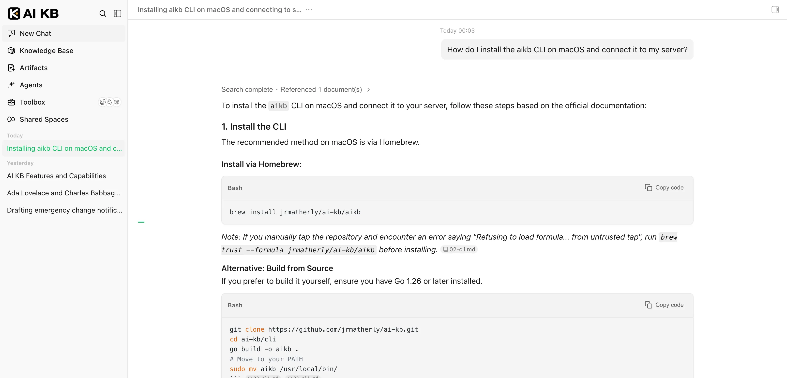
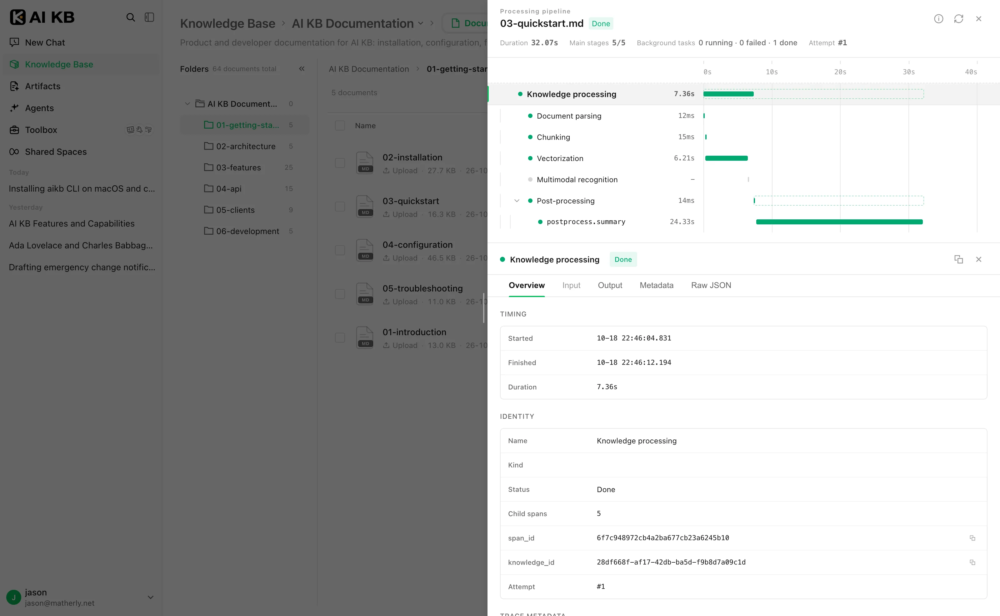
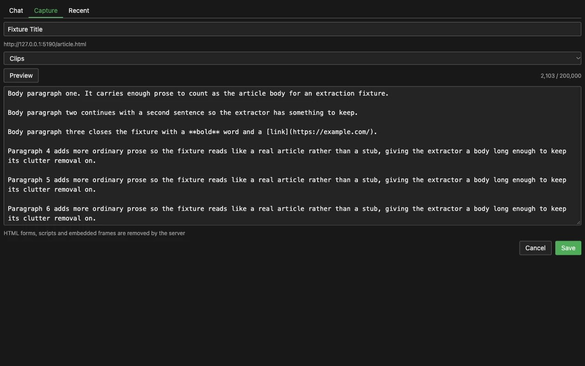

<p align="center">
  <a href="https://ai-kb.matherly.net/docs/">
    <picture>
      <source media="(prefers-color-scheme: dark)" srcset="./docs/images/readme/hero-en-dark.svg">
      
    </picture>
  </a>
</p>

<p align="center">
  <a href="https://ai-kb.matherly.net/docs/"></a>
  <a href="https://ai-kb.matherly.net/docs/"></a>
  <a href="./CHANGELOG.md"></a>
  <a href="./LICENSE"></a>
  <a href="https://github.com/jrmatherly/ai-kb/stargazers"></a>
  <br/>
  <a href="https://www.npmjs.com/package/@jrmatherly/dsh-ai-kb"></a>
</p>

<p align="center">
  <a href="#overview">Overview</a> ·
  <a href="#quick-start">Quick Start</a> ·
  <a href="#whats-new">What's New</a> ·
  <a href="#features">Features</a> ·
  <a href="#clients-and-integrations">Clients</a> ·
  <a href="#documentation">Docs</a> ·
  <a href="#development">Development</a>
</p>

## Overview

[AI KB](https://ai-kb.matherly.net/docs/) is an open-source, LLM-powered knowledge framework for enterprise document understanding, semantic retrieval and reasoning. It brings a team's documents together so they can be searched, reasoned over and kept up to date. AI KB is an independent copy of [Tencent/WeKnora](https://github.com/Tencent/WeKnora), maintained by [jrmatherly](https://github.com/jrmatherly).

<!-- markdownlint-disable-next-line no-bare-urls -->
https://github.com/user-attachments/assets/9f07fd45-2a94-41cd-b72e-3444ecd0eea2

<p align="center"><sub>1:52 · 1080p · No narration, English on-screen text</sub></p>

Use RAG to look things up, the agent for multi-step tasks, and the wiki to organize knowledge. All three work on the same knowledge bases.

<picture>
  <source media="(prefers-color-scheme: dark)" srcset="./docs/images/readme/capabilities-en-dark.svg">
  
</picture>

**The agent's toolbox.** Skills installed from ClawHub / SkillHub / Git / ZIP run in session-persistent Docker / E2B / Cube sandboxes, with an interactive terminal and graphical desktop beside the chat. Through Tencent's BrowserSkill extension the agent operates the user's own Chrome or Edge, and external MCP services (OAuth included) can be connected and enabled tool by tool. A separate AI KB browser extension for Chrome and Edge lets people ask about the page they are reading and clip pages, selections and notes into a knowledge base.

Beyond the three modes:

- **Memory and curation**: cross-session long-term memory keeps the profile, preferences and facts a user has confirmed. Folder uploads keep their directory tree, and retrieval chunks can be edited, diffed and rolled back.
- **Data sources and formats**: auto-sync from Feishu wiki / Feishu Drive / Confluence / GitLab / Tencent IMA / Notion / Yuque / DingTalk Docs / Seafile / RSS, with more on the way. 10+ document formats including PDF, Word, images, Excel and XMind; Office files are parsed in-process by anydoc.
- **Channels and integrations**: Q&A in WeCom, Feishu, Slack, Telegram and other IM apps; an embed widget for external websites; a built-in MCP Server for Cursor, Claude and other AI tools; scoped API keys with a principal model for programmatic access.
- **Models**: 30 built-in provider definitions (WeKnoraCloud among them, opt-in with `AIKB_WEKNORACLOUD_ENABLED=true`) with a generated model catalog, including OpenAI, Anthropic, DeepSeek, Qwen (Alibaba Cloud), Zhipu, Hunyuan, Gemini, MiniMax, NVIDIA and LiteLLM, plus Ollama for local models.
- **Permissions and operations**: multi-workspace RBAC (four roles, per-resource ownership, per-workspace audit log), several storage instances per workspace, a runtime task-queue dashboard with worker-pool governance, and Langfuse tracing for agent steps, token usage and pipelines.
- **Deployment**: LLMs, vector databases and storage backends are all swappable. Deploy locally or on a private cloud and keep the data in your own environment.

## Quick Start

Deploy AI KB in your own environment with Docker or Kubernetes, and configure models, storage and networking yourself.

### Run with Docker Compose

Requires [Docker](https://www.docker.com/), [Docker Compose](https://docs.docker.com/compose/) and [Git](https://git-scm.com/).

```bash
git clone https://github.com/jrmatherly/ai-kb.git
cd ai-kb
cp .env.example .env    # Replace JWT_SECRET and SYSTEM_AES_KEY (see the note below)
docker compose pull     # Release images from ghcr.io/jrmatherly/ai-kb-*
docker compose up -d    # Start core services
```

Every product release publishes the `app`, `docreader`, `ui` and `sandbox` images to GHCR under the release tag (`v2026.10.20`), its bare version and `latest`. Set `AIKB_VERSION` in `.env` to a release tag for a reproducible deployment. `docker compose build` builds the same images from the checkout instead.

> [!NOTE]
> `.env.example` ships default `JWT_SECRET` and `SYSTEM_AES_KEY` values so the first start works, and the server logs a warning for each until you replace them. Replace both before you store real credentials: `openssl rand -hex 32` for `JWT_SECRET`, `openssl rand -hex 16` for `SYSTEM_AES_KEY` (exactly 32 characters). The server refuses to start if `JWT_SECRET` is empty or `SYSTEM_AES_KEY` is not exactly 32 bytes. The shipped `JWT_SECRET` is never used to sign: the server stores a per-install secret instead. Embed sessions and presigned file links stay off until you set `SYSTEM_SIGNING_KEY` or a real `SYSTEM_AES_KEY`.

Then open **<http://localhost>** and follow the onboarding guide. A walkthrough with sample data is in the [Quickstart](https://ai-kb.matherly.net/docs/01-getting-started/03-quickstart).

> [!TIP]
> To use a local Ollama model, run `ollama serve > /dev/null 2>&1 &` first. For the Ollama embedding model name, `OLLAMA_BASE_URL`, and RAM notes, see [Configuration](https://ai-kb.matherly.net/docs/01-getting-started/04-configuration).

| Service | URL |
| --------- | ----- |
| Web UI | `http://localhost` |
| Backend API | `http://localhost:8080` |
| Langfuse Tracing (`langfuse` or `full` profile) | `http://localhost:3000` |

### Optional services

Add `--profile` flags to enable additional components; multiple profiles can be combined.

| Profile | Adds |
| --------- | ------ |
| *(default)* | Core services |
| `full` | Every profile below except `milvus`, `weaviate`, `doris` and `odl-hybrid`, plus the sandbox image and the deprecated Python MCP server (port 8082) |
| `neo4j` | Knowledge Graph (Neo4j) |
| `minio` | Object Storage (MinIO) |
| `langfuse` | Tracing (Langfuse) |
| `qdrant` / `milvus` / `weaviate` / `doris` | Vector databases |
| `searxng` | Web search (SearXNG) |
| `odl-hybrid` | OpenDataLoader hybrid PDF parsing |
| `dex` | OIDC test provider (Dex) |

```bash
docker compose --profile neo4j --profile minio up -d
docker compose down     # Stop services
```

### Upgrading

If you already have AI KB running and want a newer version:

```bash
git pull                # Update the checkout (compose file, migrations, .env.example)
docker compose pull     # Fetch the release images for AIKB_VERSION
docker compose up -d    # Recreate containers with the new images
```

> [!NOTE]
> `docker compose up -d` alone reuses the images already present and may leave the UI version out of sync with the checkout. If you build locally, run `docker compose build` instead of `pull`.

**Major version changes.** Releases after `2026.10.15.1` move PostgreSQL from 17 to 18 and the optional vector stores and Langfuse to new major versions. Existing volumes need a dump and restore or a re-index; see [Upgrading](https://ai-kb.matherly.net/docs/01-getting-started/02-installation#upgrading) in the installation guide.

### Other ways to deploy

| Option | When to use it |
| -------- | ---------------- |
| **Docker Compose** | The standard deployment above: all features, multiple services |
| **Kubernetes (Helm)** | Production clusters; the chart is in [`helm/`](./helm) |
| **Lite single binary** | Local or low-resource use with no external dependencies (SQLite + in-memory queue); see [Lite vs. standard](./docs/LITE.md) |
| **Desktop app** | The Lite runtime with a GUI, login-free start and a macOS host sandbox; every release attaches macOS DMGs (universal, arm64, amd64), a Windows installer and a Linux tarball |

All options, hardware requirements and deployment topologies: [Installation guide](https://ai-kb.matherly.net/docs/01-getting-started/02-installation).

> [!WARNING]
> AI KB ships with login authentication, but for production deployments we strongly recommend that you:
>
> - deploy it in an internal / private network rather than on the public internet;
> - avoid exposing the service directly to public networks, to prevent information leakage;
> - configure proper firewall rules and access controls for the deployment environment;
> - regularly update to the latest version for security patches and improvements.

## What's New

### 2026.10.18.1 <sub>· [changelog](./CHANGELOG.md)</sub>

The `aikb` CLI ships with every release for macOS, Linux and Windows: `brew install jrmatherly/ai-kb/aikb`, Scoop from the same tap, or archives with sha256 files and build provenance attestations.

### 2026.10.18 <sub>· [changelog](./CHANGELOG.md)</sub>

Audit log Tier 1 (logins, API keys, model and integration changes), the `AIKB_IM_PLATFORMS` allow-list, the upstream cloud parser and provider behind `AIKB_WEKNORACLOUD_ENABLED`, the Agent skill page with the new `ai-kb-ingest` skill, and Helm chart 0.4 with external database and Redis values.

### 2026.10.17.1 <sub>· [changelog](./CHANGELOG.md)</sub>

Every image runs as a non-root user on a read-only root filesystem, the Helm chart fits the `restricted` Pod Security Standard, and the chart is published to GHCR.

### 2026.10.17 <sub>· [changelog](./CHANGELOG.md)</sub>

The AI KB browser extension for Chrome and Edge, error responses scrubbed of internal details, govulncheck findings gating Go CI, a 0.6 GB app image and weekly image rebuilds on fresh bases.

### 2026.10.15.1 <sub>· [changelog](./CHANGELOG.md)</sub>

Security fixes for spreadsheet parsing (16 excelize advisories) and the remaining Go and katex advisories, Lite and desktop builds that start (2026.10.15 embeds gojieba's dictionaries), a Windows installer and Linux tarball on every release, and the `ai-kb-mcp` package on PyPI.

### 2026.10.13 <sub>· [changelog](./CHANGELOG.md)</sub>

The first AI KB release: the rename (images `ghcr.io/jrmatherly/ai-kb-*`, CLI `aikb`, env prefix `AIKB_`), English-only UI, dated CalVer versions, a uniform `{success, error}` error envelope, hash-only API keys, `.xls` / `.xlsb` workbooks and held-back mass deletions in data-source syncs.

AI KB started from [Tencent/WeKnora](https://github.com/Tencent/WeKnora) at v0.8.2 plus 268 commits on 2026-10-12; everything since is in [CHANGELOG.md](./CHANGELOG.md).

## Product Tour

Screenshots from a live AI KB deployment.

### Quick Q&A and smart reasoning

**Two ways to ask.** Quick Q&A answers from the knowledge base with RAG and cites the sources it used, here the product documentation answering an install question. In smart reasoning the agent plans multi-step work, searching, reading documents and calling tools and skills, and shows each step in the conversation. [Docs →](https://ai-kb.matherly.net/docs/03-features/18-chat-experience)

<a href="./docs/images/readme/spotlight-qa.webp"></a>

### Observability

**Tracing and runtime monitoring.** Every document gets a processing timeline, stage by stage with its background tasks, and a Langfuse trace ID when tracing is on. Langfuse records the reasoning, tool calls and token usage of each agent step, and the task-queue dashboard lists queued and failed tasks with retry. [Docs →](https://ai-kb.matherly.net/docs/03-features/16-observability)

<a href="./docs/images/readme/spotlight-observability.webp"></a>

### Browser extension

**Ask about any page, clip what matters.** The AI KB extension for Chrome and Edge opens a side panel to ask the server's agents about the page you are on, and clips pages, selections and notes into a knowledge base as Markdown, with shortcuts and a quick-clip mode. [Docs →](https://ai-kb.matherly.net/docs/05-clients/06-browser-extension)

<a href="./docs/images/readme/spotlight-extension.webp"></a>

### Also in the box

- **Skills and sandbox.** Skills from ClawHub, SkillHub, Git or ZIP run in session-persistent Docker, E2B or Cube sandboxes; generated files can be previewed and downloaded, and the graphical desktop or terminal opens beside the chat. [Docs →](https://ai-kb.matherly.net/docs/03-features/22-skills-sandbox)
- **Toolbox.** Connect external MCP services and decide, tool by tool, which are enabled and which calls need approval; manage skills per workspace and reuse them across sandboxes. [Docs →](https://ai-kb.matherly.net/docs/03-features/08-mcp)
- **Local browser.** Through Tencent's BrowserSkill extension and the `bsk` daemon, the agent operates your own Chrome or Edge and hands over for logins and CAPTCHAs. [Docs →](https://ai-kb.matherly.net/docs/05-clients/09-local-browser)
- **Automatic wiki.** With Wiki enabled, AI KB extracts people, products and concepts into interlinked pages with citations and a knowledge graph; pages can be edited and every change rolled back. [Docs →](https://ai-kb.matherly.net/docs/03-features/14-wiki)

## Architecture

<a href="./docs/images/readme/architecture-en-light.svg">
<picture>
  <source media="(prefers-color-scheme: dark)" srcset="./docs/images/readme/architecture-en-dark.svg">
  
</picture>
</a>

A modular pipeline from document parsing, vectorization and retrieval to LLM inference, in which every component can be replaced or extended. It runs locally or on a private cloud, and the Web UI needs no setup to get started. More: [Architecture overview](https://ai-kb.matherly.net/docs/02-architecture/01-overview) · [RAG pipeline](https://ai-kb.matherly.net/docs/02-architecture/04-rag-pipeline) · [Extension points](https://ai-kb.matherly.net/docs/06-development/03-extension-points).

## Features

| Area | Highlights |
| ------ | ------------ |
| [Q&A and agent](https://ai-kb.matherly.net/docs/03-features/07-agent) | Quick Q&A answers from knowledge bases with citations; smart reasoning runs a ReAct agent over knowledge bases, web search, MCP tools, skills and the local browser. Steer, fork or rewind a running conversation, and keep [long-term memory](https://ai-kb.matherly.net/docs/03-features/23-memory) across sessions |
| [Wiki](https://ai-kb.matherly.net/docs/03-features/14-wiki) | Agent-generated, interlinked wiki pages with a knowledge graph; in-browser editing, revision diff and rollback |
| [Skills and sandbox](https://ai-kb.matherly.net/docs/03-features/22-skills-sandbox) | Skill catalog installed from ClawHub / SkillHub / Git / ZIP; session-persistent Docker / E2B / Cube sandboxes with network policy; terminal and graphical desktop beside the chat |
| [Knowledge bases](https://ai-kb.matherly.net/docs/03-features/02-knowledge-base) | FAQ, document and wiki bases; folder tree; chunk editing with revisions; per-upload parsing, chunking and multimodal settings; auto-tagging |
| [Retrieval](https://ai-kb.matherly.net/docs/03-features/05-retrieval-engines) | Keyword + vector hybrid search, rerank, parent-child chunking and GraphRAG ([Neo4j](https://ai-kb.matherly.net/docs/03-features/09-knowledge-graph)); end-to-end evaluation with recall and BLEU / ROUGE |
| [Access and security](https://ai-kb.matherly.net/docs/03-features/01-tenant-auth) | Workspace RBAC with four roles and an audit log; scoped API keys; OIDC; AES-256-GCM credential encryption; SSRF-safe outbound requests with a whitelist-only mode |
| [Operations](https://ai-kb.matherly.net/docs/03-features/16-observability) | Langfuse tracing for agent steps, tokens and pipelines; document parsing timeline; task-queue dashboard with worker pools; automatic migrations on upgrade |

### Supported backends

| Component | Options |
| ----------- | --------- |
| [LLMs](https://ai-kb.matherly.net/docs/03-features/06-models) | 30 built-in providers (one, WeKnoraCloud, opt-in) plus Ollama, including OpenAI / Azure OpenAI / Anthropic / DeepSeek / Qwen / Zhipu / Hunyuan / Doubao / Gemini / MiniMax / NVIDIA / SiliconFlow / OpenRouter / LiteLLM |
| Embeddings | Ollama for local models, and OpenAI-compatible remote APIs from the provider catalog (Zhipu, Jina, Cohere, Qwen and others) |
| Vector databases | PostgreSQL (pgvector) / Elasticsearch / OpenSearch / Milvus / Weaviate / Qdrant / Apache Doris / Tencent VectorDB |
| [Object storage](https://ai-kb.matherly.net/docs/03-features/19-storage-backends) | Local / Tencent Cloud COS / MinIO / AWS S3 / Volcengine TOS / Alibaba Cloud OSS / Kingsoft Cloud KS3 / Huawei Cloud OBS |
| [Document formats](https://ai-kb.matherly.net/docs/03-features/03-document-parsing) | PDF / Word / PPT / Excel / CSV / TXT / Markdown / HTML / EPUB / MHTML / JSON / XMind / images |
| [Data sources](https://ai-kb.matherly.net/docs/03-features/10-datasource) | Feishu wiki / Feishu Drive / Lark / Confluence / GitLab / Tencent IMA / Notion / Yuque / DingTalk Docs / Seafile / RSS |
| [IM channels](https://ai-kb.matherly.net/docs/03-features/12-im-integration) | WeCom / Feishu / Lark / QQBot / Slack / Telegram / DingTalk / Mattermost / WeChat / Yunzhijia |
| [Web search](https://ai-kb.matherly.net/docs/03-features/11-web-search) | DuckDuckGo / Bing / Google / Brave / Tavily / Baidu / Ollama / SearXNG / Keenable / Zhipu AI / Exa / Metaso / Bocha / Serply |
| Deployment | Docker Compose / Kubernetes (Helm) / Lite single binary / desktop app; offline and private-cloud installs; English UI |

## Clients and Integrations

| | Client | What it does |
| :-: | -------- | -------------- |
|  | [**CLI `aikb`**](./cli/README.md) | Agent-first command line for the full API, with a curated MCP tool surface and bundled Agent Skills; `brew install jrmatherly/ai-kb/aikb`, Scoop, or release archives |
|  | [**Built-in MCP Server**](https://ai-kb.matherly.net/docs/03-features/08-mcp) | Publishes knowledge bases to Cursor, Claude and other MCP clients over Streamable HTTP; the Python [`mcp-server/`](./mcp-server/MCP_CONFIG.md) is deprecated |
|  | [**Browser extension**](https://ai-kb.matherly.net/docs/05-clients/06-browser-extension) | Chrome and Edge side panel to ask about the current page and clip pages, selections and notes into a knowledge base; source in [`extension/`](./extension) |
|  | [**Local Browser (BrowserSkill)**](https://ai-kb.matherly.net/docs/05-clients/09-local-browser) | Lets agents operate the user's own Chrome / Edge through Tencent's BrowserSkill extension |
|  | [**WeChat Mini Program**](./miniprogram/README.md) | Lightweight mobile client: configure API access, select knowledge bases, import URLs, and ask knowledge chat from WeChat |
|  | [**Agent skill**](https://ai-kb.matherly.net/docs/05-clients/07-agent-skill) | Agent Skills (`SKILL.md`) bundled with the `aikb` CLI for Claude Code, Codex, Cursor and other agents, installed with `aikb skills install` |
|  | [**DeepSeek Harness plugin**](https://www.npmjs.com/package/@jrmatherly/dsh-ai-kb) | Gives `dsh` coding agents four read-only tools: search, read document, ask and list knowledge bases |
|  | [**Website Embed Widget**](https://ai-kb.matherly.net/docs/03-features/13-embed-channel) | Publishes agents on external sites |
|  | [**Go SDK**](https://ai-kb.matherly.net/docs/05-clients/03-go-sdk) | CRUD for knowledge bases, documents and sessions, plus SSE streaming Q&A |

### Command-Line Interface

`aikb` is the official CLI for driving the API from a terminal or an AI agent. It is **agent-first**: every command emits a stable JSON envelope by default (with typed error codes mapped to exit codes), and `--format text` renders for humans. It also serves a curated MCP tool surface (`aikb mcp serve`) and ships bundled Agent Skills.

```bash
brew install jrmatherly/ai-kb/aikb  # macOS and Linux; Windows: scoop bucket add ai-kb https://github.com/jrmatherly/homebrew-ai-kb && scoop install ai-kb/aikb
aikb profile add prod --host https://kb.example.com --use
aikb auth login
aikb kb list
aikb link --kb my-knowledge-base    # bind the current directory
aikb doc upload notes.md
aikb chat "summarise the design doc"
```

For headless / CI use, set `AIKB_API_KEY` + `AIKB_HOST` and skip `auth login`; no credentials are written to disk. See [`cli/README.md`](./cli/README.md) for install + 5-minute quickstart and [`cli/AGENTS.md`](./cli/AGENTS.md) for the operational contract AI agents rely on.

## Documentation

The full product documentation lives at **[ai-kb.matherly.net/docs](https://ai-kb.matherly.net/docs/)**, organized as Getting Started → Architecture → Features → API → Clients → Development and covering about 390 API operations and the full `.env.example` reference.

| Start here | |
| ------------ | --- |
| [Introduction](https://ai-kb.matherly.net/docs/01-getting-started/01-introduction) | Capabilities overview |
| [Installation](https://ai-kb.matherly.net/docs/01-getting-started/02-installation) | Docker Compose, Helm, Lite and desktop |
| [Configuration](https://ai-kb.matherly.net/docs/01-getting-started/04-configuration) | Environment variables and models |
| [Troubleshooting FAQ](https://ai-kb.matherly.net/docs/01-getting-started/05-troubleshooting) | Common problems and fixes |
| [API reference](https://ai-kb.matherly.net/docs/04-api/01-api-overview) | REST API overview |
| [Changelog](./CHANGELOG.md) | What changed in each release |

## Development

If you need to frequently modify code, you don't need to rebuild Docker images every time. Use fast development mode:

```bash
make dev-start      # Start infrastructure
make dev-app        # Start backend (new terminal)
make dev-frontend   # Start frontend (new terminal)
```

- Frontend modifications auto hot-reload (no restart needed)
- Backend modifications quick restart (5-10 seconds, supports Air hot-reload)
- No need to rebuild Docker images
- Supports IDE breakpoint debugging

See the [Development guide](https://ai-kb.matherly.net/docs/06-development/01-dev-guide) for details.

The documentation site and product homepage are built from [`website-docs/`](./website-docs/README.md). With Node.js 24, run `cd website-docs && npm run setup && npm run build && npm run preview` to preview both together; the unified static output serves the homepage at `/` and documentation at `/docs/`. See the directory's README for Nginx and Docker deployment.

## Contributing

[Issues](https://github.com/jrmatherly/ai-kb/issues) and pull requests are welcome.

- **Process:** Fork → Create branch → Commit changes → Open PR
- **Standards:** Format code with `gofmt`, follow [Conventional Commits](https://www.conventionalcommits.org/) (`feat:` / `fix:` / `docs:` / `test:` / `refactor:`)

<details>
<summary><b>Validating your change</b></summary>

<br/>

`scripts/validate.sh` runs the checks for every area your change touches (Go, CLI, client, frontend, docreader, Helm, docs site, Markdown, shell scripts and more) and ends with the English-only and em dash gates:

```bash
scripts/validate.sh                 # working tree and untracked files against HEAD
scripts/validate.sh --base origin/main
scripts/validate.sh --list          # show which areas would run
```

`scripts/install-git-hooks.sh` installs the pre-commit and pre-push hooks that run the same checks. The [Development guide](https://ai-kb.matherly.net/docs/06-development/01-dev-guide#validation-and-contribution-workflow) lists each area's commands and the tools they need.

</details>

### Contributors

Thanks to everyone who has contributed:

[](https://github.com/jrmatherly/ai-kb/graphs/contributors)

## License

AI KB is maintained by [jrmatherly](https://github.com/jrmatherly) and based on [Tencent/WeKnora](https://github.com/Tencent/WeKnora), which Tencent publishes under the MIT License. AI KB is not a Tencent product. It is licensed under the [MIT License](./LICENSE), which keeps Tencent's copyright notice for the upstream code.
