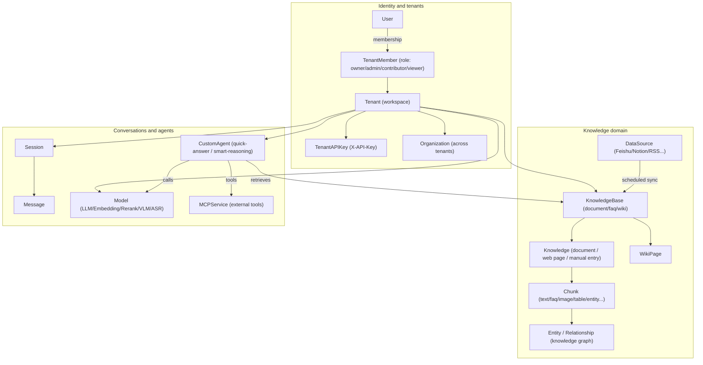
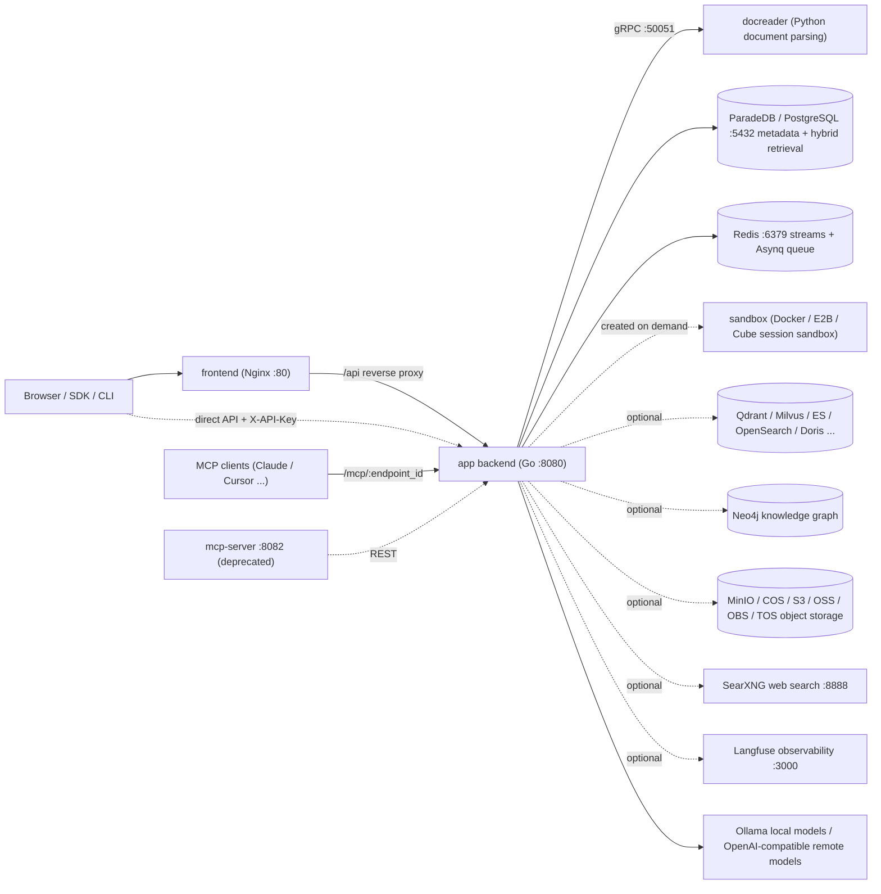

# AI KB Overview

AI KB is a knowledge base question-answering system. It imports PDFs, Word documents and web pages, and syncs content from platforms such as Feishu/Lark, Notion, Confluence, Yuque, DingTalk Docs and Seafile. Users ask questions about that material and open the cited passages from each answer.

The system uses retrieval-augmented generation (RAG): documents are parsed and indexed, relevant chunks are retrieved for each question, and a large language model writes the answer from them.

It consists of a Go backend, a Vue 3 frontend and a Python document parsing service (docreader). It deploys with Docker Compose, Helm, as a single Lite binary, or as a desktop application.

<Screenshot
  src="/screenshots/introduction-overview.png"
  caption="Main screen: knowledge bases and conversations on the left, the chat area on the right"
  hint="Full main screen after login: the sidebar (knowledge bases, agents, settings) and one answered question with citations." />

## Use cases

| Need | Capability |
| --- | --- |
| Mixed document formats; PDFs, scans and tables resist structuring | The parsing pipeline covers PDF layout analysis, OCR for scans, Office conversion, web page capture and image description, with optional OpenDataLoader/Docling hybrid parsing |
| Vector-only retrieval recalls unreliably | Hybrid vector + keyword (BM25) retrieval with RRF fusion and reranking; optional knowledge graph (GraphRAG) and Wiki navigation |
| Lock-in to one model vendor | A model abstraction layer: local Ollama models and dozens of built-in vendors (OpenAI-compatible, Anthropic Messages, Gemini native and other protocols), managed by category: LLM, embedding, rerank, VLM and ASR. Vendors and the model catalog: [Model management](../03-features/06-models.md) |
| Data security and private hosting | The whole stack runs on your infrastructure; sensitive credentials (API keys and the like) are stored AES-256 encrypted (`SYSTEM_AES_KEY`); multi-tenant isolation with RBAC |
| Multi-step tasks and tool use | Built-in agents (ReAct multi-step reasoning), MCP tool integration, Agent Skills run in a sandbox, web search (SearXNG and others), data analysis (SQL over CSV/Excel) |
| Team collaboration | Workspaces (tenants) with member roles, organizations that share knowledge bases across workspaces, and invitations |

## Core concepts

Knowledge bases organize material, workspaces manage members and resource permissions, and agents decide which model and tools answer a question. The terms below match the options in the UI; the full type definitions live in `internal/types/`.

### Tenants and identity

| Concept | Description |
| --- | --- |
| Tenant | A workspace. Manages knowledge bases, models, agents, sessions and the storage quota. See [Workspaces and permissions](../03-features/01-tenant-auth.md) |
| User | A login account. One user can belong to several workspaces |
| TenantMember | A user's membership in one workspace, with a role and a status |
| TenantRole | Four levels, Owner, Admin, Contributor and Viewer, that decide which workspace operations a user may perform |
| API key (TenantAPIKey) | A credential for programmatic access. It can be limited to specific capabilities and knowledge bases. Workspace keys and platform keys have separate permissions |
| Organization | Links several workspaces and shares knowledge bases and agents according to organization member roles |

### Knowledge domain

| Concept | Description |
| --- | --- |
| KnowledgeBase | Groups related material and configures its models, chunking and indexing strategy. Document, FAQ and Wiki types are supported |
| Knowledge | One file, web page or hand-written entry in a knowledge base. Its parsing status is visible after import |
| Chunk | The retrieval unit produced by parsing: text, image recognition output, a table, or other indexed content |
| FAQ | A question-and-answer entry with a standard question, similar questions, negative examples and the answer. See [FAQ](../03-features/17-faq.md) |
| WikiPage | A topic page generated from documents, with source citations and page links; editable and versioned |
| Knowledge graph (Entity / Relationship) | Entities and relationships extracted from documents, stored in Neo4j, used to retrieve related content |
| DataSource | A connection that keeps syncing external material. Supports Feishu/Lark (wiki and drive), Notion, Confluence, Yuque, DingTalk Docs, Tencent IMA, GitLab, RSS and Seafile. See [Data source import](../03-features/10-datasource.md) |
| RetrievalConfig | Controls candidate counts, match thresholds, fusion weights and rerank output. See [Retrieval engines](../03-features/05-retrieval-engines.md) |

### Conversations and agents

| Concept | Description |
| --- | --- |
| Session | A multi-turn conversation together with its chosen agent, model, knowledge scope and tool configuration |
| Message | One question or answer. It can carry images, attachments, citations and tool results |
| Model | A connection to a model that provides chat, embedding, rerank, vision or speech capability. See [Model management](../03-features/06-models.md) |
| CustomAgent | An agent configured per task with its model, material scope and tools. Supports Quick Answer and Smart Reasoning modes |
| Built-in agents | Preconfigured Quick Answer, Smart Reasoning, Data Analysis and Wiki agents. See [Agent engine](../03-features/07-agent.md) |
| Skills and sandboxes | The workspace skill catalog stores packages; a skill is installed per sandbox configuration and then bound to an agent. Docker, Cube and E2B backends, personal variables and generated files are supported. See [Skills and sandboxes](../03-features/22-skills-sandbox.md) |
| Long-term memory | Material, preferences, facts, to-dos and interests kept per workspace and caller. Off by default; enabling it and personal management: [Long-term memory](../03-features/23-memory.md) |
| MCPService | Connects external tools to agents over SSE or Streamable HTTP; authentication by API key, Bearer token or OAuth 2.0 |

### How the concepts relate

## Feature list

- **Document ingestion**: file upload (PDF, Word, PPT, Excel, Markdown, HTML, EPUB, XMind, images, audio and more), URL capture, hand-written Markdown, whole-folder upload, and scheduled sync from Feishu / Lark / Notion / Confluence / Yuque / DingTalk / IMA / GitLab / RSS / Seafile.
- **Document understanding**: layout analysis, OCR for scans, table extraction, multimodal image description (VLM), audio transcription (ASR), and a parsing engine chosen per file type (`ParserEngineRules`, with MinerU / OpenDataLoader as options).
- **Indexing pipeline**: configurable chunking (including parent-child chunks and adaptive strategies), vector index, keyword full-text index, FAQ index, Wiki generation, knowledge graph extraction, and pre-generated questions.
- **Retrieval**: hybrid vector + BM25 retrieval, RRF fusion, reranking, query rewriting and expansion, intent recognition (greeting, chitchat, web_search and others; see `config/prompt_templates/intent_prompts.yaml`).
- **Question answering and agents**: streaming SSE answers, multi-turn context compression, citation tracing; a ReAct agent with tools such as `search_knowledge`, `read_document`, `list_documents`, `wiki_search` and `data_analysis`; MCP external tools; Agent Skills (scripts run in a Docker, Cube or E2B sandbox); web search.
- **Conversation experience**: append requirements while an answer is running, fork from any earlier question or rewind in place (with sandbox workspace checkpoints), choose the reasoning effort per session, and an Artifacts page that collects agent-generated files across sessions. See [Conversation experience](../03-features/18-chat-experience.md).
- **Multi-tenancy and security**: RBAC (on by default, `AIKB_TENANT_ENABLE_RBAC`), audit log (90-day retention by default), invite-only registration (`auth.registration_mode=invite_only`, or the legacy `DISABLE_REGISTRATION=true`), OIDC single sign-on, SSRF protection (optionally allowlist-only egress with `SSRF_DNS_WHITELIST_ONLY`), AES-256 encryption of sensitive fields. The web UI ships in English.
- **Observability**: Langfuse tracing across LLM, embedding, rerank, VLM and ASR calls with token counts; health checks; Swagger API docs (when `GIN_MODE=debug`).
- **Ecosystem**: REST API (`/api/v1`) with API keys; a built-in MCP server (per-workspace endpoints that expose AI KB as a tool to other agents, see [MCP integration](../03-features/08-mcp.md)); a CLI (`cli/`); a WeChat mini program (`miniprogram/`); a browser extension channel; the [Local Browser](../05-clients/09-local-browser.md) (agents drive the user's Chrome or Edge through an extension). The Lite desktop edition (macOS) runs agent commands in a local OS sandbox.

## System components

| Component | Stack | Source | Default port | Role |
| --- | --- | --- | --- | --- |
| app (backend) | Go / Gin | `cmd/server`, `internal/` | 8080 | REST API, retrieval and answering, agent engine, async tasks (Asynq) |
| frontend | Vue 3 + Nginx | `frontend/` | 80 | Web console; Nginx proxies `/api` to app |
| docreader | Python / gRPC | `docreader/` | 50051 (container network only) | File to Markdown conversion, web page capture, image extraction |
| postgres | ParadeDB (PostgreSQL 17 + BM25 and vector extensions) | image `paradedb/paradedb` | 5432 | Primary database and default hybrid retrieval engine (`RETRIEVE_DRIVER=postgres`) |
| redis | Redis 7 | - | 6379 | Stream management (SSE recovery), Asynq task queue |
| sandbox | Python 3.12 + Node 20 | `docker/Dockerfile.sandbox` | - | Session sandbox image for Agent Skills |
| Optional: qdrant / milvus / weaviate / doris | - | `docker-compose.yml` profiles | 6334 / 19530 / 9035 / 9030 | Alternative or additional vector retrieval engines (`RETRIEVE_DRIVER`) |
| Optional: opensearch | - | `docker-compose.dev.yml` only | 9200 | Development only; production needs your own cluster |
| Optional: elasticsearch / tencent_vectordb | - | not in compose | - | Supported in code; deploy separately and connect with `RETRIEVE_DRIVER` |
| Optional: neo4j | Neo4j | profile `neo4j` | 7474 / 7687 | Knowledge graph storage (GraphRAG) |
| Optional: minio | MinIO | profile `minio` | 9000 / 9001 | S3-compatible object storage (`STORAGE_TYPE=minio`) |
| Optional: searxng | SearXNG | profile `searxng` | 8888 | Self-hosted web search engine |
| Optional: langfuse stack | Langfuse 3 + ClickHouse + MinIO | profile `langfuse` | 3000 | LLM observability |
| Optional: mcp (deprecated) | Python | `mcp-server/`, profile `full` | 8082 | The legacy standalone MCP server; new deployments use the MCP server endpoints built into app |
| Optional: odl-hybrid | Docling | profile `odl-hybrid` | 5002 | OpenDataLoader PDF hybrid parsing backend |

## Next steps

- [Installation](./02-installation.md): choose a deployment method and start the services.
- [Quickstart](./03-quickstart.md): create a knowledge base, upload documents and ask the first question.
- [Configuration](./04-configuration.md): deployment parameters and configuration precedence.
