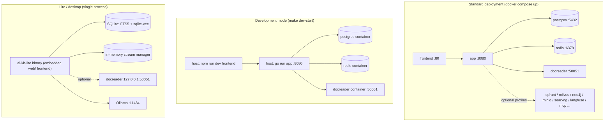
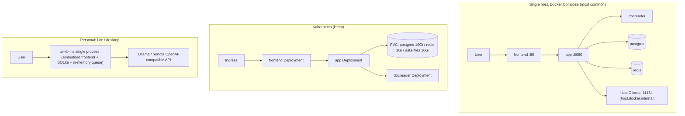

# Installation

AI KB runs under Docker Compose, Kubernetes Helm, as a single Lite binary, or as a desktop application. Server deployments use Compose or Helm. Local use fits the Lite edition. Development uses a separate dev orchestration. The dependencies, start commands and data directories of each option follow.

## Deployment options

| Option | Entry point | Database | Queue / streams | Suited for |
| --- | --- | --- | --- | --- |
| Docker Compose (standard) | `docker-compose.yml` | ParadeDB (PostgreSQL) | Redis + Asynq | Production and team self-hosting, recommended |
| Docker Compose (development) | `docker-compose.dev.yml` | Same (only the infrastructure runs in containers) | Same | Local development: app and frontend run on the host |
| Helm | `helm/` | ParadeDB (bundled in the chart) | Redis (bundled in the chart) | Kubernetes >= 1.25 |
| Lite single binary | `make build-lite` / `scripts/package-lite.sh` | SQLite (FTS5 + sqlite-vec) | In memory (no Redis) | Personal, offline or low-resource environments |
| Desktop application (**not released yet**) | `cmd/desktop` (Wails v2) + `scripts/package-mac-app.sh` | SQLite | In memory | Single-machine desktop use with a GUI and a local data directory |



## Hardware and dependency requirements

- **Standard Docker deployment**: Docker 20.10+ and Docker Compose v2 (v1 `docker-compose` also works; `scripts/start_all.sh` detects both). Start from 4 CPU cores and 8 GB of RAM (docreader bundles LibreOffice and Playwright and uses a lot of memory). Size the disk to the knowledge bases (the Postgres volume plus the `/data/files` file volume). Optional components such as Milvus, OpenSearch or Langfuse need more memory.
- **Model serving**: local inference needs [Ollama](https://ollama.com) (default address `http://host.docker.internal:11434`; with `OLLAMA_OPTIONAL=true` an unreachable Ollama only logs a warning and does not block startup), or any OpenAI-compatible API (DeepSeek, Qwen, Zhipu, SiliconFlow and others). The 8 GB baseline excludes Ollama model weights. Neo4j is off by default (enable the `neo4j` profile).
- **Building from source**: Go 1.26 (the builder stage in `docker/Dockerfile.app` is `golang:1.26-bookworm`), CGO (needs `libsqlite3-dev`), Node.js + npm (frontend), Python 3.10 + uv (docreader).
- **Kubernetes**: >= 1.25.0 (`helm/Chart.yaml`).

Starting with `v0.22.6-pg17`, the ParadeDB image used by Compose targets the `x86-64-v2` CPU baseline (SSE4.2, POPCNT) and no longer requires AVX2 (the v0.22.6 release notes list paradedb#4673, which lowered the x86_64 target from `x86-64-v3` to `x86-64-v2`). For newer image versions, the ParadeDB release notes are authoritative. This says nothing about every ARM CPU or about the other optional services.

## Docker Compose standard deployment (docker-compose.yml)

The fastest path:

```bash
git clone https://github.com/jrmatherly/ai-kb.git && cd ai-kb
cp .env.example .env              # edit the required values: DB_USER/DB_PASSWORD/DB_NAME, REDIS_PASSWORD, JWT_SECRET, SYSTEM_AES_KEY
docker compose build              # build the app, docreader and frontend images from the checkout
docker compose up -d
docker compose ps                 # wait until every service is healthy/running
```

No release images are published under `ghcr.io/jrmatherly/ai-kb-*` yet, so `docker compose pull` and a plain `make start-all` (which pulls by default) fail with `denied`. After `docker compose build`, `./scripts/start_all.sh --no-pull` starts the locally built images.

`.env.example` ships default values for `JWT_SECRET` and `SYSTEM_AES_KEY` so a first start works. The server warns about each default until it is replaced, and refuses to start when `JWT_SECRET` is empty or `SYSTEM_AES_KEY` is not exactly 32 bytes. Replace both before storing real credentials and keep them safe: `JWT_SECRET` from `openssl rand -hex 32`, `SYSTEM_AES_KEY` from `openssl rand -hex 16` (32 bytes). Credentials saved under the default AES key become unreadable once the key changes and must be entered again. When upgrading an existing deployment keep the original `SYSTEM_AES_KEY`, otherwise encrypted credentials cannot be decrypted. [Configuration](./04-configuration.md) explains what each secret does.

Stop with `docker compose down` (`-v` also deletes the data volumes, use with care). `make start-all` wraps the same command (`scripts/start_all.sh`, which additionally checks Ollama, creates a fallback `.env` and pre-pulls the sandbox image). Pick one of the two.

After startup, open `http://localhost` in a browser for the frontend (the port follows `FRONTEND_PORT`, default 80). The first visit lands on the registration page. The frontend Nginx proxies `/api/` to the backend, so API calls also go through `http://localhost/api/v1`. The backend port `8080` is mapped to the host as well, so `curl http://localhost:8080/health` confirms the backend is ready.

> Note: the app service in `docker-compose.yml` uses `env_file: [.env]`. A missing `.env` makes Compose fail to parse the file. `make docker-run` and `start_all.sh` run `cp .env.example .env` or `touch .env` as a fallback.

### Upgrading

If you have an existing deployment and downloaded a newer release:

> If the database still runs ParadeDB `v0.22.2-pg17`, first follow [Upgrading an existing ParadeDB database](06-paradedb-upgrade.md): stop writes, back up, swap the image while keeping the data volume, and complete the `pg_search` extension upgrade before bringing the application back. Replacing the image alone does not update the extension SQL in an existing database. On the current image, migration `000115` upgrades `pg_search` from any 0.22.x to 0.25.x version to 0.25.11 in the AI KB database (`migrations/versioned/000115_pg_search_02511.up.sql`); migration `000099` targets the older 0.22.6 image and returns early when only 0.25.11 is available. Other databases on the same server still need a separate check.

```bash
# In .env set AIKB_VERSION to the target version (for example 2026.10.13), or keep latest
docker compose pull
docker compose up -d
```

> Running only `docker compose up -d` reuses the locally cached images, so the version shown in the web UI may not match the downloaded release.

### Core services (started by default)

| Service | Image | Ports (host:container) | Depends on | Notes |
| --- | --- | --- | --- | --- |
| `frontend` | `ghcr.io/jrmatherly/ai-kb-ui:${AIKB_VERSION:-latest}` | `${FRONTEND_PORT:-80}:80` | app (healthy) | Nginx serves the SPA and proxies to app; `APP_HOST`/`APP_BACKEND_PORT`/`APP_SCHEME` can point at a remote backend |
| `app` | `ghcr.io/jrmatherly/ai-kb-app` | `${APP_PORT:-8080}:8080` | postgres (healthy), redis, docreader (healthy) | Go backend; mounts `./config/config.yaml` and the `data-files` volume; health check `GET /health` |
| `docreader` | `ghcr.io/jrmatherly/ai-kb-docreader` | `expose: 50051` only (not published to the host) | - | Document parsing gRPC service; health check `grpc_health_probe`; shares the `docreader-tmp` volume with app to hand over images |
| `postgres` | `paradedb/paradedb:v0.25.11-pg17` | No host port | - | ParadeDB = PostgreSQL 17 + BM25 and vector extensions, the default retrieval engine |
| `redis` | `redis:7.0-alpine` | No host port | - | `--appendonly yes --requirepass ${REDIS_PASSWORD}` |

### Optional services and profiles

Enable them on demand with `docker compose --profile <name> up -d`:

| Profile | Services | Ports | Purpose |
| --- | --- | --- | --- |
| `searxng` (also in `full`) | `searxng-init` + `searxng` | `127.0.0.1:8888` (`SEARXNG_BIND`/`SEARXNG_PORT`) | Self-hosted web search; bound to loopback by default, rotate `SEARXNG_SECRET` before exposing it |
| `minio` (also in `full`) | `minio` | 9000 (S3) / 9001 (console) | S3-compatible object storage (`STORAGE_TYPE=minio`), default account `minioadmin/minioadmin` |
| `neo4j` (also in `full`) | `neo4j` | 7474 / 7687 | Knowledge graph (`NEO4J_ENABLE=true`), default `neo4j/password` |
| `qdrant` (also in `full`) | `qdrant` | 6333 (REST) / 6334 (gRPC) | Vector store (`RETRIEVE_DRIVER=qdrant`) |
| `milvus` | `milvus` | 19530 / 9091 | Vector store (standalone, embedded etcd) |
| `weaviate` | `weaviate` | 9035 (HTTP) / 50052 (gRPC) | Vector store |
| `doris` | `doris-fe` + `doris-be` | 8030 (FE HTTP) / 9030 (FE MySQL) / 8040 (BE) | Apache Doris 4.1 retrieval engine (needs >= 3.0, HNSW ANN) |
| `dex` (also in `full`) | `dex` | 5556 | OIDC test IdP (configured in `misc/dex-config.yaml`) |
| `langfuse` (also in `full`) | `langfuse-db-init`, `langfuse-clickhouse`, `langfuse-minio`, `langfuse-worker`, `langfuse-web` | 3000 (UI) / 9100 and 9101 (dedicated MinIO) | Self-hosted Langfuse observability stack; reuses the AI KB postgres (creates a `langfuse` database) and redis (DB 1) |
| `odl-hybrid` | `odl-hybrid` | expose 5002 | OpenDataLoader/Docling PDF hybrid parsing backend (local build only, used with `DOCREADER_ODL_HYBRID`) |
| `full` | `sandbox`, `mcp` and every service marked `full` above | mcp: `${MCP_PORT:-8082}:8000` | `sandbox` only builds or pulls the image (`command: ["true"]`, not a long-running service). The Docker sandbox is off by default; set `AIKB_SANDBOX_DOCKER_ENABLED=true` and mount `docker.sock` (equivalent to root on the host); Cube and E2B do not need a local daemon. `mcp` is the MCP server |

The `environment` block of the app container is the full list of environment variables (database, vector stores, object storage, docreader tuning, workspace policy, OIDC and more). See [Configuration](./04-configuration.md).

## Development mode (docker-compose.dev.yml + scripts/dev.sh)

The development orchestration puts only the **infrastructure** in containers (postgres, redis and docreader with all ports mapped to the host). app and frontend run on the host with hot reload:

```bash
make dev-start          # ./scripts/dev.sh start; add DEV_ARGS=--odl-hybrid / --minio / --qdrant / --neo4j / --dex / --full
make dev-app            # start the Go backend on the host (points DB_HOST/REDIS_ADDR at 127.0.0.1)
make dev-frontend       # start the Vue dev server on the host
make dev-logs / dev-status / dev-stop / dev-restart
```

Differences from the production orchestration:

- postgres (`5432`), redis (`6379`) and docreader (`50051`) are published on host ports so local processes connect directly;
- an extra single-node `opensearch` (9200) and `opensearch-dashboards` (5601, profile `opensearch-ui`) development setup with the security plugin disabled;
- `dev.sh` loads `.env` and `.env.local` (the latter overrides the former) and supports `DEV_REMOTE_HOST` to point at remote infrastructure.

## Image builds (docker/ directory)

| Dockerfile | Image | Highlights |
| --- | --- | --- |
| `docker/Dockerfile.app` | `ghcr.io/jrmatherly/ai-kb-app` | Three stages: first build BrowserSkill's `bsk` and its Chrome extension (installed into `/opt/ai-kb/browserskill/`, see [Local Browser](../05-clients/09-local-browser.md)); then compile with `golang:1.26-bookworm` (`make build-prod`, `WITH_ANYDOC=1` by default links the in-process office parsing engine, injects version information, pre-downloads DuckDB extensions with `cmd/download/duckdb`); then a `debian:12.12-slim` runtime layer (with the `migrate` tool, python3/node/uvx for stdio MCP, ffmpeg for ASR, gosu for privilege dropping, and third-party license texts). Entry point `scripts/docker-entrypoint.sh`: fixes ownership of mounted directories; if `docker.sock` is mounted, adds appuser to the group matching the socket GID (compose `group_add` is lost after gosu), then runs `./ai-kb` as appuser. `EXPOSE 8080` |
| `docker/Dockerfile.docreader` | `ghcr.io/jrmatherly/ai-kb-docreader` | Python 3.10 + uv with locked dependencies; generates protobuf code; the runtime layer installs LibreOffice, OpenJDK 17, antiword, Playwright (webkit) and `grpc_health_probe`. The lightweight build excludes PaddleOCR. `EXPOSE 50051`. Supports the `APT_MIRROR`, `PLAYWRIGHT_DOWNLOAD_HOST` and `PLAYWRIGHT_WEBKIT_DOWNLOAD_HOST` build arguments |
| `docker/Dockerfile.odl-hybrid` | `ai-kb-odl-hybrid:local` | Installs `opendataloader-pdf[hybrid]` (Docling), listens on 5002, `--no-ocr` by default; local build only, never published |
| `docker/Dockerfile.sandbox` | `ghcr.io/jrmatherly/ai-kb-sandbox` | Agent session sandbox image. Base: Python 3.12-slim + Node 20 + uv/pnpm, runs as `root` by default and keeps `user` (UID 1000) for explicit selection. The default build target `sandbox` serves the Docker backend; other targets are `cube` (with Cube envd) and `desktop` / `desktop-cube` (with a graphical desktop), see [Sandbox deployment](../06-development/04-sandbox-deployment.md) |
| `frontend/Dockerfile` | `ghcr.io/jrmatherly/ai-kb-ui` | Two stages: a digest-pinned `node:24-bookworm-slim` (`$BUILDPLATFORM`, so multi-arch CI does not run Vite under QEMU) runs `npm ci` + `npm run build` (`VITE_IS_DOCKER` / `VITE_FRONTEND_COMMIT`), with optional `NPM_REGISTRY` / `NODE_MAX_OLD_SPACE_SIZE`; the runtime layer is a digest-pinned `nginx:1.30.3-alpine` (compatible with old CentOS 7 kernels). No host-side `dist/` build needed |

Build every image from source:

```bash
make build-images        # ./scripts/build_images.sh, flags --app/--docreader/--frontend/--sandbox/--clean
# or individually:
make docker-build-app
make docker-build-docreader
make docker-build-frontend
```

When building docreader behind a corporate network or in a region with slow mirrors, switch the APT and Playwright artifact sources at the same time:

```bash
APT_MIRROR=https://your-apt-mirror.example.com \
PLAYWRIGHT_WEBKIT_DOWNLOAD_HOST=https://your-playwright-mirror.example.com \
./scripts/build_images.sh --docreader
```

`APT_MIRROR` takes the root of a mirror that keeps the `/debian` and `/debian-security` path layout. The Playwright source must keep the path layout of the official artifacts. When only WebKit is configured, `PLAYWRIGHT_WEBKIT_DOWNLOAD_HOST` takes precedence over the general `PLAYWRIGHT_DOWNLOAD_HOST`.

## Makefile deployment targets

| Target | Purpose |
| --- | --- |
| `make start-all` / `stop-all` | Start or stop the whole stack through `scripts/start_all.sh` (Ollama check, `.env` fallback, sandbox image pre-pull) |
| `make start-ollama` / `start-docker` | Start only Ollama / only the Docker services |
| `make docker-run` / `docker-stop` / `docker-restart` | `docker compose up` / `down` / `stop -t 60` + `up` (creates a fallback `.env`) |
| `make build-images*` / `clean-images` / `pull-images` | Build from source / remove / pull images |
| `make check-env` / `list-containers` / `show-platform` | Deployment check (`scripts/start_all.sh --check`: Docker and Compose, `.env` (created from `.env.example` when missing) with `DB_DRIVER` and `STORAGE_TYPE` set, Ollama, the sandbox image, disk, memory and CPU) / list containers / build platform (detects amd64/arm64) |
| `make migrate-up` / `migrate-down` / `migrate-version` / `migrate-create name=x` / `migrate-force version=n` / `migrate-goto version=n` | Database migrations (`scripts/migrate.sh`; inside the container `AUTO_MIGRATE=true` migrates automatically on startup) |
| `make dev-*` | Development mode (see above) |
| `make build` / `run` / `build-prod` | Compile and run `cmd/server` locally (`build-prod` needs CGO, injects the version and `Edition=standard`) |
| `make build-lite` / `run-lite` / `package-lite` | Build / run (reads `.env.lite`) / package the Lite edition |
| `make package-mac-app` | Package the macOS desktop application |
| `make docs` / `install-swagger` | Generate the Swagger docs (`http://localhost:8080/swagger/index.html`, disabled in release mode) |
| `make clean-db` | Delete the postgres and minio data volumes (destructive) |

## scripts/ startup scripts

| Script | Responsibility |
| --- | --- |
| `scripts/start_all.sh` | One-command start: flags `-o` (Ollama only), `-d` (Docker only), `-a` (everything, default), `-s` (stop), `-c` (check the environment), `-r` (rebuild and restart one container), `-l` (list containers), `-p` (pull images), `--no-pull` (start without pulling); detects compose v1/v2, sets `PLATFORM` from `uname -m`, pre-pulls the sandbox image in the background |
| `scripts/dev.sh` | Development orchestration (see above), subcommands `start/stop/restart/logs/status/app/frontend` |
| `scripts/check-env.sh` | Development-environment check, run directly (`make check-env` runs the deployment check above instead). Validates the required `.env` variables (`DB_*` for the postgres or sqlite driver, `STORAGE_TYPE` and `REDIS_ADDR`; secrets are reported as set, not printed; the optional `OLLAMA_BASE_URL` is shown with its default) and the Go/npm/Docker/Air toolchain |
| `scripts/build_images.sh` | Builds the images and injects version information (git tag / commit / build time), supports cross-architecture builds |
| `scripts/build_frontend_dist.sh` | Builds the frontend static assets `frontend/dist` on the host (Lite and desktop packaging and other non-Docker cases; the UI image is built by the multi-stage Dockerfile instead) |
| `scripts/migrate.sh` | golang-migrate wrapper |
| `scripts/docker-entrypoint.sh` | app container entry point (ownership fix + docker.sock GID group + gosu privilege drop) |
| `scripts/package-lite.sh` / `package-mac-app.sh` | Lite tarball / macOS .app packaging |

## Helm deployment (helm/)

`helm/Chart.yaml`: apiVersion v2, chart name `ai-kb`, appVersion follows the release tag (for example v2026.10.13), requires Kubernetes >= 1.25.0.

The chart contains five components: `app` (`ghcr.io/jrmatherly/ai-kb-app`), `frontend` (`ghcr.io/jrmatherly/ai-kb-ui`), `docreader`, `postgresql` (ParadeDB image; the chart default is `paradedb/paradedb:v0.18.9-pg17`, which differs from the Compose version) and `redis` (`redis:7-alpine`), plus optional `minio` and `neo4j`.

Key settings in `helm/values.yaml`:

```yaml
app:
  replicaCount: 1
  env:
    GIN_MODE: release
    RETRIEVE_DRIVER: postgres      # postgres / elasticsearch_v7 / elasticsearch_v8 / qdrant ...
    STORAGE_TYPE: local            # local / minio / cos / tos / s3
    STREAM_MANAGER_TYPE: redis
postgresql:
  enabled: true
  persistence: { enabled: true, size: 10Gi }
redis:
  enabled: true
  persistence: { enabled: true, size: 1Gi }
dataFiles:
  persistence: { enabled: true, size: 10Gi }
global:
  maxFileSizeMB: 50                 # upload size limit, applied to frontend, app and docreader
secrets:                            # required, or reference an existing Secret with existingSecret
  dbPassword: ""
  redisPassword: ""
  jwtSecret: ""
  systemAesKey: ""                  # 32-byte AES-256 master key
```

`global.maxFileSizeMB` means the same as `MAX_FILE_SIZE_MB` in Compose. The chart writes it into frontend (Nginx request body limit), app (upload limit) and docreader (gRPC message limit). The optional MinIO image is the community build `pgsty/minio`.

```bash
helm install ai-kb ./helm -n ai-kb --create-namespace \
  --set secrets.dbPassword=xxx --set secrets.redisPassword=xxx \
  --set secrets.jwtSecret=xxx --set secrets.systemAesKey=$(openssl rand -hex 16)
```

## Desktop (Lite mode / desktop application)

The desktop options target local machines and low-resource environments. Both run the same Lite runtime (one process + SQLite + in-memory queue) and differ only in distribution and startup: the **single binary** (started from the command line, also usable as a background service) and the **desktop application** (GUI, started by double-click). Knowledge base and question answering features are identical. Login without registration, the local OS sandbox and binding a local project directory exist only in the desktop application.

### Lite runtime (no external dependencies)

Lite mode combines the compile-time `EDITION=lite` with the runtime `.env.lite` environment so that one process runs everything:

- **Database**: `DB_DRIVER=sqlite` + `DB_PATH=./data/aikb.db`, compiled with `-tags "sqlite_fts5"`;
- **Retrieval**: `RETRIEVE_DRIVER=sqlite`, SQLite FTS5 full-text search + sqlite-vec vector search, no vector database needed;
- **Queue / streams**: `STREAM_MANAGER_TYPE=memory` (`internal/stream/factory.go`), no Redis; background tasks run inline through a synchronous enqueuer instead of the Asynq queue (`internal/types/interfaces/task_enqueuer.go`);
- **Frontend**: `make build-lite` copies `frontend/dist` to `web/` at the repository root and the binary serves these static files itself (`AIKB_WEB_DIR` overrides the directory; the router's `serveFrontendStatic` serves them);
- **Document parsing**: a local docreader is still optional (`DOCREADER_ADDR=127.0.0.1:50051`);
- **Sandbox**: the single binary starts with no backend configured; set up Docker, CubeSandbox or E2B per workspace on the settings page. Desktop application sessions use the local OS sandbox when no remote sandbox is configured, see [Desktop client](../05-clients/05-desktop.md).

```bash
cp .env.lite.example .env.lite      # replace the default SYSTEM_AES_KEY (openssl rand -hex 16) and JWT_SECRET
make run-lite                       # build and start ./ai-kb-lite with the .env.lite environment
make package-lite                   # package the release tarball (scripts/package-lite.sh)
```

The single binary, when used through a browser, requires registration and login like the standard edition. The desktop application obtains a per-process random credential through the native bridge at startup and calls `POST /auth/auto-setup` to create and log in a local account automatically. That endpoint rejects anonymous HTTP requests.

### Desktop application (cmd/desktop, Wails v2)

The desktop application is the GUI way to run AI KB locally: double-click to start, the backend and SQLite live inside the process, and data lands in the system's application data directory. It adds desktop-only features such as a port setting, LAN binding and update checks. Its runtime capabilities match the [Lite runtime (no external dependencies)](#lite-runtime-no-external-dependencies).

::: warning Not released yet
The desktop application currently **ships no installer with a release**. Build it yourself with the steps below. This repository has no release workflow yet, so there are no cross-platform build jobs for it, and no release carries desktop artifacts.
:::

- Entry point `cmd/desktop/main.go` + `cmd/desktop/wails.json`. `cmd/desktop/app.go` exposes bindings to the frontend: `GetAPIBaseURL` (returns `http://127.0.0.1:PORT/api/v1`), the HTTP port and "bind to LAN" settings, and `CheckForUpdates` for automatic update checks.
- `scripts/package-mac-app.sh`: builds the frontend into `web/`, runs `wails build -tags "sqlite_fts5"`, then assembles the `.app` bundle. `Contents/MacOS/AI KB Lite` is the main program; `Contents/Resources` embeds `.env`, config, `migrations/sqlite` and the web frontend. Relative data paths are redirected to `~/Library/Application Support/AI KB Lite/data/`, and logs go to `~/Library/Logs/AI KB Lite/`.

```bash
make package-mac-app
```

## Building and running from source

```bash
# Backend (standard edition, needs local postgres/redis/docreader, see development mode)
go mod download
make build && ./ai-kb                       # or make build-prod

# Frontend
cd frontend && npm ci && npm run dev          # development; npm run build produces dist/

# docreader
make -C docreader proto && make -C docreader run  # uv sync, regenerate the stubs, then the image CMD (python -m docreader.main from the repository root)
```

Configuration file lookup order (`LoadConfig` in `internal/config/config.go`): the current directory, then `./config`, then `$HOME/.appname`, then `/etc/appname/`. The file name is `config.yaml`.

## Common deployment topologies



## Next steps

After deployment, read the [Quickstart](./03-quickstart.md) to initialize the system and ask the first question.
