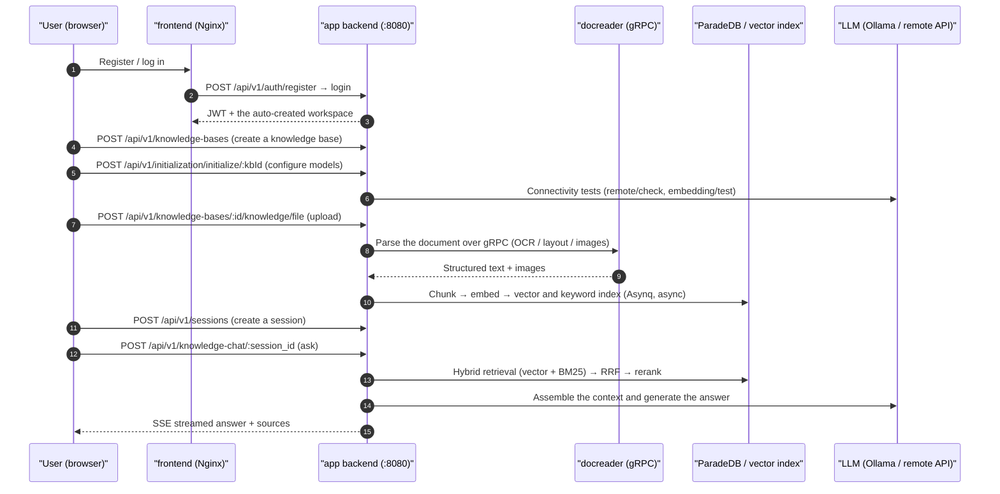

# Quickstart

Register an account, create a knowledge base, configure its models, upload documents and ask a question. The answer cites the source passages. The steps below use the web UI; the matching API calls are at the end of the page.

Complete the [installation](02-installation.md) first and have a chat model, an embedding model and a rerank model available.

## Before you start

- Start the services. After the steps in [Installation](./02-installation.md), the frontend is at `http://localhost` and the backend at `http://localhost:8080`.
- Prepare model connection details: a local Ollama (default address from inside the container `http://host.docker.internal:11434`), or the `base_url` and `api_key` of any OpenAI-compatible service. You need a chat model, an embedding model and a rerank model: the built-in Quick Answer agent will not answer until it has a chat model and a rerank model. A model server on `localhost` or a private address is blocked by the SSRF check until its host is in `SSRF_WHITELIST_EXTRA` (see [Configuration](./04-configuration.md)).
- Check backend health: `curl http://localhost:8080/health` returns `{"status":"ok"}`.

## Register and log in

The first visit opens the login page. When the deployment allows public registration (`self_serve`), the page shows a registration tab. There is no default account. With the default configuration, registration creates a personal workspace and makes the new user its Owner.

<Screenshot
  src="/screenshots/quickstart-register.png"
  caption="The registration page on first visit"
  hint="Show the registration form (username / email / password) and the link to the login page." />

Registration rules and deployment differences:

- The API accepts a username of 2 to 50 characters. The registration form is stricter: at most 20 characters, and only letters, digits, underscores and Chinese characters (no spaces). The password is 8 to 32 characters and contains at least one letter and one digit. With the complex-password policy enabled it must also contain upper-case and lower-case letters and a special character. The UI and the API apply the same policy.
- A team deployment can turn public registration off and add members through invitation links afterwards. Set `DISABLE_REGISTRATION=true` (forces the registration mode to `invite_only` at startup), or have a system administrator change `auth.registration_mode` to `invite_only` under Settings → System (takes effect immediately, no restart).
- If the deployment sets the default workspace policy to `tenantless` (`auth.default_tenant_mode`), registration does **not** create a workspace. The user is sent to `/onboarding/workspace` and has to create a workspace or accept an invitation before continuing.
- The desktop application needs no registration; it creates a local account and logs in at launch. The Lite single binary still requires registration and login when opened in a browser.

::: tip Workspace and platform permissions
A workspace Owner manages the members, models and knowledge bases of that workspace. Global system settings, the platform task queue and cross-workspace audit need the system administrator identity. The two kinds of permission are granted separately.

To set up the first system administrator, register an account, then set `AIKB_BOOTSTRAP_SYSTEM_ADMIN_EMAIL=<that account's email>` on the app service and restart. This only takes effect while the deployment has no system administrator yet. Full steps and limits: [Platform administration and system administrators](../03-features/20-platform-admin.md).
:::

## Add models, then create a knowledge base

Models are registered once per workspace under Settings → Model Management; each knowledge base and each agent then picks from that list.

1. Open Settings → Model Management and click Add Model. Pick the model type (Chat, Embedding, ReRank, Vision or Speech), the source (API or Ollama) and the provider, enter the model name and Base URL (plus the API key when the service needs one), click Test Connection, then Save and close. Add at least:
   - a **Chat** model, which generates answers;
   - an **Embedding** model, which turns documents into vectors (changing it later requires rebuilding the index);
   - a **ReRank** model, which the built-in Quick Answer agent requires.
2. On the Knowledge Base page click Create Knowledge Base, enter a name and pick a type: Document-based or FAQ Q&A. Under Model Configuration choose the LLM model and the Embedding model; RAG Search needs the embedding model. Image processing (VLM), audio (ASR), the knowledge graph and question generation are optional settings in the same dialog.
3. Open Agents → Quick Answer → Model Config, choose the chat model under Model and the rerank model under ReRank Model, then Save and Close. Until both are set, sending a message shows "Agent "Quick Answer" is not ready".

<Screenshot
  src="/screenshots/quickstart-init-wizard.png"
  caption="Add Model: a custom OpenAI-compatible chat model after a successful connection test"
  hint="Show the model type, source and provider, the model name and Base URL inputs, and the message that the connection test passed." />

::: tip Connecting to Ollama from a container
Inside the backend container `localhost` is the container itself. To reach an Ollama on the host, use `http://host.docker.internal:11434`.
:::

## Upload documents

Open the knowledge base, then drag files in or paste a web page URL. The upload confirmation dialog lets you set tags and parsing options for the batch.

Supported formats include PDF, Word, Excel, PPT, Markdown, HTML, EPUB, images and audio. The full list is in [Document parsing](../03-features/03-document-parsing.md).

<Screenshot
  src="/screenshots/quickstart-upload.png"
  caption="Upload confirmation dialog: pick files, add tags, adjust parsing options"
  hint="Show the list of files to upload, the tag picker and the parsing engine options." />

Documents are parsed asynchronously after upload. The status moves through `pending → processing → finalizing → completed`. Scanned PDFs and large files take longer; the list page refreshes progress live.

<Screenshot
  src="/screenshots/quickstart-document-list.png"
  caption="Document list: three documents parsed"
  hint="Show the columns for document name, type, parse status (Completed) and chunk count." />

## Ask a question

Open the chat page, select the knowledge base and ask. The default Quick Answer agent retrieves the relevant chunks and writes an answer. Click a citation to open the source passage.

<Screenshot
  src="/screenshots/quickstart-chat.png"
  caption="Knowledge Q&A: an answer with clickable citations"
  hint="Show one question and answer, the citation markers in the answer text and the expanded source panel." />

When the answer renders and its citations open, the import and question-answering flow is complete.

## Keep configuring

- [Configure agents](../03-features/07-agent.md): use Smart Reasoning for multi-step questions and enable web search and MCP tools as needed.
- [Tune chunking](../03-features/04-chunking.md) and [retrieval parameters](../03-features/05-retrieval-engines.md) to match your document structure and retrieval results.
- [Connect data sources](../03-features/10-datasource.md) to keep syncing Feishu, Notion, Yuque or RSS content.
- [IM integration](../03-features/12-im-integration.md) or [web embedding](../03-features/13-embed-channel.md): let users ask through channels they already use.

## The first question through the API

The example below calls the API in order: register, log in, create a knowledge base, initialize its models, upload and ask. All paths use the `/api/v1` prefix. You need Bash, curl and jq. The login account must already belong to a workspace; if the login response has no `active_tenant`, create or join a workspace first and log in again.

```bash
BASE=http://localhost:8080/api/v1

# 1) Register (first deployment only; username 2 to 50 chars; password 8 to 32 chars with letters and digits, more under the complex policy)
curl -s -X POST $BASE/auth/register -H "Content-Type: application/json" \
  -d '{"username":"admin","email":"admin@example.com","password":"pass123456"}'

# 2) Log in, keep the JWT and the current workspace ID (used later to create an API key)
LOGIN_RESPONSE=$(curl -s -X POST $BASE/auth/login -H "Content-Type: application/json" \
  -d '{"email":"admin@example.com","password":"pass123456"}')
TOKEN=$(printf '%s\n' "$LOGIN_RESPONSE" | jq -r '.token')
TENANT_ID=$(printf '%s\n' "$LOGIN_RESPONSE" | jq -r '.active_tenant.id')
AUTH="Authorization: Bearer $TOKEN"

# 3) Create a knowledge base
KB_ID=$(curl -s -X POST $BASE/knowledge-bases -H "$AUTH" -H "Content-Type: application/json" \
  -d '{"name":"My knowledge base","description":"demo","type":"document"}' | jq -r '.data.id')

# 4) Initialize the knowledge base (local Ollama shown; for a remote model change source/baseUrl/apiKey)
curl -s -X POST $BASE/initialization/initialize/$KB_ID -H "$AUTH" -H "Content-Type: application/json" -d '{
  "llm":       {"source":"local","modelName":"qwen3:8b"},
  "embedding": {"source":"local","modelName":"bge-m3","dimension":1024},
  "rerank":    {"enabled":false},
  "multimodal":{"enabled":false},
  "documentSplitting":{"chunkSize":512,"chunkOverlap":50,"separators":["\n\n","\n","."]},
  "nodeExtract":{"enabled":false},
  "questionGeneration":{"enabled":false}}'

# 5) Upload a document (multipart, field name file)
curl -s -X POST $BASE/knowledge-bases/$KB_ID/knowledge/file -H "$AUTH" \
  -F "file=@./demo.pdf"
# Poll the parse status: GET /knowledge-bases/$KB_ID/knowledge until parse_status=completed

# 6) Create a session
SESSION_ID=$(curl -s -X POST $BASE/sessions -H "$AUTH" -H "Content-Type: application/json" \
  -d '{"title":"First conversation"}' | jq -r '.data.id')

# 7) Knowledge Q&A (SSE stream)
curl -N -X POST $BASE/knowledge-chat/$SESSION_ID -H "$AUTH" -H "Content-Type: application/json" \
  -d '{"query":"What is this document about?","knowledge_base_ids":["'$KB_ID'"]}'

# 7b) Agent chat (also SSE; agent_id can be the built-in builtin-smart-reasoning)
curl -N -X POST $BASE/agent-chat/$SESSION_ID -H "$AUTH" -H "Content-Type: application/json" \
  -d '{"query":"Summarize the key points of the document and cite the evidence","agent_enabled":true,"agent_id":"builtin-smart-reasoning","knowledge_base_ids":["'$KB_ID'"]}'

# 8) Retrieval only, no generation (structured JSON result)
curl -s -X POST $BASE/knowledge-search -H "$AUTH" -H "Content-Type: application/json" \
  -d '{"query":"keyword","knowledge_base_ids":["'$KB_ID'"]}'
```

The chat request body also accepts `knowledge_ids` (restrict to specific documents), `web_search_enabled`, `summary_model_id`, `mcp_service_ids`, `skill_names`, and `images` / `attachment_uploads` (multimodal attachments). The full description is in [API reference: sessions and chat](../04-api/02-api-chat.md).

### Three ways to authenticate

| Method | Header | Use |
| --- | --- | --- |
| JWT | `Authorization: Bearer <token>` | Browser / interactive calls; issued by the login endpoint |
| API key | `X-API-Key: <key>` | Server-side integrations; created under workspace settings or with `POST /api/v1/tenants/:id/api-keys`, with fine-grained capabilities (`retrieve`, `chat`, `ingest`, `manage_kbs` and others) |
| Workspace selection | `X-Tenant-ID: <id>` | Lets a user in several workspaces switch the current workspace |

Server-side integrations should use an API key rather than a JWT:

```bash
# Create an API key as the Owner of the current workspace (TENANT_ID was extracted at login)
curl -s -X POST $BASE/tenants/$TENANT_ID/api-keys -H "$AUTH" -H "Content-Type: application/json" \
  -d '{"name":"ci-bot","full_access":true}'
# Then switch every request to:
curl -s $BASE/knowledge-bases -H "X-API-Key: <the key returned at creation>"
```

### Endpoints behind the initialization wizard

Each wizard step has its own endpoint, so a custom admin console can reuse them directly:

| Step | Endpoint | Notes |
| --- | --- | --- |
| Read the current configuration | `GET /api/v1/initialization/config/:kbId` | Returns the llm / embedding / rerank / multimodal / documentSplitting / nodeExtract / questionGeneration sections and `hasFiles` (embedding changes are restricted once files exist) |
| Detect Ollama | `GET /api/v1/initialization/ollama/status`, `GET /api/v1/initialization/ollama/models` | Check Ollama availability and installed models |
| Download an Ollama model | `POST /api/v1/initialization/ollama/models/download` → `GET /api/v1/initialization/ollama/download/progress/:taskId` | Asynchronous download with progress polling |
| Test remote models | `POST /api/v1/initialization/remote/check`, `/initialization/embedding/test`, `/initialization/rerank/check`, `/initialization/asr/check`, `/initialization/multimodal/test` | Connectivity checks before saving |
| Trial knowledge graph extraction | `POST /api/v1/initialization/extract/text-relation` (with `fabri-text` / `fabri-tag` to generate samples) | Preview entity and relationship extraction |
| Save the configuration | `POST /api/v1/initialization/initialize/:kbId` (first time) / `PUT /api/v1/initialization/config/:kbId` (update) | Persists: creates or updates Model records and writes the KnowledgeBase configuration |

`source` is `local` (Ollama) or a remote vendor id (`openai`, `deepseek`, `aliyun`, `zhipu`, `siliconflow` and others). The valid `chunkSize` range is 100 to 10000.

### What happens along the way



## If you get stuck

| Symptom | What to check |
| --- | --- |
| Still `processing` long after upload | `docker logs ai-kb-docreader`; large files are bounded by `MAX_FILE_SIZE_MB` (default 50) and `AIKB_DOCUMENT_PROCESS_TIMEOUT` (default 2h) |
| Ollama detection fails during initialization | The default address inside the container is `http://host.docker.internal:11434` (`OLLAMA_BASE_URL`); on Linux confirm that `extra_hosts: host.docker.internal:host-gateway` is in effect |
| Answers without citations / empty recall | Confirm the document parse status is `completed`; lower `vector_threshold`; check that the embedding model matches the one used when the knowledge base was built |
| The registration tab disappeared | Check `registration_mode` in `GET /auth/config`. The value can come from the database setting under Settings → System, not only from `DISABLE_REGISTRATION`. Invitation links and first OIDC login are two separate paths that it does not affect |
| API key requests return 403 | The key's capabilities do not include the needed one, or its `knowledge_base_ids` allow-list does not include the target knowledge base |

Next: [Configuration](./04-configuration.md) for the details, or [Architecture overview](../02-architecture/01-overview.md) for how the system runs.
