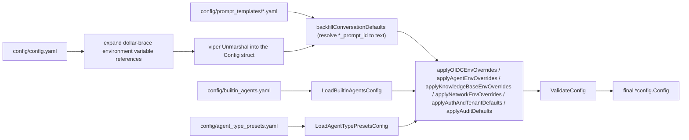

# Configuration reference

AI KB is configured in four layers, **from lowest to highest precedence**:

| Layer | Location | Purpose |
| --- | --- | --- |
| Main configuration file | `config/config.yaml` | Structured defaults, shipped with the image |
| Templates and presets | `config/prompt_templates/*.yaml`, `builtin_agents.yaml`, `agent_type_presets.yaml`, `builtin_models.yaml`, `models.json` | Prompts, built-in agents, built-in models, model vendor catalog overlay |
| Environment variables | `.env` / container `environment` | Deployment-level overrides; a restart is required after a change |
| Runtime system settings | The `system_settings` database table, edited under Settings → System | Supported settings can be changed online; they take precedence over environment variables and most take effect immediately |

Registration mode, workspace policy and quotas, the SSRF whitelist, task concurrency and the model concurrency cap support runtime configuration. Once a value is changed in the console, the database value wins over the environment variable; only resetting the setting (`DELETE /api/v1/system/admin/settings/:key`) restores the environment variable or the built-in default. When an environment variable seems to have no effect, check first whether that setting already has a runtime value. The full list is in [Platform administration and system administrators](../03-features/20-platform-admin.md).

The main configuration structure is defined in `internal/config/config.go`. The meaning, default and activation condition of each setting and environment variable follow.

## How configuration is loaded

`LoadConfig()` in `internal/config/config.go` runs these steps:

1. When `AIKB_CONFIG_FILE` is set, viper loads exactly that file. Otherwise it searches for `config.yaml` in order: the current directory, then `./config`, then `$HOME/.appname`, then `/etc/appname/`.
2. **Environment variable expansion**: the file content goes through a regex replacement; `${ENV_VAR}` is replaced with the value of the environment variable of the same name. When the variable is unset, the literal `${ENV_VAR}` is kept as is, so misconfiguration surfaces instead of silently becoming empty.
3. viper enables `AutomaticEnv()` with the key separator `.` mapped to `_` (so `server.port` can be overridden by the environment variable `SERVER_PORT`).
4. Prompt templates are loaded from `config/prompt_templates/*.yaml` and **back-filled** into the conversation configuration by the `xxx_prompt_id` fields (`backfillConversationDefaults`).
5. `builtin_agents.yaml` (built-in agents) and `agent_type_presets.yaml` (agent type presets) are loaded, and their `system_prompt_id` references are resolved.
6. Environment variable overrides are applied (the OIDC, Agent, KnowledgeBase, network, Auth/Tenant and Audit groups) and `ValidateConfig` runs.



## config/config.yaml section by section

### server (`ServerConfig`)

| Name | Type | Default | Description |
| --- | --- | --- | --- |
| `server.port` | int | 8080 | HTTP listen port, validated to the range 1-65535 |
| `server.host` | string | "0.0.0.0" | Listen address |
| `server.log_path` | string | empty | Log file path (the environment variable `LOG_PATH` also works) |
| `server.shutdown_timeout` | duration | 30s | Total graceful shutdown budget, shared by connection draining and resource cleanup; 5s is reserved for cleanup by default |

### conversation (`ConversationConfig`): the retrieval and answering pipeline

| Name | Type | Default (config.yaml) | Description |
| --- | --- | --- | --- |
| `max_rounds` | int | 5 | Number of history rounds carried into a multi-turn conversation |
| `keyword_threshold` | float | 0.3 | Minimum keyword retrieval score |
| `embedding_top_k` | int | 30 | Number of vector retrieval candidates (>= 0) |
| `vector_threshold` | float | 0.2 | Vector similarity threshold (0-1) |
| `rerank_top_k` | int | 30 | Number of results kept after reranking (>= 0) |
| `rerank_threshold` | float | 0.3 | Minimum rerank score (-10 to 10) |
| `fallback_strategy` | string | "model" | Strategy when retrieval returns nothing: `model` (let the model answer) or a fixed reply |
| `fallback_response` | string | "Sorry, I am unable to answer this question." | Fixed fallback text |
| `enable_rewrite` | bool | true | Multi-turn reference resolution / query rewrite |
| `enable_query_expansion` | bool | true | Query expansion |
| `enable_rerank` | bool | true | Enable reranking |
| `fallback_prompt_id` | string | "default_fallback_prompt" | Fallback prompt template ID (`prompt_templates/fallback.yaml`, mode:"model") |
| `rewrite_prompt_id` | string | "default_rewrite" | Rewrite template ID (a `content` system part plus a `user` part) |
| `generate_summary_prompt_id` | string | "default_summary" | Document profile template ID (short summary plus gist, topics, type and typical questions, JSON output) |
| `generate_kb_description_prompt_id` | string | "default_kb_description" | Knowledge base description template ID (the input is the aggregated document profiles, not the document bodies) |
| `generate_session_title_prompt_id` | string | "default_session_title" | Session title generation template ID |
| `extract_entities_prompt_id` / `extract_relationships_prompt_id` | string | "default_extract_entities" / "default_extract_relationships" | Knowledge graph extraction template IDs (`graph_extraction.yaml`) |
| `generate_questions_prompt_id` | string | "default_generate_questions" | Pre-generated questions template ID |

`conversation.summary` (`SummaryConfig`, answer generation parameters):

| Name | Type | Default | Description |
| --- | --- | --- | --- |
| `max_input_chars` | int | 8192 | Maximum characters sent to the LLM. A document profile only needs the beginning of the document to judge its topic, so 8k is enough; the old values 16384/24576 multiply the summary cost of every document |
| `temperature` | float | 0.3 | Generation temperature |
| `repeat_penalty` | float | 1.0 | Repeat penalty |
| `max_completion_tokens` | int | 1024 | Maximum generated tokens (every field of the profile JSON is short) |
| `no_match_prefix` | string | `<think>\n</think>\nNO_MATCH` | When the model output starts with this prefix the answer counts as "no match" and the fallback runs |
| `prompt_id` | string | "default_kb" | System prompt template ID (`system_prompt.yaml`) |
| `context_template_id` | string | "default_context" | Context assembly template ID (`context_template.yaml`) |
| `max_tokens` / `top_k` / `top_p` / `frequency_penalty` / `presence_penalty` / `seed` / `thinking` | various | unset | Optional sampling parameters passed through to the model; `thinking` is a `*bool` that controls thinking mode |

### knowledge_base (`KnowledgeBaseConfig`): global chunking defaults

| Name | Type | Default | Description |
| --- | --- | --- | --- |
| `chunk_size` | int | 512 | Default chunk size (> 0 and > overlap) |
| `chunk_overlap` | int | 50 | Chunk overlap (>= 0) |
| `split_markers` | []string | `["\n\n", "\n", "。"]` | Split markers |
| `keep_separator` | bool | false | Keep the separator |
| `document_process_timeout` | duration | 2h | Total timeout of one document processing task (env `AIKB_DOCUMENT_PROCESS_TIMEOUT` overrides it) |
| `docreader_call_timeout` | duration | 30m | Timeout of one DocReader RPC (env `AIKB_DOCREADER_CALL_TIMEOUT`); must be shorter than the previous item |
| `image_processing.enable_multimodal` | bool | true | Enable multimodal image processing (OCR / caption) at upload |

> Each knowledge base's `ChunkingConfig` overrides these global defaults.

### extract (`ExtractManagerConfig`): knowledge graph extraction templates

`extract.extract_graph` / `extract.extract_entity` / `extract.fabri_text` define the instructions for graph extraction (`description`), the allowed relationship tags (`tags`, `Author` and `Alias` by default) and few-shot examples (`examples`: `text` + `node` + `relation`). The trial extraction and sample text buttons in a knowledge base's Knowledge Graph settings use these settings (the `%s` in `fabri_text.with_tag` / `with_no_tag` is replaced with the tag list).

### tenant (`TenantConfig`)

| Name | Type | Default | Description |
| --- | --- | --- | --- |
| `enable_cross_tenant_access` | bool | false | Allow users with `CanAccessAllTenants` to access other workspaces (can be enabled on an intranet) |
| `enable_rbac` | *bool | true | Enforce workspace role checks; an explicit `false` enters the rollout mode, where role checks inside a workspace are only logged and not blocked, while cross-workspace access is still blocked (env `AIKB_TENANT_ENABLE_RBAC`) |
| `max_owned_per_user` | int | 0 (handler default, 10) | Maximum number of workspaces one non-superuser may create; < 0 disables the cap (env `AIKB_TENANT_MAX_OWNED_PER_USER`) |
| `self_service_creation_enabled` | *bool | true | Whether ordinary users may create their own workspaces (env `AIKB_TENANT_SELF_SERVICE_CREATION_ENABLED`) |
| `default_session_name` / `default_session_title` / `default_session_description` | string | empty | Default text of a new session |

### Sections the struct supports but the default file omits

The following sections exist in the `Config` struct and can be added to `config.yaml` when needed (most also have an environment variable entry point):

| Section | Struct | Key fields and defaults |
| --- | --- | --- |
| `auth` | `AuthConfig` | `registration_mode`: `self_serve` (default) / `invite_register` (new users need a valid invitation link) / `invite_only` (forced when `DISABLE_REGISTRATION=true`); `default_tenant_mode`: `create_personal` (default) / `tenantless`; `complex_password_enabled` |
| `audit` | `AuditConfig` | `retention_days`: audit log retention in days, 90 when the section is omitted; 0 disables the purge; < 0 fails validation (env `AIKB_AUDIT_RETENTION_DAYS`) |
| `oidc_auth` | `OIDCAuthConfig` | `enable`, `issuer_url`, `jwks_uri`, `discovery_url` (derived from the issuer plus `/.well-known/openid-configuration` when missing), `provider_display_name`, `client_id`, `client_secret`, `authorization_endpoint`, `token_endpoint`, `user_info_endpoint`, `scopes` (default `openid profile email`), `extension_return_urls` (exact `return_to` values the browser extension may use; empty disables it), `user_info_mapping.username` (default `name`) / `email` (default `email`); all can be overridden with `OIDC_AUTH_*` environment variables |
| `agent` | `AgentConfig` | `llm_call_timeout`: timeout of one LLM call in seconds (default 120, env `AIKB_AGENT_LLM_TIMEOUT`); `tool_approval_timeout_seconds`: how long to wait for human approval of an MCP tool (default 600, env `AIKB_AGENT_TOOL_APPROVAL_TIMEOUT`) |
| `im` | `IMConfig` | IM channel QA concurrency: `workers` (5), `global_max_workers` (0 = unlimited, needs Redis), `max_queue_size` (50), `max_per_user` (3), `rate_limit_window` (60s), `rate_limit_max` (10) |
| `docreader` | `DocReaderConfig` | `addr` (a gRPC address such as `docreader:50051` or an HTTP base URL), `transport`: `grpc` (default) / `http`; usually set with env `DOCREADER_ADDR` / `DOCREADER_TRANSPORT` |
| `vector_database` | `VectorDatabaseConfig` | `driver` (usually set with env `RETRIEVE_DRIVER`) |
| `stream_manager` | `StreamManagerConfig` | `type`: `memory` / `redis`; `redis.address/username/password/db/prefix/ttl`; `cleanup_timeout` (usually set with env `STREAM_MANAGER_TYPE` and `REDIS_*`) |
| `web_search` | `WebSearchConfig` | `timeout`: web search timeout in seconds |
| `models` | `[]ModelConfig` | Legacy static model list (`type`/`source`/`model_name`/`parameters`); `builtin_models.yaml` or the UI is recommended instead |
| `frontend_base_url` | string, empty by default | Public origin of the SPA, used to build absolute links such as invitations (env `FRONTEND_BASE_URL`) |

## Important environment variables

The variables below come from the app and docreader `environment` blocks of `docker-compose.yml`, from `.env.example` and from `os.Getenv` calls in the code. A production deployment must change at least `DB_USER/DB_PASSWORD/DB_NAME`, `REDIS_PASSWORD`, `JWT_SECRET` and `SYSTEM_AES_KEY`.

### Runtime basics

| Name | Default | Description |
| --- | --- | --- |
| `GIN_MODE` | release | `debug` for development (enables Swagger) / `release` for production |
| `AIKB_IM_PLATFORMS` | empty (all) | Comma-separated allow-list of IM platforms a workspace may connect (`wecom`, `feishu`, `lark`, `slack`, `telegram`, `dingtalk`, `mattermost`, `wechat`, `qqbot`, `yunzhijia`). Unset or empty offers all ten; a list naming only unknown values offers none. Excluded platforms get no adapter, leave the channel picker (`im_platforms` in `GET /system/capabilities`) and are refused with 400 on channel creation; stored channels for them stay listed but do not start |
| `AIKB_CONFIG_FILE` | empty | Explicit path of the server config file. Empty keeps the search order (`./config.yaml`, `./config/config.yaml`, `$HOME/.appname`, `/etc/appname`). The Lite Homebrew wrapper sets it to `~/.config/aikb/config/config.yaml`, because the `aikb` CLI stores its own `config.yaml` in `~/.config/aikb`, which the search order would otherwise load as the server config |
| `LOG_LEVEL` / `LOG_PATH` / `LOG_FORMAT` | debug / empty / empty | Log level, log file path (stdout only when empty), custom format |
| `LLM_DEBUG_LOG` | false | When true, writes `llm_debug.log` next to `LOG_PATH` |
| `TZ` | UTC | Time zone |
| `DEFAULT_LOCALE` | empty | Default UI language of the frontend container. The UI ships in English only, so `en-US` is the only accepted value; anything else is ignored. It only affects users who have never switched language; precedence: the user's saved choice > this variable > `en-US`. Restart the frontend container after changing it; no image rebuild is needed |
| `AIKB_LANGUAGE` | empty | Document processing language (question and summary generation). Precedence: this variable > the request's `Accept-Language` > the built-in default. The built-in default is `en-US` in the code (`internal/types/context_helpers.go`). The document processing language is independent of the UI language, for example an English UI processing Korean documents. IM channels with no reply language configured also use this variable (the built-in default when unset) as their default reply language |
| `AUTO_MIGRATE` | true | Run database migrations at startup |
| `AUTO_RECOVER_DIRTY` | true | Automatically repair golang-migrate's dirty state (left by an interrupted migration). Set it to false temporarily while investigating a migration problem by hand, otherwise startup rewrites the migration version record; see [Database and migrations](../06-development/02-database-schema.md) |
| `AIKB_TRUSTED_PROXIES` | empty | Proxy CIDRs trusted by gin (comma-separated) |
| `MAX_SKILL_BUNDLE_SIZE_MB` | 256 MiB (never below MAX_FILE_SIZE_MB, capped at 512 MiB) | Limit for skill ZIP uploads and source downloads; the reverse proxy request body limit must be large enough too |
| `MAX_FILE_SIZE_MB` | 50 | Upload size limit (shared by app, frontend and docreader); Helm deployments use `global.maxFileSizeMB` |
| `CONCURRENCY_POOL_SIZE` | 5 | General concurrency pool |
| `APP_EXTERNAL_URL` / `FRONTEND_BASE_URL` | empty | Externally reachable URL for IM channel image and file links / public origin of the frontend |
| `RESOURCE_URL_MODE` | handle | Default form of file references in API responses: `handle` returns the internal `resource://`, `public` returns a time-limited external link that loads directly. One request can override it with `?resource_urls=`; see [API overview](../04-api/01-api-overview.md) |

`APP_EXTERNAL_URL` decides whether IM channels can render knowledge base images. IM platforms need a public http(s) URL, so pick one of two options:

1. The storage backend itself is publicly reachable (object storage with a public endpoint, or `MINIO_ENDPOINT` set to a public host). Then `resource://` falls back to the backend's presigned URL and this variable is not needed.
2. Set `APP_EXTERNAL_URL`. `resource://` images are rewritten to `<APP_EXTERNAL_URL>/r/<token>` and served by AI KB itself (nginx must proxy `/r/`; the official frontend image already includes that location).

The default MinIO deployment on the internal network and the `local` backend can only use the second option. When IM channels are enabled but this variable is empty, the service prints one WARN at startup. If the rewritten result is not an http(s) URL the original reference is kept and an actionable warning is logged, instead of sending a link the IM side cannot open.

The four URL forms and how each channel obtains them are described in [External access to images and files](../03-features/21-file-access.md).

### Database and queues

| Name | Default | Description |
| --- | --- | --- |
| `DB_DRIVER` | postgres | `postgres` / `sqlite` (Lite) |
| `DB_HOST` / `DB_PORT` / `DB_USER` / `DB_PASSWORD` / `DB_NAME` | postgres / 5432 / empty / empty / empty | PostgreSQL connection (required) |
| `DB_PATH` | - | Database file path when `DB_DRIVER=sqlite` |
| `STREAM_MANAGER_TYPE` | empty (compose effectively uses redis) | `redis` / `memory` |
| `REDIS_ADDR` / `REDIS_USERNAME` / `REDIS_PASSWORD` / `REDIS_DB` / `REDIS_PREFIX` | redis:6379 / ... | Redis connection |
| `REDIS_USE_TLS` | false | **Master switch for TLS**; managed Redis (AWS ElastiCache, for example) needs it on. `REDIS_TLS_SERVER_NAME` sets the server name used for verification and SNI (useful when the address is an IP); `REDIS_TLS_INSECURE_SKIP_VERIFY` skips certificate verification (insecure, only for development with self-signed certificates) |
| `AIKB_REDIS_NAMESPACE` | empty | Channel namespace suffix when several deployments share one Redis |
| `AIKB_ASYNQ_CORE_CONCURRENCY` and siblings | 8 / 2 / 12 / 4 / 6 | Asynq concurrency per queue (core/postprocess/enrichment/maintenance/shared); also `AIKB_WIKI_ASYNQ_CONCURRENCY=8` and `AIKB_MODEL_MAX_CONCURRENCY=32` |

### Retrieval engines and vector stores

| Name | Default | Description |
| --- | --- | --- |
| `RETRIEVE_DRIVER` | postgres | Retrieval engine: `postgres` / `elasticsearch_v7` / `elasticsearch_v8` / `qdrant` / `milvus` / `weaviate` / `opensearch` / `doris` / `tencent_vectordb` / `sqlite` (Lite); comma-separate several engines to run them in parallel |
| `ELASTICSEARCH_ADDR/USERNAME/PASSWORD/INDEX` | empty | Elasticsearch |
| `QDRANT_HOST/PORT/COLLECTION/API_KEY/USE_TLS` | qdrant / 6334 / aikb_embeddings / empty / false | Qdrant |
| `MILVUS_ADDRESS/COLLECTION/METRIC_TYPE/...` | milvus:19530 / aikb_embeddings / IP | Milvus |
| `OPENSEARCH_ADDR/USERNAME/PASSWORD/INDEX/INSECURE_SKIP_VERIFY` | empty | OpenSearch |
| `WEAVIATE_HOST/GRPC_ADDRESS/SCHEME/AUTH_ENABLED/API_KEY` | empty | Weaviate |
| `DORIS_ADDR/HTTP_PORT/DATABASE/USERNAME/PASSWORD/TABLE_PREFIX/COMPAT_MODE` | empty | Apache Doris 4.1+ |
| `TENCENT_VECTORDB_ADDR/USERNAME/API_KEY/DATABASE/COLLECTION/REPLICA_NUMBER` | empty | Tencent Cloud VectorDB |
| `MULTI_STORE_RETRIEVE_TIMEOUT_SEC` | empty | Timeout for parallel multi-engine retrieval |
| `NEO4J_ENABLE` / `NEO4J_URI` / `NEO4J_USERNAME` / `NEO4J_PASSWORD` | empty / bolt://neo4j:7687 / neo4j / password | The only knowledge graph switch (`ENABLE_GRAPH_RAG` is deprecated) |

### File storage

| Name | Default | Description |
| --- | --- | --- |
| `STORAGE_TYPE` | local | `local` / `minio` / `cos` / `tos` / `s3` / `obs` / `oss` / `ks3` |
| `STORAGE_ALLOW_LIST` | empty | Whitelist of storage types users may choose (comma-separated); accepted values `local`, `minio`, `cos`, `tos`, `s3`, `oss`, `ks3`, `obs` |
| `LOCAL_STORAGE_BASE_DIR` | /data/files | Root directory of local storage |
| `MINIO_ENDPOINT/ACCESS_KEY_ID/SECRET_ACCESS_KEY/BUCKET_NAME/USE_SSL` | minio:9000 / minioadmin / minioadmin / empty / false | MinIO |
| `COS_SECRET_ID/SECRET_KEY/REGION/BUCKET_NAME/APP_ID/PATH_PREFIX` | empty | Tencent Cloud COS (also TEMP_BUCKET_NAME/TEMP_REGION) |
| `S3_*` / `OBS_*` / `OSS_*` / `TOS_*` / `KS3_*` | see `.env.example` section B4 | AWS S3 / Huawei OBS / Alibaba OSS / Volcengine TOS / Kingsoft Cloud KS3; each has ENDPOINT/REGION/KEY/BUCKET/PATH_PREFIX and so on |

For AWS S3, `S3_ACCESS_KEY` / `S3_SECRET_KEY` can **both be left empty**. The AWS SDK default credential chain is then used, which supports EC2/ECS/EKS IAM roles, IRSA/Web Identity, environment variables and shared configuration files, so a deployment on AWS does not need long-lived keys in its environment. Set both or neither. When `S3_ENDPOINT` is empty, the standard endpoint of the region is used.

### Models and inference

| Name | Default | Description |
| --- | --- | --- |
| `OLLAMA_BASE_URL` | `http://host.docker.internal:11434` | The single local Ollama address. Embedding and chat models with `source=local` share it; when unset the process uses `http://localhost:11434` |
| `OLLAMA_OPTIONAL` | true | When Ollama is unavailable, only warn instead of blocking startup |
| `BATCH_EMBED_SIZE` | empty | Batch embedding size |
| `VLM_HTTP_TIMEOUT_SECONDS` | 180 | Timeout of one VLM request |
| `BUILTIN_MODELS_CONFIG` | config/builtin_models.yaml | Path of the built-in model declaration file (see below) |
| `MODELS_CONFIG` | config/models.json | Path of the deployment overlay for the model vendor catalog (add vendors, override addresses or model parameters); format in [Model management](../03-features/06-models.md) |
| `AIKB_LLM_STREAM_RAW_DUMP` / `_DIR` | empty | Raw dump of LLM streams (for troubleshooting) |

The embedding model name is not set by an environment variable. In the model record, set the `name` of the `type=Embedding`, `source=local` model to the Ollama model name (the CLI example is `nomic-embed-text`, dimension 768; the quickstart uses `bge-m3`, dimension 1024). When the name is empty the local embedder falls back to `nomic-embed-text`. `EMBEDDING_MODEL_NAME` only takes effect when `builtin_models.yaml` references `${EMBEDDING_MODEL_NAME}` (see "config/builtin_models.yaml.example: declarative built-in models" below and `config/builtin_models.yaml.example` in the repository). The 8 GB starting point in the installation guide excludes Ollama weights; Neo4j is off by default (the `neo4j` profile).

### Authentication, workspaces and security

| Name | Default | Description |
| --- | --- | --- |
| `JWT_SECRET` | `aikb-default-jwt-secret-change-me` in `.env.example` | JWT signing key (required; generate one with `openssl rand -hex 32`). The server refuses to start when it is empty. The shipped default (and the older placeholders `ai-kb-jwt-secret`, `CHANGE-ME-jwt-secret`) never signs: the server generates a per-install secret once, stores it in the `system_secrets` table, uses it on every start and warns until you set your own. Multiple replicas must share the same value |
| `SYSTEM_AES_KEY` | `aikb-default-aes-key-change-me!!` in `.env.example` | AES-256 master key for encrypting sensitive fields at rest, **must be 32 bytes** (generate one with `openssl rand -hex 16`). The server refuses to start when it is empty or another length, and warns while the shipped default is in use: that key is public, so replace it before storing real credentials (values saved under it must be re-entered after the change). If it is lost, encrypted data (model keys, vector store credentials and so on) cannot be recovered; keep the same value across upgrades. Replaces `TENANT_AES_KEY`/`CRYPTO_MASTER_KEY`/`CRYPTO_SALT` |
| `SYSTEM_SIGNING_KEY` | empty (falls back to `SYSTEM_AES_KEY`) | Signing key for embed sessions and presigned file links (generate one with `openssl rand -hex 32`). `SYSTEM_AES_KEY` is used when unset; when both are missing, shorter than 16 characters or an example value (the shipped default AES key included), signed links and embed sessions cannot be issued. Rotating it invalidates issued links; multiple replicas must share the same value |
| `DISABLE_REGISTRATION` | false | When true, forces `registration_mode=invite_only` |
| `AIKB_AUTH_DEFAULT_TENANT_MODE` | create_personal | Workspace policy after registration (`create_personal` / `tenantless`) |
| `AIKB_TENANT_ENABLE_RBAC` | (default true) | Workspace role enforcement switch |
| `AIKB_TENANT_ENABLE_CROSS_TENANT_ACCESS` | false | Cross-workspace access |
| `AIKB_TENANT_SELF_SERVICE_CREATION_ENABLED` | true | Ordinary users may create workspaces |
| `AIKB_TENANT_MAX_OWNED_PER_USER` | empty | Cap on self-created workspaces |
| `AIKB_TENANT_AUTO_CREATE_API_KEY` | false | Issue a full_access API key automatically when a workspace is created (legacy behavior) |
| `AIKB_TENANT_DEFAULT_STORAGE_QUOTA_GB` | 10 | Default storage quota of a new workspace |
| `AIKB_AUTH_COMPLEX_PASSWORD_ENABLED` | false | Complex password policy: upper and lower case letters, digits and special characters; the system setting auth.complex_password_enabled takes precedence |
| `AIKB_TENANT_AUTO_ACCEPT_INVITATION` | false | An email invitation to an existing account joins directly; the system setting tenant.auto_accept_invitation takes precedence |
| `OIDC_AUTH_JWKS_URI` | empty | Public key set for verifying id_token signatures; can be completed through discovery and is checked together with issuer, audience and expiry |
| `AIKB_INVITATION_TTL` | 168h | Invitation link lifetime |
| `AIKB_AUDIT_RETENTION_DAYS` | 90 | Audit log retention in days |
| `AIKB_BOOTSTRAP_SYSTEM_ADMIN_EMAIL` | empty | Bootstraps the first system administrator. **It does not create the user**: that email must register first; at the next start, if the deployment has no system administrator yet, that account is promoted. Once an administrator exists the variable has no further effect. See [Workspaces, users and authentication](../03-features/01-tenant-auth.md) |
| `OIDC_AUTH_ENABLE` and `OIDC_AUTH_*` / `OIDC_USER_INFO_MAPPING_*` | false / empty | The full OIDC single sign-on configuration |
| `OIDC_AUTH_EXTENSION_RETURN_URLS` | empty | Comma-separated exact return URLs (`https://<extension-id>.chromiumapp.org/oidc`) the browser extension may pass as `return_to` to `/auth/oidc/start`; empty turns extension sign-in off. Each entry must be an absolute `http` or `https` URL without a fragment or credentials, or the server refuses to start. Read at startup. See [Browser extension](../05-clients/06-browser-extension.md#sign-in-with-your-identity-provider) |
| `OIDC_AUTH_GROUPS_CLAIM` | groups | Claim carrying the group names for the OIDC group mapping; the system setting `oidc.groups_claim` takes precedence. Most providers send it only when `groups` is in `OIDC_AUTH_SCOPES` |
| `OIDC_AUTH_SYSTEM_ADMIN_GROUPS` | empty | Comma-separated groups whose members are system administrators at OIDC sign-in; the system setting `oidc.system_admin_groups` takes precedence |
| `OIDC_AUTH_GROUP_ROLE_MAP` | empty | Comma-separated `group:workspace:role` entries (workspace slug or id; owner, admin, contributor or viewer); the system setting `oidc.group_role_map` takes precedence |
| `SSRF_WHITELIST` / `SSRF_WHITELIST_EXTRA` | empty / `searxng,qdrant,milvus,weaviate,doris-fe,doris-be,minio` (app only) | SSRF whitelist for outbound requests. `SSRF_WHITELIST` is shared by app and docreader; compose only gives app a default for `SSRF_WHITELIST_EXTRA`, docreader's variable of the same name defaults to empty |
| `SSRF_DNS_WHITELIST_ONLY` | false | Only allow whitelisted outbound hosts (read by both app and docreader). When on, a host outside the whitelist is refused **before any DNS query**, and direct IP access outside the whitelist is refused at URL validation as well; domain names are matched by name only, so a CIDR in the whitelist no longer applies to domain names. The value is parsed as a boolean (`1/t/true` on, `0/f/false` off); **a non-empty value that does not parse counts as on**. See the preparation steps below before enabling it |
| `IMAGE_HOST_KEEP_URL` | empty | Whitelist of image hosts whose original URL is kept |

#### Before enabling `SSRF_DNS_WHITELIST_ONLY`

Once enabled, the whitelist is the whole outbound policy, so every outbound address must be in `SSRF_WHITELIST` or `SSRF_WHITELIST_EXTRA` first. If docreader also needs to reach hosts inside compose, put them in the shared `SSRF_WHITELIST` (its `SSRF_WHITELIST_EXTRA` defaults to empty). You usually also need:

- Model service addresses (chat / embedding / rerank / VLM / ASR, including `localhost` for a local Ollama)
- `dex` for OIDC login (or your IdP domain), MCP server addresses, `docreader`
- Object storage (external S3/COS/OSS and so on), external vector stores, the Langfuse address
- The sandbox control plane address: once enabled, "allow private endpoints" can no longer bypass the whitelist

Outbound paths still not covered, ordered by impact:

1. **Runtime resolution of gRPC vector stores**: the qdrant / milvus clients resolve their target with gRPC's own resolver, and the dialer receives an address, so these hosts are judged **by name before the client is created** (environment configuration at startup, console-saved configuration at URL validation), not before every connection.
2. **The Langfuse OTLP exporter** has its own HTTP client and bypasses this mechanism entirely. `LANGFUSE_HOST` defaults to the SaaS address; in an offline deployment, disable tracing or point it at an internal address.
3. **`HTTP(S)_PROXY`**: the dialer lets the proxy host through only when the dial address is exactly equal to the host of the proxy URL. When equal, the proxy host is resolved and connected even if it is not in the whitelist; when not equal (for example the proxy URL has no port) it is refused as a non-whitelisted host. In an offline deployment, unset the proxy or add the proxy host to the whitelist.

### Image build arguments (when building from source)

These variables are only used when building the frontend image with `docker compose build` / `make docker-build-frontend`; a deployment that pulls the official images does not need them. Other build arguments (Go proxy, apt mirrors and so on) are in `.env.example` section A1.

| Name | Default | Description |
| --- | --- | --- |
| `VITE_FRONTEND_COMMIT` | unknown | Short frontend commit written to the System Information page. `make docker-build-frontend` and `start_all.sh --no-pull` fill it from git; export it yourself when running `docker compose build` directly |
| `NPM_REGISTRY` | empty (default registry) | npm registry used during the build, for example a regional mirror such as `https://registry.npmmirror.com` |
| `NODE_MAX_OLD_SPACE_SIZE` | 4096 | Node heap limit for the Vite build (MB); lower it to 2048 when Docker Desktop has little memory |

### Docreader parsing (docreader container)

| Name | Default | Description |
| --- | --- | --- |
| `DOCREADER_ADDR` / `DOCREADER_TRANSPORT` | docreader:50051 / grpc | Address and transport (`grpc`/`http`) the app connects with |
| `AIKB_WEKNORACLOUD_ENABLED` | false | Opt in to AI KB Cloud (upstream WeKnoraCloud), a hosted third-party parser and model provider. While off, the `weknoracloud` parser engine is left out of the engine list and refuses to build a reader, the Settings entry and the model provider are hidden, model create and update refuse the provider, and its credential routes answer 400. Read at call time, no restart needed |
| `DOCREADER_GRPC_MAX_WORKERS` / `DOCREADER_GRPC_PORT` / `DOCREADER_GRPC_MAX_FILE_SIZE_MB` | 4 / 50051 / follows MAX_FILE_SIZE_MB | gRPC server parameters |
| `GRPC_TLS_ENABLED/CERT/KEY/CA/SERVER_NAME`, `GRPC_MTLS_REQUIRE_CLIENT_CERT`, `GRPC_AUTH_TOKEN` | false / empty | TLS/mTLS and token authentication on the app to docreader link |
| `DOCREADER_PDF_RENDER_DPI` / `DOCREADER_PDF_JPEG_QUALITY` / `DOCREADER_PDF_RENDER_MAX_EDGE` | 200 / 85 / 2000 | PDF rendering |
| `DOCREADER_PDF_FORCE_SCANNED` / `DOCREADER_PDF_SCAN_IMAGE_RATIO` / `DOCREADER_PDF_SCAN_MIN_CHARS` | false / code defaults | Scanned document detection |
| `DOCREADER_ODL_HYBRID` / `DOCREADER_ODL_HYBRID_URL` / `DOCREADER_ODL_HYBRID_MODE` / `DOCREADER_ODL_HYBRID_FALLBACK` | off / `http://odl-hybrid:5002` / auto / false | OpenDataLoader hybrid parsing |
| The remaining `DOCREADER_PDF_*` (word gaps, margin columns, hidden text, embedded images, chart regions and so on, 20+ items) | see the comments in the docreader block of `docker-compose.yml` | PDF layout and extraction fine-tuning |
| `DOCREADER_EXTERNAL_HTTP_PROXY` / `_HTTPS_PROXY` | empty | Outbound fetch proxy for docreader |

### Agents, skills and attachments

| Name | Default | Description |
| --- | --- | --- |
| Sandbox configuration | maintained per workspace on the settings page | Backend, credentials, template, timeout and private network policy are stored per workspace |
| `AIKB_SANDBOX_DOCKER_ENABLED` | false | Fallback switch for the Docker sandbox backend. A system administrator can also turn it on under Settings → System Settings → Network security (the database value wins and takes effect immediately). Off by default because the local `docker.sock` is equivalent to root on the host |
| `AIKB_AGENT_LLM_TIMEOUT` | 120s | Timeout of one agent LLM call (a Go duration or a bare number of seconds) |
| `AIKB_AGENT_TOOL_APPROVAL_TIMEOUT` / `_FAIL_OPEN` | 600s / fail-close | Wait time for human approval of an MCP tool, and the policy on failure |
| `AIKB_CHAT_ATTACHMENT_TTL_HOURS` / `_WAIT_TIMEOUT_SEC` / `_OCR_CONCURRENCY` / `_OCR_MAX_PAGES` | 24 / 60 / 8 / 8 | Retention of parsed chat attachments, wait timeout, and OCR concurrency and page caps |
| `AIKB_HOUSEKEEPING_ENABLED` | enabled | Reclaims dirty data stuck in processing |
| `AIKB_DOCUMENT_PROCESS_TIMEOUT` / `AIKB_DOCREADER_CALL_TIMEOUT` | 2h / 30m | Document processing task timeout and single RPC timeout |
| `AIKB_PADDLEOCR_VL_TIMEOUT` | 1000s | HTTP request timeout for a self-hosted PaddleOCR-VL; accepts a positive Go duration (such as `5400s` or `90m`); empty, invalid or non-positive values use the default. Leave headroom in the outer timeouts, for example `90m` here, `100m` for DocReader and `2h` for the document task |
| `AIKB_MINERU_TIMEOUT` | 1000s | Timeout of one self-hosted MinerU parse (the whole parse task with the V1 API, the `/file_parse` request on older versions); same format and default rules as above; very large PDFs also need headroom in the outer timeouts |
| `AIKB_MINERU_CLOUD_TIMEOUT` | 600s | Maximum time to poll MinerU cloud (mineru.net) for a parse result; same format and default rules as above |
| `AIKB_PADDLEOCR_VL_CLOUD_TIMEOUT` | 600s | Maximum time to poll PaddleOCR-VL cloud (AI Studio) for a parse result; same format and default rules as above |
| `AIKB_WEKNORACLOUD_TIMEOUT` | 20m | Maximum time to poll the WeKnoraCloud managed docreader for a task result; same format and default rules as above; should be shorter than `AIKB_DOCREADER_CALL_TIMEOUT`; used only when `AIKB_WEKNORACLOUD_ENABLED=true` |

Sandbox backends, network policy, script switches and personal environment variables are managed through workspace configuration and the API; see [Skills and sandbox](../03-features/22-skills-sandbox.md). Long-term memory and auto-tagging are both off by default and use the workspace memory_config and the knowledge base auto_tag_config respectively; no global environment variable replaces the per-workspace configuration.

### Local Browser (BrowserSkill, optional)

Users connect their local browser to AI KB through a Chrome extension. The Docker app image already bundles `bsk` and the matching extension, and by default the connection address is derived from the page address the user is visiting, so usually nothing needs configuring.

| Name | Default | Description |
| --- | --- | --- |
| `BROWSERSKILL_BINARY` | `/opt/ai-kb/browserskill/bsk` inside the Docker image | Absolute path of the `bsk` executable; a native deployment builds and configures it itself; setting it explicitly to empty disables the feature |
| `BROWSERSKILL_EXTENSION_PATH` | preset inside the Docker image | Path of the extension ZIP users download under Toolbox → Browser connection → "Install manually (alternative)" |
| `BROWSERSKILL_PUBLIC_URL` | empty (derived from the page address) | Override only when the gateway uses a separate domain or path; a remote deployment must use `wss://` |
| `BROWSERSKILL_MAX_CONNECTIONS` | 32 | Maximum number of browser devices online at the same time per application instance |
| `BROWSERSKILL_INTERNAL_URL` / `BROWSERSKILL_CLUSTER_SECRET` | empty | Multi-replica deployments: each node sets an address the other nodes can reach directly (not the load balancer address), and all replicas share the same random secret (at least 32 characters) |

Deployment options and limits are in [Local Browser](../05-clients/09-local-browser.md).

### Observability (Langfuse)

Setting both `LANGFUSE_PUBLIC_KEY` and `LANGFUSE_SECRET_KEY` enables tracing automatically. `LANGFUSE_HOST` (default `https://cloud.langfuse.com`; use `http://langfuse-web:3000` for the self-hosted stack), `LANGFUSE_ENABLED`, `LANGFUSE_RELEASE`, `LANGFUSE_ENVIRONMENT`, `LANGFUSE_SAMPLE_RATE` and `LANGFUSE_FLUSH_AT/FLUSH_INTERVAL/QUEUE_SIZE/REQUEST_TIMEOUT/DEBUG` are tuning options. The self-hosted stack behind `--profile langfuse` also has `LANGFUSE_SALT`, `LANGFUSE_ENCRYPTION_KEY`, `LANGFUSE_NEXTAUTH_SECRET`, `LANGFUSE_INIT_*` (creates the organization, project and administrator on first start) and more; see `.env.example` sections I1/I2.

### Optional services: SearXNG and MCP Server

These two groups of variables are only needed when the matching compose profile is enabled; they are independent of the main services.

**SearXNG** (self-hosted metasearch, `--profile searxng` / `full`):

| Name | Default | Description |
| --- | --- | --- |
| `SEARXNG_PORT` | 8888 | Host port. Do not make it equal to `APP_PORT` (default 8080), otherwise requests on `localhost` may hit SearXNG first and the login endpoint returns an HTML 404 |
| `SEARXNG_BIND` | 127.0.0.1 | **Listens on the local machine only by default**. The bundled configuration turns off SearXNG's own rate limiter (otherwise the backend would be throttled), so it should not be exposed to the LAN directly; if you really need to open it, set `0.0.0.0` explicitly and harden it yourself |
| `SEARXNG_SECRET` | a placeholder default in `docker-compose.yml` | The entrypoint script substitutes it for `secret_key` in `settings.yml`; set your own value before exposing the instance |

When self-hosting SearXNG, remember to add `127.0.0.1` to `SSRF_WHITELIST`, otherwise the backend's SSRF protection blocks the local address. Usage is in [Web search and web page fetching](../03-features/11-web-search.md).

**MCP Server** (exposes AI KB to MCP clients such as Claude Desktop, `--profile full`):

| Name | Default | Description |
| --- | --- | --- |
| `AIKB_API_KEY` | empty | The key mcp-server uses to call the AI KB REST API in turn; generate it under Settings → API Keys |
| `MCP_SERVER_AUTH_TOKEN` | empty | **Required for the HTTP/SSE transports**; the process refuses to start without it; clients send it as `Authorization: Bearer` |
| `AIKB_CHAT_TIMEOUT` | 300 | Read timeout in seconds for calls to the AI KB REST API |
| `AIKB_VERIFY_SSL` | true | Whether to verify the backend TLS certificate; set false for self-signed certificates |
| `MCP_ALLOWED_UPLOAD_DIRS` | empty | Whitelist of directories allowed for upload (comma-separated); empty disables the file upload tool |

The full description is in [MCP integration](../03-features/08-mcp.md).

## config/prompt_templates/: prompt templates

One YAML file per prompt category, all with a `templates:` list. The fields of one template (the `PromptTemplate` struct in `internal/config/config.go`):

| Field | Description |
| --- | --- |
| `id` | Unique ID, referenced by the `*_prompt_id` fields of config.yaml, the `system_prompt_id` of built-in agents and the type presets |
| `name` / `description` | Display name and description |
| `content` | System-side prompt body (required in every template) |
| `user` | User-side prompt (only in system+user paired templates such as rewrite and keywords_extraction) |
| `default` | Whether this is the default template of its category |
| `mode` | Sub-type marker (for example `model` in fallback marks the model fallback prompt) |
| `has_knowledge_base` / `has_web_search` | Scenario markers for the template |
| `i18n` | Localized name/description, keyed by locale |

Purpose and template IDs of each file:

| File | Purpose | Template IDs |
| --- | --- | --- |
| `system_prompt.yaml` | Question answering system prompt (quick-answer / RAG) | `default_kb` (default), `expert_assistant`, `customer_service`, `technical_support`, `pure_chat`, `web_search_assistant` |
| `context_template.yaml` | Templates that assemble retrieval results into context | `default_context`, `detailed_context`, `simple_context`, `qa_context` |
| `rewrite.yaml` | Multi-turn query rewrite (content+user pairs) | `default_rewrite`, `standard_rewrite`, `strict_rewrite` |
| `fallback.yaml` | No-match fallback (fixed replies plus the `mode:"model"` model fallback) | `default_fallback`, `polite_fallback`, `brief_fallback`, `model_fallback`, `default_fallback_prompt` |
| `generate_session_title.yaml` | Session title generation | `default_session_title` |
| `generate_summary.yaml` | Document summary generation | `default_summary` |
| `generate_kb_description.yaml` | Knowledge base description generation | `default_kb_description` |
| `generate_questions.yaml` | Pre-generated questions for documents | `default_generate_questions` |
| `keywords_extraction.yaml` | Keyword extraction | `default_keywords_extraction` |
| `graph_extraction.yaml` | Graph entity and relationship extraction | `default_extract_entities`, `default_extract_relationships` |
| `agent_system_prompt.yaml` | Agent (smart-reasoning) system prompts | `pure_agent`, `progressive_rag_agent`, `data_analyst`, `wiki_researcher`, `wiki_fixer`, `hybrid_rag_wiki_agent`, `skill_installer` |
| `intent_prompts.yaml` | Per-intent system prompts for intent routing (template ID = intent value) | `greeting`, `chitchat`, `follow_up`, `image_only`, `summarize`, `web_search`, `doc_only` |

**Customization points**: edit a template's `content` directly, or add a template entry and point the matching `*_prompt_id` in config.yaml at the new ID; a restart applies it (compose already mounts `./config/config.yaml`; the template directory comes with the image or a mount). When an ID cannot be found, the startup log prints `Warning: xxx_prompt_id not found`.

## config/agent_type_presets.yaml: agent type presets

Provides one-click prefill for custom agents in smart-reasoning mode. Each preset (`AgentTypePresetEntry`, `internal/types/agent_type_preset.go`) has an `id`, `i18n` (localized label/description), `config` (prefilled values; zero values are ignored) and an optional `kb_filter` (a capability predicate that limits the selectable knowledge bases: `any_of` / `all_of` / `none_of` over the capability names `vector`, `keyword`, `wiki`, `graph`, `faq`). The frontend reads it through `GET /agents/type-presets`.

Five built-in presets:

| id | System prompt | Tool allowlist | Notes |
| --- | --- | --- | --- |
| `rag-qa` | `progressive_rag_agent` | search_knowledge, read_document, list_documents | temperature 0.7, max_iterations 30, FAQ priority |
| `wiki-qa` | `wiki_researcher` | wiki_search, wiki_read_page, read_document, wiki_flag_issue | Needs knowledge bases with Wiki enabled |
| `hybrid-rag-wiki` | `hybrid_rag_wiki_agent` | the full Wiki + RAG tool set | max_iterations 40, the most flexible preset |
| `data-analysis` | `data_analyst` | data_schema, data_analysis | temperature 0.3; `kb_filter: none_of: [faq]`; supports csv/xlsx |
| `custom` | none | no prefill | Fully manual configuration |

Old tool names found in saved configurations (`knowledge_search`, `grep_chunks` → `search_knowledge`; `list_knowledge_chunks`, `get_document_info`, `wiki_read_source_doc` → `read_document`) are mapped to the new tools at runtime; no manual rewrite is needed.

## config/builtin_agents.yaml: built-in agents

Defines the agents shipped with the system and visible to every workspace (`BuiltinAgentEntry`, `internal/types/builtin_agent_config.go`). Each entry has an `id`, `avatar`, `is_builtin: true`, `i18n` (name and description under `default`, with optional per-locale overrides) and a complete `config` (`CustomAgentConfig`). The file ships five agents:

- `builtin-quick-answer`: `agent_mode: quick-answer`, references `system_prompt_id: default_kb` and `context_template_id: default_context`, with full retrieval parameters (`embedding_top_k: 10`, `vector_threshold: 0.5`, `rerank_threshold: 0.3`, FAQ direct-answer threshold 0.9 and so on);
- `builtin-smart-reasoning`: `agent_mode: smart-reasoning`, `agent_type: rag-qa`, `max_iterations: 50`;
- `builtin-data-analyst`, `builtin-wiki-researcher`, `builtin-wiki-fixer`: for table analysis and Wiki scenarios respectively.

The `system_prompt_id` in `config` is resolved at startup by `resolveBuiltinAgentPromptIDs` into the actual content from `agent_system_prompt.yaml`. Edit this file and restart to change the behavior of the built-in agents.

## config/builtin_models.yaml.example: declarative built-in models

After copying it to `config/builtin_models.yaml` (or pointing `BUILTIN_MODELS_CONFIG` at a path), its entries are written to the `models` table **at every start** and marked `is_builtin=true`, visible to every workspace (in compose, uncomment the mount line `- ./config/builtin_models.yaml:/app/config/builtin_models.yaml:ro`). Format:

```yaml
builtin_models:
  - id: builtin-llm-default        # stable ID; repeated starts update idempotently by ID
    type: KnowledgeQA              # KnowledgeQA | Embedding | Rerank | VLLM | ASR
    source: remote                 # remote (default) | local
    is_default: true               # whether this is the default model of its type
    name: ${LLM_MODEL_NAME}        # every string field accepts ${ENV} references (.env reaches the container via env_file)
    parameters:
      base_url: ${LLM_BASE_URL}
      api_key: ${LLM_API_KEY}
      provider: ${LLM_PROVIDER}    # openai | generic | aliyun | moonshot | ...
      embedding_parameters:        # Embedding type only
        dimension: 1536
        truncate_prompt_tokens: 0
```

Note: an unset `${ENV}` keeps its literal so misconfiguration surfaces; non-string fields (`type`, `source`, `is_default`, `dimension` and so on) must be literals; removing an entry from the file does **not** delete it from the database, clean it up by hand.

Local Ollama: set `source` to `local` and use the Ollama model name as `name` (the embedding side can use `${EMBEDDING_MODEL_NAME}`). The fully commented example is the "one local Ollama" block of `config/builtin_models.yaml.example`; `dimension` must be a literal (768 for the CLI example `nomic-embed-text`).

## Configuration precedence in short

For settings with the same meaning, the effective precedence is: **database `system_settings` (only keys registered in the table) > environment variables > config.yaml > built-in code defaults**. Workspace and knowledge base level configuration (`RetrievalConfig`, `ChunkingConfig` and so on, stored in the database) overrides the global defaults at runtime. After changing `.env`, restart the container (`docker compose up -d app`); the air hot reload in development mode does not re-read `.env`, so restart the dev script.
