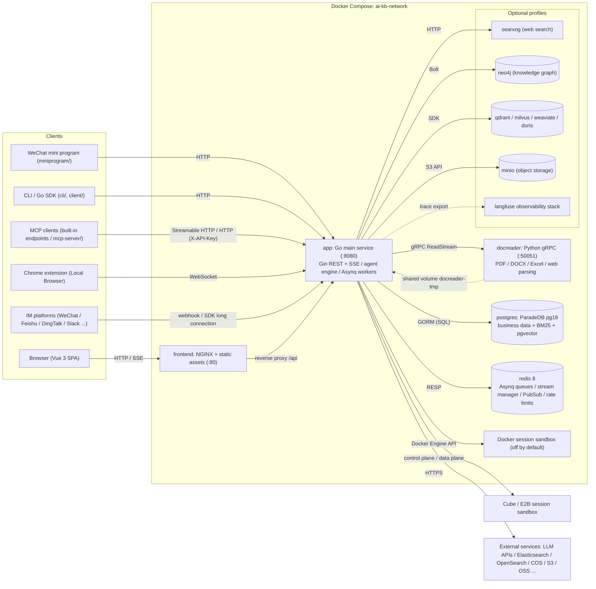
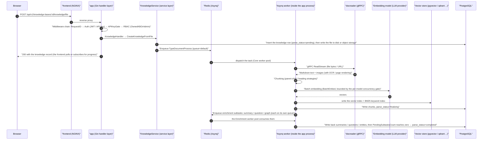

# Architecture overview

AI KB consists of a web frontend, a Go main service and a Python document parsing service. Business data lives in a database and asynchronous tasks are scheduled through Redis. Vector storage, object storage, the knowledge graph and model services are configured per deployment.

## System components

AI KB runs as three core processes, the main service, the frontend and the document parsing microservice, plus two infrastructure dependencies, PostgreSQL and Redis. Everything else (vector databases, knowledge graph, web search and so on) is optional and enabled on demand through Docker Compose profiles.

### Core services (started by default)

| Service | Image / build | Port | Role |
| --- | --- | --- | --- |
| `app` | `ghcr.io/jrmatherly/ai-kb-app` (`docker/Dockerfile.app`, Go) | `8080` | Main backend: REST API, RAG retrieval, agent engine, async task workers, IM and embed channels. Health check `GET /health` |
| `frontend` | `ghcr.io/jrmatherly/ai-kb-ui` (`frontend/`, NGINX + Vue 3 static build) | `80` | Web UI. NGINX also acts as the reverse proxy and forwards `/api` to `app` (`APP_HOST`, `APP_BACKEND_PORT` and `APP_SCHEME` can point it at a remote backend) |
| `docreader` | `ghcr.io/jrmatherly/ai-kb-docreader` (`docker/Dockerfile.docreader`, Python) | `50051` (exposed inside the Compose network only, not mapped to the host) | Document parsing microservice: a gRPC server that parses and renders more than 20 file types (PDF, DOCX, Excel, EPUB, web pages and others). Health check `grpc_health_probe` |
| `postgres` | `paradedb/paradedb:v0.26.1-pg18` | `5432` (network only) | Primary database. The ParadeDB distribution ships BM25 full-text search and pgvector, so **the default deployment needs no separate vector database** (`RETRIEVE_DRIVER=postgres`) |
| `redis` | `redis:8.10.2-alpine` (`appendonly` + `requirepass`) | `6379` (network only) | Asynq task queue, SSE stream management across instances, `system_settings` publish/subscribe, rate limiting and the distributed per-model concurrency gate |
| `sandbox` | `ghcr.io/jrmatherly/ai-kb-sandbox` (`docker/Dockerfile.sandbox`) | - | The standard runtime image. It is used directly by the workspace Docker backend; with CubeSandbox or E2B it is registered through their template API and used for Agent Skills |

`app` and `docreader` also share the `docreader-tmp` volume (mounted at `/tmp/docreader`) to hand over parsed images; `app` keeps local file storage in the `data-files` volume (`/data/files`).

### Optional components (Compose profiles)

| Service | Profile | Purpose |
| --- | --- | --- |
| `searxng` (+ one-shot `searxng-init`) | `searxng` / `full` | Self-hosted metasearch engine that gives agents Web Search (bound to `127.0.0.1:8888` by default) |
| `neo4j` | `neo4j` / `full` | Knowledge graph storage (GraphRAG), switched on with `NEO4J_ENABLE`, Bolt on `7687` |
| `minio` | `minio` / `full` | Object storage (`STORAGE_TYPE=minio`) |
| `qdrant` / `milvus` / `weaviate` | profile of the same name | Standalone vector databases (selected with `RETRIEVE_DRIVER`) |
| `doris-fe` + `doris-be` | `doris` | Apache Doris 4.1 retrieval engine (FE MySQL 9030 / FE HTTP 8030 Stream Load / BE 8040) |
| `odl-hybrid` | `odl-hybrid` | OpenDataLoader PDF hybrid parsing backend (docreader calls it over HTTP on `:5002`) |
| `dex` | `dex` / `full` | OIDC test IdP (used with `OIDC_AUTH_ENABLE`) |
| `langfuse-*` (web/worker/clickhouse/minio/db-init) | `langfuse` | Self-hosted LLM observability stack; reuses the AI KB `postgres` (a new `langfuse` database) and `redis` (DB 1) |
| `mcp` | `full` | The legacy standalone Python MCP server (`mcp-server/`) on host port `8082`; new deployments use the MCP endpoints built into `app` |

The Go backend can also connect directly to engines that are not in Compose: Elasticsearch v7/v8, OpenSearch, Tencent Cloud VectorDB, and eight object storage backends (local, MinIO, COS, TOS, S3, OSS, KS3, OBS).

### Deployment shapes

Besides the standard Docker Compose deployment, the repository supports:

- **Lite mode**: `DB_DRIVER=sqlite` (with the built-in sqlite-vec extension) and no `REDIS_ADDR` (Asynq falls back to the in-process `SyncTaskExecutor`). One binary serves everything; the frontend build is embedded and served by the Go process when `handler.Edition == "lite"`.
- **Desktop**: `cmd/desktop` packages the app with Wails v2. Sessions can run inside a local OS sandbox (macOS only for now, based on Seatbelt).
- **Kubernetes**: the `helm/` chart. **Bare metal**: the systemd unit in `deploy/`.

## Technology stack

| Layer | Technology | Version / notes |
| --- | --- | --- |
| Backend language | Go | `go.mod` declares `go 1.26.0` |
| Web framework | `github.com/gin-gonic/gin` | v1.12.0 |
| ORM | `gorm.io/gorm` + postgres/sqlite drivers | v1.31.1; SQLite ships with the `sqlite-vec` vector extension |
| Dependency injection | `go.uber.org/dig` | v1.19.0 (constructor injection, see the backend design page) |
| Async tasks | `github.com/hibiken/asynq` | v0.26.0 (Redis-backed, six worker pools) |
| Cache / queue | `github.com/redis/go-redis/v9` | v9.14.1 |
| Authentication | `github.com/golang-jwt/jwt/v5` + OIDC | Three paths: JWT Bearer, X-API-Key, OIDC |
| Database migrations | `github.com/golang-migrate/migrate/v4` | `migrations/versioned/*.up.sql`, run at startup when `AUTO_MIGRATE` is on |
| Logging | `github.com/sirupsen/logrus` + lumberjack rotation | Custom formatter, `request_id` carried through every line |
| Configuration | `github.com/spf13/viper` + `config/config.yaml` + environment variables | - |
| Observability | OpenTelemetry + Langfuse (`internal/tracing/langfuse`) | Traces at the level of individual LLM calls |
| gRPC | `google.golang.org/grpc` v1.81.0 | Calls docreader |
| LLM access | In-house protocol layer `internal/models/api` (one package per wire format: OpenAI, Anthropic, Gemini, DashScope and others), Ollama, the Tencent Cloud LKE SDK | 30 built-in provider definitions in `internal/models/providers`, see [Model management](../03-features/06-models.md) |
| Vectors / retrieval | pgvector, ES v7/v8, OpenSearch, Qdrant, Milvus, Weaviate, Doris, Tencent VectorDB, sqlite-vec | Assembled at runtime from `RETRIEVE_DRIVER` and the `vector_stores` table |
| Knowledge graph | `neo4j-go-driver/v6` | Optional |
| Data analysis | DuckDB (`duckdb-go/v2`), `pg_query_go` SQL validation | The agent's data analysis tool |
| Goroutine pool | `panjf2000/ants/v2` | Document processing concurrency pool (`CONCURRENCY_POOL_SIZE`) |
| MCP | `mark3labs/mcp-go` v1.1.1 | External MCP tools for agents (with OAuth) |
| API docs | swaggo/gin-swagger | `/swagger` is served when `GIN_MODE` is not `release` |
| Frontend framework | Vue 3 (^3.5) + TypeScript + Vite 7 | `frontend/package.json` |
| Frontend UI / state | TDesign Vue Next, Pinia, Vue Router 4, vue-i18n | Marked, KaTeX, Mermaid and highlight.js render rich text |
| Document parsing service | Python + grpcio | `docreader/main.py`; parsers live in `docreader/parser/` (pdf, docx, excel, epub, web, image, markitdown, opendataloader and others) |
| Desktop | Wails v2 | `cmd/desktop` |

## Inter-process communication

| Link | Protocol | Notes |
| --- | --- | --- |
| Browser → `frontend` (NGINX) → `app` | HTTP/HTTPS (REST + SSE) | NGINX proxies `/api`; chat responses stream over SSE |
| `app` → `docreader` | **gRPC** (default `docreader:50051`, `DOCREADER_TRANSPORT=grpc`, TLS/mTLS and `GRPC_AUTH_TOKEN` supported) | Proto definitions in `docreader/proto/`; large files use the streaming `ReadStream` call |
| `app` → `postgres` | PostgreSQL wire (GORM/pgx) | Business data + BM25 + pgvector |
| `app` ↔ `redis` | RESP (TLS supported) | (1) Asynq task queue (document parsing, enrichment, Wiki, memory and other tasks); (2) the Stream Manager for SSE reconnection (`STREAM_MANAGER_TYPE`); (3) `system_settings` change Pub/Sub; (4) embed channel rate limiting; (5) distributed per-model concurrency semaphore |
| `app` → `neo4j` | Bolt (`bolt://neo4j:7687`) | GraphRAG entity and relationship storage |
| `app` → `searxng` / web search providers | HTTP | SSRF allowlist check (`SSRF_WHITELIST_EXTRA` admits the Compose hosts `searxng,qdrant,milvus,weaviate,doris-fe,doris-be,minio` by default; with `SSRF_DNS_WHITELIST_ONLY` on, only allowlisted egress is permitted) |
| `app` → vector databases / object storage / LLM providers | Each vendor's SDK (HTTP, gRPC or MySQL protocol) | Doris uses the MySQL protocol plus Stream Load over HTTP |
| `app` → sandbox backends | Docker Engine API / Cube and E2B control and data planes | Session execution, skill installation and file artifacts; chosen by the workspace sandbox configuration |
| MCP clients → `app` | Streamable HTTP (`/mcp/:endpoint_id`, one Bearer token per endpoint) | The built-in MCP server exposes a workspace's knowledge base search and other capabilities to external MCP clients, see [MCP integration](../03-features/08-mcp.md) |
| Chrome extension ↔ `app` | WebSocket (`/api/v1/local-browser/extension`, WSS for remote deployments) | Local Browser: the `app` process hosts the BrowserSkill daemon and the extension runs web tasks in the user's browser, see [Local Browser](../05-clients/09-local-browser.md) |
| `app` ↔ IM platforms | HTTP webhooks / long-lived SDK connections | WeChat, WeCom, Feishu, DingTalk, Slack, Telegram, QQ, Mattermost, Yunzhijia (`internal/im/`) |

## Architecture diagram

## A typical request path: document upload and parsing

The diagram below follows one document from upload until it is searchable. It touches most of the interactions between components: the synchronous API, Asynq tasks, gRPC parsing, embedding and vector writes, and the enrichment subtasks.

The chat path (`POST /api/v1/knowledge-chat/:session_id` or `agent-chat`) is a synchronous SSE stream: handler → `SessionService` → the `chat_pipeline` plugin pipeline (query understanding → parallel retrieval → rerank → merge → prompt assembly → streaming LLM completion) → the Stream Manager (Redis or in-memory) pushes the token stream back to the client. The backend design page covers it in detail.

## Repository top-level directories

| Directory | Role |
| --- | --- |
| `cmd/` | Executable entry points. `cmd/server`: the main service (main, bootstrap, listen and platform signal handling); `cmd/desktop`: the Wails desktop edition; `cmd/download`: downloads the DuckDB extensions the data analysis tool needs; `cmd/milvus-migrate`: Milvus migration helper |
| `internal/` | All Go backend business code (layering is described in the backend design page): `handler`, `application/service`, `application/repository`, `container` (DI), `router`, `middleware`, `types`, `agent`, `im`, `mcp`, `stream`, `sandbox` and more |
| `frontend/` | The Vue 3 + Vite + TDesign web frontend; the build is served by NGINX or embedded in Lite mode |
| `docreader/` | The Python gRPC document parsing microservice: `main.py` server entry point, `parser/` parsers, `splitter/` splitters, `proto/` protocol definitions, built with its own `Dockerfile.docreader` |
| `cli/` | The `aikb` command-line tool: operations on knowledge bases, documents, search, sessions, agents, models, MCP, skills and other resources, plus `doctor` diagnostics, see [CLI](../05-clients/02-cli.md) |
| `client/` | Go SDK: an HTTP client that wraps the AI KB API for integrations |
| `mcp-server/` | The Python MCP server (`aikb_mcp_server.py`) that exposes the AI KB API as MCP tools to Claude and other MCP clients |
| `miniprogram/` | The WeChat mini program client (WXML/WXSS/JS) |
| `migrations/` | golang-migrate database migrations: `versioned/` (the Postgres mainline, `NNNNNN_*.up/down.sql`), `sqlite/` (Lite mode), `paradedb/`, `mysql/` |
| `config/` | Runtime configuration: `config.yaml` main config, `builtin_agents.yaml` built-in agents, `agent_type_presets.yaml` agent presets, `builtin_models.yaml.example` declarative built-in models, `models.json.example` model vendor catalog overlay, `prompt_templates/` prompt templates |
| `docker/` | The Dockerfiles for each image (app, docreader, sandbox, odl-hybrid) and the searxng configuration |
| `deploy/` | Bare-metal deployment resources (systemd unit and the like) |
| `helm/` | The Kubernetes Helm chart (Chart.yaml, values.yaml, templates/) |
| `examples/` | API usage examples; `examples/skills/` holds Agent Skill package examples |
| `dataset/` | QA evaluation datasets and their generation scripts |
| `scripts/` | Build, start-up and migration helper scripts (`start_all.sh`; `build_frontend_dist.sh` for Lite and desktop packaging; the UI image is a multi-stage build from `frontend/Dockerfile`) |
| `tests/`, `testdata/` | Integration tests and test data |
| `misc/` | Miscellany (for example `dex-config.yaml`, the OIDC test configuration) |
| `packages/` | Independently published integration packages, such as the DeepSeek Harness plugin `packages/dsh-ai-kb`, see [DeepSeek Harness](../05-clients/08-deepseek-harness.md) |
| `docs/` | Old, no longer maintained docs; holds the generated Swagger package, release assets and historical images |

> Note: the Go module path is `github.com/jrmatherly/ai-kb`. The root directory also holds `docker-compose.yml` (production orchestration), `docker-compose.dev.yml` (development orchestration), the `Makefile`, `VERSION` and similar files.

The next page, Go backend design, goes inside `internal/`: layered architecture, dig dependency injection, the startup sequence, routing and RBAC, middleware, domain models, and the error and logging conventions.
