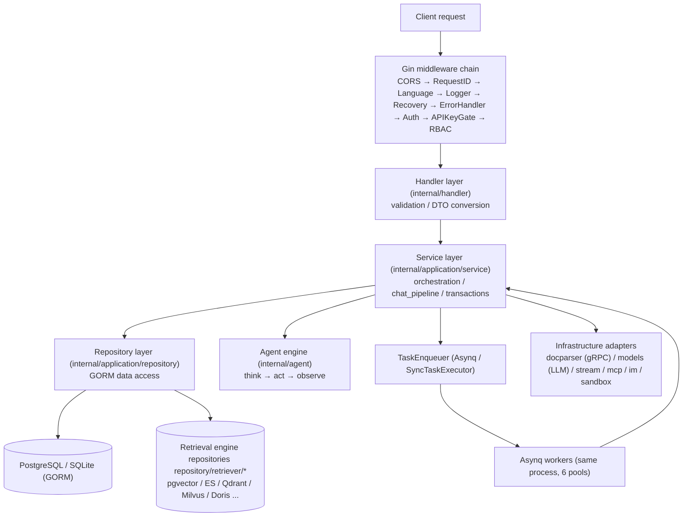
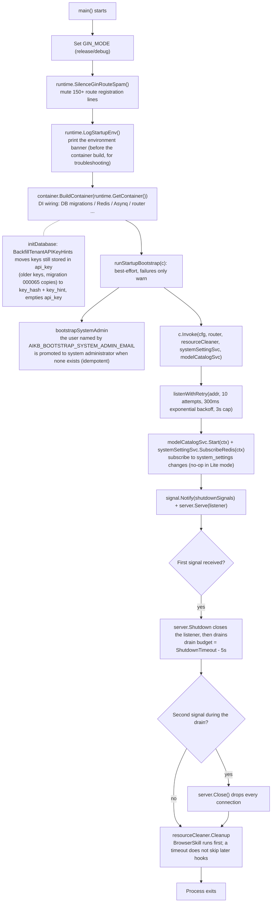

# Go backend design

The Go backend handles a request in layers: Handler, Service, Repository and infrastructure, wired together with uber/dig. `cmd/server` owns startup and shutdown; `internal/` holds routing and authentication, business services and storage access.

## Layered architecture

The backend follows the classic **Handler → Service → Repository → database** structure. Every dependency between layers is an interface declared in `internal/types/interfaces/`, bound by the DI container at startup:

| Layer | Location | Responsibility |
| --- | --- | --- |
| Router / middleware | `internal/router/`, `internal/middleware/` | Route registration, authentication, RBAC, rate limiting, logging, the error envelope |
| Handler | `internal/handler/` (session handlers in `internal/handler/session/`) | Parse request parameters (DTOs in `internal/handler/dto/`), call a Service, write the response; no business logic |
| Access control | `internal/application/access/` | Shared authorization rules with no Gin dependency: three-tier knowledge base access resolution, organization sharing, the knowledge base scope of a shared agent, file and message artifact authorization, cross-knowledge-base clone and move authorization |
| Service | `internal/application/service/` (about 160 non-test files) | Business orchestration: knowledge bases, knowledge items and chunks, sessions and the `chat_pipeline/` pipeline, agents, workspaces and members, models, data source sync, Wiki, audit and more |
| Repository | `internal/application/repository/` (about 50 non-test files) | Data access through **GORM** (`type knowledgeRepository struct { db *gorm.DB }`, every call goes through `r.db.WithContext(ctx)`); retrieval engine repositories live in one package per engine under `repository/retriever/{postgres,elasticsearch,qdrant,milvus,weaviate,doris,opensearch,tencentvectordb,sqlite,neo4j}` |
| Domain model | `internal/types/` | GORM entities, enums, context keys, interface definitions (`types/interfaces`) |
| Infrastructure | `internal/infrastructure/` (docparser gRPC client, web_search, web_fetch, chunker), `internal/models/` (chat, embedding, rerank, VLM and ASR adapters), `internal/stream/`, `internal/sandbox/`, `internal/mcp/`, `internal/im/` | Adapters for external systems |



Key conventions:

- A Handler depends only on Service interfaces (for example `interfaces.KnowledgeService`); a Service depends only on Repository interfaces and other Service interfaces.
- All interfaces are declared in `internal/types/interfaces/`; implementations are bound through dig.
- The Asynq workers run in the **same process** as the HTTP server, and task handlers reuse the same Service instances.

## Dependency injection: internal/container (uber/dig)

AI KB uses **`go.uber.org/dig` v1.19.0**, a constructor-injection container (not the code-generating wire). The entry point is `BuildContainer` in `internal/container/container.go`:

```go
// cmd/server/main.go
c := container.BuildContainer(runtime.GetContainer())

// internal/container/container.go
func BuildContainer(container *dig.Container) *dig.Container {
    must(container.Provide(NewResourceCleaner, dig.As(new(interfaces.ResourceCleaner))))
    must(container.Provide(config.LoadConfig))
    must(container.Provide(initDatabase))     // *gorm.DB
    must(container.Provide(initRedisClient))  // *redis.Client (nil in Lite mode)
    ...
    must(container.Provide(repository.NewTenantRepository))
    must(container.Provide(service.NewTenantService))
    ...
    must(container.Provide(router.NewRouter)) // finally yields *gin.Engine
    return container
}
```

`runtime.GetContainer()` (`internal/runtime/container.go`) holds the global `dig.Container` singleton. `must(err)` panics on a registration failure: a DI wiring error is fatal at startup.

### dig features in use

| Feature | Example |
| --- | --- |
| `dig.As` | Bind a concrete type to an interface: `container.Provide(NewResourceCleaner, dig.As(new(interfaces.ResourceCleaner)))`; `router.NewAsyncqClient` is bound as `interfaces.TaskEnqueuer` |
| `dig.Name` named dependencies | Several instances of one interface: the extraction services (`chunkExtractor`, `dataTableSummary`, `imageMultimodal`, `knowledgePostProcess`, `knowledgeAutoTag`, `knowledgeBaseProfile`), the 6 Asynq servers (`coreAsynqServer`, `postProcessAsynqServer`, `enrichmentAsynqServer`, `maintenanceAsynqServer`, `sharedAsynqServer`, `wikiAsynqServer`), `wikiIngest` |
| `dig.In` parameter struct | `router.RouterParams` embeds `dig.In` and receives about 60 Handler and Service dependencies in one struct instead of a very long constructor signature |
| `container.Invoke` for side effects | Components that start when registered: `registerPoolCleanup`, `registerWebSearchProviders`, `startDataSourceScheduler`, `startHousekeepingService`, `startAuditLogRetention`, `startTemporaryDocumentCleanup`, `startTenantSkillReaper`, `startForkSnapshotReaper`, 17 `chatpipeline.NewPluginXxx` calls (Search, Rerank, WebFetch, Merge, DataAnalysis, QueryUnderstand, LoadHistory, ChatCompletionStream and others register themselves with the EventManager), `router.RunAsynqServer`, `recoverPendingWikiTasks` and more |
| Adapter Provide | A closure converts between interfaces: `func(s *service.StorageBackendService) interfaces.StorageBackendService { return s }`; the `RetrieveEngineRegistry` instance is also exposed as `StoreRegistry` |

### Registration order and conditional wiring

`BuildContainer` registers in nine stages, each with a matching debug log line: (1) core infrastructure (config, Langfuse, database, file storage, Redis, ants pool) → (2) the retrieval engine registry → (3) external clients (docreader gRPC, Ollama, Neo4j, StreamManager, DuckDB) → (4) the Repository layer (about 40) → (5) the Service layer (about 60, including the MCP manager, the event bus and the agent approval gate `approval.Gate`) → (6) **conditional task executor wiring** → (7) chat_pipeline plugins → (8) the Handler layer (about 40) and IM adapters → (9) the router and the Asynq servers.

Stage 6 is the most important conditional branch in the repository. **Whether Redis is configured decides the runtime shape**:

```go
redisAvailable := os.Getenv("REDIS_ADDR") != ""
if redisAvailable {
    must(container.Provide(router.NewAsyncqClient, dig.As(new(interfaces.TaskEnqueuer))))
    must(container.Provide(router.NewCoreAsynqServer, dig.Name("coreAsynqServer")))
    ... // 6 worker pools in total, plus the Asynq inspector
    must(container.Invoke(registerModelConcurrencyLimiter))   // Redis-backed per-model concurrency gate
} else {
    syncExec := router.NewSyncTaskExecutor()                  // Lite mode: in-process synchronous executor
    must(container.Provide(func() interfaces.TaskEnqueuer { return syncExec }))
    must(container.Provide(router.NewNoopTaskInspector))
    must(container.Invoke(registerLiteModelConcurrencyLimiter)) // in-process semaphore
}
```

The concurrency of the 6 Asynq worker pools is adjustable through system settings or environment variables (defaults Core=8, PostProcess=2, Enrichment=12, Maintenance=4, Shared=6, Wiki=8; `AIKB_ASYNQ_CORE_CONCURRENCY`, `AIKB_ASYNQ_POSTPROCESS_CONCURRENCY`, `AIKB_ASYNQ_ENRICHMENT_CONCURRENCY`, `AIKB_ASYNQ_MAINTENANCE_CONCURRENCY`, `AIKB_ASYNQ_SHARED_CONCURRENCY`, `AIKB_WIKI_ASYNQ_CONCURRENCY`). The queue topology is defined in `internal/types/task.go` (`default`, `chat_attachment`, `postprocess`, `summary`, `multimodal`, `graph`, `question`, `memory`, `sync`, `low` for maintenance, `wiki`), including auto-tagging and memory extraction.

### Resource cleanup and factories

- `ResourceCleaner` (`internal/container/cleanup.go`): components register their teardown with `RegisterWithName(name, cleanupFunc)` (the ants pool, the Langfuse flush, the MCP manager, the IM service, the data source scheduler, housekeeping and others), and `Cleanup(ctx)` runs them all at exit, in reverse registration order. `Promote(name)` moves a hook to the front; BrowserSkill uses it so the local browser closes before hooks that wait on in-flight jobs.
- `EngineFactory` (`internal/container/engine_factory.go`): creates retrieval engine instances at runtime from rows of the `vector_stores` table (`createQdrantEngine`, `createMilvusEngine`, `createDorisEngine`, `createOpenSearchEngine` and the rest) instead of binding one engine statically at startup.
- `initDatabase` does more than open the connection: automatic golang-migrate migrations (`AUTO_MIGRATE`; a failure only warns unless `AIKB_MIGRATE_FAIL_FAST` is set, which stops startup), backfilling the `__pending_env__` storage provider marker, migrating legacy storage backends, syncing PostgreSQL sequences, resetting pending tasks in Lite mode, and a declarative UPSERT of the built-in models from `config/builtin_models.yaml`, then resolving the per-install JWT secret (`system_secrets`) and backfilling API key hashes and hints (`BackfillTenantAPIKeyHints`). With SQLite it forces `SetMaxOpenConns(1)` to serialize writes.

## cmd/server startup sequence

`cmd/server` has three logic files: `main.go` (entry point and the HTTP lifecycle), `bootstrap.go` (one-shot bootstrap hooks) and `listen.go` (port retry), plus `signals_unix.go` and `signals_windows.go`, which provide the platform `shutdownSignals` (SIGINT, SIGTERM and SIGHUP on Unix).



Points to note:

- **Bootstrap failures do not block startup**: `bootstrap.go` logs failures with `logger.Warnf`. System administrator bootstrap only applies while the deployment has no system administrator, so a restart does not restore a revoked privilege.
- **Two-stage graceful shutdown**: the first SIGTERM or SIGINT calls `server.Shutdown`, which closes the listener first (the port is immediately free for a new process). `runtime.ShutdownBudgets` reserves 5s of `ShutdownTimeout` (default 30s) for resource cleanup and gives the rest to draining existing connections. Do not call `listener.Close()` by hand before `Shutdown`: `Serve` would return `use of closed network connection` instead of `ErrServerClosed`, and `logger.Fatalf` would kill the process before cleanup. A second signal forces `Close`.
- **Port-in-use retry**: `listenWithRetry` retries 10 times with exponential backoff starting at 300ms and capped at 3s, so a rolling restart does not fail while the old process still holds the port.

## Route organization and RBAC wiring (internal/router)

### NewRouter assembly order

`NewRouter(params RouterParams)` in `internal/router/router.go` (`RouterParams` is a `dig.In` struct) assembles in the order below. **The order is the security model**:

1. `gin.New()` + `MultipartFormCleanup` (deletes the temporary files written by multipart parsing once the request ends) + `SetTrustedProxies` (`AIKB_TRUSTED_PROXIES`; by default only loopback and private ranges are trusted, so a forged `X-Forwarded-For` cannot bypass per-IP rate limits).
2. Global middleware: `cors` → `RequestID` → `Language` → `Logger` → `Recovery` → `ErrorHandler`.
3. Unauthenticated endpoints: `GET /health`; `/swagger/*any` outside release mode.
4. The `frame-ancestors` CSP middleware for embed pages; the embedded frontend static assets in the Lite edition (`handler.Edition == "lite"`).
5. Public routes registered **before authentication**: IM platform callbacks (`/api/v1/im`, each platform verifies its own signature), the public Web Embed routes (`/api/v1/embed/:channel_id`, `middleware.EmbedAuth` publish-token authentication plus Redis rate limiting), the built-in MCP server (`/mcp/:endpoint_id`, `middleware.MCPEndpointAuth` per-endpoint Bearer token), short-lived capability URLs (resource grants), the sandbox terminal and desktop WebSockets (a browser cannot send auth headers during the handshake, so they use a short-lived ticket minted by an authenticated POST), and the Local Browser extension connection (`/api/v1/local-browser/*`).
6. `middleware.Auth(...)` global authentication; then the authenticated file proxy routes, the presigned file routes (no login, signature check only), the Langfuse trace middleware and `AuditServiceProvider`.
7. `v1 := r.Group("/api/v1")`: first `v1.Use(rbacGuards.apiKeyAuthorizer.Middleware())` (the API key gate; JWT sessions pass straight through), then about 40 `RegisterXxxRoutes(v1, handler, rbacGuards)` calls in sequence.
8. A final self-check: `rbacGuards.assertAPIKeyPoliciesMatchRoutes(r)`. If a declared API key policy points at a route template that does not exist (path drift, a typo), **startup panics** rather than shipping a policy that always returns 403.

### Route groups

| Group prefix | Register function | API key policy example |
| --- | --- | --- |
| `/auth`, `/me` | RegisterAuthRoutes / RegisterMyInvitationRoutes | Mostly no key needed |
| `/tenants`, `/tenants/:id/*` (members, invitations, audit) | RegisterTenantRoutes | `manage_members` / `manage_spaces`; the `/:id` group carries `PathTenantMatch()` |
| `/knowledge-bases`, `/knowledge-bases/:id/knowledge\|faq\|tags\|shares` | RegisterKnowledgeBaseRoutes and others | `retrieve` / `ingest` (fallback `full_access`) |
| `/knowledge`, `/chunks` | RegisterKnowledgeRoutes / RegisterChunkRoutes | `ingest` |
| `/sessions`, `/knowledge-chat`, `/agent-chat`, `/knowledge-search`, `/messages` | RegisterSessionRoutes / RegisterChatRoutes and others | `chat` / `retrieve` |
| `/models`, `/evaluation`, `/weknoracloud/credentials` | RegisterModelRoutes / RegisterEvaluationRoutes / RegisterWeKnoraCloudRoutes | `manage_models` / `run_evaluations` |
| `/sandbox-configs`, `/me/env-vars`, `/me/browser` | RegisterSandboxConfigRoutes / RegisterMyEnvVarRoutes and others | `full_access`; `/me/*` is for the JWT user only |
| `/system`, `/system/admin` | RegisterSystemRoutes / RegisterSystemAdminRoutes | The admin group enforces `g.SystemAdmin()` |
| `/mcp-services`, `/agent`, `/web-search`, `/web-search-providers` | The matching Register functions | `manage_mcp_services` / `manage_web_search` |
| `/vector-stores`, `/storage-backends` | RegisterVectorStoreRoutes / RegisterStorageBackendRoutes | `manage_vector_stores` / `manage_storage_backends` |
| `/agents`, `/agents/:id/shares\|embed-channels\|im-channels` | RegisterCustomAgentRoutes and others | `full_access` / `manage_channels` |
| `/organizations`, `/user/favorites`, `/skills` | The matching Register functions | `manage_spaces` and others |
| `/im-channels`, `/embed-channels`, `/mcp-endpoints`, `/wechat` | RegisterIMChannelRoutes / RegisterEmbedChannelRoutes / RegisterMCPEndpointRoutes | `manage_channels` |
| `/datasource`, `/knowledgebase/:kb_id/wiki`, `/chunker/preview` | RegisterDataSourceRoutes / RegisterWikiPageRoutes / RegisterChunkerDebugRoutes | `manage_datasources` / `ingest` |

### rbacGuards: the central permission matrix

`internal/router/rbac.go` defines `rbacGuards`, built once by `NewRouter` and passed to every Register function. The guards come in three kinds and are used inline on the route line, so the permission requirement is visible at a glance:

```go
kb.PUT("/:id", g.OwnedKBOrAdmin(), handler.UpdateKnowledgeBase)
```

- **Role guards** (which role does the caller hold in this workspace?): `Viewer()` / `Contributor()` / `Admin()` / `Owner()` / `AdminOrSystemAdmin()` / `SystemAdmin()`, built on `middleware.RequireRole`.
- **Ownership guards** (is the caller the creator of this resource, or Admin or above?): `OwnedKBOrAdmin()`, `OwnedAgentOrAdmin()`, `OwnedKnowledgeKBOrAdmin()`, `OwnedChunkKBOrAdmin()`, `OwnedWikiKBOrAdmin()` and others. Child resources (chunk, wiki, FAQ, tag) resolve the owning knowledge base's `creator_id` from the URL parameter through closures such as `KBCreatorLookupFromKnowledgeID`, so they share one rule with the parent resource.
- **Knowledge base access guards** (three-tier resolution: own knowledge base / knowledge base shared across the organization / knowledge base visible through a shared agent): `KBAccessRead|Write(param)` and the `...FromKnowledgeIDParam` / `...FromChunkIDParam` variants, built on `middleware.RequireKBAccess`.
- **Workspace boundary guards**: `CrossTenant()` (platform-level operations need `EnableCrossTenantAccess` plus `CanAccessAllTenants`) and `PathTenantMatch()` (`/tenants/:id` must match the workspace in the context).

The source comments give a decision tree for choosing a guard (resources with a creator use OwnedXxxOrAdmin, workspace-level infrastructure uses Admin, creation entry points use Contributor). Every guard honours the `cfg.Tenant.EnableRBAC` switch: when it is off, a request that would have been denied is logged and allowed through (the behavior for a staged migration).

**API key policies** are orthogonal to the role guards. `apiKeyGroup(grp, policy)` wraps a gin RouterGroup and records `(method, fullPath) → APIKeyRoutePolicy` in the `APIKeyRouteAuthorizer` policy table while the route is registered. The policy constructors are `apiKeyFullAccess()`, `apiKeyPlatform(...)` and 18 capability wrappers (`apiKeyRetrieve` / `apiKeyChat` / `apiKeyIngest` / `apiKeyManageModels` and others). A route with no registered policy is **denied (fail-closed)** for API key principals.

## Middleware inventory (internal/middleware)

In the order a request passes through them:

| Middleware | File | Responsibility and key logic |
| --- | --- | --- |
| `MultipartFormCleanup()` | multipart_cleanup.go | After the request ends (including failures and recovered panics), deletes the files multipart forms wrote to the system temp directory, so a container's `/tmp` does not keep growing |
| `cors.New` (gin-contrib) | router.go | Allows `Authorization`, `X-API-Key`, `X-Tenant-ID`, `X-Embed-Session`, `X-AIKB-Desktop-Token`, and the headers MCP Streamable HTTP needs (`MCP-Protocol-Version`, `Mcp-Session-Id` and others); MaxAge 12h |
| `RequestID()` | logger.go | Reuses the `X-Request-ID` request header or generates a UUID, stores it in the gin context and `Request.Context()`, and carries it through logs and traces |
| `Language()` | language.go | Decides the document processing language: the `AIKB_LANGUAGE` environment variable, then the first `Accept-Language` tag, then the default `en-US` |
| `Logger()` | logger.go | Full request and response logging; regex masking of password and token fields, truncation of base64 image data URLs, SSE responses marked and skipped, 10KB cap per entry |
| `Recovery()` | recovery.go | Catches panics, records the stack trace, returns 500 |
| `ErrorHandler()` | error_handler.go | Reads the last error in `c.Errors`: an `*errors.AppError` is returned with its `HTTPCode` in the uniform `{success:false, error:{code,message,details}}` envelope; anything else is a 500 |
| `EmbedAuth(...)` | embed_auth.go | Only on the public `/api/v1/embed/:channel_id` group: validates the publish token, injects the embed channel context; three-level Redis rate limiting (per IP per minute, channel-wide per minute, channel per day) |
| `MCPEndpointAuth(...)` | mcp_endpoint_auth.go | Only on `/mcp/:endpoint_id`: validates the endpoint Bearer token and injects the endpoint's workspace, a machine principal and an API-key-style permission scope derived from the tool allowlist and the knowledge base scope |
| `AttachAuthenticatedUser(...)` | ws_auth.go | WebSocket routes such as the sandbox terminal: builds the same authenticated session as `Auth` from the user resolved from a short-lived ticket; membership and role still come from the database |
| `PublicAuthRateLimit()` | auth_public_ratelimit.go | Unauthenticated invitation lookup and invite registration routes: an **in-memory** sliding window, 30 requests per 60s per IP, expired buckets cleaned every 2 minutes, 429 when exceeded |
| `Auth(...)` | auth.go | Core authentication with three modes: (1) JWT (`Authorization: Bearer`, `userService.ValidateToken`); (2) API key (`X-API-Key`, `AuthenticateAPIKey`); (3) the `noAuthAPI` allowlist (for example `GET /system/links`). Supports switching workspace with `X-Tenant-ID` (`IsTenantAccessible` checks three cases: own workspace, cross-workspace system administrator, active membership), and `resolveTenantRole` resolves the role in that workspace. Writes `TenantIDContextKey`, `TenantInfoContextKey`, `UserContextKey`, `UserIDContextKey`, `TenantRoleContextKey`, `SystemAdminContextKey`, `PrincipalContextKey` and more into the context |
| `langfuse.GinMiddleware()` | tracing/langfuse | LLM observability trace; a no-op when no `LANGFUSE_*` variable is set |
| `AuditServiceProvider()` | audit_provider.go | Puts the `AuditLogService` into the gin context so RBAC denial paths can write audit entries; degrades gracefully when the service is nil |
| `APIKeyRouteAuthorizer.Middleware()` | api_key_gate.go | The route-level gate for API key principals: looks up the `(method, fullPath)` policy and checks `PlatformOnly` / `RequireFullAccess` / `Capabilities`; an undeclared route is denied; JWT users pass through |
| `RequireRole(min)` and relatives | rbac.go | Minimum role check in the workspace (owner=40 > admin=30 > contributor=20 > viewer=10); `RequireOwnershipOrRole(min, creatorLookup)` lets the resource creator pass below the minimum role; API key principals short-circuit (their authorization is the API key gate); a cross-workspace system administrator temporarily gets Admin; a denial calls `AuditService.LogDenied` |
| `RequireCrossTenantAccess()` / `RequirePathTenantMatch()` | access.go | The platform-level operation gate and the URL workspace consistency check |
| `RequireKBAccess(resolver, perm, ...)` | kb_access.go | Adapts the three-tier knowledge base access resolution of `internal/application/access` (own → organization share → shared agent, read-only) and **rewrites** `TenantIDContextKey` in `Request.Context()` to the knowledge base's source workspace, so downstream retrieval reads the right workspace's data |
| `asynqdl.Middleware()` | asynqdl/ | Not HTTP: when an Asynq task exhausts its retry budget it is written to the `task_dead_letters` table; an `OnDeadLetter` callback can update business state (for example marking a knowledge item as failed) |

## Domain model overview (internal/types)

`internal/types/` holds about 30 GORM entities. The core relationships:

```mermaid
erDiagram
    TENANT ||--o{ USER : "home workspace (users.tenant_id)"
    TENANT ||--o{ TENANT_MEMBER : "members"
    USER ||--o{ TENANT_MEMBER : "joins several workspaces"
    TENANT ||--o{ TENANT_API_KEY : "API key (platform-level when tenant_id is empty)"
    TENANT ||--o{ KNOWLEDGE_BASE : "owns"
    TENANT ||--o{ MODEL : "model configuration"
    TENANT ||--o{ CUSTOM_AGENT : "custom agents"
    TENANT ||--o{ VECTOR_STORE : "vector store instances"
    TENANT ||--o{ STORAGE_BACKEND : "storage backends"
    TENANT ||--o{ DATA_SOURCE : "external data sources"
    TENANT ||--o{ SESSION : "sessions"
    TENANT ||--o{ AUDIT_LOG : "audit (tenant_id=0 is system level)"
    KNOWLEDGE_BASE ||--o{ KNOWLEDGE : "documents (knowledge.knowledge_base_id)"
    KNOWLEDGE_BASE ||--o{ KNOWLEDGE_TAG : "tags"
    KNOWLEDGE_BASE ||--o| VECTOR_STORE : "vector_store_id bound at creation"
    KNOWLEDGE_BASE ||--o| STORAGE_BACKEND : "storage_backend_id bound at creation"
    KNOWLEDGE_BASE ||--o{ WIKI_PAGE : "Wiki pages"
    KNOWLEDGE_BASE ||--o{ WIKI_FOLDER : "Wiki folder tree"
    KNOWLEDGE ||--o{ CHUNK : "chunks (chunk.knowledge_id)"
    DATA_SOURCE ||--o{ SYNC_LOG : "sync records"
    SESSION ||--o{ MESSAGE : "messages (message.session_id)"
    MESSAGE }o--|| CUSTOM_AGENT : "agent_id"
    MESSAGE }o--|| MODEL : "model_id"

    TENANT {
        uint64 id PK
        string name
        int64 storage_quota
        json retriever_engines
        json credentials_config "AES-256 encrypted"
    }
    USER {
        string id PK "UUID"
        string username UK
        string email UK
        uint64 tenant_id FK
        bool is_system_admin
        bool can_access_all_tenants
    }
    TENANT_MEMBER {
        uint64 id PK
        string user_id FK "uniq(user_id,tenant_id)"
        uint64 tenant_id FK
        string role "owner/admin/contributor/viewer"
        string status "active/invited/suspended"
    }
    KNOWLEDGE_BASE {
        string id PK "UUID"
        uint64 tenant_id FK
        string creator_id FK "RBAC ownership"
        string type "document/faq/wiki"
        json chunking_config
        json indexing_strategy "vector/keyword/wiki/graph pipeline switches"
        string embedding_model_id FK
    }
    KNOWLEDGE {
        string id PK "UUID"
        string knowledge_base_id FK
        string parse_status "pending→processing→finalizing→completed and others, 7 states"
        string channel "web/api/wechat/feishu... 17 values"
        int pending_subtasks_count
    }
    CHUNK {
        string id PK "UUID"
        string knowledge_id FK
        string chunk_type "text/parent_text/faq/entity/wiki_page... 13 values"
        string parent_chunk_id "parent and child chunks"
        string content_hash
    }
    SESSION {
        string id PK "UUID"
        uint64 tenant_id FK
        string user_id "user / API principal / embed visitor"
        json last_request_state
    }
    MESSAGE {
        string id PK "UUID"
        string session_id FK
        string role "user/assistant/system"
        json knowledge_references "retrieval citations"
        json agent_steps "agent reasoning trace"
        text rendered_content "the full RAG-augmented prompt"
    }
    MODEL {
        string id PK
        uint64 tenant_id FK
        string type "Embedding/Rerank/KnowledgeQA/VLLM/ASR"
        string source "local / remote / vendor id"
        json parameters "API key AES encrypted"
    }
```



Design points:

- **Multi-workspace isolation**: almost every entity carries `TenantID`; `tenant_id=0` means system level (system audit entries, for example).
- **Sensitive fields encrypted at rest**: `Model.Parameters`, `VectorStore.ConnectionConfig`, `StorageBackend.Config`, `DataSource.Config` and others are encrypted with AES-256-GCM in their GORM `Value()` hook using `SYSTEM_AES_KEY` (32 bytes) and decrypted leniently in `Scan()` (a decryption failure reads as "not configured" rather than an error). API keys are not encrypted: only a SHA-256 `KeyHash` and a masked `KeyHint` are stored.
- **Bound at creation, then immutable**: a knowledge base's `VectorStoreID` (gorm tag `<-:create`) and `StorageBackendID` cannot change after creation, which keeps the index and the files consistent.
- **Asynchronous state machine**: `Knowledge.ParseStatus` has seven states, and `PendingSubtasksCount` tracks the parallel enrichment subtasks (summary, question, graph) of the finalizing stage.
- **Append-only audit**: `AuditLog` has no update or soft-delete columns and covers 60+ `AuditAction` values.
- Important non-entity types: `SearchResult` for retrieval results, `Pagination`, `Task` and the queue topology (`task.go`), the JSONB configuration structs (`ChunkingConfig`, `IndexingStrategy`, `CustomAgentConfig` and others), and the context keys with their accessors (`context_helpers.go`).

## Error handling conventions (internal/errors)

The single error carrier is `AppError`:

```go
// internal/errors/errors.go
type AppError struct {
    Code     ErrorCode // business error code
    Message  string
    Details  any
    HTTPCode int       // HTTP status mapping
}
```

- **Code ranges**: 1000-1999 generic HTTP semantics (`ErrBadRequest=1000`, `ErrUnauthorized=1001`, `ErrForbidden=1002`, `ErrNotFound=1003`, `ErrTooManyRequests=1006`, `ErrServiceUnavailable=1008`, `ErrBadGateway=1011`); 2000-2099 workspace; 2100-2199 agent; 2200-2299 vector store.
- **Constructors**: `NewBadRequestError` / `NewUnauthorizedError` / `NewForbiddenError` / `NewNotFoundError` / `NewValidationError` / `NewConflictError` / `NewTooManyRequestsError` / `NewServiceUnavailableError` and others.
- **How they fit together**: a Handler or middleware attaches the error with `c.Error(appErr)`, the `ErrorHandler` middleware renders the `{success:false, error:{code,message,details}, request_id}` envelope at the end, and the frontend localizes on `error.code`. Anything that is not an `AppError` becomes a 500, and every 500 is sent as a fixed "Internal server error" with no details: the `Logger` middleware records the real cause under the same `request_id`.
- `session.go` provides the session domain sentinel errors (`ErrSessionNotFound` and others). `parse_error_codes.go` defines the string error codes of the document parsing stage (`DOCREADER_TIMEOUT`, `EMBEDDING_RATE_LIMIT`, `VECTORSTORE_WRITE_FAILED`, `TASK_TIMEOUT` and others), stored in `Knowledge.ErrorMessage` for the frontend to translate and display.

## Logging (internal/logger)

- Built on **logrus** with a private `appLogger` instance and a custom formatter (colored terminal output; `LOG_FORMAT` accepts a template with placeholders such as `%d`, `%level`, `%traceId` and `%msg`; when `LOG_PATH` is set, output is rotated with lumberjack and written to a file with ANSI color codes stripped).
- **request_id end to end**: `middleware.RequestID` writes it into the context, and `logger.GetLogger(ctx)` extracts it and adds the `request_id` field. The usual calls are `logger.Infof/Warnf/Errorf(ctx, format, ...)` and `ErrorWithFields`.
- **LLM debug log** (`llm_logger.go`): enabled with `LLM_DEBUG_LOG=true`. Every LLM call is recorded in a file per request_id (`LLMCallRecord`: CallType Chat/Embedding/Rerank/VLM, the model, the duration, the full messages and tool calls, the error). Files are deleted after 7 days. Use it to debug prompts and context.

## Key utility libraries (internal/common, internal/utils)

| Location | Utility | Purpose |
| --- | --- | --- |
| `common/tools.go` | `Deduplicate` / `DeduplicateWithScore`, `ParseLLMJsonResponse`, `CleanInvalidUTF8`, the `PipelineLog` family | Generic deduplication (retrieval merging keeps the highest score), parsing the ```json code block an LLM returns, stripping invalid UTF-8, RAG pipeline stage logging |
| `common/db_retry.go` | `WithDeadlockRetry(ctx, fn)` | Retries on a detected database deadlock (up to 3 times, 50→100→200ms backoff) |
| `common/redis_tls.go` | `RedisTLSConfig()` | Builds the Redis TLS configuration from `REDIS_USE_TLS` and related environment variables |
| `utils/crypto.go` | `EncryptAESGCM` / `DecryptAESGCM` (`enc:v1:` prefix, idempotent) | The implementation behind every encrypted-at-rest field above |
| `utils/security.go` | `SanitizeHTML`, `ValidateFilePath`, `SanitizeForLog` | XSS sanitizing, path traversal protection, log masking |
| `utils/inject.go` | `ValidateSQL` (built on `pganalyze/pg_query_go`) | Table allowlist validation and injection pattern detection for the SQL the data analysis agent generates |
| `utils/presign.go` | `SignFileURL` / `VerifyFileURLSig`, `SystemHMACKey` | HMAC-SHA256 presigned file URLs (2h by default, used for inline images in IM); the signing key is `SYSTEM_SIGNING_KEY`, falling back to `SYSTEM_AES_KEY` when unset |
| `utils/oidc_state.go` | `SignOIDCState` / `VerifyOIDCState` | HMAC-signed OIDC authorization state with a 10-minute TTL (CSRF protection) |
| `utils/log_sanitize.go` | `CompactImageDataURLForLog` | Truncates oversized image data URLs so logs do not explode |
| `utils/storage_error.go` | `SanitizeStorageConnectivityError` | Turns storage connection errors into user-friendly messages and hides internal hostnames |
| Others | `taskid.go` / `fileutil.go` / `filesize.go` / `httputil.go` / `json.go` | Task IDs, file and size formatting, HTTP downloads, JSON Schema generation and so on |

---

This closes the loop from process startup through dependency wiring and request entry to the database. The next chapters cover the RAG retrieval pipeline (`chat_pipeline`), the agent engine (`internal/agent`) and the document parsing service (`docreader`) in turn.
