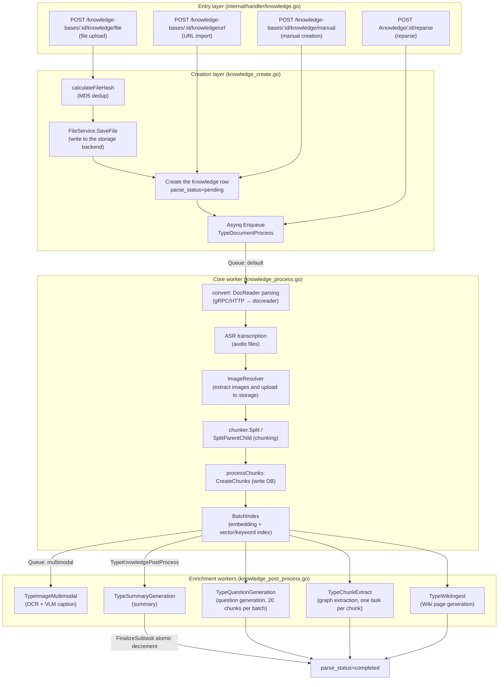
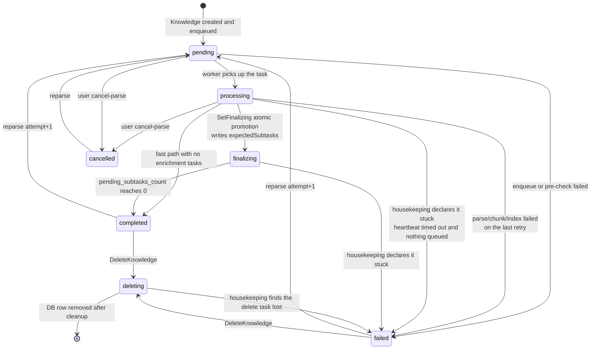

# Document Ingestion Pipeline

Documents enter the system by file upload, URL import or manual creation. The server stores the content and submits a processing task that parses, chunks and indexes the document, then generates summaries, questions, a knowledge graph and Wiki pages according to the knowledge base configuration. Status and progress follow each stage. Failed tasks are recovered by retries and a housekeeping sweep.

## Overall architecture

The ingestion path in AI KB is a **distributed asynchronous pipeline built on Asynq (Redis)**. The HTTP handler only writes the row and enqueues a task. Every expensive step (parsing, embedding, LLM enrichment) runs in separate worker pools that consume the queues.



## Entry layer: three ways to create a document

Routes are registered in `internal/router/routes_knowledge.go`:

```go
kb.POST("/file",   g.OwnedKBOrAdmin(), g.KBAccessWrite("id"), handler.CreateKnowledgeFromFile)
kb.POST("/url",    g.OwnedKBOrAdmin(), g.KBAccessWrite("id"), handler.CreateKnowledgeFromURL)
kb.POST("/manual", g.OwnedKBOrAdmin(), g.KBAccessWrite("id"), handler.CreateManualKnowledge)
```

Management endpoints: `POST /knowledge/:id/reparse` (reparse), `POST /knowledge/:id/cancel-parse` (cancel parsing), `POST /knowledge/batch-reparse`, `POST /knowledge/batch-delete`, `POST /knowledge/move` (move across knowledge bases).

### File upload (CreateKnowledgeFromFile)

- Form fields: `file`, `fileName`, `metadata`, `enable_multimodel`, `tag_ids`, `process_config` (each upload can override the knowledge base processing configuration, see [Processing configuration](#processing-configuration-knowledge-base-defaults-plus-per-upload-overrides)).
- Flow: extension check → MD5 dedup → `FileService.SaveFile` → create the `Knowledge` row → enqueue.

### One extension gate for every import path

`supportedImportFileExtensions` in `internal/utils/import_filetypes.go` is **the single source of truth for every import path**. Direct uploads, file URL downloads and the worker's re-check after a download all consult the same set:

```text
pdf txt docx doc epub html htm mhtml md markdown xmind
png jpg jpeg gif csv xlsx xls xlsb pptx ppt json
mp3 wav m4a flac ogg
```

URL import used to keep a shorter list of its own, so a direct `xlsx` upload worked while an `xlsx` URL import was rejected. Both paths now go through `isSupportedImportExtension()` / `validateImportFileType()` in `internal/application/service/knowledge_util.go`, and video files are rejected with the error "Uploading video files is not supported".

Spreadsheet extensions (`csv` / `xlsx` / `xls`, `dataTableFileExtensions`) get one extra table summary task after the document processing task (`enqueueDataTableSummaryIfNeeded`). A binary `xlsb` workbook is parsed as a document only: DuckDB, which loads the data tables, reads neither it (`read_xlsx`) nor its sheet list (`st_read_meta`).

The extra pre-checks for image and audio files (is the object storage configuration complete, is a VLM / ASR model configured) and the `process_config` validation are collected in `resolveFileImportProcessConfig()`, shared by upload and URL import.

### URL import (CreateKnowledgeFromURL)

- JSON body: `{url, file_name?, file_type?, enable_multimodel?, title?, tag_ids?, channel?, process_config?}`.
- `isFileURL()` uses the shared extension set to decide between "download a file" and "capture a web page".
- Both the handler and the service guard against SSRF (`internal/handler/knowledge.go` and `knowledge_create.go` both call it):

```go
if err := secutils.ValidateURLForSSRF(req.URL); err != nil {
    c.Error(errors.NewBadRequestError(secutils.FormatSSRFError("URL", req.URL, err)))
    return
}
```

The worker validates again right before fetching (`convert()` in `knowledge_process.go`), a third line of defense against TOCTOU.

### Manual creation (CreateManualKnowledge)

- The JSON body is `types.ManualKnowledgePayload{Title, Content, Status, TagIDs, Channel, ProcessConfig}`. A draft status is supported. Publishing calls `triggerManualProcessing()`, which enters the same chunking and indexing pipeline as files but skips the DocReader stage.

### Deduplication

`knowledge_create.go` computes an MD5 hash of the uploaded file and queries by a four-field key:

```go
hash, err := calculateFileHash(file) // MD5
exists, existingKnowledge, err := s.repo.CheckKnowledgeExists(ctx, tenantID, kbID,
    &types.KnowledgeCheckParams{
        Type:     "file",
        FileName: fileName,
        FileType: getFileType(fileName),
        FileSize: file.Size,
        FileHash: hash,
    })
if exists {
    return existingKnowledge, types.NewDuplicateFileError(existingKnowledge)
}
```

On a hit the file is not stored again. The existing Knowledge is returned together with a `DuplicateFileError`, which the frontend turns into a "file already exists" notice. Rows whose `parse_status` is `failed` or `deleting` are excluded from the check, so a file whose deletion has not finished, or is stuck deleting, can be uploaded again. `FileType` is part of the key. A duplicate only counts **within the same file type**, so `notes.md` and `notes.txt` with identical content coexist as two knowledge items (`CheckKnowledgeExists` adds a `LOWER(file_type)` condition to both the hash branch and the "file name + size" branch).

### Initial state

Key initial fields of a new Knowledge row (`knowledge_create.go`):

```go
knowledge := &types.Knowledge{
    ID:           uuid.New().String(),
    Type:         "file",        // or "url" / "manual"
    ParseStatus:  "pending",     // initial parse status
    EnableStatus: "disabled",    // not retrievable until indexing completes
    FileHash:     hash,
    ...
}
```

For CSV/Excel data tables, creation also enqueues a `TypeDataTableSummary` (`datatable:summary`) task that produces `table_summary` / `table_column` chunks for table question answering.

## File storage layer (FileService and storage backends)

### Interface

`internal/types/interfaces/file.go`:

```go
type FileService interface {
    CheckConnectivity(ctx context.Context) error
    SaveFile(ctx context.Context, file *multipart.FileHeader, tenantID uint64, knowledgeID string) (string, error)
    SaveBytes(ctx context.Context, data []byte, tenantID uint64, fileName string, temp bool) (string, error)
    GetFile(ctx context.Context, filePath string) (io.ReadCloser, error)
    GetFileURL(ctx context.Context, filePath string) (string, error)
    DeleteFile(ctx context.Context, filePath string) error
    CopyFile(ctx context.Context, srcPath string, tenantID uint64, knowledgeID string) (string, error)
}
```

### Supported storage backends

The factory `NewFileServiceFromStorageConfig()` (`internal/application/service/file/factory.go`) picks the backend from `types.StorageEngineConfig.DefaultProvider`. The backends in the code:

| Provider | Path prefix | Implementation | Notes | Key configuration |
| ---------- | ------------- | ---------------- | ------- | ------------------- |
| `local` | `local://` | `file/local.go` | Local disk on one host | `LocalEngineConfig.PathPrefix`; the base directory comes from `LOCAL_STORAGE_BASE_DIR`, signed external links from `APP_EXTERNAL_URL` |
| `minio` | `minio://` | `file/minio.go` | MinIO / S3-compatible | `MinIOEngineConfig` (`mode: docker` reads the `MINIO_ENDPOINT` / `MINIO_ACCESS_KEY_ID` / `MINIO_SECRET_ACCESS_KEY` / `MINIO_BUCKET_NAME` environment variables; `mode: remote` reads the config fields) |
| `cos` | `cos://` | `file/cos.go` | Tencent Cloud COS | `SecretID/SecretKey/Region/BucketName/AppID`; a separate temporary bucket `TempBucketName/TempRegion` is supported |
| `oss` | `oss://` | `file/oss.go` | Alibaba Cloud OSS | `Endpoint/Region/AccessKey/SecretKey/BucketName`; temporary bucket supported |
| `s3` | `s3://` | `file/s3.go` | AWS S3 and compatible protocols | `Endpoint/Region/AccessKey/SecretKey/BucketName/UseSSL/ForcePathStyle` |
| `tos` | `tos://` | `file/tos.go` | Volcengine TOS | Same as above; temporary bucket supported |
| `obs` | `obs://` | `file/obs.go` | Huawei Cloud OBS | `Endpoint/Region/AccessKey/SecretKey/BucketName/UseSSL` |
| `ks3` | `ks3://` | `file/ks3.go` | Kingsoft Cloud KS3 | `Endpoint/Region/AccessKey/SecretKey/BucketName` |
| `dummy` | `dummy://` | `file/dummy.go` | Empty implementation for tests | None |

### Object key layout

- Document files: `{tenantID}/{knowledgeID}/{uuid or nanosecond timestamp}{ext}`, for example `local://12345/kb-001/1722045600000000000.pdf`.
- Exports, temporary files and clone products: `{tenantID}/exports/{fileName}_{timestamp}{ext}`.
- Path safety: `secutils.SafePathUnderBase` (blocks directory traversal), `secutils.SafeFileName`, and `utils.SafeObjectKey` on the object storage side.

### Two wrapper layers

- **`backend_scoped.go`**: in a deployment with several storage backends it prefixes paths with the instance, `storage://{backendID}/{innerPath}`. `wrap/unwrap` encode and decode the prefix and reject cross-backend operations. A knowledge base binds to a concrete backend instance through `StorageBackendID`.
- **`resource_catalog.go`**: registers a physical path as a stable `resource://{uuid}` reference, with `Bind` (associate the resource with an owner such as a knowledge item), `MarkDeleted` and `CreateAccessGrant` (a temporary access token, exposed as a `/r/{token}` URL). The application layer holds `resource://` references, so the underlying storage can migrate without the application noticing.

## Asynchronous tasks (Asynq + Redis)

### Enqueue

`knowledge_create.go` builds a `types.DocumentProcessPayload` (`TenantID/KnowledgeID/KnowledgeBaseID/FilePath/FileName/FileType/EnableMultimodel/EnableQuestionGeneration/QuestionCount/Language/Attempt` and more). The task options come from `knowledge_task_options.go`:

```go
opts := []asynq.Option{
    asynq.Queue(types.QueueDefault),
    asynq.Timeout(config.DocumentProcessTimeout(cfg)), // default 2 hours
    asynq.MaxRetry(3),                                  // at most 3 retries on failure
}
task := asynq.NewTask(types.TypeDocumentProcess, payloadBytes, opts...)
info, err := s.task.Enqueue(task)
```

If enqueueing fails, `ParseStatus` is set to `failed` (the file is already stored, so a reparse can trigger processing again).

### Queue topology and worker pools

Queues defined in `internal/types/task.go`:

| Queue constant | Name | Purpose |
| ---------------- | ------ | --------- |
| `QueueDefault` | `default` | Core document processing (parse/chunk/embed/index) |
| `QueueChatAttachment` | `chat_attachment` | Parsing temporary documents attached to a conversation |
| `QueuePostProcess` | `postprocess` | Post-processing orchestration |
| `QueueSummary` | `summary` | Summaries, table summaries, auto-tagging, knowledge base description |
| `QueueMultimodal` | `multimodal` | Image OCR / VLM captions |
| `QueueQuestion` | `question` | Question generation |
| `QueueGraph` | `graph` | Graph extraction |
| `QueueWiki` | `wiki` | Wiki generation and finalization |
| `QueueMaintenance` | `low` | Maintenance tasks (FAQ bulk import, knowledge base clone/delete, batch delete/reparse, move, and so on) |

There are also `sync` (data source sync) and `memory` (personal memory extraction) queues. Default concurrency (`internal/types/task.go`): core pool `DefaultCoreWorkerConcurrency = 8`, post-processing pool `2`, enrichment pool `12`, maintenance pool `4`, elastic shared pool `6`, Wiki pool `8`. The full topology is in [Asynchronous task system](05-async-tasks.md).

### Retry semantics

- `TypeDocumentProcess`: `MaxRetry(3)` means the initial run plus 3 retries, 4 attempts in total. Each attempt is bounded by `DocumentProcessTimeout` (default 2 hours, environment variable `AIKB_DOCUMENT_PROCESS_TIMEOUT`), and each docreader call inside it by `AIKB_DOCREADER_CALL_TIMEOUT` (default 30 minutes).
- A panic inside the handler is turned into an error and handed to the retry and dead-letter flow (`internal/middleware/asynqdl/recover.go`). On the last failed attempt the document is marked `failed`. The Lite-mode executor also catches panics, so the process does not exit.
- The payload carries `Attempt` (a reparse takes the historical maximum attempt plus 1). The span tracker isolates each round's progress tree by attempt, and a new attempt supersedes the finalization of the old task.
- The handler distinguishes whether this is the last Asynq attempt (`isFinalAsynqAttempt`). A failure on an earlier attempt returns the error so Asynq retries; only the last attempt sets `ParseStatus` to `failed` and writes `ErrorMessage`. A transient database error while reading the tenant, reading the knowledge row or writing the `processing` status is also returned for retry instead of acknowledging the task. Only when the knowledge row really no longer exists does the task end silently.
- Reparse: a new attempt is allocated only after the override configuration validates and the old resources are cleaned up, so a rejected reparse does not affect the previous round. If the previous round is still running (`pending` / `processing` / `finalizing`), its queued tasks are cancelled first and running tasks are told to stop. Tasks that belong to an old attempt are skipped everywhere: `ProcessDocument`, chunk writes, post-processing and image multimodal tasks no longer write the row, delete chunks or decrement counters; Wiki operations carry the attempt they were enqueued with and no longer release the new round's counter once stale; the dead-letter callback does not mark the new round `failed`.

## Processing configuration: knowledge base defaults plus per-upload overrides

`ResolveProcessConfig(kb, overrides)` in `knowledge_process_config.go` merges the knowledge base defaults with the `process_config` sent with the upload (`types.KnowledgeProcessOverrides`) into a `types.EffectiveProcessConfig`:

- Overridable: `ChunkingConfig` (chunk size, overlap, strategy, parent-child chunking and so on), `EnableMultimodel`, `VLMConfig`, `ASRConfig`, `QuestionGenerationConfig`, `GraphEnabled`, `ExtractConfig`, `ParserEngineRules`.
- Constraint: `eff.GraphEnabled = eff.GraphEnabled && eff.ExtractConfig.Enabled` (the graph depends on extraction being enabled).
- `ValidateProcessOverrides` validates by file type up front: an image upload needs a VLM model, an audio upload needs an ASR model, and multimodal processing needs a complete object storage configuration (`validateImageMultimodalConfig`).
- The overrides are persisted on the Knowledge row with `knowledge.SetProcessOverrides` and reused on reparse.

Which pipelines run is decided by the knowledge base `IndexingStrategy` (`internal/types/indexing_strategy.go`):

```go
type IndexingStrategy struct {
    VectorEnabled  bool // semantic vector index
    KeywordEnabled bool // BM25 keyword index
    WikiEnabled    bool // automatic Wiki page generation
    GraphEnabled   bool // knowledge graph extraction
}
```

`NeedsEmbedding() = Vector || Keyword`, `NeedsChunks() = any of them enabled`. The default enables vector and keyword.

## Core processing pipeline (knowledge_process.go)

After a worker picks up `TypeDocumentProcess` it moves through five canonical stages, each recorded as a span (see [Housekeeping self-healing](#housekeeping-self-healing)):

`docreader → chunking → embedding → multimodal → postprocess`

### Parsing (convert, stage: docreader)

1. `beginStage(StageDocReader)` records the input (file_name/file_type/is_url).
2. In URL mode `ValidateURLForSSRF` runs again. A failure means `failStage` and `ParseStatus=failed`.
3. Engine selection: `eff.ChunkingConfig.ResolveParserEngine(fileType)` (URLs use the virtual type `"url"`) routes by the knowledge base `ParserEngineRules` (file type → engine). `MergeParserEngineOverrides` merges tenant-level and upload-level engine parameter overrides.
4. `resolveDocReader` returns an `interfaces.DocReader`:
   - **builtin**: calls the Python **docreader** service over gRPC (`docparser/grpc_parser.go`) or HTTP (`http_parser.go`).
   - **simple**: Go-native parsing of md/txt/csv/json/images/audio (`builtin_converter.go`: CSV becomes a Markdown table, JSON becomes recursively split code blocks, images and audio become placeholder references).
   - **anydoc**: in-process Go parsing of docx/doc/pptx/ppt/xlsx/xls/xlsb/odf/rtf/epub/csv/pdf (`anydoc_reader.go`), backed by the anydoc Rust library linked through cgo. Images embedded in Office documents are inserted back into the Markdown at their original position according to the document model. Scanned PDFs without a text layer fall back to builtin whole-page rendering when DocReader is available. When anydoc is linked, complex formats without a configured rule default to anydoc, but PDF still defaults to builtin. It is only available in binaries built with the `anydoc` build tag; other builds list the engine as unavailable.
   - **weknoracloud / mineru / mineru_cloud / paddleocr_vl / paddleocr_vl_cloud**: HTTP converters (registered in `engines.go`; availability is decided by configuration such as `mineru_endpoint`, `mineru_api_key`, `paddleocr_vl_endpoint`). A self-hosted `mineru` detects the MinerU 4.0 V1 API versus the legacy `/file_parse` endpoint automatically, see [Document parsing](../03-features/03-document-parsing.md#mineru-self-hosted).

The engine catalog lives in `internal/infrastructure/docparser/engines.go`. Each engine declares its metadata (name, description, file types, availability probe) together with a `NewReader` factory. `docparser.NewReader` dispatches by name; a name that is not registered (such as `markitdown`, which exists only in docreader) falls through to the docreader client.
5. File mode: the bytes are read back with `FileService.GetFile(payload.FilePath)` and placed in `ReadRequest.FileContent`.

**On the docreader side** (`docreader/`, Python gRPC): the proto is `docreader/proto/docreader.proto` with the methods `Read` / `ReadStream` (streaming: a first frame with metadata, then one frame per image, so large scanned PDFs do not hit the gRPC message limit) / `ListEngines`. The built-in parsers cover docx/doc/pdf/md/xlsx/xls/xlsb/pptx/ppt/epub/html/htm/mhtml/xmind/images/web pages (`WebParser` handles URLs). Two more engines are registered: `markitdown` (Microsoft MarkItDown) and `opendataloader` (PDF layout analysis, needs Java 11+). The Go app keeps its own engine list (registered from `engines.go`), and `ListAllEngines()` in `engine_registry.go` merges in the result of the `ListEngines` RPC: for an engine both sides know, docreader's file types and description win, and engines only docreader reports are appended, so a new docreader engine shows up without a Go change. The result is always a `ReadResult{MarkdownContent, ImageRefs, Metadata, IsAudio, AudioData}`: **the parse product is Markdown text plus image bytes**, and the Go side persists the images.

### ASR transcription (audio files)

When `convertResult.IsAudio` is true (an audio file parses to a placeholder plus the raw bytes):

```go
asrModel, err := s.modelService.GetASRModel(ctx, eff.ASRConfig.ModelID)
transcriptionResult, err := asrModel.Transcribe(ctx, convertResult.AudioData, knowledge.FileName)
```

The transcript replaces `MarkdownContent` and the normal text pipeline continues. Without a configured ASR model the task fails.

### Image extraction and upload

`ImageResolver.ResolveAndStore` in `docparser/image_resolver.go`:

1. Handles, in order, `<!link>`-wrapped images, `data:` URIs, inline base64 in HTML, bare base64, and the inline bytes in the `ImageRefs` returned by docreader.
2. Filters icon-sized images (width or height below 64px, or below 512 bytes), except original uploads marked `IsOriginal=true`.
3. Uploads with `SaveBytes` to the storage backend of the current knowledge base; `savedRefs` deduplicates.
4. Rewrites the Markdown references to storage URLs (`markdown_image_scanner.go` locates each `` exactly).

`ResolveRemoteImages` then downloads and re-stores external `http(s)` images in the Markdown (also under SSRF protection). The output is `storedImages []docparser.StoredImage` for the multimodal stage.

### Chunking (stage: chunking)

Chunking runs on the **Go side** (`internal/infrastructure/chunker`, see the chunking chapter):

```go
chunkCfg := buildSplitterConfigFromChunking(eff.ChunkingConfig)
if eff.ChunkingConfig.EnableParentChild {
    parentCfg, childCfg := buildParentChildConfigs(eff.ChunkingConfig, chunkCfg)
    pcResult := chunker.SplitParentChild(convertResult.MarkdownContent, parentCfg, childCfg)
    // children → types.ParsedChunk (with ParentIndex); parents → ParsedParentChunk
} else {
    splitChunks := chunker.Split(convertResult.MarkdownContent, chunkCfg)
}
```

### Writing and indexing (processChunks, stages: chunking + embedding)

`processChunks` is the core assembly function:

1. **Parent chunks** (parent-child mode): one `ChunkTypeParentText` record per parent, linked through `PreChunkID/NextChunkID`. Parent chunks **go to the database only, not the vector index** (after a child chunk matches, the parent content is fetched).
2. **Text chunks**: one `ChunkTypeText` record per `ParsedChunk`, carrying `StartAt/EndAt` (rune offsets in the source, usable for reconstruction and highlighting) and `ContextHeader` (the heading breadcrumb, stored in `chunks.context_header`, not returned by the API). In parent-child mode `ParentChunkID` is set. Before chunking, inline HTML tables produced by any parser engine are converted to Markdown tables (`NormalizeHTMLTables`).
3. `chunkService.CreateChunks(ctx, insertChunks)` writes in bulk. On failure: `ParseStatus=failed` and `failStage(StageChunking)`.
4. **Embedding and indexing** (when `kb.NeedsEmbeddingModel()`). If the embedding model or the vector store bound to the knowledge base cannot be resolved (model deleted, credentials expired), the attempt fails immediately with the reason in `error_message` instead of staying in `processing`:

```go
indexContent := titlePrefix + chunk.EmbeddingContent() // title + breadcrumb + content
indexInfoList = append(indexInfoList, &types.IndexInfo{
    Content: indexContent, SourceID: chunk.ID, SourceType: types.ChunkSourceType,
    ChunkID: chunk.ID, KnowledgeID: knowledge.ID, KnowledgeBaseID: ..., IsEnabled: true,
})
err = retrieveEngine.BatchIndex(ctx, embeddingModel, indexInfoList)
```

   An indexing failure triggers a **compensating rollback**: the written chunks are deleted (`DeleteChunksByKnowledgeID`), the vector index is cleared (`DeleteByKnowledgeIDList`) and the status is set to `failed`, so no half-finished document remains.
5. **Image multimodal fan-out**: when `enableMultimodel && len(storedImages) > 0`, `enqueueImageMultimodalTasks` enqueues one `TypeImageMultimodal` task **per image** (`QueueMultimodal`) with `ImageURL/EnableOCR/EnableCaption/Attempt/ImageIndex` in the payload. If one image fails to enqueue its counter slot is released immediately; if all of them fail, post-processing starts directly so the document does not sit in `processing`.
6. `finalizeIndexedKnowledgeState`: stays in `processing` if multimodal or post-processing work remains, otherwise `completed`. Either way it sets `EnableStatus="enabled"` (the document is retrievable from this moment) and adds to the workspace storage usage.

### Post-processing orchestration (stage: postprocess)

Once every multimodal task has finished (or there were none), `TypeKnowledgePostProcess` is enqueued. This task (`knowledge_post_process.go`) is the **orchestrator of the enrichment subtasks** and uses an atomic counter to converge on a final state:

```go
willSpawnSummary  := eff.SummaryEnabled && len(textChunks) > 0   // a single upload can disable the summary
willSpawnQuestion := len(textChunks) > 0 && kb.NeedsEmbeddingModel() && eff.QuestionGenerationConfig.Enabled
willSpawnWiki     := kb.IndexingStrategy.WikiEnabled && len(textChunks) > 0
graphChunks       := selectGraphChunks(textChunks)                // see below
// questionGenChunkBatchSize = 20: question generation runs in batches of 20 chunks (chunks that only hold image links are skipped)
expectedSubtasks = summary(0/1) + questionBatchCount + wiki(0/1) + len(graphChunks)(when the graph is enabled)

// atomically promote parse_status from processing to finalizing and write pending_subtasks_count
promoted, err := s.knowledgeRepo.SetFinalizing(ctx, payload.KnowledgeID, expectedSubtasks)
```

- `expectedSubtasks == 0` takes the fast path straight to `completed`.
- Graph extraction input (`selectGraphChunks`): text chunks with body text. A text chunk that only holds image links (a scanned PDF page, for example) is replaced by its `image_ocr` child chunk; `image_caption` child chunks are excluded to avoid duplicating the OCR text.
- If the `processing → finalizing` write fails, the task returns an error for Asynq to retry rather than reporting success and leaving the document in `processing`.
- Every subtask calls `FinalizeSubtask` when it reaches a final state, which atomically decrements `pending_subtasks_count` and promotes the row to `completed` at 0.
- **Shortfall reconciliation**: if fewer tasks were enqueued than planned (a queue rejected an enqueue, for example), the difference is decremented immediately so the row never sticks in `finalizing`.
- `finalizeSubtaskDetached` (`knowledge.go`): the decrement runs on a **detached context** (`context.WithoutCancel` with a 10-second timeout), so a cancelled context during a graceful worker shutdown cannot lose the decrement and leave the item in `finalizing` forever.

The four enrichment subtasks:

| Task | Queue | Granularity | Notes |
| ------ | ------- | ------------- | ------- |
| `TypeSummaryGeneration` | `summary` | 1 per knowledge item | Generates the document summary; `summary_status` is its own state machine; `process_config.summary_enabled=false` on upload skips it |
| `TypeQuestionGeneration` | `question` | 1 per batch of 20 chunks | Generates retrieval questions for chunks |
| `TypeChunkExtract` | `graph` | 1 per chunk | Entity and relationship extraction into the graph engine |
| `TypeWikiIngest` | `wiki` | Debounced batches | Creates or updates Wiki pages |

#### Automatic document tags

Post-processing checks the knowledge base `auto_tag_config` to decide whether to enqueue `knowledge:auto_tag` (`summary` queue). The handler picks from the tags that already exist in the knowledge base, with the model falling back to `summary_model_id`. `max_tags` defaults to 3 with a cap of 10, and documents that already have tags are skipped by default. It only adds tag associations: it never creates categories or removes tags set by hand, and a failure does not block ingestion. Configuration and whether it applies to new parses or reparses: [Knowledge base management](../03-features/02-knowledge-base.md).

#### Knowledge base description refresh (knowledgebase_profile.go)

Every final exit of a summary task, every completed post-processing dispatch, every document deletion and every completed move calls `requestKnowledgeBaseProfileRefresh`, which enqueues one `kb:profile` task (`summary` queue). The task ID is bucketed per knowledge base and 30-second window, so a batch of uploads or deletions triggers one aggregation. The handler recomputes the document profile aggregate and skips the model call when the hash has not changed. Only document knowledge bases with `profile_config.enabled` enqueue automatically; a manual trigger (`POST /knowledge-bases/:id/profile/generate`) ignores that setting.

#### Summary refresh (knowledge_summary_refresh.go)

Beyond the initial ingestion, editing chunk content, enabling or disabling chunks and changing custom metadata make the existing summary stale and enqueue one **summary refresh** (also available manually through `POST /knowledge/:id/regenerate-summary`):

- At the start the task snapshots its input: each source chunk's `content_revision` / `is_enabled` and the `custom_metadata` version.
- After generation it rechecks the snapshot with `summarySourceChanged()`. If an edit happened in between, it returns `ErrSummaryRefreshStale`, **discards the result and leaves `summary_status` untouched**, letting the newer refresh finish. Otherwise an old summary would overwrite a newer one.
- A database read failure is handled separately from "the input changed", so a transient read error is not silently dropped as a stale task.
- The refresh runs in an Asynq worker without the tenant context that the HTTP middleware injects, so `restoreSummaryRefreshTenantInfo()` rebuilds the full tenant configuration, which the retrieval engine factory needs.

### Image multimodal processing (image_multimodal.go)

`ImageMultimodalService.Handle` consumes one single-image task:

1. `readImageBytes` fetches the image from storage or the URL; `resolveVLM` loads the knowledge base VLM configuration.
2. It generates the caption (VLM; the prompt is assembled by `buildVLMCaptionPrompt` from `DescriptionLanguage/CustomInstructions`) and the OCR text.
3. The result is written back into the `ImageInfo` (JSON) of the owning text chunk, and two **child chunks** are created or updated: `ChunkTypeImageCaption` and `ChunkTypeImageOCR`, with `ParentChunkID` pointing at the text chunk. They are then indexed separately with `indexChunks`, so a search that matches an image description recalls the original text chunk.
   - **Image vectors**: when the knowledge base has image vectors enabled (`ImageProcessingConfig.ImageVectorEnabled`, off by default, see `KnowledgeBase.IsImageVectorEnabled`) and the embedding model accepts images (its `input` capability includes `image` and the vendor protocol can carry images, see `embedding.AsImageEmbedder`), `indexImageVector` encodes the image itself with that model and stores a third child chunk, `ChunkTypeImageVector`. Its index row has `SourceType = ImageSourceType`, the vector is the image's own (written as a precomputed vector through `CompositeRetrieveEngine.BatchIndexVectors`), and `Content` reuses the image description (or the OCR text when there is none) for reranking and the answer context. The image first passes through `imageprep.Prepare` to convert and compress it within the vendor limits. Scanned PDF pages are skipped (OCR is more accurate). A failure here is only logged and does not fail the task.
   - A `ChunkTypeImageVector` vector cannot be rebuilt from text: `syncChunkIndex` only syncs its enabled flag, `updateChunkVector` skips it, and editing the image description only updates its `Content`.
4. `shouldDropOrphanedMultimodal` checks whether the parent chunk was deleted or superseded; an orphaned task is dropped.
5. `checkAndFinalizeAllImages`: once every image is done, `enqueueKnowledgePostProcessTask` triggers the [post-processing orchestration](#post-processing-orchestration-stage-postprocess). The enqueue is retried 3 times in place; if it still fails, the task returns an error for retry instead of acknowledging and leaving the document in `processing`. On the last attempt the image counts as done even if reading the knowledge row fails. Lite mode has no Redis, so the counter lives in process memory, and post-processing starts only after every image completes.

## State machine

### Knowledge status (ParseStatus)

The full set of values defined in `internal/types/knowledge.go`:

| Value | Meaning |
| ------- | --------- |
| `pending` | Created, waiting for a worker |
| `processing` | Parsing, chunking, embedding or multimodal work in progress |
| `finalizing` | The main flow is done, enrichment subtasks are pending (`pending_subtasks_count > 0`) |
| `completed` | Everything finished |
| `failed` | Processing failed (`ErrorMessage` records why) |
| `deleting` | Deletion in progress (a concurrency marker; not counted in the knowledge base document count and excluded from duplicate checks) |
| `cancelled` | The user cancelled parsing |

Secondary states: `EnableStatus ∈ {enabled, disabled}` (retrievable or not; enabled as soon as indexing succeeds, without waiting for enrichment) and `SummaryStatus ∈ {none, pending, processing, completed, failed}`.



### Stage-level progress (span tracker)

`knowledge_span_tracker.go` and `internal/types/knowledge_span.go` provide a per-stage progress tree, which the frontend timeline renders:

- Five canonical stages: `StageDocReader / StageChunking / StageEmbedding / StageMultimodal / StagePostProcess` (`types.AllStages`).
- Span statuses: `pending / running / done / failed / skipped / cancelled`. `skipped` marks a deliberate skip (multimodal disabled, for example); `cancelled` marks a span not run because an upstream span failed.
- Each processing round has its own `Attempt` (`repo.NextAttempt`). The root span is `name="knowledge_processing"`, `Kind=SpanKindRoot`. Stages are marked with `beginStage / endStage / failStage / skipStage`, with inputs and outputs in a `JSONMap` (`chunks_planned` / `chunks_written` / `total_text_chars` and so on).
- Every progress record also refreshes the heartbeat through `touchKnowledgeHeartbeat`, which lets housekeeping tell a task that is still working from one that stopped updating.

## Housekeeping self-healing

`knowledge_housekeeping.go` runs a sweep every **5 minutes** (disable with `AIKB_HOUSEKEEPING_ENABLED=false`) that repairs zombie states left by a crashed worker or a task lost in Redis.

**Sweep A, stuck knowledge recovery**, filters in three steps:

1. Coarse filter: `parse_status IN (pending, processing, finalizing) AND updated_at < cutoff`.
2. `filterByLastSpanActivity`: reads the `MAX(updated_at)` heartbeat from `knowledge_processing_spans`. Rows whose heartbeat is within the threshold are kept as still processing; rows with no span at all count as stuck.
3. `filterOutQueued`: asks the Asynq TaskInspector whether a queued task still exists. If so the row is kept (it is only waiting in a queue).

Rows judged stuck are updated one by one to `parse_status = 'failed'`, `pending_subtasks_count = 0`, with an `error_message` naming the stage it stopped at and the last progress time, for example:

```text
task stuck in processing at docreader stage: no progress since 2026-09-22T09:37:54Z (> 2h10m0s), recovered by housekeeping
```

It also closes the `pending`/`running` spans of that knowledge item's latest attempt, all with error code `TASK_STALLED` and a backfilled `duration_ms`: the stuck span becomes `failed`, the others `cancelled`. The stuck span is the stage span that was running. When no stage is running (in `finalizing` the post-processing stage span is already closed), it is the innermost running child span, and the message carries its name, as in `at postprocess stage (postprocess.summary)`. If the span heartbeat query fails, the message omits the timestamp. The timeline then shows where the task stalled instead of spinning forever.

The frontend warns before the server declares a task dead: the batch query and the spans endpoint return `last_activity_at` for in-progress items, and after 20 minutes without progress they also return the server's `stall_state` verdict (the same backlog check Sweep A uses). `stalled` shows a "possibly stuck" hint in the list, the card and the timeline, and the timeline offers a "stop parsing" action; `queued` shows "queued" with no stop action; when the probe fails there is no verdict and the item renders as a normal in-progress parse. During quiet periods the polling interval relaxes to 15 seconds.

Threshold: `staleThreshold() = max(1h, DocumentProcessTimeout) + 10min`.

**Sweep B, stuck summary recovery**: `summary_status = 'processing' AND updated_at < 1 hour ago` is set to `failed`. A `summary_status = 'pending'` row whose parse has finished (`completed` / `failed` / `cancelled`), is older than 1 hour and has no task in the queue is set to `failed` as well, so a summary task that gave up early does not leave the frontend showing "generating summary" forever. When Sweep A reclaims a stuck document, or the user cancels parsing, an unfinished summary status is closed too (`failed` in the first case, `none` in the second).

**Sweep C, stuck deletion recovery**: `parse_status = 'deleting'` past the threshold with no `knowledge:list_delete` task covering it in the queue is set to `failed` with the reason recorded. The document reappears in the list and the user can delete it again. If the queue probe fails the row waits for the next sweep. Lite mode has no queued tasks and recovers the row directly.

**Wiki queue fallback**: a document that sits in `finalizing` only because the durable Wiki queue has not been consumed gets a fresh Wiki generation trigger for its knowledge base (at most once per threshold window per knowledge base). If the Wiki task finds that the knowledge base has Wiki disabled, has no synthesis model, or the model was deleted, it clears the unclaimed Wiki operations and releases the documents so they leave `finalizing` normally. If the synthesis model exists but cannot be built (its endpoint rejected by the SSRF check, for example), the Wiki task releases the documents the same way on its last retry. A Wiki operation protects a document for at most 48 hours: a document with no progress for more than 48 hours is reclaimed as `failed` by Sweep A and its Wiki operation is deleted.

## Deletion chain (knowledge_delete.go)

`DeleteKnowledge(ctx, id)` runs in a deliberate order (**rows first, files last**, so a failure can be retried):

1. Mark `ParseStatus = deleting` (blocks concurrent task writes).
2. For `pending/processing` items, `dequeueKnowledgeTasks()` cancels the queued downstream tasks.
3. **Parallel cleanup with errgroup** of four resource kinds:
   - Vector and keyword indexes: `retrieveEngine.DeleteByKnowledgeIDList` (routed by embedding dimension and knowledge base type).
   - Wiki: `cleanupWikiOnKnowledgeDelete` (write a Redis tombstone → clear pending ingests → reconcile existing pages → enqueue WikiRetract).
   - Chunks: `chunkService.DeleteChunksByKnowledgeID`.
   - Graph: `graphEngine.DelGraph`.
4. Delete tag associations → delete the Knowledge row.
5. **Finally, best-effort physical cleanup**: the source file plus every extracted image collected from `chunk_image_info` (`collectImageURLs` + `deleteExtractedImages`), and the workspace storage statistics are credited back.

The batch version `DeleteKnowledgeList` preloads each knowledge base's FileService, groups image URLs by knowledge base and groups index deletion by embedding model, avoiding repeated queries inside goroutines.

## FAQ knowledge import (knowledge_faq.go / knowledge_faq_import.go)

FAQ knowledge bases bypass the document pipeline. Each FAQ knowledge base has exactly **one** Knowledge instance (`ensureFAQKnowledge`); each question-answer pair is a `ChunkTypeFAQ` chunk with its metadata in `Chunk.Metadata`:

```go
type FAQChunkMetadata struct {
    StandardQuestion  string   // standard question
    SimilarQuestions  []string // similar questions
    NegativeQuestions []string // negative questions (negative filter, not indexed)
    Answers           []string
    AnswerStrategy    AnswerStrategy // "all" | "random"
    ...
}
```

- **Single entry** `CreateFAQEntry`: clean and validate → duplicate check (`checkFAQQuestionDuplicate`) → build the chunk (`buildFAQChunkContent` decides by `FAQIndexMode` whether the answer goes into `Content`) → `indexFAQChunks` indexes synchronously → `ChunkStatusIndexed`.
- **Index modes** (knowledge base level): `FAQIndexModeQuestionOnly` (`question_only`, index the question only) / `FAQIndexModeQuestionAnswer` (`question_answer`, question plus answer). Question indexing is further split into `FAQQuestionIndexModeCombined` (standard and similar questions merged into one vector) and `FAQQuestionIndexModeSeparate` (one vector per similar question, `source_id` of the form `{chunkID}-{index}`, with incremental indexing through `incrementalIndexFAQEntry`).
- **Bulk import** `UpsertFAQEntries`:
  - Mode `append` (add and merge) or `replace` (replace everything); `DryRun` validates only.
  - Above 200 entries or 50KB the entries are first uploaded to object storage with `SaveBytes` and the payload carries only `EntriesURL`.
  - Enqueued as `TypeFAQImport` on `QueueMaintenance`, `MaxRetry 5` (3 for dry run), timeout 2 hours. One import task per knowledge base at a time (Redis lock).
  - Deduplication uses `CalculateFAQContentHash`: the standard question, similar questions, negatives and answers are **normalized** (URLs stripped, lowercased, Traditional to Simplified Chinese, full-width to half-width, whitespace normalized) and then hashed with SHA256.
  - `append` mode validates in four stages (a standard question conflict fails the whole entry; a similar or negative question conflict fails partially and drops only the conflicting items; an existing standard question merges the union).
  - Progress is written to Redis (`FAQImportProgress`: `pending/processing/completed/failed` plus success, failure, partial-failure and skipped counts). Failed entries are exported as a CSV with a UTF-8 BOM for download.

## Knowledge clone and move (knowledge_clone_move.go)

### Clone (CloneKnowledgeBase / CloneChunk)

- A knowledge base clone copies the knowledge base configuration first, then adds and removes Knowledge rows by set difference (`AminusB`) in parallel (deletes in batches of 10, clones one by one).
- A chunk clone (batches of 100) copies five chunk types: `Text/ParentText/Summary/ImageCaption/ImageOCR`:
  - **Image deep copy**: `cloneChunkImageInfo` reads the bytes from the source storage and writes them into the target workspace's `exports/` namespace, deduplicated with `urlCache`; `rewriteContentImageURLs` replaces every old URL in `Content` (longest URL first to avoid partial matches).
  - Tag mapping with `getOrCreateTagInTarget` (reuse by name, otherwise create).
  - The `PreChunkID/NextChunkID/ParentChunkID` mapping is rebuilt before the bulk insert.
  - Vector indexes are copied directly with `retrieveEngine.CopyIndices()` without recomputing embeddings.
- An FAQ knowledge base clone runs a differential sync: `chunkRepo.FAQChunkDiff` splits the entries by `content_hash` into add, remove and match sets; matched pairs only sync state (`IsEnabled/Flags/TagID/AnswerStrategy`).
- Progress is written to Redis (`KBCloneProgress`).

### Move (ProcessKnowledgeMove)

Precondition: the source and target knowledge bases **must have the same type** and the **same EmbeddingModelID**. Two modes:

- `reuse_vectors`: requires `sourceKB.SharesStoreWith(targetKB)` (the same vector store instance). `CopyIndices` copies the index → the source index is deleted → `MoveChunksByKnowledgeID` reassigns the chunks → tag associations are cleared → the Knowledge row's knowledge base ID is updated.
- `reparse`: used across vector stores. `cleanupKnowledgeResources` (delete index, chunks and graph, credit back storage statistics) → the Knowledge row is reset to `pending` under the target knowledge base → `TypeDocumentProcess` is enqueued again (manual items go through `triggerManualProcessing`).

## End-to-end summary

The full journey of a PDF with multimodal processing, question generation and the graph enabled:

1. `POST /knowledge-bases/:id/knowledge/file` → MD5 dedup → `cos://tenant/kb/uuid.pdf` → Knowledge (`pending`) → Asynq `document:process`.
2. Worker: the span root for attempt 1 opens → the `docreader` stage calls the Python service over gRPC and gets Markdown plus image bytes → images are uploaded to storage and their URLs rewritten → the `chunking` stage splits with the Go chunker → chunks are written → the `embedding` stage runs `BatchIndex` → `EnableStatus=enabled` (retrievable from now on) → one multimodal task per image is enqueued.
3. The multimodal worker runs OCR and captioning per image, creates and indexes the `image_caption`/`image_ocr` child chunks, and triggers post-processing when all are done.
4. The orchestrator computes `expectedSubtasks` (1 summary + N/20 question batches + M graph chunks + 0/1 Wiki) → `SetFinalizing` → fan-out. Each subtask decrements with `FinalizeSubtask` at its final state; at 0 the row becomes `completed`.
5. If any step dies along the way, housekeeping reclaims it as `failed` every 5 minutes using the three signals `updated_at`, the span heartbeat and the queue check, and the user can reparse (attempt+1).

## Implementation reference

Where each step lives in the source:

| Step | Source |
| ------ | -------- |
| HTTP entry | `internal/handler/knowledge.go`, `internal/router/routes_knowledge.go` |
| Creation and enqueue | `internal/application/service/knowledge_create.go`, `knowledge_task_options.go` |
| File storage | `internal/application/service/file/` (`factory.go` and the backend implementations) |
| Parsing infrastructure | `internal/infrastructure/docparser/`, `docreader/` (Python service) |
| Main processing pipeline | `internal/application/service/knowledge_process.go` |
| Processing configuration merge | `internal/application/service/knowledge_process_config.go` |
| Post-processing | `internal/application/service/knowledge_post_process.go`, `image_multimodal.go` |
| Progress tracking | `internal/application/service/knowledge_span_tracker.go`, `internal/types/knowledge_span.go` |
| Self-healing | `internal/application/service/knowledge_housekeeping.go` |
| Deletion | `internal/application/service/knowledge_delete.go` |
| FAQ | `internal/application/service/knowledge_faq.go`, `knowledge_faq_import.go` |
| Clone and move | `internal/application/service/knowledge_clone_move.go` |
