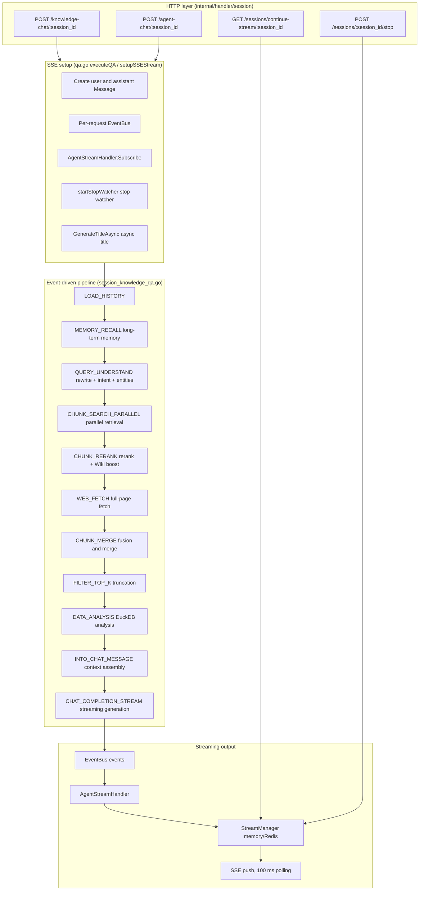
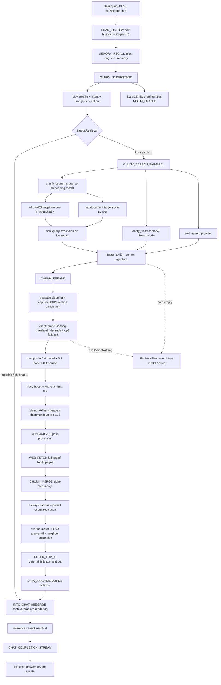
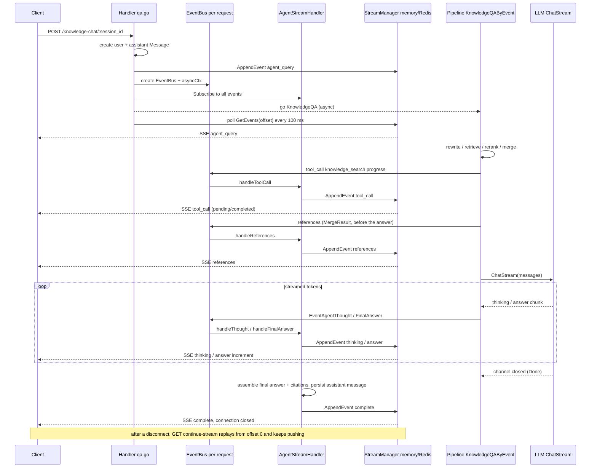

# RAG pipeline

A knowledge question enters an event-driven RAG pipeline: intent recognition, query rewrite, retrieval, rerank and context assembly, then answer generation. The answer streams back over SSE with citations expanded as they are produced; the stream manager replays events after a dropped connection.

## Overall architecture

The question-answering path is an **event-driven plugin pipeline**. Each stage is a plugin that implements the `Plugin` interface and registers with an `EventManager`. The orchestrator (`KnowledgeQAByEvent`) triggers a dynamically assembled list of `EventType` values one by one, and plugins on the same event are chained through `next()`. Generated output is not written to the HTTP response directly. Each request gets its own `EventBus`; `AgentStreamHandler` writes its events into the shared `StreamManager` (in memory or Redis), and the HTTP layer polls every 100 ms and pushes the events to the SSE client. This design gives **resumable streams after a disconnect** and **multi-replica deployments** without extra machinery.



## Event-driven plugin framework

### Plugin interface and chain of responsibility

`internal/application/service/chat_pipeline/chat_pipeline.go` defines the core abstraction:

```go
type Plugin interface {
    OnEvent(ctx context.Context, eventType types.EventType,
        chatManage *types.ChatManage, next func() *PluginError) *PluginError
    ActivationEvents() []types.EventType
}
```

`EventManager` keeps an `eventType → []Plugin` map. `Register` appends in registration order, and `buildHandler` builds the nested closure chain from the back: **on one event, the plugin registered first sits on the outside of the chain and later ones sit inside**. An outer plugin reaches the inner one only by calling `next()` inside `OnEvent`. A plugin can do its work before `next()` (most plugins) or call `next()` first and post-process (as `PluginWikiBoost` does, boosting after the rerank).

Errors propagate as `*PluginError`. The predefined errors include `ErrSearchNothing` (retrieval found nothing; triggers the fallback reply rather than a failure), `ErrRerank`, `ErrGetChatModel` and `ErrModelCall` (`chat_pipeline.go`).

### Registration order (container.go)

All plugins are constructed and self-registered in the DI container through `container.Invoke` (`internal/container/container.go`). Registration order is execution order on a shared event chain:

```go
must(container.Provide(chatpipeline.NewEventManager))
must(container.Invoke(chatpipeline.NewPluginSearch))               // CHUNK_SEARCH
must(container.Invoke(chatpipeline.NewPluginRerank))               // CHUNK_RERANK (outer)
must(container.Invoke(chatpipeline.NewPluginWebFetch))             // WEB_FETCH
must(container.Invoke(chatpipeline.NewPluginMerge))                // CHUNK_MERGE
must(container.Invoke(chatpipeline.NewPluginDataAnalysis))         // DATA_ANALYSIS
must(container.Invoke(chatpipeline.NewPluginIntoChatMessage))      // INTO_CHAT_MESSAGE
must(container.Invoke(chatpipeline.NewPluginChatCompletion))       // CHAT_COMPLETION
must(container.Invoke(chatpipeline.NewPluginChatCompletionStream)) // CHAT_COMPLETION_STREAM
must(container.Invoke(chatpipeline.NewPluginFilterTopK))           // FILTER_TOP_K
must(container.Invoke(chatpipeline.NewPluginQueryUnderstand))      // QUERY_UNDERSTAND (outer)
must(container.Invoke(chatpipeline.NewPluginLoadHistory))          // LOAD_HISTORY
must(container.Invoke(chatpipeline.NewPluginMemoryRecall))         // MEMORY_RECALL
must(container.Invoke(chatpipeline.NewPluginExtractEntity))        // QUERY_UNDERSTAND (inner)
must(container.Invoke(chatpipeline.NewPluginSearchEntity))         // ENTITY_SEARCH
must(container.Invoke(chatpipeline.NewPluginSearchParallel))       // CHUNK_SEARCH_PARALLEL
must(container.Invoke(chatpipeline.NewPluginWikiBoost))            // CHUNK_RERANK (middle)
must(container.Invoke(chatpipeline.NewPluginMemoryAffinity))       // CHUNK_RERANK (innermost)
```

The full event-to-plugin map, including chain order on shared events:

| EventType | Plugins (chain order) | Source file |
|-----------|-----------------------|-------------|
| `load_history` | PluginLoadHistory | `load_history.go` |
| `memory_recall` | PluginMemoryRecall | `memory_recall.go` |
| `query_understand` | PluginQueryUnderstand → PluginExtractEntity | `query_understand.go`, `extract_entity.go` |
| `chunk_search` | PluginSearch | `search.go`, `query_expansion.go` |
| `chunk_search_parallel` | PluginSearchParallel (composes PluginSearch + PluginSearchEntity internally) | `search_parallel.go` |
| `entity_search` | PluginSearchEntity | `search_entity.go` |
| `chunk_rerank` | PluginRerank → PluginWikiBoost → PluginMemoryAffinity | `rerank.go`, `wiki_boost.go`, `memory_affinity.go` |
| `web_fetch` | PluginWebFetch | `web_fetch.go` |
| `chunk_merge` | PluginMerge | `merge.go`, `merge_overlap.go`, `merge_expand.go`, `merge_faq.go`, `merge_history.go` |
| `data_analysis` | PluginDataAnalysis | `data_analysis.go` |
| `into_chat_message` | PluginIntoChatMessage | `into_chat_message.go` |
| `chat_completion` | PluginChatCompletion | `chat_completion.go` |
| `chat_completion_stream` | PluginChatCompletionStream | `chat_completion_stream.go` |
| `filter_top_k` | PluginFilterTopK | `filter_top_k.go` |

### ChatManage: the state object that spans the run

`ChatManage` in `internal/types/chat_manage.go` embeds three parts:

- **PipelineRequest** (immutable request configuration): `Query`, `KnowledgeBaseIDs`/`KnowledgeIDs`/`SearchTargets`, `VectorThreshold`/`KeywordThreshold`/`EmbeddingTopK`, `RerankModelID`/`RerankTopK`/`RerankThreshold`, `ChatModelID`/`SummaryConfig`, `FallbackStrategy`, `CitationEnabled`, `EnableRewrite`/`EnableQueryExpansion`, the FAQ policy (`FAQPriorityEnabled`/`FAQDirectAnswerThreshold`/`FAQScoreBoost`), `DataAnalysisEnabled`, multimodal input (`Images`/`VLMModelID`/`ChatModelSupportsVision`), web search (`WebSearchEnabled`/`WebFetchEnabled`/`WebFetchTopN`) and more.
- **PipelineState** (intermediate state plugins read and write): `RewriteQuery`, `Intent`, `History`, the three result tiers `SearchResult` → `RerankResult` → `MergeResult`, `Entity`/`EntityKBIDs`/`GraphResult`, `UserContent`, `RenderedContexts`, `SystemPromptOverride` and more.
- **PipelineContext** (runtime handles): `EventBus`, `MessageID` (the assistant message ID), `UserMessageID`.

`ChatManage.Clone()` makes a deep copy (parallel retrieval must not share slices across goroutines) but does **not** copy `PipelineContext`.

### Dynamic pipeline assembly (PipelineBuilder)

`KnowledgeQA` in `session_knowledge_qa.go` assembles the event list from the request:

```go
// Plain chat (no knowledge base and web search off)
pipeline = types.NewPipelineBuilder().
    AddIf(hasHistory, types.LOAD_HISTORY).
    Add(types.MEMORY_RECALL).
    Add(types.CHAT_COMPLETION_STREAM).Build()

// RAG
pipeline = types.NewPipelineBuilder().
    AddIf(hasHistory, types.LOAD_HISTORY).
    Add(types.MEMORY_RECALL).
    Add(types.QUERY_UNDERSTAND).
    Add(types.CHUNK_SEARCH_PARALLEL).
    Add(types.CHUNK_RERANK).
    AddIf(webSearchEnabled, types.WEB_FETCH).
    Add(types.CHUNK_MERGE).
    Add(types.FILTER_TOP_K).
    AddIf(chatManage.DataAnalysisEnabled, types.DATA_ANALYSIS).
    Add(types.INTO_CHAT_MESSAGE).
    Add(types.CHAT_COMPLETION_STREAM).Build()
```

The `types.Pipeline` map also keeps static presets (`chat`, `chat_stream`, `chat_history_stream`, `rag`, `rag_stream`) for callers that do not need dynamic assembly.

### The orchestrator KnowledgeQAByEvent

`KnowledgeQAByEvent` (`session_knowledge_qa.go`) calls `eventManager.Trigger` for each event and does a fair amount of work around it:

- Each stage is wrapped in a Langfuse span (`pipeline.<event_type>`). `CHAT_COMPLETION_STREAM` is the exception: its `OnEvent` returns immediately, so the span would close before the stream ends.
- **Progress events**: `progress.go` folds `CHUNK_SEARCH_PARALLEL → CHUNK_RERANK → CHUNK_MERGE → FILTER_TOP_K` (plus the conditional `WEB_FETCH`/`DATA_ANALYSIS`) into one `knowledge_search` tool_call progress window visible in the frontend; `QUERY_UNDERSTAND` gets its own `query_understand` window. Error and short-circuit paths also close the window, so the frontend does not spin on "searching the knowledge base" forever.
- **Citations first**: before triggering `CHAT_COMPLETION_STREAM`, `emitKnowledgeReferencesEvent` sends `MergeResult` as a `references` event, so the client holds the citation list before the SSE connection can close.
- **Cancellation wins**: after each stage, `ctx.Err()` is checked first (a user stop cancels the context). This check must come before the `ErrSearchNothing` check, otherwise a stop would be misread as "retrieval found nothing" and a fallback reply would be written.
- **Fallback**: `ErrSearchNothing` → `handleFallbackResponse`. `FallbackStrategyFixed` sends the fixed `FallbackResponse` text; `FallbackStrategyModel` lets the model answer freely from `FallbackPrompt`.

## Stage plugins in detail

### LOAD_HISTORY: load the conversation history

`load_history.go`. `MaxRounds <= 0` means the agent turned multi-turn off explicitly (`MultiTurnEnabled=false`); the stage is skipped and does **not** fall back to the global default. Otherwise it calls `loadAndProcessHistory` (`common.go`):

1. `messageService.GetRecentMessagesBySession` fetches the latest `maxRounds*2+10` messages.
2. User and assistant messages are paired by `RequestID` into `types.History` (the user side gets image captions and attachment prompts appended; the assistant side has thinking tags stripped by the `regThinkTags` regex and carries `KnowledgeReferences`).
3. The newest `maxRounds` rounds are taken in reverse order, then reversed back into chronological order and written to `chatManage.History`.

Historical user messages replay the original `Content`, not `RenderedContent` (so an older context envelope cannot leak into the current protocol). Historical citations are injected separately by `merge_history.go`.

### MEMORY_RECALL: recall long-term memory

`memory_recall.go`. When the workspace has long-term memory on, the caller's memories are recalled for the current question, written to `chatManage.MemoryPrompt`, and a `memory_recalled` event is emitted so the frontend can show which memories this turn used. The stage calls no model, and a failure does not block the answer. Enabling and managing memory: [Long-term memory](../03-features/23-memory.md).

### QUERY_UNDERSTAND: query rewrite + intent recognition (+ entity extraction)

Two plugins chain on the same event.

**PluginQueryUnderstand** (`query_understand.go`) rewrites the query and classifies the intent:

- Three input combinations: text only (chat model), text plus images, images only (a vision-capable chat model is preferred, otherwise `VLMModelID`).
- The prompt comes from `config/prompt_templates/rewrite.yaml` (a system and user pair) and can be overridden per agent with `RewritePromptSystem`/`RewritePromptUser`. The placeholders `{conversation}` / `{query}` / `{language}` are rendered by `types.RenderPromptPlaceholders`.
- The model must output JSON: `{"rewrite_query":"...","intent":"kb_search","image_description":"..."}`. Parsing is tolerant (markdown wrapping, field aliases, OCR fields merged). When the reply is cut off by the output limit, the `rewrite_query`, `intent` and partial `image_description` already written are salvaged field by field. When nothing parses, the original query is kept and the intent is empty (treated as needing retrieval). Turns with images get a 2048-token output limit (the prompt asks for the full OCR text in `image_description`).
- The intent enum (`types.QueryIntent`): `kb_search`, `web_search`, `greeting`, `chitchat`, `follow_up`, `image_only`, `doc_only`, `summarize`, `clarification`. The model's label first goes through `types.NormalizeQueryIntent` (case and `-`/space are ignored, so `KB-Search` → `kb_search`); an unknown label becomes the empty intent. `NeedsKBRetrieval()` returns true only for `kb_search`, `clarification`, `summarize` and the empty intent. `ChatManage.NeedsRetrieval()` additionally checks `WebSearchEnabled` for `web_search` (when web search is off, the intent prompt tells the user the assistant cannot search the web right now). **Every later retrieval plugin uses `NeedsRetrieval()` as its skip condition.**
- For a non-retrieval intent, `applyIntentPromptOverride` sets `SystemPromptOverride` from `config/prompt_templates/intent_prompts.yaml` (template ids map one-to-one to intent values, for example `greeting`) or from the agent's override.
- The image description is written back asynchronously to the user message's `Images[0].Caption` for the next turn's history.
- `QueryUnderstandModelID` can point this stage at a separate small model; on failure it falls back to `ChatModelID`.

**PluginExtractEntity** (`extract_entity.go`) runs on the inner side of the chain. Only when `NEO4J_ENABLE=true`, the intent needs knowledge-base retrieval (greetings and chitchat do not call it) and the retrieval scope contains a knowledge base with `ExtractConfig.Enabled`, it calls the LLM with the `config.ExtractManager.ExtractEntity` template (`graph_extraction.yaml`), preferring the rewritten query, to extract query entities into `chatManage.Entity` / `EntityKBIDs` / `EntityKnowledge` for `ENTITY_SEARCH`.

### CHUNK_SEARCH_PARALLEL: parallel retrieval (chunks + graph entities)

`search_parallel.go`. Skipped when `NeedsRetrieval()` is false. Otherwise `chatManage` is `Clone()`d twice and `RunParallel` runs both:

- `chunk_search`: the internal (unregistered) `PluginSearch.OnEvent(CHUNK_SEARCH, ...)`.
- `entity_search`: when entities exist, `PluginSearchEntity.OnEvent(ENTITY_SEARCH, ...)` runs `SearchNode` in Neo4j in parallel per `NameSpace{KnowledgeBase, Knowledge}` and converts matching graph nodes and relationships into SearchResults plus a `GraphResult`. Chunks and documents are looked up by ID (not limited to the current workspace, so graph hits from organization-shared knowledge bases resolve too), keeping only chunks that belong to a knowledge base in this turn's scope, are still enabled and whose document exists, at most 30. Graph hits carry no retrieval score (`Score=0`); the rerank uses the model score instead.

The two result sets are merged and deduplicated by `removeDuplicateResults` (chunk ID plus the content signature from `searchutil.BuildContentSignature`). When both are empty, the stage returns `ErrSearchNothing`.

**PluginSearch** (`search.go`) is itself two concurrent paths:

1. **Knowledge-base retrieval** `searchByTargets`:
   - `SearchTargets` are grouped by embedding model identity (`model.Name + BaseURL`, shareable across tenants) through `ResolveEmbeddingModelKeys`, and the query vector is computed once per group (`GetQueryEmbedding`).
   - Whole-knowledge-base targets without tag or document constraints are merged into **one** `HybridSearch` call (`params.KnowledgeBaseIDs` carries several knowledge bases). Constrained targets go through `searchSingleTarget` one by one (with `KnowledgeIDs`/`TagIDs`/`ScopeTagIDs`); a target with an explicit scope can set `DisableRecallThresholds` to turn the recall thresholds off.
2. **Web search** `searchWebIfEnabled`: when `WebSearchEnabled`, it calls `webSearchService.Search` with the `WebSearchProviderID` resolved from the workspace or agent, and `searchutil.ConvertWebSearchResults` turns the hits into SearchResults (the URL is the ID, `KnowledgeSource="web_search"`).

**Query expansion** (`query_expansion.go`) runs when `EnableQueryExpansion` is on and the first recall returned fewer than `EmbeddingTopK` results. It calls no LLM. Variants are generated locally (stop-word removal, reordering, key-phrase extraction and so on). Chinese segmentation uses `types.Jieba.CutForSearch`: a run of Han characters goes to jieba as a whole, mixed Chinese/Latin/digit text is split by script, so the fallback is no longer "one character per token"; stop-word and length filters count runes, so multi-byte characters are not misread as single characters. Each (variant × SearchTarget) pair runs a **keyword-only** `HybridSearch` concurrently (semaphore of 16). Variants add recall only on the keyword side, since their vectors are nearly identical to the original query's, so no variant is embedded again. The keyword threshold is relaxed to 0.8 of the original and TopK grows to `max(EmbeddingTopK, RerankTopK) * 2`. With keyword retrieval off, there is no expansion.

### CHUNK_RERANK: rerank, composite score, MMR and Wiki boost

**PluginRerank** (`rerank.go`) is a thin wrapper; the scoring logic lives in `internal/reranking/` (`rerank.go`, `passage.go`, `image.go`, `mmr.go`) and is shared with the agent retrieval tool and the search API:

1. **Passage cleaning** `cleanPassageForRerank`: a rerank model scores semantic similarity, and Markdown syntax is noise. Code fences and `$$...$$` formula blocks **lose only their fences and keep the body** (an earlier version dropped the whole block, so a candidate that was pure code or pure formula became an empty string and lost its score). HTML tags, image references, link markup (text kept), bare URLs, table separator rows (data rows joined with commas), heading, quote, bold and list markers are stripped in order, then extra blank lines are collapsed.
2. **Passage enrichment** `getEnrichedPassage`: the `ImageInfo` captions and OCR text and the generated questions from `ChunkMetadata` (`GeneratedQuestions`) are appended. Image text identical to the body (the OCR or description chunk itself) is not appended twice. When the model has a per-passage or per-request length limit, overlong passages are trimmed from the tail to fit; at most 200 candidates, by retrieval score, go to the model.
3. `rerankModel.Rerank(ctx, RewriteQuery, passages)` is called and the output filtered by `RerankThreshold`:
   - When everything is below the threshold but the top candidate scores at least `rerankFallbackMinScore` (default 0.15; no floor at all when the user explicitly scoped tags or documents, so the best candidate in an authoritative scope survives), the top candidate is kept as a fallback.
   - When nothing passes and the threshold is above 0.3, the call is **retried once with a degraded threshold** (`threshold * 0.7`, floor 0.3).
   - When the rerank model fails to load (deleted, misconfigured) or the API call fails (including the default 60-second timeout), the original retrieval results continue down the pipeline.
   - **Image hits** (`image_vector`, recalled through the image's own vector, see [image recall](#cross-knowledge-base-retrieval-and-fusion-hybridsearch)): a text rerank model sees only the description and OCR text and would reject an image because "the description did not mention it". Two cases (`internal/reranking/image.go`):
     - A rerank model that can see images (its model capability `input` includes `image`; in the catalog these are `jina-reranker-m0` and `nvidia/llama-nemotron-rerank-vl-1b-v2`): the image is read (`KnowledgeBaseService.ReadChunkImage`, converted and compressed to the vendor's limits) and **the image itself is scored**, on the same scale and threshold as text. If reading or scoring fails, the text score is used.
     - A text-only rerank model: for an image with OCR text of 200 or more characters (screenshots, tables, document photos), the text is essentially the content and it passes the threshold as text. When a pictorial image with less OCR text is rejected, but its original vector score (`VectorScore`, recorded before retrieval fusion) is at least `max(vector threshold, 0.25)`, up to 2 such images are kept by descending vector score, appended after the ranked results and marked `Metadata["kept_by"]="image_vector"`. These images are returned even when no text passes the threshold.
     - The diagnostics record `images_scored` and `images_kept_by_vector`.
4. **Composite score** `CompositeScore`: `0.6*model score + 0.3*retrieval base score + 0.1*source weight` (the `web_search` source weighs 0.95, everything else 1.0), clamped to [0,1]. A chunk found through graph entity retrieval has no retrieval score, so its model score stands in as the base score. The base, model and composite scores are recorded in `Metadata["base_score"]` / `["model_score"]` / `["composite_score"]`. An earlier version also multiplied in a position prior (higher nearer the start of the document, ±0.05); it was coupled to offsets that change when chunks are edited and showed no clear benefit, so it was removed.
5. **FAQ boost**: when `FAQPriorityEnabled` and `FAQScoreBoost > 1.0`, FAQ chunk scores are multiplied by the boost and capped at 1.0, with `Metadata["faq_boosted"]` set and the pre-boost score kept in `Metadata["faq_original_score"]`.
6. **MMR diversity selection** `reranking.SelectMMR` (λ=0.7, k=`RerankTopK`): `mmr = 0.7*relevance - 0.3*max_jaccard_redundancy`. The enriched chunk bodies are tokenized once with `searchutil.TokenizeSimple`, then an inverted index from token to candidate index is built. Each round only accumulates the intersection with candidates that share a token with the newly selected chunk, computes Jaccard as `intersection / (sum of both token counts - intersection)` and updates the cached maximum redundancy; candidates with no shared token need no comparison. The index is stored in contiguous arrays, so extra space is proportional to the total token count, and ties keep input order. With `k=1`, the top candidate is chosen by relevance alone and the cleaning, tokenizing and indexing are skipped. Chat, the agent retrieval tool and the retrieval API share this implementation.

**PluginMemoryAffinity** (`memory_affinity.go`) is registered innermost on the chain and also calls `next()` before post-processing: documents cited at least twice in this caller's earlier answers are boosted logarithmically by usage count, at most ×1.15, only to break ties between close candidates. WikiBoost's post-processing runs after it.

**PluginWikiBoost** (`wiki_boost.go`) is registered in the middle of the same chain; its `OnEvent` calls `next()` first (waiting for the rerank) and post-processes: when `RerankResult` contains a `wiki_page` chunk and a retrieval target is a knowledge base with Wiki on, the score is multiplied by `wikiBoostFactor = 1.3` and the list is re-sorted stably. Wiki pages are knowledge the LLM has already synthesized, so they outrank raw chunks.

### WEB_FETCH: fetch full web pages

`web_fetch.go`. Runs only when `WebFetchEnabled && WebSearchEnabled`. It takes the first `WebFetchTopN` (default 3) web results from `RerankResult`, fetches their bodies in parallel with `web_fetch.FetchURLContent(ctx, url)` and replaces the snippets (truncated to 8000 characters). It sits after the rerank and before the merge, so fetch cost is paid only for the high-scoring pages that enter the context.

### CHUNK_MERGE: the eight-step merge

The `OnEvent` comment in `merge.go` is the process description:

1. **Choose the input**: `RerankResult` first, falling back to `SearchResult` when it is empty (sorted by score and cut to `RerankTopK`, so the whole recall set is not looked up and expanded).
2. **Deduplicate**: ID plus content signature.
3. **Inject history citations** (`merge_history.go`): `KnowledgeReferences` are taken from the most recent history round that has citations and filtered by how many query words each citation covers (overlap coefficient `|q∩c|/min(|q|,|c|)` ≥ 0.3; Jaccard divides by the union, and a query of about 8 words against a chunk of hundreds would never reach the threshold). Scores are discounted to 0.6, at most 3 are injected, marked `MatchTypeHistory`.
4. **Parent chunk resolution** `resolveParentChunks`: text children and image_ocr/image_caption/image_vector children all complete their context from the **current** parent_text content. Narrowing the image Markdown relies on stable image URLs (`PruneMarkdownImagesByImageInfo`) rather than parser coordinates. ImageInfo is strictly limited to the text child that matched, so an image-heavy parent does not pour sibling pages' OCR into the context. The image → text → parent_text chain looks up the grandparent only when an image result actually matched.
5. **Grouped sequential merge** `groupAndMergeCurrentContent`: results are grouped by `KnowledgeID + ChunkType`, sorted by `ChunkIndex` and passed to `mergeSequentialChunks`. Adjacent indexes, or one body containing the other, are joined with `searchutil.JoinChunkContent`; the highest score is kept, `SubChunkID` records the merged chunks and `mergeImageInfo` merges image information deduplicated by URL.
6. **FAQ answer fill** (`merge_faq.go`): FAQ chunks are looked up in one batch for their `FAQMetadata` and the Content is rewritten as `Q: standard question + Answer: answer list`.
7. **Neighbor expansion for short context** (`merge_expand.go`): when a text chunk is shorter than 350 characters, its `PreChunkID`/`NextChunkID` neighbors are fetched in one batch and joined up to about 850 characters. The matched chunk is kept whole, and the remaining length is split between the end of the preceding text and the start of the following text. Neighbors must belong to the same document; chunks of organization-shared knowledge bases expand too.
8. New duplicates introduced by expansion are **merged once more**, then a final dedup plus `removePartialOverlaps` (normalized containment, or token overlap ratio ≥ 0.85 across knowledge bases removes the near duplicate with the lower score; the ratio is compared only when the token counts differ by at most 3×, so a long web page or parent chunk cannot "cover" a short chunk; each text is tokenized once). An `image_vector` hit and a description hit of the same image have identical bodies once their context is completed, and dedup may keep either; when the image hit is the one dropped, the survivor gets `Metadata["image_vector_match"]="true"` so the image can still go to the vision model.

The result is written to `chatManage.MergeResult`.

::: tip Why character offsets are no longer the primary key
Once chunks became editable, the parser coordinates `StartAt` / `EndAt` stopped being a reliable description of "where the current content sits in the source": one edit can leave the span length and the body length out of step. The merge stage therefore judges adjacency and containment from the **current body plus the `ChunkIndex` sequence** (`JoinChunkContent` / `ContainsChunkContent` do text-level dedup and joining). A pair of unedited chunks still uses the overlap the coordinates give (`appendTrustedContent`), and any pair that involves edited, expanded or stale content falls back to text matching so current content is never discarded on parser coordinates. Source coordinates are otherwise kept for citation positioning. `FILTER_TOP_K`'s tie-breaker moved from `StartAt`/`EndAt` to `ChunkIndex` for the same reason.
:::

### FILTER_TOP_K: deterministic ordering and truncation

`filter_top_k.go`. It runs `sortSearchResultsDeterministically` over `MergeResult` (falling back to `RerankResult`, then `SearchResult`): score descending, with `KnowledgeID`/`ChunkType`/`ChunkIndex`/`ID` as a stable tie-breaker (map iteration in the merge stage scrambles order; this restores a reproducible global order), then cuts to `RerankTopK`. Results the rerank stage kept outside the TopK (`kept_by`, see the image hits under CHUNK_RERANK) do not take a slot and are appended after the truncated list.

### DATA_ANALYSIS: DuckDB analysis of tabular data

`data_analysis.go`. Off by default (`DataAnalysisEnabled` comes from the agent configuration). When `MergeResult` hits a CSV or Excel file: `table_column`/`table_summary` chunks are filtered out, the first data file is taken, `tools.NewDataAnalysisTool` loads it into DuckDB to get the schema, the LLM decides whether analysis is needed and writes DuckDB SQL (structured output `DataAnalysisInput`), and the result is appended to `MergeResult` as a synthetic SearchResult with `MatchTypeDataAnalysis` and score 1.0.

### INTO_CHAT_MESSAGE: context assembly

`into_chat_message.go`:

- `utils.ValidateInput` checks the query for injection.
- The non-retrieval path still renders `ContextTemplate` (with empty `contexts`) so runtime metadata such as `current_time` is injected.
- **FAQ priority**: with `FAQPriorityEnabled`, FAQ and document results are split into a `source type="faq" priority="high"` section and a `source type="document" priority="supplementary"` section. The first FAQ whose pre-boost score (`composite_score`, or the retrieval score when nothing was reranked) is at least `FAQDirectAnswerThreshold` gets `match="exact"` on its context (a hint that the model may adopt the answer directly). The pre-boost score is compared so that the FAQ, Wiki and memory boosts cannot lift a middling match over the threshold.
- The normal path wraps each enriched passage in `context id="N"` in order (`getEnrichedPassageForChat` inlines ImageInfo as Markdown images plus descriptions).
- `buildDocumentHeader` emits deduplicated document metadata (title and description) at the top.
- `SummaryConfig.ContextTemplate` (from `config/prompt_templates/context_template.yaml`) is rendered with the placeholders `{query}` / `{contexts}` / `{language}`; image descriptions (for a non-vision model), the quoted context `QuotedContext` and attachment prompts are appended.
- **Retrieved images**: when the chat model supports vision, the images of contexts that depend on an image-vector hit (`image_vector`, or carrying `image_vector_match`) are read (deduplicated by image, at most 3, converted to PNG/JPEG/WebP/GIF and at most 5 MB) into `ContextImages` and sent after the user's own uploaded images at generation time. The original image identity (`matched_images`) survives parent expansion and dedup, so the image actually matched is still the one read after the merge. The final model message names each image's source with the request-local chunk alias and counts the user's images that precede it. Information that is in the picture but not in its description becomes visible to the model this way. In agent mode, `search_knowledge` keeps separate image candidates before the rerank, puts the images into the tool result when the model supports vision, and names the source alias on the model message that carries them (history stores only the image identity, not the bytes).
- The assembled `UserContent` is **written back asynchronously** to the user message's `RenderedContent` (`persistRenderedContent`) for audit and debugging; `RenderedContexts` keeps the bare contexts string for citation replacement.

### CHAT_COMPLETION / CHAT_COMPLETION_STREAM: generation

The two plugins share helpers in `common.go`:

- `prepareChatModel` fetches the chat model and builds `ChatOptions` from `SummaryConfig` (Temperature, TopP, Seed, MaxTokens, Thinking and so on).
- `prepareMessagesWithHistory`: the system prompt is `SystemPromptOverride` (an intent override) or `SummaryConfig.Prompt` (`system_prompt.yaml`); after placeholder rendering, when the retrieved context contains Markdown images, a "retrieved image output requirement" paragraph is appended (`appendRetrievedImageOutputRequirement`). Then the historical Q/A pairs are appended in order, and finally the current user message (with `Images` for a vision model).

`prepareMessagesWithModelContext` in `references.go` adds **citation alias replacement** on top (see [Citation generation](#citation-generation)): the positionally numbered contexts in `RenderedContexts` are replaced by the request-scoped chunk alias view generated by `modelcontext.Registry`, and the citation protocol is appended to the end of the system prompt.

**The streaming version** (`chat_completion_stream.go`) requires an `EventBus`, calls `chatModel.ChatStream` and starts a goroutine that consumes the response channel:

- `ResponseTypeThinking` → decoded by `modelcontext.StreamDecoder` (one decoder both restores `res://` resource aliases and expands ref citation tags), then emitted as `EventAgentThought`.
- `ResponseTypeAnswer` → decoded the same way, then emitted as `EventAgentFinalAnswer`. The terminal answer carrying `Done` is **forwarded once only**: some vendors send a completion for `finish_reason` and then another for the end-of-stream sentinel, and forwarding both would place an answer event after the session's complete event.
- **Truncation**: when `finish_reason` is `length` / `max_tokens` / `max_output_tokens` (case-insensitive), the answer event carries `truncated` and the frontend shows a notice next to the answer. If no text was produced before the cut, a fixed notice becomes the answer, suggesting a narrower question or a larger `max_completion_tokens`. The model fallback answer for empty retrieval (`handleFallbackResponse`) is handled the same way.
- `ResponseTypeError` → `EventError`.
- When the channel closes or the context is cancelled, `flushDecoders` flushes the decoders' buffered trailing bytes (an alias split across chunks is not lost) before closing the thinking stream.

**The non-streaming version** (`chat_completion.go`) calls `Chat` directly, then `modelContext.DecodeResponse` restores the full text once (resource handles and citation tags) and writes `chatManage.ChatResponse`.

## Complete RAG flow



## Session and message management

### Session Service (`session.go`)

- Full CRUD: `CreateSession` / `GetSession` (workspace plus shared scope) / `GetOwnedSession` (strict ownership, used for destructive operations such as stop) / paginated listing / `SetSessionPinned` / `UpdateSessionLastRequestState` (remembers the composer state: agent, model, knowledge base, web search, reasoning effort and so on, UI only) / single delete, batch delete, clear.
- **Fork and rewind**: `session_fork.go` copies the history into a new session (recording `parent_session_id` / `forked_from_message_id`); `session_rewind.go` deletes the messages after the rewind point in place. Both restore `/workspace` from the sandbox workspace git checkpoint written at the end of each turn (`workspace_checkpointer.go`). API: [Sessions and chat](../04-api/02-api-chat.md).
- **Title generation**: `GenerateTitleAsync` is triggered asynchronously during SSE setup (when the session has no title). It calls the same model as the conversation with the `generate_session_title.yaml` template, and the result flows out as an `EventSessionTitle` event (SSE `response_type=session_title`); the HTTP layer waits up to 3 more seconds after `complete` for the title event.

### Message Service (`message.go`)

- The user and assistant messages of one round share a `RequestID`. The user message is `IsCompleted=true` as soon as the request arrives; the assistant message gets its content and citations from `completeAssistantMessage` when the stream ends (or on stop).
- `UpdateMessageRenderedContent` / `UpdateMessageImages` are the asynchronous write-backs called by `INTO_CHAT_MESSAGE` and `QUERY_UNDERSTAND`.
- `GetRecentMessagesBySession` is the data source for history loading.
- Extras: `IndexMessageToKB` (writes Q/A pairs into the chat-history knowledge base for cross-session search) and `SearchMessages` (vector plus rerank message search).

## Streaming output

### StreamManager: an append-only event stream

`internal/stream/factory.go` picks the implementation from the `STREAM_MANAGER_TYPE` environment variable:

| Implementation | Storage | Notes |
|------|------|--------|
| `memory` (default) | In-process `map[sessionID]map[messageID]*events` with an RWMutex | Single-node deployments; `GetEvents` returns a copy of the events to avoid races |
| `redis` | Redis list, key = `{REDIS_PREFIX or stream:events}:{sessionID}:{messageID}` | `AppendEvent` = RPUSH plus TTL refresh (the factory passes 1 hour); `GetEvents` = LRANGE offset..-1; shared across replicas, and the stop event crosses nodes through it too |

The interface has two methods, `AppendEvent(ctx, sessionID, messageID, StreamEvent)` and `GetEvents(ctx, sessionID, messageID, fromOffset) (events, nextOffset, error)`. **Producers only append and consumers pull by offset**, so any node can replay from the start at any time.

### Event flow: EventBus → AgentStreamHandler → StreamManager → SSE

1. `setupSSEStream` (`qa.go`) creates a **separate** `event.EventBus` and a cancellable `asyncCtx` for each request.
2. `AgentStreamHandler.Subscribe()` (`agent_stream_handler.go`) subscribes to `thought` / `tool_call` / `tool_result` / `references` / `final_answer` / `reflection` / `error` / `session_title` / `agent.complete` / tool approval / MCP OAuth and the other events, and turns each into a `StreamEvent` appended to the StreamManager. It also accumulates `answerSegments` in memory (one segment per answer event ID; the "preamble" of a non-final round is marked superseded when a later tool_call appears and does not enter the persisted answer) and `knowledgeRefs`, and assembles and persists the assistant message when the stream ends.
3. In the HTTP layer, `handleAgentEventsForSSE` (`stream.go`) polls `GetEvents` on a 100 ms ticker, wraps each `StreamEvent` as `types.StreamResponse` through `buildStreamResponse` and pushes it with `c.SSEvent("message", response)`. It stops on the `complete` event (a new session may wait up to 3 s more for the title event).

### SSE protocol and response_type event types

`setSSEHeaders` sets the SSE headers (`text/event-stream`, `no-cache`, `keep-alive`, `X-Accel-Buffering: no`). Each SSE `message` is a JSON `StreamResponse` (`internal/types/chat.go`):

```go
type StreamResponse struct {
    ID                  string       `json:"id"`            // request_id
    ResponseType        ResponseType `json:"response_type"`
    Content             string       `json:"content"`       // incremental chunk; the frontend accumulates
    Done                bool         `json:"done"`
    KnowledgeReferences References   `json:"knowledge_references,omitempty"`
    SessionID           string       `json:"session_id,omitempty"`
    AssistantMessageID  string       `json:"assistant_message_id,omitempty"`
    Data                map[string]interface{} `json:"data,omitempty"`
    ...
}
```

The full `response_type` list (`internal/types/chat.go`; `stop` is built in the handler layer, and `steer` exists only in a server-side queue sub-list and never appears on the SSE stream):

| response_type | Meaning |
|---------------|------|
| `agent_query` | The query was accepted; carries `session_id` / `assistant_message_id` (the client takes the message_id it needs for resuming from here) |
| `thinking` | Reasoning increment (reasoning_content) |
| `answer` | Answer text increment; carries `data.truncated: true` when the model's single-output limit cut it off |
| `references` | Knowledge citation list (the `knowledge_references` field) |
| `tool_call` / `tool_result` | Agent and progress tool calls and results (the RAG pipeline's `knowledge_search` and `query_understand` progress use these too); a failed tool also comes back as `tool_result` with `data.success=false` |
| `command_output` / `install_output` | Incremental output of command execution or skill installation; only updates the in-progress tool card |
| `reflection` | Agent reflection |
| `session_title` | The asynchronously generated session title |
| `error` | The whole turn failed (`Done=true` marks a terminal error); a single tool failure does not use this type |
| `complete` | End-of-stream marker (the frontend finishes on it instead of relying on an empty answer with done) |
| `tool_approval_required` / `tool_approval_resolved` | Approval request and result for a dangerous MCP tool |
| `mcp_oauth_required` / `mcp_oauth_resolved` | MCP OAuth authorization request and result |
| `memory_recalled` | Long-term memories injected this turn |
| `artifacts_pending` | The answer has ended while sandbox artifacts are still being persisted; the file list arrives with `complete` |
| `user_message_injected` | A message appended during the run reached the agent and was written to history |
| `context_compacted` | The agent context was compacted |
| `install_prompt` | The first event of a skill installation record (the install instruction) |
| `stop` | User stop notification (built in the handler layer) |

### Resuming a stream (continue-stream) and stopping

**Resume**: `GET /sessions/continue-stream/:session_id?message_id=...` (`ContinueStream` in `stream.go`). After validating the session and message, it **replays every stored event** with `GetEvents` from offset 0 (`continue_stream_coalesce.go` merges consecutive unfinished answer/thinking/reflection increments under the same event ID into one frame, so a long answer does not replay as tens of thousands of frames). If a `complete` is already present it finishes; otherwise it keeps polling every 100 ms and pushes new events until complete. Because the generating goroutine is fully decoupled from the SSE connection (events live in the StreamManager), a page refresh or a network blip does not interrupt generation.

**Stop**: `POST /sessions/:id/stop` (strict ownership check) appends a `stop` event to the StreamManager. Two consumers pick it up: the SSE polling loop sends `EventStop` to the EventBus when it sees it, and the independent `startStopWatcher` (300 ms polling, independent of the client connection, 2-hour safety timeout) makes sure the stop still cancels generation when the client has already disconnected. `setupStopEventHandler` calls `cancel()` on asyncCtx when it receives `EventStop` and saves the partial output already streamed using `context.WithoutCancel`.

### Streaming sequence diagram



## Citation generation

### Request-scoped source aliases and ref expansion (sources.go / citations.go)

`internal/modelcontext/` (`sources.go`, `citations.go`, exposed through the `Registry` in `registry.go`; the former `internal/llmreference/` was folded into this package). Goal: **internal IDs never enter the model context, and citations in the model output can be expanded safely**.

- `Registry` (one instance per answer, covering all of an agent's tool rounds, never persisted across requests) assigns low-entropy aliases to sources: `cN` = knowledge chunk, `wN` = web page, `dN` = document, `bN` = knowledge base.
- `ProtocolPrompt()` is appended to the system prompt (whether citations are on is fixed at `NewRegistry(citationsEnabled)`). With citations on, the model must cite inline with self-closing `ref id="cN"` tags (inventing kb or web tags is forbidden); with citations off (`PipelineRequest.CitationEnabled=false`; on by default), any citation output is forbidden.
- `prepareMessagesWithModelContext` in `references.go` registers `MergeResult` in FAQ-first order with `RegisterSearchResults`, renders the knowledge and web results as a compact model-facing XML view with `ModelToolResult` (through `ModelOutput` in `model_output.go`; `display_type=search_results` / `web_search_results`) and **replaces** the original `RenderedContexts` in the message.
- `ref` tags in the model output are expanded by `ExpandText` / `StreamDecoder` (streaming, handling a tag split across chunks) into public tags: chunk → a `kb` tag (with chunk_id, knowledge_id and other attributes), web page → a `web url title` tag. Unknown aliases fail closed and are deleted. The frontend renders the citation markers from these.
- Independently of inline citations, `MergeResult` is always pushed whole as the `references` SSE event (which drives the "retrieved results" panel), even when inline citations are off.

### Storage resource handle aliases (resources.go)

`internal/modelcontext/resources.go` (formerly `internal/llmresource/`) solves a different problem: high-entropy storage handles such as `resource://`, `minio://` and `cos://`, and wiki `summary/<uuid>` slugs, get mangled when the model repeats them. The same `Registry`'s `EncodeMessages` replaces them with low-entropy aliases of the form `res://0001` (resource handles are encoded before source aliases; the order is fixed inside `Registry`, see the type comment in `registry.go`). Streaming output is restored by `StreamDecoder` (`Flush` makes sure an alias split across chunks is not lost), and tool-call arguments get their real handles back through `DecodeToolCalls`.

## Cross-knowledge-base retrieval and fusion (HybridSearch)

`internal/application/service/knowledgebase_search.go` is where all retrieval converges (the chat pipeline, agent tools and the search API share it):

1. **Authorization and validation**: knowledge bases are loaded in one batch (including organization-shared ones from other workspaces) and each passes `authorizeKBAccess`; `validateSameEmbeddingModel` rejects a multi-knowledge-base search that spans embedding spaces (wiki and graph knowledge bases without vectors are exempt).
2. **Parameter normalization and over-recall**: `MatchCount <= 0` (JSON deserialization yields 0 when the caller omits it) is first normalized by `normalizedMatchCount` to `types.DefaultRetrievalTopK` (50), so the over-recall floor, the FAQ iteration trigger and the final cut all read the same value; otherwise the cut would slice the result set to `[:0]`, and a negative value would panic. Then `matchCount = max(MatchCount*5, 50) * len(KBs)`, capped at `maxRetrievalPoolSize` (500).
3. **The query vector is computed once** and travels in `params.QueryEmbedding` to every store group.
4. **storeGroup grouping** (`knowledgebase_search_storegroup.go`): grouped by `(VectorStoreID, owning tenant)`; each group resolves a `CompositeRetrieveEngine` through `retriever.CreateRetrieveEngineForKB`. `buildRetrievalParams` routes by the type of each knowledge base in the group: FAQ knowledge bases use the FAQ vector index (`KnowledgeType=faq`, no keyword index), document knowledge bases use the default vector index plus the keyword index.
5. **Image recall** (`knowledgebase_search_image.go`): `applyImageRecall` resolves the embedding model and checks whether it handles images only when some knowledge base has image vectors on (`ImageProcessingConfig.ImageVectorEnabled`, off by default). When both hold, those knowledge bases are recorded in the group's `ImageKBIDs`, the group's document vector TopK grows by 1.5× (still capped at 500) and its threshold drops to `min(VectorThreshold, 0.2)`. A text query is naturally less similar to an image than to text (the modality gap), and a shared text threshold would block almost every image. Before normalization, each group's results pass through `filterImageHits`, which applies a threshold per source: text hits keep `VectorThreshold`, image hits (`ImageSourceType`) use `min(VectorThreshold, 0.2)`. Image rows among keyword hits are always dropped (their `Content` is the image description, and the description chunk has its own keyword index). Image vector hits from a knowledge base outside `ImageKBIDs` (never enabled, enabled then disabled, or a document moved in from an enabled one) are dropped too; when no knowledge base in the group is enabled, TopK and threshold stay as they are. The image vector chunks and index rows are not deleted: deleting or re-parsing a document, or deleting a knowledge base, clears them with the document by knowledge ID, and re-enabling the knowledge base restores recall. The engine does not filter by source type, so dropped image rows are removed only after the engine cut its ranking at TopK, and image rows ranked above text crowd the candidate pool. `refillPastDroppedImages` therefore re-queries before filtering: when the document vector pool or the keyword pool is full and contains dropped image rows, TopK doubles and the query repeats until the pool holds TopK kept rows, the index runs out or `maxRetrievalPoolSize` (500) is reached, then it is cut back to TopK kept rows (at most 4 extra queries for a pool of 50). The cost is a few extra retrieval queries for groups with image rows; when more than about 500 image rows rank above the text, text hits can still be missed. The refill is best-effort: an error or a partial return on a refill (`RetrieveResult.Error`) stops it and keeps the previous complete pool rather than replacing it with an incomplete one.
6. **Fan-out** (`knowledgebase_search_fanout.go`): a single group is queried directly at zero overhead; multiple groups run concurrently through `errgroup` (limit 4), each with a `MULTI_STORE_RETRIEVE_TIMEOUT_SEC` timeout (default 30 s) and an all-or-nothing failure policy. Results that span engine types go through `EngineAwareNormalizer`, which normalizes vector scores to [0,1] (see the retrieval engines page).
7. **Fusion** (`knowledgebase_search_fusion.go`):
   - Vector only or keyword only → `deduplicateByScore` (the highest score per chunk).
   - Hybrid → **weighted RRF**: `score = vectorWeight/(k+vectorRank) + keywordWeight/(k+keywordRank)`, divided by the theoretical maximum `(vectorWeight+keywordWeight)/(k+1)` to normalize into [0,1]. `k` and the weights come from the workspace `RetrievalConfig` (with defaults); the rank is computed by score inside each result list (1-indexed), and a chunk takes its best rank.
   - All three paths output in [0,1] (vectors as cosine similarity), so the results of different retrieval calls can be ranked together.
8. **FAQ hit policy** (`knowledgebase_search_faq.go`, FAQ knowledge bases only):
   - **Iterative retrieval** (when the primary knowledge base is an FAQ base): when the deduplicated set is short of `MatchCount` and some vector result list is full, retrieval repeats with a larger TopK, starting at `max(3×MatchCount, 2×first-round depth)` and doubling for at most 5 rounds, across all store groups, fused the same way as the first round (same score scale), with chunk data cached to avoid repeated lookups. The seed and every growth step are capped at `maxRetrievalPoolSize`; when the first round already hit the cap there is no iteration, and it stops as soon as the cap is reached.
   - **Negative question filter**: an exact match (lowercased, whitespace removed) between the query and an FAQ's `NegativeQuestions` drops that FAQ, which supports the operator rule "do not answer this question with this FAQ".
9. After the cut to `MatchCount`, `processSearchResults` completes the chunk metadata (the pipeline passes `SkipContextEnrichment=true` and leaves context assembly to the merge stage).

The pipeline-side FAQ policy (the agent settings `FAQPriorityEnabled` / `FAQScoreBoost` / `FAQDirectAnswerThreshold`) is described under [CHUNK_RERANK](#chunk-rerank-rerank-composite-score-mmr-and-wiki-boost) and [INTO_CHAT_MESSAGE](#into-chat-message-context-assembly).

## Keyword extraction and searchutil

`config/prompt_templates/keywords_extraction.yaml` provides a system and user template pair that extracts up to 5 keywords from a question. It is loaded by the `prompt_templates` loader in `internal/config/config.go` and exposed to the frontend through the workspace template API (`internal/handler/tenant.go`). Query expansion inside the pipeline ([CHUNK_SEARCH_PARALLEL](#chunk-search-parallel-parallel-retrieval-chunks-graph-entities)) generates keyword variants with local heuristics and no LLM.

`internal/searchutil/` is the pure-function library shared by retrieval and merge:

| File | Key functions | Purpose |
|------|----------|------|
| `textutil.go` | `BuildContentSignature` / `NormalizeContent` / `IsContentContained` / `ContentOverlapRatio` | Content signatures for dedup, normalization, containment and overlap ratio (merge dedup) |
| `textutil.go` | `TokenizeSimple` / `Jaccard` | Simple tokenization (Chinese per character, English per word) and Jaccard similarity (MMR, history citation filter) |
| `chunkmerge.go` | `AppendWithOverlap` / `MergeTextChunks` | Joining overlapping chunks by text match |
| `imageinfo.go` / `imageinfo_match.go` | `CollectImageInfoByChunkIDs`, `EnrichContentWithImageInfoForChat`, `FilterImageInfoByMatchRange`, `PruneMarkdownImagesOutsideRange`, `SliceContentByDocumentRange` | Collecting image information, filtering by match window, enriching content |
| `conversion.go` | `ConvertWebSearchResults` | Web search results to SearchResult |
| `normalize.go` | `NormalizeKeywordScores` | Keyword score normalization |

## Prompt templates and the code that uses them

Templates are loaded by `loadPromptTemplates` in `internal/config/config.go` from `config/prompt_templates/` into `PromptTemplatesConfig`. Each yaml is a list of templates with `id`/`i18n`/`default`; settings such as `system_prompt_id` / `context_template_id` resolve the default template text by id.

| Template file | Config field | Used by |
|----------|----------|----------|
| `rewrite.yaml` | `Conversation.RewritePromptSystem/User` | Rewrite and intent classification in `query_understand.go` (placeholders `{conversation}`/`{query}`/`{language}`) |
| `intent_prompts.yaml` | `Conversation.IntentSystemPrompts` | System prompt override for non-retrieval intents (template id = intent value) |
| `system_prompt.yaml` | `Conversation.Summary.Prompt` | The RAG answer system prompt (`common.go prepareMessagesWithHistory`) |
| `context_template.yaml` | `Conversation.Summary.ContextTemplate` | Retrieval context rendering (`into_chat_message.go`) |
| `fallback.yaml` | `Conversation.FallbackPrompt/Response` | Fallback when retrieval finds nothing (`handleFallbackResponse`) |
| `generate_session_title.yaml` | `Conversation.GenerateSessionTitlePrompt` | Asynchronous session title generation (`session.go GenerateTitleAsync`) |
| `keywords_extraction.yaml` | `PromptTemplates.KeywordsExtraction` | Keyword extraction template (exposed by the workspace template API) |
| `generate_questions.yaml` / `generate_summary.yaml` | - | Import enrichment (question generation and summaries; see the document import page) |
| `generate_kb_description.yaml` | `Conversation.GenerateKBDescriptionPrompt` | Generates a knowledge base description from the document profile |
| `graph_extraction.yaml` | `ExtractManager.ExtractEntity/ExtractGraph` | Query entity extraction (`extract_entity.go`) and graph construction |
| `agent_system_prompt.yaml` | - | The agent mode system prompt (see the agent page) |

Placeholders are rendered uniformly by `types.RenderPromptPlaceholders` (`{query}`, `{contexts}`, `{conversation}`, `{language}` and others). The citation protocol ([request-scoped source aliases](#request-scoped-source-aliases-and-ref-expansion-sources-go-citations-go)) is appended by the system and is **not** part of any user-editable template.

## Implementation reference

Where each part lives in the source:

| Part | Source location |
|------|----------|
| HTTP entry points and SSE setup | `internal/handler/session/qa.go`, `helpers.go`, `stream.go` |
| EventBus to stream event bridge | `internal/handler/session/agent_stream_handler.go` |
| Pipeline orchestration | `internal/application/service/session_knowledge_qa.go` |
| Plugin framework and every stage plugin | `internal/application/service/chat_pipeline/` |
| Shared rerank logic (scoring, MMR, images) | `internal/reranking/` |
| Plugin registration (DI container) | `internal/container/container.go` |
| Event and state types | `internal/types/chat_manage.go`, `internal/types/chat.go`, `internal/event/event.go` |
| Cross-knowledge-base hybrid retrieval | `internal/application/service/knowledgebase_search*.go` |
| Stream manager (resumable streams) | `internal/stream/` (`factory.go`, `memory_manager.go`, `redis_manager.go`) |
| Session and message management | `internal/application/service/session.go`, `message.go` |
| Citation aliases and expansion | `internal/modelcontext/` (`sources.go`, `citations.go`, `resources.go`, `stream.go`) |
| Text utilities | `internal/searchutil/` |
| Prompt templates | `config/prompt_templates/`, `internal/config/config.go` |
