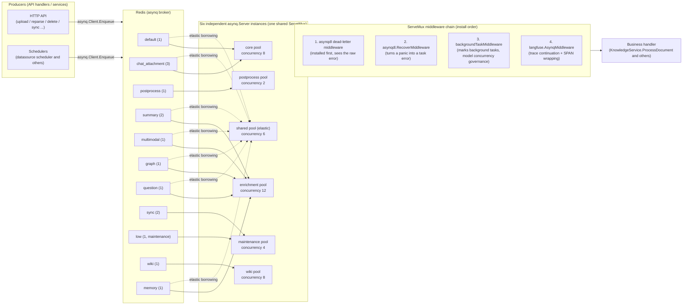
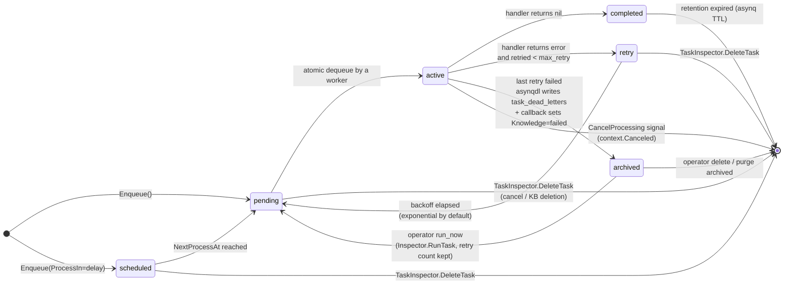
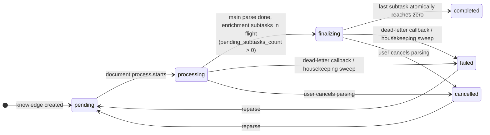

# Async task system

Document parsing, index building, summary and question generation, graph extraction, Wiki generation, data source sync and batch operations are scheduled by the task system. Standard deployments use [asynq](https://github.com/hibiken/asynq) with Redis; Lite mode uses an executor that needs no Redis. Both modes share the task handlers. They differ in how tasks run and in what operators can inspect.

## Overall architecture: two execution modes

AI KB has two task execution modes, chosen by the deployment form:

- **asynq mode (standard deployment)**: a task is serialized to a JSON payload by `asynq.Client` and written to a Redis queue, then consumed by several independent `asynq.Server` instances (worker pools). `RunAsynqServer()` in `internal/router/task.go` builds one shared `asynq.ServeMux` and runs it on 6 pools.
- **Lite mode (single machine / macOS app, no Redis)**: `SyncTaskExecutor` in `internal/router/sync_task.go` implements the same `interfaces.TaskEnqueuer` interface. `Enqueue` dispatches the task straight to a goroutine. It honours `ProcessIn` / `ProcessAt` (delay), `MaxRetry`, `Timeout` and `Deadline`, whether they were given to `asynq.NewTask` or to `Enqueue` (the latter wins). A task with no timeout runs unbounded, unlike asynq's default of 30 minutes. Retries use linear backoff (`attempt * 5s`, capped at 30s), except that a Wiki ingest lock conflict waits a fixed 15s (see [Retry backoff](#retry-backoff)); a task that returns `asynq.SkipRetry` is not retried. A panic inside a handler is recovered and treated as a failure; it does not take the process down. When retries are exhausted the same wrap-up runs as the dead-letter callback in standard mode: document tasks mark the knowledge item `failed`.

```go
// internal/router/sync_task.go
// SyncTaskExecutor executes tasks synchronously (in a goroutine) without Redis.
// Used in Lite mode as a drop-in replacement for *asynq.Client.
```

Both modes register exactly the same set of handlers (compare `RunAsynqServer` with `RegisterSyncHandlers`), so task semantics do not drift with the deployment form.

## The role of Redis

| Role | Description | Source |
| --- | --- | --- |
| asynq broker | Every task queue (pending list, scheduled/retry ZSET, archived ZSET) lives in Redis; dequeue is atomic (`BRPOPLPUSH`), so one task runs on exactly one worker | `internal/router/task.go` `getAsynqRedisClientOpt()` |
| Task inspection data source | `asynq.Inspector` plus direct `LPos` / `ZRank` / `ZRevRank` reads for pagination | `internal/router/task_inspector.go` |
| Wiki ingest locks | The per-slug reduce lock (5 min TTL) and the KB-level finalize lock (60 s TTL) are `SetNX` + TTL. Standard mode no longer takes an exclusive per-KB batch lock; concurrent batches are kept safe by row claiming in `task_pending_ops`. Lite mode serializes per KB with an in-process map, which also backs the Wiki stats `is_active` flag (standard mode reads the `wiki:inflight:<kb_id>` slot set) | `internal/application/service/wiki_ingest.go`, `wiki_ingest_batch.go` |
| Multimodal subtask counter | Counts completed image subtasks (`DECR`); the last attempt triggers finalize. Lite mode uses an in-process counter instead | `internal/application/service/multimodal_pending_counter.go` and the `image_multimodal` service |
| Rate limiting | Sliding-window limiter on a ZSET (see [Observability](../03-features/16-observability.md)) | `internal/ratelimit/limiter.go` |

Redis connection parameters come from the environment: `REDIS_ADDR` / `REDIS_USERNAME` / `REDIS_PASSWORD` / `REDIS_DB` and the TLS settings. The read and write timeout is `AIKB_REDIS_OP_TIMEOUT_MS`, default 500 ms (the write timeout is twice that, to absorb head-of-line stalls):

```go
// internal/router/task.go
const defaultRedisOpTimeoutMs = 500
opt := &asynq.RedisClientOpt{
    Addr:        os.Getenv("REDIS_ADDR"),
    ReadTimeout: time.Duration(timeoutMs) * time.Millisecond,
    WriteTimeout: time.Duration(timeoutMs*2) * time.Millisecond,
    ...
}
```

## Task types

Task type constants are defined in `internal/types/task.go`:

| Task type | Constant | Purpose | Queue |
| --- | --- | --- | --- |
| `document:process` | `TypeDocumentProcess` | Document parsing entry point (DocReader / chunking / embedding) | `default` |
| `manual:process` | `TypeManualProcess` | Manual knowledge update (cleanup + re-indexing) | `default` |
| `temporary_document:process` | `TypeTemporaryDocumentProcess` | Session temporary document (chat attachment) parsing | `chat_attachment` |
| `knowledge:post_process` | `TypeKnowledgePostProcess` | Knowledge post-processing dispatcher (fans out enrichment subtasks) | `postprocess` |
| `knowledge:auto_tag` | `TypeKnowledgeAutoTag` | Auto-link a document to the knowledge base's existing tags | `summary` |
| `memory:extract` | `TypeMemoryExtract` | Background long-term memory extraction | `memory` |
| `summary:generation` | `TypeSummaryGeneration` | Summary + document profile generation | `summary` |
| `kb:profile` | `TypeKnowledgeBaseProfile` | Knowledge base description (profile aggregation + one small model call, skipped when the hash is unchanged) | `summary` |
| `datatable:summary` | `TypeDataTableSummary` | Table summary | `summary` |
| `image:multimodal` | `TypeImageMultimodal` | Image OCR + VLM caption | `multimodal` |
| `chunk:extract` | `TypeChunkExtract` | Graph entity and relationship extraction (per chunk) | `graph` |
| `question:generation` | `TypeQuestionGeneration` | Question generation (fan-out per chunk batch) | `question` |
| `datasource:sync` | `TypeDataSourceSync` | Data source sync | `sync` |
| `faq:import` | `TypeFAQImport` | FAQ import (including dry run) | `low` (maintenance) |
| `kb:clone` | `TypeKBClone` | Knowledge base clone | `low` |
| `kb:delete` | `TypeKBDelete` | Knowledge base deletion | `low` |
| `index:delete` | `TypeIndexDelete` | Index deletion | `low` |
| `knowledge:list_delete` | `TypeKnowledgeListDelete` | Batch delete of knowledge items | `low` |
| `knowledge:list_reparse` | `TypeKnowledgeListReparse` | Batch reparse | `low` |
| `knowledge:move` | `TypeKnowledgeMove` | Move a knowledge item | `low` |
| `wiki:ingest` | `TypeWikiIngest` | Wiki page generation / sync | `wiki` |
| `wiki:finalize` | `TypeWikiFinalize` | KB-level Wiki wrap-up (debounced: index rebuild, dead-link cleanup, cross-links) | `wiki` |

Every payload struct (such as `DocumentProcessPayload` and `ImageMultimodalPayload`) embeds `types.TracingContext`, which carries the Langfuse / W3C `traceparent` across processes (see [Observability](../03-features/16-observability.md)), and carries routing fields such as `tenant_id` / `knowledge_id` / `knowledge_base_id` for dead-letter archiving and cancel matching.

Auto-tagging, summaries and the knowledge base description share the `summary` queue and are optional enrichment tasks. Auto-tagging is enqueued only when the document knowledge base has `auto_tag_config` enabled. The knowledge base description (`kb:profile`) is enqueued only when `profile_config` is enabled; it is triggered by a terminal summary state, a deletion or a move, deduplicated in a 30-second window. A failure in any of them does not affect a completed parse. Memory extraction uses its own `memory` queue, consumed by the enrichment pool and borrowed by the shared pool with weight 1; the pool count stays at 6.

Memory tasks are deduplicated per subject and aggregated with a delay. `extract_cursor`, `pending_sessions` and the schedule time on `memory_subjects` let a run resume, so a model extraction does not start on every question. No background distillation runs when the workspace has memory off or `write_mode` is not `auto`. The Lite synchronous executor registers the auto-tag and memory tasks too, under the same business switches.

## Worker pool topology and governance

`queueDefinitions` in `internal/types/task.go` is the **single source of truth** for the queue topology. Worker server construction (`QueueWeightsForPool`) and the operations dashboard (`QueueStats`) read the same registry, so weights cannot drift.

### Six independent worker pools

Each pool is a separate `asynq.Server`, and its concurrency is **hard isolation**, not a weighted preference. Default concurrency and configuration keys (system_settings key / environment variable, see `types.ResolveWorkerPoolConcurrency`):

| Pool | Default concurrency | Queues consumed (weight) | Setting key / environment variable |
| --- | --- | --- | --- |
| `core` | 8 | `default` (1), `chat_attachment` (3) | `asynq.core_concurrency` / `AIKB_ASYNQ_CORE_CONCURRENCY` |
| `postprocess` | 2 | `postprocess` (1) | `asynq.postprocess_concurrency` / `AIKB_ASYNQ_POSTPROCESS_CONCURRENCY` |
| `enrichment` | 12 | `summary` (2), `multimodal` (1), `graph` (1), `question` (1), `memory` (1) | `asynq.enrichment_concurrency` / `AIKB_ASYNQ_ENRICHMENT_CONCURRENCY` |
| `maintenance` | 4 | `sync` (2), `low` (1) | `asynq.maintenance_concurrency` / `AIKB_ASYNQ_MAINTENANCE_CONCURRENCY` |
| `shared` (elastic layer) | 6 | the core and enrichment queues with `SharedWeight > 0` | `asynq.shared_concurrency` / `AIKB_ASYNQ_SHARED_CONCURRENCY` |
| `wiki` | 8 | `wiki` (1) | `asynq.wiki_concurrency` / `AIKB_WIKI_ASYNQ_CONCURRENCY` |

Design points (each backed by a source comment):

- **Guaranteed capacity plus elastic borrowing**: core, postprocess, enrichment and maintenance each provide a guaranteed minimum. The `shared` pool subscribes to the core and enrichment queues, so idle capacity can be borrowed by either stage (`NewSharedAsynqServer`: Redis dequeue is atomic, so a task still runs once even though several servers subscribe to the same queue). Post-process and maintenance stay out of the shared pool: the former needs its own latency guarantee, the latter runs long tasks that would pin burst capacity meant for interactive work. The scope is defined by `QueueWeightsForSharedPool`.
- **Wiki hard isolation**: the `wiki` pool pulls only the `wiki` queue, so the parsing pipeline and Wiki generation cannot starve each other (`NewWikiAsynqServer` comment).
- **Chat attachments first**: `chat_attachment` has weight 3 in the core pool against 1 for `default`, so a large KB import does not make interactive chat uploads wait.
- **Rolling upgrade compatibility**: the physical Redis queue name behind the `QueueMaintenance` constant stays the old `"low"`, so tasks enqueued by an older release are still consumed during a rolling deployment.

### Capacity planning and scaling {#capacity-planning}

The old aggregate setting `asynq.concurrency` / `AIKB_ASYNQ_CONCURRENCY` is retired; existing deployments should move to the per-pool settings above. A changed setting takes effect after a restart. The default first five pools add up to 32 workers per instance; Wiki's 8 are counted separately.

Use the estimate below as a starting point, then adjust from the runtime dashboard and real load:

```text
workers needed ≈ ceil(peak task arrival rate × average execution time / 0.70)
```

The 0.70 is an example target utilization, not a system setting or a capacity guarantee. Count the arrival rate after fan-out: one document can produce several question batches, per-chunk graph tasks and one task per image. The number of queues says nothing about throughput.

Workers control how many tasks one service instance runs at once. Model quotas control concurrency, RPM and TPM across replicas. DocReader, the vector store, the database and object storage have capacity limits of their own. When the model rate-limit wait is already high, more workers only add more waiters. Judge from the wait time of the oldest task, the total capacity of the active instances, worker utilization and the downstream resources: raise the matching pool when downstream has headroom and the backlog keeps growing; lower the core intake when DocReader is saturated.

### Worker pool diagram



### Middleware governance

`RunAsynqServer` (`internal/router/task.go`) installs four middlewares on the one mux, in order:

1. **`asynqdl.MiddlewareWithCallback` (dead letters)**. Installed first so it sees the raw error the handler returned (later middlewares may transform it). See [Failure retries and dead letters](#failure-retries-and-dead-letters).
2. **`asynqdl.RecoverMiddleware`**. Turns a handler panic into an ordinary task error. asynq itself recovers panics only outside the middleware chain; without this layer the dead-letter callback never sees the error, and a document on its last attempt stays in `processing`.
3. **`backgroundTaskMiddleware`**. Tags every task context with `types.WithBackgroundTask`, so the per-model chat concurrency governor throttles ingestion and enrichment LLM calls without touching interactive user chat.
4. **`langfuse.AsynqMiddleware`**. A pass-through when Langfuse is off. When on, it resumes the upstream HTTP trace or opens a standalone one and wraps the handler in a SPAN.

### Retry backoff

asynq's default exponential backoff applies (about 10s, 40s, 90s, 2.5m, ...), with one customization for Wiki ingest lock conflicts (`asynqRetryDelayFunc`):

```go
// internal/router/task.go
func asynqRetryDelayFunc(n int, e error, t *asynq.Task) time.Duration {
    if errors.Is(e, service.ErrWikiIngestConcurrent) {
        return wikiIngestRetryDelay // fixed 15s
    }
    return asynq.DefaultRetryDelayFunc(n, e, t)
}
```

The intent: an orphaned lock expires within 60s, so a fixed 15s retry almost always succeeds, while exponential backoff would leave a KB stuck for 7 to 10 minutes after a crash-restart. Only Lite mode returns `ErrWikiIngestConcurrent` (standard mode no longer takes a per-KB batch lock), so the Lite executor applies the same fixed 15s delay to it (`syncRetryDelay` in `internal/router/sync_task.go`); every other Lite retry backs off linearly, 5s per attempt up to 30s.

## Task lifecycle state machine

Runtime states on the asynq side (`runtimeTaskState` in `internal/router/task_inspector.go` maps to `types.RuntimeTaskState`): `pending`, `active`, `scheduled`, `retry`, `archived`, `completed`. On the business side, the knowledge row's `parse_status` (`internal/types/knowledge.go`) goes `pending` → `processing` → `finalizing` → `completed`, plus `failed` / `deleting` / `cancelled`.



The matching knowledge row states (driven by the tasks):



## Task inspection, cancellation and the runtime dashboard (TaskInspector)

`internal/router/task_inspector.go` implements `interfaces.TaskInspector`. In asynq mode it is backed by `asynq.Inspector` plus a native Redis client. Lite mode gets `noopTaskInspector` (a goroutine cannot be removed before it starts; the checkpoint-style abort is the only stop signal).

### Cancel by knowledge item or knowledge base

- `CancelTasksForKnowledge(ctx, knowledgeID)`: scans every registered queue (`queuesScanned` comes from `types.QueueDefinitions()`) across the four states pending / scheduled / retry / active, and acts on any task whose payload `knowledge_id` matches. The cancellable task types are the allowlist `taskTypesForKnowledgeCancel`: `document:process`, `manual:process`, `image:multimodal`, `knowledge:post_process`, `question:generation`, `summary:generation`, `chunk:extract` (FAQ import and knowledge-base-level tasks are excluded).
- Cancellation runs in three phases (`cancelMatchingTasks`): (1) delete the queued states first; (2) snapshot the active tasks, signal them with `Inspector.CancelProcessing`, then poll for up to 1s (every 25 ms) to delete the records that moved to retry because of `context.Canceled` (`deleteCancelledTransitions`); (3) scan the queued states once more to catch downstream tasks enqueued while cancellation was settling.
- `CancelTasksForKnowledgeBase`: orphan cleanup after a KB is deleted. `kb:delete` and `index:delete` are explicitly excluded (they carry a snapshot and perform the real storage cleanup; deleting them would leak resources). The semantic KB fields of clone and move payloads (`source_id` / `target_id` / `source_kb_id` / `target_kb_id`) also take part in matching.
- Everything is best-effort: a Redis hiccup is logged at Warn and swallowed, and the cancel API still returns success.
- `HasQueuedTasksForKnowledge`: a read-only probe. The housekeeping sweep uses it to tell a backlogged row from an orphaned one, so it does not mark a live row `failed`. `HasQueuedDeleteTasksForKnowledge` matches the batch payload of `knowledge:list_delete` for stuck-delete recovery.
- `QueuedKnowledgeIDs`: one scan of every queue returning the set of knowledge IDs still referenced by queued tasks. The knowledge list API derives `stall_state` (`queued` / `stalled`) from it. The result is cached for 60 seconds and shared between concurrent requests; a failed scan is not cached.

### Runtime dashboard (SystemAdmin Runtime Dashboard)

- `QueueStats()`: `GetQueueInfo` per queue, emitted as `types.QueueStat` (size / pending / active / scheduled / retry / archived / completed, today's processed / failed, paused, `latency_ms` (age of the oldest pending task), memory usage), plus the static pool and weight metadata. A queue that has never been created returns a zero row (`isAsynqQueueNotFound` also recognizes the internal `NOT_FOUND` error string leaked by asynq v0.26; see `task_inspector_errors.go`).
- `ListRuntimeTasks()`: paginates directly on the Redis keys `asynq:{<queue>}:<state>`. pending / active are LISTs (newest first); scheduled / retry are ZSETs ordered by `NextProcessAt` ascending; archived / completed are ordered by score descending. The cursor is a base64-encoded window of anchors (at most 32, `runtimeTaskCursorMaxAnchors`), so pagination continues when an anchor disappears (task completed, retried or deleted). The payload is projected to an allowlist of routing metadata (tenant / kb / knowledge / task / sync IDs and the like); **document content and secrets are never exposed**.
- Task actions are constrained by the state checks in `runtimeTaskActions`: `cancel` (pending / active / scheduled / retry, cancellable types only), `run_now` (scheduled / retry / archived; asynq keeps the retry count), `delete` (archived only). `PurgeArchivedRuntimeTasks` clears the archived set of one queue in one call.
- `WorkerServerStats()`: reads the asynq server heartbeats (concurrency, active workers, status, queue weights) and aggregates them across replicas, separating "configured per-instance capacity" from "actual cluster capacity".

The HTTP API (`internal/router/routes_auth_tenant.go`, gated by SystemAdmin plus the platform API key capability):

| Method | Path | Description |
| --- | --- | --- |
| GET | `/api/v1/system/admin/runtime/queues` | Queue depth snapshot + worker heartbeats |
| GET | `/api/v1/system/admin/runtime/queues/:queue/tasks` | Task list paginated by state and cursor |
| POST | `/api/v1/system/admin/runtime/queues/:queue/tasks/:task_id/actions/:action` | `cancel` / `run_now` / `delete` (written to the platform audit log) |
| DELETE | `/api/v1/system/admin/runtime/queues/:queue/archived` | Purge archived (audit action `system.queue_archived_purged`) |

## Failure retries and dead letters

### asynq dead-letter middleware (`internal/middleware/asynqdl/asynqdl.go`)

- Writes one `task_dead_letters` row only when the **final attempt** fails (`isFinalAttempt`: `retried >= max_retry`), so a transient hiccup does not produce a row on every retry.
- `buildDeadLetter` uses the tolerant `payloadProbe` to pull `tenant_id` / `knowledge_base_id` / `kb_id` / `knowledge_id` / `source_kb_id` out of any payload, and `inferScope` picks the scope by blast radius (`knowledge_base` > `knowledge` > `tenant` > `unknown`). The payload is kept verbatim (usable for a future replay); `last_error` is truncated to 8 KB.
- The insert is best-effort: a DB failure is only logged, and the original task error always propagates to asynq unchanged (the task is archived).
- The `OnDeadLetter` callback (`newDeadLetterKnowledgeFailer` in `internal/router/task.go`): when `document:process` / `knowledge:post_process` / `manual:process` exhausts its retries, and only if the knowledge row is still `pending` / `processing` / `finalizing` and its tenant and knowledge base match the payload, one conditional update writes `parse_status=failed` together with `error_message` (no half-updates, and a cancelled or deleted row is never overwritten; a task that ends with `SkipRetry` does not trigger it). A task whose attempt number is older than the row's latest attempt is also left alone. It then calls `SpanTracker.FinalizeAttempt` to close the root span of that attempt, so the timeline stops showing "in progress". `knowledge:list_delete` has its own branch, `markKnowledgeListDeleteFailed`. `image:multimodal` does not mark the parent knowledge item failed (finalize-on-last-attempt already keeps progress moving). The callback runs with `context.Background()`, its panics are recovered, and it never changes the original task error.

### Durable task queue and service-level dead letters (`internal/application/repository/task_queue.go`)

The `task_pending_ops` table is the durable alternative to a Redis list queue (survives restarts, no TTL eviction). A queue is identified by the triple `(task_type, scope, scope_id)`. Its main consumer today is Wiki ingest:

- `Enqueue` / `EnqueueIfKnowledgeBaseActive`: the latter checks inside a transaction, with a Postgres `SHARE` row lock, that the KB still exists and that its tenant is not soft-deleted, so no new durable work is written after the KB or tenant is gone.
- **Deleted tenants**: tenant deletion is a soft delete; the knowledge bases and `task_pending_ops` rows remain. Startup recovery clears pending rows of soft-deleted tenants, and the Wiki ingest / finalize tasks check that the tenant is alive before calling a model; for a deleted tenant the KB's queue is dropped and no model request is made.
- `ClaimBatch`: claims **whole groups** atomically by `dedup_key` (= document). The core invariant: several ops for one document (such as an ingest followed by a retract) are never split across two concurrent batches. A key with a fresh claim (`claimed_at >= staleBefore`) is skipped as a whole, so a late sibling op waits for the holder to finish or the claim to go stale. On Postgres the anchor row of each key is locked with `FOR UPDATE SKIP LOCKED`, so concurrent claimers get **disjoint** key sets; SQLite (Lite and tests) relies on the single-writer engine. Claim order is `fail_count` ascending, then enqueue order within the same count: a repeatedly failing document does not sit at the head forever, and new documents are not starved (`PeekBatch` in Lite mode uses the same order).
- `IncrFailCount` (one round trip, atomic `UPDATE ... RETURNING`) works with a service-side cap (`wikiMaxFailRetries`, 5 for Wiki): past the cap the op moves from `task_pending_ops` to `task_dead_letters` (`internal/application/service/wiki_ingest.go` calls `deadLetterRepo.Insert` directly).
- `ReleaseByIDs` / `DeleteByIDs` / `DeleteByScope` / `DeleteByDedupKey` / `PendingCount` provide release, consumption acknowledgement, KB lifecycle cleanup and backlog observation.

The dead-letter repository `taskDeadLetterRepository` provides `ListByScope` / `ListByTaskType` (id-descending cursor pagination, limit 1 to 200) and `DeleteByID`. Operators can query failures by task type, scope or tenant straight from SQL instead of reading logs.

### Last resort: the housekeeping sweep

`internal/application/service/knowledge_housekeeping.go`: a cron runs one sweep every 5 minutes (`0 */5 * * * *`). It is the last line of defence beyond asynq retries, the dead-letter callback and multimodal finalize (a worker killed in the middle of a handler, a `defer` that never ran, and similar). `AIKB_HOUSEKEEPING_ENABLED=false` turns it off.

The threshold is `max(1h, AIKB_DOCUMENT_PROCESS_TIMEOUT) + 10min`. Each sweep covers:

| Sweep | Target | Action |
| --- | --- | --- |
| Stuck parse | `pending` / `processing` / `finalizing` older than the threshold, with the span heartbeat also older than the threshold, and no related task in the asynq queues or the durable Wiki queue | Set `failed`; `error_message` names the stage it stopped at and the time of the last progress. Open spans of the latest attempt are closed with `TASK_STALLED` (the stuck stage as `failed`, the rest as `cancelled`) |
| Stuck summary | `summary_status = processing` for more than 1 hour, or `summary_status = pending` on a row whose parse already ended with no task still queued | `summary_status` set to `failed` |
| Stuck delete | `deleting` older than the threshold, with no delete task in the queue that covers it | Set `failed` with a reason; the document becomes visible again and can be deleted again. A failed queue probe defers the row |
| Wiki queue re-trigger | Documents held in `finalizing` only because the durable Wiki queue has not been consumed | Re-enqueue the Wiki trigger task for the knowledge base, at most once per knowledge base per threshold period |

A recurring "tasks still queued (backpressure, not stuck)" log line means the bottleneck is queue capacity: raise the matching worker pool concurrency rather than suspecting a false positive.

## Event bus (`internal/event`)

The event bus distributes **in-process** session and agent streaming events (SSE pushes, IM callbacks). It complements asynq, which handles durable cross-process tasks.

### Structure and delivery guarantees

```go
// internal/event/event.go
type Event struct {
    ID        string                 // event ID (generated UUID, used to track streaming updates)
    Type      EventType
    SessionID string
    Data      interface{}
    Metadata  map[string]interface{}
    RequestID string
}
```

- `EventBus.On(type, handler)` registers a handler (several per type are allowed); `Off` / `Clear` remove them; `HasHandlers` / `GetHandlerCount` query them.
- **Sync mode** (`NewEventBus`, the default): `Emit` runs the handlers in order and returns the first error immediately (at most once; an error stops the remaining handlers).
- **Async mode** (`NewAsyncEventBus`): `Emit` starts a goroutine per handler, fire-and-forget. Errors are dropped and panics are recovered and logged.
- `EmitAndWait`: in both modes, runs every handler in parallel and waits for all of them, collecting errors and panics.
- **Delivery is in-process and not durable**: an event with no registered handler is silently dropped (returns nil), and a process crash loses in-flight events. Anything that must persist goes through asynq or `task_pending_ops`.
- `global.go` provides a global singleton (`event.On` / `event.Emit`). In practice session-level streaming uses a **separate bus instance** per run (see the subscribers below).
- `middleware.go` provides handler middlewares: `WithLogging` (trigger and failure logs), `WithTiming` (duration written to metadata), `WithRecovery` (panic turned into a `PanicError`), composed with `Chain` / `ApplyMiddleware`.
- `EventBusAdapter` in `adapter.go` adapts `*EventBus` to `types.EventBusInterface` to avoid an import cycle.

### Event types (`internal/event/event.go`)

| Group | Event types |
| --- | --- |
| Query processing | `query.received`, `query.validated`, `query.preprocess`, `query.rewrite`, `query.rewritten` |
| Retrieval | `retrieval.start`, `retrieval.vector`, `retrieval.keyword`, `retrieval.entity`, `retrieval.complete` |
| Rerank | `rerank.start`, `rerank.complete` |
| Merge | `merge.start`, `merge.complete` |
| Chat generation | `chat.start`, `chat.complete`, `chat.stream` |
| Agent lifecycle | `agent.query`, `agent.plan`, `agent.step`, `agent.tool`, `agent.complete` |
| Agent streaming (live feedback) | `thought`, `command_output`, `tool_call`, `tool_result`, `reflection`, `references`, `final_answer` |
| MCP tool human approval | `tool_approval_required`, `tool_approval_resolved` |
| MCP OAuth in-conversation authorization | `mcp_oauth_required`, `mcp_oauth_resolved` |
| Memory and context | `memory_recalled`, `context_compacted`, `user_message_injected` |
| Error / session / control | `error`, `session_title`, `stop` |

The data structure of each event is defined in `internal/event/event_data.go` (for example `AgentToolCallData` carries `tool_call_id` / `tool_name` / `arguments` / `hint`, and `AgentFinalAnswerData` carries `content` / `done` / `is_fallback`).

### Main subscribers

| Subscriber | Source | Subscribed events |
| --- | --- | --- |
| SSE agent streaming handler | `internal/handler/session/agent_stream_handler.go` | `thought`, `command_output`, `tool_call`, `tool_result`, `references`, `memory_recalled`, `context_compacted`, `user_message_injected`, `final_answer`, `reflection`, `error`, `session_title`, `agent.complete`, and the four tool approval and MCP OAuth events |
| Knowledge QA handler | `internal/handler/session/qa.go`, `helpers.go` | `thought`, `final_answer`, `stop` |
| IM integration (WeCom and others) | `internal/im/service.go` | `final_answer`, `error`, `references`, `agent.complete`, `thought`, `tool_call`, `tool_result`, `mcp_oauth_required` and others, translated into each IM platform's messages |

## The `internal/runtime` package

A small package of runtime infrastructure, not worker logic:

- `container.go`: `init()` creates the global `*dig.Container` (uber dig); `GetContainer()` lets packages register and resolve dependencies. Every asynq server, handler and repository is assembled through it (the bulk of the wiring is in `internal/container/container.go`).
- `server.go`: `MarkServerStarted()` / `ServerStartedAt()` / `ServerUptime()` record the process start time, which the runtime dashboard shows as uptime.
- `startup.go`: `SilenceGinRouteSpam()` suppresses the roughly 150 Gin route registration lines and summarizes them in one line (`LogGinRouteCount`). `LogStartupEnv()` prints a banner of selected environment variables (sensitive values show only `set (N chars)`) and warns explicitly about typical footguns (a `SYSTEM_AES_KEY` whose length is not 32 silently disables encryption, `REDIS_TLS_INSECURE_SKIP_VERIFY=true`).

## How to monitor tasks

1. **Runtime dashboard / Runtime API** (see [Runtime dashboard](#runtime-dashboard-systemadmin-runtime-dashboard)): queue depth, oldest pending latency (`latency_ms`), today's processed / failed, worker heartbeats; browse tasks by state, read `last_error` and `retried/max_retry`, run `run_now` / `cancel` / `delete`.
2. **Dead-letter SQL**: `SELECT * FROM task_dead_letters WHERE scope='knowledge_base' AND scope_id='<kbID>' ORDER BY id DESC;`, or aggregate failure rates by `task_type`. `PendingCount` and `enqueued_at` on `task_pending_ops` reveal a backlog that never drains.
3. **Logs**: workers log through `internal/logger`. Key prefixes are `[TaskInspector]` (cancellation and inspection), `asynq dead-letter`, `[SyncTask]` (Lite mode) and `[Housekeeping]`. At startup each pool logs `asynq <pool> server starting with concurrency=...`.
4. **Langfuse traces**: when enabled, every asynq task is an `asynq.<task_type>` SPAN (with queue, retry and payload size metadata) on the same trace as the HTTP request that triggered it (see [Observability](../03-features/16-observability.md)).
5. **Platform audit**: `cancel`, `run_now`, `delete` and purge actions on queue tasks are written to `audit_logs` (the `system.queue_task_*` and `system.queue_archived_purged` actions) for accountability.

## Implementation reference

| Module | Source path |
| --- | --- |
| Task registration and worker pool construction | `internal/router/task.go` |
| Lite mode synchronous executor (no Redis) | `internal/router/sync_task.go` |
| Task inspection / cancellation / runtime dashboard | `internal/router/task_inspector.go`, `internal/router/task_inspector_errors.go` |
| Queue topology and task type definitions | `internal/types/task.go` |
| Dead-letter middleware | `internal/middleware/asynqdl/asynqdl.go` |
| Durable task queue / dead-letter repository | `internal/application/repository/task_queue.go` |
| Dead-letter / pending-op models | `internal/types/task_dead_letter.go`, `internal/types/task_pending_op.go` |
| Event bus | `internal/event/` (`event.go`, `event_data.go`, `global.go`, `middleware.go`, `adapter.go`) |
| Runtime helpers (DI container, startup banner, uptime) | `internal/runtime/` (`container.go`, `server.go`, `startup.go`) |
| Housekeeping sweep for stuck tasks | `internal/application/service/knowledge_housekeeping.go` |
