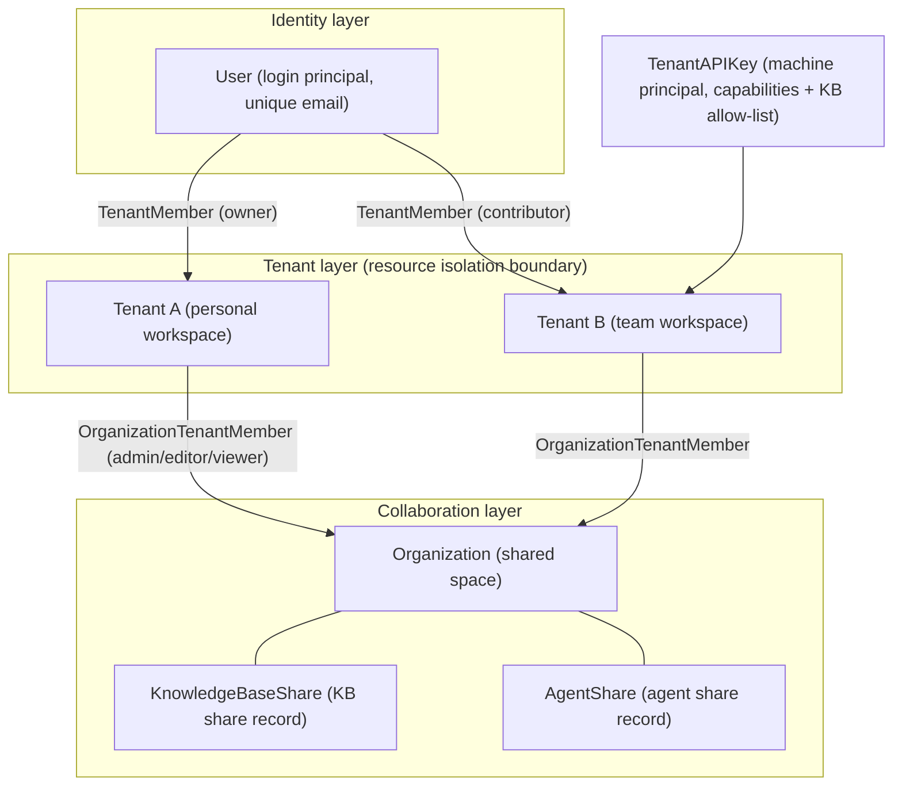
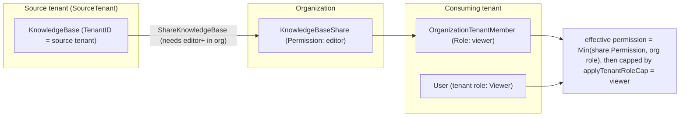
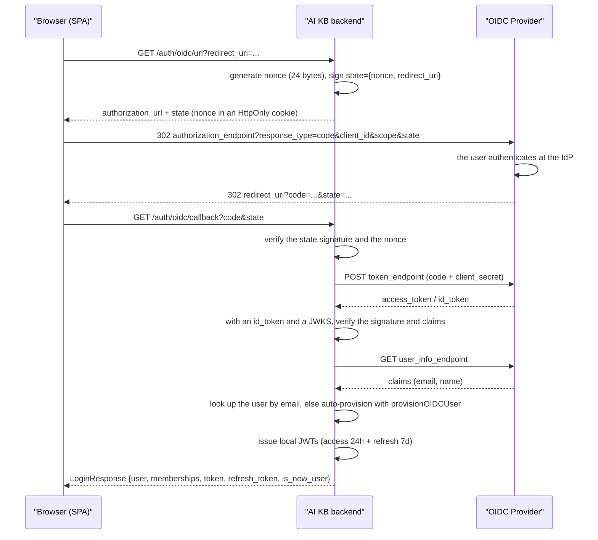

# Workspaces, users and authentication

A workspace is the resource and permission boundary of AI KB: knowledge bases, models, agents, sessions and the storage quota all belong to a workspace. One user can join several workspaces with a different role in each. Organizations connect workspaces so they can share knowledge bases and agents. The backend calls a workspace a Tenant.

The entry points for inviting members, sharing resources and API access are below. Managing the whole deployment needs a separate platform permission.

| Task | Where and what it needs |
| --- | --- |
| Invite a team member | Workspace settings → Members → Invite, and give them a role (Owner / Admin / Contributor / Viewer) |
| Share a knowledge base with another team | Create an organization → add both workspaces → "Share to organization" on the knowledge base |
| Connect a program | Workspace settings → API Key; tick the capabilities it needs (retrieve / chat / ingest / manage) and, if needed, limit the knowledge bases it may reach |
| Manage the whole deployment (global settings, task queues, cross-workspace audit) | Needs the **system administrator** identity, granted independently of workspace Owner; see [Platform administration and system administrators](20-platform-admin.md) |
| Delete a whole workspace | Triggered by the **Owner** in workspace settings (`DELETE /tenants/:id`); the workspace and all its membership rows are soft-deleted, members lose access at once, and the UI offers no undo |

<Screenshot
  src="/screenshots/settings-members.png"
  caption="Workspace member management: member roles and the invite entry"
  hint="The member list, the role dropdown and the 'Invite member' button, ideally with one pending invitation." />

A Viewer can browse and ask questions, a Contributor can create knowledge bases and upload documents, an Admin manages members and workspace settings, and an Owner can also delete or transfer the workspace. Changing a resource is additionally bound by ownership or sharing permission; the role matrix is in the reference section.

Users sign in with a password or through OIDC single sign-on; programs use an API key. A signed-in user's permissions come from the workspace role and resource ownership; an API key is checked against its granted capabilities and knowledge base scope.

## Invite members and assign roles

To bring colleagues into a workspace, invite them under "Members" in workspace settings and assign a role that matches their work. An invited user joins the current workspace on accepting. When public registration is off, a valid invitation still lets a new user register. An existing user can accept an invitation into a new workspace without creating a second account.

Workspace member roles and organization member roles are managed separately. When material has to be shared, check the knowledge base's share permission, the receiving workspace's role in the organization, and the user's own workspace role.

## Share knowledge bases and agents

To give another team access to a knowledge base or an agent, first add the source workspace and the receiving workspace to the same organization, then let a member with permission share the knowledge base or agent to that organization. The receiver's effective permission is bounded by the share record and the member role together; organization sharing never raises a user's workspace role.

## Configure an API key for a program

To let a script or service call the API, create an API key in workspace settings (Settings → Publish & Integrations → API Integration) and pick the retrieve, chat, ingest or manage capabilities the task needs; to limit the material it can reach, name the allowed knowledge bases. Copy the key from the dialog that opens after creation: the full key is shown only once, and the key list shows it masked afterwards. The program sends the credential in the `X-API-Key` request header. The capabilities and resource limits are in the reference section.

## Manage workspace and platform permissions

To remove a workspace or administer the deployment, you need the right identity. Deleting a workspace is done by its Owner. The workspace record and the membership rows are soft-deleted and every member loses access at once; the knowledge bases, models and other data inside it are not physically removed right away, and queued Wiki tasks of a deleted workspace do not call a model. Global settings, the platform task queues and cross-workspace audit are managed by the system administrator, see [Platform administration and system administrators](20-platform-admin.md).

## Concept overview

This section shows how users, workspaces, organizations and API keys relate before the reference material goes into each one.



Key points:

- One User can belong to several Tenants at once through the `tenant_members` table; each membership has its own role.
- Organization membership is **per tenant** (`OrganizationTenantMember` is keyed by `tenant_id`), and a share is "one tenant shares a KB into one organization".
- An API key is a machine principal fully separate from JWT users; it does not reuse the tenant role ladder.

## Authentication and authorization reference

This section is the reference for the registration, membership, sharing, RBAC, API key, OIDC and JWT mechanisms, with the code that implements each.

### Registration and login

#### Registration mode

`internal/handler/auth.go` plus `internal/config/config.go`:

```go
type AuthConfig struct {
    RegistrationMode       string // "self_serve" (default, public registration) | "invite_register" (registration only by invitation) | "invite_only" (no registration, kept as the legacy value)
    DefaultTenantMode      string // "create_personal" (default, a personal tenant is created) | "tenantless" (no tenant, waits for an invitation)
    ComplexPasswordEnabled bool
}

func (c *AuthConfig) IsInviteOnly() bool {
    return c != nil && c.RegistrationMode == AuthRegistrationModeInviteOnly
}
```

The decision has two layers, which explains "I changed the env and nothing happened":

**At startup** (`applyAuthAndTenantDefaults()`) `cfg.Auth.RegistrationMode` is synthesized: `DISABLE_REGISTRATION=true` rewrites it to `invite_only`, **overriding the YAML** value. Env wins over YAML so that the two gates, "the API rejects registration" and "the frontend hides the register entry" (the frontend reads `/auth/config`), stay consistent; otherwise the button would still be there and clicking it would return 403.

**On every request** (`resolveRegistrationMode()`) only two sources are compared: the `auth.registration_mode` row in the `system_settings` database table > the cfg value synthesized above > the hard-coded fallback `self_serve`. `DISABLE_REGISTRATION` is **not** re-read per request.

The consequence: after a system administrator sets `auth.registration_mode` to `self_serve` in the UI, public registration is open even though the deployment still has `DISABLE_REGISTRATION=true`. To close it completely, reset that database row (`DELETE /system/admin/settings/auth.registration_mode`).

The registration mode has three values and can be switched at any time in the global settings:

| Mode | Public registration | Registration with a valid invitation link | Existing account accepts an invitation |
| --- | --- | --- | --- |
| `self_serve` (open registration) | allowed | allowed | allowed |
| `invite_register` (registration by invitation only) | denied | allowed | allowed |
| `invite_only` (no registration, legacy value) | denied | denied | allowed |

`DISABLE_REGISTRATION=true` still maps to the original `invite_only`. To let invited new users register, set the global setting to `invite_register`. When registration is off, `POST /auth/register-by-invite` also returns 403, consistent with the login page.

These modes control password registration. **The first OIDC login** is still governed by the identity provider's policies (application visibility, user groups), and accounts created by an administrator are not affected by this setting either.

#### Password registration and login

- `POST /auth/register`: `{username(2-50), email, password}`; `DefaultTenantMode` decides whether a personal tenant is created automatically (`TenantProvisioningCreatePersonal` / `TenantProvisioningTenantless`). `auth.default_tenant_mode` is read from the `system_settings` table first, then the `AIKB_AUTH_DEFAULT_TENANT_MODE` env, then the YAML value.
- `POST /auth/login`: `{email, password}`, returns `LoginResponse{user, active_tenant, memberships[], token, refresh_token}`; the active tenant is restored from `Preferences.LastActiveTenantID`.
- Registration, registration by invitation, password change and an administrator setting a new password all apply one password policy (`internal/application/service/password_policy.go`): by default 8 to 32 characters with at least one letter and one digit. `GET /auth/config` returns the current `complex_password_enabled`; when it is on, the password must also contain an upper-case letter, a lower-case letter, a digit and a special character from `!@#$%^&*()_+-=[]{}|;:,.<>?`.
- A system administrator changes it with `auth.complex_password_enabled`; without a database row the value falls back to `AIKB_AUTH_COMPLEX_PASSWORD_ENABLED`, then the YAML value. Changing the policy only binds passwords created or changed afterwards; existing accounts are not forced to change theirs.
- Changing your own password in the profile requires the old password, and the new one must differ; on success every session of that user is revoked and a new login is required (it also clears the `oidc_only_login` preference set for auto-provisioned OIDC accounts). The API errors and parameters are in [Authentication API](../04-api/02-api-auth.md).

#### Registration by invitation (register-by-invite)

`internal/handler/auth_register_by_invite.go`. The **shared invitation link** (share link, see [Shared invitation links (invite link)](#shared-invitation-links-invite-link)) generated by a workspace Owner carries a token; the registration page completes registration with that token. Supported in the `self_serve` and `invite_register` modes:

```go
// POST /auth/register-by-invite
type registerByInviteRequest struct {
    Token    string `json:"token"    binding:"required"`
    Email    string `json:"email"    binding:"required,email"` // chosen by the registrant, not bound to the token
    Username string `json:"username" binding:"required"`
    Password string `json:"password" binding:"required,min=6"` // then checked by the shared password policy (8 to 32, letters and digits)
}
```

Flow: validate the token (`LookupByToken`) → check the email is not registered (409 when it is) → check the password policy → create the user in `tenantless` mode → set the inviting tenant as the user's home tenant → `AcceptByToken` creates the `tenant_members` row (status `active`, role as specified in the invitation). If the link was revoked between lookup and accept, the new account is kept, restored to tenantless, and 410 is returned.

The companion endpoint `POST /auth/invitations/lookup` (no authentication) returns the invitation context `{tenant_id, tenant_name, role, expires_at}` for the registration page; the token travels in the POST body so it does not appear in URL access logs; an invalid or revoked token returns 410.

#### Joining through an invitation link as an existing user

In an `invite_only` deployment the invitation page guides the user to log in first and then submit the token to `POST /me/invitations/accept-by-token` to join the workspace; no new account is created for an already registered email. A user without a default workspace gets the first workspace they join as their default. In `invite_register` mode a new user can register with a valid invitation; an existing account can switch to the login form to join, and switch back to the registration form.

Inviting a registered user by email is also governed by `tenant.auto_accept_invitation`: by default false, a pending invitation is created and waits for the invitee's inbox confirmation; when true the user is added directly, an active member is returned and any existing pending invitation is reconciled. The frontend reads this switch from `capabilities.auto_accept_invitation` in `GET /auth/me`. It does not turn an arbitrary share link into a login-free entry.

### Workspace members, invitations and invitation links

#### Member management and direct invitations

Handlers: `internal/handler/tenant_member.go` and `tenant_invitation.go`. The `/tenants/:id` group carries `PathTenantMatch()` (the URL tenant must equal the active tenant in the token, except for cross-tenant superusers).

| Endpoint | Minimum role | Description |
| --- | --- | --- |
| `GET /tenants/:id/members` | Viewer | Paged list of active members; `q` filters by email or username |
| `POST /tenants/:id/members` | Owner | Add an existing user directly `{email, role}` |
| `PUT /tenants/:id/members/:user_id` | Owner | Change a role |
| `DELETE /tenants/:id/members/:user_id` | Owner | Remove a member |
| `POST /tenants/:id/leave` | Viewer | Leave the workspace yourself (rejected when it would leave the workspace without an Owner) |
| `POST /tenants/:id/invitations` | Owner | Invite an existing user directly `{email, role, message}` |
| `GET /tenants/:id/invitations` | Viewer | List invitations |
| `DELETE /tenants/:id/invitations/:inv_id` | Owner | Revoke an invitation |
| `GET /me/invitations` | self | Invitation inbox |
| `POST /me/invitations/:inv_id/accept` / `.../decline` | self | Accept / decline |

An API key with the `manage_members` capability may call the member and invitation routes; it can never assign the Owner role.

The `TenantInvitation` state machine: `pending → accepted / declined / revoked / expired` (expiry is applied by a lazy sweep and audited as `rbac.invitation_expired`). An invitation expires after `AIKB_INVITATION_TTL` (a Go duration, default 7 days). The whole member and invitation lifecycle has audit events: `rbac.member_added` / `member_removed` / `member_role_changed` / `member_left` / `invitation_sent` / `invitation_accepted` / `invitation_declined` / `invitation_revoked` (`internal/types/audit_log.go`).

#### Shared invitation links (invite link)

`internal/handler/tenant_invite_link.go`. Stored in the same table as direct invitations: an empty `InviteeUserID` means a shared link (usable by many, counted in `AcceptedCount`), a non-empty one a direct invitation.

- `POST /tenants/:id/invite-links` (Owner): `{role, message}` → returns `invite_url` (`{FrontendBaseURL}/register?token=...`; `FrontendBaseURL` is the YAML `frontend_base_url` → the `FRONTEND_BASE_URL` env at request time → a relative path as fallback);
- Invitation links share the table with direct invitations: list with `GET /tenants/:id/invitations` (Viewer; only Owners see the `invite_url` of each link), revoke with `DELETE /tenants/:id/invitations/:inv_id` (Owner).

A link stays valid until it expires or is revoked. Together with `register-by-invite` from [Registration by invitation (register-by-invite)](#registration-by-invitation-register-by-invite) it closes the account-creation loop in invite-only mode.

### Organizations and shared spaces

#### Organization lifecycle

`internal/application/service/organization.go`:

- Creating an organization generates a unique `InviteCode` with validity `invite_code_validity_days ∈ {0 (never), 1, 7, 30}`, default 7 days (the `ValidInviteCodeValidityDays` allow-list; an invalid value returns `ErrInvalidValidityDays`);
- `GetOrganizationByInviteCode` joins by code (the repository distinguishes `ErrInviteCodeNotFound` and `ErrInviteCodeExpired`, surfaced as `ErrOrgNotFound` / `ErrInviteCodeExpired`); with `RequireApproval=true` a join request awaiting approval is created instead;
- Organizations with `Searchable=true` can be found through `SearchSearchableOrganizations`;
- `MemberLimit` defaults to 50 (0 = unlimited) and is enforced atomically with the membership insert;
- The invite code and the pending-approval count are visible only to "the organization admin or the owner tenant" (the `isAdmin || isOwner` check in `internal/handler/organization.go`).

#### Invitation candidates: exact workspace ID resolution

Organization invitations target workspaces. `GET /organizations/:id/search-tenants?q=<workspace ID>` needs a tenant Admin+ caller whose workspace is an organization admin. It resolves candidates only by an **exact workspace ID**, with no cross-workspace search by name (which would let a caller enumerate other workspaces' names): when `q` is not a valid ID, the workspace is already in the organization, or it does not exist, an empty list is returned; otherwise the single `{tenant_id, tenant_name}`. The invited side can find its workspace ID in its own workspace settings and tell the organization admin; the organization invite code or an invitation link also work.

The old endpoint `GET /organizations/:id/search-users` is kept as a compatibility alias with the same behavior as `search-tenants`.

`POST /organizations/:id/invite` (organization admin only) adds a member directly: `tenant_id` is preferred, with the old SDK's `user_id` path still accepted (it resolves that user's default workspace). A direct add no longer attaches a representative user (`representative_user_id` is ignored); the organization member list returns a representative user's email only to the caller's own workspace.

#### KB sharing model and permission calculation

`internal/types/organization.go` plus `internal/application/service/kbshare.go`:

```go
type KnowledgeBaseShare struct {
    ID              string
    KnowledgeBaseID string
    OrganizationID  string
    SharedByUserID  string
    SourceTenantID  uint64        // the sharing tenant
    Permission      OrgMemberRole // the highest permission the share grants (viewer/editor/admin)
}
// AgentShare has the same shape, for agents.
```

**Preconditions for sharing** (`ShareKnowledgeBase`): the caller's tenant must **own** the KB (`kb.TenantID == tenantID`) and hold the **editor+** role in the target organization. Sharing again updates the permission.

**Who can manage a share** (`canManageShare`, shared by KB and agent shares, used for permission changes and revocation):

1. The original sharer, still acting inside the source tenant with tenant role Contributor+;
2. An Admin+ of the source tenant (ownership is tenant-level, so a tenant Admin can still manage the share after the original sharer leaves);
3. An Admin+ user of a tenant that is an admin in the target organization may revoke the share or **lower** its permission, but may not raise it above the current value, since that would hand write access to someone else's KB to every editor member.

The `share_id` in the route must belong to the KB / agent in the path, otherwise 404.

**Limits on the receiver's access to a shared KB's configuration**: only the KB's own workspace may call `POST /initialization/initialize/:kbId`; another workspace changing the KB configuration (`PUT /initialization/config/:kbId`) needs an admin-level share and cannot change the storage binding; a receiver reading the configuration sees only whether credentials are configured, not the model base URL or the bucket location, and the KB detail no longer returns the legacy inline storage and VLM credentials.

**When a share lapses**: a share is effective only while the organization exists and the source tenant is still a member of it. When the source tenant leaves or is removed, the KBs and agents it shared into that organization are revoked together; the query side also filters by the source tenant's membership, so shares left over from older versions stop working as well.

**Effective permission = intersection of layers (the minimum)**:

```go
// final permission = Min(share.Permission, the caller tenant's OrgMemberRole in the organization)
// then capped by the tenant role:
func applyTenantRoleCap(p types.OrgMemberRole, callerTenantRole types.TenantRole) types.OrgMemberRole {
    // a user who is only a Viewer in their tenant is capped to viewer even when the share side grants editor+
    if callerTenantRole == types.TenantRoleViewer && p.HasPermission(types.OrgRoleEditor) {
        return types.OrgRoleViewer
    }
    return p
}
```

Share operations are written to the KB activity stream: `kb.share_added` / `kb.share_permission_changed` / `kb.share_removed`.

**Extra rules for agent shares** (`internal/application/service/agent_share.go`, `agent_share_scope.go`):

- Built-in agents cannot be shared: every workspace has a built-in agent with the same ID, so the receiver could not tell them apart. A chat request that names no source workspace always uses its own workspace's agent first.
- An agent share is always read-only (the stored permission is forced to `viewer`), and the agent must have a chat model configured, plus a rerank model when the knowledge search tool is enabled.
- A shared agent opens its KB scope read-only to organization members, so the sharer must be allowed to share those KBs directly, that is the KB creator or a tenant Admin+. `kb_selection_mode: all` automatically covers KBs created later, so only an Admin+ can share it. When a shared agent is edited, the same rule applies to KBs newly added to its scope.
- At share runtime an agent with no MCP selection mode is treated as "none", matching what the share scope displays; in Quick Answer mode web search needs to be enabled on the agent itself, and the `summary_model_id` in the request is ignored.
- The shared agent the receiver sees carries no system prompt and no creator user ID; its capabilities and KB scope stay visible.
- When an agent with skills enabled is shared, the skills run in the source workspace's sandbox with the environment variables the administrator configured for them (such as API keys); members can make the agent read those values out. The share settings page warns about this.



### RBAC: roles, ownership and the guard matrix

Authorization is three orthogonal mechanisms, all gathered in `rbacGuards` in `internal/router/rbac.go`:

1. **Role guards** (role-only): `Viewer()` / `Contributor()` / `Admin()` / `Owner()` / `SystemAdmin()` (plus `AdminOrSystemAdmin()` for platform-owned resources such as built-in models) ask "what is the caller's role in this tenant".
2. **Ownership guards** (ownership-or-role): `OwnedKBOrAdmin()` and friends ask "is the caller the creator of **this resource**, or at least Admin+".
3. **KB access guards** (KB-access): `KBAccessRead()` / `KBAccessWrite()` ask "can the caller's tenant reach this KB" (own / organization share / visible through a shared agent).

#### Role capability matrix

| Capability | Owner (40) | Admin (30) | Contributor (20) | Viewer (10) |
| --- | --- | --- | --- | --- |
| Delete the tenant / transfer ownership / manage API keys | ✓ | ✗ | ✗ | ✗ |
| Add / remove members, change roles, send invitations | ✓ | ✗ (the handler is Owner-only) | ✗ | ✗ |
| Configure tenant infrastructure (models / vector stores / IM / MCP / web search / storage backends / data sources) | ✓ | ✓ | ✗ | ✗ |
| Clear a knowledge base's content (`DELETE /knowledge-bases/:id/knowledge`) | ✓ | ✓ | ✗ | ✗ |
| Edit / delete a KB / agent / knowledge item / chunk / Wiki page / tag created by **someone else** | ✓ | ✓ | ✗ | ✗ |
| Create a KB / agent; copy an agent for yourself | ✓ | ✓ | ✓ | ✗ |
| Edit / delete **your own** KB and its sub-resources | ✓ | ✓ | ✓ | ✗ |
| Create and manage your own sessions, ask questions (`/sessions`, `/knowledge-chat`, `/agent-chat` are all Viewer+) | ✓ | ✓ | ✓ | ✓ |
| View the member list / invitation list / KB list / knowledge / retrieval / preview | ✓ | ✓ | ✓ | ✓ |

The design comment at the top of `internal/router/rbac.go` sums up the product semantics:

> - Owner / Admin: manage everything in the tenant;
> - Contributor: manage the resources they created, other people's resources behave as read-only;
> - Viewer: read everything, change nothing;
> - Creating a new resource needs at least Contributor; configuring tenant infrastructure needs Admin+.

Two places that trip people up: **adding, removing and re-roling members and sending invitations is Owner-only**, not even Admin may (`routes_auth_tenant.go` mounts `g.Owner()`; only the member list is Viewer+); and **a Viewer is not "unable to create anything"**: sessions are the user's own working data, so a Viewer can create sessions and ask questions, just not create knowledge bases or agents.

#### Guard selection rules (Q1 / Q2)

`rbac.go` spells out how to pick the guard for a new route:

- **Q1: does the resource have a creator?** Yes (KB, agent, knowledge document, chunk, WikiPage, FAQ entry, KB tag) → mutating routes use `OwnedXxxOrAdmin`; no (Model, VectorStore, IM channel, WebSearchProvider, DataSource, MCPService and other tenant-level infrastructure) → `Admin()`; the creation entry point (the resource does not exist yet) → `Contributor()`.
- **Q2: is the side effect private or public?** Private (such as `POST /agents/:id/copy`, which copies for the caller alone) → `Contributor()` is enough; public (sharing a KB to an organization, disabling an agent for the whole tenant, transferring ownership) → `OwnedXxxOrAdmin` or `Admin`.

#### Ownership guard list

| Guard | Resolution path | Routes |
| --- | --- | --- |
| `OwnedKBOrAdmin` | `:id` → KB.CreatorID | KB update / delete / pin / knowledge upload / tag CRUD |
| `OwnedKBOrAdminFromKbIDParam` | `:kbId` → KB.CreatorID | The `/initialization/*` KB configuration routes |
| `OwnedAgentOrAdmin` | `:id` → Agent.CreatorID (a built-in agent has an empty creator, so only Admin+ may change it) | Agent mutations |
| `OwnedKnowledgeKBOrAdmin` | knowledge `:id` → the owning KB.CreatorID | Knowledge update / delete / reparse / image edit |
| `OwnedChunkKBOrAdmin` / `...FromChunkID` | `:knowledge_id` or chunk `:id` → KB.CreatorID | Chunk mutations |
| `OwnedWikiKBOrAdmin` | `:kb_id` → KB.CreatorID | Wiki page CRUD |

Sub-resources must inherit the gate of their parent KB (the comment names the FAQ/tag, agent share and KB share bugs that were wired to the wrong axis and fixed).

#### Middleware semantics (`internal/middleware/rbac.go`)

The decision order of `RequireRole` / `RequireOwnershipOrRole` (the ownership decision itself is the pure function `CheckOwnershipOrRole` in `internal/application/access/ownership.go`):

1. An API key principal passes straight through (its authorization is the APIKeyGate of the [route declaration mechanism](#route-declaration-mechanism), and the synthetic system user can never match a `creator_id`);
2. Role satisfied → pass;
3. Cross-tenant superuser (`IsCrossTenantSuperuser`) → pass;
4. RBAC not enforced (`tenant.enable_rbac=false`, rollout mode) → log and pass, with no creator lookup at all;
5. An ownership guard runs the creator query: resource missing → pass so the handler returns 404; query failure → 503; creator == current user → pass;
6. Otherwise 403 plus an audit row (`AuditActionAccessDenied = "rbac.access_denied"`).

The enforcement switch is `TenantConfig.EnableRBAC`: `nil` or `true` = enforce (the current default), `false` = log only, never reject (for a release transition); the `AIKB_TENANT_ENABLE_RBAC` env overrides it. The switch only affects role checks inside a workspace; the knowledge base access guard (`RequireKBAccess`) always blocks cross-workspace access.

`RequireSystemAdmin`: a JWT user needs `IsSystemAdmin=true`; an API key must be a platform key (a tenant key always gets 403).

#### KB access guard (the cross-workspace sharing channel)

`middleware/kb_access.go` (wrapped by the `KBAccess*` family in `rbac.go`; the decision rules live in `internal/application/access`) unifies three access paths:

```text
1. own KB                          → equivalent to full Admin-level access
2. organization-shared KB (Plan 3) → capped by the share permission
3. visible through a shared agent  → read-only (only active at the KBAccessRead level)
```

When the guard passes it stores `(KB, effective tenant ID, permission)` in the context and **rewrites the request's tenant ID to the effective tenant**, so downstream handlers need not know whether the KB is own or shared. The variants `KBAccessReadFromKnowledgeIDParam` / `...FromChunkIDParam` (and their `Write` counterparts) resolve the KB from a knowledge or chunk ID. Read routes need at least `OrgRoleViewer`, write routes at least `OrgRoleEditor`. The guard also applies the API key KB allow-list before resolving access.

### API key system

#### Capabilities

`internal/types/tenant_api_key.go`. An API key **does not reuse tenant roles**: a key is either `FullAccess` or carries an explicit capability set; a route with no declared policy denies API keys by default (default-deny).

| Capability | Description |
| --- | --- |
| `retrieve` | Read and search knowledge base data (KB list, knowledge detail, hybrid-search and so on) |
| `chat` | The conversation flow: create a session, knowledge-chat / agent-chat, load and delete messages |
| `read_agents` | List and view agents (no create or update) |
| `ingest` | Write content: upload documents, edit chunks / FAQ / tags / Wiki, batch delete and move knowledge |
| `manage_kbs` | The KB lifecycle: create / copy / duplicate / update / delete / initialization configuration |
| `manage_agents` | Create, update, delete and copy agents |
| `message_history` | Search and view tenant-level chat history (`POST /messages/search` and so on, separate from chat) |
| `manage_models` | Manage model definitions and credentials |
| `manage_mcp_services` | Manage MCP services and credentials |
| `manage_datasources` | Manage data source connectors and sync tasks |
| `manage_channels` | Manage embed / IM channel integrations |
| `manage_vector_stores` | Manage vector stores and parsers |
| `manage_storage_backends` | Manage object storage backends |
| `manage_web_search` | Manage the web search configuration |
| `run_evaluations` | Run and view evaluation tasks |
| `manage_members` | Manage tenant members and invitations |
| `manage_spaces` | Manage organization / shared space membership |
| `manage_tenant_settings` | Read and write tenant integration settings |
| `system_tenants_read` / `system_tenants_manage` | Platform level: tenant management (platform keys only) |
| `system_settings_read` / `system_settings_manage` | Platform level: system settings |
| `system_runtime_read` / `system_runtime_manage` | Platform level: runtime queues / tasks |
| `system_audit_read` | Platform level: audit log |

#### Route declaration mechanism

In `internal/router/rbac.go` every API-key-accessible route registers one `APIKeyRoutePolicy` explicitly through `apiKeyGroup` / `apiKeyRoute` (`middleware.APIKeyRouteAuthorizer` is the single source of truth):

```go
// policy constructors
apiKeyAny()                    // any valid key
apiKeyFullAccess()             // FullAccess keys only
apiKeyPlatform(caps...)        // platform keys only, plus the named capabilities
apiKeyRetrieve(base) / apiKeyChat(base) / apiKeyIngest(base) / ...
```

At startup `assertAPIKeyPoliciesMatchRoutes` checks that every declared policy matches a really registered route; configuration drift panics. Typical mappings pinned by `router_api_key_capabilities_test.go`:

| Route | Required capability |
| --- | --- |
| `POST /sessions`, `POST /knowledge-chat/:session_id`, `POST /agent-chat/:session_id`, `GET /messages/:session_id/load` | `chat` |
| `GET /agents`, `GET /agents/:id`, `GET /agents/:id/suggested-questions` | `read_agents` |
| `POST/PUT/DELETE /agents`, `POST /agents/:id/copy` | `manage_agents` |
| `PUT/DELETE /knowledge-bases/:id`, `POST /initialization/initialize/:kbId` | `manage_kbs` |
| `POST /messages/search`, `GET /messages/chat-history-stats` | `message_history` (not chat) |
| `GET /system/admin/settings` | platform key + `system_settings_read` |
| `POST /system/admin/runtime/queues/:queue/tasks/:task_id/actions/:action` | platform key + `system_runtime_manage` |

#### KB allow-list {#_4-3-kb-allow-list}

When `KnowledgeBaseIDs` is not empty the key can only reach the KBs in the list (pinned by `knowledge_api_key_scope_test.go`):

```go
// a single out-of-scope KB → 403
requireTenantAPIKeyKnowledgeBase(ctx, "kb-2") // scope holds only kb-1 → forbidden
// any out-of-scope KB in a batch operation → the whole call is 403 (partial overlap is rejected)
requireTenantAPIKeyKnowledgeBases(ctx, "kb-1", "kb-2") // → forbidden
```

Other hard limits: the platform API key routes (`/system/admin/api-keys`) are registered without an API key policy, so a platform key cannot create another platform key (only a human system administrator can); an API key principal takes no part in ownership decisions (see [RBAC: roles, ownership and the guard matrix](#rbac-roles-ownership-and-the-guard-matrix)).

### OIDC single sign-on

#### OIDC configuration

`OIDCAuthConfig` in `internal/config/config.go` (every key also has an `OIDC_AUTH_*` env override, applied by `applyOIDCEnvOverrides`):

| Key | Description |
| --- | --- |
| `enable` | Whether OIDC is on |
| `issuer_url` | The expected issuer, used in id_token validation |
| `jwks_uri` | The signing key set URL; env `OIDC_AUTH_JWKS_URI` |
| `discovery_url` | The OpenID Connect Discovery URL (`.well-known/openid-configuration`); derived from `issuer_url` when empty |
| `provider_display_name` | The name shown on the login button (default `OIDC`) |
| `client_id` / `client_secret` | The client credentials (the secret is serialized as `json:"-"` and never sent to the frontend) |
| `authorization_endpoint` / `token_endpoint` / `user_info_endpoint` | Explicit endpoints |
| `scopes` | The requested scopes (default `openid profile email`) |
| `user_info_mapping.username` / `.email` | Claim field mapping (default `name` / `email`) |
| `extension_return_urls` | Exact return URLs the browser extension may pass as `return_to` to `/auth/oidc/start`; env `OIDC_AUTH_EXTENSION_RETURN_URLS`, comma-separated; empty (the default) disables `return_to` |

The authorization and token endpoints can be set explicitly; even when both are filled in, discovery is still used to complete the verification data whenever the issuer or `jwks_uri` is missing. Without reliable verification data a login must not be completed from the id_token payload alone.

#### Groups to roles

An OIDC sign-in can set workspace membership and the system administrator flag from the identity provider's groups. Three system settings drive it (System Settings, "Registration & access"; each has an environment fallback read when no row is stored):

| Setting | Environment | Meaning |
| --- | --- | --- |
| `oidc.groups_claim` | `OIDC_AUTH_GROUPS_CLAIM` | Claim that carries the group names; default `groups`. Most providers send it only when `groups` is in `OIDC_AUTH_SCOPES` |
| `oidc.system_admin_groups` | `OIDC_AUTH_SYSTEM_ADMIN_GROUPS` | Groups whose members are system administrators; empty leaves the flag alone |
| `oidc.group_role_map` | `OIDC_AUTH_GROUP_ROLE_MAP` | `group:workspace:role` entries (one per tag in the UI, comma-separated in the variable); `workspace` is a workspace slug or numeric id, `role` is `owner`, `admin`, `contributor` or `viewer` |

Examples: `cluster_admins:main:owner` names the workspace by its slug, `authors:10042:contributor` by its id. The slug is set on Settings > Workspace by a system administrator only (`PUT /tenants/:id` with `slug`), because an owner who could claim any slug could capture a mapping meant for another workspace. The feature is off while both lists are empty.

Rules, applied at each OIDC sign-in after the disabled-account check and before the session is issued; password sign-ins never run it:

- A workspace named in the mapping is governed: membership there is set from the groups (added, role changed, removed). When several groups name one workspace the highest role wins. Workspaces absent from the mapping are never touched.
- A claim that is absent (or neither a list of names nor a string) changes nothing and logs a warning; a present claim, even an empty list, is authoritative inside the governed workspaces.
- The last active owner of a workspace is never demoted or removed, and the last active system administrator is never revoked; both are recorded as skipped.
- Every sign-in that applied the mapping writes one `auth.oidc_group_sync` audit row (added, role changes, removals, admin granted/revoked/unchanged, skipped), `partial` when anything was skipped. A member removal is recorded as `rbac.member_removed` with no actor. A sync failure never fails the sign-in.
- Settings > Members shows a banner in a governed workspace, and `GET /tenants/:id/members` carries `managed_by_idp: true`.

Set `auth.default_tenant_mode` to `tenantless` so a first OIDC sign-in lands in the mapped workspaces instead of creating a personal one.

Routes (`internal/router/routes_auth_tenant.go`):

```go
r.GET("/auth/oidc/config",   handler.GetOIDCConfig)           // the frontend probes whether OIDC is on
r.GET("/auth/oidc/url",      handler.GetOIDCAuthorizationURL) // get the authorization URL
r.GET("/auth/oidc/start",    handler.OIDCStart)              // start the login with a direct 302
r.GET("/auth/oidc/callback", handler.OIDCRedirectCallback)    // authorization code callback
```

An enterprise portal can link straight to `/api/v1/auth/oidc/start`; the backend answers 302 to the IdP and builds the callback address from the request origin (`X-Forwarded-Proto` and `Host`). Behind a reverse proxy, pass the external scheme and host through correctly and register the matching callback address with the IdP. The endpoint accepts no arbitrary post-login redirect target. The one exception is the optional `return_to` query parameter, which must exactly match an entry of `extension_return_urls`; with OIDC enabled, any other value gets 400. When it is set, the callback redirects there instead of `/`, for success and error outcomes alike, so the browser extension's auth window always closes.

#### Flow and security design

`internal/application/service/user.go`:

- `GetOIDCAuthorizationURL`: generates a 24-byte random `nonce` and **signs `{nonce, redirect_uri, iat}` into the state** (plus `return_to` when `/auth/oidc/start` was given one; the callback checks it against the allow-list again before redirecting) with `SignOIDCState` (`internal/utils/oidc_state.go`, HMAC-SHA256 keyed by `JWT_SECRET` or a per-process random key; prevents CSRF, replay and callback address tampering); the nonce is delivered in an HttpOnly cookie (omitted from the response JSON with `json:"-"`) and the cookie is cleared once the callback has checked it.
- `LoginWithOIDC`: exchange the code for tokens → when an id_token is used, verify its signature, issuer, audience and validity against the JWKS first → merge the UserInfo endpoint's data (mapped by `user_info_mapping`) → **match the local user by email**; when none is found, `provisionOIDCUser` creates the account automatically → issue the same local JWT pair as a password login.

With only an access_token the identity comes from UserInfo; without a JWKS the unverified id_token claims are never used, but with an access_token and a UserInfo endpoint the UserInfo path still works. A verified id_token serves as the fallback when the UserInfo request fails.

Auto-provisioning details:

- The tenant mode comes from `auth.default_tenant_mode` (`create_personal` creates a personal tenant / `tenantless` waits for an invitation);
- Username candidates: the OIDC username → the email prefix → `oidc-user`; on a conflict the suffixes `-1` to `-20` are tried, then a Unix timestamp;
- A random 32-byte password is generated and stored (the user never sees it and can only log in through OIDC); the `oidc_only_login` preference marks the account so the profile hides the password form until the user sets one;
- The response carries `is_new_user` so the SPA can run first-login onboarding; an account with `IsActive=false` is refused.



### Configuration quick reference

| Key | Values | Default | Effect |
| --- | --- | --- | --- |
| `auth.registration_mode` | `self_serve` / `invite_register` / `invite_only` | `self_serve` | Password registration mode (hot-changeable in the `system_settings` table) |
| `auth.default_tenant_mode` | `create_personal` / `tenantless` | `create_personal` | Whether a new user gets a personal tenant (`system_settings` > `AIKB_AUTH_DEFAULT_TENANT_MODE` > YAML) |
| `auth.complex_password_enabled` | `true` / `false` | `false` | Require upper, lower, digit and special character (`system_settings` > `AIKB_AUTH_COMPLEX_PASSWORD_ENABLED` > YAML) |
| `tenant.enable_rbac` | `true` / `false` | `true` | RBAC enforced / log-only mode (`AIKB_TENANT_ENABLE_RBAC` overrides) |
| `tenant.enable_cross_tenant_access` | `true` / `false` | `false` | Deployment-wide switch for cross-tenant superusers (`AIKB_TENANT_ENABLE_CROSS_TENANT_ACCESS` overrides) |
| `tenant.auto_accept_invitation` | `true` / `false` | `false` | Email invitations add registered users directly (`system_settings` > `AIKB_TENANT_AUTO_ACCEPT_INVITATION`) |
| `JWT_SECRET` (env) | any string | `aikb-default-jwt-secret-change-me` in `.env.example`; startup fails when empty | The JWT HMAC key; also signs the OIDC state. The shipped default never signs: a per-install secret from the `system_secrets` table is used instead |
| `SYSTEM_AES_KEY` (env) | 32-byte AES key | `aikb-default-aes-key-change-me!!` in `.env.example`; startup fails when empty or another length | Encrypts stored credentials (model, web search, data source and workspace secrets) at rest; the shipped default is public, replace it before storing real credentials |
| `oidc.*` | see [OIDC configuration](#oidc-configuration) | off | OIDC single sign-on |
| `frontend_base_url` / `FRONTEND_BASE_URL` | URL | relative path | The base of the invitation link registration page |
| `AIKB_INVITATION_TTL` (env) | Go duration | `168h` (7 days) | Lifetime of workspace invitations and invitation links |
| `Tenant.StorageQuota` | bytes | 10737418240 (10GB) | The tenant storage quota |

### JWT mechanism

Implemented in `internal/application/service/user.go` with `github.com/golang-jwt/jwt` (HMAC-SHA256).

#### Secret source

```go
func getJwtSecret() string {
    // The JWT_SECRET env. Startup refuses an empty value, and database.ResolveDefaultJWTSecret has already
    // replaced the shipped default and the old placeholders ("ai-kb-jwt-secret", "CHANGE-ME-jwt-secret") with a
    // per-install secret stored in the system_secrets table, so tokens stay valid across restarts.
}
```

#### Issuing (access + refresh token pair)

```go
accessClaims := jwt.MapClaims{
    "user_id":   user.ID,
    "email":     user.Email,
    "tenant_id": activeTenantID, // the request's tenant scope is fixed in the token
    "exp":       time.Now().Add(24 * time.Hour).Unix(),
    "iat":       time.Now().Unix(),
    "type":      "access",
}
refreshClaims := jwt.MapClaims{
    "user_id": user.ID,
    "exp":     time.Now().Add(7 * 24 * time.Hour).Unix(),
    "iat":     time.Now().Unix(),
    "type":    "refresh",
}
```

| Token | Lifetime | Claims |
| --- | --- | --- |
| Access token | 24 hours | `user_id` / `email` / `tenant_id` / `type=access` |
| Refresh token | 7 days | `user_id` / `type=refresh` (no tenant_id) |

Both tokens are written to the `auth_tokens` table for **server-side revocation**; a failed write fails the login instead of issuing tokens the next request would reject.

#### Validation and refresh

The checks in `ValidateToken`:

1. The signing algorithm must be from the HMAC family (prevents algorithm confusion attacks);
2. A `type=refresh` token **cannot** be used as an access token (`isRefreshTokenClaims`), and neither can a sandbox terminal ticket;
3. The `auth_tokens` row is loaded and `IsRevoked` checked (logout = a revocation record); a failed lookup is reported as an infrastructure error, not as "revoked";
4. The user is loaded from the `user_id` claim and must still be active (`IsActive`); `tenant_id` becomes the active tenant, falling back to the home tenant for tokens without the claim.

**Switching tenant reissues the tokens**: `SwitchTenant` checks the caller's active membership in the target tenant (cross-tenant superusers excepted), first writes the target workspace to the "last active tenant" preference (`Preferences.LastActiveTenantID`), then issues a token pair carrying the new `tenant_id` claim and makes a best-effort revocation of the old refresh token. The refresh JWT carries no `tenant_id`, so the next login and every refresh land on that preference; if the preference write fails the whole switch fails. Switching back home writes the home ID (equivalent, for the current landing point, to the SPA sending `0` to clear the preference). The preference is account-level, so one switch changes the next landing point on every device.

### Data model

#### Tenant (workspace)

`internal/types/tenant.go`:

```go
type Tenant struct {
    ID                      uint64               `json:"id" gorm:"primaryKey"`
    Name                    string               `json:"name"`
    Slug                    *string              `json:"slug,omitempty"` // unique key, system administrators only
    Description             string               `json:"description"`
    Status                  string               `json:"status" gorm:"default:'active'"`
    RetrieverEngines        RetrieverEngines     `json:"retriever_engines" gorm:"type:json"`
    Business                string               `json:"business"`
    StorageQuota            int64                `json:"storage_quota" gorm:"default:10737418240"` // default 10GB
    StorageUsed             int64                `json:"storage_used"  gorm:"default:0"`
    ContextConfig           *ContextConfig       `json:"context_config" gorm:"type:jsonb"`
    WebSearchConfig         *WebSearchConfig     `json:"web_search_config" gorm:"type:jsonb"`
    ParserEngineConfig      *ParserEngineConfig  `json:"parser_engine_config" gorm:"type:jsonb"`
    Credentials             *CredentialsConfig   `json:"credentials" gorm:"type:jsonb"`
    StorageEngineConfig     *StorageEngineConfig `json:"storage_engine_config" gorm:"type:jsonb"`
    DefaultStorageBackendID *string              `json:"default_storage_backend_id,omitempty"`
    ChatHistoryConfig       *ChatHistoryConfig   `json:"chat_history_config" gorm:"type:jsonb"`
    RetrievalConfig         *RetrievalConfig     `json:"retrieval_config" gorm:"type:jsonb"`
    MemoryConfig            *MemoryConfig        `json:"memory_config" gorm:"type:jsonb"`
    APIPrincipalConfig      *APIPrincipalConfig  `json:"-" gorm:"type:jsonb"`
    // CreatedAt / UpdatedAt / DeletedAt (soft delete)
}
```

The tenant is the anchor for the quota (`StorageQuota` / `StorageUsed`, default 10GB) and for the tenant-level configurations (retrieval engines, web search, parser engine, credentials, storage engine, chat history, long-term memory and so on).

#### User

`internal/types/user.go`:

```go
type User struct {
    ID                  string          `json:"id" gorm:"type:varchar(36);primaryKey"`
    Username            string          `json:"username" gorm:"uniqueIndex;not null"`
    Email               string          `json:"email" gorm:"uniqueIndex;not null"`
    PasswordHash        string          `json:"-" gorm:"not null"`
    Avatar              string          `json:"avatar"`
    TenantID            uint64          `json:"tenant_id" gorm:"index"` // the preferred / home tenant
    IsActive            bool            `json:"is_active" gorm:"default:true"`
    CanAccessAllTenants bool            `json:"can_access_all_tenants" gorm:"default:false"` // cross-tenant superuser
    IsSystemAdmin       bool            `json:"is_system_admin" gorm:"default:false;index"`  // platform administrator
    Preferences         UserPreferences `json:"preferences" gorm:"type:jsonb"`
}

type UserPreferences struct {
    // the last active tenant ID, used to restore the context at login
    LastActiveTenantID *uint64 `json:"last_active_tenant_id,omitempty"`
    // set for accounts auto-provisioned by OIDC until they choose a password
    OidcOnlyLogin *bool `json:"oidc_only_login,omitempty"`
    // BrowserSearchInstructions and Gallery hold other per-user UI preferences
}
```

Two special flags:

- `CanAccessAllTenants`: a cross-workspace superuser. **Both switches must be true** for it to take effect: `CanAccessAllTenants` on the user row, and the deployment-level `tenant.enable_cross_tenant_access` / `AIKB_TENANT_ENABLE_CROSS_TENANT_ACCESS` (`IsCrossTenantSuperuser()` in `middleware/access.go` checks the configuration before the user; with the configuration off, the login response also reports this field as false). Once in effect it bypasses the workspace role checks and may call the cross-workspace endpoints `/tenants/all`, `/tenants/search` and so on. Note that `POST /tenants` (create a workspace) is **not** a cross-workspace endpoint: any signed-in user may call it, bounded by the self-service creation policy (`tenant.self_service_creation_enabled`) and the per-user limit (`tenant.max_owned_per_user`, default 10).
- `IsSystemAdmin`: the platform-level administrator (system admin), independent of any tenant role, used for the `/system/admin/*` control plane. It manages the whole deployment rather than one workspace; how the first one is created and what it can do is in [Platform administration and system administrators](20-platform-admin.md).

#### TenantMember and workspace roles

`internal/types/tenant_member.go`:

```go
type TenantRole string

const (
    TenantRoleOwner       TenantRole = "owner"       // full control: delete the tenant, transfer ownership, manage API keys and members
    TenantRoleAdmin       TenantRole = "admin"       // manage members, models, vector stores, MCP, IM and other tenant infrastructure
    TenantRoleContributor TenantRole = "contributor" // create KBs / agents, edit the resources they created
    TenantRoleViewer      TenantRole = "viewer"      // read-only
)

var tenantRoleLevel = map[TenantRole]int{
    TenantRoleOwner: 40, TenantRoleAdmin: 30,
    TenantRoleContributor: 20, TenantRoleViewer: 10,
}

func (r TenantRole) HasPermission(required TenantRole) bool {
    return r.Level() >= required.Level()
}
```

```go
type TenantMember struct {
    ID        uint64
    UserID    string
    TenantID  uint64
    Role      TenantRole         // default contributor
    Status    TenantMemberStatus // active / invited / suspended
    InvitedBy *string
    JoinedAt  time.Time
}
```

The login response returns a `Membership{TenantID, TenantName, Role}` projection list, from which the frontend renders the workspace switcher.

#### TenantAPIKey (API key) {#_1-4-tenantapikey-api-key}

`internal/types/tenant_api_key.go`:

```go
type TenantAPIKey struct {
    ID               uint64
    TenantID         *uint64         // NULL for a platform key
    ScopeType        APIKeyScopeType // "tenant" | "platform"
    Name             string
    KeyHash          string      `json:"-" gorm:"uniqueIndex"` // SHA-256 of the token, the only stored form
    KeyHint          string      `json:"-"`                      // display hint: first 7 + "..." + last 4 characters
    FullAccess       bool        // full access (not limited by capabilities)
    KnowledgeBaseIDs StringArray // the KB allow-list (empty = unrestricted)
    Capabilities     StringArray // the capability list
    LastUsedAt / ExpiresAt / RevokedAt *time.Time
}
```

- **Storage**: the token is never stored. `key_hash` holds its SHA-256 for lookup and `key_hint` its masked form. At startup `BackfillTenantAPIKeyHints` converts rows from older versions that still hold an encrypted token, then clears `api_key`.
- **Responses**: only the create response carries the full key. List and update responses mask `api_key` to its first 7 and last 4 characters (`sk-Ab12...wxyz`), so a lost key is replaced, not recovered.
- **Validation flow**: the request carries `X-API-Key` → the hash is computed → the row is loaded by `KeyHash` → `RevokedAt` / `ExpiresAt` are checked → `TenantAPIKeyScope{KeyID, ScopeType, FullAccess, KnowledgeBaseIDs, Capabilities}` is injected into the context and later read with `types.TenantAPIKeyScopeFromContext`; `last_used_at` is refreshed asynchronously.

#### Organization (shared space)

`internal/types/organization.go`:

```go
type Organization struct {
    ID                     string
    Name / Description / Avatar string
    OwnerID                string  // the creating user
    OwnerTenantID          uint64  // the tenant that owns the organization
    InviteCode             string  `gorm:"uniqueIndex"` // the organization invite code
    InviteCodeExpiresAt    *time.Time
    InviteCodeValidityDays int     // allowed 0 (never) / 1 / 7 / 30, default 7
    RequireApproval        bool    // joining needs approval
    Searchable             bool    // discoverable by search
    MemberLimit            int     // default 50, 0 = unlimited
}

type OrganizationTenantMember struct { // the member unit is a tenant
    OrganizationID       string
    TenantID             uint64
    Role                 OrgMemberRole // admin / editor / viewer, default viewer
    RepresentativeUserID string        // the representative user (informational)
}

const (
    OrgRoleAdmin  OrgMemberRole = "admin"  // full control of the organization and its shared resources
    OrgRoleEditor OrgMemberRole = "editor" // may edit shared KB content, not the organization settings
    OrgRoleViewer OrgMemberRole = "viewer" // read-only
)
```

## Implementation reference

This table maps each part of the mechanism above to the file that implements it. Paths are relative to the repository root:

| Layer | Files |
| --- | --- |
| Tenant model | `internal/types/tenant.go` |
| User model | `internal/types/user.go` |
| Tenant members and roles | `internal/types/tenant_member.go` |
| Tenant invitations | `internal/types/tenant_invitation.go` |
| API key model and capabilities | `internal/types/tenant_api_key.go` |
| Organization / share models | `internal/types/organization.go` |
| Registration / login handler | `internal/handler/auth.go` |
| Registration-by-invitation handler | `internal/handler/auth_register_by_invite.go` |
| Member / invitation / invitation link handlers | `internal/handler/tenant_member.go`, `tenant_invitation.go`, `tenant_invite_link.go` |
| Organization handler | `internal/handler/organization.go` |
| JWT / OIDC / user service | `internal/application/service/user.go`, `internal/utils/oidc_state.go` |
| Password policy | `internal/application/service/password_policy.go` |
| Organization / KB share services | `internal/application/service/organization.go`, `kbshare.go`, `agent_share.go` |
| RBAC middleware | `internal/middleware/rbac.go`, `kb_access.go`, `access.go`; decisions in `internal/application/access/` |
| RBAC route guard matrix | `internal/router/rbac.go` |
| Authentication configuration | `internal/config/config.go` (`AuthConfig` / `OIDCAuthConfig` / `TenantConfig`) |
