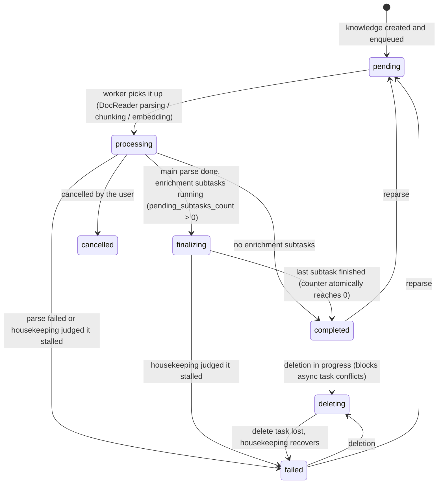

# Knowledge bases and knowledge management

A knowledge base groups related material and carries one configuration for chunking, the embedding model, the retrieval indexes, Wiki and the knowledge graph. Files, web pages, hand-written Markdown and FAQ entries are managed as knowledge items; after import they are parsed and indexed according to that configuration.

Each knowledge base can use its own processing configuration. A question can be limited to a set of knowledge bases, and member access and organization sharing are granted per knowledge base.

<Screenshot
  src="/screenshots/kb-document-list.png"
  caption="Knowledge base document list: parse status, tags and batch actions"
  hint="The document list page with the parse status column, the tag column, the filter bar and sort button at the top, and the batch action bar (tags, move, batch download) that appears once documents are selected." />

## Where to find each operation

This table maps the day-to-day tasks to the place in the UI that does them.

| Task | Where |
| --- | --- |
| Create a knowledge base, change the chunk size or toggle indexes | The "Chunking" and "Indexing strategy" tabs of the knowledge base edit dialog |
| Upload files, import a web page or write Markdown | The upload area of the document list, or the "New" dropdown; progress is in the upload task panel at the bottom right |
| Change the order of the document list | "Sort" in the document list toolbar: updated time, upload/created time (newest upload first by default) or file name |
| Check parse progress or find a stuck document | The status on the document card, or the document's parse timeline (see [Checking parse progress](#checking-parse-progress)) |
| Organize documents into folders | The folder tree on the left of the document list; uploading a whole directory keeps its structure (see [Folder tree](#folder-tree)) |
| Tag documents (several tags per document) | One document in its detail view; several documents through "Tags" in the batch action bar (see [Tags (KnowledgeTag)](#tags-knowledgetag)) |
| Check parse output, fix typos | Open the document, go to the chunk list and edit the chunk in place (see [Chunk editing and version history](#chunk-editing-and-version-history)) |
| Add custom fields such as department or classification | Custom metadata in the document detail view (see [Model essentials](#model-essentials)) |
| Review what changed | Knowledge base settings → Activity (see [Knowledge base activity stream (KB Activity)](#knowledge-base-activity-stream-kb-activity)) |
| Copy a knowledge base or move documents to another one | Copy in the knowledge base list, or Move in the document batch actions (see [Knowledge base copy and knowledge move](#knowledge-base-copy-and-knowledge-move)) |
| Download original files in bulk | Select documents, then "Download selected" in the batch action bar (see [Batch download of original files](#batch-download-of-original-files)) |

<Screenshot
  src="/screenshots/kb-settings.png"
  caption="Knowledge base settings: chunking parameters and indexing strategy switches"
  hint="The chunk size, overlap and parent-child settings, and the four index switches: vector, keyword, Wiki and graph." />

## Create a knowledge base and import material

To start a knowledge base you choose its content type, models and indexes, then upload files, import web pages or write Markdown. Ordinary material goes in a document knowledge base; standard question-and-answer pairs go in an [FAQ knowledge base](17-faq.md). The vector store cannot be changed after creation, so settle it before you create the knowledge base.

The upload confirmation page sets tags and the parse options for that batch, including whether to generate a document summary (on by default; when off, parsing, indexing and the other steps still run). A per-upload option overrides the knowledge base configuration, which in turn overrides the workspace default. Existing documents need a reparse before changed chunking parameters apply to them.

During a batch upload the upload task panel at the bottom right summarizes every file: at most 3 transfer at once, with bytes sent, remaining time, and counts of searchable, processing, failed and already-existing files. A single file can be cancelled or retried. Once every upload has finished you can leave the page; parsing continues in the background. The upload timeout for large files grows with the file size.

<Screenshot
  src="/screenshots/kb-upload-tasks.png"
  caption="Upload task panel: overall batch progress and per-file status"
  hint="The floating panel at the bottom right: the progress ring and the 'Uploading x/y' title, remaining time, the segmented bar for searchable/processing/failed/existing, and the cancel and retry buttons in the file list." />

### Checking parse progress

The document list and cards show each document's parse status. After 20 minutes without progress the status becomes "Queued" or "May be stuck". Queued means a task is still waiting in the queue and usually needs no action. May be stuck means no task is advancing the document any more: open the parse timeline to see which stage it stopped at, or stop parsing and retry. Documents that make no progress for a long time are marked failed by the system with error code `TASK_STALLED`.

The parse timeline shows the duration and result of each stage. On failure, the error card at the top names the failed stage and the reason and offers a retry.

<Screenshot
  src="/screenshots/kb-parse-timeline.png"
  caption="Parse timeline: stage durations, failure reason and stuck hint"
  hint="The document parse timeline drawer: the stage waterfall (document parsing/chunking/embedding/multimodal/post-processing), the error card on failure (stage name, error code, backend reason and retry button), the 'No progress for N minutes' banner and the stop parsing button." />

## Organize folders and tags

Folders and tags are the two ways to arrange the documents in a knowledge base. A folder files documents by directory, and a document belongs to exactly one folder. Uploading a whole directory keeps its hierarchy. Renaming or moving a folder in the tree updates the paths of its subfolders, and when the target already exists the two are merged. Moving a document between folders of the same knowledge base only changes its filing; it is not reparsed.

Tags classify across folders, and a document can carry several. Tags can be preset at upload time or changed in bulk after selecting documents; the batch dialog preselects the tags the selected documents share. Filtering by several tags returns documents that match any of them.

With auto-tagging on, the system picks matching tags from the existing candidates when parsing completes. By default it attaches at most 3 per document and skips documents that already have tags. The setting only affects later parses, does not backfill existing documents, and a model failure does not block document completion.

<Screenshot
  src="/screenshots/kb-batch-tag.png"
  caption="Batch tagging: tags shared by the selected documents are preselected"
  hint="The tag dialog opened after selecting several documents, with the selected tag area, the search box and the list of available tags." />

## Edit chunks and add metadata

When parsing got something wrong, edit the text chunk in the document detail view and the index is rebuilt. Every edit or rollback creates a new version; if another user has updated the same chunk, the UI asks you to refresh and retry. When the index update fails the edited content is kept and shown with a failed status; submitting again retries.

Custom metadata adds information such as department, classification or version number, up to 20 fields. Changing metadata triggers a summary refresh; the field length limits and supported types are in the reference section.

<Screenshot
  src="/screenshots/kb-chunk-edit.png"
  caption="Chunk editing: change the text, view version history and roll back"
  hint="A chunk in edit mode, the version history list (editor and time) and the rollback entry." />

## Copy and move content

To reuse an existing configuration and its content, copy the knowledge base. When moving documents to another knowledge base you choose between reusing the vectors and reparsing: reuse requires both knowledge bases to be bound to the same vector store, reparse allows the target's own store and processing configuration. A move is an asynchronous task whose progress can be queried.

### Batch download of original files

Select documents and click "Download selected": the original files are packed into a ZIP that keeps the folder structure of the knowledge base, so after unpacking they can be uploaded again folder by folder. Each batch holds at most 200 documents and 512 MiB of original files; entries without an original file, such as web page imports, are skipped. "Select all" covers only the documents already loaded. Batch download has the same permission as a single file download: Contributor or above with edit access to the knowledge base.

## Review activity and usage

The Activity tab in the knowledge base settings records configuration, document, chunk, sharing and Wiki changes. It is for logged-in users with resource management permission; API keys cannot open it. Operations made through an API key show the key name under the operator.

A knowledge base shared through an organization with read-only (Viewer) permission shows no upload, edit, delete or settings entries.

The storage quota is counted per workspace and covers files, text, vectors and indexes. Creating a knowledge base and uploading check the quota first; deleting content releases its usage.

<Screenshot
  src="/screenshots/kb-activity.png"
  caption="Knowledge base activity stream: operations in reverse chronological order"
  hint="The activity list (operator, action, target document, time) and the detail drawer opened for one entry." />

## Configuration and API reference

### Knowledge base model and configuration

#### KB types

`internal/types/knowledgebase.go`:

```go
const (
    KnowledgeBaseTypeDocument = "document" // document knowledge base
    KnowledgeBaseTypeFAQ      = "faq"      // FAQ knowledge base
    KnowledgeBaseTypeWiki     = "wiki"     // Wiki knowledge base
)
```

Updating a KB clears configuration that does not match its type (for example `FAQConfig` on a non-FAQ KB). `VectorStoreID` carries the GORM `<-:create` tag and **cannot be changed after creation** (it keeps the index and the store aligned).

#### Configuration structure overview

```mermaid
graph TB
    KB["KnowledgeBase (id, name, type, tenant_id, creator_id)"]
    KB --> CC["ChunkingConfig (chunking)"]
    KB --> IS["IndexingStrategy (index pipeline switches)"]
    KB --> EMB["EmbeddingModelID / SummaryModelID"]
    KB --> VLM["VLMConfig (vision model)"]
    KB --> ASR["ASRConfig (speech recognition)"]
    KB --> IMG["ImageProcessingConfig (image understanding)"]
    IMG --> ICP["ImageAttrsEnabled + ImageActions (attribute observation + conditional OCR)"]
    KB --> EXT["ExtractConfig (knowledge graph)"]
    KB --> FAQ["FAQConfig (faq type only)"]
    KB --> QG["QuestionGenerationConfig (question generation)"]
    KB --> WIKI["WikiConfig (when wiki_enabled is on)"]
    KB --> ST["StorageProviderConfig / StorageBackendID / StorageConfig (legacy)"]
    KB --> VS["VectorStoreID (fixed after creation)"]
    CC --> PCR["ParserEngineRules (parser engine per file type)"]
    CC --> PC["Parent-child chunks (parent_chunk_size / child_chunk_size)"]
    EXT --> GN["GraphNode / GraphRelation"]
    IS --> V["vector (default true)"]
    IS --> KW["keyword / BM25 (default true)"]
    IS --> WK["wiki (default false)"]
    IS --> GR["graph (default false)"]
```



#### ChunkingConfig (chunking)

| Field | Type | Default | Description |
| --- | --- | --- | --- |
| `chunk_size` | int | required | Chunk size in characters |
| `chunk_overlap` | int | - | Overlap between adjacent chunks |
| `separators` | []string | - | Separator list |
| `parser_engine_rules` | []ParserEngineRule | - | Parser engine per file type: `{file_types, engine, xlsx_first_row_as_header?}` |
| `enable_parent_child` | bool | false | Enable the parent-child chunking strategy |
| `parent_chunk_size` | int | 4096 | Parent chunk size (returned as context) |
| `child_chunk_size` | int | 384 | Child chunk size (embedded for retrieval) |
| `strategy` | string | empty (= `legacy`) | Chunking strategy: `legacy` (the historical recursive splitter) / `auto` (a profiler picks the tier) / `heading` / `heuristic` / `recursive` (one fixed tier), see [Chunking](04-chunking.md) |
| `token_limit` | int | 0 | Token limit (0 = none) |
| `languages` | []string | auto-detected | Language hint |
| `table_metadata_instructions` | string | - | Instructions for table metadata generation |

#### IndexingStrategy (index pipeline switches)

| Field | Default | Description |
| --- | --- | --- |
| `vector_enabled` | true | Semantic vector retrieval |
| `keyword_enabled` | true | Keyword (BM25) retrieval |
| `wiki_enabled` | false | Wiki page generation |
| `graph_enabled` | false | Knowledge graph extraction |

#### Multimodal and enrichment configuration

**VLMConfig (vision language model)**:

| Field | Description |
| --- | --- |
| `enabled` / `model_id` | Current form: enable switch plus model ID |
| `description_language` | Language of image descriptions (empty = follow the document language) |
| `custom_instructions` | KB-level guidance for interpreting images |
| `model_name` / `base_url` / `api_key` / `interface_type` | Legacy compatibility fields (ollama / openai) |

Enabled when `Enabled && ModelID != ""`, or in the legacy form when `ModelName != "" && BaseURL != ""`.

**ASRConfig**: `enabled` / `model_id` / `language` (optional language hint).

**ImageProcessingConfig (image attribute observation, conditional OCR and image vectors)**:

| Field | Type | Default | Description |
| --- | --- | --- | --- |
| `model_id` | string | - | VLM model ID used for image understanding (counted in model usage tracking) |
| `image_attrs_enabled` | bool | false | Switch for the attribute observation pipeline. Off (default) is the historical behavior: one description request and one OCR request per image, no attribute observation. On: a first round of "observation plus description", then a pure function in code decides from the observed attributes whether the image deserves an OCR round |
| `image_actions` | object | see below | OCR trigger conditions: `{ ocr: { on: ImageAttrCondition[], on_unobserved: bool } }`. `on` is a list of "attribute = value" conditions; `on_unobserved` is the conservative fallback when the model did not observe an attribute (default true = still OCR) |
| `image_vector_enabled` | bool | false | Image vector switch. When on and the knowledge base's embedding model can take images (the model's "image input" capability), the image is encoded directly by the embedding model after its description is generated and stored as one image vector, which retrieval recalls alongside text; see "Image vectors" below |

With `image_attrs_enabled` on, the model **no longer classifies images**. It "observes" each attribute and produces a description. Two observations are active in this release (the full registry is `GET /api/v1/image-attrs/schema`, read-only, Viewer permission; the registry is global and does not vary per knowledge base):

| Attribute | Values | Meaning |
| --- | --- | --- |
| `contain.text` | `none` / `sparse` / `block` | How much running text the image contains. `block` = body text worth an OCR pass |
| `contain.data_visual` | `true` / `false` | Whether the image contains a chart or data visualization (axis labels and the like may also contain text) |

The OCR decision is the pure function `DecideOCR` (`internal/application/service/image_attr_decision.go`) and is not persisted:

- `contain.text == block` **or** `contain.data_visual == true` → run OCR;
- an attribute the policy reads is **missing** (the model skipped that line or answered an invalid value) → apply `on_unobserved` (default: still OCR);
- every attribute observed and none matched → skip OCR.

An off-topic answer or a missing attribute always falls back to the policy, so an observation mistake costs one extra call and never loses content. Note that **a missing attribute is a normal result**: a failed observation does not write a conservative default (schema version `attrs/2`), so `image_attrs` can be an empty object, and readers must distinguish "not observed" from "observed as negative".

The pipeline and the observation result are recorded on each image's processing trace sub-span for checking and troubleshooting: input `pipeline` = `observation_driven` (switch on) or `caption_ocr` (off, the historical behavior); output `attr_policy` (this round's OCR decision), `image_attrs` (the observed attributes), `ocr_skipped` (`attr_policy` = skipped by the policy / `disabled` = the OCR master switch is off), `observation_failed` (no valid observation formed), `chunks_created`.

Before storing, OCR rejects an empty response, content that is only separators, and long repeated runs that make up the bulk of the output; ordinary short labels, numbers and tables are kept. When an OpenAI-compatible VLM returns `finish_reason=length`, the truncated output is treated as a failure even when non-empty. The ordinary image prompt transcribes visible text, buttons and labels in screenshots line by line, and uses Markdown tables only for real tables; scanned PDFs use a dedicated document layout prompt.

Every OCR run has its own `multimodal.image[i].ocr` processing sub-span; in Langfuse it is `image.ocr` and includes the model call and output validation. On failure it records `ocr_status=failed`, `ocr_error_code` (`OCR_INVALID_OUTPUT` / `OCR_TRUNCATED` / `OCR_REQUEST_FAILED`) and the reason, and the OCR chunk is neither created nor indexed. A normal image description is still kept; the image's output marks the partial failure with `outcome=partial_failure`, and the whole image task is not retried because of invalid OCR. An explicit "no text" answer is recorded as `ocr_status=no_text`, distinct from an error; a normal extraction is `succeeded`. Existing bad chunks are not cleaned up automatically; reparse the documents concerned.

To verify a real model, point `AIKB_OCR_TEST_FIXTURE` at a local JSON file (`{"model": <model config>, "image_paths": [<local image paths>]}`) and run `go test ./internal/application/service -run '^TestLiveImageOCRValidation$' -v -count=1`. A private endpoint needs `SSRF_WHITELIST`. The test uses an in-memory chunk repository and does not write to the business database; keep configurations with credentials and the source images out of version control.

A single upload or reparse can override `image_attrs_enabled` and `image_actions` per document in the request body's `process_config` (`KnowledgeProcessOverrides`); items not sent inherit the knowledge base setting. `image_actions` merges per action key (`on` is replaced as a whole). The API fields are in [Knowledge base API](../04-api/02-api-knowledge.md); the pipeline details are in [Document parsing](03-document-parsing.md).

**Image vectors (`image_vector_enabled`)**: off by default, and existing knowledge bases stay off after an upgrade (the stored configuration has no such key, so it reads as false). Turn it on in the knowledge base settings under "Image processing → Image vector retrieval" (shown once multimodal is on) or explicitly through the API. It takes effect only when **the switch is on and the embedding model can take images**; with either missing, import generates no image vectors and retrieval recalls none. It does not follow the model capability automatically because an image-capable embedding model is often used only to encode text; turning it on by itself would add one embedding call per image to those knowledge bases and change retrieval behavior. With it on, the candidate pool of document vector retrieval grows by 1.5x and image hits are filtered by a separate threshold of `min(VectorThreshold, 0.2)`.

- Image vectors are generated in the multimodal task, so multimodal (VLM) must be on too. The image vector's `Content` reuses the image description (the OCR text when there is no description); scanned PDF pages get none;
- The switch affects only documents imported or reparsed afterwards; reparse existing documents to add image vectors;
- With the switch off, existing image vectors (generated before it was turned off, or brought along when a document was **moved** from a knowledge base with image vectors on) are kept with their chunks but dropped at retrieval time. They are removed with the document on delete or reparse and when the knowledge base is deleted. Turning the switch back on restores recall of the kept vectors. **Copying** a document into a knowledge base with the switch off does not copy its image vectors;
- In multi-knowledge-base retrieval each knowledge base is judged by its own switch; a knowledge base with it off recalls no image vectors;
- The retrieval engine cannot filter by source type, so image rows that must not be recalled (image vector hits from knowledge bases with the switch off, and any image row hit by keyword retrieval) can only be dropped after the results return. To keep them from filling the candidate pool and crowding out text, when the document vector pool or the keyword pool is full and contains such rows, TopK is doubled and the query rerun until enough candidates that need no dropping are collected (text hits, and image hits from knowledge bases with the switch on), the index is exhausted, or the 500-candidate cap is reached (with the default pool of 50, at most 4 extra queries per pool). A store group with image rows may therefore run a few extra retrieval queries, and when more than about 500 image rows rank above the text, text hits can still be missed. If a re-query fails or returns partially, the previous full result is kept.

**QuestionGenerationConfig (question generation)**: `enabled`; `question_count`, the number of questions generated per chunk (default 3, capped at 10); `custom_instructions`, target audience and style notes.

**ExtractConfig (knowledge graph)**: `enabled`, `text`, `tags`, `nodes []*GraphNode{name, chunks, attributes}`, `relations []*GraphRelation{node1, node2, type}`, `custom_instructions` (domain extraction guidance).

**FAQConfig (FAQ knowledge bases only)**: `index_mode` (`question_only` / `question_answer`, default the latter), `question_index_mode` (`combined` / `separate`, default combined); see the FAQ page.

**WikiConfig (knowledge bases with `indexing_strategy.wiki_enabled` on)**. It is not exclusive to `type = "wiki"`: when an ordinary document knowledge base turns on the Wiki index, `UpdateKnowledgeBase` creates an empty `WikiConfig` for it to hold these settings:

| Field | Default | Description |
| --- | --- | --- |
| `synthesis_model_id` | - | LLM for Wiki generation |
| `max_pages_per_ingest` | 0 (unlimited) | Maximum pages created or updated per ingest |
| `extraction_granularity` | `standard` | `focused` (main topics only) / `standard` / `exhaustive` (every entity and concept) |
| `content_instructions` / `extraction_instructions` | - | Style guidance for generation and extraction |
| `ingest_batch_size` / `ingest_map_parallel` / `ingest_reduce_parallel` / `ingest_max_inflight` | 5 / 10 / 10 / 4 | Ingest concurrency parameters |

Every `custom_instructions`-style field is checked for length and validity on update by `validateKnowledgeBasePromptInstructions` (`internal/handler/knowledgebase.go`).

#### Storage configuration

- **StorageProviderConfig** (current): `provider ∈ {local, minio, cos, tos, s3, oss, ks3, obs}`;
- **StorageBackendID**: binds a specific storage backend instance;
- **StorageConfig** (legacy `cos_config` column): `secret_id / secret_key / region / bucket_name / app_id / path_prefix / provider / endpoint / use_ssl / force_path_style`.

#### KB computed fields

List and detail responses carry: `knowledge_count` (excludes documents being deleted, consistent with the document list), `chunk_count`, `is_processing` (FAQ knowledge bases), `processing_count` (documents being processed in a document knowledge base), `share_count` (organizations shared to), `creator_name`, `is_pinned` / `pinned_at` (the current user's pin state).

There is also a stored field `is_temporary`. It marks an **ephemeral knowledge base** that the normal knowledge base list does not show. It is used internally, typically when web search caches fetched pages as retrievable content. Knowledge bases created by hand are never temporary.

#### Auto-tagging

Turn on auto-tagging in the tag settings of a document knowledge base: prepare the candidate tags first, then pick a chat model. After parsing completes, the system asynchronously picks matching tags from the existing ones and never creates new tags. `auto_tag_config` applies to the document type only:

| Field | Default | Description |
| --- | --- | --- |
| enabled | false | Turn auto-tagging on |
| model_id | empty | Empty uses the knowledge base `summary_model_id` |
| max_tags | 3 | Maximum tags attached automatically per document, capped at 10 |
| skip_if_tagged | true | Skip documents that already have tags, including tags added by hand or by a data source; false appends |

The setting applies only to documents parsed or reparsed afterwards and does not backfill existing documents. A model failure does not block document completion; the asynchronous task retries under the queue policy. Candidates are the first 500 tags in the knowledge base's sort order; automatic tagging never removes tags added by hand. Data sources adding a tag named after the source is a separate mechanism.

#### AI-generated knowledge base description

A knowledge base has two descriptions: `description` is the hand-written "what this knowledge base is for", and `generated_profile` is the system's "what is actually in it", derived from the document profiles. Neither overwrites the other. Agents read both in their runtime context to decide which bound knowledge base a question should search.

Generation has three layers, and only the last calls a model:

1. **Document profile**: the document summary task emits a structured profile (`knowledges.profile`) alongside the short summary: a one-line gist, 3 to 5 topic terms, the document type and one typical question. It lives with the document and disappears when the document is deleted.
2. **Knowledge base aggregation**: pure database statistics: document count, file types, tag counts, topic term counts (normalized for case and punctuation), document type counts, typical questions sampled round-robin by topic, evenly sampled titles, and a hash of the input. Deletes, moves and reparses need no special handling; recomputing is exact.
3. **Description text**: the aggregation (one or two thousand tokens, independent of document count) goes to the model, which returns the gist, the merged topic list and 3 to 5 typical questions. When the aggregation hash is unchanged the model call is skipped.

`profile_config` applies to the document type only:

| Field | Default | Description |
| --- | --- | --- |
| enabled | false | Refresh automatically after a document is added, deleted or its summary updated (30-second debounce, one run per window) |
| model_id | empty | Empty uses the knowledge base `summary_model_id` |
| custom_instructions | empty | Extra requirements appended to the system prompt, such as the intended readers or terms to keep |

Whether or not automatic refresh is on, the knowledge base settings page can run "Generate AI description" once on demand and adopt the gist as the hand-written description with one click. `generated_profile.status` is `ready`, `empty` (no parsed documents, no model call) or `failed` (the previous text is kept and the error recorded). Uploads with the document summary turned off contribute only title, type and tags, not topic terms.

### Knowledge management

#### Model essentials

`internal/types/knowledge.go`. Key fields: `type` (`manual` hand-written Markdown / `faq` / a file type), `source` / `channel` (ingest channel), `parse_status`, `summary_status`, `enable_status`, `file_name/type/size/hash/path`, `storage_size`, `metadata` (JSON; manual knowledge stores `ManualKnowledgeMetadata{content, format, status(draft/publish), version}`), `custom_metadata` (JSON, user-maintained metadata), `last_faq_import_result`.

`custom_metadata` holds descriptive fields the user maintains, such as department, classification or version number; `metadata` holds the processing pipeline's internal state and IDs. Custom metadata allows at most 20 fields; a key is 1 to 64 characters and a value is a string, number, boolean or null of at most 1000 characters. Changing it refreshes the summary automatically.

In the implementation, `Knowledge.CustomMetadataText()` renders `key: value` text sorted by key for summary generation and document-level model context. The field was introduced by migration `000078`.

Ingest channel constants: `web`, `api`, `browser_extension`, `wechat`, `wecom`, `feishu`, `feishu_drive`, `lark_drive`, `dingtalk`, `slack`, `im`, `notion`, `confluence`, `yuque`, `rss`, `ima`, `seafile`. The git and Microsoft Graph data sources store their connector type as the channel: `github`, `gitlab`, `bitbucket`, `onedrive`, `sharepoint`.

Parse state machine:



A failed enrichment subtask (summary, question generation, graph, Wiki) does not move the document to `failed`; the document reaches `completed` once every subtask has finished. Documents stuck in `pending`, `processing`, `finalizing` or `deleting` are reclaimed by the background housekeeping sweep, see [the async task system](../02-architecture/05-async-tasks.md#last-resort-the-housekeeping-sweep).

The summary has its own status: `summary_status ∈ {none, pending, processing, completed, failed}`.

#### Knowledge routes

| Method | Path | Description | Gate |
| --- | --- | --- | --- |
| POST | `/knowledge-bases/:id/knowledge/file` | Upload a file | OwnedKBOrAdmin + KBAccessWrite |
| POST | `/knowledge-bases/:id/knowledge/url` | Import a URL | same |
| POST | `/knowledge-bases/:id/knowledge/manual` | Hand-written Markdown knowledge | same |
| GET | `/knowledge-bases/:id/knowledge` | List (pagination + filters + sort) | Viewer+ + KBAccessRead |
| POST | `/knowledge-bases/:id/knowledge/batch-download` | Batch download of original files (ZIP) | Contributor+ + KBAccessWrite |
| GET / PUT | `/knowledge-bases/:id/knowledge/folders` | Folder tree / rename or move a folder | Viewer+ + KBAccessRead / OwnedKBOrAdmin + KBAccessWrite |
| DELETE | `/knowledge-bases/:id/knowledge` | Clear the KB's content | Admin + KBAccessWrite |
| GET | `/knowledge/:id`, `/knowledge/batch` | Detail / batch get | Viewer+ |
| GET | `/knowledge/:id/stages`, `/knowledge/:id/spans` | Processing stages / spans | Viewer+ |
| PUT / DELETE | `/knowledge/:id`, `/knowledge/manual/:id` | Update (including `custom_metadata`) / delete | OwnedKnowledgeKBOrAdmin + KBAccessWrite |
| POST | `/knowledge/:id/reparse`, `/knowledge/:id/cancel-parse` | Reparse / cancel parsing | same |
| POST | `/knowledge/:id/regenerate-summary` | Regenerate the document summary | same |
| GET | `/knowledge/:id/download` | Download the original file | Contributor+ + KBAccessWrite |
| GET | `/knowledge/:id/preview` | Preview the file | Viewer+ + KBAccessRead |
| PUT | `/knowledge/tags` | Batch update tags | Contributor+ / `ingest` |
| POST | `/knowledge/batch-reparse`, `/knowledge/batch-delete` | Batch reparse / delete | Contributor+ / `ingest` |
| POST | `/knowledge/folder` | File documents into a folder | Contributor+ / `ingest` |
| POST | `/knowledge/move` | Move knowledge | Contributor+ / `ingest` |
| GET | `/knowledge/move/progress/:task_id` | Move progress | Viewer+ |

#### List filter parameters

`KnowledgeListFilter` in `internal/types/knowledge.go` plus `internal/handler/knowledge.go`:

| Parameter | Description |
| --- | --- |
| `page` / `page_size` | Pagination (default 1 / 20) |
| `sort_by` / `sort_order` | Sort: `updated_at` / `created_at` / `file_name`, `asc` / `desc`; default `created_at desc` |
| `keyword` | Search by file name / title |
| `file_type` | Filter by file type (`pdf` / `manual` / `url` ...) |
| `parse_status` | Filter by parse status |
| `source` | Filter by ingest channel (`api` / `web` / `feishu` ...) |
| `tag_ids` | Filter by tags, comma-separated (**OR semantics**) |
| `start_time` / `end_time` | Updated time range (RFC3339) |
| `folder_path` | Filter by folder. **Whether the parameter is present decides the list mode**: absent is the flat view of the whole KB, an empty string is the KB root (without subfolders) |
| `folder_recursive` | With `folder_path`; `true` also returns documents in subfolders |

#### Folder tree

Folders organize documents by project, source or directory hierarchy. The structure is kept at upload time and can be renamed and moved afterwards.

Folder operations:

- **Upload a whole directory**: the directory structure is kept as is, with no need to create folders afterwards;
- **Create / rename / move a folder**: done in the folder tree on the left of the document list. Renaming changes the paths of the subfolders too; when the target path exists the two folders are merged; a folder cannot be moved into its own subtree;
- **Refile documents**: select documents and move them to a folder (or back to the root). This only changes the filing, with no reparse and no effect on the index;
- **Browse by directory**: the list API's `folder_path` decides the view mode: absent is the flat view of the whole KB, an empty string is the root (without subfolders), and `folder_recursive=true` includes subfolders.

Folders and tags solve different problems and combine: **a folder is a single home** (a document sits in one directory, good for filing by project or source), **tags are many-to-many** (a document carries several, good for cross-cutting filters by topic, classification or state). Both can scope retrieval.

The directory path is stored in `knowledges.folder_path`; `file_name` holds only the file name. Migration `000079` backfilled directory paths from historical file names.

The folder endpoints are `GET/PUT /knowledge-bases/:id/knowledge/folders` and `POST /knowledge/folder`; see [Knowledge base API](../04-api/02-api-knowledge.md).

#### Tags (KnowledgeTag)

`internal/types/tag.go` plus `internal/handler/tag.go`:

```go
type KnowledgeTag struct {
    ID              string // UUID
    SeqID           int64  // auto-increment integer ID (used by the API)
    TenantID        uint64
    KnowledgeBaseID string
    Name            string // unique within the KB
    Color           string
    SortOrder       int
}
type KnowledgeTagRelation struct { KnowledgeID, TagID string } // many-to-many
```

**A document can carry several tags.** Early versions had a single tag (the `knowledges.tag_id` column); migration `000063` replaced it with the relation table `knowledge_tag_relations`: it migrated the existing single tags into the new table and then **dropped the `knowledges.tag_id` column**. So today:

- Read: `Knowledge.Tags` is batch-joined by `knowledge_id` at query time (`gorm:"-"`, not stored on the knowledges table);
- Write: whole-set replacement. `PUT /knowledge/tags` takes `{knowledge_id: [tag_ids]}`; the implementation deletes all of the document's relations and writes the new set;
- Filter: `tag_ids` has **OR semantics** (any matching tag returns the document); the SQL is `knowledges.id IN (SELECT knowledge_id FROM knowledge_tag_relations WHERE tag_id IN (...))`;
- FAQ entries are a separate path: an entry is a chunk and its tag lives in `chunks.tag_id` (**single tag**), not in the document relation table.

Tag management routes: `GET /knowledge-bases/:id/tags` (Viewer+), `POST` (OwnedKBOrAdmin), `PUT/DELETE /knowledge-bases/:id/tags/:tag_id` (OwnedKBOrAdmin); the `tag_id` path parameter accepts either the UUID or the integer `seq_id`.

Two entry points in the frontend (`frontend/src/views/knowledge/components/`):

- **Batch tagging**: select documents in the list, then the "Tags" button in the batch action bar opens `BatchTagDialog.vue`. The dialog preselects the tags **shared** by the selected documents, supports search and a direct jump to tag management, and refreshes the list after submit;
- **Tags at upload**: the upload confirmation dialog (`UploadConfirmDialog.vue`) sets tags and parse options before the files are imported, so there is no need to upload first and tag afterwards.

#### Chunk editing and version history

In the document detail view you can edit a chunk's text to fix OCR, table or formula parsing errors. Saving rebuilds the index and keeps the previous versions for viewing and rollback.

Implementation (`internal/application/service/chunk.go`, migration `000078`):

Data model:

| Field / table | Role |
| --- | --- |
| `chunks.source_content` | The parser's original output, **immutable**. Not written when the chunk is created; lazily backfilled from `content` on the first manual edit |
| `chunks.content` | The current content (retrieval and citation display use it) |
| `chunks.content_revision` | +1 on every edit or rollback; used as the optimistic lock |
| `chunks.index_status` | `ready` / `processing` / `failed`: whether the current content is reflected in the retrieval store |
| `chunks.last_editor_id` | The operator who produced the current version |
| `chunk_revisions` table | Snapshots of overwritten versions (content, enabled state, editor, source, time) |

Behavior:

- **Only `text` chunks are editable**; the content must not be empty after trimming, and the limit is 200000 bytes;
- **Optimistic concurrency**: the request may carry `expected_revision`; a mismatch with the current version returns 409 and the frontend asks the user to refresh and retry;
- **No new images**: an image URL in the edited content that is absent from the source content is rejected; removing an image's Markdown reference **disables** its OCR / caption sub-chunks rather than hard-deleting them, so rolling back to an earlier version re-enables them;
- **Parent-child consistency**: after a child chunk is edited the change is applied back to the parent by offset (the parent's `source_content` stays immutable, replacements are applied in reverse order, and length changes do not shift the coordinates);
- **Index failure handling**: when the index rebuild fails the row is still saved but `index_status = failed`, which the UI shows; submitting the same content again retries;
- **Generated questions kept**: after a content edit the existing retrieval questions are kept but marked "does not match the current text version"; rewrite one (`PUT /chunks/by-id/:id/questions`) or regenerate all (`POST /chunks/by-id/:id/questions/regenerate`);
- **Summary coupling**: a change of content or enabled state enqueues one document summary refresh and `summary_status` becomes `pending`; `POST /knowledge/:id/regenerate-summary` triggers it by hand.

A rollback (`POST /chunks/:knowledge_id/:id/revert`) is itself a new edit: the target version's content is written as the current content, the revision number keeps increasing, and the previous content joins the history, so a "rollback of a rollback" works too.

The endpoints are listed in [API reference: chunks and tags](../04-api/02-api-chunks.md).

#### Editing the summary by hand and browsing chunks

The summary can be edited and saved in the document content preview to correct an automatic summary. In `PUT /knowledge/:id`, omitting `description` keeps the summary and an explicit empty string clears it; updating the summary is not the same as changing the original document content. Use "Regenerate summary" to generate it again; content or metadata changes may also trigger a summary refresh.

Document chunks load page by page; switching documents and jumping from a search result update the pagination state. The full fields are in [Knowledge API](../04-api/02-api-knowledge.md) and [Chunk API](../04-api/02-api-chunks.md).

#### Download and preview security

The safeguards of `GET /knowledge/:id/preview` are pinned by `internal/handler/knowledge_preview_security_test.go`:

| Control | Implementation | Purpose |
| --- | --- | --- |
| `Content-Type` by extension | PDF, images, text and the like preview inline by type; HTML, SVG, XML, JS, CSS and other browser-executable types are forced to `application/octet-stream` | Keeps the browser from executing uploaded content as a page (stored XSS) |
| `X-Content-Type-Options: nosniff` | Response header | Prevents MIME sniffing bypasses |
| `Content-Disposition` | `attachment` for executable types, `inline` otherwise | Dangerous types can only be downloaded, never rendered inline |
| Path validation | `ValidateKBScopedStoragePath()` | The file path must fall inside the KB's authorized storage scope (prevents path traversal and reads across KBs) |
| Size limit | Limit on the GetFile response body | Keeps a huge file from overwhelming the preview |

The test cases assert that an HTML file whose content is `<script>alert(1)</script>` is transferred only as a binary attachment. The download endpoints (`/knowledge/:id/download` and the batch download `/knowledge-bases/:id/knowledge/batch-download`) require the higher Contributor+ role and go through the KBAccessWrite gate.

Preview returns the original file itself, and read-only access (an organization-shared viewer, or visibility through a shared agent) can preview too. "Only Editor and above can download" is a product convenience, not an access control boundary: anyone who can read a KB can obtain its original files.

### Knowledge base copy and knowledge move

#### Copy / Duplicate and preflight

`internal/application/service/knowledge_clone_move.go`; the preflight rules are pinned by `internal/handler/knowledgebase_copy_preflight_test.go`:

- `POST /knowledge-bases/copy`: copies the whole knowledge base (configuration plus content), with `source_id` in the body; an asynchronous task whose progress is read from `GET /knowledge-bases/copy/progress/:task_id` (the activity stream records `kb.clone_started` / `kb.clone_completed` / `kb.clone_failed`).
- `POST /knowledge-bases/:id/duplicate`: **copies the configuration only** (no content, indexes or sharing records); the activity stream records `kb.duplicated`.

Preflight (checked before the copy, rejected synchronously):

1. Tenant isolation of source and target KB (cross-tenant is rejected);
2. The source KB exists;
3. **VectorStore compatibility**: `reuse_vectors` mode does not support KBs on different vector stores (vectors cannot be moved directly);
4. **StorageBackend compatibility**: copying across storage backends is not supported;
5. When called with an API key, both source and target KB must be in the allow-list.

#### Knowledge move gate

`POST /knowledge/move` supports two modes, with the constraints checked in **both the handler and the service** (`internal/handler/knowledge_move_gate_test.go` and `internal/application/service/knowledge_move_gate_test.go` pin both layers):

- **`reuse_vectors` mode**: reuses the existing vectors and **requires the source and target KB to be bound to the same VectorStore**;
- **`reparse` mode**: the target KB reparses and regenerates vectors, so moving across vector stores is allowed.

The normalized semantics of the same-store check `SharesStoreWith()` (an empty string normalizes to nil, and nil means the environment default store):

```text
nil & nil               → true   (both on the env store)
"" & nil                → true   (empty string normalizes to nil)
"store-a" & "store-a"   → true
"store-a" & "store-b"   → false
"store-a" & nil         → false  (an explicit binding and the env store are not the same store)
```

`GET /knowledge-bases/:id/move-targets` returns the candidate target KBs that pass the gate; the move is an asynchronous task whose progress is read from `GET /knowledge/move/progress/:task_id`.

### Storage quota and usage

The quota hangs on the tenant (`internal/types/tenant.go`):

| Field | Default | Description |
| --- | --- | --- |
| `storage_quota` | 10737418240 (10GB) | Total tenant quota |
| `storage_used` | 0 | Used amount (original files, text, vectors and indexes) |

The quota is checked before a KB is created and before knowledge is uploaded (the creation validation chain in `internal/handler/knowledgebase.go`), and writes over the limit are rejected. Each knowledge record carries its own `file_size` and `storage_size`, released on delete.

### KB routes and permissions

(The gate semantics are on the workspaces, users and authentication page; `KBAccessRead/Write` resolve organization sharing paths.)

| Method | Path | Handler | Gate |
| --- | --- | --- | --- |
| POST | `/knowledge-bases` | CreateKnowledgeBase | Contributor+ / API key `manage_kbs` |
| GET | `/knowledge-bases` | ListKnowledgeBases | Viewer+ / `retrieve` |
| GET | `/knowledge-bases/:id` | GetKnowledgeBase | Viewer+ + KBAccessRead |
| PUT | `/knowledge-bases/:id` | UpdateKnowledgeBase | OwnedKBOrAdmin + KBAccessWrite |
| DELETE | `/knowledge-bases/:id` | DeleteKnowledgeBase | OwnedKBOrAdmin + KBAccessWrite |
| PUT | `/knowledge-bases/:id/pin` | TogglePinKnowledgeBase | Viewer+ + KBAccessRead |
| POST/GET | `/knowledge-bases/:id/hybrid-search` | HybridSearch | Viewer+ + KBAccessRead |
| POST | `/knowledge-bases/copy` | CopyKnowledgeBase | Contributor+ / `manage_kbs` |
| POST | `/knowledge-bases/:id/duplicate` | DuplicateKnowledgeBase | Contributor+ / `manage_kbs` + KBAccessRead |
| POST | `/knowledge-bases/:id/profile/generate` | GenerateKnowledgeBaseProfile | OwnedKBOrAdmin + KBAccessWrite / `manage_kbs` |
| GET | `/knowledge-bases/copy/progress/:task_id` | GetKBCloneProgress | Viewer+ / `retrieve` or `manage_kbs` |
| GET | `/knowledge-bases/:id/move-targets` | ListMoveTargets | Viewer+ + KBAccessRead |
| GET | `/knowledge-bases/:id/activity` | ListKnowledgeBaseActivity | OwnedKBOrAdmin + KBAccessRead (JWT only) |

**Creation flow** (`internal/handler/knowledgebase.go`): Contributor check → tenant storage quota check → `EmbeddingModelID` check → `VectorStoreID` binding check → create → return the KB plus `vector_store_display`.

**Delete cascade**: every Knowledge in the KB → Chunk → vector index → keyword index → Wiki pages → tags → stored files → soft delete of the KB itself. An editor on the shared side cannot delete the source KB (deletion requires the owner tenant plus Admin-side permission).

### Hybrid search

`POST /knowledge-bases/:id/hybrid-search` (`internal/handler/knowledgebase.go` plus `internal/application/service/knowledgebase_search*.go`) combines recall according to the KB's `IndexingStrategy`: vector (vector_enabled) plus keyword BM25 (keyword_enabled), merged by rank fusion and reranked, optionally augmented by the knowledge graph (graph_enabled). Across several KBs, `knowledgebase_search_fanout.go` fans out concurrently and `knowledgebase_search_fusion.go` merges; the shared-KB retrieval path is `knowledgebase_search_shared.go`. FAQ knowledge bases have their own hit strategy (negative example filtering / iterative recall); see the FAQ page.

### Knowledge processing pipeline

`internal/application/service/knowledge_create.go` / `knowledge_process.go` / `knowledge_process_config.go`:

```text
Upload (file/url/manual)
  → create Knowledge (parse_status=pending) → enqueue in Asynq
  → Worker: DocReader parsing → chunking (ChunkingConfig)
      → vector embedding      (indexing_strategy.vector_enabled)
      → keyword index         (keyword_enabled)
      → graph extraction      (graph_enabled + ExtractConfig)
      → Wiki generation       (wiki_enabled + WikiConfig)
      → question generation   (QuestionGenerationConfig.enabled)
      → document summary      (process_config.summary_enabled, on by default)
  → parse_status=finalizing, pending_subtasks_count=N
  → each enrichment subtask decrements atomically; at zero → parse_status=completed
```

**Configuration merge precedence** (`ResolveProcessConfig` returns an `EffectiveProcessConfig`): `Knowledge.ProcessOverrides` (the per-upload override, stored as `KnowledgeProcessOverrides` in the knowledge metadata; it can override parser rules / chunking / VLM / ASR / question generation / the graph switch / the summary switch and more) > KB configuration > tenant default.

Chunk types (`internal/types/chunk.go`): `text`, `parent_text`, `image_ocr`, `image_caption`, `image_vector`, `summary`, `entity`, `relationship`, `faq`, `web_search`, `table_summary`, `table_column`, `wiki_page`; a chunk has an `is_enabled` switch and `flags` bit flags (bit0 = recommendable).

### Knowledge base activity stream (KB Activity)

The Activity tab in the knowledge base settings records configuration changes, document uploads and deletions, chunk edits, sharing changes and Wiki updates, with operator, time and result.

`internal/application/service/kb_activity.go` reuses the audit log system (`AuditLog` with scope knowledge_base) and records through `recordKBActivity(ctx, audit, tenantID, kbID, action, targetType, targetID, outcome, details)`:

- **Activity actions** (`internal/types/audit_log.go`): `kb.created` / `kb.updated` / `kb.deleted` / `kb.duplicated` / `kb.clone_started` / `kb.clone_completed` / `kb.clone_failed`, `kb.share_added` / `kb.share_permission_changed` / `kb.share_removed`, plus the knowledge-level and chunk-level create, update and delete actions;
- **Trigger source**: `kbActivityTaskMetadata{TaskID, Trigger}` in the context (`user` for a user action, `system` for a background task) is merged into the details automatically; `processing_status` is derived from the outcome (accepted→pending, success→completed, partial→partial, failed/denied→failed, canceled→canceled);
- **API key identity**: an `X-API-Key` call writes `details.api_key_id` / `details.api_key_name` (a name snapshot). The activity page shows the key name after the original actor; JWT web actions do not add these two. Asynchronous tasks carry only the key's display identity in `TaskInitiator` and do not restore the key's permission scope in the worker;
- **Sample titles for batch operations**: `kbActivityAppendSampleTitles` attaches at most 5 deduplicated titles to a batch operation (the first as `title`, the rest in the `titles` array), keeping the stream readable and bounded;
- **Suppression**: `withKBActivitySuppressed(ctx)` lets internal cascades skip duplicate activity records.

Query endpoint: `GET /knowledge-bases/:id/activity` (OwnedKBOrAdmin, JWT users only; an `X-API-Key` request, even with a full-access key, gets 403).

## Implementation reference

Paths are relative to the repository root:

| Layer | Files |
| --- | --- |
| KB model and configuration structures | `internal/types/knowledgebase.go`, `indexing_strategy.go` |
| Knowledge / Chunk / tag models | `internal/types/knowledge.go`, `chunk.go`, `tag.go` |
| Processing configuration overrides | `internal/types/knowledge_process.go` |
| KB handler | `internal/handler/knowledgebase.go` |
| Knowledge handler | `internal/handler/knowledge.go` |
| Tag handler | `internal/handler/tag.go` |
| KB service | `internal/application/service/knowledgebase.go` |
| Knowledge creation / processing pipeline | `internal/application/service/knowledge_create.go`, `knowledge_process.go`, `knowledge_process_config.go` |
| Copy and move | `internal/application/service/knowledge_clone_move.go` |
| Activity stream | `internal/application/service/kb_activity.go` |
| Routes and gates | `internal/router/routes_knowledge.go`, `internal/router/rbac.go` |
| Key test evidence | `internal/handler/knowledge_preview_security_test.go`, `knowledge_move_gate_test.go`, `knowledgebase_copy_preflight_test.go` |
