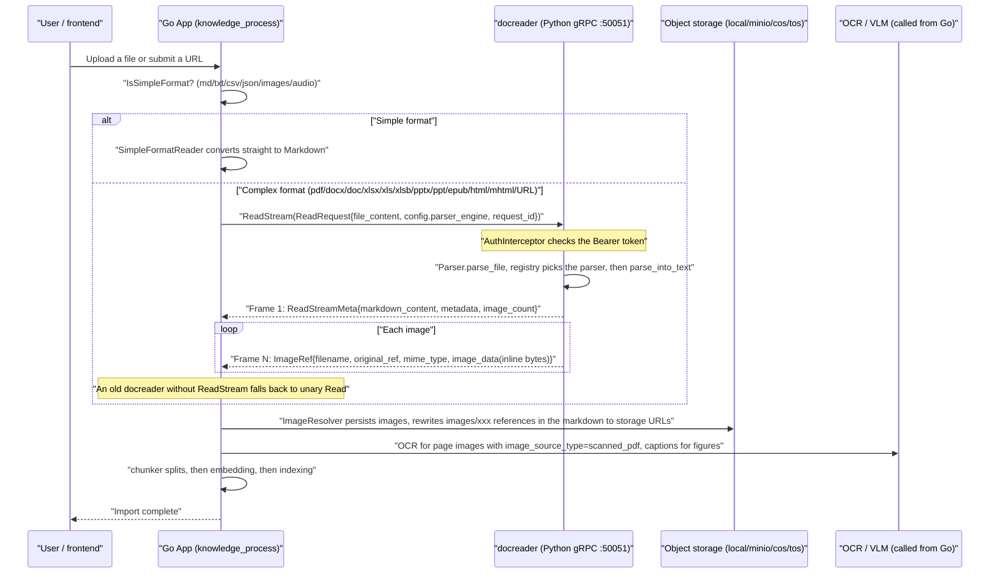
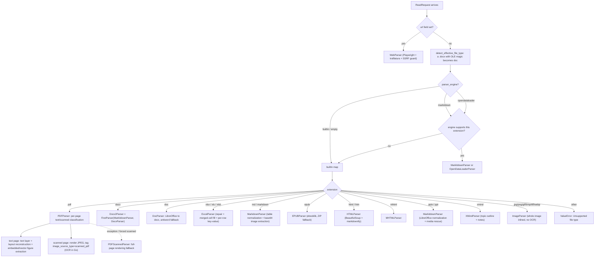

# Document parsing service (docreader)

Document parsing turns an uploaded file into searchable text and extracts the original image references. AI KB accepts many formats and lets you choose a parsing engine per file type. Scans, images and audio also need a vision or speech model.

Supported formats:

| Category | Formats |
| --- | --- |
| Documents | PDF, Word (doc/docx), PowerPoint (ppt/pptx), Excel (xls/xlsx/xlsb), EPUB, XMind |
| Text | txt, Markdown, CSV, JSON |
| Web | online URL capture, local HTML / MHTML archives |
| Images | jpg, jpeg, png, gif (a vision model must be configured for the content to be understood; docreader itself also parses bmp, tiff and webp over gRPC, but the upload paths accept only the four listed) |
| Audio | mp3, wav, m4a, flac, ogg (a speech-to-text model must be configured) |

When a parse result is poor, these adjustments help:

- **PDF layout is wrong or tables are misaligned**: pick another engine for `pdf` in the knowledge base parsing settings (MarkItDown / OpenDataLoader / MinerU).
- **A scan produced no text**: confirm a vision model is configured; force scanned mode if needed.
- **The first Excel row holds column names but is treated as data**: turn on "first row as header" for `xlsx`/`xls`/`xlsb`.
- **A chunk needs a correction**: edit the text in the chunk list, see [Knowledge bases and knowledge management](02-knowledge-base.md#edit-chunks-and-add-metadata).

## Parsing mechanics and configuration reference

Read this section when you need to know which component handles a file, why a result looks the way it does, or which setting to change. docreader is a standalone Python gRPC service that converts a file or URL into Markdown plus raw image references. The Go main service then does chunking, image storage, OCR, image description and embedding.

The split between the parsing service and the later stages is defined in `docreader/parser/base_parser.py`:

```python
class BaseParser(ABC):
    """Base parser interface.

    After the lightweight refactoring, BaseParser only extracts markdown text
    and raw image references from documents. Chunking, image storage, OCR,
    and VLM caption are handled by the Go App module.
    """
```

### Service role and external interface

#### Protocol: gRPC only (no HTTP)

The entry point is `docreader/main.py`. It starts a single gRPC server (`grpc.server` + `ThreadPoolExecutor`), listens on port `50051` by default, and registers the standard gRPC Health service (`grpc_health.v1`) so Kubernetes and Docker can probe it (together with the `grpc_health_probe` binary in the image). **There is no HTTP interface.**

The proto is `docreader/proto/docreader.proto`, with four RPCs:

```protobuf
service DocReader {
  rpc Read(ReadRequest) returns (ReadResponse) {}
  // Streaming variant: one meta frame first (markdown/metadata/error), then one image per frame.
  // Keeps large scanned PDFs (hundreds of page images) under the unary message-size cap (RESOURCE_EXHAUSTED).
  rpc ReadStream(ReadRequest) returns (stream ReadStreamResponse) {}
  rpc ListEngines(ListEnginesRequest) returns (ListEnginesResponse) {}
  // Rewrites an .xls or .xlsb workbook as .xlsx, the only Excel format DuckDB reads.
  rpc ConvertSpreadsheet(ConvertSpreadsheetRequest) returns (ConvertSpreadsheetResponse) {}
}
```

`ReadRequest` is the unified request: set `file_content`/`file_name`/`file_type` for file mode, or `url`/`title` for URL mode. `config.parser_engine` picks the engine (`builtin` / `markitdown` / `opendataloader`) and `config.parser_engine_overrides` carries engine-level overrides (such as `pdf_force_scanned` or `odl_hybrid`).

`ReadResponse` returns `markdown_content` plus `repeated ImageRef image_refs`. Images come back as **inline bytes**; `image_dir_path` is always an empty string, because image persistence is entirely the Go App's job (the former `image_storage` field 3 in the proto is `reserved`). It can also carry `repeated SourceBlock source_blocks`, which map a span of `markdown_content` (Unicode code point offsets `start`/`end`) back to a position in the original file (`locator_json`) for citation highlighting, see [Source locators](#source-locators). `ReadStreamMeta` carries the same fields.

What `ReadStream` buys (see `main.py::ReadStream` and `_iter_image_refs`): every frame is small and independent. The server decodes base64 and `images.pop(ref_path)` releases the source data as it goes, so neither side holds every image at once. That solves the peak memory and message-size problems of large scanned PDFs. On the Go side `internal/infrastructure/docparser/grpc_parser.go` calls `ReadStream` first and falls back to unary `Read` when an older docreader answers `Unimplemented`.

`ListEngines` reports the engines docreader has registered. The Go App keeps its own engine list in `internal/infrastructure/docparser/engines.go`, and `docparser.ListAllEngines` (`engine_registry.go`) merges this RPC's result into it, so an engine added to docreader shows up without a Go change; see [Document pipeline](../02-architecture/03-document-pipeline.md). Remote engines such as MinerU are handled natively in Go.

`ConvertSpreadsheet` serves the data-analysis path, not parsing: the Go `data_analysis` loader calls it for `.xls` and `.xlsb` data tables and hands the `.xlsx` it gets back to DuckDB. `excel_convert.py::convert_spreadsheet_to_xlsx` reads every sheet with python-calamine and writes it with openpyxl, keeping sheet names, order, cell positions and typed numbers and dates (formulas become their cached values). Bad input comes back as `INVALID_ARGUMENT`: a type other than `xls`/`xlsb`, an unreadable workbook, a file or result larger than `DOCREADER_GRPC_MAX_FILE_SIZE_MB`, or more than 5,000,000 cells. The conversion runs in a child process limited to 2 GiB of address space and 100 seconds, because calamine allocates a sheet's whole bounding box up front and a few-kilobyte file can claim the full 1,048,576 x 16,384 grid. A 4.8M-cell sheet peaked at about 1.3 GB of address space and 575 MB resident, so the docreader container's memory limit (512Mi in the Helm chart's defaults) is the practical ceiling; the child raises its own `oom_score_adj` so the kernel kills it, not the server, when that limit is hit.

#### Authentication and TLS (auth.py)

`docreader/auth.py` provides two security layers, both switched on by environment variables:

**Token authentication (`AuthInterceptor`)**: enabled when `GRPC_AUTH_TOKEN` is set. The client sends `authorization: Bearer <token>` (or the bare token) in metadata. The check uses `hmac.compare_digest` against timing attacks, and a token shorter than 16 bytes logs a warning. The two health-check methods (`/grpc.health.v1.Health/Check`, `/Watch`) bypass authentication so probes keep working. On failure, `_make_abort_handler` builds an abort handler that matches the original RPC kind (unary/stream) and returns `UNAUTHENTICATED` instead of letting the framework raise `INTERNAL`.

**TLS / mTLS (`load_tls_credentials`)**: with `GRPC_TLS_ENABLED=true`, `GRPC_TLS_CERT` / `GRPC_TLS_KEY` are required and `GRPC_TLS_CA` is optional. `GRPC_MTLS_REQUIRE_CLIENT_CERT=true` forces a client certificate (when unset, the requirement follows whether `GRPC_TLS_CA` is present). Any missing or unloadable TLS setting raises `TLSConfigError`; `main()` catches it and calls `sys.exit(1)`. **It fails fast and never degrades silently to plaintext.**

The Go client lives in `docreader/client/auth.go` (`LoadAuthConfigFromEnv` reads the same variables, `GRPC_TLS_ENABLED/CERT/KEY/CA/SERVER_NAME` and `GRPC_AUTH_TOKEN`). `NewClient` in `docreader/client/client.go` builds the connection with `round_robin` load balancing and the `MAX_FILE_SIZE_MB` message limit.

#### Call sequence with the main service

In the Go App, `internal/application/service/knowledge_process.go` calls the parser in the docreader stage of the import pipeline. The call is bounded by the `docreader_call_timeout` setting so a hung docreader cannot hold a worker indefinitely. Note that **md/markdown/txt/csv/json, images and audio are handled natively on the Go side by `SimpleFormatReader` and never reach docreader** (see `simpleFormats` in `internal/infrastructure/docparser/builtin_converter.go`).



---

### Parser registration and dispatch

#### Engine registry (parser/registry.py)

`ParserEngineRegistry` keeps a two-level map, `engine name → {file extension → parser class}`, and lets each engine register a `check_available` probe (used by `ListEngines` to report availability and the reason when unavailable).

`_build_default_registry()` registers three engines:

| Engine | File types | Notes |
| --- | --- | --- |
| `builtin` | `docx` (Docx2Parser), `doc` (DocParser), `pdf` (PDFParser), `md`/`markdown` (MarkdownParser), `xlsx`/`xls`/`xlsb` (ExcelParser), `pptx`/`ppt` (MarkitdownParser), `epub` (EPUBParser), `html`/`htm` (HTMLParser), `mhtml` (MHTMLParser), `xmind` (XMindParser), `jpg`/`jpeg`/`png`/`gif`/`bmp`/`tiff`/`webp` (ImageParser) | Built-in engine; PPT/PPTX reuse the MarkItDown parser |
| `markitdown` | `md`, `markdown`, `pdf`, `docx`, `doc`, `pptx`, `ppt`, `xlsx`, `xls`, `csv` (all MarkitdownParser) | Microsoft MarkItDown library |
| `opendataloader` | `pdf` (OpenDataLoaderParser) | OpenDataLoader PDF layout analysis, needs Java 11+; `check_available` probes java, the Python package and the hybrid service health |

Dispatch rule (`get_parser_class`): when the requested engine does not support the file type, it **falls back to the `builtin` engine automatically**. When builtin has no parser either, it raises a `ValueError` naming the engines that do support the type.

#### Facade and magic-number correction (parser/parser.py)

`Parser` is the facade: `parse_file()` goes through the registry and `parse_url()` always uses `WebParser`. One important defence is `detect_effective_file_type()`. An OOXML `.docx` is a ZIP container while a legacy `.doc` is an OLE Compound File, and WPS and Word tolerate a `.doc` renamed to `.docx`. A "docx" whose bytes start with the OLE magic number (`b"\xd0\xcf\x11\xe0\xa1\xb1\x1a\xe1"`) is therefore forced to the DOC parser rather than feeding binary OLE data to the DOCX parser.

The engine overrides (`engine_overrides`, from the proto `parser_engine_overrides`) are passed into the parser constructor as `**kwargs`; for example `pdf_force_scanned` is picked up by `PDFParser.__init__`.

#### Chain parsers (parser/chain_parser.py)

Two chain-of-responsibility combinators, both generating subclasses dynamically through the class factory `create(*parser_classes)`:

- **`FirstParser`**: tries parsers in order and returns the first result for which `document.is_valid()` (that is, `content != ""`) holds; an exception is caught and the next parser is tried. Typical use: `Docx2Parser = FirstParser.create(MarkitdownParser, DocxParser)`.
- **`PipelineParser`**: a pipeline where each parser's output text (re-encoded to bytes) feeds the next one, with `images`/`metadata` from every stage merged. Typical uses: `MarkdownParser = PipelineParser.create(MarkdownTableFormatter, MarkdownImageBase64)`, `WebParser = PipelineParser.create(StdWebParser, MarkdownParser)`, `MarkitdownParser = PipelineParser.create(StdMarkitdownParser, MarkdownParser)`.

#### Concurrency model (parser/concurrency.py and elsewhere)

Concurrency is controlled at four levels:

1. **gRPC thread pool**: `ThreadPoolExecutor(max_workers=CONFIG.grpc_max_workers)` (default 4), so at most 4 requests run at once.
2. **Named semaphores** (`parser_worker_limit(name, max_workers)`): process-wide `threading.BoundedSemaphore` instances reused by name to limit heavy backends. Current limit points: `"markitdown"` (default 1), `"opendataloader"` (default 1, every convert starts a JVM) and `"pdf_render"` (default 1). `max_workers <= 0` disables the limit.
3. **pdfium global lock** (`pdf_parser.py::_PDFIUM_LOCK`): the pdfium C library is process-global and **not thread-safe**. Two gRPC workers parsing PDFs at once corrupt shared state or deadlock the whole process (requests were observed stuck forever at "Parsing document with PDFParser"). **Every pdfium operation (text extraction, page rendering, image extraction) is serialized behind this lock**, so concurrent PDF uploads queue; non-PDF parsers are unaffected.
4. **Process-level parallelism**:
   - PDF scanned-page rendering: `_render_pages_parallel` uses a `ProcessPoolExecutor` (preferring the `forkserver` start method to avoid forking a multi-threaded process) to shard one PDF's scanned pages across worker processes (each opens its own `PdfDocument` from a temp file), with parallelism `DOCREADER_PDF_RENDER_PARALLELISM` (default `min(4, cpu)`). This is the main lever that brought "an hour or more for a large scan" on CPU-bound containers down; on failure it falls back to serial rendering transparently.
   - DOCX per-page parallelism: `docx_parser.py::Docx` hands page tasks to a `ProcessPoolExecutor` plus a `Manager` shared list; images cross processes as `/tmp/docx_img_*` temp files and are encoded and uploaded in the main process at the end.
   - LibreOffice conversion (doc→docx, ppt→pptx, xls→xlsx): `subprocess` calls `soffice --headless`, each attempt with its own `-env:UserInstallation=<temp profile>` so concurrent soffice processes do not fight over the user profile lock and fail silently; failures retry 3 times with backoff.

---

### Parsers one by one

#### pdf_parser.py: PDFParser / PDFScannedParser (the builtin engine's PDF)

**Dependencies**: `pypdfium2` (+ Pillow). No external service (MinerU, Docling or similar) is needed; docreader does no OCR itself.

**Core design: per-page routing**. Each page is classified independently as `"text"` or `"scanned"` (`_classify_page`). The main signal is **image area coverage** (bounding-box area of image objects on the page divided by page area, threshold `DOCREADER_PDF_SCAN_IMAGE_RATIO=0.5`). A scanned page is essentially one large image covering the whole page, even when it carries an embedded (often low-quality) OCR text layer. The secondary signal is a text layer under `DOCREADER_PDF_SCAN_MIN_CHARS` (10) characters together with some image content. The design follows the routing approach of MinerU, Docling and DeepDoc and avoids trusting a poor text layer that would produce garbled RAG content.

Processing (`_route_locked`, three passes):

1. **Pass 1, text extraction and classification**: text pages use the text layer. When `DOCREADER_PDF_LAYOUT_ORDERING=true` (the default) and the plain pdfium text is not well formed (`_plain_is_well_formed`), a **geometric layout reconstruction** runs: glyph-level extraction (filtering hidden text with render mode 3 and glyphs outside the page, which blocks hidden-text prompt injection), recursive XY-cut column splitting (multi-column pages are linearized column by column), removal of margin and vertical watermark columns (arXiv sidebars), word spacing inferred from glyph gaps (`WORD_GAP_WIDTH_RATIO`), and lines promoted to Markdown headings when their height is large relative to the page median (`DETECT_HEADINGS`). If the reconstruction looks broken (the `_should_prefer_plain` heuristics), it falls back to plain text. `_postprocess_pdf_text` then cleans up: placeholders such as U+FFFE, arXiv watermark lines, page-number lines, and axis and legend debris that vector charts leak into the text layer (`STRIP_CHART_TEXT_DEBRIS`). When a `Figure N` caption is detected on a text page, the **vector figure region above the caption is rendered to JPEG** (`RENDER_VECTOR_FIGURES`) and injected as `` before the caption.
2. **Pass 2, scanned-page rendering**: only scanned pages are rendered to JPEG (DPI `DOCREADER_PDF_RENDER_DPI=200`, quality `DOCREADER_PDF_JPEG_QUALITY=85`, long edge clamped to `DOCREADER_PDF_RENDER_MAX_EDGE=2000` px so a PDF declaring a huge page box cannot produce a 100+ MP image that breaks the gRPC limit). The markdown gets a `` placeholder, the metadata is tagged `image_source_type=scanned_pdf`, and **the Go App runs OCR on these page images** (`image_multimodal.go` uses a dedicated `ocr_prompt` for the `scanned_pdf` source).
3. **Pass 3, embedded image extraction**: figures and charts embedded in text pages are extracted (`EXTRACT_EMBEDDED_IMAGES`) and filtered by minimum pixels (80), minimum page-area share (1%), cross-page repetition (the same MD5 on 50% or more of text pages counts as a logo or watermark and is dropped) and a per-document cap (50), then inserted into the markdown in top-to-bottom page order.

`_strip_repeating_lines` also conservatively removes headers and footers repeated across pages (candidates are only the first and last lines of each page, must be short, and must appear on 60% or more of text pages).

Any exception falls back to **`PDFScannedParser`**, the safety-net parser that renders every page to JPEG. It is also used for forced scanned mode (`pdf_force_scanned`), enabled per upload through an override or globally with `DOCREADER_PDF_FORCE_SCANNED`.

**Output**: Markdown (text-page text plus image placeholders), the `images` dict, and metadata (`page_count`/`scanned_page_count`/`text_page_count`/`embedded_image_count`/`vector_figure_count`/`image_source_type`).

**Limits**: no table structure recognition (text-layer tables come out line by line); heading detection is a font-size heuristic; scanned-page text depends entirely on Go-side OCR.

#### doc_parser.py: DocParser (legacy .doc Word)

Inherits `Docx2Parser` and tries, in order:

1. `_parse_with_docx`: LibreOffice (`soffice --headless --convert-to docx`, separate profile plus 3 retries) converts the DOC to DOCX, then the parent DOCX chain parses it (**the only path that extracts images**).
2. `_parse_with_antiword`: plain-text extraction with the `antiword` command line tool, run through `SandboxExecutor`, which injects proxy variables (default `http://128.0.0.1:1`, a "black hole" proxy that blocks unexpected outbound connections from the subprocess).

**Dependencies**: LibreOffice (soffice) and antiword (both installed in the image); lookup paths can be overridden with `LIBREOFFICE_PATH`/`ANTIWORD_PATH`. External commands time out after 60 seconds by default; on timeout the whole process group is terminated (including children spawned by soffice) so stray processes do not occupy docreader workers. **Limit**: without LibreOffice it degrades to antiword plain text (no images, no table structure).

#### docx2_parser.py versus docx_parser.py

- **`Docx2Parser` (the registry entry for docx)** has three lines of real code: `FirstParser.create(MarkitdownParser, DocxParser)`. **MarkItDown runs first** (fast, good table-to-Markdown quality); on failure or empty output it falls back to the in-house `DocxParser`.
- **`DocxParser` (docx_parser.py, 1500+ lines)** is the in-house python-docx parser:
  - It patches python-docx with `load_from_xml_v2` (skipping corrupt relationships whose `target_ref` is `../NULL`, from python-docx issue #1105).
  - The `Docx` processing class detects page breaks (`lastRenderedPageBreak` / `w:br type="page"` / `sectPr`; documents with more than 1000 paragraphs switch to a heuristic of about 25 paragraphs per page) and **processes pages in parallel across processes**.
  - It extracts text paragraph by paragraph together with inline images (`a:blip/@r:embed` → related part blob → PIL, skipping decorative images under 50 px and scaling those over 1920 px), keeps the original text/image order (`content_sequence`), and inlines images through the `_inline_upload` callback as base64 `images/<uuid>.<ext>`.
  - Tables become HTML `<table>` (adjacent cells with identical text merge into a colspan).
  - On total failure it falls back to `_parse_using_simple_method` (plain python-docx paragraphs plus table rows, no images).
  - The page cap is `DOCREADER_DOCX_MAX_PAGES` (default 0 = unlimited).

#### excel_parser.py and three helper modules (.xlsx / .xls / .xlsb)

**`ExcelParser`** is built on pandas: it reads each sheet as a DataFrame, drops fully empty rows, and **turns each row into `column: value,column: value` key-value text**, one `Chunk` per row (with start/end positions). It strips embedded image function strings such as WPS `=DISPIMG("ID",mode)` and Office 365 `=_xlfn.IMAGE(...)` (`_IMAGE_FUNC_RE`). It does not extract images.

**Header mode**: XLSX and legacy XLS now behave the same. By default row 1 is treated as data and columns are named with the letters `A`/`B`/`C`, so a data row is never mistaken for a header and lost. For a flat table whose first row really holds column names, turn on `xlsx_first_row_as_header` in the parsing engine rules: the first row becomes the column labels and the key-value text turns into the semantic form `Name: Alice,Department: R&D`. Empty cells and image-function values fall back to the column letter, and duplicate labels get `_2`, `_3` suffixes to stay unique.

The switch is configured through the knowledge base's `parser_engine_rules[].xlsx_first_row_as_header` (and can be overridden per upload in the upload confirmation dialog). On the backend, `applyParserRuleOverrides()` applies it only to `xlsx`/`xls`/`xlsb` rules whose engine is `builtin` (or empty), and passes it to docreader as a `parser_engine_overrides` entry. The field type is `*bool`: `null` keeps the parser default and an explicit `false` turns it off.

Three helper modules deal with messy real-world files:

- **`excel_convert.py`**: detects the real format by magic number / `inspect_excel_format` (xlsx/xls/xlsb/ods) and picks the pandas engine per format (`xlrd`/`openpyxl`/`odf`). Unrecognized files (WPS `.et`, a renamed CSV) are normalized with LibreOffice `convert-to xlsx` (`normalize_excel_bytes` tries the `.xlsx/.xls/.et/.csv` suffixes in turn). It also holds `convert_spreadsheet_to_xlsx`, the `ConvertSpreadsheet` RPC's converter.
- **`xlsx_merge.py`**: `fill_merged_cells_xlsx` unmerges cells and **copies the top-left value into every cell of the merged range**. openpyxl stores the value only in the top-left cell and pandas reads the rest as NaN; after filling, row-based RAG chunks keep their context.
- **`xlsx_repair.py`**: repairs common XLSX packaging problems. A `sharedStrings.xml` with non-standard path case or location is renamed into place; when the manifest references sharedStrings but the package lacks it and the sheets use only inline strings, the reference is stripped from `[Content_Types].xml` and the workbook rels so openpyxl can read the file.

Before reading an XLSX the parser always runs `repair → fill_merged_cells`, and uses `header=None` plus A/B/C column letters as stable column names (XLS first tries the first row as header and falls back to letters when it sees `Unnamed:` columns).

#### ppt_convert.py / pptx_media.py (.ppt / .pptx, serving the markitdown engine)

The PowerPoint family **has no parser of its own**; `MarkitdownParser` handles it, and these two modules are its pre- and post-processing helpers:

- **`ppt_convert.py`**: `normalize_ppt_bytes` decides by magic number (ZIP = pptx, passed through; OLE = legacy ppt, converted with LibreOffice `convert-to pptx`, separate profile plus 3 retries). Without LibreOffice a .ppt raises an error that asks you to install it.
- **`pptx_media.py`**: rescues PPTX media that MarkItDown cannot inline (especially WMF/EMF/SVG vector graphics). It unpacks every resource under `ppt/media/`, rasterizes them in order to PNG with Pillow (bitmaps) or ImageMagick `convert` (vectors, the fallback for every format), then replaces the unresolved `` references in the markdown in order with `images/<uuid>.png` and inlines the image data.

#### image_parser.py: ImageParser (standalone image files)

The simplest parser: **no OCR at all**. It inlines the whole image as base64 in `Document.images`, and the body is one line, ``. **The OCR engine is on the Go side.** The docreader Dockerfile comment states that the OCR/PaddleOCR dependencies were removed; Go does OCR and captioning through `internal/infrastructure/docparser/paddleocr_vl_converter.go` / `paddleocr_vl_cloud_converter.go` (PaddleOCR-VL) and `image_multimodal.go`. Note also that Go's `simpleFormats` routing takes image formats natively, so docreader's ImageParser mainly serves SDK clients that call the gRPC service directly.

#### markdown_parser.py: MarkdownParser (.md / .markdown)

`PipelineParser.create(MarkdownTableFormatter, MarkdownImageBase64)`:

- **`MarkdownTableFormatter`**: after encoding detection (`endecode.decode_bytes`: utf-8 → gb18030 → gb2312 → gbk → big5 → ascii → latin-1) it normalizes tables: consistent `| cell |` spacing and alignment markers, `normalize_spurious_table_prefixes` repairs the fake blank-line and separator prefixes MarkItDown produces, and header-less Word tables get a `| --- |` GFM separator row.
- **`MarkdownImageBase64`**: extracts `` inline images into `images/<uuid>.<ext>` references plus `Document.images` data (MIME subtypes with hyphens such as `x-emf` are supported). An image that cannot be decoded (for example base64 followed directly by a non-ASCII caption) is skipped and logged rather than failing the whole document.

This parser is also the shared post-processing stage of the MarkitdownParser and WebParser pipelines.

#### web_parser.py: WebParser (URL mode)

`PipelineParser.create(StdWebParser, MarkdownParser)`. `StdWebParser` renders the page with **Playwright (WebKit)** and extracts the article with **trafilatura** into Markdown:

- **Double SSRF protection**: `is_ssrf_safe_url(url)` runs before navigation, and a route guard installed with `page.route("**/*")` applies the same check to **every sub-request and redirect target**. `utils/ssrf.py` mirrors the Go policy in `internal/utils/security.go`: private, loopback and link-local ranges, cloud metadata hosts, suffixes such as `.local`/`.internal`, direct IPs, IP-like hostnames, DNS answers in restricted ranges and dangerous ports are all blocked, with `SSRF_WHITELIST` / `SSRF_WHITELIST_EXTRA` as allow lists.
- **SPA support**: after `domcontentloaded` it waits for networkidle (10 s) and for `#app`/`main`/body to show at least 80 characters of visible text (15 s), which covers JavaScript-rendered pages.
- **WeChat Official Account pages**: trafilatura internals are monkey-patched, `utils.IMAGE_EXTENSION` (to recognize extension-less `mmbiz.qpic.cn/...wx_fmt=` images) and `xpaths.BODY_XPATH` (preferring `#js_content` / `.rich_media_content`).
- **Fallback**: when trafilatura finds no article, the Playwright visible text (at least 50 characters) plus the page title are used.
- The proxy comes from `DOCREADER_EXTERNAL_HTTPS_PROXY`. Metadata carries `title`.

#### mhtml_parser.py: MHTMLParser (.mhtml web archives)

Parses the MIME structure with the standard `email` library: it collects every `text/html` part and **picks the largest non-advertising part** as the body (filtered by a domain blacklist such as `googleads`/`doubleclick`). `image/*` parts are extracted as `images/...` (preferring the Content-Location file name, with a `_2` suffix on conflicts), and an alias table built from the many spellings of `Content-Location`/`Content-ID` (`cid:`)/`X-Attachment-Id` (HTML-escaped, URL-encoded, basename, relative urljoin) rewrites ``. HTML to Markdown uses BeautifulSoup (dropping script/style/noscript/iframe, unwrapping in-site links) plus `markdownify`, followed by code-fence-aware blank-line normalization. If everything fails it degrades to a ```` ```html ```` code block. Metadata: `source_format=mhtml`, `file_size`, `image_count`.

#### html_parser.py: HTMLParser (.html / .htm static files)

HTML files uploaded directly take this path, separate from the online capture in `parse_url()`: `HTMLParser = PipelineParser.create(HTMLToMarkdownParser, MarkdownParser)`.

- `HTMLToMarkdownParser` first decodes the raw bytes with `BeautifulSoup(content, "lxml")` (honoring a BOM and the charset declared in the HTML), then hands off to the shared Markdown conversion.
- HTML to Markdown reuses `MHTMLParser.html_to_markdown()`, called with `extract_images=False` (a local HTML file has no MIME attachments to extract), `strip_internal_links=False` (in-site links are kept) and `fallback_to_raw_html=False` (an empty conversion returns empty instead of a whole ```` ```html ```` block).
- Remote images referenced as `` are completed on the Go side: `internal/infrastructure/docparser/image_resolver.go` downloads them with SSRF checks, stores them in object storage and rewrites the references, so they go through the same OCR and caption flow as uploaded images.

#### xmind_parser.py: XMindParser (.xmind mind maps)

Reads `content.json` (new format) or `content.xml` (old format) from the XMind archive, with a 32 MiB limit per content file. Each canvas becomes a `# canvas title` section, the topic hierarchy becomes an indented Markdown list, plain-text notes are attached as block quotes under their topic, and canvases are separated with `---`. No images are extracted; a file with no renderable topic fails to parse.

#### epub_parser.py: EPUBParser (.epub e-books)

The main path uses **ebooklib** (read through a temp file): it extracts DC metadata (title/author/publisher/language/description/date/isbn), processes chapters in TOC order where possible (the first h1/h2 of each chapter becomes the title, output as `## title` plus the markdownify-converted body), extracts every `ITEM_IMAGE` as `images/<uuid>.<ext>` and rewrites `` through multi-variant path aliases. Internal EPUB links (chapter jumps, `#fragment`) are unwrapped to plain text. When ebooklib fails it falls back to **reading the ZIP directly**, converting html/xhtml files one by one sorted by `chapter(\d+)`. Metadata includes `chapter_count`/`image_count`.

#### markitdown_parser.py: MarkitdownParser (the markitdown engine)

`PipelineParser.create(StdMarkitdownParser, MarkdownParser)`. `StdMarkitdownParser` wraps Microsoft's **MarkItDown** library (`markitdown[docx,pdf,xls,xlsx,pptx]`): ppt/pptx first go through `normalize_ppt_bytes`; conversion runs with `keep_data_uris=True` (images stay as data URIs for the downstream `MarkdownImageBase64` to extract) and retries with `keep_data_uris=False` on failure; for pptx, unresolved image references left in the markdown trigger `attach_pptx_media_to_markdown`. The whole thing is limited by `parser_worker_limit("markitdown", DOCREADER_MARKITDOWN_MAX_WORKERS=1)`. **Limits**: MarkItDown's PDF path is pdfminer text extraction, useless for scans (the `parse_local.py --scanned` comment also notes that pdfminer can hang), and its table and layout fidelity is below the builtin PDF routing.

#### opendataloader_parser.py: OpenDataLoaderParser (the opendataloader engine, PDF only)

Wraps the Apache-2.0 **opendataloader-pdf** (layout analysis implemented in Java). Each `convert()` starts a JVM (limited by `parser_worker_limit("opendataloader", 1)`) and produces markdown plus an external image directory; the parser then collects every image under the output tree, builds an alias table (angle-bracket `<images/foo.png>`, HTML entities, basename, `imageFileN` numbering) and rewrites the markdown image references. It supports a **hybrid mode** (`DOCREADER_ODL_HYBRID=docling-fast` and others) that calls a separately deployed `opendataloader-pdf-hybrid` HTTP service (`DOCREADER_ODL_HYBRID_URL`, default `http://127.0.0.1:5002`; on the Docker side this is `docker/Dockerfile.odl-hybrid`), with a retrying availability probe (a quick probe of 2 s × 1; before parsing, 5 s × 6 to tolerate a cold start). Output under 20 characters counts as failure and **falls back to the builtin `PDFScannedParser`**. The availability check needs `java` on PATH (Java 11+; the image ships openjdk-17-jre-headless), the Python package installed and a healthy hybrid service.

#### Parser selection flow



---

### Image handling and the multimodal split

The image contract on the docreader side is simple: every parser returns images as `Document.images = {"images/<filename>": "<base64>"}` and references them in the markdown as ``.

`main.py` has two return paths:

- unary `Read`: `_resolve_images()` decodes every image from base64 into `ImageRef.image_data` **inline bytes** and returns them in one message (`image_dir_path` is always empty; the old "write to a shared volume" mode is gone, and the comment states *"The Go App is solely responsible for persisting images to the configured storage backend (local/minio/cos/tos)"*).
- streaming `ReadStream`: `_iter_image_refs()` yields one image at a time and `pop`s it to free memory as it sends.

Once Go takes over (`internal/infrastructure/docparser/image_resolver.go`), it uploads the inline bytes to object storage and rewrites the `images/...` references in the markdown to storage URLs. `internal/application/service/image_multimodal.go` then decides by the `image_source_type` metadata: `scanned_pdf` full-page images go to OCR (with the dedicated `ocr_prompt`), ordinary figures get a VLM caption. The service has two pipelines (recorded in the processing trace as `pipeline` = `caption_ocr` / `observation_driven`). The legacy pipeline (knowledge base without `image_attrs_enabled`) sends one description call and one OCR call per image. The attribute-observation pipeline (when enabled) first runs a combined "attribute observation + description" call to establish the attributes (`contain.text` / `contain.data_visual`), then the pure function `DecideOCR` applies the knowledge base's `image_actions` to decide whether the image is worth an OCR pass. By default an image with `contain.text` in `{sparse, none}`, a confirmed observation and `data_visual == false` keeps only its description and skips OCR. **Image understanding happens on the Go side in both pipelines.** The knowledge base's custom image instructions (`vlm_config.custom_instructions`) are appended only to the description prompt (in the observation pipeline, the combined "observation + description" prompt), never to the OCR prompt, so they cannot disturb the OCR output contract (for example, an image without text must answer `No text content`).

Inline HTML `<table>` elements in any engine's output (common with MinerU, PaddleOCR-VL and VLM OCR) are converted to Markdown tables before chunking (`docparser.NormalizeHTMLTables`). Tables that cannot be converted, such as those with merged cells, stay as HTML, but each row goes on its own line so the chunker can split at row boundaries. **docreader makes no VLM calls at all**; the `vlm_config`/`storage_config` fields in `models/read_config.py` are empty shells kept for the old constructor signature ("Legacy config kept for backward compatibility").

---

### Source locators {#source-locators}

Every chunk is stored with a set of `source_locators` that record where it sits in the original file, so clicking a citation in a conversation opens the original and highlights the passage (see [Chat experience](18-chat-experience.md#view-answers-and-sources)). Positions are produced per parsing engine, first expressed as a mapping from Markdown spans to original positions (source blocks), then intersected with the chunk spans after chunking to produce each chunk's locators:

| Source | How it is produced | locator |
| --- | --- | --- |
| builtin PDF (`pdf_parser.py`) | Text pages: pdfium glyph coordinates are grouped into columns and lines, then into paragraphs by line spacing, list numbering and short sentence-final lines, one box per paragraph; scanned pages and embedded images record only the page | `pdf`: `page` + `bbox` |
| MinerU (self-hosted / cloud / V1) | Reads the returned `content_list` (`page_idx` plus a 0 to 1000 normalized `bbox`) and aligns it with the Markdown by text; PDF and images only | `pdf`: `page` + `bbox` |
| PaddleOCR-VL (self-hosted / cloud) | Layout blocks from the per-page result (`prunedResult.parsing_res_list`), or the page when there are no blocks | `pdf`: `page` (+ `bbox`) |
| Word / PPT / Excel / CSV / EPUB (any engine) | Go reads the original file structure (docx body paragraphs and tables, pptx slide text, sheet rows, EPUB spine chapters) and aligns it with the parser's Markdown by text, independent of the engine | `docx`: `block`; `slide`: `slide`; `sheet`: `sheet` + `row_start`/`row_end`; `section`: `section` |
| builtin Excel (`excel_parser.py`) | Records the sheet name and row number of every row directly | `sheet` |
| Markdown / TXT (passed through verbatim) | Records the original character span per paragraph | `text`: `start`/`end` |
| Audio | When speech-to-text returns segment times, the transcript is emitted line by line per segment with its time | `time`: `start_ms`/`end_ms` |

Alignment compares only letters and digits, ignoring Markdown syntax, whitespace and punctuation. The parse result is also normalized on the Go side (line endings, HTML table conversion, image URL rewriting), and block spans are re-mapped line by line onto the final text. Every locator carries a `quote` (the cited text, up to 300 characters) that the frontend searches for in the rendered original to pick the paragraph that best matches the answer sentence. Legacy doc/ppt/xls files and web pages have no structural positions; the frontend falls back to a text search or opens the original web page.

### The splitter/ chunker and the Go-side chunker

`TextSplitter` in `docreader/splitter/splitter.py` is a recursive chunker with protected patterns:

- Defaults are `chunk_size=512` and `chunk_overlap=80`. The code comment states **"Aligned with internal/infrastructure/chunker/splitter.go (DefaultChunkOverlap = 80, DefaultChunkSize = 512). The Go splitter is now the production path; this Python splitter is kept for the docreader sidecar where it's still used."** So **production chunking happens on the Go side** (`internal/infrastructure/chunker/`, including heading_splitter, heuristic_splitter and header_tracker); the Python version is kept for the sidecar scenario and local debugging, with both sides keeping the same algorithm and defaults.
- Splitting: recursive splitting by separator priority (`\n`, the ideographic full stop, space, with character-level fallback) → `protected_regex` extracts fragments that must not be cut (`$$...$$` formulas, `` images, `[](...)` links, Markdown table header plus body rows, code-block headers) → `_join` keeps protected fragments intact → `_merge` combines by chunk_size/overlap and yields `(start, end, text)` triples (`restore_text` can rebuild the original losslessly).
- `HeaderTracker` in `splitter/header_hook.py` tracks Markdown table headers during merging: a chunk that starts in the middle of a table body gets the header (with its separator row) prepended (skipped when the column counts differ, `header_column_mismatch`; an empty header row is completed from the first data row, matching the Go header_tracker), so a table chunk retrieved by RAG carries its column names.

The gRPC response no longer returns chunks (`ReadResponse` has no chunk field). `ExcelParser` still puts per-row chunks into `Document.chunks`, but the main path consumes only `content`.

---

### Configuration reference

#### config.py (`DocReaderConfig`, effective values are logged at startup)

| Environment variable (alias) | Default | Description |
| --- | --- | --- |
| `DOCREADER_GRPC_MAX_WORKERS` (`GRPC_MAX_WORKERS`) | 4 | gRPC thread pool size |
| `DOCREADER_GRPC_MAX_FILE_SIZE_MB` (`MAX_FILE_SIZE_MB`) | 50 (MB) | gRPC send/receive message limit (converted to bytes) |
| `DOCREADER_GRPC_PORT` (`PORT`) | 50051 | gRPC listen port |
| `DOCREADER_DOCX_MAX_PAGES` | 0 (unlimited) | Maximum DOCX pages processed |
| `DOCREADER_MARKITDOWN_MAX_WORKERS` | 1 | MarkItDown concurrency limit (0 or less disables it) |
| `DOCREADER_ODL_MAX_WORKERS` | 1 | OpenDataLoader (JVM) concurrency limit |
| `DOCREADER_ODL_HYBRID` | `off` | ODL hybrid mode (such as `docling-fast`) |
| `DOCREADER_ODL_HYBRID_URL` | `http://127.0.0.1:5002` | Hybrid service address |
| `DOCREADER_ODL_HYBRID_MODE` | `auto` | Hybrid mode parameter |
| `DOCREADER_ODL_HYBRID_FALLBACK` | false | Whether a hybrid failure falls back |
| `DOCREADER_ODL_MARKDOWN_WITH_HTML` | false | Allow HTML in ODL markdown |
| `DOCREADER_PDF_RENDER_MAX_WORKERS` | 1 | PDF rendering stage limit (across requests) |
| `DOCREADER_PDF_RENDER_PARALLELISM` | `min(4, cpu)` | Worker processes rendering scanned pages within one PDF |
| `DOCREADER_PDF_RENDER_DPI` | 200 | Scanned-page render DPI |
| `DOCREADER_PDF_JPEG_QUALITY` | 85 | Page image JPEG quality |
| `DOCREADER_PDF_RENDER_MAX_EDGE` | 2000 | Long-edge pixel cap for rendered and extracted images (0 = unlimited) |
| `DOCREADER_EXTERNAL_HTTP_PROXY` / `DOCREADER_EXTERNAL_HTTPS_PROXY` (`EXTERNAL_HTTP_PROXY`/`EXTERNAL_HTTPS_PROXY`) | empty | Outbound proxy (WebParser, DOC conversion subprocesses) |
| `DOCREADER_IMAGE_OUTPUT_DIR` (`IMAGE_OUTPUT_DIR`) | `/tmp/docreader` | Temporary image directory (local-mode fallback; the main path does not write to disk) |

#### PDF routing details (pdf_parser.py module-level variables, common ones)

| Environment variable | Default | Description |
| --- | --- | --- |
| `DOCREADER_PDF_SCAN_IMAGE_RATIO` | 0.5 | Image area coverage at or above this value marks a scanned page |
| `DOCREADER_PDF_SCAN_MIN_CHARS` | 10 | Fewer characters than this means no usable text layer |
| `DOCREADER_PDF_FORCE_SCANNED` | false | Treat every page as scanned (also per upload through the `pdf_force_scanned` override) |
| `DOCREADER_PDF_EXTRACT_EMBEDDED_IMAGES` | true | Extract embedded figures from text pages |
| `DOCREADER_PDF_EMBED_MIN_PIXELS` / `_EMBED_MIN_AREA_RATIO` / `_EMBED_REPEAT_PAGE_FRAC` / `_EMBED_MAX_IMAGES` | 80 / 0.01 / 0.5 / 50 | Embedded image filters: minimum edge / page-area share / logo repetition rate / per-document cap |
| `DOCREADER_PDF_LAYOUT_ORDERING` | true | Geometric layout reconstruction (multi-column reading order) |
| `DOCREADER_PDF_DETECT_HEADINGS` | true | Font-size heuristic heading detection |
| `DOCREADER_PDF_FILTER_HIDDEN_TEXT` | true | Drop invisible and off-page text (prompt injection defence) |
| `DOCREADER_PDF_SANITIZE_TEXT` / `_STRIP_CHART_DEBRIS` | true | Clean placeholder characters / chart debris lines |
| `DOCREADER_PDF_RENDER_VECTOR_FIGURES` | true | Render vector figure regions to JPEG |
| `DOCREADER_PDF_SOURCE_BOXES` | true | Record a box per paragraph on text pages (citation highlighting); when off only the page is recorded, saving one per-glyph coordinate pass |
| `DOCREADER_PDF_WORD_GAP_WIDTH_RATIO` / `_MARGIN_COL_WIDTH_RATIO` / `_MIN_HEADING_LINE_CHARS` and others | 0.4 / 0.12 / 8 | Layout reconstruction tuning (see the constants block in the source) |

#### Go-side parsing timeouts

These variables apply to the Go main service, not the docreader container:

| Environment variable | Type | Default | Description |
| --- | --- | --- | --- |
| `AIKB_DOCUMENT_PROCESS_TIMEOUT` | Go duration | `2h` | Total timeout of one document processing task |
| `AIKB_DOCREADER_CALL_TIMEOUT` | Go duration | `30m` | Timeout of one docreader call; must be shorter than the document processing timeout |
| `AIKB_PADDLEOCR_VL_TIMEOUT` | Go duration | `1000s` | HTTP request timeout of the self-hosted PaddleOCR-VL engine; empty, invalid or non-positive values use the default |
| `AIKB_MINERU_TIMEOUT` | Go duration | `1000s` | Timeout of one self-hosted MinerU parse (the V1 API covers the whole job from upload to download, the legacy API covers the `/file_parse` request); empty, invalid or non-positive values use the default |
| `AIKB_MINERU_CLOUD_TIMEOUT` | Go duration | `600s` | Longest time MinerU cloud (mineru.net) results are polled; empty, invalid or non-positive values use the default |
| `AIKB_PADDLEOCR_VL_CLOUD_TIMEOUT` | Go duration | `600s` | Longest time PaddleOCR-VL cloud (AI Studio) results are polled; empty, invalid or non-positive values use the default |
| `AIKB_WEKNORACLOUD_TIMEOUT` | Go duration | `20m` | Longest time the WeKnoraCloud managed docreader is polled for a task result; should be shorter than `AIKB_DOCREADER_CALL_TIMEOUT`; empty, invalid or non-positive values use the default |

For large files, leave headroom from the inside out, for example PaddleOCR-VL or MinerU `90m`, docreader `100m`, document processing `2h`.

#### Security and other settings

| Environment variable | Description |
| --- | --- |
| `GRPC_AUTH_TOKEN` | Enables token authentication when set (metadata `authorization: Bearer <token>`) |
| `GRPC_TLS_ENABLED` / `GRPC_TLS_CERT` / `GRPC_TLS_KEY` / `GRPC_TLS_CA` / `GRPC_MTLS_REQUIRE_CLIENT_CERT` | TLS / mTLS; the service refuses to start on an invalid configuration |
| `SSRF_WHITELIST` / `SSRF_WHITELIST_EXTRA` | SSRF allow list (comma-separated, supports `*.suffix` and CIDR) |
| `SSRF_DNS_WHITELIST_ONLY` | When `true`, only allow-listed hostnames may be reached; others are rejected before DNS resolution. The Go main service uses the same switch |
| `LOG_LEVEL` | Log level (default INFO; the log format includes the request_id and elapsed time, see `utils/request.py`) |
| `LIBREOFFICE_PATH` / `ANTIWORD_PATH` | Override the soffice / antiword executable paths |

---

### Deployment and scaling

#### Image and system dependencies (docker/Dockerfile.docreader)

The base image is `python:3.14-bookworm`, built in two stages (the builder installs dependencies with `uv sync --locked --no-dev` and generates the protobuf code with `docreader/scripts/generate_proto.sh`; the runner copies the venv), with `EXPOSE 50051` and `CMD ["/app/.venv/bin/python", "-m", "docreader.main"]`. Runtime system dependencies:

- **LibreOffice** (doc→docx, ppt→pptx and odd spreadsheet→xlsx conversion) plus a set of X and font libraries (libxinerama1, libfontconfig1, libcairo2, libcups2 and others);
- **antiword** (plain-text fallback for .doc);
- **openjdk-17-jre-headless** (OpenDataLoader PDF needs Java 11+);
- **Playwright WebKit**: `python -m playwright install webkit` plus `install-deps webkit`. This is the only "model or browser binary download" step in the image; after the slimming there is **no OCR model download** (the Dockerfile comment states the OCR/PaddleOCR dependencies were removed);
- **grpc_health_probe** (gRPC health probe for container orchestration);
- ImageMagick `convert`, when present, is used by `pptx_media.py` to rasterize WMF/EMF (an optional enhancement).

`scripts/` holds two tools: `generate_proto.sh` (runs grpc_tools.protoc to generate the Python and Go code and fixes import paths) and `parse_local.py` (calls the Parser directly for local debugging without gRPC, with `--engine`, `--scanned` and `--out` to export the markdown and images).

Python dependencies (`pyproject.toml`, locked by `uv.lock`): `grpcio`, `pypdfium2`, `markitdown[docx,pdf,xls,xlsx,pptx]`, `opendataloader-pdf`, `python-docx`, `pandas`/`openpyxl`/`xlrd`, `playwright`, `trafilatura`, `beautifulsoup4`/`markdownify`/`lxml`, `ebooklib`, `pillow`, `pydantic` and others.

#### Scaling and tuning

- **Scale out first**: the pdfium global lock makes **PDF parsing serial within one instance**, so PDF throughput comes from more replicas. The Go client dials `dns:///` with `round_robin`; on Kubernetes a headless service is enough to spread load across replicas.
- **Vertical tuning of one instance**: with spare CPU, raise `DOCREADER_PDF_RENDER_PARALLELISM` (near-linear speedup for one document) and `DOCREADER_GRPC_MAX_WORKERS` (non-PDF formats run truly concurrently); under memory pressure, make sure the Go side uses `ReadStream` (the default).
- **Large files**: `MAX_FILE_SIZE_MB` must be raised **on both the Go client and docreader**; scanned page image size is governed by the three knobs `DOCREADER_PDF_RENDER_MAX_EDGE`/`_DPI`/`_JPEG_QUALITY`.
- **Isolating JVM and browser workloads**: OpenDataLoader starts a JVM per parse and WebParser starts WebKit per page, both heavy processes. The defaults of 1 for `DOCREADER_ODL_MAX_WORKERS` and `DOCREADER_MARKITDOWN_MAX_WORKERS` are conservative; with enough resources raise them or set 0 or less to disable the limit. The ODL hybrid service (`Dockerfile.odl-hybrid`) should run as its own deployment with `DOCREADER_ODL_HYBRID_URL` pointing at it.
- **Timeout protection**: the Go-side `AIKB_DOCREADER_CALL_TIMEOUT` (config file `docreader_call_timeout`, default 30 minutes) bounds one docreader call so a hung docreader cannot hold an import worker; when large files need longer, raise the document processing timeout as well (see [Go-side parsing timeouts](#go-side-parsing-timeouts)).
- **Security baseline**: in production set `GRPC_AUTH_TOKEN` (16 bytes or more) and `GRPC_TLS_ENABLED`; without them the service starts in plaintext without authentication and logs a WARNING.

---

### The anydoc engine (in-process Go parsing, no docreader)

`anydoc` is an optional Go-side parsing engine: it links [anydoc](https://github.com/firecrawl/anydoc), a document conversion library written in Rust, into the AI KB main process through cgo and converts Office documents to Markdown directly. Unlike the docreader described in the rest of this page, it **does not go through the Python service, cross a process boundary or call an external binary**, which suits lightweight deployments that do not want to run docreader, or latency-sensitive parsing.

Supported file types: `doc`, `docx`, `docm`, `odt`, `rtf`, `ppt`, `pptx`, `pptm`, `odp`, `xls`, `xlsx`, `xlsb`, `xlsm`, `ods`, `epub`, `csv`, `pdf`.

#### Enabling it

The parsing library is a Rust static library and needs the Rust toolchain to build. The official Docker image (`ghcr.io/jrmatherly/ai-kb-app`) and `docker compose build` **link anydoc by default**, so it can be selected in the settings page. A local `go build` does not link it: without `-tags anydoc` the engine shows as unavailable in the "parsing engine" list, and the other engines are unaffected.

```bash
make build-anydoc                  # build the static library + the binary with the anydoc tag
# equivalent to:
scripts/build-anydoc-lib.sh && go build -tags anydoc ./cmd/server
```

The Docker image defaults to `WITH_ANYDOC=1`. To skip the Rust toolchain and shorten the build:

```bash
docker build -f docker/Dockerfile.app --build-arg WITH_ANYDOC=0 -t ai-kb-app .
# or set WITH_ANYDOC=0 in .env and run docker compose build
```

Explicit parsing rules take priority. Without a rule, complex formats that a linked anydoc supports default to anydoc, except PDF, which still defaults to builtin (anydoc only extracts the PDF text layer and loses images, tables and layout, while builtin detects scanned pages per page and hands them to OCR). Simple formats keep using the Go SimpleFormatReader. Without a linked anydoc, PPT/PPTX default to markitdown. To pin an engine, set it explicitly in the knowledge base parsing settings (including assigning `pdf` to anydoc) instead of relying on the build options of the deployment.

#### Capability boundaries

- **Scanned PDFs**: anydoc extracts only the PDF text layer. A scan without a text layer reports that OCR is required; when the DocReader (builtin) is connected, AnydocReader hands the file to builtin automatically, which renders each page to JPEG tagged `image_source_type=scanned_pdf` and continues with Go-side OCR. Without a DocReader the conversion fails; use `builtin`, `mineru` or `paddleocr_vl` instead.
- **Vertically merged cells are not back-filled**: docreader's `Docx2Parser` copies a vertically merged value into every row (see issue #2634); anydoc writes the value only on the first row and leaves the rest empty. For knowledge bases that rely on per-row table semantics, `builtin` remains the safer choice.
- **Image positions**: with image extraction on, embedded images in the document model are rewritten as `images/image-N.ext` links before anydoc's official GFM serialization, so images stay in their original paragraph, table or list position. The engine override `anydoc_extract_images=false` turns image extraction off for a faster text-only render (embedded images degrade to alt text).
- **No URLs, images or audio**: those still go through `WebParser`, `SimpleFormatReader` and the ASR path.

#### Code locations

| Path | Role |
| --- | --- |
| `internal/infrastructure/docparser/anydoc/` | Adapter: format mapping, availability check, and the cgo and stub backends |
| `internal/infrastructure/docparser/anydoc_reader.go` | The `DocReader` implementation: assembles the conversion result and image references |
| `internal/infrastructure/docparser/engines.go` | Engine registration (metadata plus Reader factory) |
| `third_party/anydoc-go/` | Vendored upstream Go bindings and C ABI shim (source and local changes in that directory's README) |

### MinerU self-hosted engine (direct from the Go process, no docreader) {#mineru-self-hosted}

The `mineru` engine calls a self-hosted MinerU service directly from the Go App (`internal/infrastructure/docparser/mineru_converter.go`). MinerU 4.0 removed the old `/file_parse` endpoint in favor of the V1 API, so AI KB sends `GET {mineru_endpoint}/v1/health` before every parse and picks the protocol from the result:

| Probe result | Protocol | Flow |
| --- | --- | --- |
| `200` with `status=ok` | V1 (MinerU 4.0 or later, `mineru_v1_client.go`) | `POST /v1/uploads` → upload the bytes to the returned `upload_url` → `POST /v1/uploads/{id}/complete` → `POST /v1/parse/jobs` (requesting only the `zip` output) → poll `GET /v1/parse/jobs/{id}` → `GET /v1/files/{id}/content` downloads the zip, from which `markdown.md` and `images/` are taken |
| `404` / `405` | Legacy (MinerU 3.x or earlier) | `POST /file_parse`, which returns the Markdown and base64 images synchronously |
| `503` with an error body | V1, but the service is not ready | Fails immediately (typically model preloading failed); no fallback to the legacy protocol |

Upgrading MinerU needs no AI KB configuration change. How the settings map onto the two protocols:

| Setting (`ParserEngineConfig`) | MinerU 4.0 or later | MinerU 3.x or earlier |
| --- | --- | --- |
| `mineru_endpoint` | V1 service address (such as `http://mineru:8000`) | Same |
| `mineru_server_api_key` | Sent as `Authorization: Bearer` when the service was started with `--api-key` | Not used |
| `mineru_tier` | `tier`: `flash` / `basic` / `standard` / `advanced`; empty lets the server choose its default (preferring `standard`) | Not used |
| `mineru_parse_method` | `ocr_mode` (`auto` / `txt` / `ocr`) | `parse_method` |
| `mineru_model`, `mineru_vlm_server_url`, `mineru_enable_formula`, `mineru_enable_table`, `mineru_language` | Ignored (4.0 removed these parameters; the VLM address is now set in MinerU's `config.yaml`) | Sent as-is |

Details of the V1 flow:

- The upload carries a `sha256sum`; when the server already has the same file it is reused and no bytes are sent.
- The API key is attached only when `upload_url` has the same origin as `mineru_endpoint` (same scheme, host and port). A cross-origin address (such as a presigned object storage URL issued by the official API) gets no key and still passes the SSRF check.
- Polling starts at 2 seconds with exponential backoff up to 30 seconds per poll. The total time defaults to 1000 seconds, as with the legacy protocol, adjustable with `AIKB_MINERU_TIMEOUT`. On timeout or caller cancellation a `DELETE /v1/parse/jobs/{id}` cancels the server-side job.
- A MinerU V1 service keeps uploads and job state in process memory. After a restart, a job being polled returns 404 and that parse fails.
- "Test connection" on a V1 service makes one extra authenticated request, `GET /v1/parse/jobs?limit=1`, to detect a missing or wrong API key (`/v1/health` itself does not check the key).

`mineru_cloud` (mineru.net) still uses the `/api/v4/file-urls/batch` batch endpoint and is unaffected by the 4.0 self-hosted changes.

---

### Appendix: key facts at a glance

- **External interface**: gRPC only, port `50051` (`DOCREADER_GRPC_PORT`/`PORT`); RPCs `Read` / `ReadStream` / `ListEngines` / `ConvertSpreadsheet` plus the standard Health service.
- **File formats docreader handles directly**: `pdf`, `docx`, `doc`, `xlsx`, `xls`, `xlsb`, `pptx`, `ppt`, `xmind` (the markitdown engine adds `csv`), `md`/`markdown`, `epub`, `html`/`htm`, `mhtml`, images `jpg/jpeg/png/gif/bmp/tiff/webp`, and URL capture; `txt`/`csv`/`json`, images and audio are handled natively on the Go side by `SimpleFormatReader` in the main path and never reach this service.
- **OCR / VLM**: zero OCR and zero VLM inside docreader; scanned pages and figures return as images, and OCR (PaddleOCR-VL) and captions happen in the Go App.
- **Image return**: inline bytes (`ImageRef.image_data`); persistence to local/minio/cos/tos is Go's job.
- **Chunking**: the production path is the Go-side chunker; the Python `TextSplitter` (512/80) is kept for the sidecar and aligned with Go.
