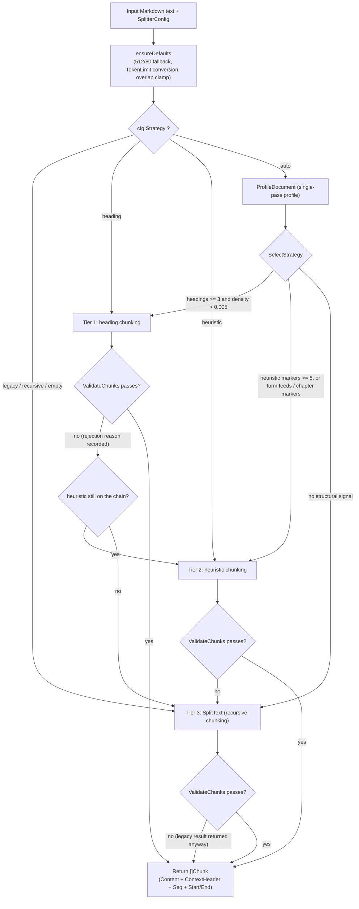
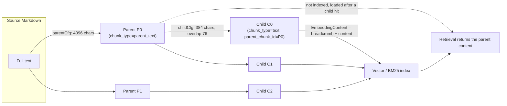

# Chunking

Chunking splits a document into retrieval units. Smaller chunks stay on one topic; larger chunks keep more context. Chunk size and overlap are tuned against the document structure and the retrieval results you see.

Start with the UI defaults (chunk size 512 characters, overlap 80 characters, adaptive strategy `auto`) and adjust when you notice one of these:

| Symptom | Suggestion |
| --- | --- |
| Answers lack context or are incomplete | Raise `chunk_size`, or enable parent-child chunking (child chunks are retrieved, parent chunks are returned) |
| Retrieved chunks are only loosely related to the question | Lower `chunk_size` so each chunk stays on one topic |
| The material is itemized (FAQ, glossary, parameter tables) | Set the overlap to 0 so neighbouring entries do not bleed into each other |
| The material is long narrative (reports, papers) | Raise the overlap to 150-200 to keep semantic links across chunks |
| You want to see the chunks before committing | Call `POST /api/v1/chunker/preview`; it writes nothing to the database |

After changing the chunking configuration, existing documents must be re-parsed before the new configuration applies.

## Parameter cheat sheet and tuning

Use this table to pick a starting configuration for a known kind of material.

| Scenario | strategy | chunk_size | chunk_overlap | Other |
| --- | --- | --- | --- | --- |
| General documents (recommended start) | `auto` | 512 | 80 | - |
| Structured technical docs / manuals | `auto` (selects `heading`) | 512-1024 | 80 | Breadcrumbs apply automatically |
| OCR PDFs / plain-text books | `auto` (selects `heuristic`) | 512-1024 | 80-150 | `languages` narrows the heuristic patterns and reduces false matches |
| Long narrative / argumentative documents | `auto` | 1000-2000 | 150-200 | Can be combined with parent-child chunking |
| Precise retrieval plus long context | any | - | - | `enable_parent_child=true`, parent 4096 / child 384 |
| FAQ / atomic records | not applicable (FAQ knowledge bases store one chunk per entry) | - | 0 | `FAQIndexMode` decides whether answers are indexed |
| Embedding model with a strict token limit | any | - | - | Set `token_limit`; it is converted to a character budget |
| Reproduce the behaviour of an older version | `legacy` | previous value | set 64 explicitly | See the migration note under [ChunkingConfig](#chunkingconfig-knowledge-base-level-overridable-per-upload) |

## Chunking reference

This section describes how the chunker works, for readers who tune it or debug its output.

AI KB chunks on the **Go side** (package `internal/infrastructure/chunker`) with an adaptive design: document profile, tiered strategies, result validation, and tier-by-tier fallback. The Python side keeps the original recursive splitter in `docreader/splitter/` for the docreader sidecar. The Go implementation is the production path; the comment at the top of `docreader/splitter/splitter.py` states that the defaults of the two are aligned.

### Configuration model

Three structures shape chunking: the knowledge base configuration, the runtime splitter configuration derived from it, and the indexing strategy that decides where chunks go.

#### ChunkingConfig (knowledge base level, overridable per upload)

`internal/types/knowledgebase.go`:

| Field | Type | Default | Description |
| --- | --- | --- | --- |
| `chunk_size` | int | 512 (characters) | Target size of one chunk. About 100-130 English tokens or 300 Chinese tokens. FAQ-style atomic content: 200-400; long narrative: 1000-2000 |
| `chunk_overlap` | int | 80 (about 15%) | Characters shared by adjacent chunks. Atomic data: 0; long narrative: 150-200. A value above `chunk_size/2` is clamped to half |
| `separators` | []string | `["\n\n", "\n", "。"]` | Separator priority list for recursive chunking |
| `strategy` | string | `""` (= legacy) | Chunking strategy: `auto` / `heading` / `heuristic` / `recursive` / `legacy`, see [Adaptive strategy](#adaptive-strategy-three-tiers-and-the-fallback-chain) |
| `token_limit` | int | 0 (off) | Caps chunk size in approximate tokens. When > 0 the limit is converted to a character budget per language and the smaller of the two sizes wins (0.9 safety factor) |
| `languages` | []string | empty (auto-detect) | Language hints for the heuristic tier, such as `["zh"]` or `["en","de"]` |
| `enable_parent_child` | bool | false | Enables two-level parent-child chunking, see [Parent-child chunking](#parent-child-chunking-multi-granularity) |
| `parent_chunk_size` | int | 4096 | Parent chunk size (parent-child mode only) |
| `child_chunk_size` | int | 384 | Child chunk size (parent-child mode only); the child overlap is fixed at `child_size/5` (about 20%) |
| `parser_engine_rules` | []ParserEngineRule | empty | File type to parser engine routing, with parser-level switches such as `xlsx_first_row_as_header` (parsing rather than chunking, but stored in the same structure) |
| `table_metadata_instructions` | string | empty | Business guidance used when generating summaries of CSV/Excel tables |

The single source of the defaults is the constant block in the `chunker` package (`splitter.go`):

```go
const (
    DefaultChunkSize    = 512
    DefaultChunkOverlap = 80
)
```

> Migration note (from the source comment): earlier versions had three overlap defaults, 64 in the Go `DefaultConfig`, 50 in `knowledge.go`, and 100 in the Python docreader. All three are now 80. An existing knowledge base whose row stores `ChunkOverlap=0` picks up 80 on the next re-index, so its embeddings no longer match the old ones bit for bit.

#### SplitterConfig (runtime configuration)

The service layer maps `ChunkingConfig` to `chunker.SplitterConfig{ChunkSize, ChunkOverlap, Separators, Strategy, TokenLimit, Languages}` in `buildSplitterConfigFromChunking` (`knowledge_process.go`). Inside the chunker package, `ensureDefaults` fills the gaps:

- When `TokenLimit > 0`: `charBudget = CharsForTokenLimit(TokenLimit, lang)`, and the budget replaces `ChunkSize` when it is smaller (`tokens.go`; characters per token: en 4.0, de 4.5, zh 1.7, mixed 3.0, with a 0.9 safety factor so a chunk stays under the embedding model's token limit).
- When `ChunkOverlap > ChunkSize/2`: the overlap is clamped to `ChunkSize/2`.

#### IndexingStrategy and chunking

The four switches in `internal/types/indexing_strategy.go` decide which pipelines consume the chunks:

```go
type IndexingStrategy struct {
    VectorEnabled  bool // vector index
    KeywordEnabled bool // BM25 keyword index
    WikiEnabled    bool // Wiki generation
    GraphEnabled   bool // graph extraction
}
```

- When `NeedsChunks()` (any switch on) is false, no chunks are needed.
- When `NeedsEmbedding()` (vector || keyword) is false, chunks are written to the database only and `BatchIndex` is skipped (`processChunks` calls `skipStage(StageEmbedding)`).
- Wiki and Graph both consume text chunks in the post-processing stage.

### Adaptive strategy: three tiers and the fallback chain

The public entry points are `chunker.Split(text, cfg)` and `chunker.SplitWithDiagnostics` (`strategy.go`). `cfg.Strategy` resolves as follows (`resolveChainWithProfile`):

| Strategy value | Tier chain | Description |
| --- | --- | --- |
| `auto` | Chosen by the profiler; a subsequence of `[heading, heuristic, legacy]` | Recommended. Picks the tier from the document structure. Any unknown value is treated the same way |
| `heading` | `[heading, legacy]` | Forces heading chunking, falls back to legacy on failure |
| `heuristic` | `[heuristic, legacy]` | Forces heuristic chunking |
| `recursive` | `[legacy]` | `recursive` is the public alias of `legacy` |
| `legacy` / `""` (empty) | `[legacy]` | The historical recursive splitter, the backward-compatible default |

Every tier's output must pass the **validator** (`validator.go`) before it is accepted; otherwise the chain moves to the next tier. `legacy` is the floor: even when its output fails validation, it is returned (the result is never empty).

Validator rejection rules:

| Rule | Rejection reason string |
| --- | --- |
| No output | `no chunks produced` |
| The document exceeds `2*chunkSize` but only one chunk was produced | `single chunk for large document` |
| More than a quarter of the chunks (and more than 2) are non-final chunks under 50 characters | `too many tiny chunks` |
| The largest chunk is under `chunkSize/4` while the document is longer than `chunkSize` (over-fragmented) | `all chunks far below target size` |
| The largest chunk exceeds `2*chunkSize` (budget ignored) | `chunk exceeds 2x target size` |

#### Document profile (profiler.go)

`ProfileDocument(text)` produces a `DocProfile` in one pass: total characters and lines, mean and standard deviation of line length, Markdown heading counts per level, numbered sections, all-caps short lines, blank-line blocks, form feeds (`\f`), horizontal rules, German/English/Chinese chapter markers, repeated footer lines, whether tables or code are present, the code ratio, and language detection (a sample of the first 4096 bytes; `DetectLanguage` returns `zh/de/en/mixed` from the CJK to Latin ratio).

`SelectStrategy(profile)` assembles the tier chain:

```go
// Tier 1 candidate: Markdown heading structure
if p.MdHeadingTotal >= 3 && p.HeadingDensity() > 0.005 && p.DominantHeadingLevel() > 0 {
    chain = append(chain, TierHeading)
}
// Tier 2 candidate: heuristic boundaries
if p.HeuristicMarkerTotal() >= 5 || p.FormFeedCount > 0 ||
    p.GermanChapterCount+p.EnglishChapterCount+p.ChineseChapterCount > 0 {
    chain = append(chain, TierHeuristic)
}
chain = append(chain, TierLegacy) // always the floor
```

`DominantHeadingLevel` picks the level that drives section splitting: the shallowest level that occurs at least 3 times (the document's real skeleton), otherwise the deepest level that occurs at all.

#### Decision flow



### The three chunking algorithms

Each tier targets a different kind of document structure.

#### Tier 1: heading-aware chunking (heading_splitter.go)

**Fits**: documents with a regular Markdown heading structure (technical docs, exported Word files, PDFs with bookmarks).

Algorithm:

1. With `DominantHeadingLevel` as the primary level, `findHeadingBoundaries` finds every heading line with `level <= primaryLevel` as a section boundary (fake headings inside fenced code are skipped). With one boundary or fewer, it falls back to `SplitText`.
2. `HeadingHierarchy` (`heading_hierarchy.go`) keeps a six-level heading stack: pushing a level-N heading pops every level >= N, and `BreadcrumbWithHashes()` renders a breadcrumb such as `"# Chapter 1\n## Section 1.2"`.
3. For each section:
   - If `breadcrumb length + 2 + section length <= ChunkSize`: the whole section becomes one chunk and the breadcrumb goes into **`ContextHeader` (not into Content)**.
   - Otherwise the section is handed to `SplitText` for a second split, and each sub-chunk gets the deepest heading path in effect at its offset (`sectionBreadcrumbs` + `breadcrumbAtOffset`) as its ContextHeader, so `###`/`####` sub-headings inside a section are not flattened to the section heading.
4. `coalesceTinyChunks`: adjacent chunks smaller than `ChunkSize/2` (floor 200) that share a heading prefix and are contiguous (`cur.End == next.Start`) are merged, so a document of short FAQ-style sections no longer drops to legacy because of "too many tiny chunks".

**Position invariant**: `End - Start == utf8.RuneCountInString(Content)` always holds (the breadcrumb is not part of Content). Document reconstruction and UI highlighting rely on it.

#### Tier 2: heuristic boundary chunking (heuristic_splitter.go, patterns.go)

**Fits**: documents without Markdown headings but with recognizable structure (OCR output from PDFs, plain-text manuals, scanned books).

All candidate boundaries are scanned first (only the highest priority survives at a given offset):

| Boundary type | Pattern (patterns.go) | Priority |
| --- | --- | --- |
| Form feed `\f` | `FormFeedPattern` | 100 |
| Numbered section (`1.2.3 Title`, `IV. Results`) | `NumberedSectionPattern` | 90 |
| Chapter marker (`Chapter 3` / `Kapitel 2`, and Chinese chapter or section lines numbered with Chinese or Arabic numerals) | `EnglishChapterPattern` / `GermanChapterPattern` / `ChineseChapterPattern` (filtered by the `Languages` hint; all three when empty) | 85 |
| All-caps short heading line | `AllCapsHeadingPattern` | 70 |
| Visual separator (`---`, `===`, `***`) | `VisualSeparatorPattern` | 60 |
| Page footer (`Page 3 of 10` / `Seite 3 von 10`, and the Chinese page-number form) | `PageFooterPattern` | 50 |
| Three or more consecutive newlines | `ExcessiveBlanksPattern` | 40 |

Then:

- `dropBoundsInsideSpans`: boundaries **inside** a protected span (tables, code blocks, formulas; see [Tier 3](#tier-3-recursive-chunking-legacy-splitter-go-ported-from-python)) are dropped; boundaries aligned with a span edge are kept.
- **Greedy bin-packing**: blocks accumulate along the boundaries; when the accumulated size exceeds `ChunkSize` and at least `max(ChunkSize/4, 50)` characters are present, a chunk is emitted.
- An oversized block between two boundaries is handed to `SplitText` recursively.
- Overlap alignment: `applyOverlapAligned` searches the window `[curEnd-2*overlap, curEnd)` and snaps to the nearest semantic boundary, then to a line break, so the next chunk does not start mid-word.

#### Tier 3: recursive chunking, legacy (splitter.go, ported from Python)

This is the base implementation ported from `docreader/splitter/splitter.py`. It is the floor of every tier and the engine for second splits inside a section. Three steps:

**Step 1: protected span detection** (`protectedSpans`). These regions are never cut in the middle:

```go
var protectedPatterns = []*regexp.Regexp{
    regexp.MustCompile(`(?s)\$\$.*?\$\$`),                        // LaTeX block math
    regexp.MustCompile(`!\[[^\]\n]{0,200}\]\([^)\n]{1,500}\)`),   // Markdown image (single line, bounded)
    regexp.MustCompile(`\[[^\]\n]{1,200}\]\([^)\n]{1,500}\)`),    // Markdown link (single line, bounded)
    /* header + separator row */ /* table data rows */           // Markdown tables
    regexp.MustCompile("(?s)```(?:\\w+)?[\\r\\n].*?```"),          // fenced code block
    regexp.MustCompile("`[^`\\r\\n]+`"),                            // inline code
}
```

Image and link matches are limited to one line, with link text up to 200 characters and the target up to 500 (consistent with CommonMark, which forbids spans across blank lines). A stray `[` left by OCR therefore cannot pair with a distant `](` and turn a whole passage into one unsplittable protected region.

A protected span longer than `maxProtectedSize = 7500` runes (a huge table or code block) is force-split at a newline or space so it stays within the embedding API limits.

**Step 2: recursive separation** (`splitBySeparators`): the text is cut by `Separators` in priority order (default `\n\n`, then `\n`, then `。`); a fragment still over `ChunkSize` is cut again with the next separator (same semantics as the Python `_split`; the separator stays attached to its fragment).

**Step 3: merge and overlap** (`mergeUnits`): small units are packed into chunks. When `curLen + uLen + headersLen > chunkSize` a chunk is emitted, and `computeOverlap` takes a suffix of the current chunk as the start of the next one. The absolute cap is `absoluteMaxSize = 7500`.

`computeOverlap` takes a **semantic suffix**, not a fixed-length slice:

- `ChunkOverlap` is a hard cap, not a target. The window is the last `min(ChunkOverlap, ChunkSize - length of the next unit)` characters of the chunk, plus 4 extra characters of lookbehind (`semanticOverlapLookbehind`, the length of the longest separator `\r\n\r\n`) so a separator cut by the window edge stays visible. A candidate boundary's last character must fall inside the window (at position -1 or later relative to the original window), so the retained content never exceeds the cap.
- Boundary priority: paragraph break (`\n\n`) > line break (`\n`) > sentence end (the CJK full stop `。`, the fullwidth question and exclamation marks U+FF1F and U+FF01, and the English `. ` / `? ` / `! `, where the punctuation must be followed by a space so `3.14` and `v1.2` are not split). Among boundaries of equal priority the **earliest** in the window wins, so the useful overlap is as large as possible.
- The window may cut inside a single `splitUnit` (the previous implementation could only retain whole units, so ordinary paragraphs often fell back to zero overlap), but it never crosses a zero-width synthetic unit with `start == end` such as a table header marker, which keeps the `Start/End` to Content invariant.
- Separators inside protected spans (code blocks, inline code `` ` ` ``, formulas, tables, images and links) are not boundaries; a boundary followed only by whitespace does not count either.
- If no valid semantic boundary exists in the window, no overlap is retained, rather than cutting mid-word.

#### Table handling: header tracking (header_tracker.go)

When a large Markdown table is cut into several chunks, the later chunks lose their column names. `headerTracker` (ported from `docreader/splitter/header_hook.py`) solves this:

- A "header row + separator row" pair (`| A | B |` + `| --- | --- |`) becomes the **active header** and stays active until the table ends (a blank line, or a line that does not start with `|`).
- When `mergeUnits` emits a new chunk and the active header is not already in the overlap or the next unit, and the column count matches (`headerAlreadyPresent` / `headerColumnMismatch`), the header is **prepended to the new chunk** as a zero-width unit with `start==end`, so every table fragment carries its column names.
- An empty header (`||` + `|---|---|`, common in MarkItDown output) is completed from the first data row (`pendingExtend`).
- Table boundary awareness: a new table row after a `\n\n` at the chunk end, or a row whose column count differs from the header, ends the old header and forces a chunk boundary (`headerEndedThisUnit`), so one table's header does not leak into the next table.

Inline HTML tables, whether from a parser engine (MinerU, PaddleOCR-VL, VLM OCR and others) or hand-written Markdown, are converted to GFM Markdown tables by `NormalizeHTMLTables` in `docparser/html_table_normalizer.go` before chunking, so they enter the protection and header-tracking logic above. A table with real merged cells (`rowspan`/`colspan` greater than 1) or one that cannot be converted stays HTML, but each `<tr>` is placed on its own line with blank lines around it, so the chunker can cut at row boundaries instead of hard-cutting at the 7500-character cap.

#### Image handling

- A Markdown image reference `` is a protected pattern and is never cut.
- `chunker.ExtractImageRefs(text)` (`splitter.go`) extracts the image references in a chunk with a regex that tolerates one level of nested parentheses; `processChunks` uses it to link chunks to images.
- In the multimodal stage each image produces two child chunks, `image_caption` and `image_ocr` (`ParentChunkID` points at the text chunk), which are indexed on their own, so image semantics are retrievable and a hit leads back to the source text chunk.

### Context header (ContextHeader)

`Chunk.ContextHeader` is a context string (the heading breadcrumb) **stored separately** from Content:

```go
// internal/types/chunk.go
// ContextHeader is a Markdown heading breadcrumb prepended when indexing.
// It is persisted so a later content edit can rebuild the same index input.
ContextHeader string `json:"-" gorm:"type:text"`

func (c *Chunk) EmbeddingContent() string {
    body := strings.TrimSpace(c.Content)
    if c.ContextHeader == "" { return body }
    return c.ContextHeader + "\n\n" + body
}
```

Design points:

- **It affects the embedding only, never the source text**: `processChunks` builds the index content as `knowledge title + "\n" + chunk.EmbeddingContent()`, so the vector carries the section context, while Content stays a verbatim slice of the source and the `StartAt/EndAt` offset invariant holds.
- **Persisted in the `chunks.context_header` column** (migration `migrations/versioned/000078_chunk_editing_and_custom_metadata`). Earlier versions kept it in memory only (`gorm:"-"`) and dropped it once indexing finished. With manual chunk editing, re-indexing a single chunk must reproduce the same index input, so the field now lands in the database. `json:"-"` is unchanged, so API responses still omit it.
- In parent-child mode, `mergeBreadcrumbs` (`strategy.go`) merges the parent and child breadcrumbs and drops a duplicated first line, so a child gets a finer path than its parent.

### Parent-child chunking (multi-granularity)

With `EnableParentChild = true`, chunking runs in two levels (`chunker.SplitParentChild`, the strategy-aware version; the legacy version is `SplitTextParentChild`):

1. `parentCfg` (4096 characters by default, the configured overlap, the inherited Strategy) cuts the **parent chunks**.
2. Each parent is cut again with `childCfg` (384 characters by default, overlap = child size / 5, the inherited Strategy) into **child chunks**.
3. Child `Seq` values are continuous across the document, `Start/End` are shifted back to document-level offsets, and `ParentIndex` points at the parent. When a parent yields exactly one child identical to itself, the parent is not stored (`ParentIndex = -1`) to avoid redundancy.

Persistence rules on the service side (`processChunks` in `knowledge_process.go`):

- Parent chunks become `ChunkTypeParentText`, **written to the database but not to the vector index**, and are linked as a `PreChunkID/NextChunkID` list.
- Child chunks become `ChunkTypeText` with `ParentChunkID`; they are the only granularity that is embedded and indexed.
- Retrieval hits a child chunk and returns the parent content: a small window for precise matching, a large window for context.

`buildParentChildConfigs` insists that Strategy be passed through: an empty Strategy resolves to the legacy tier, and parent-child chunks would silently lose their heading alignment and ContextHeader breadcrumbs.



### FAQ chunking

FAQ knowledge bases **skip the chunking algorithms entirely**: each question-answer pair is one `ChunkTypeFAQ` chunk (`knowledge_faq.go`), and `buildFAQChunkContent` generates its Content according to the index mode:

```go
builder.WriteString(fmt.Sprintf("Q: %s\n", meta.StandardQuestion))
// Similar Questions: listed one per line
// Negative examples (NegativeQuestions) are not written to Content; they must not be indexed
if mode == types.FAQIndexModeQuestionAnswer && len(meta.Answers) > 0 {
    // Answers: listed one per line
}
```

- The structured data lives in `Chunk.Metadata` (`FAQChunkMetadata`); `ContentHash` (a SHA256 of the normalized data) drives import deduplication and incremental sync of clones.
- Index modes: `question_only` / `question_answer` (knowledge base level `FAQIndexMode`); question index modes `combined` (standard question and similar questions in one vector) / `separate` (one vector per similar question, which supports incremental updates).
- The general advice of `chunk_overlap = 0` for FAQ material holds by construction: entries do not overlap.

### Pipeline integration

The call chain in `knowledge_process.go`:

```
processDocument
  └─ convert()                          // docreader → Markdown
  └─ imageResolver.ResolveAndStore()    // store images, rewrite URLs
  └─ buildSplitterConfigFromChunking()  // ChunkingConfig → SplitterConfig
  └─ chunker.Split / SplitParentChild   // the algorithms described above
  └─ processChunks()                    // create Chunk rows, EmbeddingContent → BatchIndex
```

The chunking stage has its own span (`StageChunking`, recording `chunks_planned/chunks_written/total_text_chars`); its failure error code is `ErrCodeChunkingFailed`.

### Debugging: POST /api/v1/chunker/preview (chunker_debug.go)

A read-only preview endpoint. The chunking debug panel in the knowledge base editor uses it to try sample text before changing parameters. It **writes nothing to the database, produces no embeddings and logs no text**.

Request body:

```json
{
  "text": "sample text...",
  "chunking_config": {
    "chunk_size": 512, "chunk_overlap": 80,
    "separators": ["\n\n", "\n", "。"],
    "strategy": "auto", "token_limit": 0, "languages": ["zh"],
    "enable_parent_child": false,
    "parent_chunk_size": 4096, "child_chunk_size": 384
  }
}
```

With `enable_parent_child: true` the preview returns the **child chunks** (the granularity retrieval actually hits), while the diagnostics come from the parent pass. Preview and import derive their configuration through the same `chunker.NormalizeSplitterConfig()` and `chunker.DeriveParentChildConfigs()`, so a preview that looks right cannot differ from the import. Earlier previews always ran a single-level split, so for a knowledge base with parent-child chunking enabled the preview did not match the real result.

Response (`PreviewChunkingResponse`):

| Field | Description |
| --- | --- |
| `selected_tier` | The tier that won (`heading`/`heuristic`/`legacy`) |
| `tier_chain` | The chain attempted for this request |
| `rejected` | Each rejected tier and the validator's reason (`TierRejection{tier, reason}`) |
| `profile` | The full `DocProfile` (from strategy selection under `auto`; computed on demand for an explicit strategy) |
| `chunks[]` | Per chunk: `seq/start/end/size_chars/size_tokens_approx/context_header/content` |
| `stats` | `count/avg_chars/min_chars/max_chars/stddev_chars`, computed over the **full** chunk set; `truncated_to` is added when the response is truncated |

Safeguards (constants): input cap `previewMaxChars = 64k` runes (413 when exceeded), returned chunk cap `previewMaxChunks = 500` (stats still cover the full set), timeout `previewTimeout = 5s` (the splitter takes no context, so after the timeout the handler returns 504 while the worker goroutine runs to completion; the 64k cap is the main protection). The diagnostics come from `chunker.SplitWithDiagnostics`, and their JSON shape is part of the public API.

Route registration (`internal/router/routes_knowledge.go`):

```go
g.apiKeyRoute(r, http.MethodPost, "/chunker/preview",
    apiKeyRetrieve(apiKeyIngest(apiKeyFullAccess())), g.Viewer(), handler.PreviewChunking)
```

### Python-side splitter (docreader/splitter/)

`TextSplitter` in `docreader/splitter/splitter.py` is the prototype of the Go legacy implementation and ships with the docreader sidecar:

- Defaults are aligned with Go: `DEFAULT_CHUNK_SIZE = 512`, `DEFAULT_CHUNK_OVERLAP = 80`; the constructor's default separators are `["\n", "。", " "]`, with character-level splitting as the last resort.
- The same protected regexes (formula, image, link, table header, table row, code block); `_split` (recursive separation), then `_split_protected` + `_join` (protected span isolation), then `_merge` (overlap merging with `HeaderTracker` header prepending).
- It emits `(start, end, text)` triples and asserts `"".join(splits) == text`, so the text can be rebuilt; `restore_text` demonstrates the de-overlap reconstruction.
- `HeaderTracker` in `docreader/splitter/header_hook.py` behaves like the Go `header_tracker.go` (header detection, empty header completion, ending on a column count mismatch).

## Implementation reference

Source files involved:

| Module | File |
| --- | --- |
| Strategy entry and fallback chain | `internal/infrastructure/chunker/strategy.go` |
| Document profile | `internal/infrastructure/chunker/profiler.go` |
| Tier 1 heading chunking | `internal/infrastructure/chunker/heading_splitter.go`, `heading_hierarchy.go` |
| Tier 2 heuristic chunking | `internal/infrastructure/chunker/heuristic_splitter.go`, `patterns.go` |
| Tier 3 recursive chunking (legacy) | `internal/infrastructure/chunker/splitter.go` |
| Header tracking | `internal/infrastructure/chunker/header_tracker.go` |
| Result validation | `internal/infrastructure/chunker/validator.go` |
| Token estimation | `internal/infrastructure/chunker/tokens.go` |
| Configuration structures | `internal/types/knowledgebase.go` (`ChunkingConfig`), `internal/types/indexing_strategy.go` |
| Pipeline integration | `internal/application/service/knowledge_process.go` (`buildSplitterConfigFromChunking` / `buildParentChildConfigs` / `processChunks`) |
| Debug endpoint | `internal/handler/chunker_debug.go` (`POST /api/v1/chunker/preview`) |
| Python side | `docreader/splitter/splitter.py`, `docreader/splitter/header_hook.py` |
