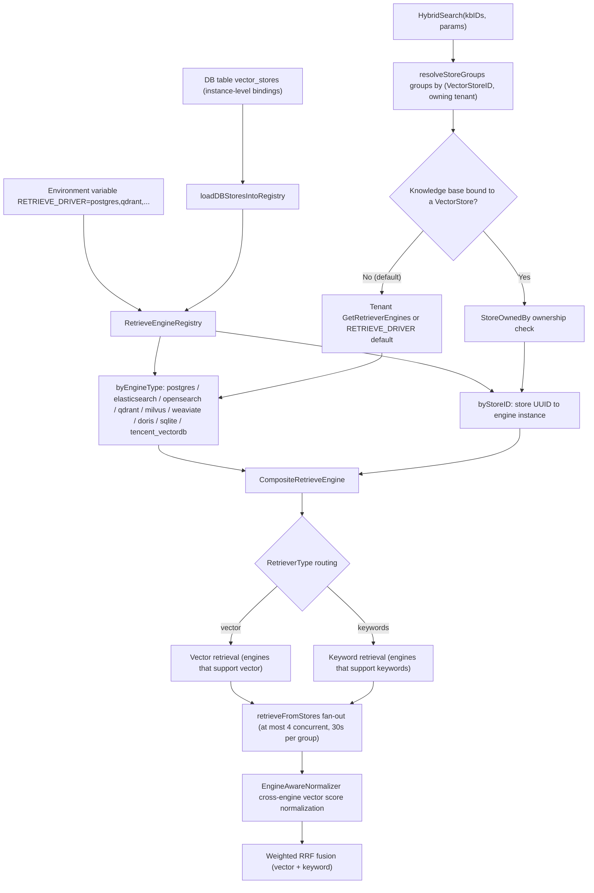
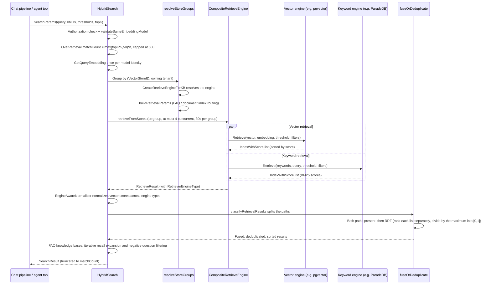

# Retrieval engines and vector stores

A retrieval engine stores the indexes and runs vector, keyword or hybrid retrieval. The default PostgreSQL deployment uses the ParadeDB image, which provides pgvector and BM25 in the same database as the business data. Choose another backend when vector retrieval must scale on its own or when existing infrastructure should be reused.

Pick a backend from its deployment dependencies, capacity and data isolation requirements:

| Situation | Consider |
| --- | --- |
| Single machine or desktop deployment with an embedded database | SQLite (embedded, no dependencies) |
| Vector retrieval must scale independently | Qdrant, Milvus |
| The company already runs an Elasticsearch / OpenSearch stack | Reuse the existing cluster |
| Data must be stored separately per knowledge base | Keep the default engine, register an instance under Settings → Vector stores and bind it to the knowledge base |

Switching engines requires rebuilding the indexes. The vector store bound to a knowledge base cannot be changed after creation, so settle on the instance before creating the knowledge base.

## Capability matrix and comparison

Use this table to compare what each engine provides before choosing one.

| Engine | `RETRIEVE_DRIVER` value | Vector retrieval | Keyword / full text | Keyword scoring | Chinese tokenization | Dimension handling | Threshold pushdown | Deployment effort | Typical use |
| --- | --- | --- | --- | --- | --- | --- | --- | --- | --- |
| PostgreSQL | `postgres` | pgvector halfvec + HNSW expression index | ParadeDB BM25 (`\|\|\|`) | BM25 (`paradedb.score`) | ParadeDB tokenizer | One table for all dimensions, expression index cast per dimension | Distance threshold inside SQL | Low (built into the default image) | Default choice; same database as business data, transactional consistency |
| SQLite | `sqlite` | sqlite-vec vec0 (cosine) | FTS5 contentless | FTS5 | Application-side bigrams | One vec0 virtual table per dimension | Application side | Very low (embedded) | Desktop edition / development / tiny deployments |
| Elasticsearch v8 | `elasticsearch_v8` | script_score cosineSimilarity | match (BM25) | BM25 | ES analyzer | One dense_vector index | Application side | Medium | Existing ES 8 cluster |
| Elasticsearch v7 | `elasticsearch_v7` | Not supported (`Support()` returns keywords only) | match (BM25) | BM25 | ES analyzer | - | - | Medium | Existing ES 7; keyword engine only, combine with another vector engine |
| OpenSearch | `opensearch` | k-NN plugin knn (HNSW) | match (BM25) | BM25 | OS analyzer | Declarative knn_vector mapping + fingerprint check | k-NN native | Medium | Production ES-family setups that need audit, aliases and reindex; version 2.11+ / 3.x |
| Qdrant | `qdrant` | Native HNSW cosine | Full-text index MatchText (token OR) | No score (Scroll returns hits, rank comes from RRF) | Multilingual tokenizer | One collection per dimension | score_threshold native | Medium | Vector-first workloads that need payload filtering |
| Milvus | `milvus` | HNSW (IP / COSINE / L2) | BM25 function over sparse vectors | BM25 | Milvus analyzer | One collection per dimension | Application side | Medium to high | Large vector volumes with native BM25 hybrid retrieval |
| Weaviate | `weaviate` | nearVector (certainty) | Native BM25 | BM25 | Weaviate tokenizer | Dynamic class | certainty native | Medium | GraphQL ecosystem, replication and sharding configuration |
| Doris | `doris` | ANN HNSW inner_product / cosine | Inverted index MATCH_ANY | Inverted index hit | Chinese parser declared at table creation | One table per dimension | Inside SQL | High | Existing Doris warehouse, retrieval and analytics in one system |
| Tencent Cloud VectorDB | `tencent_vectordb` | HNSW COSINE | Sparse vector BM25 (SPARSE_INVERTED) | BM25 | SDK SparseEncoder | One collection per dimension | Application side | Low (cloud managed) | Managed on Tencent Cloud, no operations |

> Whether or not an engine offers its own "hybrid retrieval", hybrid retrieval in AI KB is always the **RRF fusion in the service layer** (`knowledgebase_search_fusion.go`). Vector and keyword retrieval run independently and are merged by weighted rank (see [Hybrid retrieval scoring and normalization](#hybrid-retrieval-scoring-and-normalization)), so each engine only has to provide the two single-mode retrievals.

## Configuration summary

This section lists the environment variables that select and connect the engines. Core switches (`.env.example` section C1, `docker-compose.yml`):

| Environment variable | Default | Description |
| --- | --- | --- |
| `RETRIEVE_DRIVER` | `postgres` | Comma-separated list of drivers: `postgres` / `sqlite` / `elasticsearch_v7` / `elasticsearch_v8` / `opensearch` / `qdrant` / `milvus` / `weaviate` / `doris` / `tencent_vectordb`. With several drivers, writes are broadcast to all of them and retrieval is routed by type |
| `MULTI_STORE_RETRIEVE_TIMEOUT_SEC` | 30 | Per-group timeout for parallel multi-store retrieval |
| `ELASTICSEARCH_ADDR` / `_USERNAME` / `_PASSWORD` / `_INDEX` | - / `xwrag_default` | Shared by ES v7 and v8 |
| `OPENSEARCH_ADDR` / `_USERNAME` / `_PASSWORD` / `_INDEX` / `_INSECURE_SKIP_VERIFY` | - | OpenSearch |
| `QDRANT_HOST` / `_PORT` / `_COLLECTION` / `_API_KEY` / `_USE_TLS` | `localhost` / 6334 / `aikb_embeddings` | Qdrant (gRPC port) |
| `MILVUS_ADDRESS` / `_COLLECTION` / `_METRIC_TYPE` / `_USERNAME` / `_PASSWORD` / `_DB_NAME` | `localhost:19530` / `aikb_embeddings` / `IP` | Changing the metric requires rebuilding the collection |
| `WEAVIATE_HOST` / `_GRPC_ADDRESS` / `_SCHEME` / `_AUTH_ENABLED` / `_API_KEY` / `_COLLECTION` | `weaviate:8080` / `weaviate:50051` / `http` | Use the service name inside containers |
| `DORIS_ADDR` / `_HTTP_PORT` / `_DATABASE` / `_USERNAME` / `_PASSWORD` / `_TABLE_PREFIX` / `_COMPAT_MODE` | `doris-fe:9030` / 8030 / `aikb` / `root` / - / `aikb_embeddings` / `auto` | Doris 4.1+; compat modes are not interchangeable once tables exist |
| `TENCENT_VECTORDB_ADDR` / `_USERNAME` / `_API_KEY` / `_DATABASE` / `_COLLECTION` | - | Registration is skipped when any of the three core values is missing |
| `NEO4J_ENABLE` / `NEO4J_URI` / `_USERNAME` / `_PASSWORD` | `false` / no code default (`.env.example` sample `bolt://neo4j:7687`) | Graph retrieval (independent of the vector engine system) |

Besides environment variables (the env store, global to the process), an administrator can create `VectorStore` records for a workspace (DB stores) and bind them to specific knowledge bases. The same engine type can connect to several cluster instances; retrieval routes by the knowledge base binding and checks workspace ownership ([Engine selection at retrieval time](#engine-selection-at-retrieval-time)).

## Engine implementation reference

This section is for readers who need to know how the drivers are layered and what each backend does internally.

### Layers: Repository → KVHybridRetrieveEngine → Composite → Registry

Each backend implements `interfaces.RetrieveEngineRepository` (`EngineType()` / `Support()` / `Save` / `BatchSave` / `Retrieve` / `DeleteBy*` / `CopyIndices` / `BatchUpdateChunkEnabledStatus` / `BatchUpdateChunkTagID` / `EstimateStorageSize`). Above it, in order:

- **KVHybridRetrieveEngine** (`retriever/keywords_vector_hybrid_indexer.go`): wraps a Repository as a `RetrieveEngineService` and, at index time, computes embeddings for the retrieval types the engine supports and writes them;
- **CompositeRetrieveEngine** (`retriever/composite.go`): the composite pattern. `Retrieve` routes each `RetrieveParams.RetrieverType` (`vector` / `keywords`) to the first engine that supports that type and runs them concurrently; write operations such as `Index` / `Delete` / `CopyIndices` are broadcast to every member engine;
- **RetrieveEngineRegistry** (`retriever/registry.go`): a registry with two indexes. `byEngineType` holds the env stores driven by the `RETRIEVE_DRIVER` environment variable (one per type); `byStoreID` holds instance-level registrations driven by the `VectorStore` database table (several instances of one engine type, for example two ES clusters).

#### On-demand rebuild (rehydrate)

When a vector store happens to be unavailable at startup (backend not up yet, network blip), it never enters `byStoreID`; from then on every retrieval against a knowledge base bound to that store, and even deleting the knowledge base, would keep failing. The registry therefore supports **on-demand rebuild**:

- When `GetOrLoadByStoreID` misses, it builds the engine on the spot with the injected `VectorStoreRepository` + `EngineFactory` and registers it; if either is nil it degrades to a plain lookup;
- A single build is bounded by `EngineBuildTimeout` (10s), and `singleflight` merges concurrent requests into one build;
- A failed build enters a `rebuildCooldown` (30s) so that a backend that stays down does not cost every request a full timeout;
- A `storeGen` generation counter prevents races: it is sampled before the build starts, and the result is only published if the generation is unchanged, so a registration or removal during the build is not overwritten by a stale result.

Deleting a knowledge base whose engine is not ready also retries through this rebuild path instead of failing outright.

#### Engine registration: initRetrieveEngineRegistry

`internal/container/container.go`. At startup, `RETRIEVE_DRIVER` (comma-separated) is parsed, a client is built per driver and `registry.Register(retriever.NewKVHybridRetrieveEngine(repo, engineType))` is called; a driver that fails to initialize is logged and does not block startup. Then `loadDBStoresIntoRegistry` loads the vector store instances created by workspaces from the `vector_stores` table, builds each engine through `createEngineServiceFromStore` (`engine_factory.go`) and registers it with `RegisterWithStoreID`.

#### Engine selection at retrieval time

The retrieval entry point `HybridSearch` (`knowledgebase_search.go`) selects engines from the knowledge base bindings:

1. `resolveStoreGroups` groups the participating knowledge bases by `(VectorStoreID, owning tenant)`;
2. Each group calls `retriever.CreateRetrieveEngineForKB` (`factory.go`):
   - Knowledge base without a bound store (`VectorStoreID` empty, the current default) → the tenant's `GetRetrieverEngines()`: `RetrieverEngines.Engines` if the tenant configured it, otherwise `GetDefaultRetrieverEngines()` derives the list from the `RETRIEVE_DRIVER` environment variable (`internal/types/tenant.go`);
   - Knowledge base bound to a store → `ownership.StoreOwnedBy` checks the owning tenant first (prevents cross-tenant probing; failure returns `ErrVectorStoreForbidden`), then `registry.GetByStoreID` fetches the instance (unregistered returns `ErrVectorStoreNotFound`), wrapped as a single-member Composite;
3. `buildRetrievalParams` generates the vector and keyword `RetrieveParams` from the engine's `SupportRetriever` capabilities and the knowledge base type (FAQ knowledge bases only use the FAQ vector index; document knowledge bases use the default vector index plus the keyword index);
4. With several groups, `retrieveFromStores` fans out through an errgroup (at most 4 groups at once, per-group timeout `MULTI_STORE_RETRIEVE_TIMEOUT_SEC`, default 30s); when results span engine types the scores are normalized.



### Engines one by one

The engine type constants are in `internal/types/retriever.go`: `postgres`, `elasticsearch`, `opensearch`, `qdrant`, `milvus`, `weaviate`, `doris`, `sqlite`, `tencent_vectordb` (`infinity` and `elasticfaiss` are legacy enum values with no deployable implementation). Unless noted otherwise, every engine's `Support()` returns both `[keywords, vector]`.

#### PostgreSQL (pgvector + ParadeDB), the default engine

`internal/application/repository/retriever/postgres/repository.go`. Data lives in the business database (`embeddings` table, managed by GORM).

- **Vector retrieval**: pgvector `halfvec` (half precision, 2 bytes per dimension). The `embedding` column has no fixed dimension; the HNSW index is built on the expression `(embedding::halfvec(dim)) halfvec_cosine_ops`. **The ORDER BY expression must match the index expression exactly** (explicit cast on both sides), otherwise the query degrades to a sequential scan (the source comment cites pgvector issues [#702](https://github.com/pgvector/pgvector/issues/702) and [#835](https://github.com/pgvector/pgvector/issues/835)). The query first takes `expandedTopK` candidates in a subquery (TopK*2, clamped to [100, 200] so a large LIMIT does not drag HNSW down), computes `distance = embedding <=> query`, then filters by `distance <= 1-threshold` and returns `score = 1 - distance`. Inside the transaction it sets `SET LOCAL hnsw.ef_search` (at least 40) and `SET LOCAL hnsw.iterative_scan = strict_order` (pgvector 0.8+, keeps filling recall under selective filters); when an older version lacks the GUC it retries without the overrides.
- **Keyword retrieval**: ParadeDB `pg_search` BM25, `content ||| query` (any token matches) plus `paradedb.score(id) as score`.
- **Filters**: `knowledge_base_id` / `knowledge_id` / `tag_id` IN filters (AND semantics), `is_enabled` NULL or true.
- **Indexing**: `BatchSave` with `ON CONFLICT DO NOTHING`; deletes are physical, by chunk, source or knowledge ID.

#### SQLite (FTS5 + sqlite-vec), lightweight single machine

`internal/application/repository/retriever/sqlite/repository.go`. Fully embedded, no external dependencies.

- **Vector retrieval**: the `sqlite-vec` extension (cgo bindings), **one vec0 virtual table per dimension**: `CREATE VIRTUAL TABLE ... USING vec0(embedding float[dim] distance_metric=cosine)`; the query is `WHERE v.embedding MATCH ?` (serialized query vector) `ORDER BY v.distance`, `score = 1 - distance`. At startup `ensureExistingVecTables` creates the virtual tables for the dimensions already present in the data.
- **Keyword retrieval**: the contentless FTS5 table `lite_embeddings_fts`, with manual **bigram tokenization** at write time (Chinese-friendly); the query goes through `sanitizeFTS5Query`, is bigrammed the same way, then `MATCH`.
- **Filters**: the knowledge base, document, tag and enabled conditions apply to the `lite_embeddings` main table. The vector path uses `v.rowid IN (SELECT ... FROM lite_embeddings WHERE ...)`, so filtering happens before the top-k selection. Taking a global top-k first and filtering afterwards could drop valid matches inside the scope;
- **Error propagation**: a failure on either retrieval path returns an error, so the caller cannot mistake it for a successful retrieval with no matches;
- **Threshold**: a vector threshold of 0 means no filtering, not filtering everything out.
- Suited to the desktop edition, development environments and very small deployments.

#### Elasticsearch v8

`internal/application/repository/retriever/elasticsearch/v8/repository.go`. Typed client, one index (`ELASTICSEARCH_INDEX`, default `xwrag_default`), documents carry a `dense_vector` embedding field.

- **Vector retrieval**: a `script_score` query with the script `Math.max(cosineSimilarity(params.query_vector, 'embedding'), 0.0)`; the threshold is applied on the application side. Lucene rejects a negative final score: without the clamp, one vector pointing away from the query makes the whole request return 400. Clamped to 0, the range is [0, 1]; such documents sort last and any positive threshold filters them out.
- **Keyword retrieval**: a `match` query on the content field (BM25).
- **Filters**: bool filter (terms on KB / knowledge / tag IDs; `is_enabled` is matched inversely with must_not, so historical data without the field counts as enabled); at startup the mapping is probed to decide whether ID fields need the `.keyword` suffix.
- **Indexing**: batched writes through the Bulk API; empty vectors are rejected.

#### Elasticsearch v7, keywords only

`internal/application/repository/retriever/elasticsearch/v7/repository.go`. Note that **`Support()` returns only `[keywords]`**: the v7 driver is registered in AI KB as a BM25 keyword engine only (the code still builds a `script_score cosineSimilarity` vector query, but the capability declaration omits vector, so the Composite never routes vector requests to it). For vector retrieval, pair it with another driver (for example `RETRIEVE_DRIVER=postgres,elasticsearch_v7`) or upgrade to v8.

#### OpenSearch

`internal/application/repository/retriever/opensearch/` (split across `repository.go`, `retrieve.go`, `query.go`, `mapping.go`, `crud.go` and others).

- **Version gate** `probeVersion`: rejects the Elasticsearch distribution and OS 1.x / 2.0-2.3 (Lucene HNSW preview); 2.4-2.10 is accepted with a warning; 2.11+ / 3.x is accepted cleanly (primary test target 3.3.2). `probeKNNPlugin` requires the `opensearch-knn` plugin on every node.
- **Vector retrieval**: the k-NN plugin `knn` query (`query.go buildKNNQuery`). The k-NN `COSINESIMIL` space type returns `(1+cosine)/2`. The driver pushes the threshold down as `min_score = (1+threshold)/2` and converts results back to cosine similarity (`2*score-1`), the same scale as the other engines.
- **Keyword retrieval**: `match` on content (BM25). Hybrid retrieval does not use the native OS hybrid pipeline; fusion is left to the RRF layer above (stated in a `query.go` comment).
- **Indexing**: `mapping.go` declares the mapping (a `knn_vector` field with method and engine parameters); at startup the mapping fingerprint is checked and drift reports `ErrConfigInvalid`; alias management plus `copy.go` support reindex; index creation and reindex events go to the audit log through the AuditSink.
- Configuration includes `OPENSEARCH_INSECURE_SKIP_VERIFY` and an SSRF-validating transport layer (`transport.go`).

#### Qdrant

`internal/application/repository/retriever/qdrant/repository.go`. gRPC client (default port 6334).

- **Collection management**: **one collection per dimension**, `{QDRANT_COLLECTION|aikb_embeddings}_{dim}`, Distance=Cosine; payload fields (kb_id / knowledge_id / chunk_id / tag_id and others) get keyword indexes, and content gets a **full-text index with the multilingual tokenizer**.
- **Vector retrieval**: the `Query` API; the score is the normalized dot product (about cosine, [0, 1] for IR embeddings); the threshold is pushed down as score_threshold.
- **Keyword retrieval**: `tokenizeQuery` tokenizes locally, then builds a **should (OR) filter** of `MatchText(content, token)` per token and fetches with `Scroll` across the collections of every matching dimension; there is no BM25 score (a hit is returned as is, the score comes from the RRF rank above).
- **Filters**: `getBaseFilter` uses `MatchKeywords` for exact filtering on KB / knowledge / tag / is_enabled.
- **Writes and deletes**: invalid UTF-8 and NUL characters in string payloads are cleaned before writing; a delete against a dimension whose collection does not exist yet (old vectors are deleted before the first write, or Qdrant was wiped) is treated as "nothing to delete" and no longer blocks the following write; batch enabled-status and tag updates run per collection, and any failure returns an error instead of only being logged.
- Configuration: `QDRANT_HOST` / `QDRANT_PORT` / `QDRANT_API_KEY` / `QDRANT_USE_TLS`.

#### Milvus

`internal/application/repository/retriever/milvus/repository.go`.

- **Collection management**: one collection per dimension (`{MILVUS_COLLECTION|aikb_embeddings}_{dim}`). The schema has the dense vector `embedding` (HNSW index, M=16, efConstruction=128, metric from `MILVUS_METRIC_TYPE`: IP by default / COSINE / L2) and the sparse vector `content_sparse`, generated from content by the **built-in BM25 function** (`entity.FunctionTypeBM25`) with `AutoIndex(BM25)`. New collections use Milvus multilingual analyzers on `content`: `english` for English, `chinese` for Chinese (built-in Jieba), `default` (ICU) for unknown languages, selected through the `language` field.
- **Vector retrieval**: `Search` + `WithANNSField(embedding)`. IP / COSINE return cosine similarity directly; L2 returns the squared Euclidean distance, which the driver converts to `1 - d/2`, with the threshold converted to a search radius of `2(1 - threshold)`.
- **Keyword retrieval**: BM25 sparse vector search on `content_sparse` (native full-text search in Milvus 2.5+); the query passes `analyzer_name` chosen from the language of the question text. It returns the real BM25 score from Milvus; across several dimension collections the results are merged and sorted by score before TopK is cut.
- **Filters**: `filter.go` builds the boolean expression (kb / knowledge / tag / is_enabled).
- **Enabled-status sync**: `BatchUpdateChunkEnabledStatus` updates per collection and, on failure, aggregates with `errors.Join` and **returns the error** instead of logging a warning. A chunk disabled in the main database must never stay retrievable because an index update failed silently.
- Configuration: `MILVUS_ADDRESS` / `MILVUS_USERNAME` / `MILVUS_PASSWORD` / `MILVUS_DB_NAME` / `MILVUS_METRIC_TYPE` (changing it requires rebuilding the collection). An old collection's schema cannot be switched to the multilingual analyzers in place; run `go run ./cmd/milvus-migrate --source <old prefix> --target <new prefix>` to reuse the existing dense vectors with the source collection's metric, confirm retrieval works, then set `MILVUS_COLLECTION` to the new prefix.

#### Weaviate

`internal/application/repository/retriever/weaviate/repository.go`. HTTP and gRPC channels.

- **Class management**: classes are created dynamically (from `WEAVIATE_COLLECTION`), with ReplicationConfig / ShardingConfig support.
- **Vector retrieval**: GraphQL `nearVector` with certainty threshold pushdown; certainty = `(2-distance)/2 = (1+cos)/2`. The driver pushes `(1+threshold)/2` and converts results back to cosine similarity (`2*certainty-1`), the same scale as the other engines.
- **Keyword retrieval**: the GraphQL **BM25** query (`Bm25ArgBuilder`).
- **Filters**: GraphQL where filters on KB / knowledge / tag / is_enabled.
- Configuration: `WEAVIATE_HOST` / `WEAVIATE_GRPC_ADDRESS` / `WEAVIATE_SCHEME` / `WEAVIATE_AUTH_ENABLED` + `WEAVIATE_API_KEY`.

#### Apache Doris (4.1+)

`internal/application/repository/retriever/doris/` (`repository.go` plus `schema.go` and `structs.go`). The MySQL protocol connects to the FE (9030); HTTP (8030) is used for Stream Load (SSRF-safe client).

- **Table creation**: one table per dimension (prefix `DORIS_TABLE_PREFIX|aikb_embeddings`); `schema.go` generates the DDL: ANN index HNSW + `inner_product` (vectors are normalized before writes and queries, which equals cosine); the content column gets an **inverted index with the chinese parser** (no application-side tokenization). After the DDL, the driver polls until the ANN index is ready.
- **Compat mode** `DORIS_COMPAT_MODE`: `auto` (probe) / `inner_product_duplicate` (DUPLICATE KEY table + `inner_product_approximate`) / `legacy` (`1 - cosine_distance_approximate`); not interchangeable once tables exist.
- **Vector retrieval**: `inner_product_approximate(embedding, query)` (cosine after normalization) or the legacy formula, SQL LIMIT TopK.
- **Keyword retrieval**: `content MATCH_ANY ?` through the inverted index.
- **Writes**: DUPLICATE KEY tables keep replacement semantics with an explicit delete + insert by id; enabled and tag updates go through Stream Load partial update.
- Configuration: `DORIS_ADDR` / `DORIS_HTTP_PORT` / `DORIS_DATABASE` / `DORIS_USERNAME` / `DORIS_PASSWORD` / `DORIS_TABLE_PREFIX` / `DORIS_COMPAT_MODE`.

#### Tencent Cloud VectorDB

`internal/application/repository/retriever/tencentvectordb/repository.go`. RpcClient, EventualConsistency, 10s timeout.

- **Collection management**: one collection per dimension (`{TENCENT_VECTORDB_COLLECTION|aikb_embeddings}_{dim}`), with three indexes: dense vector HNSW+COSINE (M=16, efConstruction=200), **sparse vector SPARSE_INVERTED+IP** (server-side BM25), and scalar FILTER indexes (id primary key plus the content / source / chunk / knowledge / kb / tag filter fields).
- **Vector retrieval**: Search with COSINE; the SDK range is [-1, 1] (in practice [0, 1] for IR embeddings).
- **Keyword retrieval**: the local `encoder.SparseEncoder` (BM25) encodes the query as a sparse vector for a sparse search on the `sparse_vector` field across every collection of the matching dimensions.
- Configuration: `TENCENT_VECTORDB_ADDR` / `TENCENT_VECTORDB_USERNAME` / `TENCENT_VECTORDB_API_KEY` / `TENCENT_VECTORDB_DATABASE` / `TENCENT_VECTORDB_COLLECTION`. Registration is skipped when any of the three core values is missing.

#### Neo4j, graph retrieval (outside the Registry)

`internal/application/repository/retriever/neo4j/repository.go` implements `RetrieveGraphRepository` (`SearchNode(ctx, NameSpace, entities)`), not a vector or keyword engine: it retrieves entity nodes and relationships by `NameSpace{KnowledgeBase, Knowledge}` for the `ENTITY_SEARCH` stage of the chat pipeline (GraphRAG). Enabled by `NEO4J_ENABLE=true` plus `NEO4J_URI` / `NEO4J_USERNAME` / `NEO4J_PASSWORD`. One query expands from at most 200 seed entities and returns at most 2000 rows; see [Knowledge graph](09-knowledge-graph.md).

### Embedding dimension management

AI KB lets different knowledge bases use different embedding models (with different dimensions). Each engine isolates dimensions as follows:

| Engine | Strategy |
| --- | --- |
| PostgreSQL | One `embeddings` table for all dimensions with a per-row `dimension` column; HNSW is built on the `embedding::halfvec(dim)` expression, and retrieval uses `WHERE dimension = ?` plus the same-dimension cast to hit the matching index |
| SQLite | One `vec0` virtual table per dimension (created at startup for the dimensions found in existing data) |
| Qdrant / Milvus / TencentVectorDB | One collection per dimension, `{base}_{dim}`, created lazily by `ensureCollection` on first write (a sync.Map remembers the dimensions already created) |
| Doris | One table per dimension, `{prefix}_{dim}`; `schema.go` generates the DDL and polls until the ANN index is ready |
| Elasticsearch | One index with a `dense_vector` mapping (`ELASTICSEARCH_INDEX`); the dimension is fixed in the mapping |
| OpenSearch | A `{OPENSEARCH_INDEX}_{dim}` alias and physical index per dimension, plus a dimension-less keyword index |

After the query vector is generated it is compared with the dimension configured for the model. On a mismatch (for example the model service changed its output size) the request returns error code 2201 with the model name, the expected dimension and the actual dimension, and a hint to check the embedding model configuration and rebuild the index. It is not sent to the vector store, which would only produce a vague failure or an empty result.

Consistency on the retrieval side is guaranteed by `validateSameEmbeddingModel` (`knowledgebase_search_storegroup.go`): all knowledge bases in one multi-base search must share the same embedding model identity (`model.Name + BaseURL`, equivalent across tenants), otherwise the search is rejected, because scores from different vector spaces are not comparable. The query vector is computed once per model identity (`ResolveEmbeddingModelKeys` + `GetQueryEmbedding`) and propagated to every store group through `params.QueryEmbedding`, so the embedding API is never called twice.

### Hybrid retrieval scoring and normalization

#### Cross-engine vector score normalization (EngineAwareNormalizer)

Every driver returns vector scores as **cosine similarity**, and the vector threshold is interpreted as cosine similarity too; when the engine's native scale differs, the driver converts:

| Engine | Native engine score | Driver conversion |
| --- | --- | --- |
| Postgres / SQLite | cosine distance | `1 - distance` |
| Qdrant / TencentVectorDB / Doris | cosine (or inner product of normalized vectors) | Pass-through |
| Milvus (IP / COSINE) | inner product / cosine | Pass-through |
| Milvus (L2) | squared Euclidean distance, `2 - 2cos` for unit vectors | Score `1 - d/2`, threshold becomes the radius `2(1 - threshold)` |
| Elasticsearch v8 | `cosineSimilarity` script_score (Lucene requires non-negative) | Pass-through |
| OpenSearch | k-NN COSINESIMIL: `(1+cos)/2` | Score `2*score-1`, threshold `(1+threshold)/2` |
| Weaviate | certainty: `(1+cos)/2` | Score `2*certainty-1`, threshold `(1+threshold)/2` |

`internal/application/service/retriever/normalizer.go` applies one more clamp01 to vector scores when a multi-store fan-out returns results from several engine types (`hasMixedEngineTypes`), catching theoretical negative cosines and NaN/Inf; unknown engines are clamped the same way with one WARN per request.

**Keyword (BM25) scores are not normalized at this step**: their range has no upper bound and compressing it would collapse the long tail; the fusion stage handles each list on its own (see below). `clamp01` also absorbs NaN/Inf, protecting the strict weak ordering that downstream sorting relies on.

#### Weighted RRF fusion

`knowledgebase_search_fusion.go`. When both the vector and the keyword path return results:

```go
// fuseWithRRF
rrf   = vectorWeight/(rrfK + vectorRank) + keywordWeight/(rrfK + keywordRank)
score = rrf / ((vectorWeight + keywordWeight) / (rrfK + 1))   // normalized to [0,1]
```

- Each `RetrieveResult` (one list per engine, store group and document/FAQ parameter set) is ranked by score **separately**, and a chunk takes its best rank across the lists. The lists are concatenated in goroutine completion order, so the concatenated index means nothing; otherwise the first hit of a late list would count as hit N+1;
- The score is divided by its theoretical maximum: a chunk ranked first on both paths scores 1, one ranked first on a single path scores that path's share of the weight (defaults 0.7 / 0.3). Unnormalized RRF peaks around 0.016; mixed with single-path cosine scores (about 0.5 to 0.9) it would be pushed to the back, and the base term of the composite score and the relevance term of MMR would stop working;
- `rrfK`, `vectorWeight` and `keywordWeight` come from the tenant's `RetrievalConfig` (`GetEffectiveRRFK` / `GetEffectiveRRFWeights` supply the defaults);
- Single-path results skip RRF; `deduplicateByScore` keeps the highest score per chunk. Vector-only results keep their cosine similarity; keyword-only results are scaled per list by that list's best score into [0, 1] (BM25 from different engines is not comparable), preserving relative order so unbounded BM25 scores cannot saturate the composite score later. The retrieval trace still records the raw BM25 scores.

All three paths produce output in [0, 1], so results from different retrieval calls (document or tag targets, different embedding model groups, FAQ and document calls) can be sorted together.

The composite score after fusion (0.6 rerank model score + 0.3 retrieval base score + 0.1 source weight, then MMR and the FAQ/Wiki boost) is computed in the `CHUNK_RERANK` stage of the chat pipeline, see [the rerank stage of the retrieval flow](../02-architecture/04-rag-pipeline.md#chunk-rerank-rerank-composite-score-mmr-and-wiki-boost).

### Retrieval execution data flow



## Implementation reference

Use this table to find the source for each part of the retrieval path.

| Area | Source location |
| --- | --- |
| Engine registration (env + DB stores) | `internal/container/container.go` (`initRetrieveEngineRegistry`), `engine_factory.go` |
| Registry / composite engine / factory | `internal/application/service/retriever/` (`registry.go`, `composite.go`, `factory.go`, `normalizer.go`) |
| Engine implementations | `internal/application/repository/retriever/{postgres,sqlite,elasticsearch,opensearch,qdrant,milvus,weaviate,doris,tencentvectordb,neo4j}` |
| Hybrid retrieval scheduling and fusion | `internal/application/service/knowledgebase_search*.go` |
| Engine type constants | `internal/types/retriever.go` |
| Tenant default engines | `internal/types/tenant.go` (`GetDefaultRetrieverEngines`) |
| Environment variable list | `.env.example` (section C1), `docker-compose.yml` |

## Local testing and upgrades

This section covers testing an engine against the development compose stack and upgrading the default engine in place.

- [ParadeDB upgrade of an existing database](../01-getting-started/06-paradedb-upgrade.md): keep the data volume, upgrade the extension SQL, and recover.

### OpenSearch local testing {#opensearch-local-testing}

Start the development cluster from the repository root:

```bash
docker compose -f docker-compose.dev.yml --profile opensearch up -d opensearch
curl -fsS 'http://localhost:9200/'
curl -fsS 'http://localhost:9200/_cat/plugins?format=json'
```

Confirm the version and the `opensearch-knn` plugin. The default port is 9200; adjust the address if you changed `OPENSEARCH_PORT`. This profile disables the security plugin and is only for isolated local testing; the optional Dashboards start with `--profile opensearch-ui up -d opensearch-dashboards`.

For a backend running on the host, set these in `.env` and restart:

```dotenv
RETRIEVE_DRIVER=opensearch
OPENSEARCH_ADDR=http://localhost:9200
SSRF_WHITELIST=localhost
```

You can also register a store with `engine_type: opensearch` through the admin UI or the API, with `connection_config.addr` set to that address. A backend running inside a container needs a reachable service address; production connections also need TLS, authentication and SSRF rules configured for the real target. Configuration details: [Infrastructure API](../04-api/02-api-infra.md).

**Single-node replica limit**: the driver currently defaults to 1 replica, and `index_config.number_of_replicas: 0` also falls back to 1 (zero-value handling in `opensearch/config.go`). So writing 0 cannot make the cluster Green. With healthy primaries and unassignable replicas the cluster shows Yellow; check `/_cluster/health` and `/_cat/shards?v` for the exact reason, then verify actual reads and writes.

Create a test knowledge base bound to that store, upload a few documents, wait for parsing to finish and verify vector and keyword retrieval. Check `/_cat/indices?v` and `/_cat/aliases?v`, then verify retrieval after editing, disabling, re-enabling and deleting entries; if the test knowledge base is copied, check the target knowledge base as well. Indexes are created on demand, so do not expect every index to exist as soon as the store configuration is saved.

When done, stop only the services you used and keep the development data:

```bash
docker compose -f docker-compose.dev.yml --profile opensearch stop opensearch
# If Dashboards was started
docker compose -f docker-compose.dev.yml --profile opensearch-ui stop opensearch-dashboards
```
