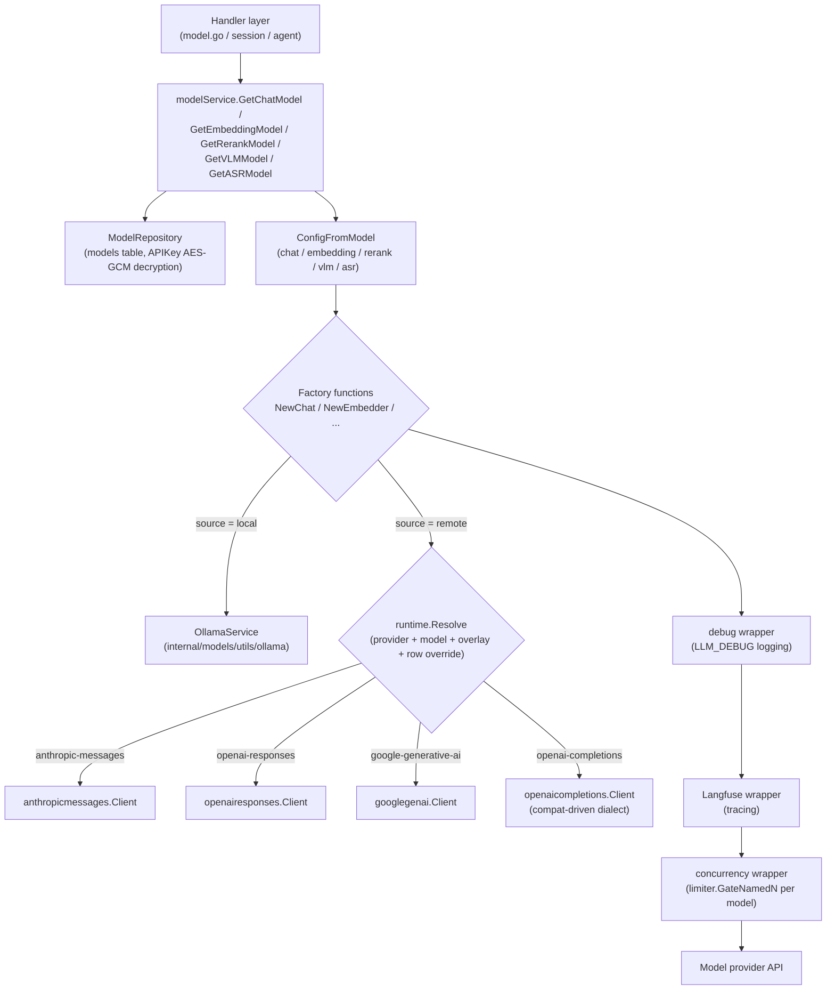

# Model management

Add chat, embedding, rerank, vision and speech models under Settings → Models, then let knowledge bases and agents pick the ones they need. Local Ollama models and remote models combine freely, for example a local model for embeddings and a remote one for answers.

<Screenshot
  src="/screenshots/settings-models.png"
  caption="Model settings: added models, managed by type"
  hint="Shows the model list (name, type, provider icon and name, default badge) and the Add model entry." />

Before adding a model, check the connection settings and index compatibility:

- **Changing the embedding model requires rebuilding the index.** The model decides the vector space and dimension, so old and new vectors cannot be mixed.
- **Test the connection before saving.** Confirm the endpoint, credentials and model name work before a knowledge base or agent depends on the model.

Model types, configuration fields and usage status are described below.

## Choose a model type

Pick the type that matches what the model will do for you.

| Type | Purpose |
| --- | --- |
| Chat model | Generates answers, summaries and Smart Reasoning output |
| Embedding model | Turns documents and questions into vectors for semantic retrieval |
| Rerank model | Reorders recalled chunks |
| Vision model | Reads images in documents or conversations |
| Speech model | Transcribes audio to text |

## Add and test a connection

Connect a remote or local model and confirm it answers before anything depends on it. Choose the type and source first: "API" for a remote service, "Ollama" for a local model (rerank models do not support Ollama). Configure a remote model in these steps:

1. **Choose a provider.** The list only shows providers that support the chosen model type; after choosing one you can jump to that provider's or that model's documentation page. If none fits, choose "Custom (OpenAI-compatible)".
2. **Enter the model name.** Pick from the provider's built-in catalog, where each option shows its context window, vector dimension, reasoning and vision capability, or type a name that is not in the catalog. Choosing a catalog model fills in the context window, max output tokens, vision support and vector dimension that are still empty.
3. **Enter the Base URL and API key**, plus any extra fields the provider requires (see [Provider extra fields](#provider-extra-fields)). Add custom request headers when access goes through a corporate gateway.
4. **Check "How this model is called".** For chat and vision models the panel shows, live, the request protocol, where the capabilities come from (a built-in model profile or the vendor defaults), the request endpoint, how the thinking switch is sent, the selectable effort levels, the context window and max output tokens, so you know how the configuration will be called before saving.
5. **Test the connection, then save.** The test uses the configuration currently in the form; saving first is not required. When editing an existing model, the API key is the separately saved value. If you change the configuration after testing, test again.

<Screenshot
  src="/screenshots/model-editor-catalog.png"
  caption="Add model: pick a model from the provider catalog and review how it is called"
  hint="Open the Add model drawer with type Chat and source API, pick a provider (for example Alibaba Cloud DashScope), expand the model name dropdown to show the context window / reasoning / vision badges, and show the How this model is called panel below it (request protocol, capabilities source, selectable effort) and the Test connection button at the bottom." />

"Advanced options" also offers:

| Option | Applies to | Description |
| --- | --- | --- |
| Vector dimension / custom output dimension | Embedding | The dimension must match the index. Enable "custom output dimension" only when the model is known to support a requested dimension |
| Context window | Chat, vision | Empty uses the default 200000. Enter the real value from the provider's documentation; a value that is too large stops the agent's history compaction from triggering and the upstream rejects the request |
| Supports vision / multimodal | Chat | Whether the model accepts image input |
| Image input | Embedding | Whether the model can encode images into the same vector space as text. When enabled and the provider protocol can send images, **knowledge bases with "image vector retrieval" enabled** also store one image vector per image after generating its description, so content the description missed is still recalled (scanned PDF pages excepted). That knowledge base switch is off by default; declaring the model capability alone does not change existing knowledge bases. Catalog models are detected automatically and the value is saved on the model only when it differs from the catalog; models outside the catalog need a manual declaration |
| Max output tokens | Chat, vision | Output cap per response; empty uses the catalog default for that model |
| Background concurrency limit | Chat, vision, embedding | Caps concurrent background tasks (document import, enrichment) against this model; 0 or empty uses the global default and interactive chat is never affected |
| Advanced → Protocol override | Chat, vision | Forces a request protocol; normally leave it on "Auto" |
| Advanced → Remote model name | Remote models | The model ID actually sent to the provider, when it differs from the model name |
| Advanced → Protocol compat override (JSON) | Remote models | Corrects request fields where one endpoint differs from the catalog defaults, for example `{"max_tokens_field": "max_tokens"}`; empty means no override. Syntax and fields: [Protocol compat override](#protocol-compat-override-compat-json) |

A chat model saved by an older version with a `thinking_control` setting shows an extra "Thinking parameter format (legacy)" control in the advanced area; switching it to "Follow catalog default" lets the model catalog decide how thinking parameters are written.

The model catalog decides whether a chat model can think and which effort levels it offers (a subset of off, auto, minimal, low, medium, high, extra high and max). When an agent or conversation asks for a level the model does not support, the nearest available level is used.

### Protocol compat override (compat JSON)

"OpenAI-compatible" endpoints disagree on request fields: some only accept `max_tokens`, some toggle thinking with a different field, and reasoning models may reject `temperature`. These differences are already recorded in the model catalog for built-in providers and catalogued models, so this option is usually left empty. It lives under "Advanced options → Advanced" for remote models (except WeKnoraCloud). Override by hand only when:

- a self-hosted inference server (vLLM, SGLang and the like) or a relay gateway behaves differently from the provider defaults;
- a provider's newly released model is not catalogued yet, the "How this model is called" panel shows "Vendor defaults (model not in the catalog)", and calls fail;
- a provider changed its API and you need a temporary fix before upgrading.

#### Rules

1. **Check the protocol first.** For chat and vision models the fields depend on the "Request protocol" shown in the "How this model is called" panel, and only that protocol's fields are accepted; if you change the "Protocol override", rewrite the JSON for the new protocol. Embedding, rerank and speech models each have their own field set, independent of protocol.
2. **Write only the keys you change.** Unwritten keys keep the catalog defaults. Objects such as `extra_body` merge by key; arrays are replaced whole.
3. **Validated on save.** The input must be a JSON object. A misspelled key, a value of the wrong type or an unknown enum value fails the save with the reason, instead of failing later during a conversation.
4. **Test after editing.** "Test connection" uses the configuration in the form; saving first is not required.

This override ranks above the provider defaults and the model catalog; the legacy "Thinking parameter format" and "Remote model name" still apply last. For a model the catalog marks as unable to think, thinking fields are ignored.

`extra_body` only adds fields AI KB does not write itself; it cannot override `model`, `messages`, `max_tokens` or other fields AI KB generates.

#### Common cases

| Symptom | Override |
| --- | --- |
| Error that `max_completion_tokens` is unknown | `{"max_tokens_field": "max_tokens"}` |
| A reasoning model rejects `temperature` / `top_p` | `{"supports_temperature": false}` |
| The endpoint only accepts a fixed temperature (for example 1) | `{"fixed_temperature": 1}` |
| A hybrid-thinking model such as Qwen3 on vLLM / SGLang cannot turn thinking on or off | `{"thinking_format": "chat-template-kwargs"}` |
| The gateway does not return usage in streams and streaming requests fail | `{"supports_usage_in_streaming": false}` |
| The gateway rejects message structures that carry images | `{"supports_multi_content": false}` (only text is sent; images are dropped) |
| A provider-private parameter is needed, such as Alibaba Cloud web search | `{"extra_body": {"enable_search": true}}` |
| Replaying thinking content in multi-turn conversations fails | `{"replay_reasoning_content": false}` |
| A self-hosted embedding service accepts only 16 inputs per request | `{"max_batch_size": 16}` |
| A multimodal embedding model on vLLM (VLM2Vec, GME and the like) | Turn on "Image input"; the custom provider sends images in vLLM's `messages` format by default. Add `{"image_prompt": "Represent the given image."}` when the template needs an instruction, and `{"text_as_messages": true}` when text must also go through the chat template to share the image space |
| Qwen3-VL-Embedding on vLLM | Nothing to enter: under the custom provider a model name containing `qwen3-vl-embedding` already carries image input plus `{"text_as_messages": true, "batch_messages": true, "max_image_batch_size": 5, "extra_body": {"add_special_tokens": true}}`. Text sent through plain `input` bypasses the chat template and lands in a different space from the images; without `add_special_tokens` the trailing `<\|endoftext\|>` the model pools its vector from is missing and results differ from the [model card](https://huggingface.co/Qwen/Qwen3-VL-Embedding-8B). Indexes already built with this model need their vectors rebuilt |
| A multimodal embedding model on SGLang | Turn on "Image input" and enter `{"image_format": "object", "image_field": "image"}` |
| The embedding or rerank service responds slowly and needs a longer timeout | `{"request_timeout_seconds": 120}` |
| A self-hosted rerank service returns unnormalized scores (logits) | `{"score_scale": "logit"}` |

#### Field reference

"Protocol default" below is the value with no provider, catalog or override in play; the real value for a given provider is what the "How this model is called" panel shows.

**OpenAI Chat Completions (`openai-completions`)**: the protocol used by most "OpenAI-compatible" providers, self-hosted services and gateways.

| Field | Type | Protocol default | Description |
| --- | --- | --- | --- |
| `max_tokens_field` | string | `max_completion_tokens` | Field name for the output cap: `max_tokens` or `max_completion_tokens`; only one is sent. The built-in providers follow their own documentation: hunyuan, modelscope, qiniu, requesty, longcat and novita send `max_tokens`; moonshot and aliyun send `max_completion_tokens` |
| `thinking_format` | string | `none` | How the thinking switch is written: `none` sends nothing; `openai` sends only `reasoning_effort`; `thinking-type` sends `{"thinking": {"type": ...}}`; `enable-thinking` sends `enable_thinking` (with the budget field); `chat-template-kwargs` sends `chat_template_kwargs.enable_thinking` (vLLM / SGLang); `openrouter` sends `{"reasoning": ...}` |
| `thinking_enabled_value` | string | `enabled` | The `type` value sent when enabling thinking in `thinking-type` format (MiniMax uses `adaptive`) |
| `thinking_always_send` | bool | false | Send the switch even when no thinking preference is set |
| `thinking_disable_on_non_stream` | bool | false | Force thinking off on non-streaming calls (some models only think while streaming) |
| `thinking_budget_field` | string | empty | Field name for the thinking budget, such as `thinking_budget`; empty sends nothing |
| `thinking_budget_excludes_effort` | bool | false | Set true when the provider rejects a budget together with `reasoning_effort`; only the effort is kept |
| `supports_reasoning_effort` | bool | false | Whether to also send the effort level |
| `reasoning_effort_field` | string | `reasoning_effort` | Field name for the effort level |
| `supports_developer_role` | bool | false | Send the system prompt of reasoning models as the `developer` role |
| `supports_store` | bool | false | Send `store: false` so the server does not keep the conversation |
| `supports_usage_in_streaming` | bool | true | Streaming requests carry `stream_options.include_usage` for usage accounting |
| `supports_temperature` | bool | true | false sends no sampling parameters at all (temperature, top_p, penalties) |
| `fixed_temperature` | number | none | A fixed temperature to send every time |
| `supports_seed` | bool | true | Whether to send `seed` |
| `tool_choice_modes` | string[] | `none`, `auto`, `required`, `function` | Allowed `tool_choice` values |
| `supports_parallel_tool_calls` | bool | true | Whether to send `parallel_tool_calls` |
| `supports_response_format` | bool | true | Whether to send `response_format` when JSON output is needed |
| `supports_multi_content` | bool | true | false keeps only the text part of mixed text-and-image messages |
| `replay_reasoning_content` | bool | true | Replay earlier thinking content to the model in multi-turn conversations |
| `reasoning_fields` | string[] | `reasoning_content`, `reasoning`, `reasoning_text` | Response fields to read thinking text from; the first present wins |
| `tool_call_extra_fields` | string[] | empty | Extra fields in tool calls to replay verbatim (such as `extra_content` when calling Gemini through an OpenAI-compatible endpoint) |
| `prompt_cache_key` | bool | false | Send `prompt_cache_key` so one session hits the prompt cache |
| `cache_control_format` | string | empty | `anthropic` inserts cache breakpoints in Anthropic format |
| `prompt_cache_accounting` | bool | false | The provider reports cache-hit usage for accounting |
| `extra_body` | object | empty | Fields added to every request |

**OpenAI Responses (`openai-responses`)**: the default for OpenAI's own API (`api.openai.com`).

| Field | Type | Protocol default | Description |
| --- | --- | --- | --- |
| `supports_developer_role` | bool | true | The system prompt uses the `developer` role |
| `supports_max_output_tokens` | bool | true | Whether to send `max_output_tokens` |
| `supports_reasoning_summary` | bool | true | Whether to request a reasoning summary |
| `supports_encrypted_reasoning` | bool | true | Whether to request and replay encrypted reasoning |
| `supports_store` | bool | true | Send `store: false` |
| `supports_temperature` | bool | true | false sends no sampling parameters |
| `prompt_cache_key` | bool | true | Send the prompt cache key |
| `supports_long_cache_retention` | bool | true | Allow 24-hour cache retention |
| `supports_parallel_tool_calls` | bool | true | Whether to send `parallel_tool_calls` |
| `extra_body` | object | empty | Fields added to every request |

**Anthropic Messages (`anthropic-messages`)**: Anthropic, plus compatible endpoints whose `base_url` ends in `/anthropic`.

| Field | Type | Protocol default | Description |
| --- | --- | --- | --- |
| `thinking_mode` | string | `budget` | `budget` enables thinking by budget; `adaptive` lets the model decide, with the effort passed in `output_config.effort` |
| `thinking_off_type` | string | `disabled` | The `thinking.type` sent to turn thinking off in `adaptive` mode; Claude Sonnet 5.5 rejects `disabled` and uses `between_tools` |
| `supports_effort` | bool | false | Whether to send the effort level |
| `thinking_budgets` | object | minimal 1024, low 2048, medium 8192, high 16384, xhigh 32768, max 63999 | `budget_tokens` per effort level, keyed `minimal`/`low`/`medium`/`high`/`xhigh`/`max` |
| `default_max_tokens` | int | 4096 | `max_tokens` used when no output cap is set (required by this protocol) |
| `supports_temperature` | bool | true | Whether to send the temperature |
| `temperature_with_thinking` | bool | false | Whether to keep sending the temperature while thinking is on |
| `supports_top_p` | bool | true | Whether to send `top_p` |
| `supports_cache_control` | bool | true | Whether to insert cache breakpoints |
| `supports_cache_control_on_tools` | bool | true | Whether to insert cache breakpoints on tool definitions |
| `long_cache_ttl` | string | `1h` | Lifetime of the long cache |
| `version` | string | `2023-06-01` | The `anthropic-version` request header |
| `beta_headers` | string[] | empty | Extra `anthropic-beta` request headers |
| `interleaved_thinking_beta` | string | `interleaved-thinking-2025-05-14` | Beta flag added when thinking and tools are used together; an empty string sends none |
| `prompt_cache_accounting` | bool | true | The provider reports cache-hit usage |
| `extra_body` | object | empty | Fields added to every request |

**Gemini (`google-generative-ai`)**: the native Gemini API.

| Field | Type | Protocol default | Description |
| --- | --- | --- | --- |
| `thinking_mode` | string | `budget` | `budget` sends `thinkingBudget` (Gemini 2.5); `level` sends `thinkingLevel` (Gemini 3 onward); `none` sends no thinking configuration |
| `thinking_budgets` | object | minimal 128, low 2048, medium 8192, high 24576, xhigh 32768, max 32768 | `thinkingBudget` per effort level |
| `include_thoughts` | bool | true | Whether to return thinking content |
| `supports_seed` | bool | true | Whether to send `seed` |
| `supports_penalty` | bool | true | Whether to send frequency / presence penalties |
| `extra_generation_config` | object | empty | Fields added to `generationConfig` |
| `prompt_cache_accounting` | bool | true | The provider reports cache-hit usage |
| `api_version_prefix` | string | `/v1beta` | Version path appended when `base_url` is only a host |

##### Embedding models

| Field | Type | Protocol default | Description |
| --- | --- | --- | --- |
| `api` | string | provider default | Embedding protocol: `openai-embeddings`, `dashscope-embeddings`, `ark-embeddings`, `google-embeddings` |
| `path` | string | empty | Path appended to `base_url` |
| `send_encoding_format` | bool | false | Whether to send `encoding_format: "float"` |
| `dimensions_field` | string | empty | Field name for the requested output dimension; only sent when "custom output dimension" is on |
| `truncate_field` / `truncate_value` | string | empty | Field and value that ask the server to truncate overlong input |
| `input_type_field` | string | empty | Field name that distinguishes "document" from "query" input |
| `input_type_values` | object | empty | The values sent for `document` and `query` input |
| `max_batch_size` | int | 0 (unlimited) | Max inputs per request; larger sets are split automatically |
| `max_input_chars` | int | 0 (unlimited) | Max characters per input |
| `accepts_truncate_prompt_tokens` | bool | false | Whether the service supports vLLM's `truncate_prompt_tokens` |
| `request_timeout_seconds` | int | 60 | Per-request timeout in seconds |
| `extra_body` | object | empty | Fields added to every request |
| `image_field` | string | empty | `openai-embeddings` only: the key of the object inside `input` that carries an image (`image` for Jina and SGLang). Empty with an `image_format` other than `messages` means the endpoint takes no images |
| `image_format` | string | empty (`messages` for the custom provider) | `openai-embeddings` only: how images are sent. `object` puts `{image_field: image}` into `input`; `messages` sends the image as one chat turn in `messages` (vLLM's multimodal embedding API), one request per image. Empty with an `image_field` set behaves as `object` |
| `image_prompt` | string | empty | `messages` format only: text sent with the image, required by some models' chat templates (VLM2Vec's `Represent the given image.`) |
| `text_as_messages` | bool | false | `openai-embeddings` only: send text in `messages` format too, one request each. For models whose text must pass the chat template to share the image space (built in for Qwen3-VL-Embedding under the custom provider); changing it on a model with an existing index requires rebuilding the vectors |
| `max_image_batch_size` | int | 1 | Max images per request; larger sets are split automatically |
| `max_image_bytes` | int | 0 (unlimited) | Byte cap per image; larger images are rejected without a request |
| `image_mime_types` | array | empty (unlimited) | Image formats the provider accepts, such as `["image/png", "image/jpeg"]` |

##### Rerank models

| Field | Type | Protocol default | Description |
| --- | --- | --- | --- |
| `path` | string | empty | Path appended to `base_url` |
| `send_top_n` | bool | false | Whether to send `top_n` (omitted, all documents are returned) |
| `send_return_documents` | bool | false | Whether to ask the server to return document text |
| `score_scale` | string | `probability` | What the score means: `probability` (0 to 1) or `logit` (unnormalized). A wrong value breaks the relevance threshold |
| `truncate` | string | empty | Server-side truncation setting (NIM's `END`) |
| `max_documents` | int | 0 (unlimited) | Max documents per request; larger sets are split automatically |
| `max_query_chars` | int | 0 (unlimited) | Query length cap; exceeding it fails the call (the query repeats in every request, so splitting documents cannot shorten it) |
| `max_document_chars` | int | 0 (unlimited) | Length cap per document; exceeding it fails the call |
| `max_request_chars` | int | 0 (unlimited) | Total length cap per request (query plus all documents); larger sets are split automatically, together with `max_documents`, whichever limit is hit first. One document plus the query already over the cap fails the call |
| `max_concurrency` | int | 0 (default) | Requests sent at once after splitting |
| `accepts_truncate_prompt_tokens` | bool | false | Whether the service supports vLLM's `truncate_prompt_tokens` |
| `request_timeout_seconds` | int | 0 (default 60 seconds) | Per-request timeout in seconds; a timeout fails the call and retrieval falls back to recall order |
| `extra_body` | object | empty | Fields added to every request |
| `image_field` | string | empty | `cohere-rerank` only: key of an image document object (`image` for Jina). Empty means the endpoint takes text only. The NIM protocol fixes its own image passage format and needs nothing here |
| `max_image_batch_size` | int | 1 | Max images per request; images and text are sent separately and larger sets are split automatically |
| `max_image_bytes` | int | 0 (unlimited) | Byte cap per image; larger images are rejected without a request |
| `image_mime_types` | array | empty (unlimited) | Image formats the provider accepts |

Only rerank models whose catalog `input` includes `image` (`jina-reranker-m0` and `nvidia/llama-nemotron-rerank-vl-1b-v2`) receive image documents.

##### Speech recognition models

| Field | Type | Protocol default | Description |
| --- | --- | --- | --- |
| `api` | string | provider default | `openai-transcriptions` (uploads the audio file) or `openai-chat-audio` (carries the audio in a chat request) |
| `path` | string | `/audio/transcriptions` | Path appended to `base_url` |
| `response_format` | string | empty | The `response_format` sent; use `verbose_json` for segmented results |
| `language_param` | string | empty | Where the language hint goes: `form`, `header`, `asr_options`; empty sends none |
| `max_file_bytes` / `max_encoded_bytes` | int | 0 (unlimited) | Size caps for the audio file and for its base64 encoding |
| `formats` | string[] | empty (unlimited) | Accepted audio extensions (without the dot) |
| `request_timeout_seconds` | int | 300 | Per-request timeout in seconds |

## Built-in providers

Find out which provider to choose for each model type. There are 30 built-in providers, and Ollama connects local models on top of that. The model types each provider supports (✓ means supported):

| Provider | ID | Chat | Embedding | Rerank | Vision | Speech |
| --- | --- | :-: | :-: | :-: | :-: | :-: |
| Custom (OpenAI-compatible) | `generic` | ✓ | ✓ | ✓ | ✓ | ✓ |
| WeKnoraCloud | `weknoracloud` | ✓ | ✓ | ✓ | ✓ | |
| Alibaba Cloud DashScope | `aliyun` | ✓ | ✓ | ✓ | ✓ | ✓ |
| Zhipu BigModel | `zhipu` | ✓ | ✓ | ✓ | ✓ | ✓ |
| Volcengine | `volcengine` | ✓ | ✓ | ✓ | ✓ | |
| Tencent Hunyuan | `hunyuan` | ✓ | ✓ | | | |
| SiliconFlow | `siliconflow` | ✓ | ✓ | ✓ | ✓ | ✓ |
| MiniMax | `minimax` | ✓ | | | | ✓ |
| Moonshot | `moonshot` | ✓ | | | ✓ | |
| Xiaomi MiMo | `mimo` | ✓ | | | | ✓ |
| ModelScope | `modelscope` | ✓ | ✓ | | ✓ | |
| Baidu Qianfan | `qianfan` | ✓ | ✓ | ✓ | ✓ | |
| Qiniu | `qiniu` | ✓ | | | | |
| Meituan LongCat | `longcat` | ✓ | | | | |
| Tencent Cloud LKEAP | `lkeap` | ✓ | | ✓ | | |
| DeepSeek | `deepseek` | ✓ | | | | |
| OpenAI | `openai` | ✓ | ✓ | | ✓ | ✓ |
| Azure OpenAI | `azure_openai` | ✓ | ✓ | | ✓ | |
| Anthropic | `anthropic` | ✓ | | | | |
| Google Gemini | `gemini` | ✓ | ✓ | | | |
| OpenRouter | `openrouter` | ✓ | ✓ | ✓ | ✓ | ✓ |
| LiteLLM | `litellm` | ✓ | ✓ | ✓ | ✓ | ✓ |
| Requesty | `requesty` | ✓ | ✓ | | ✓ | ✓ |
| Jina | `jina` | | ✓ | ✓ | | |
| NVIDIA | `nvidia` | ✓ | ✓ | ✓ | ✓ | |
| Novita AI | `novita` | ✓ | ✓ | ✓ | ✓ | |
| GPUStack | `gpustack` | ✓ | ✓ | ✓ | ✓ | ✓ |
| Hugging Face TEI | `huggingface_tei` | | | ✓ | | |
| Pinecone | `pinecone` | | | ✓ | | |
| Cohere | `cohere` | | | ✓ | | |

"Vision" in the table means the provider can be chosen under the vision model type; whether a chat model itself accepts images is decided by the model catalog and the "Supports vision / multimodal" switch. WeKnoraCloud needs its credentials saved in Settings first; the model name is one of `chat`, `embedding`, `rerank`, `vlm`.

The provider list, default endpoints and model catalog are served by the backend (`GET /api/v1/models/providers`); operators can change or add providers through the [deployment overlay](#deployment-overlay-config-models-json).

### Embedding providers

Per-provider behavior pinned by `internal/models/embedding/wire_test.go`:

- **NVIDIA NIM**: retrieval queries are sent with `input_type: query` and documents with `passage`; overlong input is truncated server-side with `truncate: END`; `dimensions` is not sent.
- **Alibaba Cloud DashScope** routes by model: text models use `/compatible-mode/v1/embeddings`; `qwen3-vl-embedding`, `qwen2.5-vl-embedding`, `tongyi-embedding-vision*` and `multimodal-embedding*` use the native multimodal API. A `base_url` that is only a host, the international site or a workspace domain keeps that host. `text-embedding-v1` and `text-embedding-v2` take at most 25 inputs per request and are fixed at 1536 dimensions, so `dimensions` is not sent.
- **Volcengine Ark**: `doubao-embedding-text*` and `doubao-embedding-large-text*` use the archived text API at `/api/v3/embeddings`; every other model uses the multimodal API.
- **Google Gemini**: dimension reduction is sent as `embedContentConfig.outputDimensionality`.
- **SiliconFlow** takes at most 32 inputs per request; larger sets are split automatically.
- Task-type fields (Jina's `task`, Gemini's `taskType`, OpenRouter's `input_type`, Volcengine's `instructions`, DashScope native `text_type` / `instruct`) are never sent, so every vector in a knowledge base stays in one space.

### Rerank providers

Per-provider behavior pinned by `internal/models/rerank/wire_test.go`:

- **OpenAI** has no rerank API and is not a rerank provider; a relay behind an OpenAI-style URL that offers rerank is created as a `generic` row.
- **Volcengine** sends at most 200 documents per request (larger sets are split automatically), and its default instruction is the console's text `Whether the document answers the query or matches the content retrieval intent`; an `instruction` saved in the extra fields replaces it.

### Speech providers

Per-provider behavior pinned by `internal/models/asr/wire_test.go`:

- The OpenAI-compatible multipart upload serves openai, siliconflow, gpustack, generic, Zhipu (`glm-asr-2512`, one file of at most 30 seconds), MiniMax (`asr-1.0`), OpenRouter, Requesty and LiteLLM. Alibaba Cloud `qwen3-asr-flash` and Xiaomi `mimo-v2.5-asr` carry the audio inside a chat request; other Alibaba Cloud speech model names are refused with a reason.
- `response_format=verbose_json` is sent only to models documented to return segments (OpenAI `whisper-1`); a self-hosted row that needs segments sets `{"response_format": "verbose_json"}` in `spec.compat`.
- Size and format are checked against the provider's documentation before upload: OpenAI, Zhipu and OpenRouter 25 MB, Requesty 32 MB, SiliconFlow and MiniMax 50 MB; Alibaba Cloud and Xiaomi count 10 MB of the base64 `data:` URI. Zhipu and Xiaomi accept wav and mp3 only.
- A reply without a `text` field is an error; silent audio returns an empty `text` string and is handled normally.
- The knowledge base's audio language hint is sent to OpenAI, Requesty, OpenRouter, GPUStack, generic, MiniMax, Alibaba Cloud and Xiaomi; Zhipu, SiliconFlow and LiteLLM do not take the parameter and never receive it. `auto` equals empty.
- Not connected for speech transcription: Volcengine Doubao speech, Qianfan, Qiniu, Novita, Tencent Cloud ASR, NVIDIA Riva, Gemini and Azure OpenAI (its audio transcription exists only in the v1 preview API).

### Cohere rerank

When adding a remote rerank model, choose **Cohere**, enter the Cohere API key and pick
`rerank-v4.0-pro`, `rerank-v4.0-fast` or `rerank-v3.5`. The default endpoint is
`https://api.cohere.com/v2`; a full `/v2/rerank` URL also works.

Request body example for creation through `POST /api/v1/models`:

```json
{
  "name": "rerank-v4.0-pro",
  "type": "Rerank",
  "source": "remote",
  "parameters": {
    "provider": "cohere",
    "base_url": "https://api.cohere.com/v2",
    "api_key": "your-cohere-api-key"
  }
}
```

The request sends only the text query and documents and restores the originals by response index. Following the
[Cohere API recommendation](https://docs.cohere.com/v2/reference/rerank), AI KB splits candidate sets above 1000
documents into several requests; 1000 is the recommended batch size. `top_n` is omitted so every candidate is scored,
and overlong documents keep the server's default truncation. This integration covers Cohere text reranking only.

## View references and adjust configuration

Check what depends on a model before changing or deleting it. Knowledge bases and agents keep references to models. Check the dependency details before deleting a model; built-in models are managed by YAML configuration and should be maintained in that file.

The model debugger sends real requests to a saved model and shows the elapsed time, a redacted request and the response, which is useful for checking vector dimensions, rerank scores or streaming output. For chat models that can think, the debugger lets you choose the effort level and reports the request protocol and thinking switch actually sent. Call volume and cache usage: [Observability and audit](16-observability.md).

## Configuration and call reference

Look up the exact types, fields, endpoints and loaders behind the model settings.

### Model types and purposes

Model types are defined in `internal/types/model.go`:

```go
const (
    ModelTypeEmbedding   ModelType = "Embedding"   // Embedding model
    ModelTypeRerank      ModelType = "Rerank"      // Rerank model
    ModelTypeKnowledgeQA ModelType = "KnowledgeQA" // KnowledgeQA model
    ModelTypeVLLM        ModelType = "VLLM"        // VLLM model
    ModelTypeASR         ModelType = "ASR"         // ASR model
)
```

| Type | Frontend ID | Client package | Interface | Purpose |
| ------ | --------- | --------- | ------ | ------ |
| `KnowledgeQA` | `chat` | `internal/models/chat` | `Chat` / `ChatStream` (Tools, Thinking and multimodal messages) | Knowledge Q&A, agent reasoning, summaries / question generation / graph extraction and every other LLM call |
| `Embedding` | `embedding` | `internal/models/embedding` | `Embed` / `BatchEmbed` (with `GetDimensions`) | Text vectorization for the vector index and queries |
| `Rerank` | `rerank` | `internal/models/rerank` | `Rerank(query, documents)` returns `RankResult` | Fine ranking of retrieval results |
| `VLLM` | `vllm` | `internal/models/vlm` | `Predict(imgBytes, prompt)` | Vision language model (VLM): document image understanding / multimodal parsing |
| `ASR` | `asr` | `internal/models/asr` | `Transcribe(audioBytes, fileName)` returns text, with segment timestamps when the model provides them (OpenAI `whisper-1`) | Audio transcription (automatic speech recognition) |

The frontend-backend type mapping is `modelTypeToFrontend()` in `internal/handler/model_catalog.go` (`KnowledgeQA -> chat` and so on). The REST endpoint that creates a model stores `type` as given, so callers should send the backend value (`KnowledgeQA` and the like); the `model_type` query parameter accepts either spelling.

The model source (`ModelSource`) has two core values, `local` (started through local Ollama) and `remote` (a remote API); the remaining historical values (`aliyun`, `zhipu`, `openai` and others) are kept for compatibility and route exactly like `remote` plus the matching provider.

### Model configuration fields

The `Parameters` of the model entity `types.Model` (`ModelParameters` in `internal/types/model.go`):

| Name | Type | Default | Description |
| ------ | ------ | -------- | ------ |
| `base_url` | string | empty (provider default endpoint) | Model API endpoint, checked for SSRF on create and update (`ValidateURLForSSRF`) |
| `api_key` | string | empty | API key, **stored AES-256-GCM encrypted** (`ModelParameters.Value/Scan`). It can be submitted with the create request; afterwards it changes only through the `PUT /models/:id/credentials` sub-resource |
| `interface_type` | string | empty (VLM: `ollama` for local, `openai` for remote) | Interface protocol type |
| `embedding_parameters.dimension` | int | 0 | Vector dimension |
| `embedding_parameters.truncate_prompt_tokens` | int | 0 | Server-side truncation token count. A vLLM extension sent only to `generic` and `gpustack` (0 keeps the historical 511); managed providers do not document it and never receive it |
| `embedding_parameters.supports_dimension_override` | bool | false | Whether to request a vector dimension. The field name is the provider's (`dimensions` for the OpenAI family, `outputDimensionality` for Gemini, `parameters.dimension` for DashScope multimodal); models whose provider does not document the parameter (NVIDIA NIM, Hunyuan, Novita, ada-002 and others) never receive it even when checked |
| `parameter_size` | string | empty | Ollama model parameter size (such as "7B"), maintained by the backend and read-only in the frontend |
| `provider` | string | empty (detected from the base URL) | Provider ID, see [Built-in providers](#built-in-providers) |
| `extra_config` | map[string]string | nil | Provider extra fields (next section); reserved keys `api` (forced chat protocol), `remote_model_name` (remote model name), `thinking_control` (legacy thinking parameter format) |
| `spec` | object | nil | Single-row catalog override: `api`, `reasoning`, `input`, `context_window`, `max_output_tokens`, `thinking_levels`, `compat` (flat protocol-specific JSON) |
| `custom_headers` | map[string]string | nil | Extra HTTP request headers (like the OpenAI SDK's `extra_headers`; reserved headers such as `Authorization` and `api-key` are ignored at runtime) |
| `supports_vision` | bool | false | Whether the chat model accepts image input |
| `context_window` | int | 0 (falls back to 200000) | Chat / VLM context window in tokens. Agents load and compact history against this cap; enter what the service really supports, since a value that is too high delays compaction |
| `max_output_tokens` | int | 0 (catalog default) | Chat / VLM output cap per response |
| `max_concurrency` | int | 0 (falls back to the global `model.max_concurrency`) | Background task concurrency cap for this model (chat / vlm / embedding only) |
| `app_id` / `app_secret` | string | empty | WeKnoraCloud credentials; the second key half for LKEAP / Volcengine rerank is also stored in `app_secret`. `app_secret` is AES encrypted |

Model-level fields also include `name` (the model name called at runtime), `display_name`, `type`, `source`, `is_default` (one default per `(tenant_id, type)` bucket), `is_builtin`, `managed_by` and `status` (`active` / `downloading` / `download_failed`).

Query responses for remote chat and vision models carry `capabilities` (protocol, whether it can think, selectable effort levels, context window and more), resolved by the backend from the catalog.

### Provider extra fields

A provider declares extra fields in its definition, the editor renders them dynamically, and the values are stored in `extra_config` (fields marked secret are never echoed back; only whether they are set):

| Provider | Field | Applies to | Description |
| --- | --- | --- | --- |
| Azure OpenAI | `api_version` | all | Empty uses the `/openai/v1` data plane; a version (such as `2025-04-01-preview`) uses the legacy `/openai/deployments/{deployment}` path |
| Tencent Cloud LKEAP | SecretKey (required, stored encrypted), `region` (default `ap-guangzhou`) | rerank | The rerank API uses TC3 signing; the API key field takes the SecretId |
| Volcengine | SecretKey (required, stored encrypted), `region` (default `cn-beijing`), `instruction` | rerank | The rerank API uses AK/SK signing; the API key field takes the Access Key ID; `instruction` defaults to the console's text |
| Custom, GPUStack, LiteLLM | `score_scale` | rerank | "Rerank score scale": `probability` (0 to 1 relevance, BGE and the like) or `logit` (unbounded, Qwen3-Reranker and the like, mapped to 0 to 1 before the rerank threshold). Choose by the model actually deployed behind the endpoint |
| Custom, GPUStack | `truncate_prompt_tokens` | rerank | vLLM extension, not sent by default; set only when the backend fails on overlong documents |

#### Management API (`internal/router/routes_infra.go`)

| Method & path | Description |
| ------------- | ------ |
| `GET /models/providers` | Provider definitions for a `model_type` (icon, default endpoint, extra fields, model catalog) |
| `GET` / `POST /models/catalog/resolve` | Resolves how one row is called (protocol, effort levels, context), the editor's "How this model is called" |
| `POST /models` / `GET /models` / `GET /models/:id` / `PUT /models/:id` / `DELETE /models/:id` | Model CRUD |
| `PUT /models/:id/credentials`, `DELETE /models/:id/credentials/:field` | Credential sub-resource; an `api_key` in the `PUT /models/:id` body is ignored with a warning |
| `POST /models/:id/debug` | Model debugging (below) |
| `GET /models/weknoracloud/status` | WeKnoraCloud credential status |

Full requests and responses: [API reference: models and initialization](../04-api/02-api-model-system.md).

### Model health check / connectivity test

Two mechanisms, both holding credentials on the server and never returning plaintext keys:

1. **Test connection** (`internal/handler/initialization.go`, behind the editor's "Test connection" button):
   - `POST /initialization/remote/check` for chat models (`CheckRemoteModel` / `checkChatModelConnection`)
   - `POST /initialization/embedding/test` for embedding (`TestEmbeddingModel`)
   - `POST /initialization/rerank/check` for rerank (`CheckRerankModel`)
   - `POST /initialization/asr/check` for ASR (`CheckASRModel`)
   - `POST /initialization/multimodal/test` for VLM multimodal parsing (`TestMultimodalFunction`)

   The `ModelTestRequest` body may carry a `modelId`: `fillSecretsFromStoredModel` fills a missing `APIKey` / `AppSecret`, `extraConfig` and `spec` from the stored model (decrypted), so "change the base URL and verify with the old key" works in one click and the frontend neither needs nor can obtain the plaintext key. `buildTestModel` turns the request into a temporary `*types.Model` that is **never persisted** and shares the `ConfigFromModel` mapping with the production path.

2. **Model debugger** (`POST /models/:id/debug`, `ModelHandler.DebugModel`): sends a real call to a saved model by type and returns the full normalized response. Chat streams, accepts an effort level (`options.reasoning_effort`) and aggregates observations such as the protocol and the thinking switch sent; embedding returns the vector and dimension; rerank returns scores; VLM / ASR accept an uploaded file. The response carries `elapsed_ms`, a redacted request preview and `observations`.

### Built-in model mechanism

`internal/types/builtin_models_config.go` implements declarative built-in models: at startup it reads `config/builtin_models.yaml` (or the path in `BUILTIN_MODELS_CONFIG`; template in `config/builtin_models.yaml.example`), UPSERTs every entry into the `models` table with `is_builtin=true`, `managed_by="yaml"` and the default `tenant_id=10000` (`DefaultBuiltinModelTenantID`), visible to every workspace.

Key behavior (`LoadBuiltinModelsConfig`):

- Any string field supports `${ENV_NAME}` environment variable interpolation; an unset variable keeps the literal so the configuration error is visible.
- Every startup UPSERTs by `id` and resets `deleted_at` to NULL (an entry that reappears in the file is revived).
- **Drift cleanup**: rows with `managed_by='yaml'` whose id is no longer in the file are soft-deleted; removing an entry from the YAML is the supported way to retire a built-in model.
- Once an administrator takes over a row at runtime (`managed_by` cleared), the YAML loader skips it ("preserving runtime override").
- An `is_default: true` entry first clears other defaults in the same `(tenant_id, type)` bucket, keeping the single-default invariant shared with the API path.
- A built-in agent with an empty chat or rerank model slot uses the default of that type: an active workspace model marked `is_default` first, then an active `is_default` built-in model (`AgentModelSlot` in `internal/types/agent_model_slot.go`). Custom agents never fall back to a default. Without a rerank model, Quick Answer skips reranking and a Smart Reasoning agent with knowledge search refuses to run. Deleting the default chat model leaves built-in agents with an empty slot not ready unless a built-in default remains; the model usage check does not list them, since they store no model ID.
- Validation: a non-empty id of at most 64 characters (`ModelIDMaxLen`), a type among `KnowledgeQA | Embedding | Rerank | VLLM | ASR`, a valid or empty status; a YAML parse failure aborts the reconciliation (no drift cleanup).
- `parameters` go through the same catalog validation as the REST API (`runtime.ValidateRow`): rows that cannot be resolved (unknown protocol, misspelled compat key, invalid effort level) only log a WARN and do not block startup.

YAML example (from `builtin_models.yaml.example`):

```yaml
builtin_models:
  - id: builtin-llm-default
    type: KnowledgeQA
    source: remote
    is_default: true
    name: ${LLM_MODEL_NAME}
    parameters:
      base_url: ${LLM_BASE_URL}
      api_key: ${LLM_API_KEY}
      provider: ${LLM_PROVIDER}
      context_window: 200000     # optional; the default 200K applies when omitted
```

#### Local model download (Ollama)

Local embedding and chat share one `OLLAMA_BASE_URL`; the embedding model name and environment variables are described in [Configuration](../01-getting-started/04-configuration.md).

The local model lifecycle is managed by `OllamaService` in `internal/models/utils/ollama/ollama.go` (`IsModelAvailable` / `PullModel` / `EnsureModelAvailable` / `ListModelsDetailed` / `DeleteModel` and more), with HTTP entry points in `internal/handler/initialization.go`:

| Path | Description |
| ------ | ------ |
| `GET /initialization/ollama/status` | Ollama service availability |
| `GET /initialization/ollama/models` | Lists local models |
| `POST /initialization/ollama/models/check` | Batch check of whether models are downloaded |
| `POST /initialization/ollama/models/download` | Asynchronous download (`downloadModelAsync` + `pullModelWithProgress`, writes model `status=downloading`) |
| `GET /initialization/ollama/download/progress/:taskId`, `GET /initialization/ollama/download/tasks` | Download progress / task list |

> Note: `cmd/download/duckdb/duckdb.go` is unrelated to models. It pre-downloads DuckDB's `excel` extension at image build time for the data analysis tool. Model weights are downloaded only on the Ollama path.

### Deployment overlay `config/models.json`

Add providers, change endpoints and add models without touching code: copy `config/models.json.example` to `config/models.json` (or point `MODELS_CONFIG` at a path). `providers` is keyed by provider ID; a known ID patches that provider, a new ID declares a new one.

| Field | Description |
| --- | --- |
| `name` / `names` / `description` / `descriptions` / `website` | Display name, per-language names and descriptions, website |
| `api` | Default chat protocol (`openai-completions`, `openai-responses`, `anthropic-messages`, `google-generative-ai`) |
| `base_url` / `base_urls` | Default endpoint; `base_urls` sets one per `chat`, `embedding`, `rerank`, `vlm`, `asr` |
| `api_key` | Deployment-level key, used when the model row has none saved; supports `${ENV}` / `$ENV` interpolation, and an unset variable expands to empty |
| `auth` / `requires_auth` | Auth scheme (`bearer`, `api-key`, `x-api-key`, `x-goog-api-key`, `none`) and whether a key is required |
| `headers` | Extra request headers |
| `model_types` / `url_patterns` | Model types a new provider supports; legacy rows without a provider are matched by URL substring |
| `compat` / `thinking_levels` | Provider-level protocol compat switches and effort level mapping |
| `models` | Upsert by ID: an existing ID overwrites only the fields written, keeping `reasoning`, `thinking_levels`, `compat` and `input` otherwise; a new ID creates a full entry |
| `model_overrides` | Patches existing entries by ID (such as `context_window`, `max_output_tokens`) |
| `icon` | An inline `<svg …>` string, or an `.svg` path relative to the overlay file's directory; no absolute paths, no escaping that directory, at most 256 KB (the icon is served as a data URI to everyone who can open the models page) |

The overlay is validated as a whole at startup: an unknown key, an invalid auth scheme or an unresolvable model entry rejects the entire overlay, the startup log prints `Load models catalog overlay failed`, and the service continues with the built-in catalog. The file is not watched; restart the service after editing it. Nothing is fetched from outside at runtime, so behavioral facts such as field names and thinking formats are maintained by people.

The overlay only changes provider definitions and the model catalog; every model still stores its own URL, API key, extra fields and `spec`, and no existing model ID or reference is modified.

### System administrators maintain the model catalog

Under Settings → System Administration → Model catalog, every catalog model is listed with its provider, type, context window / max output, capabilities (thinking, image and other inputs) and configuration source (built-in / deployment file / administrator change), filterable by provider and type, or restricted to administrator-changed entries. Wildcard match rules sort after each provider's concrete models, supply defaults only and never appear in the candidate list.

Administrator changes are stored separately in the database, and the precedence is **built-in catalog → deployment file read at startup → administrator changes → a single model's explicit configuration**. The page never rewrites the mounted configuration file; changing the deployment file still needs a restart, and every instance should use the same file.

Common operations take effect on save: this instance switches to the full catalog at once, other instances check the version every 5 seconds and sync; on a validation failure or a database fault the current catalog stays in effect. If another administrator published first, the server returns 409 and the page prompts and reloads the latest version.

- **Edit a model**: click a model in the list and change its display name, context window and whether it is hidden from the candidate list in the drawer; chat models also expose max output, input modalities (image / audio / video; checking image makes it usable as a vision model), thinking support and effort levels; embedding models expose the vector dimension (prefilled when adding a model). Each item shows its default (the deployment file or built-in catalog value) and marks fields changed by an administrator; clearing an input restores the default. "Values per layer" below compares the built-in catalog, the deployment file and the effective value. "Restore defaults" removes every administrator change for that model at once.
  - Effort levels are shown as the server resolves them (provider level mapping merged with protocol capabilities). Unchecking writes `null` to mark a level unsupported; re-checking restores the provider mapping's live value; levels that equal the default write no override and keep following the provider. Leaving "Off" unchecked means the model always thinks. Custom mappings from level to provider value are still maintained in the JSON editor.
- **Add a model**: adds a model the catalog lacks for a provider (provider, type, model ID, optional display name and defaults; effort levels follow the provider default and can be adjusted afterwards). Administrator-added models can be deleted from the edit drawer.
- **JSON editor** ("More" menu): edits the administrator change document in `models.json` format directly (at most 1 MiB, a top-level `_comment` is allowed and removed on publish), for bulk changes or migration. "Check changes" validates on the server and lists the entries to add, change and remove with their changed fields; "Publish N changes" confirms. "Import JSON" loads a file into this editor and publishes only after confirmation; "Export changes" downloads the administrator changes in effect.
- **Version history** ("More" menu): keeps the last 20 versions with publisher, time and number of changed models; "Restore" publishes a new version with that content.

The catalog document manages metadata. The console does not accept provider `api_key`, `headers`, `base_url` / `base_urls`, `url_patterns`, `auth` or server icon file paths; those stay in the model configuration / deployment file (environment variable references expand only in those fields of the deployment file; `$` in the console document is plain text). The console accepts inline SVG icons only. The generated file `models.generated.json` with its `version + providers: array` structure cannot be imported as an override document; write the `providers: object` structure of `config/models.json.example` instead.

After a catalog update, reopening the model editor refreshes the provider and model candidates. The models page has a "Model catalog" entry for system administrators only. Catalog models are not created as configured models automatically, and `deprecated` only hides the dropdown candidate; explicit values on existing models such as the context window stay and are never rewritten in bulk. Catalog values not overridden on a row, such as API and compat, affect model clients created afterwards; clients already created keep their original snapshot.

### Model usage statistics

- **Token usage**: `types.TokenUsage` (`internal/types/chat.go`) records `prompt_tokens / completion_tokens / total_tokens` and the prompt cache breakdown (`cache_read_tokens / cache_write_tokens / cache_miss_tokens / cache_status`). Every protocol client writes one structured log line through `LogUsage` in `internal/models/api/usage_log.go`:

  ```go
  logger.Infof(ctx,
      "[LLM Usage] model=%s, purpose=%s, prompt_prefix=%s, prompt_tokens=%d, completion_tokens=%d, ...",
      ...)
  ```

  `purpose` comes from `types.WithLLMCallMetadata` (such as `document_summary`, `entity_extraction`) and allows aggregation by purpose.
- **Tracing**: with Langfuse enabled, every model type has a `langfuse_wrapper.go` decorator that reports calls (including usage) as traces and spans.
- **Streaming responses**: usage arrives with the last `StreamResponse` event (the model debugger aggregates it into the `usage` field).
- **Concurrency watermarks**: `GET /system/admin/runtime/queues` exposes live `active / waiting / limit` per model (see [Concurrency and rate limiting](#concurrency-and-rate-limiting-limiter) below).

## Model call and implementation reference

Trace how a configured model becomes a client and a request.

### Layered structure

Model integration is split into protocol, provider, catalog and runtime layers:

| Layer | Location | Responsibility |
| ---- | ------ | ------ |
| Protocol layer | `internal/models/api/<protocol>` | One package per wire protocol. Chat: `openaicompletions`, `openairesponses`, `anthropicmessages`, `googlegenai`; rerank: `cohererank`, `dashscoperank`, `nimrerank`, `tencentlkeap`, `volcengineknowledge`; embedding: `openaiembeddings`, `dashscopeembeddings`, `arkembeddings`, `googleembeddings`; speech: `openaitranscriptions`, `openaichataudio`. Each owns its request and response structures and parsing, independent of provider definitions and the model catalog |
| Provider layer | `internal/models/providers/<id>.go` | One definition per provider, declaring supported model types, default endpoints per type, auth scheme, extra fields, protocol compat defaults and special endpoint hooks; icons live in `providers/assets/` and every provider is listed explicitly in `Builtins()` in `builtin.go` |
| Catalog layer | `internal/models/catalog` | Loads the generated model catalog `catalog/data/models.generated.json` and looks entries up by type and model name; contains no provider behavior |
| Runtime | `internal/models/runtime` | Combines provider definitions with the catalog, applies the deployment overlay (`overlay.go`), merges the single model configuration, chooses the protocol, assembles auth and endpoint, and isolates legacy field inference |

`runtime.Resolve(Ref{Provider, Model, BaseURL, ModelType, Extra, Override})` merges from lowest to highest:

1. protocol defaults (`DefaultOpenAICompletions()` and the like);
2. provider-level `Compat` (declared in `providers/<id>.go`, for example DeepSeek's `max_tokens_field: max_tokens`; the deployment overlay's provider-level `compat` sits here too);
3. the matching catalog entry (exact id → `aliases` → `match` wildcard, longest literal prefix first; the overlay's `models` / `model_overrides` are already merged into the catalog);
4. `parameters.spec` on the model row (the editor's "Advanced" protocol override and compat JSON);
5. `extra_config.api` forced protocol, `extra_config.thinking_control` legacy thinking encoding, `extra_config.remote_model_name`.

Provider parameters are maintained from the provider's documentation; each `providers/<id>.go` lists its basis and documentation links in comments, and a catalog entry's `source` field records where it came from. The outbound JSON is pinned by each protocol package's golden tests (such as `openaicompletions/golden_test.go`).

Compat fields, protocol defaults and common usage per protocol: [Protocol compat override](#protocol-compat-override-compat-json); the structures are in `internal/models/api/compat_settings.go` (chat protocols) plus `embeddings_settings.go`, `rerank_settings.go` and `transcriptions_settings.go` in the same directory.

Effort levels are unified internally as `off / auto / minimal / low / medium / high / xhigh / max`, and each model's `thinking_levels` maps the unified levels to provider values (`null` means unsupported; `"off": null` means thinking cannot be turned off, as with DeepSeek Reasoner, QwQ and Kimi K3). A requested level that is unsupported snaps to the nearest supported one, upward first, then downward.

#### Protocol selection

Anthropic uses the Messages protocol; Gemini defaults to native `generateContent` (a `base_url` pointing at `/v1beta/openai` keeps OpenAI compatibility); OpenAI uses the Responses protocol on `api.openai.com` while relays and proxies keep Chat Completions; any provider whose `base_url` ends in `/anthropic` switches to the Messages protocol automatically (the Anthropic-compatible endpoints of MiniMax, Zhipu and Kimi). An explicit `spec.api` on the row beats URL and provider inference; the legacy `extra_config.api` still has the highest priority. `extra_config.api` is a reserved key whose valid values are `openai-completions`, `openai-responses`, `anthropic-messages`, `google-generative-ai` and `ollama`; any other value is rejected with 400 on create and update. `extra_config.api` forces the chat protocol and applies to chat / VLM rows only; an embedding row's protocol override goes into `"api"` inside `spec.compat`, with an embedding protocol value (`openai-embeddings`, `dashscope-embeddings`, `ark-embeddings`, `google-embeddings`).

Catalog entries are looked up by model type: an embedding row only matches embedding entries and never picks up a chat wildcard with the same prefix (such as DashScope's `qwen3*` or OpenAI's `gpt-5*`) and its chat compat. New ids not yet in the catalog and dated snapshots resolve with the provider defaults as usual.

The write side has a gate too: `runtime.ValidateRow` resolves the row (every model type) when a model is created or updated (REST) and when `config/builtin_models.yaml` loads (startup); an unknown protocol, a misspelled compat key or an invalid effort level is rejected at write time (YAML rows only WARN and do not block startup, so one restart cannot take production models offline).

The development workflow for adding a provider and maintaining the model catalog and provider behavior: [Extension points](../06-development/03-extension-points.md#add-a-model-provider-internal-models-providers).

### Model call chain



The factory functions wrap the real client in three decorators, in order (see `chat.NewChat` / `embedding.NewEmbedder` / `vlm.NewVLM`):

```go
c, err = wrapChatDebug(c, err)
c, err = wrapChatLangfuse(c, err)
// Outermost: hold the per-model concurrency slot only around the real
// provider round-trip, so the wait is excluded from debug/langfuse timing.
return wrapChatConcurrency(c, config.MaxConcurrency, err)
```

### Concurrency and rate limiting (limiter)

`internal/models/limiter` provides a **distributed background concurrency gate per model ID**. The core design (package comment in `limiter.go`): the scarce shared resource is the model provider's request budget, so the gate sits in the model client layer, the only place that sees every task type, rather than in the asynq queue layer.

- **Redis backend** (`NewRedisLimiter`): a self-healing distributed semaphore. Each held slot is a ZSET member (unique token) whose score is the lease expiry; the `acquireScript` Lua script atomically clears expired leases, counts and admits within the limit. The lease TTL is 30s, holders heartbeat every TTL/3 (also refreshing the ZSET key's own TTL), and a crashed process's leases expire on their own. **Every backend error fails open**: a broken limiter must never block model traffic.
- **Local backend** (`NewLocalLimiter`): an in-process counting semaphore for Lite mode (single process without Redis).
- **Only background tasks are gated**: `GateNamedN` (`governor.go`) queues only when `types.IsBackgroundTask(ctx)` is true (asynq workers: summaries, question generation, graph extraction, multimodal enrichment and so on); interactive user requests are never blocked by the gate.
- The limit is the model's own `parameters.max_concurrency`, falling back when 0 to the process-level default `model.max_concurrency` (hot-updated at runtime through `SetGlobalLimit` from system settings).
- Runtime observation: `GET /system/admin/runtime/queues` (`internal/handler/system.go`) returns `limiter.RuntimeStats()` per model as `active / waiting / limit` (with the Redis backend, active is cluster-wide and waiting is process-local).

### What rerank_server_demo.py is for

`rerank_server_demo.py` in the repository root is a **minimal reference implementation of a self-hosted rerank service**: FastAPI plus HuggingFace `AutoModelForSequenceClassification`, exposing `POST /rerank` with a `{query, documents}` body and returning `{"results": [{index, document: {text}, score}]}`. `RERANK_MODEL` names the model, a local directory or a Hugging Face id (default `BAAI/bge-reranker-base`), and `RERANK_HOST` / `RERANK_PORT` set the listen address (default `0.0.0.0:8000`). Its dependencies are declared inline (PEP 723), so `uv run rerank_server_demo.py` installs them and starts the service.

The demo returns a `score` field, which is useful for checking client compatibility. The `cohererank` protocol (`internal/models/api/cohererank`) reads `relevance_score` first and falls back to `score`; `document` accepts both a string and a `{text}` object. A private rerank service that follows this protocol connects through the `generic` provider.
