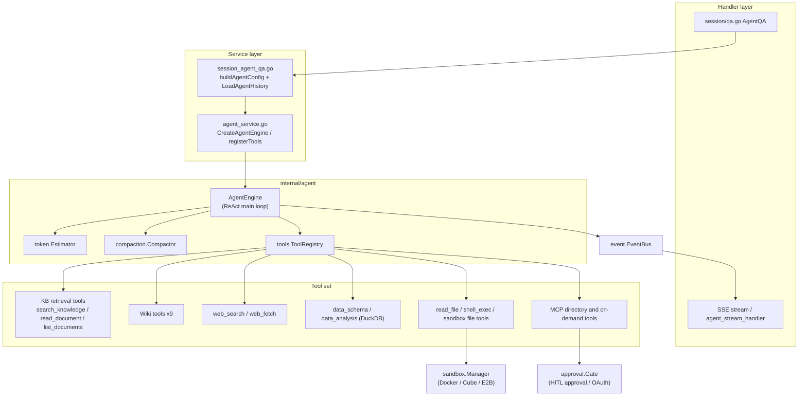
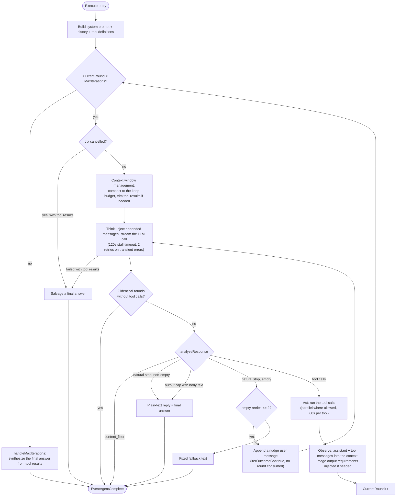
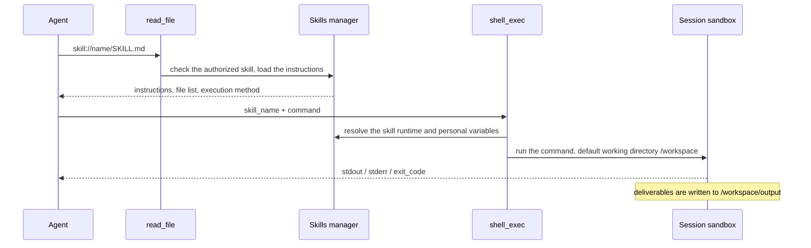

# Agent engine

How prompt sections, template references and custom prompt bodies are maintained is covered in [Conversation prompt assembly and editable scope](../06-development/05-agent-prompts.md); browser pairing and deployment in [Local Browser](../05-clients/09-local-browser.md).

An agent combines knowledge base retrieval, web search and external tools to handle multi-step tasks, such as comparing the clauses of several contracts. Smart Reasoning picks tools per question, runs several rounds of calls, and writes the answer from what it found.

At the top of the chat box you choose Quick Answer or Smart Reasoning:

| Mode | Suited to | How it runs |
| --- | --- | --- |
| Quick Answer (`quick-answer`) | Fact lookups over documents | Retrieve, then generate; usually few calls |
| Smart Reasoning (`smart-reasoning`) | Cross-document analysis, web lookups or tool operations | May run several rounds of calls; time and token usage depend on the task |

On the Agents page you create custom agents: choose the mode and model, limit the knowledge base scope, and configure the prompt, web search, MCP tools and skills. A saved agent is available in web chat and can be bound to IM or embed channels.

<Screenshot
  src="/screenshots/agent-editor.png"
  caption="Custom agent configuration: mode, model, knowledge scope and tools"
  hint="Agent editor dialog with mode selection, model selection, knowledge base scope, the web search switch and MCP tool checkboxes." />

<Screenshot
  src="/screenshots/agent-chat.png"
  caption="Agent chat: reasoning steps and the tool call timeline"
  hint="One agent answer with expanded thinking steps, tool call cards and the citations of the final answer." />

The configuration decides which material and tools the agent can reach. Every call is still bound by the permissions of the current user or channel.

## Create and use an agent

You want an agent that answers a specific kind of question with the right model, material and tools.

1. On the Agents page create an agent and choose Quick Answer or Smart Reasoning.
2. Choose the model, the knowledge base scope and the prompt. A type preset pre-fills the configuration; you can still change it before saving.
3. Enable web search or select MCP tools as the task needs. Running skill scripts also needs a sandbox with the skills installed.
4. Save, select the agent on the chat page, ask one question, and check the answer's sources and tool results.

For a first try use a built-in agent. Quick Answer suits document lookups, the Data Analyst agent handles CSV and Excel files, and the Wiki agent browses and maintains Wiki content.

XLSX table analysis and table summaries skip worksheets that contain formatting but no cell content, so an empty sheet is not parsed into many bogus columns. Sheets with headers, formulas, zeros or booleans still go to the regular parser; if none of the enumerated sheets has content, an explicit error is returned. This does not modify the source file and does not rebuild summaries that already exist.

The agent's reasoning effort (`reasoning_effort`) is a default; it can be changed per conversation in the input box. While a Smart Reasoning answer is running you can append further requirements. See [Conversation experience](18-chat-experience.md).

## Set the material and tool scope

You want to control which knowledge bases, skills and services an agent may use.

An agent can use all, selected or no knowledge bases and skills. Mentions in a conversation select the material for that turn or mark a preferred skill; they cannot bypass existing authorization. The @skill and @MCP menus in the input box only list resources available to the agent that actually runs this turn; for a shared agent they list the source workspace's skills and the MCP services the agent explicitly selected. Web search is bound by both the agent configuration and the per-request switch.

A custom agent must name its own chat model, and its own rerank model when it runs in Smart Reasoning mode with knowledge search. A built-in agent may leave either slot empty: it then uses the workspace's active default model of that type (a workspace model marked `is_default`), else the active built-in default declared in `config/builtin_models.yaml`. Conversation titles use the same chat model. Without a chat model the agent is not ready. Without a rerank model, Quick Answer skips reranking and keeps the retrieval order, while a Smart Reasoning agent with knowledge search refuses to run. A configured model that no longer exists is reported, never replaced by a default. `summary_model_id` in a request can still pick another chat model once the agent has one.

When an agent is shared through an organization, the receiving side uses the source workspace's models and material within the granted scope. Shared agents are read-only; the receiving side cannot change their configuration. When the receiving side uses one:

- the agent's configured model is always used, and `summary_model_id` in the request is ignored;
- an agent without an MCP selection mode uses no MCP services;
- conversation records go to the receiving workspace's own conversation knowledge base, never to the source workspace;
- the receiving side can see the agent's capabilities and resource scope (model, knowledge bases, MCP, web search) but not the prompt or the creator.

When an agent with skills is shared, the skills run in the source workspace's sandbox with the environment variables an administrator configured for them, and members can have the agent read those values. Sharing rules: [Workspaces and permissions](01-tenant-auth.md).

## Handle tool approvals and authorization

You want to know what happens when a tool needs a human decision before it runs.

An MCP tool that requires approval shows an approval card before it executes; the user can approve, reject or modify the arguments. The default wait is 10 minutes. A rejection, timeout or cancellation is returned as the tool result, and the agent continues from it. This approval mechanism applies to MCP tools only.

When an MCP service needs OAuth authorization, you complete it in the current conversation and the system retries the tool call afterwards.

## Use skills, attachments and memory

You want the agent to read attachments, run scripts, produce files, or remember things across sessions.

With a sandbox bound, Smart Reasoning reads attachments, runs scripts and generates files. Downloadable artifacts go to `/workspace/output`; once the answer completes they can be previewed and downloaded in the session. After each answer the system records a git checkpoint of `/workspace`; forking and rewinding a session restores the workspace of that turn from it. Desktop sessions that use a local directory directly record no checkpoints, so forking and rewinding affect only the conversation. Installation and variable configuration: [Skill catalog and sandboxes](22-skills-sandbox.md); attachment handling: [Conversation experience](18-chat-experience.md).

Long-term memory is isolated per workspace and caller, and an agent can switch memory reads and writes off. Full description: [Long-term memory](23-memory.md).

## Configuration reference

You need the exact fields, defaults and built-in definitions behind the editor.

### Custom agents

#### Modes and type presets

`CustomAgent` (`internal/types/custom_agent.go`) has two run modes (`Config.AgentMode`):

- `quick-answer`: the classic RAG pipeline (retrieve, assemble context, one generation). It does not enter the agent engine.
- `smart-reasoning`: ReAct agent mode. `IsAgentMode()` returns true and `MultiTurnEnabled` is forced to `true`.

Under smart-reasoning you can also pick a **type preset** (`Config.AgentType`, defined in `config/agent_type_presets.yaml`, loaded by `internal/types/agent_type_preset.go`). A preset only **pre-fills the form** in the editor; the user can override anything:

| Preset ID | System prompt template | Temperature | Max iterations | Pre-filled tools | KB filter |
| --- | --- | --- | --- | --- | --- |
| `rag-qa` | `progressive_rag_agent` | 0.7 | 30 | search_knowledge, read_document, list_documents | Derived from the tools: any_of vector/keyword |
| `wiki-qa` | `wiki_researcher` | 0.7 | 30 | wiki_search, wiki_read_page, read_document, wiki_flag_issue | Derived from the tools: any_of wiki |
| `hybrid-rag-wiki` | `hybrid_rag_wiki_agent` | 0.7 | 40 | wiki_search, wiki_read_page, search_knowledge, read_document, list_documents, wiki_flag_issue | any_of vector/keyword/wiki |
| `data-analysis` | `data_analyst` | 0.3 | 30 | data_schema, data_analysis; web search off; file types limited to csv/xlsx | explicit `none_of: [faq]` |
| `custom` | none | - | - | nothing pre-filled | unrestricted |

`thinking` and `todo_write` are not in any preset's tools by default; select them by hand when needed. Enabling them increases token usage.

#### Configurable fields (CustomAgentConfig)

The main fields of `CustomAgentConfig` in `internal/types/custom_agent.go` (the `CreateAgent` and `UpdateAgent` handlers accept this struct directly):

| Group | Field | Description / default (EnsureDefaults) |
| --- | --- | --- |
| Basic | `agent_mode` | `quick-answer` / `smart-reasoning` |
| Basic | `agent_type` | The preset category under smart-reasoning; empty or unknown counts as custom |
| Basic | `system_prompt` / `system_prompt_id` | A direct body wins; a custom agent's template reference is resolved per request by `ResolveCustomAgentPrompts` |
| Basic | `context_template` / `context_template_id` | The template that assembles retrieved passages in normal mode |
| Model | `model_id`, `rerank_model_id`, `temperature`, `max_completion_tokens`, `thinking`, `reasoning_effort`, `citation_enabled` | temperature < 0 becomes 0.7; max_completion_tokens = 0 uses the runtime default: quick-answer 2048, smart-reasoning 4096, smart-reasoning with a sandbox 24576; with a sandbox an explicit value below 8192 runs as 8192. `reasoning_effort` takes `off`/`auto`/`minimal`/`low`/`medium`/`high`/`xhigh`/`max` and, when set, wins over `thinking` (`thinking: true` equals `auto`); a level the model does not support is adjusted to the nearest one at call time; with neither set, thinking is off; a single conversation can override it with the request field `reasoning_effort`. citation unset counts as true |
| Agent | `max_iterations` | Default 10; a negative value means unlimited rounds (service-layer cap 100) |
| Agent | `llm_call_timeout` | Seconds one streaming model call may go without output; 0 uses the default 120s. Total duration is governed by the model transport layer |
| Agent | `allowed_tools` | Tool allowlist; empty falls back to DefaultAllowedTools |
| MCP | `mcp_selection_mode` (all/selected/none), `mcp_services`, `mcp_auth_wait_timeout` | OAuth wait in seconds; <= 0 uses the Gate default |
| Skills | `skills_selection_mode` (all/selected/none), `selected_skills`, `sandbox_config_id` | Selects a workspace sandbox and its installed skills; see [Skill catalog and sandboxes](22-skills-sandbox.md) |
| Memory | `memory_enabled` | nil inherits the workspace setting; false disables memory reads and writes for this agent |
| Knowledge bases | `kb_selection_mode` (all/selected/none), `knowledge_bases`, `retrieve_kb_only_when_mentioned`, `retain_retrieval_history` | With retain = true, historical KB retrieval results are not redacted |
| Multimodal | `image_upload_enabled`, `vlm_model_id`, `audio_upload_enabled`, `asr_model_id`, `image_storage_provider` | The VLM also describes images returned by MCP tools |
| Files | `supported_file_types`, `chat_parser_engine_rules`, `attachment_image_understanding`, `attachment_ocr_max_pages`, `attachment_parse_wait_timeout_sec` | Data analysis agents usually limit this to csv/xlsx |
| FAQ | `faq_priority_enabled`, `faq_direct_answer_threshold`, `faq_score_boost` | - |
| Web | `web_search_enabled`, `web_search_max_results`, `web_search_provider_id`, `web_fetch_enabled`, `web_fetch_top_n` | max_results defaults to 5; `web_fetch_*` only applies to the quick-answer pipeline, Smart Reasoning calls `web_fetch` itself |
| Multi-turn | `multi_turn_enabled`, `history_turns` | history_turns defaults to 5 and only constrains normal mode (KnowledgeQA); smart-reasoning forces multi_turn and loads history by context window, ignoring history_turns |
| Retrieval | `embedding_top_k` (10), `keyword_threshold` (0.3), `vector_threshold` (0.5), `rerank_top_k` (5), `rerank_threshold` | Defaults in parentheses |
| Advanced | `enable_query_expansion`, `enable_rewrite`, `rewrite_prompt_*`, `query_understand_model_id`, `fallback_strategy` (default model), `fallback_response`, `fallback_prompt`, `intent_prompts`, `data_analysis_enabled` | Mostly affect the quick-answer pipeline |
| Suggestions | `question_suggestions` (starters / follow_ups) | starters default to hybrid mode, 6 items; follow_ups default off, 3 items |

The handler layer (`internal/handler/custom_agent.go`) provides `CreateAgent`, `GetAgent`, `ListAgents`, `UpdateAgent`, `DeleteAgent`, `CopyAgent`, `GetPlaceholders` (the placeholder lists from `types.PlaceholdersByField`, including `PromptFieldAgentSystemPrompt`), `GetAgentTypePresets` (the preset list with display labels) and `GetSuggestedQuestions`. Create and update go through `authorizeAgentKnowledgeScope`, which checks the KB scope of a restricted API key: `kb_selection_mode: all` is rejected with 403 for a KB-restricted key, and `selected` is authorized base by base.

Runtime mapping: `buildAgentConfig` (`session_agent_qa.go`) converts `CustomAgentConfig` into the engine's `types.AgentConfig` (`internal/types/agent.go`) and adds: web search needs both the agent and the request switched on (`customAgent.Config.WebSearchEnabled && req.WebSearchEnabled`); the web provider falls back to the workspace default; `SearchTargets` is built from the KB / @document / @tag scope; `MaxContextTokens` falls back to 200000; `@Skill` and `@MCP` become per-turn preference hints without removing other configured resources (for a shared agent, @MCP can only land inside the agent's preset set). A rerank model is only required when `search_knowledge` is actually available (`agentRequiresRerankModel`; the old names `knowledge_search` and `grep_chunks` count too after `SuccessorToolName` normalization).

#### Sharing (agent_share)

`internal/application/service/agent_share.go`: an agent can be shared with an **organization**:

- Only the agent's owning workspace can share it (`ErrNotAgentOwner`); the sharer's workspace must be an organization member with the Editor role or higher.
- The configuration is validated before sharing: `model_id` is required; if `search_knowledge` is in the tool set (or the set is empty and falls back to the default set) and the KB scope is not disabled, `rerank_model_id` is required too, otherwise `ErrAgentNotConfigured`.
- **Permission is forced to read-only**: `permission = types.OrgRoleViewer` (cross-workspace editing is out of scope for v1). Sharing again updates idempotently.
- A receiving workspace can disable a shared agent locally through `TenantDisabledSharedAgentRepository`.
- When a shared agent is used in a conversation (`session_agent_qa.go`), the retrieval and model scope switches to the **agent's owning workspace** (`resolveRetrievalTenantID`), so the sharer's knowledge bases are available to the user, while the user's own MCP @mentions are limited to the agent's preset.

### Built-in agents (config/builtin_agents.yaml)

Built-in agents are defined in `config/builtin_agents.yaml`. At startup `types.LoadBuiltinAgentsConfig` loads the file and rebuilds `BuiltinAgentRegistry` (`internal/types/builtin_agent_config.go`); the agents' names and descriptions ship in English. `system_prompt_id` and `context_template_id` are resolved to concrete template content at startup by `ResolveBuiltinAgentPromptRefs`.

| ID | Name | agent_mode / agent_type | Key configuration |
| --- | --- | --- | --- |
| `builtin-quick-answer` | Quick Answer | `quick-answer` | Templates `default_kb` + `default_context`; temperature 0.7; FAQ priority (direct answer threshold 0.9, boost 1.2); query expansion + rewrite; web search on, 5 results; does not enter the agent engine |
| `builtin-smart-reasoning` | Smart Reasoning | `smart-reasoning` / `rag-qa` | `max_iterations: 50`; tools: search_knowledge, read_document, list_documents, query_knowledge_graph; web search on; multi-turn (history loaded by context window) |
| `builtin-data-analyst` | Data Analyst | `smart-reasoning` / `data-analysis` | Template `data_analyst`; temperature 0.3; `max_iterations: 30`; tools data_schema + data_analysis only; limited to csv/xlsx; web search off; multi-turn (history loaded by context window) |
| `builtin-wiki-researcher` | Wiki Questioner | `smart-reasoning` / `wiki-qa` | Template `wiki_researcher`; `max_iterations: 30`; tools: wiki_search, wiki_read_page, read_document, wiki_flag_issue (read-only plus issue flagging); web search off |
| `builtin-wiki-fixer` | Wiki Fixer | `smart-reasoning` / `custom` | Template `wiki_fixer`; `retain_retrieval_history: true` (revisions need page content remembered across rounds); 9 tools: wiki_search, wiki_read_page, read_document, wiki_write_page, wiki_replace_text, wiki_rename_page, wiki_delete_page, wiki_read_issue, wiki_update_issue (no wiki_flag_issue); `kb_selection_mode: selected` |
| `builtin-skill-installer` | Skill Installer | `smart-reasoning` / `custom` | Template `skill_installer`; temperature 0.2; `max_completion_tokens: 24576`; `max_iterations: 30`; tools: shell_exec, write_skill_file, edit_skill_file; `kb_selection_mode: none`; invoked by the skill upload flow of a sandbox configuration |

Notes (from `internal/types/custom_agent.go`):

- `builtin-wiki-fixer` and `builtin-skill-installer` do not appear in the user-facing agent list (`builtinAgentIDsOrdered` excludes them). The former is invoked programmatically by the Wiki editor, the latter by the skill upload flow; both remain usable through `GetAgentByID`.
- `builtinAgentIDsOrdered` also keeps slots for the ID constants `builtin-deep-researcher`, `builtin-knowledge-graph-expert` and `builtin-document-assistant`, but the current YAML does not define them. The registry follows the YAML.
- Every entry in `builtin_agents.yaml` except Quick Answer carries `reflection_enabled` (`true` for the Data Analyst, `false` elsewhere), but **the backend does not consume this field**. There is no struct field or reference under `internal/`; it exists only in the YAML and the frontend type definitions. It does not change agent behavior, so a `true` value does not mean an extra reflection round.

Related: the constants `WikiSummaryPrompt`, `WikiKnowledgeExtractPrompt` and `WikiTaxonomyPlanPrompt` in `internal/agent/prompts_wiki.go` belong to the **Wiki ingest pipeline** (the LLM generates wiki pages and directory plans at import time). They complement the runtime tools of the wiki agents: the former produce Wiki content, the latter consume and maintain it.

### Suggested questions (starters and follow-ups)

The chat box offers clickable questions in two places: **starters** while the session is still empty, and **follow-up suggestions** after each answer. This configuration belongs to the agent (`QuestionSuggestionConfig`, `internal/types/custom_agent.go`); channel settings can only suppress the display, not change the content strategy.

#### Fields

The two groups have independent switches, and `mode` decides where the questions come from:

| mode | Source | Used for |
| --- | --- | --- |
| `curated` | Only the hand-written `items` | Starters |
| `knowledge` | Taken from knowledge base content | Starters, follow-ups |
| `generated` | The model generates them from the conversation | Follow-ups |
| `hybrid` (default) | A mix of the sources above | Starters, follow-ups |

| Setting | Default | Description |
| --- | --- | --- |
| `starters.enabled` / `mode` / `items` / `count` | on / `hybrid` / empty / 6 | Starters; `count` is 1 to 8 |
| `follow_ups.enabled` / `mode` / `count` | off / `hybrid` / 3 | Follow-up suggestions; `count` is 1 to 5 |
| `follow_ups.model_id` | empty (the session model) | The model that generates follow-ups; a small model saves cost |
| `follow_ups.categories` | all three | Limits the question types: `clarify`, `deepen`, `action` |
| `follow_ups.max_context_turns` | 2 | How many conversation turns to look back when generating, 1 to 5 |
| `follow_ups.additional_instruction` | empty | Business constraints appended to the generation prompt, at most 2000 characters |
| `follow_ups.suppress_on_fallback` | on | No suggestions when the answer used the fallback strategy |
| `follow_ups.suppress_when_answer_asks_question` | on | No suggestions when the answer itself asks the user a question (so two questions do not compete) |
| `follow_ups.knowledge_fallback` | on | Fall back to the knowledge base source when generation fails |
| `follow_ups.allow_regenerate` | off | Whether the user may request a new batch by hand |

A follow-up identical to the question the user just asked (ignoring case, whitespace and common punctuation) is dropped, and knowledge base candidates fill the count. When the user picks a suggestion that came from a knowledge base, Smart Reasoning first searches that question's source knowledge base or document, then answers.

#### Generation, caching and analytics

- Results are stored in the `message_suggestion_sets` table, cached by `(assistant_message_id, placement, config_hash, locale)`. `config_hash` digests the currently effective agent configuration into the cache key, so a configuration change naturally produces a new batch instead of serving a stale one; `locale` keeps languages separate.
- Status: `generating` to `ready`, plus `suppressed` (skipped by the rules above) and `failed`; `lease_until` prevents several instances from generating the same batch.
- Endpoints: `GET /sessions/:id/messages/:message_id/suggestions` reads, `POST` on the same path triggers generation (idempotent), `POST /sessions/:session_id/suggestion-events` reports analytics events.
- Events: `impression`, `click`, `dismiss`, `regenerate`, stored in `message_suggestion_events`. The next user message after a click carries `SuggestionAttribution` (`suggestion_set_id` + `question_id`), so statistics can tell "clicked a suggestion" from "typed the same question".

## Execution reference

You need to know how a Smart Reasoning turn runs inside the engine: the loop, the tools, context management, skills, approvals and the two question-answering paths.

### Overview and architecture

#### Core components

| Component | Source | Responsibility |
| --- | --- | --- |
| `AgentEngine` | `internal/agent/engine.go` | Drives the ReAct main loop; holds the configuration, tool registry, chat model, event bus and more |
| `ToolRegistry` | `internal/agent/tools/registry.go` | Tool registration, lookup, parameter validation, execution, output truncation, resource cleanup |
| Built-in tool set | `internal/agent/tools/*.go` | Built-in tools registered by capability, plus dynamic MCP tools |
| Token estimation and compaction | `internal/agent/token/` + `internal/agent/compaction/` | `Estimator` (BPE estimate) and long-run context compaction (sandbox tool history) |
| Memory consolidation | `internal/application/service/memory/` | Cross-session long-term memory: extraction, recall, topic promotion, document affinity, consolidation |
| Skills system | `internal/agent/skills/` | Discovery, loading and script execution of SKILL.md packages (progressive disclosure) |
| Execution sandbox | `internal/sandbox/` | Session-level isolated execution and safety checks for skill scripts and `shell_exec` on Docker / Cube / E2B |
| Tool approval | `internal/agent/approval/gate.go` | Human-in-the-loop approval of dangerous MCP tools and in-conversation OAuth |
| Agent service layer | `internal/application/service/agent_service.go` | Assembles the engine: registers tools, resolves KB metadata, initializes skills, sandbox and VLM |
| Session QA entry | `internal/application/service/session_agent_qa.go` | Builds the runtime `AgentConfig` from a `CustomAgent` and executes |
| History rebuild | `internal/application/service/agent_history.go` | Rebuilds the multi-turn LLM context from the DB (`LoadAgentHistory`) |

The `AgentEngine` struct (`internal/agent/engine.go`, excerpt):

```go
type AgentEngine struct {
	config               *types.AgentConfig
	toolRegistry         *agenttools.ToolRegistry
	chatModel            chat.Chat
	eventBus             *event.EventBus
	knowledgeBasesInfo   []*KnowledgeBaseInfo    // Detailed knowledge base information for prompt
	selectedDocs         []*SelectedDocumentInfo // User-selected documents (via @ mention)
	pinnedMCPServices    []*PinnedMCPServiceInfo // User @mentioned MCP services for this turn
	pinnedSkills         []*PinnedSkillInfo      // User @mentioned skills for this turn
	questionOrigin       *QuestionOriginInfo     // Source of a picked suggested question, if any
	memoryPrompt         string                  // Long-term memory envelope appended to the system prompt
	skillsManager        *skills.Manager         // Skills manager for Progressive Disclosure (optional)
	tokenEstimator       *agenttoken.Estimator   // Token estimator for context window management, calibrated
	compactor            *compaction.Compactor   // Summarizes older history to fit the context window (nil = disabled)
	checkpointSink       types.ContextCheckpointSink // persists compactions that end on a stored turn
	modelContext         *modelcontext.Registry  // single request-local boundary for every model handle
	steerSink            types.SteerSink         // lets users append messages into the running turn
	// ... the rest is run-time state: estimate calibration, overflow recovery and so on
}
```

Engine responsibilities and constraints:

1. **Stateless across turns.** The engine source states it explicitly: the caller rebuilds the session history from the DB every turn through `service.LoadAgentHistory` and passes it to `Execute` as `llmContext`. The engine keeps no cache, no stored system prompt and no cross-turn buffer.
2. **Event-driven output.** The engine never writes SSE itself. Every output (thoughts, tool calls, tool results, the final answer, the completion event) is emitted through `event.EventBus`; subscribers in the handler layer turn them into the SSE stream and persist them. Event types include `EventAgentThought`, `EventAgentFinalAnswer`, `EventAgentToolCall`, `EventAgentToolResult`, `EventAgentTool`, `EventAgentComplete` and `EventError`.
3. **Citation and resource aliases.** `modelContext` (`modelcontext.Registry`, see `internal/modelcontext/`) runs `EncodeMessages` over the messages before every LLM call, replacing persistent IDs (chunk, document and web UUIDs) with short aliases (`cN`/`dN`/`bN`/`wN`, `res://NNNN`), and decodes them again while streaming back. The model never sees a real UUID. The encoding order (resource handles before source aliases) is fixed inside `Registry` and callers cannot invert it (see the type comment in `registry.go`): otherwise the document UUID embedded in a wiki summary page slug would be replaced by citation compaction with an alias such as `d1`, producing a dead link.
4. **Observability.** Each execution opens a Langfuse span hierarchy, `agent.execute` to `agent.round.N` to `agent.tool.<name>`, carrying the round number, token usage and a tool output preview (truncated to 4000 runes). The SQL argument of `database_query` is redacted in Langfuse and in UI hints (`toolHintSensitiveArgs`).

#### Component diagram



#### Building the system prompt

`BuildSystemPromptSections` in `internal/agent/prompts.go` first picks the base template: an explicit body wins; otherwise `pure` without knowledge bases and `rag` with them. It then appends, in order, the mid-run additions, runtime conventions, sources, tools, output, skills, memory and citation protocol sections. The skills section is only added when `read_file` is available, usable skills exist and the agent is not in skill install mode.

The current turn's knowledge base summary, pinned documents, date and session information are placed by `observe.go` into the `runtime_context` of the user message and are not persisted to history; the general answering rules live in the system section. `@MCP` / `@Skill` produce a preference hint for the authorized resources without excluding other available sources.

Section order, placeholders, template reference storage and message role boundaries are maintained in [Conversation prompt assembly](../06-development/05-agent-prompts.md).

### The ReAct loop stage by stage

#### Entry: Execute

The flow of `AgentEngine.Execute` (`internal/agent/engine.go`):

1. `defer e.toolRegistry.Cleanup(ctx)`: at the end, tools implementing `types.Cleanable` are cleaned up (for example `data_analysis` drops the DuckDB tables it created for this session).
2. Open the Langfuse `agent.execute` span.
3. Initialize `types.AgentState` (`RoundSteps`, `KnowledgeRefs`, `IsComplete=false`, `CurrentRound=0`).
4. `buildSystemPrompt` + `buildMessagesWithLLMContext` (system + history + the current user message, with image URLs).
5. `buildToolsForLLM` converts the registry's tools into function-calling definitions.
6. Enter `executeLoop`.

#### Main loop: executeLoop and runReActIteration

```go
for state.CurrentRound < e.config.MaxIterations {
    // ctx cancellation check: if tool results already exist, salvage a final answer
    outcome, iterErr := e.runReActIteration(...)
    switch outcome {
    case iterOutcomeContinue: continue loop   // empty-response retry, does not consume a round
    case iterOutcomeBreak:    break loop      // stop (natural stop / stuck / cancelled / content filter)
    case iterOutcomeNext:     state.CurrentRound++
    }
}
if !state.IsComplete && ctx.Err() == nil {
    e.handleMaxIterations(ctx, query, state, sessionID) // synthesize a final answer as a fallback
}
```

`executeLoop` uses `defer emitCompletion()` to guarantee that **every exit path emits `EventAgentComplete` exactly once** (with `context.WithoutCancel`, so the event still arrives after the user clicks Stop). The event carries `state.RoundSteps`, which the stream handler persists into the `AgentSteps` field of the assistant message.

One `runReActIteration` runs four stages:

**1. Think**: first context window management (see [Memory and context compaction](#memory-and-context-compaction)), then the `inject` messages the user appended during the run are written to history and attached to the end of the message list (see [Append messages to a running answer](../04-api/02-api-chat.md#steer)), then `callLLMWithRetry` (`internal/agent/think.go`):

- `agenttools.SanitizeMessages` repairs consecutive same-role messages, orphan tool results and similar problems;
- the LLM is called in streaming mode (`streamThinkingToEventBus`); the call is cancelled only after `defaultLLMStallTimeout = 120s` with no output at all (overridable with `AgentConfig.LLMCallTimeout`). A long round that keeps producing output has no total time limit; the total is governed by the model transport layer;
- transient errors (429, 5xx, timeout, overloaded and the like, see `transientErrorMarkers`) are retried at most `maxLLMRetries = 2` times with 1s and 2s backoff (a `Retry-After` header extends the wait, up to 30s);
- if retries still fail but tool results already exist, **graceful degradation** applies: `streamFinalAnswerToEventBus` synthesizes a final answer from the existing tool results and sets `state.IsComplete = true`.

During streaming, the `reasoning_content` channel (DeepSeek and others) and inline `<think>` blocks (split by `ThinkStreamSplitter`) both go to the thinking area (`EventAgentThought`). Ordinary content streams optimistically to the final answer area (`EventAgentFinalAnswer`); if the round then issues a tool call, the UI treats that text as a preamble, moves it into the step tree, and it is kept as the round's `Thought`.

**2. Analyze**: `analyzeResponse` (`internal/agent/observe.go`) checks the stop conditions:

- `finish_reason == "content_filter"` with no tool calls: stop; the answer is the filtered content or a fixed apology.
- A natural stop (`isNaturalStopFinishReason`: `stop` / `end_turn` / `stop_sequence`) with no tool calls: **the agent is done** and the plain-text reply is the final answer (**there is no dedicated final_answer tool**; `final_answer` tool calls left in historical data are filtered out on replay by `filterNonTerminalToolCalls`).
- A natural stop with empty content: a nudge user message `"Please provide your complete answer now as plain text."` is appended and the call retried, at most `maxEmptyResponseRetries = 2` times (returns `iterOutcomeContinue`, no round consumed). No terminal answer event is emitted during the retries; only when they are exhausted does a fixed fallback text become the single final answer.
- Truncated by the output cap (`finish_reason` is `length` / `max_tokens` / `max_output_tokens`) with body text and no tool calls: the text before the cut is delivered and the round ends; the answer event and the `AgentStep` carry a `truncated` flag. A truncation with no body (thinking only) is retried like an empty response. After `maxConsecutiveLengthRounds = 3` consecutive truncated rounds (usually cut inside tool call arguments) the loop stops; without body text a fixed notice suggests narrowing the question or raising `max_completion_tokens`.
- When a natural stop is imminent and the user has appended `inject` messages, the round's reply is kept as an intermediate answer and the agent continues after reading the appended content. If the iteration cap is already reached, one extra round is allowed (`maxSteerOverruns = 1`).

A **stuck detector** runs before Analyze: if `maxRepeatedResponseRounds = 2` consecutive rounds return identical content (including consecutive empties) with no tool calls (usually an unhandled finish reason), the loop is forced to stop with that content as the final answer, or the fixed fallback text when it is empty.

**3. Act**: `executeToolCalls` (`internal/agent/act.go`) runs all tool calls of the round:

- With 2 or more calls they run **in parallel** through `errgroup` (`buildAgentConfig` always sets `ParallelToolCalls`; best effort, one failure does not cancel its siblings), and the results are filled back in the original order. Only read-only tools (`CanRunConcurrently`: retrieval, reading and search tools) overlap; any other tool is a barrier that waits for the calls before it, runs alone, then lets the later calls continue.
- Each call goes through `NormalizeToolCallID`, then JSON argument parsing. A parse failure is first repaired with `RepairJSON` and retried; if it still fails, an error result with a hint (`"[Analyze the error above and try a different approach.]"`) is returned so the model changes approach instead of failing the whole round.
- A single tool execution times out after `defaultToolExecTimeout = 60s`; `shell_exec` uses `shellExecToolTimeout = 10m5s` (slightly longer than the command's own 600s cap, so a structured timeout result can be returned); the human-takeover steps of `local_browser` use their own wait. `ToolExecContext` also carries an `ApprovalCtx` without that timeout for legitimate long waits such as MCP human approval and OAuth.
- `EventAgentToolCall` (with a hint built from the tool's display label and its key argument, such as the query of a web search), `EventAgentToolResult` and `EventAgentTool` events are emitted. A failed tool execution is also sent to the client as `tool_result` (`success: false` plus `error`), no longer as an `error` event, and the agent continues from the error.

**4. Observe**: `appendToolResults` (`internal/agent/observe.go`) appends the round to the message array per the OpenAI protocol: one assistant message with `tool_calls` plus one `role:"tool"` message per result (content aliased by `modelContext.ModelToolResultForTool`). Then `state.CurrentRound++` and the next round starts.

#### Termination conditions and max iterations

| Exit path | Trigger | Source of the final answer |
| --- | --- | --- |
| Natural stop | finish_reason in {stop, end_turn, stop_sequence}, no tool calls, non-empty content | The round's plain-text reply |
| Empty responses exhausted | Natural stop with empty content, still empty after 2 nudge retries | Fixed fallback text |
| Output truncation | Cut by the output cap with body text and no tool calls | The text before the cut (with the `truncated` flag) |
| Consecutive truncation | 3 consecutive rounds cut at the output cap | The last body text or a fixed notice |
| Content filter | finish_reason == content_filter, no tool calls | The filtered content or a safety notice |
| Stuck detection | 2 consecutive rounds with identical content and no tool calls | The repeated content itself |
| User cancel / timeout | ctx.Done(); salvaged if tool results exist | Synthesized answer or the partial steps |
| Unrecoverable LLM failure | Retries exhausted; with tool results, degraded synthesis, otherwise an error | Synthesized answer / error event |
| Max iterations reached | `CurrentRound == MaxIterations` (a negative `max_iterations` means unlimited) | `handleMaxIterations` to `streamFinalAnswerToEventBus` |

The layered defaults for max iterations:

- Service layer `ValidateConfig`: `0` falls back to 5, a negative value means unlimited rounds, hard cap `MAX_ITERATIONS = 100` (`internal/application/service/agent_service.go`);
- `CustomAgent.EnsureDefaults`: 10 when unset (`internal/types/custom_agent.go`);
- Built-in agents: Smart Reasoning 50, Data Analyst 30, Wiki Questioner / Wiki Fixer 30 (`config/builtin_agents.yaml`).

Once the cap is reached, `handleMaxIterations` goes through `internal/agent/finalize.go`: it keeps the current message list with the original roles, images and tool call pairs and appends a closing request for the final answer. That call offers no tools, sets `tool_choice=none` and disables thinking.

#### ReAct loop flowchart



### Built-in tools in full

#### Tool table

Tool name constants are defined in `internal/agent/tools/definitions.go`. The table covers every built-in tool (the parameter column lists only schema fields; `*` marks required):

| Tool | Key parameters | Behavior / result |
| --- | --- | --- |
| `thinking` | `thought`\*, `next_thought_needed`\*, `thought_number`\*, `total_thoughts`\*, `is_revision`, `revises_thought`, `branch_from_thought`, `branch_id`, `needs_more_thoughts` | Sequential thinking: records, revises and branches thinking steps; returns the thinking progress (with `incomplete_steps`) and reminds the model not to put tool names or the final answer inside a thought |
| `todo_write` | `task`, `steps[]`\* (`id`/`description`/`status`: pending/in_progress/completed) | Creates or updates a retrieval task plan, for retrieval tasks only (summarizing belongs to thinking); returns the formatted plan with `display_type: "plan"` |
| `search_knowledge` | `query`\* (one natural-language question or phrase; in keyword mode exact terms), `mode` (`hybrid` default / `semantic` / `keyword`), `knowledge_base_ids[]` (`bN`, at most 10), `limit` (default 10, at most 30) | The only knowledge base retrieval entry: `hybrid` fuses vector and keyword results with RRF, `semantic` is vector only, `keyword` is served by the keyword index (BM25 or the engine's keyword search), never an unindexed regex scan of the chunks table. Recall thresholds and the candidate pool come from the global `conversation.vector_threshold` / `keyword_threshold` / `embedding_top_k` (0.2 / 0.3 / 30 in the shipped `config.yaml`; 0.6 / 0.5 / 30 when unset), not from the agent's own thresholds. With a rerank model the results are reranked (scored text is document title plus chunk body, except FAQ; threshold 0.3 in the shipped `config.yaml`, 0.2 when unset; if nothing passes, the best candidate with a score of at least 0.15 is kept), then MMR (lambda 0.7) removes redundancy. When the reranker rejects everything the result carries `rerank_rejected` and suggests `keyword` for identifier-like terms. Results carry `cN`/`dN` short IDs, are deduplicated within one call, and a document's metadata header is printed once. Retrieval does not attach neighboring, parent or related chunks (use `read_document(id=cN, context=k)` for context); at most 200 candidates go to the reranker. When the output exceeds 4/5 of the tool output budget, results are dropped from the bottom of the ranking (at least one is kept) and `<omitted count=... reason="output_budget">` tells the model. When a selected KB lacks the matching index the tool degrades per base instead of failing: `keyword` on an FAQ or vector-only base switches to semantic retrieval, `semantic` on a keyword-only base switches to keyword retrieval, and the result marks which bases degraded and why with `requested_mode` and `mode_fallbacks`. Only when no base in scope has any chunk index (for example all are Wiki-only) is an error returned |
| `read_document` | `id`\* (`dN` document handle or `cN` chunk handle), `offset` (position in reading order, from 0, not a chunk index; page with the returned `next_offset`), `limit` (default 20, at most 100), `query` (find within the document: split on whitespace into terms, a chunk must contain all of them in any order, case-insensitive), `regex` (treat the whole `query` as one case-insensitive regex), `context` (neighboring chunks on each side of a `cN`, at most 5) | Always returns the document's metadata header first (title, type, parse_status, chunk count, metadata), then chunks as needed: `dN` pages through from `offset`; `cN` reads that chunk, optionally with `context` on each side (neighbors follow chunk_index order and are not affected by the indexes used by parent, summary or image chunks). With `query`, even when `id` is a `cN`, the search runs within that chunk's document and returns the matching chunks with one chunk of context on each side (at most 20 hits); when truncated it returns `next_offset` (the position of the first unreturned hit), and repeating the same query with `offset` continues. No hits come with a notice. A single page or search result stays under 80% of the tool output budget; the rest continues through `next_offset`. FAQ entries are read the same way. The tool checks that the KB is inside searchTargets and the @mention scope |
| `list_documents` | `knowledge_base_id`\* (`bN`), `keyword` (substring filter on title or file name), `page` (default 1), `page_size` (default 20, at most 100) | Lists the documents of one knowledge base page by page and returns `dN` handles that go straight to `read_document` |
| `query_knowledge_graph` | `knowledge_base_ids[]`\* (1 to 10 `bN`), `query`\* (an entity name or a question containing one) | Queries the knowledge graph of each KB concurrently: matches entities by name in the graph store using the query itself and its longer tokens, returns the relationships between entities (`relations`, `<relation>` in the model's view) and the entities' source chunks first, then text retrieval hits. A failure per KB is reported to the model as `<error>`. Offered to the model only when a graph-enabled KB is in scope (`agent_service.go` removes it while assembling the allowlist); capability requirement `all_of: [graph]` |
| `database_query` | `sql`\* (SELECT only) | Read-only queries over the allowlisted tables (`knowledge_bases`/`knowledges`/`chunks`), with the tenant_id filter and `deleted_at IS NULL` injected automatically; the SQL argument is redacted in the UI and Langfuse |
| `data_schema` | `knowledge_id`\* (`dN`) | Reads the `table_summary` and `table_column` chunks of a CSV/Excel file and returns column information and row count; tells the model that the document is always accessed as the table `dataset` in `data_analysis` |
| `data_analysis` | `knowledge_id`\*, `sql`\* | Loads the CSV/Excel file (`csv`, `xlsx`, `xls`, `xlsb`; docreader converts `.xls` and `.xlsb` to `.xlsx` first, over the gRPC transport only) into DuckDB and runs the SQL. The document is chosen by `knowledge_id` and referenced in SQL as the fixed table name `dataset` (each query creates a temporary view on its own connection mapping to the physical table, so the model never writes a document ID into SQL); a multi-sheet Excel file is merged into one table with a `__sheet_name` column; column name case and whitespace differences are corrected automatically; the tables it created are dropped by Cleanup at the end of the session |
| `web_search` | `query`\*, optional `count` (within the configured maximum, at most 20), `country` (two-letter code or `ALL`), `freshness` (`pd`/`pw`/`pm`/`py`; Brave also accepts a date range), `content` | Web search that returns the provider's titles, snippets and `wN` page short IDs; the agent chooses knowledge base or web retrieval per task, and agent searches no longer run RAG compression. `country`/`freshness` are supported by Brave and Serply only; other providers return an error when they are passed. `content=true` fetches the first 3 results in parallel within 15 seconds, 5000 characters of body text each |
| `web_fetch` | `items[]`\* (each with `url`\* = `wN` or an HTTP(S) URL, optional `offset`, `limit`; `limit` counts characters, default and maximum 8000, shared across items) | Fetches up to 8 pages concurrently (SSRF-safe client with DNS pinning, chromedp rendering when needed) and returns Markdown or supported text bodies directly; 60s timeout. Pages are read by character offset, continued with `next_offset`; the full body is saved at `full_output_path` (a `web://` address readable in the same session only) and can be read line by line across rounds with `read_file`. Each URL reports `success`/`failed`/`skipped` and a retryable error code (such as `snapshot_expired`); a partial failure does not affect the other pages |
| `read_file` | `path`\*, `offset` (1-based line number), `limit` (default 2000 lines), `max_bytes` (at most 64 KiB, 50 KiB for web snapshots); web pages also take `line_offset` | Reads workspace text, skill:// resources and web:// page snapshots, continued from the returned positions |
| `shell_exec` | `command`\*; optional `skill_name`, `work_dir`, `timeout_sec`, `stdin` (<= 64 KiB), `max_output_bytes` (default 16 KiB, at most 64 KiB), `max_stderr_bytes` (default 8 KiB, at most 16 KiB), `env` | Runs a command in the current session sandbox, default working directory `/workspace`; with a skill name it resolves the skill directory and variables |
| `list_sandbox_files` | `path`, `max_entries` (default 200, at most 500) | Browses sandbox files and available artifacts; offered only when `shell_exec` is not registered |
| `write_sandbox_file` | `path`\*, `content`\*, `mode` (`overwrite` default / `append`) | Writes or appends a workspace file; cannot write `/workspace/input` |
| `edit_sandbox_file` | `path`\*, `edits`\* (each with `old_string`\*, `new_string`\*, `replace_all`) | Batch exact replacements resolved against the original version |
| `search_memory` | `query`\*, `limit` (default 10, at most 20) | Searches long-term memory in the current caller's scope |
| `search_conversations` | `query`\*, `limit` (default 5, at most 8) | Searches the current caller's past conversations; the scope follows the caller's identity and no scope parameter is accepted |
| `wiki_search` | `query`\* (case-insensitive POSIX regex such as `stardust\|skyvault`; text that is not a valid regex, such as `C++`, is matched literally), `regex` (`false` forces literal matching, `true` requires a valid regex), `knowledge_base_ids[]` (`bN`), `limit` (default 10 per KB, at most 50); the old parameters `queries[]` and `knowledge_base_id` are still accepted | Searches Wiki pages (title, slug, aliases, summary, content) and returns page slugs with `bN` markers and summaries; pages returned earlier are still listed without their summary. When the scope is limited to documents or tags it over-fetches first (5 times `limit`, at most 100), filters by source, keeps the first `limit`, and reports `filtered_out_of_scope` when everything was filtered |
| `wiki_read_page` | `slugs[]`\* | Reads Wiki pages by slug: full text, metadata, inbound and outbound links (links carry summaries, already seen ones omitted); the knowledge base is routed by slug; the `index` slug returns a directory overview grouped by type (top 20 per type) |
| `wiki_write_page` | `slug`\*, `title`\*, `summary`\*, `content`\*, `page_type`\*, `aliases[]`, `source_refs[]` | Creates or fully overwrites a Wiki page; normalizes and validates the slug before writing; handles outbound links automatically |
| `wiki_replace_text` | `slug`\*, `old_text`\*, `new_text`\*, `source_refs[]` | Exact text replacement, for small revisions |
| `wiki_rename_page` | `slug`\*, `new_slug`\* | Renames the slug and cascades the update to every page that links to it |
| `wiki_delete_page` | `slug`\* | Deletes the page and cleans the inbound links on other pages to prevent dead links |
| `wiki_flag_issue` | `slug`\*, `issue_type`\* (mixed_entities/contradictory_facts/out_of_date/other), `description`\*, `suspected_knowledge_ids[]` | Flags a page problem such as a factual error or mixed entities and records an issue for manual or automatic maintenance |
| `wiki_read_issue` | `issue_id` / `slug` | Shows one issue or lists a page's pending issues |
| `wiki_update_issue` | `issue_id`\*, `status`\* (resolved/ignored/pending) | Updates an issue's status |
| `discover_mcp_tools` / `call_mcp_tool` | Discovery: `mode`\* (`list_servers`/`list_tools`/`describe`/`search`), `server_id`, `tool_name`, `query`, `cursor`, `limit` (1 to 50), `refresh`; call: `tool_ref`\*, `arguments`\* | Queries the directory, reads full definitions and calls on demand; see [MCP tool directory](08-mcp.md#mcp-tool-directory) |
| `mcp_...` (dynamic, with a stable hash suffix) | Decided by the MCP service's InputSchema | External functions published after their definition is read; the description names the service and the original tool name; permissions are rechecked at execution; may require human approval and in-conversation OAuth |
| `local_browser` | `method`\* (`observe`, `snapshot`, `navigate`, `click`, `fill`, `tab_*`, `evaluate`, `request_help` and others); the other fields depend on the method | Drives the user's connected local browser; registered only when the request sets `local_browser_enabled` and the deployment enables browser access, see [Local Browser](../05-clients/09-local-browser.md) |
| `write_skill_file` / `edit_skill_file` | Write: `path`\*, `content`\* (<= 256 KiB); edit: `path`\*, `old_string`\*, `new_string`\*, `replace_all` | Used only by the built-in skill installer in install mode; can only change the skill directory being installed |

The default tool allowlist `DefaultAllowedTools()` (the fallback when an agent has no `allowed_tools`): `search_knowledge`, `read_document`, `list_documents`, `search_conversations`. `web_search` / `web_fetch` and `search_memory` are not governed by the allowlist: they are removed from it at registration and then injected by the web search switch and the memory switch respectively (memory needs the workspace, the user and the agent to all allow it).

**Compatibility with old tool names**: `knowledge_search` and `grep_chunks` were merged into `search_knowledge`; `list_knowledge_chunks`, `get_document_info` and `wiki_read_source_doc` were merged into `read_document`. `legacyToolSuccessors` in `definitions.go` records the mapping, and `NormalizeAllowedTools` rewrites old names in stored agent configurations, presets and API calls to the new tools at registration, with no data migration; old tool names recorded in historical messages still render correctly.

**Scope of the document reading tools**: `read_document` and `list_documents` read stored chunks, and every knowledge base writes chunks whatever its indexing strategy, so they are registered as soon as the scope contains a vector/keyword base or a Wiki base (`documentToolSet` in `agent_service.go`), letting Wiki agents read the original text; `search_knowledge` still requires a vector or keyword index. The capability table marks both tools `Auxiliary`: they work on Wiki-only bases but do not pull Wiki-only bases into a RAG agent's "all knowledge bases" scope, and they only count when deriving the KB filter if no other knowledge base tool is present. The @file / @tag scope of `list_documents` applies before pagination: tags are pushed down into the database filter, specified documents are read by ID, and `total_docs` and `next_page` count only documents in scope.

**Recommended retrieval workflow**: `search_knowledge` (choose `mode` by question: `hybrid` by default, `keyword` for exact terms, error messages and identifiers, `semantic` for rephrased or conceptual questions), then `read_document` (page through context by `dN`, or locate within the document with `query`), then cite `cN` handles in the answer. For Wiki knowledge bases: `wiki_search`, then `wiki_read_page`, then `read_document` to read the original source.

#### Tool registry (ToolRegistry)

`internal/agent/tools/registry.go`:

- **Registration**: `RegisterTool` is **first-wins**. A later registration under the same name is rejected, so an MCP service cannot hijack a built-in tool through a name collision (security advisory GHSA-67q9-58vj-32qx).
- **Definition export**: `GetFunctionDefinitions` sorts by tool name, so the tools payload sent to the LLM is byte-identical across requests and hits provider prompt caches that rely on prefix matching (such as Qwen's explicit cache).
- **Execution pipeline**: `ExecuteTool` = `CastParams` (converts `"true"` to `true` and similar common LLM type slips), then `ValidateParams` (JSON Schema pre-validation, saving one invalid execution plus an LLM round trip), then `tool.Execute`, then output truncation.
- **Output truncation**: `TruncateToolOutput` (`truncate.go`) defaults to `DefaultMaxToolOutput = 24000` **runes** (overridable with `AgentConfig.MaxToolOutputChars`; tools such as `shell_exec` and `discover_mcp_tools` may declare a higher cap of their own). Over the limit, the head 70% and tail 30% are kept with a truncation marker in between, so a large result cannot pollute the context.
- **Error hints**: when the tool arguments cannot be parsed as JSON, `"[Analyze the error above and try a different approach.]"` is appended to the result to steer the LLM to another strategy; other failures return the tool's own error message.
- **Cleanup**: `Cleanup` walks the tools implementing `types.Cleanable` and releases their resources.

#### Capabilities and configuration-driven enablement

`internal/agent/tools/capabilities.go` is the Go mirror of the frontend's `frontend/src/utils/tool-capabilities.ts` and declares each tool's KB capability requirements:

```go
var ToolCapabilityRequirements = map[string]ToolRequirement{
	"thinking":   {},
	"todo_write": {},
	"search_knowledge":      {AnyOf: []KBCapability{CapVector, CapKeyword}, ConsumesFiles: true},
	"read_document":         documentReaderRequirement, // AnyOf vector/keyword/wiki, Auxiliary
	"query_knowledge_graph": {AllOf: []KBCapability{CapGraph}, ConsumesFiles: true},
	"list_documents":        documentReaderRequirement,
	// Retired names keep their original declarations (wiki_read_source_doc equals read_document)
	// so old configurations pass the capability check before normalization
	// ...
	"wiki_search":          {AllOf: []KBCapability{CapWiki}},
	// ...
	"data_analysis": {AnyOf: []KBCapability{CapVector, CapKeyword}, ConsumesFiles: true},
}
```

The capability enum is `vector` / `keyword` / `wiki` / `graph` / `faq`. Derived from it:

- `DeriveKBFilterForAgent(agentMode, allowedTools)`: the predicate that filters selectable KBs in the agent editor and the `@` menu; `quick-answer` mode implicitly requires `vector|keyword`;
- `KBSatisfiesToolRequirements`: the backend's last line of defense, so a client that bypasses the frontend still cannot hand an incompatible KB to a tool;
- `ToolsConsumeFiles`: decides whether the chat input shows the `@file` list.

**Runtime enablement** (`registerTools` in `agent_service.go`):

1. Start from `config.AllowedTools` (the user-editable allowlist; presets only pre-fill it), rewrite old tool names with `NormalizeAllowedTools`, and fall back to `DefaultAllowedTools()` when empty. For a shared agent's read-only call, or when the scope has no writable Wiki base, remove the Wiki write tools (`wiki_write_page`, `wiki_replace_text`, `wiki_rename_page`, `wiki_delete_page`, `wiki_flag_issue`, `wiki_update_issue`).
2. When the turn has **no knowledge retrieval scope at all** (pure agent mode), drop every KB, Wiki and data tool; if web search is off too, drop `todo_write` as well.
3. Inject by runtime switches: with web search on, add `web_search` + `web_fetch`; with memory available, add `search_memory` (removed first even if the allowlist names it).
4. **Hard safety net**: scan the real capabilities of the KBs in `SearchTargets`. No wiki KB drops all wiki tools; no vector/keyword KB drops `search_knowledge`, `query_knowledge_graph` and `database_query`, and without a wiki KB also `read_document` and `list_documents`; no graph-enabled KB drops `query_knowledge_graph` (this guards against stale configurations, such as wiki tools ticked earlier and a non-wiki KB swapped in later).
5. Deduplicate, then instantiate and register one by one. MCP tools are registered separately by `MCPSelectionMode` (all/selected/none); sandbox shell and file tools follow the session's capabilities (`list_sandbox_files` is not registered when `shell_exec` is present), and `read_file` adds skill and web data sources; `local_browser` and the skill installer's file tools have their own registration conditions; old skill tool names are recognized for compatibility only and are no longer registered.

### Memory and context compaction

Long-term memory is stored across sessions per workspace and caller and is configured separately from the session history compaction below. Enabling it and personal management: [Long-term memory](23-memory.md); full API: [Memory API](../04-api/02-api-memory.md).

#### Token budget and estimator

- Context budget: `AgentConfig.MaxContextTokens`; when `buildAgentConfig` leaves it unset, `types.DefaultMaxContextTokens = 200000` applies.
- `token.Estimator` (`internal/agent/token/estimator.go`) estimates with tiktoken's **cl100k_base** encoding, constants `perMessageOverhead = 3` and `perConversationTail = 3`; if encoding fails it degrades to a `len(s)/4` approximation.
- **Authoritative values first**: the real token count is the `Usage` returned by the model API. The engine's `estimateCurrentTokens` uses the previous round's reported `lastUsage.TotalTokens` as the baseline and only estimates the new messages (the assistant reply plus tool results) with BPE; a full estimate happens only in the first round, before any Usage exists.
- **Estimate calibration**: cl100k is not every model family's tokenizer. Chinese text is about 1 token per character under cl100k but about 0.6 for Qwen and DeepSeek, while English and JSON are nearly identical. The estimator therefore carries a calibration factor (`Estimator.SetScale`, clamped to 0.5 to 1.5) that applies to text only, not to the fixed per-message overhead or the fixed image estimate. The engine measures the factor between two adjacent requests of the same turn: both requests share the tool definitions, system prompt and existing messages, so the model's reported prompt token increase corresponds only to the newly appended messages (the previous reply, tool results, appended messages); dividing it by the estimate of those messages gives the factor for conversation content, independent of how each provider renders tool definitions. A sample is skipped when a compaction or tool result trim happened in between, when it contains images, when the ratio is implausible (below 0.3 or above 3), or when fewer than 256 estimated tokens have accumulated. The measured factor is stored with the turn's usage as `context_token_scale` (even when the model reports no total tokens); a turn that measured nothing (one request, no tool calls) keeps the factor it started with, so the newest turn always carries the latest factor. The next turn's `LoadAgentHistory` takes the most recent message with a factor, prices the history with it and hands it to the engine as the starting point. The loader, the first-round compaction decision and the compactor (kept-text budget, summary input cap) share one estimator, so one ruler: calibrating only the compaction decision and not the loader would make the loader drop turns first. The first-round compaction decision still counts messages only, not tool definitions.

#### Context compaction and overflow recovery

`manageContextWindow` (`internal/agent/observe.go`) calls `compaction.Compactor` before every Think. MaxContextTokens comes from the agent configuration first, then the model's `parameters.context_window`, then the 200000 fallback. The trigger threshold is the window minus a reserve; the reserve is at least 16384 and grows with the turn's output budget: `max(completion budget + 4096, 16384)`.

Compaction selects the most recent messages to keep by token budget, default KeepRecentTokens = 20000, lowered to a quarter of the usable window for small windows. A long ReAct session can be split inside the current turn; the cut never separates an assistant tool call from its tool results, and the first half of a split turn is summarized on its own to explain the kept second half.

The previous summary takes part in the update, and older history becomes a structured summary; the result is placed as a marked user message between the system message and the kept tail. The summary budget is computed from the reserve, the model's output cap and the keep budget, no longer a fixed 2000. The summary call uses the streaming interface and, like the engine's own rounds, has only a stall timeout: it is cancelled after a period (default 120 seconds, following `LLMCallTimeout`) without any output, and the total duration is left to the model transport layer. The earlier 60-second total timeout cut off large requests that were prefilling and producing output normally. The model's thinking output counts as progress but not as summary; an error reported in the stream counts as a failure. Each summary is attempted at most 2 times, with no retry once the turn is cancelled; on failure the raw text is archived instead and marked degraded. The raw archive is bound by the summary budget like a summary, kept from the newest message backwards with a note of how many were omitted, so the context still shrinks in the degraded case.

**Summary input cap.** History can fill the whole window, so the part to summarize may exceed what one summary request can hold. An oversized request is rejected and degrades to a raw archive, and a degraded result writes no checkpoint, so the next turn fails the same way. `Prepare` therefore keeps only the newest messages that fit one request (the window minus the reply budget, the previous summary and the prompt, with a further 10% margin) and notes in the prompt how many older messages were omitted; file paths are still extracted from all messages to summarize. The omitted count is recorded in `Result.Omitted` and visible in the engine log.

`internal/agent/compaction/fileops.go` mechanically extracts the file read and write paths from the compacted messages and inherits the previous summary's file list, so the model does not forget artifacts already written to disk. Ordinary reads use read_file; old read tool names are still recognized.

If the budget is still exceeded after compaction, tool results are trimmed last: the tool result budget is 20% of the window, clamped to 8192 to 32768 tokens. When nothing is compactable or less than 5% would be freed, the current message count is recorded to avoid spending model calls repeatedly at the same context size. A successful compaction clears the old usage baseline and emits a `context_compacted` event with the token and message counts before and after, the reason, `split_turn` and `degraded`.

**Checkpoint persistence.** When the summarized history ends exactly at the end of a stored turn, the engine writes the summary back as a checkpoint (`messages.context_checkpoint`) on that turn's assistant message, and the next turn starts from it instead of summarizing the same history again. Rebuilt history messages carry the assistant message ID of their turn (`chat.Message.TurnID`, never sent to the model), which decides whether the cut falls on a turn boundary. No checkpoint is written when the cut falls inside a stored turn (for example at an appended message) or when the summary covers only the current turn. A history summary that degraded to a raw archive is still written and marked `degraded`: without it, a persistently failing summarizer would reload, compact and fail on the same history every turn; with it, the next compaction hands the archive to the model as the previous summary to reorganize. The summary of a split turn's first half is not checkpointed, because that turn is replayed in full next time. When compaction is abandoned for freeing less than 5%, the turn's context stays unchanged, but a checkpoint produced for the history part is still written so the next turn does not summarize the same history again. The write updates only that column and counts as failed when no assistant row of the session matches; a failure is only logged and does not affect the turn. Reverse pagination of history and the latest-checkpoint lookup per session both use the index `idx_messages_session_created_id (session_id, created_at DESC, id DESC)`: the lookup scans backwards from the newest row and stops at the first checkpoint. That index (migration 000106) is created with `CREATE INDEX CONCURRENTLY`, so upgrades do not block writes to messages; an interrupted build leaves an INVALID index that must be dropped before rerunning the migration. The checkpoint lives on the turn it covers, so forking a session copies it with that turn, and rewinding or deleting the turn invalidates it.

When the provider reports a context overflow (by error or by the response truncation criteria), a forced compaction and one retry follow. A truncation caused only by exhausting the completion budget must not be mistaken for a context overflow. Provider error recognition: `internal/agent/compaction/overflow.go`.

#### Session history (agent_history)

Cross-turn history is rebuilt every turn by `LoadAgentHistory` (`internal/application/service/agent_history.go`) from the messages table (the DB is the only source of truth; no Redis or in-memory cache):

- History is loaded by token budget, not by turn count; `history_turns` has no effect in agent mode. The budget is the whole context window (`agent.HistoryTokenBudget`), deliberately larger than the compaction threshold: a turn the loader cannot fit is neither replayed nor summarized, which means lost. If the budget only reached the threshold, the loader would trim old turns first, the request might never cross the threshold, compaction and checkpoints would never happen, and the session would degrade into a sliding window. With the budget at the window, the part above the threshold goes to the first-round compaction summary and a checkpoint, the next turn starts from the new checkpoint and the history shrinks; the next compaction happens when the session fills again, no turn after the checkpoint is missing, and compaction never runs in two consecutive turns.
- When the session has a checkpoint (see [Context compaction and overflow recovery](#context-compaction-and-overflow-recovery)), the newest one is used: its turn and the earlier ones are replaced by one summary message at the front of the history, and later turns are replayed as is. When the checkpoint's turn was not read (the budget filled first), the order of assistant rows by `(created_at, id)` decides which turns come after it. A failed checkpoint query falls back to history without a checkpoint.
- Rows are read newest first by `(created_at, id)`, 200 rows per page and at most 5000 per load, paired into user/assistant turns by `RequestID`, keeping only complete turns whose assistant message is finished (`IsCompleted`). Reading stops at a checkpoint or when the budget is full, so a long session is never read in full. When the read did not reach the session start and the oldest row is not a user message, that row's turn lacks its original question and is discarded.
- Turns are placed into the budget from the newest backwards, stopping at the first that does not fit, so the kept turns are contiguous. The newest turn is kept even if it alone exceeds the budget; compaction splits it. Each turn is priced and returned as the engine actually sends it (`agent.HistoryAsSent`): without `RetainRetrievalHistory`, historical KB/Wiki results are sent as a one-line placeholder, counted as one line and kept in memory as one line (`search_knowledge` and similar results are already compressed to one line when stored; the difference is mainly `wiki_read_page` / `wiki_search`, which are stored in full). Each turn's database rows are released after replay, so roughly one page of rows plus the history to send is resident during paging.
- Each turn expands to: the user message (with image captions and the attachment prompt; the `RenderedContent` snapshot is ignored so old rendering protocols do not enter the context), then each `AgentStep` with tool calls as an assistant message with tool_calls plus its tool messages, then one normalized final-answer assistant message at the end (with `<think>` blocks stripped).
- Tool message content in history is compressed by `CompactToolOutputForHistory` (`internal/agent/tools/persist.go`): large payloads with a `display_type` become a one-line summary, such as `"Knowledge search returned N result(s) (details omitted from history)"` for `search_knowledge` and `"Listed 20/87 chunks from X (content omitted from history)"` for a `read_document` chunk list; results of sandbox tools such as `shell_exec` and `read_file` are rebuilt in their original structure rather than compressed to one line.

Inside the engine, `buildMessagesWithLLMContext` also **redacts historical KB results** (`redactHistoryKBResults`): unless the agent has `RetainRetrievalHistory`, the results of KB tools in earlier turns (`search_knowledge`, `read_document`, `list_documents`, `query_knowledge_graph`, `wiki_search`, `wiki_read_page`, plus the old names that may remain in history: `knowledge_search`, `grep_chunks`, `list_knowledge_chunks`, `get_document_info`, `wiki_read_source_doc`) are replaced by a fixed notice that the previous retrieval result was omitted because the knowledge base may have changed and a fresh search is required, forcing the model to retrieve again from a knowledge base that may have changed.

On the persistence side, `SanitizeAgentStepsForStorage` strips LLM-only large payloads before `AgentSteps` are written to the DB or replayed over SSE, keeping only compact summaries.

### Skills system

Usage steps, installation sources, sandbox connection, network policy and environment variables: [Skill catalog and sandboxes](22-skills-sandbox.md). Skills depend on the workspace sandbox configuration the agent selects.

#### Progressive loading and scope

A skill package contains a `SKILL.md` with YAML frontmatter plus resources such as scripts and templates. The model first sees the name and description (level 1), then reads the full instructions with `read_file(path="skill://<name>/SKILL.md")` (level 2), and loads further resources as needed (level 3). The read result also states how the skill is executed, which files are available and where the skill directory is.

`skills_selection_mode` is all/selected/none; selected uses `selected_skills`. At run time only skills installed and available in the selected sandbox are exposed. `@skill` only records an authorized mention as this turn's preference; it does not narrow the allowlist and does not authorize a skill that was not available.

The single entry points are `read_file` and `shell_exec(skill_name=..., command=...)`; the old `read_skill` and `execute_skill_script` are no longer registered. A skill file URI is not a shell path; to run a script inside the package use the directory given in the read result or `$AIKB_SKILL_DIR`. Without a workspace sandbox configuration, script execution is unavailable; the Lite desktop edition on macOS uses the [host sandbox](22-skills-sandbox.md#lite-host) instead.

#### Session environment and files

Docker, Cube and E2B all provide session-level sandboxes. Attachment staging, shell execution and artifact collection share one instance; the sandbox identity is bound to the session and cannot be switched to another workspace's runtime through tool arguments. The default execution account is root inside the sandbox; the isolation boundary is the sandbox itself. Docker is off by default; the conditions for enabling it are in [Skill catalog and sandboxes](22-skills-sandbox.md).

| Path | Purpose |
| --- | --- |
| `/workspace/input` | Staged chat attachments |
| `/workspace` | Working files and scripts for this and later turns |
| `/workspace/output` | Deliverables that are collected, previewed and downloaded |
| `skill://<name>/...` | Read address of skill package resources |
| `web://...` | Web page snapshots persisted for this session, readable without a sandbox |

The sandbox idle TTL, skill image updates and rebuilds affect the instance's temporary state. Artifact collection in conversations: [Conversation experience](18-chat-experience.md); API: [Sandbox and skills API](../04-api/02-api-sandbox-skills.md).

#### File tool contract

- **Write**: `write_sandbox_file` writes only under /workspace, excluding the read-only input directory /workspace/input; overwrite and append are supported, at most 8 MiB per file. The model's output allowance is a budget for generation, not a predicted byte threshold for rejecting complete file content. A truncated tool call is rejected before execution so half a file is never written.
- **Read**: `read_file` takes a 1-based `offset` line number and a `limit` defaulting to 2000 lines, bounded by `max_bytes` and the tool output budget; when truncated, continue from the returned `next_offset`. Workspace text is at most 64 KiB per page; web snapshots at most 50 KiB per page, with `line_offset` to continue an overlong line. Binary content is not returned as text.
- **Edit**: `edit_sandbox_file` takes `edits:[{old_string,new_string,replace_all?}]`; all matches are resolved against the same original version, and a failed, ambiguous or overlapping match rejects the whole batch with no partial write.
- **Concurrency**: append and edit are read-modify-write operations serialized per session and file path; different paths still run in parallel.
- **Skill packages**: the ordinary workspace file tools do not modify installed skill packages. Installation maintenance uses the dedicated skill write tools, which are not a general file editing entry for ordinary agents.

The constraints live in the tool descriptions; the system prompt only covers tool choice and cross-tool flows. The underlying file cache is keyed by session, path, size, mtime and a file change epoch, so an edit that keeps the length does not read stale content.

#### Execution flow



### Tool approval (human-in-the-loop)

MCP tool approval is implemented in `internal/agent/approval/gate.go`.

**Scope**: the approval gate (`approval.MCPApproval`) **covers MCP tools only**. `MCPTool.Execute` (`internal/agent/tools/mcp_tool.go`) asks `gate.NeedsApproval(tenantID, serviceID, toolName)` before actually calling the MCP service; built-in tools skip approval. Which MCP tools need approval is decided by the `Checker` (`MCPToolApprovalService` in the DB, adapted through `approval.Adapter`) per workspace, service and tool name.

**Fail-close default**: when the checker of `NeedsApproval` errors, approval is **required** by default (safer for a HITL feature); the environment variable `AIKB_AGENT_TOOL_APPROVAL_FAIL_OPEN=true` restores the old pass-through behavior.

**Approval flow** (`RequestAndWait`):

1. Generate a `pendingID` (UUID) and hang the waiter in an in-memory map.
2. Emit `EventToolApprovalRequired` through the EventBus (with the service name, MCP tool name, argument JSON, timeout seconds, tool_call_id and more); the frontend shows the approval card.
3. Block until one of three things happens: the user's `Resolve`, the timeout (default **10 minutes**, configurable with `cfg.Agent.ToolApprovalTimeoutSeconds`), or request ctx cancellation. The outcome is reported to the UI as `EventToolApprovalResolved`.
4. `Decision` carries `Approved`, `Reason` and `ModifiedArgs`: the user can **modify the tool arguments** when approving, and MCPTool re-parses and runs with the modified arguments.
5. Rejection, timeout and cancellation are all returned to the LLM as a failed tool result rather than aborting the whole agent.

**Long waits and timeouts**: ordinary tool execution times out after 60s, but an approval may wait longer. The engine passes a round-level ctx **without** the per-tool timeout in `ToolExecContext.ApprovalCtx` for the approval wait; after approval, MCPTool derives a fresh execution timeout window from `ApprovalCtx`, so a long approval does not consume the budget and time out right after approval.

**Multi-instance support**: the waiter lives in the memory of the instance that started the wait. With Redis configured, a `Resolve` that misses locally is broadcast over the Pub/Sub channel `aikb:mcp_approval:resolve` (suffixed with `AIKB_REDIS_NAMESPACE` to isolate several deployments) to every replica; the instance holding the waiter delivers it and acknowledges over a per-pending reply channel with a nonce, so the HTTP layer can distinguish `ok` / `not_found` / `tenant_mismatch` / `user_mismatch` / `already_resolved` exactly. Without Redis the gate degrades to single-process semantics (sticky sessions required).

**Authorization check**: `Resolve` verifies the tenant matches; when the waiter registered a `userID`, the caller must carry the same non-empty userID (empty counts as a mismatch, fail-close), so nobody else can approve for the session owner.

**In-conversation OAuth**: the same Gate also provides `RequestOAuthAndWait`. When the MCP transport returns an "authorization required" error (rather than consulting the approval table), it emits `EventMCPOAuthRequired` so the user completes OAuth inside the conversation, waits up to the agent's configured `MCPAuthWaitTimeout` (`internal/agent/tools/mcp_oauth.go`), and retries the tool call automatically after success.

### Agent mode and the normal RAG question-answering mode

#### Two question-answering paths

The router (`internal/router/routes_chat.go`) registers two entry points:

```go
knowledgeChat.POST("/:session_id", handler.KnowledgeQA)  // /knowledge-chat/:session_id
agentChat.POST("/:session_id", handler.AgentQA)          // /agent-chat/:session_id
```

Both converge on the shared execution flow `executeQA(reqCtx, mode, generateTitle)` in `internal/handler/session/qa.go`, where `mode` is one of two values:

```go
const (
	qaModeNormal qaMode = iota // KnowledgeQA pipeline (RAG / pure chat)
	qaModeAgent                // Agent engine with tool calling
)
```

#### Mode decision

`Handler.AgentQA` picks the execution mode in this order:

1. Parse the request and resolve the `CustomAgent` for `agent_id` through `resolveAgent` (including the permission checks for built-in and shared agents).
2. **`CustomAgent.IsAgentMode()` takes priority over the request's `agent_enabled` field**: only `Config.AgentMode == "smart-reasoning"` goes to the agent; a `quick-answer` agent is downgraded even when sent to `/agent-chat`.
3. If agent mode holds but `customAgent == nil` (typically the frontend's localStorage lost `selectedAgentId` while the switch stayed on), return 400 `"agent_id is required when agent mode is enabled"` early instead of an obscure error inside the async stream.
4. Agent mode holds: `executeQA(reqCtx, qaModeAgent, true)`; otherwise log `"Agent mode disabled, delegating to normal mode"` and run `qaModeNormal`.

Embed channels (`delegateEmbedChat` in `internal/handler/embed_channel.go`) do the same: only `agentMode && ch.AgentID != types.BuiltinQuickAnswerID` forwards to `AgentQA`, otherwise `KnowledgeQA`.

#### Differences between the two paths

| Aspect | Normal RAG (qaModeNormal) | Agent (qaModeAgent) |
| --- | --- | --- |
| Executor | The KnowledgeQA chat pipeline (intent recognition, rewrite, retrieval, rerank, context assembly, one generation) | The ReAct multi-round loop of `AgentEngine.Execute` |
| Retrieval | The pipeline's fixed vector/keyword hybrid retrieval | The LLM chooses tools itself (semantic, regex, graph, Wiki, web, SQL and more) and can iterate |
| Service entry | `sessionService.KnowledgeQA` | `sessionService.AgentQA` (**requires** `req.CustomAgent != nil`) |
| History | The pipeline's own multi-turn rewrite and history assembly | `LoadAgentHistory` rebuilds message-level assistant and tool history |
| Persisted result | One answer | The answer plus `AgentSteps` (the thought and tool call tree), replayable over SSE |
| KB compatibility | Implicitly requires a vector or keyword index (`quickAnswerKBFilter`) | Derived from the capabilities of `allowed_tools` |

Before entering the engine, `sessionService.AgentQA` (`internal/application/service/session_agent_qa.go`) also handles: the workspace switch for shared agents, vision model routing (images are passed directly when the model supports vision, otherwise the VLM description is merged into the query), merging quoted context and attachment content into the query, and initializing the rerank model on demand. Execution is asynchronous; events flow back to the handler layer through the EventBus.

### Key constants

| Constant | Value | Location |
| --- | --- | --- |
| `MAX_ITERATIONS` (service-layer cap) | 100 | `internal/application/service/agent_service.go` |
| `defaultLLMStallTimeout` | 120s (cap on consecutive silence, not total duration) | `internal/agent/const.go` |
| `defaultToolExecTimeout` | 60s | `internal/agent/const.go` |
| `shellExecToolTimeout` | 10m5s | `internal/agent/const.go` |
| `maxLLMRetries` | 2 | `internal/agent/const.go` |
| `maxEmptyResponseRetries` | 2 | `internal/agent/const.go` |
| `maxRepeatedResponseRounds` | 2 | `internal/agent/const.go` |
| `maxConsecutiveLengthRounds` | 3 | `internal/agent/const.go` |
| `DefaultMaxToolOutput` | 24000 runes (head 70% / tail 30%) | `internal/agent/tools/truncate.go` |
| `DefaultMaxContextTokens` | 200000 | `internal/types/agent.go` |
| `DefaultReserveTokens` | 16384 (grows with a larger output budget) | `internal/agent/compaction/settings.go` |
| `DefaultKeepRecentTokens` | 20000 (lowered for small windows) | `internal/agent/compaction/settings.go` |
| Approval default timeout | 10 minutes | `internal/agent/approval/gate.go` |
| shell_exec default timeout | 120s, cap 600s; resource limits come from the sandbox backend configuration | `internal/agent/tools/shell_exec.go` |
| Skill naming limits | name <= 64, description <= 1024 | `internal/agent/skills/skill.go` |
