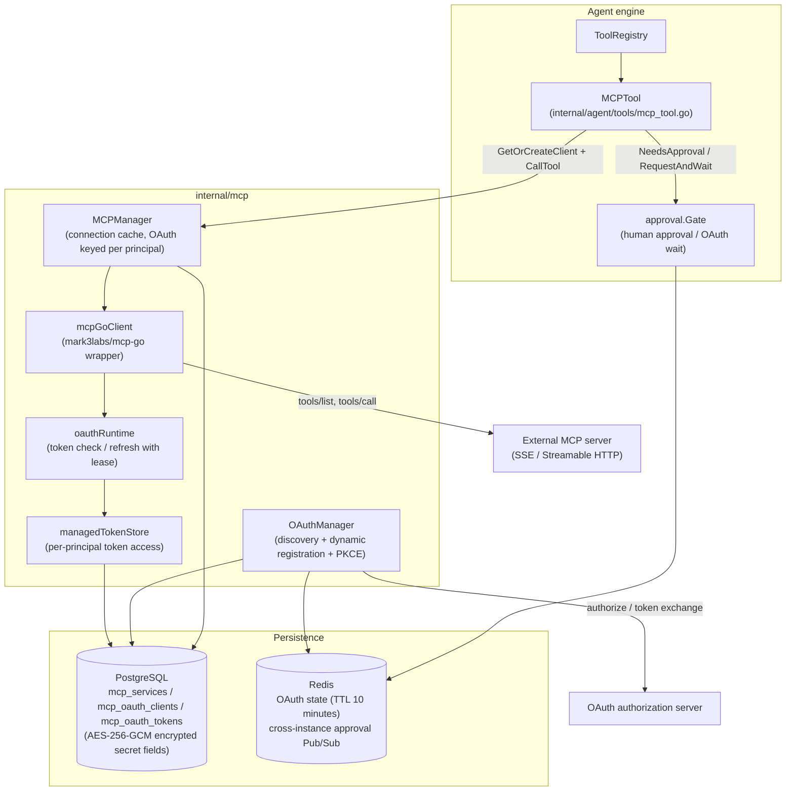
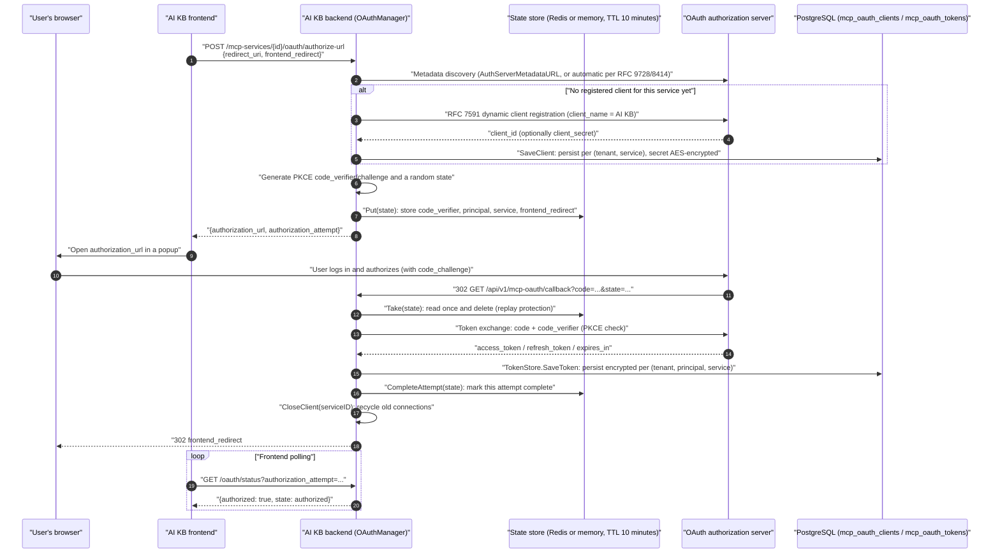
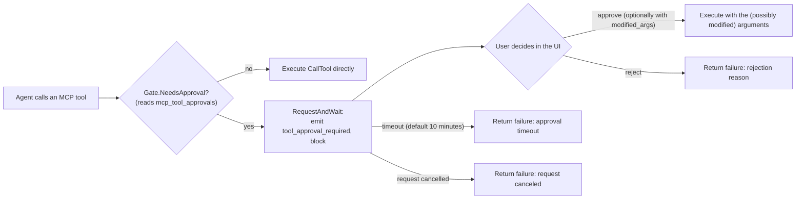
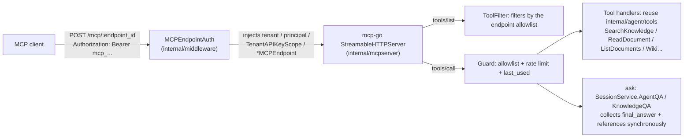

# MCP (Model Context Protocol) integration

MCP connects agents to external tools. AI KB works in both directions: it connects to external MCP servers, and it runs its own MCP server for other clients.

1. **AI KB as an MCP client.** Under Toolbox → MCP services, register any external MCP server (SSE or Streamable HTTP). Its tools are loaded on demand from a directory and called by agents during a conversation. Three authentication strategies are supported (API key, Bearer, OAuth 2.0 with dynamic client registration and PKCE), plus per-tool enable and approval switches and in-conversation OAuth authorization.
2. **AI KB as an MCP server.** Under Settings → Publish & Integrations → MCP Server, create one or more MCP endpoints for the current workspace. Each endpoint has its own token, knowledge base scope and tool list. Claude Desktop, Cursor, Claude Code, VS Code Copilot and other MCP clients connect over Streamable HTTP with no extra process to deploy. The Python service under `mcp-server/` is the previous approach and is deprecated.

Connecting external services extends what AI KB agents can do; running the AI KB MCP server lets external clients use knowledge base retrieval, question answering and management.

A workspace Admin creates services in the sidebar under Toolbox → MCP services (the old Settings → MCP services link redirects there), fills in the connection, syncs the tools, writes usage instructions, and then selects the services in an agent. To control write or outbound operations, turn on human approval for the relevant tools; a confirmation card appears before each call.

<Screenshot
  src="/screenshots/mcp-services.png"
  caption="MCP services: connecting an external tool service and its tool list"
  hint="Shows the MCP service list, one service's configuration form (URL, authentication) and the tools discovered after a connectivity test." />

Connection methods, authentication and tool scope are described below.

---

## Connecting external tools

Here you register an external MCP server so that agents in this workspace can call its tools.

The MCP management page searches by service name and by the usage note shown on each card. The search ignores case; every space-separated keyword must match. When no usage note is set, the service description is searched instead. Clear the search when nothing matches.

Creating a service takes two steps:

1. **Connection.** Enter a name and the service URL, choose SSE or Streamable HTTP, and configure authentication (none or custom headers, API key or token, OAuth 2.0), the timeout and retries. "Import from code" pastes a standard `mcpServers` JSON block and fills the form; stdio configurations that only carry `command` and `args` are not supported. After saving you can test the connection. For an OAuth service, clicking "Authorize" saves the configuration first and then starts authorization as the current user.
2. **Tools and usage instructions.** Connect and fetch the tools. The full tool descriptions and parameter definitions are saved. Then write the usage instructions: what the service is for, when to use it and the key constraints. Once tools are synced, "AI generate" drafts a short note from the enabled tools for you to review and save. In the tool list, each tool has "Enabled" and "Requires approval" switches. Changes apply immediately and a directory refresh does not overwrite them.

The model reads the service's usage instructions first and loads individual tools on demand, so the instructions decide whether the agent picks the right service. OAuth services are authorized per caller. When a tool requires approval, you check the arguments in the conversation and confirm. A tool that has been disabled individually is not executed at runtime. The AI KB MCP client does not support stdio transport.

## Serving external clients

Here you publish this workspace's knowledge bases as an MCP server that Claude Desktop, Cursor and similar clients connect to.

Create an endpoint under Settings → Publish & Integrations → MCP Server: enter a name, pick the knowledge bases it may access (empty means all), tick the tools to expose, and optionally set the default agent that `ask` uses (empty means the built-in Quick Answer) and the per-minute call limit (default 60). After creation the token and the address `/mcp/<endpoint_id>` are shown once. The page also shows the `mcpServers` configuration for Cursor, VS Code and Claude Desktop, a one-line Claude Code command, and the `mcp-remote` bridge for clients that only support stdio.

With a custom reverse proxy, forward `/mcp/` to the AI KB backend with the path unchanged, in addition to `/api/`. Preserve the `Authorization` header and the MCP protocol headers, disable response buffering, and set read and write timeouts long enough for long-lived connections. The Nginx, Vite dev and Vite preview configurations shipped in the repository already include this proxy, so clients connect through the site's domain without exposing backend port 8080.

<Screenshot
  src="/screenshots/mcp-server-endpoint.png"
  caption="Publish & Integrations → MCP Server: address, token and client configuration after creating an endpoint"
  hint="The result page after creating an endpoint: the one-time token and the /mcp/<endpoint_id> address, the mcpServers configuration for Cursor and Claude Desktop and the Claude Code command; the endpoint's knowledge base scope and four tool groups are visible in the background." />

A workspace can have several endpoints. For example, a support team gets an endpoint with retrieval and question answering over two knowledge bases, and a content team gets another with write tools enabled. Tokens can be rotated at any time, endpoints can be disabled at any time, and deleting an endpoint disconnects its clients immediately.

The exposed tools are chosen in four groups. Only read-only tools are enabled by default:

| Group | Tools | Notes |
| --- | --- | --- |
| Retrieval and reading | `list_knowledge_bases`, `search_knowledge`, `grep_chunks`, `list_documents`, `read_document` | Knowledge base parameters accept an ID or a name. `search_knowledge` picks the retrieval method with `mode` (hybrid, semantic or keyword) and accepts `limit` (default 10, max 30). `grep_chunks` keeps case-insensitive regular expression semantics: the literal terms in the pattern become the keyword index query (bases without a keyword index use the semantic index for candidates), each candidate is then checked against the regular expression, and every returned chunk matches the pattern. A pattern with no literal text (such as `^\d+$`) is rejected. `read_document` pages with `offset` and `limit`, or finds a phrase inside the document with `query` |
| Question answering | `ask` | Runs only the endpoint's default agent (clients cannot choose one; the built-in Quick Answer is used when none is configured). The server creates the session, returns the full answer with citations and a `session_id`, which you pass back to continue the conversation. Web search is off |
| Wiki | `wiki_search`, `wiki_read_page`, `wiki_index` | Only for knowledge bases with Wiki enabled. The `query` of `wiki_search` keeps regular expression semantics (case-insensitive); text that is not a valid regular expression is matched literally. `regex=false` forces a literal match and `regex=true` requires a valid regular expression |
| Write | `add_document`, `update_document`, `delete_document` | Off by default. Import from Markdown text or from a URL |

Results from these MCP tools reuse the resource link conversion of the REST and IM surfaces: image references in body text, Wiki content and structured data are converted, after a permission check, into directly accessible HTTP(S) links. No new tool and no change to the endpoint tool list is needed. `references[].images` in `ask` keeps the image URL, caption and OCR text, and the text reference list also contains the image links, so image information survives truncation of the body summary.

For local or private storage, set `APP_EXTERNAL_URL` to an address external clients can reach and make sure the reverse proxy forwards `/r/`. `resource://` images use the time-limited `/r/<token>` links; other storage addresses use the HTTP(S) URL generated by the storage service. Within one tool call each resource is converted once, and the returned links are not written back to the document or the session. When no accessible link can be generated, the original reference is kept and the text result is not interrupted.

Before generating a link, the endpoint's knowledge base scope, sharing permissions, the resource's workspace and a valid document binding are re-checked with the same rules as knowledge base image previews. An endpoint with no knowledge base restriction is judged by the knowledge bases the caller can view, so images from shared knowledge bases that `ask` retrieved through the agent are converted too. An original uploaded file does not get a download link just because it appears in result text. Historical storage paths with an existing binding are converted. Historical documents without an image binding must be re-parsed by an administrator with permission and then retrieved again; file permissions are never granted from editable body text or `image_info` alone.

> **`grep_chunks` recall is bounded.** It takes candidates from the index, at most 30 per call, and then filters with the regular expression. Every returned chunk matches the pattern, but the result is not exhaustive: a matching chunk in the base may not have entered the candidate pool. Three cases miss easily. Combined patterns such as `foo.*bar`: candidates are ranked by relevance to foo and bar, and the chunk where they actually appear together may not rank in the top 30. Patterns that are almost all symbols such as `C++`: the only literal term extracted is `C`, which has almost no discriminating power in the index. Bases without a keyword index use the semantic index for candidates, so literal matching depends more on luck. The old implementation scanned the whole chunks table with a regular expression, which guaranteed a hit when one existed, but it was too expensive on large data and has been removed. To search one document exhaustively, use `query` on `read_document`, which scans the whole document in order.

The tools reuse the agent's native tools (`internal/agent/tools/`), and authorization reuses the API key scope model: the endpoint is converted into a scope that only carries capabilities such as retrieve, chat and ingest and is limited to its knowledge bases, so the checks in each backend service are identical to those for a restricted API key. Implementation details are in the built-in MCP server reference below.

## Comparing the two directions

Use this table to decide which direction you need.

| Aspect | AI KB as an MCP client | AI KB as an MCP server |
| --- | --- | --- |
| Code | `internal/mcp/` + handler, service and repository layers + `internal/agent/tools/` | `internal/mcpserver/` + `internal/middleware/mcp_endpoint_auth.go` + `internal/handler/mcp_endpoint.go` |
| Protocol library | `github.com/mark3labs/mcp-go` (client) | `github.com/mark3labs/mcp-go` (server, Streamable HTTP, stateless mode) |
| Transport | SSE, Streamable HTTP (stdio disabled for security) | Streamable HTTP; stdio clients bridge through `mcp-remote` |
| Authentication | API key, Bearer, OAuth 2.0 (DCR + PKCE, AES-encrypted tokens isolated per principal) | Inbound `Authorization: Bearer mcp_...`, one token per endpoint (stored as SHA-256, rotatable) |
| Security controls | Per-tool human approval, SSRF validation, untrusted-output prefix, DTO-level secret isolation | Per-endpoint tool allowlist (checked on list and on call), knowledge base scope, per-minute rate limit, token shown once |
| Consumer | AI KB agents (called automatically in conversation) | Any MCP client: Claude Desktop, Cursor, Claude Code, VS Code Copilot and others |

## Configuration and implementation reference

This section is for operators and developers who need the exact code paths, data model and protocol behavior behind both directions.

### MCP client reference

#### Overall architecture

The MCP client code is spread across these layers:

| Layer | Path | Responsibility |
| --- | --- | --- |
| Protocol client | `internal/mcp/client.go`, `types.go`, `errors.go` | Wraps `github.com/mark3labs/mcp-go` behind the `MCPClient` interface (Connect, Initialize, ListTools, CallTool, ListResources, ReadResource) |
| Connection management | `internal/mcp/manager.go` | `MCPManager` caches and reuses connections; OAuth services get one connection per principal |
| OAuth | `internal/mcp/oauth_manager.go`, `oauth_lifecycle.go`, `oauth_state.go`, `oauth_tokenstore.go` | Authorization code flow, token lifecycle and refresh, in-flight state storage, token persistence |
| Data model | `internal/types/mcp.go`, `internal/types/mcp_oauth.go` | `MCPService`, `MCPAuthConfig`, `MCPToolApproval`, `MCPOAuthClient`, `MCPOAuthToken` (with AES encryption hooks) |
| HTTP layer | `internal/handler/mcp_service.go`, `mcp_credentials.go`, `mcp_oauth.go`, `internal/handler/dto/mcp.go` | MCP service CRUD, the credentials sub-resource, OAuth authorization and approval resolution; DTOs guarantee responses never leak secrets |
| Service layer | `internal/application/service/mcp_service.go`, `mcp_tool_approval_service.go` | Service CRUD, connection tests, connection recycling after credential changes, approval policy |
| Repository layer | `internal/application/repository/mcp_service.go`, `mcp_oauth.go`, `mcp_tool_approval_repository.go` | GORM persistence (`mcp_services`, `mcp_oauth_clients`, `mcp_oauth_tokens`, the tool approval table) |
| Agent integration | `internal/agent/tools/mcp_tool.go`, `mcp_oauth.go`, `internal/agent/approval/gate.go` | Wraps MCP tools as agent tools, the human approval gate, in-conversation OAuth waiting |



#### Data model and transports

The core entity `MCPService` is defined in `internal/types/mcp.go`:

```go
type MCPService struct {
    ID                string             `json:"id"                     gorm:"type:varchar(36);primaryKey"`
    TenantID          uint64             `json:"tenant_id"              gorm:"uniqueIndex:idx_tenant_name"`
    Name              string             `json:"name"                   gorm:"type:varchar(255);not null;uniqueIndex:idx_tenant_name"`
    Description       string             `json:"description"            gorm:"type:text"`
    UsageInstructions string             `json:"usage_instructions"     gorm:"type:text;not null;default:''"`
    Enabled           bool               `json:"enabled"                gorm:"index"`
    TransportType     MCPTransportType   `json:"transport_type"         gorm:"type:varchar(50);not null"`
    URL               *string            `json:"url,omitempty"          gorm:"type:varchar(512)"`
    Headers           MCPHeaders         `json:"headers"                gorm:"type:json"`
    AuthConfig        *MCPAuthConfig     `json:"auth_config"            gorm:"type:json"`
    AdvancedConfig    *MCPAdvancedConfig `json:"advanced_config"        gorm:"type:json"`
    IsBuiltin         bool               `json:"is_builtin"             gorm:"default:false"`
    // ... StdioConfig / EnvVars / timestamps / soft delete
}
```

Transports (`MCPTransportType`):

| Transport | Constant | Status | Notes |
| --- | --- | --- | --- |
| SSE | `sse` | Supported | Server-Sent Events; `client.NewSSEMCPClient`, or `client.NewOAuthSSEClient` with OAuth |
| Streamable HTTP | `http-streamable` | Supported | MCP Streamable HTTP; `client.NewStreamableHttpClient`, or `client.NewOAuthStreamableHttpClient` with OAuth |
| Stdio | `stdio` | **Disabled** | Rejected for security (command injection risk) in `NewMCPClient`, `MCPManager.GetOrCreateClient`, `CreateMCPService` and `UpdateMCPService` with `"stdio transport is disabled for security reasons"` |

> Note: the type system still has `MCPTransportStdio` and the `StdioConfig` fields (`command` and `args`), and `mcp_tool.go` still has a stdio branch for connection release, but every runtime entry point that would create a stdio client is blocked. Only SSE and Streamable HTTP are usable.

Advanced configuration `MCPAdvancedConfig` (defaults from `types.GetDefaultAdvancedConfig()`): `timeout` 30 seconds, `retry_count` 3, `retry_delay` 1 second. `timeout` applies to both the HTTP client timeout and the initialize handshake (the initialize timeout is capped at 60 seconds in `manager.go`). A single agent tool call has a 60 second window by default. A service `timeout` above 60 seconds extends that service's CallTool window; a smaller value does not shorten it (`callToolTimeout` in `internal/agent/tools/mcp_tool.go`).

#### Authentication strategies

`MCPAuthConfig.AuthType` defines four strategies (`internal/types/mcp.go`):

| `auth_type` | Behavior (`applyAuthHeaders` in `internal/mcp/client.go`) |
| --- | --- |
| `""` (none) | No authentication. For backward compatibility, if legacy data still contains `api_key` or `token`, the corresponding header is injected as before |
| `api_key` | Injects `<APIKeyHeader>: <APIKey>`. The header name defaults to `X-API-Key` and can be changed through the non-secret field `api_key_header` |
| `bearer` | Injects `Authorization: Bearer <Token>` |
| `oauth` | Per-user (principal) OAuth 2.0 authorization code flow; tokens are stored in `mcp_oauth_tokens`. See the OAuth 2.0 authorization flow below |

The strategies are **mutually exclusive**. `applyAuthHeaders` injects only the header of the selected strategy (the old implementation sent api_key and bearer together). `custom_headers` is structural configuration: it is always added and can override the strategy header.

**Encrypted secret storage.** `MCPAuthConfig` implements `driver.Valuer` and `sql.Scanner`. On write, when `SYSTEM_AES_KEY` is configured, `APIKey` and `Token` are AES-256-GCM encrypted (with the `enc:v1:` prefix). On read they are decrypted transparently. When decryption fails (key lost or rotated) the value is treated as "not configured" and logged; ciphertext is never used as plaintext.

#### Connection lifecycle and MCPManager

`MCPManager` in `internal/mcp/manager.go` keeps a `map[cacheKey]MCPClient` connection cache:

- **Cache key** (the `cacheKey` function): non-OAuth services share one connection per `service.ID`; OAuth services use `service.ID + "\x00" + principal.StorageID()`, **one connection per identity**, so every user connects with their own token.
- **GetOrCreateClient**: checks the cache first (reused only when `IsConnected()`), otherwise `NewMCPClient` → `Connect` (with the manager's long-lived context, because SSE needs a persistent connection) → `Initialize` (bounded by the timeout) → store in the cache. For OAuth services the `TenantID` and `MCPOAuthPrincipalFromContext` are taken from the context (embed channels map to a per-visitor principal).
- **CloseClient(serviceID)**: disconnects and removes every cached connection of the service, including all per-principal OAuth connections of the form `serviceID\x00principal`. It is called after credential changes, after disabling or reconfiguring the service, and after OAuth authorization completes or is revoked, to force a reconnect on the next call.
- **Background cleanup**: `removeDisconnectedClients()` runs every 5 minutes and drops disconnected clients.
- **Session self-healing**: `checkErrorAndDisconnectIfNeeded` in `client.go` recognizes the server errors `"Invalid session ID"` and `"No active connection"` (both SSE and Streamable HTTP use `Mcp-Session-Id` sessions) and disconnects so the next call rebuilds the session. The `OnConnectionLost` callback does the same.

The client identifies itself in the `Initialize` handshake as:

```go
ClientInfo: mcp.Implementation{ Name: "AI KB", Version: "1.0.0" }
```

#### REST API endpoints

Routes are registered by `RegisterMCPServiceRoutes` (`internal/router/`), all under `/api/v1`:

| Method | Path | Permission | Description |
| --- | --- | --- | --- |
| POST | `/mcp-services` | Admin+ | Create an MCP service (the URL passes the SSRF check `secutils.ValidateURLForSSRF`) |
| GET | `/mcp-services` | Viewer+ | List the current workspace's MCP services (including builtin ones) |
| GET | `/mcp-services/{id}` | Viewer+ | Service details (redacted through the DTO) |
| PUT | `/mcp-services/{id}` | Admin+ | Update a service. The main PUT **ignores** `auth_config.api_key` and `auth_config.token` (with a deprecation warning) |
| DELETE | `/mcp-services/{id}` | Admin+ | Delete a service (soft delete, `CloseClient` first) |
| POST | `/mcp-services/{id}/test` | Admin+ | Connection test: a temporary client runs Connect and Initialize and tries to list tools and resources. A listing failure is a failed test when the server declares that capability; otherwise it is logged and treated as an empty list. Returns `MCPTestResult` (with the `oauth_required` flag) |
| GET | `/mcp-services/{id}/tools` | Viewer+ | Fetch the service's tool list |
| GET | `/mcp-services/{id}/metadata` | Viewer+ | Read the cached tool directory (see "Managing the persistent directory") |
| POST | `/mcp-services/{id}/metadata/refresh` | Viewer+ (Admin for static authentication) | Connect upstream and replace the cached directory |
| POST | `/mcp-services/{id}/usage-instructions/generate` | Admin+ | Generate usage instructions from the enabled tools |
| GET | `/mcp-services/{id}/resources` | Viewer+ | Fetch the service's resource list |
| PUT | `/mcp-services/{id}/credentials` | Admin+ | Write the `api_key` and `token` credentials (see below) |
| DELETE | `/mcp-services/{id}/credentials/{field}` | Admin+ | Clear one credential field (`api_key` or `token`); idempotent, returns 204 on success |
| GET | `/mcp-services/{id}/tool-approvals` | Viewer+ | List the service's tool approval policies |
| PUT | `/mcp-services/{id}/tool-approvals/{tool_name}` | Admin+ | Update a tool's enabled and approval flags: `{"enabled":bool,"require_approval":bool}`, at least one field |
| POST | `/mcp-services/{id}/oauth/authorize-url` | Viewer+ | Start OAuth authorization for the current user; returns `authorization_url` and `authorization_attempt` |
| GET | `/mcp-services/{id}/oauth/status` | Viewer+ | Query the authorization status; with the `authorization_attempt` parameter only this attempt counts |
| DELETE | `/mcp-services/{id}/oauth/token` | Viewer+ | Revoke the current user's token for the service and recycle the connection |
| GET | `/mcp-oauth/callback` | **Public** | Authorization server callback (the single-use `state` parameter is the authentication); registered outside the `/mcp-services` group to avoid clashing with the `:id` route |
| POST | `/agent/tool-approvals/{pending_id}` | Viewer+ | Approve or reject a pending tool call: `{"decision": "approve"\|"reject", "reason"?, "modified_args"?}` |
| POST | `/agent/mcp-oauth-resolutions/{pending_id}` | Viewer+ | Resume a paused agent after in-conversation OAuth (`{"service_id", "decision": "authorize"\|"cancel"}`) |
| POST | `/agent/mcp-oauth-resolutions/{pending_id}/cancel` | Viewer+ | Skip an in-conversation OAuth prompt |

The embed channel has matching session-scoped routes (`/embed/sessions/{session_id}/mcp-oauth-resolutions/...` and `/embed/sessions/{session_id}/mcp-services/{id}/oauth/...`; see `internal/handler/embed_channel.go` and `internal/router/routes_agent.go`).

##### Credentials sub-resource (mcp_credentials.go)

Secrets (`api_key` and `token`) **do not go through the main PUT**. They have their own `/credentials` sub-resource. The comment in `internal/handler/mcp_credentials.go` gives three reasons:

1. The main PUT body never carries secrets, which removes the "masked value written back over the real secret" class of bug at the contract level.
2. Saving the edit dialog (changing timeout, enabled and so on) cannot damage configured credentials.
3. The "is it configured" metadata comes back with the main resource (`MCPServiceResponse.Credentials` as `{"api_key": {"configured": bool}, "token": {...}}`), so no extra GET is needed.

Fields in the PUT body have pointer semantics: **absent = keep the current value**, **empty string = no-op** (use DELETE to remove), non-empty = replace. After a successful change, `UpdateMCPCredentials` calls `CloseClient` so the next call uses the new credentials. On the response side, `MCPServiceResponse` in `internal/handler/dto/mcp.go` guarantees **at compile time** that no secret field is present (`MCPAuthConfigResponse` has no `APIKey` or `Token` field).

#### OAuth 2.0 authorization flow

When an MCP server requires OAuth (`auth_type: "oauth"`), AI KB runs the full authorization code flow: **RFC 9728 / RFC 8414 discovery → RFC 7591 dynamic client registration → authorization code with PKCE → encrypted token persistence → automatic refresh with a distributed lease**. Tokens are isolated by `(tenant_id, principal_type, principal_id, service_id)`: for one service, every user (or embed visitor, IM user or other principal, see `internal/types/principal.go`) holds their own token.

##### Authorization sequence



##### Flow details (with source references)

- **Discovery and dynamic registration** (`internal/mcp/oauth_manager.go`): `StartAuthorization` first builds a `transport.OAuthHandler` (when `AuthServerMetadataURL` is empty, mcp-go discovers the authorization server from the MCP URL). If `mcp_oauth_clients` has no client for this `(tenant, service)`, it calls `h.RegisterClient(ctx, "AI KB")` once for RFC 7591 registration and persists it with `SaveClient`; all later users reuse the same client_id.
- **PKCE**: `transport.GenerateCodeVerifier()`, `GenerateCodeChallenge()` and `GenerateState()`. The `code_verifier` is a secret and is **stored only in server-side state** (the comment in `internal/mcp/oauth_state.go` forbids encoding it into the state parameter).
- **State store** (`oauth_state.go`): with Redis, the key is `aikb:mcp_oauth_state:<state>` (with the `AIKB_REDIS_NAMESPACE` namespace when set), so the callback can land on any backend replica. Lite mode falls back to an in-memory map with garbage collection. The TTL is fixed at 10 minutes. `Take` is a **read-and-delete** single consumption. A separate `OAuthAttempt` record without secrets is stored, and `CompleteAttempt` sets `Completed=true` only after the token is persisted, so a status query for a new popup (`status?authorization_attempt=`) **is never satisfied by an older token**.
- **Callback** (`CompleteAuthorization` in `oauth_manager.go` and `Callback` in `internal/handler/mcp_oauth.go`): the callback route is public and authenticated by the single-use state. Because the Gin request context is cancelled as soon as the browser receives the redirect, the token exchange runs under `context.WithoutCancel` with a 60 second timeout (`oauthCallbackTimeout`), detached from the request lifetime. After a successful exchange, `CloseClient(serviceID)` recycles connections that may carry old registration data, and the result is encoded in the URL fragment (`#mcp_oauth_result=success` or `#mcp_oauth_error=...`) of the redirect back to the frontend.
- **CSRF check on the rebuilt handler**: the handler is reconstructed in the callback request, so `h.SetExpectedState(state)` restores the expected state before mcp-go's CSRF check can pass.

##### Encrypted token storage (oauth_tokenstore.go and types/mcp_oauth.go)

The `mcp_oauth_tokens` table model `MCPOAuthToken` has a unique index on `(tenant_id, principal_type, principal_id, service_id)`. `AccessToken` and `RefreshToken` are AES-256-GCM encrypted (`SYSTEM_AES_KEY`) by the GORM hooks `BeforeCreate` and `BeforeSave`, decrypted by `AfterFind`, and both fields are `json:"-"`, so they never appear in API responses. The `client_secret` in `mcp_oauth_clients` is encrypted the same way.

`internal/mcp/oauth_tokenstore.go` provides two TokenStore layers:

- `dbTokenStore` implements mcp-go's `transport.TokenStore`. After authorization or refresh, mcp-go calls `SaveToken` to persist the token (a missing `TokenType` becomes `Bearer`, `ExpiresIn` is converted to `ExpiresAt`).
- `managedTokenStore` is the wrapper the runtime transport actually uses. **`GetToken` clears `ExpiresAt`** so mcp-go always treats the token as valid and the library's own automatic refresh is disabled. Refresh decisions belong entirely to AI KB's coordinated lifecycle; otherwise the library would bypass the cross-instance lease and collapse refresh failures into a generic authorization-required error.

##### Token refresh and the cross-instance lease (oauth_lifecycle.go)

Every MCP operation (Connect, Initialize, ListTools, CallTool and so on) runs through the generic wrapper `oauthCall` in `client.go`:

```go
// Before the operation: ensureFresh(force=false) pre-check.
// On a 401: force ensureFresh(force=true) once and retry once.
// Other errors are not retried, to avoid repeating tool side effects after ambiguous network failures.
```

The rules of `oauthRuntime.ensureFresh`:

- Expiry is predicted with a **30 second skew** (`oauthRefreshSkew`): a token whose `ExpiresAt` is within 30 seconds needs a refresh. A **token without a refresh_token keeps its full real lifetime**; the skew does not shorten it.
- Expired with no refresh_token → the token row is deleted and `OAuthReauthorizationRequiredError` is returned (the user must authorize again).
- When a refresh is needed, `refreshWithLease` takes a **database-level refresh lease** on the `mcp_oauth_tokens` row through the `refresh_lease_id` and `refresh_lease_until` columns (45 seconds by default, raised with the HTTP timeout). `TryAcquireTokenRefreshLease` claims it with a conditional UPDATE. Instances that lose the race poll every 100 ms and reuse the token as soon as they observe that a concurrent refresher updated it and it is not about to expire. **In a multi-instance deployment one refresh_token is consumed exactly once** (safe under refresh token rotation).
- Refresh failures are classified (`permanentRefreshFailure`): `invalid_grant`, `invalid_token`, `bad_refresh_token`, `expired_token` (or HTTP 400) → permanent, the token is deleted and re-authorization is required; `invalid_client`, `unauthorized_client` (or HTTP 401) → the dynamic registration record in `mcp_oauth_clients` is deleted too (the next authorization registers again); anything else (network issues and the like) → `OAuthRefreshTemporaryError`, the token is **kept** and the failure is raised as operational, without a new authorization popup.

`AuthorizationStatus` exposes this as three states: `authorized` (usable now), `refreshable` (expired but has a refresh_token) and `reauth_required`.

##### Guidance when the server requires OAuth

If a service is **not** configured for OAuth but the target MCP server answers the handshake with a 401 carrying RFC 9728 protected-resource metadata, `asOAuthRequired` in `client.go` wraps it as `OAuthRequiredError`. `TestMCPService` (`mcpTestFailure` in `internal/application/service/mcp_service.go`) sets `oauth_required: true` in the test result, and the UI suggests switching the authentication method to OAuth instead of showing a bare 401. A **bare 401 without metadata does not redirect to OAuth** (the API key may simply be wrong).

##### In-conversation OAuth

When an agent calls an OAuth MCP tool and the current user has not authorized yet, the call does not fail outright (`internal/agent/tools/mcp_oauth.go`):

1. `getOrCreateMCPClientWithOAuthRetry` catches authorization-required errors (`isAuthorizationRequired`).
2. `approval.Gate.RequestOAuthAndWait` publishes an `EventMCPOAuthRequired` event to the frontend EventBus (with `pending_id`, the service and tool names and the timeout in seconds) and **blocks**. The wait uses the agent's `mcp_auth_wait_timeout` (`internal/types/custom_agent.go`), or the Gate default when unset.
3. The user completes the standard flow above in the popup, then the frontend calls `POST /agent/mcp-oauth-resolutions/{pending_id}`. The handler (`ResolveMCPOAuth` in `mcp_oauth.go`) **first verifies that `(tenant, principal, service)` really holds a token** before releasing (otherwise 409), so the resumed call does not fail again. The user can also `cancel` to skip.
4. After release, `CloseClient` and one reconnect and retry of the original call. A timeout or cancel returns a rejection decision.
5. **Non-interactive channels** (IM bots and the like, with `types.WithMCPOAuthNonInteractive` set on the context) do not block: `emitMCPOAuthRequiredNotice` sends one notification event with `TimeoutSeconds: 0`, asking the user to authorize out of band in the web console, and the agent skips the tool and continues.

#### Tool discovery and agent integration (mcp_tool.go)

At agent startup, `internal/application/service/agent_service.go` selects MCP services by the agent's configuration:

| `mcp_selection_mode` | Behavior |
| --- | --- |
| `all` (default) | Registers every enabled MCP service in the workspace (including builtin ones) |
| `selected` | Registers only the services listed in `mcp_services` |
| `none` | Registers no MCP tools |

Production uses the persistent directory with on-demand loading by default. When there are no historical tools to restore, the model initially sees only `discover_mcp_tools` and a source summary of the authorized services. Only after a complete definition is obtained are the matching function and `call_mcp_tool` exposed. All upstream schemas are never sent to the model at once.

1. `PrepareMCPTools` reads the persisted snapshot without opening upstream connections for preloading; a missing or stale directory is reported as such. Runtime directory completion is still bound by permissions and the OAuth principal.
2. The model locates tools with `list_tools` or `search`, then `describe` returns the full tool definition and a `tool_ref`. A list summary is not a callable definition.
3. Described tools are published as ordinary functions before the next model request. A new engine can restore used tools from the session history or call them through the `call_mcp_tool` proxy.
4. At execution time the service, principal, tool policy and argument schema are checked again before the approval, OAuth and remote call chain. The directory cache does not cache permission decisions.

Function names carry a stable hash suffix of the service ID and original tool name to avoid collisions after sanitizing. A reference is bound to a specific schema and must be read again after the definition changes. Schema validation never fetches external URLs or files, and arguments modified during approval are validated too. Service descriptions and tool results are treated as external data: they cannot override the user's request or widen permissions.

A mention is only a preference; it does not change the agent's `all`, `selected` or `none` scope. Exposing every function at once remains available as a compatibility path, not the production default.

##### Managing the persistent directory {#mcp-tool-directory}

The settings page saves the connection first, then edits the usage instructions and syncs the tools. An existing directory can be viewed offline. After a connection or authentication change the old snapshot is marked `stale` and must be refreshed before the runtime uses it; a failed refresh never overwrites the previous snapshot with an incomplete directory.

| Content | Where it is stored and how it is updated |
| --- | --- |
| Human-written usage instructions | `mcp_services.usage_instructions`; a refresh does not overwrite it. `description` is kept only for legacy compatibility |
| Upstream description, server identity, full tools and schemas | `mcp_metadata`; saved atomically after a complete fetch |
| Per-tool enabled and approval flags | `mcp_tool_approvals`; independent of directory refreshes |
| Directory isolation | `(tenant_id, service_id, principal)`; static authentication shares one directory per workspace, OAuth isolates by the authorized principal |

`GET /mcp-services/:id/metadata` reads the cache only and returns `data: null` before the first sync; `POST /mcp-services/:id/metadata/refresh` explicitly connects upstream and syncs. Refreshing a static-authentication directory requires Admin or the matching management capability; OAuth users can refresh their own authorized directory. The prefix is `/api/v1`; see [MCP API](../04-api/02-api-agent-mcp.md).

At runtime `list_tools(refresh=true)` fetches upstream again and tries to save the snapshot for the current principal, rather than re-reading the database. A refresh has a timeout and a directory size limit; on failure the error state is kept. A cached success does not mean the upstream is reachable now. Services that had no complete directory before an upgrade need a first sync.

#### Human approval of tool calls

**Approval granularity**: the `(tenant_id, service_id, tool_name)` triple. One `MCPToolApproval` row records `enabled` and `require_approval`, which decide whether the tool is available and whether a call needs approval. The tool list itself comes from MCP `ListTools`; the table only stores overrides (see the comment in `internal/types/mcp.go`). The repository (`internal/application/repository/mcp_tool_approval_repository.go`) upserts atomically with `ON CONFLICT (tenant_id, service_id, tool_name)`; `IsRequired` treats a missing row as "no approval needed".

**Approval flow** (`internal/agent/approval/gate.go`):



Key implementation points:

- **Blocking and resuming**: `RequestAndWait` generates a `pending_id`, publishes `EventToolApprovalRequired` to the EventBus (with the tool name, the arguments as JSON and the timeout in seconds) and waits on an in-memory waiter. The user releases it through `POST /agent/tool-approvals/{pending_id}` with `decision: approve|reject`. After approval, `mcp_tool.go` **derives a fresh full tool execution timeout from ApprovalCtx** (the approval may have used up the original 60 second budget).
- **Argument modification**: `approve` may carry `modified_args` (a non-null JSON object; the handler explicitly rejects `"null"`), which replaces the original arguments before execution.
- **Authorization**: Resolve checks the tenant and the session owner (`ErrTenantMismatch` and `ErrUserMismatch`; an empty userID counts as a mismatch, fail-close). A repeated decision returns `ErrAlreadyResolved`.
- **Cross-instance**: the waiter lives in the memory of the instance that started the wait. With Redis configured, a Resolve that lands on another replica is broadcast over the `aikb:mcp_approval:resolve` Pub/Sub channel; the owning instance delivers the decision and acknowledges on a per-pending reply channel (3 second window), so the HTTP status code stays accurate across instances. Without Redis it degrades to single-instance operation (sticky sessions required).
- **Timeout and failure policy**: the wait defaults to 10 minutes and is configurable with `config.Agent.ToolApprovalTimeoutSeconds`. The approval check is **fail-close** by default: a database error counts as "approval required". Set `AIKB_AGENT_TOOL_APPROVAL_FAIL_OPEN=true` to restore the old fail-open behavior.

#### Disabling individual tools

In an MCP service's tool list you can disable one tool while keeping the service's other tools. A missing row counts as enabled=true. Disabling affects runtime tool registration and is checked again at call time, so an open session cannot keep calling a disabled tool.

`PUT /mcp-services/:id/tool-approvals/:tool_name` accepts at least one of `enabled` and `require_approval`; an omitted field keeps its value. Turning off human approval is not the same as disabling the tool. See the [API reference](../04-api/02-api-agent-mcp.md).

#### Builtin MCP services

The `mcp_services.is_builtin` flag (introduced by migration `migrations/versioned/000017_mcp_builtin.up.sql`) marks a built-in service shared across workspaces:

- **Visibility**: every repository query uses `tenant_id = ? OR is_builtin = true` (`internal/application/repository/mcp_service.go`), so builtin rows are visible to all tenants.
- **Immutable**: `UpdateMCPService`, `DeleteMCPService`, `UpdateMCPCredentials` and `ClearMCPCredential` all reject builtin rows ("builtin MCP services cannot be updated/deleted/have credentials modified").
- **Response redaction**: `dto.NewMCPServiceResponse` additionally strips `URL`, `Headers`, `EnvVars`, `StdioConfig`, `AuthConfig` and the `Credentials` metadata from builtin services. These fields could reveal how the platform configures the upstream provider and must not leak to tenants.

There is no hard-coded list of builtin MCP services in the code (`builtin_agents.yaml` and `builtin_models.yaml.example` under `config/` are unrelated to MCP). Builtin rows are provisioned directly in the database by the platform operator (`is_builtin = true`); the application only displays and protects them by the rules above.

---

### Built-in MCP server reference

#### Protocol compatibility

The built-in `/mcp/:endpoint_id` serves both `2026-07-28` and `2025-11-25` clients with the same URL, Bearer token, tool allowlist and knowledge base scope. New clients discover capabilities through `server/discover` and send protocol metadata and the matching HTTP headers on every request; older clients keep using `initialize`. Browser preflight allows the protocol request headers `Mcp-Method`, `Mcp-Name` and others. Discovery and listing responses default to `cacheScope=private` and `ttlMs=0`, so a permission-restricted directory is never shared from a cache.

Calling a tool outside the allowlist returns JSON-RPC `-32602` and the tool does not run; this differs from older SDKs, which returned a tool result with `isError=true`. Knowledge base violations are still rejected by the existing scope checks.

When AI KB calls external MCP services, `mcp-go v1.1.1` negotiates per peer: it tries the new discovery first and falls back to legacy initialization. A legacy server that ignores the discovery request adds up to about 5 seconds of probing (each probe is capped at 2.5 seconds, or a quarter of the service timeout, and runs at most twice). Probe failures such as 401 or 503 also fall through to legacy initialization; when both fail, the initialization error is returned. A cancelled or timed-out parent request is never recorded as a successful initialization. This negotiation does not depend on the protocol version of the client calling AI KB.

The external tool directory keeps the full JSON Schema. New-protocol tool calls generate `Mcp-Param-*` request headers from the schema's `x-mcp-header` annotations. A failed directory refresh never replaces the parameter header definitions of the last complete directory with partial results, and they are cleared on disconnect.

#### Data model and management API

The `mcp_endpoints` table (PostgreSQL migration `000102_mcp_endpoints`, SQLite `000022_mcp_endpoints`) holds one row per endpoint: `tenant_id`, `name`, `description`, `enabled`, `token_hash` (SHA-256), `token_hint` (a prefix for display), `knowledge_base_ids` (an empty array means every knowledge base in the workspace), `tools` (the allowlist), `default_agent_id` (empty means the built-in Quick Answer), `rate_limit_per_minute` (default 60, maximum 6000) and `last_used_at`. The type is defined in `internal/types/mcp_endpoint.go` and the tool catalog in `internal/types/mcp_endpoint_tools.go`.

The management API lives under `/api/v1/mcp-endpoints`. Reads need Viewer, changes need Admin, and API keys need the `manage_channels` capability (fields and examples in [MCP API](../04-api/02-api-agent-mcp.md#mcp-server-endpoints-api-v1-mcp-endpoints)):

| Method | Path | Description |
| --- | --- | --- |
| GET | `/mcp-endpoints` | List |
| GET | `/mcp-endpoints/tools` | Tool catalog (groups and default selection) |
| POST | `/mcp-endpoints` | Create; the response contains the one-time `token` |
| GET / PUT / DELETE | `/mcp-endpoints/:endpoint_id` | Details / update / delete |
| POST | `/mcp-endpoints/:endpoint_id/rotate-token` | Rotate the token; the response contains the new `token` |

An endpoint token is a new credential, so a restricted API key can only create, modify or rotate endpoints that stay within its own permissions: the endpoint's knowledge bases must be inside the key's knowledge base allowlist (when the key has one, the endpoint cannot be left empty, because empty means every knowledge base in the workspace), and the capabilities the endpoint's tools need (retrieve, chat, ingest and so on) must already belong to the key. Otherwise the request returns 403.

#### Request path



- The public route `/mcp/:endpoint_id` is registered before the global Auth middleware, at the same level as the public embed routes. `MCPEndpointAuth` parses the token and, through `applyAuthSession`, injects the tenant, a synthetic user, the `mcp_endpoint` principal and a `TenantAPIKeyScope` derived from the endpoint (`types.MCPEndpointScope`). Downstream services use it for knowledge base scope and capability checks.
- There is one global `MCPServer` instance with the full tool catalog. `WithToolFilter` filters `tools/list` by the endpoint in the request context, and `WithToolHandlerMiddleware` checks the allowlist again on `tools/call` and applies a per-endpoint sliding-window rate limit (Redis first, local fallback).
- The transport runs with `WithStateLess(true)`, so any replica can serve any request and clients do not need to keep an `Mcp-Session-Id`.
- Sessions created by the `ask` tool are owned by `mcp_endpoint:<tenant>:<endpoint>`, and a follow-up checks that `session_id` belongs to the same endpoint. One answer is limited to 4 minutes.
- Document-level tools (list, read, write) resolve permissions with `access.ResolveKB` first and then run in the knowledge base's own workspace, so knowledge bases shared by an organization can be read and written, and new documents land in the owner's workspace.

#### Client configuration examples

```json
{
  "mcpServers": {
    "ai-kb-docs": {
      "url": "https://your-ai-kb.example.com/mcp/<endpoint_id>",
      "headers": { "Authorization": "Bearer mcp_xxxxxxxx" }
    }
  }
}
```

Claude Code:

```bash
claude mcp add --transport http ai-kb-docs https://your-ai-kb.example.com/mcp/<endpoint_id> --header "Authorization: Bearer mcp_xxxxxxxx"
```

Clients that only support stdio:

```json
{
  "mcpServers": {
    "ai-kb-docs": {
      "command": "npx",
      "args": ["-y", "mcp-remote", "https://your-ai-kb.example.com/mcp/<endpoint_id>", "--header", "Authorization: Bearer mcp_xxxxxxxx"]
    }
  }
}
```

### Python MCP server reference (legacy, deprecated)

::: warning Deprecated
The Python service under `mcp-server/` predates the built-in MCP server: each process is bound to one API key, can reach one workspace, and maps tools one-to-one onto REST calls. New deployments use the built-in MCP server above. This section is only for users still running the old approach; a later version removes the directory.
:::

`mcp-server/` is a standalone Python package named **`ai-kb-mcp`** (version 1.1.2, Python >= 3.11, depending on `mcp>=2,<3`, `requests>=2.33.0`, `starlette>=1.3.1` and `uvicorn>=0.24.0`). The core is `mcp-server/aikb_mcp_server.py`: `AIKBClient` calls the AI KB REST API with a `requests.Session` carrying `X-API-Key`, and `MCPServer("ai-kb-server", version="1.1.2")` registers the tools and serves them over the selected transport.

::: warning Package name and API changes (v1.1.x)

- The package name is `ai-kb-mcp` (`mcp-server/pyproject.toml`). It is published on PyPI as `ai-kb-mcp`. The command-line entry points are `ai-kb-mcp-server` and `ai-kb-server`.
- The implementation uses the high-level API of mcp 2.x: a tool is a plain function with the `@mcp.tool()` decorator, its parameter JSON Schema is derived from the type annotations, the description comes from the docstring, and the return value is serialized automatically. The old `handle_list_tools()` / `handle_call_tool()` dispatch is gone; adding a tool means adding one decorated function.
- Blocking network I/O (`chat` and `agent_chat`) runs in a thread pool and does not block the asyncio event loop.
:::

#### Installation

The commands below match `mcp-server/setup.py`, `pyproject.toml`, `Dockerfile` and `README.md`:

**Run from source**:

```bash
cd mcp-server
pip install -r requirements.txt
python main.py            # or python run.py / python run_server.py
```

**Install from PyPI** (two console entry points, `ai-kb-mcp-server` and `ai-kb-server`):

```bash
pip install ai-kb-mcp
ai-kb-mcp-server

# Or run without installing, through uvx
uvx --from ai-kb-mcp ai-kb-mcp-server
```

**Install from the repository**: `pip install ./mcp-server` or `uvx --from ./mcp-server ai-kb-mcp-server` from a checkout.

**Local development install**:

```bash
cd mcp-server
pip install -e .          # development mode; or pip install .
ai-kb-mcp-server
```

**Docker** (`mcp-server/Dockerfile`, based on `python:3.14-slim`, starts with the Streamable HTTP transport and exposes port 8000):

```dockerfile
ENV MCP_HOST=0.0.0.0
ENV MCP_PORT=8000
ENV AIKB_BASE_URL=http://app:8080/api/v1
EXPOSE 8000
CMD ["ai-kb-mcp-server", "--transport", "http", "--host", "0.0.0.0", "--port", "8000"]
```

The container must receive `MCP_SERVER_AUTH_TOKEN`; without it the HTTP transport refuses to start (see "Transports and network authentication"). The Compose service `mcp` (profile `full`) publishes the container on host port `${MCP_PORT:-8082}`.

The three entry scripts: `main.py` is the full main entry (`--check-only` environment check, `--verbose`, `--transport/--host/--port`); `run.py` is a thin wrapper that calls `main.sync_main`; `run_server.py` goes through `aikb_mcp_server.run` (a stdio alias).

::: tip Diagnostic output under the stdio transport
The stdio transport uses stdout as the protocol channel. Any stray `print` corrupts the protocol stream and the client reports a failed start. All diagnostic output from the entry scripts therefore goes to stderr. Follow the same rule in your own wrapper scripts.
:::

#### Environment variables

The source of truth is what `aikb_mcp_server.py` and `upload_paths.py` actually read:

| Variable | Default | Description |
| --- | --- | --- |
| `AIKB_BASE_URL` | `http://localhost:8080/api/v1` | Base URL of the AI KB API |
| `AIKB_API_KEY` | empty | Workspace API key, sent as the `X-API-Key` header |
| `AIKB_CHAT_TIMEOUT` | `300` | SSE read timeout in seconds for chat and agent_chat; an invalid value falls back to 300 |
| `AIKB_VERIFY_SSL` | `true` | Set to `false` to disable SSL certificate verification (development with self-signed certificates only) |
| `MCP_TRANSPORT` | `stdio` | Transport: `stdio`, `sse` or `http` (the `--transport` flag wins) |
| `MCP_HOST` | `127.0.0.1` | Bind address for network transports |
| `MCP_PORT` | `8000` | Bind port for network transports |
| `MCP_SERVER_AUTH_TOKEN` | empty | Shared secret, **required for the SSE and HTTP transports**; without it the process exits with `sys.exit(1)` |
| `MCP_ALLOWED_UPLOAD_DIRS` | empty | Comma-separated directory allowlist that limits the local paths `create_knowledge_from_file` may read |

#### Transports and network authentication

`main()` supports three transports (precedence: the `--transport` flag, then the `MCP_TRANSPORT` variable, then the stdio default):

| Transport | Endpoint | Use |
| --- | --- | --- |
| `stdio` | stdin/stdout pipe | Local clients such as Claude Desktop and VS Code Copilot (default) |
| `sse` | `http://host:port/sse` (messages posted to `/sse/messages/`) | Older remote MCP clients |
| `http` | `http://host:port/mcp` | Streamable HTTP (MCP 2025-03-26 specification), running as `stateless_http` by default |

The SSE message path is set explicitly with `SSE_MESSAGE_PATH = "/sse/messages/"`: after the move to mcp 2.x the default path no longer matched the mount point, which made client initialization time out.

The SSE and HTTP transports are authenticated by `MCPAuthMiddleware` (an ASGI middleware): the client must send `Authorization: Bearer <MCP_SERVER_AUTH_TOKEN>` or the `X-MCP-Auth-Token` header. The comparison uses `secrets.compare_digest` against timing attacks and a mismatch returns 401. `require_network_transport_auth` makes sure a network transport cannot start without a token.

#### Exposed MCP tools

31 tools in total, one per function decorated with `@mcp.tool()` in `aikb_mcp_server.py` (`*` marks a required parameter; the `AIKBClient.update_knowledge_base` method exists but is **not registered** as a tool):

##### Workspace management

| Tool | Parameters | Description |
| --- | --- | --- |
| `create_tenant` | `name`\*, `description`\*, `business`\*, `retriever_engines` | Create a workspace; without `retriever_engines` it defaults to the postgres keywords + vector pair |
| `list_tenants` | none | List all workspaces |

##### Knowledge base management

| Tool | Parameters | Description |
| --- | --- | --- |
| `create_knowledge_base` | `name`\*, `description`\*, `embedding_model_id`, `summary_model_id` | Create a knowledge base; default chunking is `chunk_size` 1000, `chunk_overlap` 200, separators `["."]`, multimodal enabled |
| `list_knowledge_bases` | none | List the current workspace's own knowledge bases |
| `list_shared_knowledge_bases` | none | List knowledge bases shared with the current workspace through an organization or shared space |
| `get_knowledge_base` | `kb_id`\* | Knowledge base details |
| `delete_knowledge_base` | `kb_id`\* | Delete a knowledge base |
| `hybrid_search` | `kb_id`\*, `query`\*, `vector_threshold` (0.5), `keyword_threshold` (0.3), `match_count` (5) | Vector + keyword hybrid retrieval; `kb_id` accepts a UUID **or a name** (resolved by `resolve_kb_id`) |

##### Knowledge management

| Tool | Parameters | Description |
| --- | --- | --- |
| `create_knowledge_from_file` | `kb_id`\*, `file_path`\*, `enable_multimodel` (true), `file_name` | Import a local file from the server; `file_name` may include directories such as `docs/spec/design.pdf` to place it in the matching knowledge base folder; the path is validated by `upload_paths.resolve_upload_file_path` (see "Upload path safety") |
| `create_knowledge_from_url` | `kb_id`\*, `url`\*, `enable_multimodel` (true) | Import a web page by URL |
| `create_knowledge_from_text` | `kb_id`, `title`, `content` required; `tag_ids`, `status` | Create a manual Markdown entry; `status` defaults to publish, draft only saves |
| `update_knowledge_from_text` | `knowledge_id`, `content` required; `title`, `status` | Update a manual Markdown entry; an empty title keeps the current one, publish re-indexes, draft saves a draft |
| `list_knowledge` | `kb_id`\*, `page` (1), `page_size` (20), `folder_path`, `folder_scope` | List knowledge items with paging; `folder_path` filters by folder (`""` is the root) |
| `get_knowledge` | `knowledge_id`\* | Knowledge item details |
| `delete_knowledge` | `knowledge_id`\* | Delete a knowledge item |

##### Model management

| Tool | Parameters | Description |
| --- | --- | --- |
| `create_model` | `name`\*, `type`\*, `description`\*, `source` ("local"), `base_url`, `api_key` | Create a model configuration; `type` is KnowledgeQA, Embedding or Rerank |
| `list_models` | none | List all models |
| `get_model` | `model_id`\* | Model details |

##### Session management

| Tool | Parameters | Description |
| --- | --- | --- |
| `create_session` | `kb_id`\*, `max_rounds` (5), `enable_rewrite` (true), `fallback_response`, `summary_model_id`, `title`, `description` | Create a chat session bound to a knowledge base (built-in strategy: `embedding_top_k` 10, `keyword_threshold` 0.5, `vector_threshold` 0.7 and others) |
| `get_session` | `session_id`\* | Session details |
| `list_sessions` | `page` (1), `page_size` (20) | List sessions |
| `delete_session` | `session_id`\* | Delete a session |

##### Conversation

| Tool | Parameters | Description |
| --- | --- | --- |
| `chat` | `session_id`\*, `query`\*, `knowledge_base_ids`, `web_search_enabled` (false) | The RAG pipeline (`/knowledge-chat/{session_id}`): retrieves relevant chunks and lets the LLM summarize; consumes the SSE stream and assembles `{answer, references}`; passing `knowledge_base_ids` (names or UUIDs) is strongly recommended |
| `agent_chat` | `session_id`\*, `query`\*, `agent_id`\*, `knowledge_base_ids`, `web_search_enabled` (false) | The agent pipeline (`/agent-chat/{session_id}`): the agent calls tools on its own. A pre-check reports the available knowledge bases instead of an obscure backend error when the agent's `kb_selection_mode` is `none` or `selected` without built-in knowledge bases and no `knowledge_base_ids` are passed |
| `list_agents` | `page` (1), `page_size` (50) | List the custom agents available to the current workspace |
| `get_agent` | `agent_id`\* | Full agent configuration by UUID or name (to check `kb_selection_mode`) |

##### Chunk management

| Tool | Parameters | Description |
| --- | --- | --- |
| `list_chunks` | `knowledge_id`\*, `page` (1), `page_size` (20) | List a knowledge item's text chunks |
| `delete_chunk` | `knowledge_id`\*, `chunk_id`\* | Delete a chunk |

##### Wiki (read-only)

| Tool | Parameters | Description |
| --- | --- | --- |
| `wiki_search` | `kb_id`\*, `query`\*, `limit` (10) | Full-text search over Wiki pages (title, slug, summary, snippet) |
| `wiki_read_page` | `kb_id`\*, `slug`\* | Read a whole page by slug: Markdown, metadata and inbound and outbound links |
| `wiki_index_view` | `kb_id`\*, `limit` (50) | A structured Wiki index grouped by type (entity, concept, summary and others) |

Conveniences: `resolve_kb_id` and `resolve_agent_id` resolve human-readable names (case-insensitive) to UUIDs, so `hybrid_search`, `chat`, `agent_chat`, `create_session` and `get_agent` accept either a name or a UUID. Name resolution searches both own and shared knowledge bases, so shared bases can be referenced by name too; `resolve_agent_id` accepts non-UUID agent identifiers. Every tool result is returned as formatted JSON in a `TextContent`; exceptions are caught and returned as the text `Error executing <name>: ...`.

#### Configuring Claude Desktop and other clients

The stdio transport (`claude_desktop_config.json` in Claude Desktop):

```json
{
  "mcpServers": {
    "aikb": {
      "command": "python",
      "args": ["/path/to/ai-kb/mcp-server/main.py"],
      "env": {
        "AIKB_BASE_URL": "http://localhost:8080/api/v1",
        "AIKB_API_KEY": "your-api-key"
      }
    }
  }
}
```

After `pip install ai-kb-mcp`, `command` can be `ai-kb-mcp-server` directly. Or use `uvx` without installing (for a checkout, set `--from` to the absolute path of its `mcp-server/` directory):

```json
{
  "mcpServers": {
    "aikb": {
      "command": "uvx",
      "args": ["--from", "ai-kb-mcp", "ai-kb-mcp-server"],
      "env": {
        "AIKB_BASE_URL": "http://localhost:8080/api/v1",
        "AIKB_API_KEY": "your-api-key"
      }
    }
  }
}
```

For a remote deployment (Docker or `--transport http`), clients connect to `http://<host>:8000/mcp` with `Authorization: Bearer <MCP_SERVER_AUTH_TOKEN>`.

The main AI KB application (the MCP client reference above) can also connect to this mcp-server: under Toolbox → MCP services, create a Streamable HTTP service pointing at the `/mcp` endpoint, choose the "API Key / Token" authentication, set the header name to `Authorization` and the secret to `Bearer <MCP_SERVER_AUTH_TOKEN>`. An AI KB agent can then operate another AI KB instance.

#### Upload path safety (upload_paths.py)

`create_knowledge_from_file` reads local files **on the machine running the MCP server process**. `mcp-server/upload_paths.py` protects the path:

- Empty paths and paths containing `\x00` are rejected; after `os.path.realpath` normalization the path must be an existing regular file.
- Allowlisted directories: when `MCP_ALLOWED_UPLOAD_DIRS` (comma-separated) is set, it is authoritative. When unset, **every transport (stdio, sse and http) allows only the current working directory**, so a caller cannot read the disk at will.
- `_path_within_root` uses `os.path.commonpath` for the containment check, which blocks `..` and symlink escapes.

---
