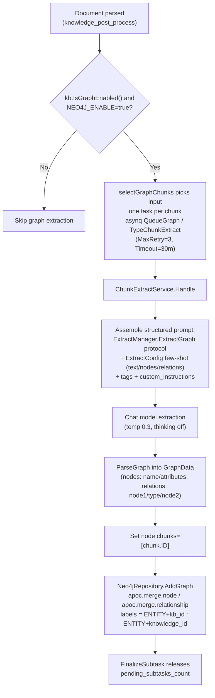
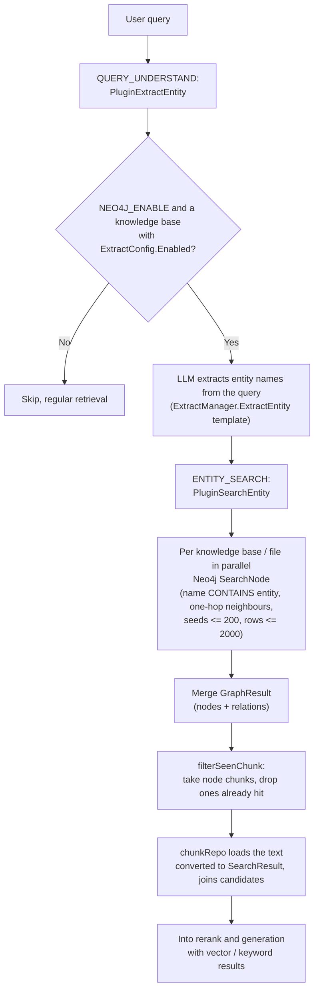

# Knowledge graph

The knowledge graph extracts entities and relationships while a document is imported, and at question time follows those relationships to retrieve more related chunks. It runs alongside vector and keyword retrieval and adds relationship context to the answer.

The feature suits material with many relationships between people, organizations, products or clauses. Turning it on adds model calls to the import stage and requires a Neo4j deployment.

Graph storage uses Neo4j and depends on the APOC plugin.

## Enabling the graph

To turn the graph on you satisfy **two switches**, one global and one per knowledge base.

### Global switch: Neo4j environment variables

`NEO4J_ENABLE` is the only global switch for the knowledge graph. `ENABLE_GRAPH_RAG` was replaced by `NEO4J_ENABLE` and the Go application no longer reads it (the comment in `docker-compose.yml` says so).

| Name | Type | Default | Description |
| --- | --- | --- | --- |
| `NEO4J_ENABLE` | string | empty (off) | Set to `true` to enable the graph. `initNeo4jClient` in `internal/container/container.go`, task enqueueing and the retrieval pipeline all check it |
| `NEO4J_URI` | string | none in code; `bolt://neo4j:7687` in `docker-compose.yml` | Neo4j connection address |
| `NEO4J_USERNAME` | string | none in code; `neo4j` in `docker-compose.yml` | User name |
| `NEO4J_PASSWORD` | string | none in code; `password` in `docker-compose.yml` | Password |

The code reads the three connection variables without defaults; the `app` service in `docker-compose.yml` fills in the values above when they are unset, and `.env.example` lists the same samples.

`initNeo4jClient` retries up to 30 times (2 s apart) at startup to open and verify the connection. When the graph is not enabled it returns a `nil` driver, and every `Neo4jRepository` method degrades to a no-op (log line `NOT SUPPORT RETRIEVE GRAPH`). The `GET /system/info` endpoint reports `"Neo4j"` or `"Not Enabled"` through `getGraphDatabaseEngine()` (`internal/handler/system.go`).

The `neo4j` service in `docker-compose.yml` preinstalls APOC with `NEO4J_PLUGINS=["apoc"]`. Graph writes depend on `apoc.merge.node` and `apoc.merge.relationship`; deletion runs `CALL (n) { DETACH DELETE n } IN TRANSACTIONS OF 1000 ROWS` on an auto-commit session, which needs Neo4j 5.23 or later (the compose pin is 2026.09.0) and no APOC.

### Knowledge base switch: IndexingStrategy and ExtractConfig

`internal/types/knowledgebase.go`:

```go
// IsGraphEnabled checks if knowledge graph extraction is enabled.
// Requires both the IndexingStrategy flag and a valid ExtractConfig.
func (kb *KnowledgeBase) IsGraphEnabled() bool {
    return kb != nil && kb.IndexingStrategy.GraphEnabled &&
        kb.ExtractConfig != nil && kb.ExtractConfig.Enabled
}
```

- `IndexingStrategy.GraphEnabled` (`internal/types/indexing_strategy.go`) is the graph switch in the knowledge base indexing strategy, `false` by default. `KnowledgeBase.EnsureDefaults` syncs the legacy `ExtractConfig.Enabled` flag one way into `IndexingStrategy.GraphEnabled`.
- `ExtractConfig` (`internal/types/knowledgebase.go`) carries the few-shot configuration for extraction:

| Name | Type | Default | Description |
| --- | --- | --- | --- |
| `enabled` | bool | false | Whether extraction is enabled |
| `text` | string | empty | The few-shot example text |
| `tags` | []string | nil | The set of relationship type labels |
| `nodes` | []*GraphNode | nil | Example entity nodes (name / attributes) |
| `relations` | []*GraphRelation | nil | Example relationships (node1 / node2 / type) |
| `custom_instructions` | string | empty | Domain-specific extraction instructions, appended to the system prompt; the structured output protocol stays under system control |

When `enabled` is true, the knowledge base handler rejects a configuration whose `text`, `tags`, `nodes` or `relations` is empty, whose node names repeat, or whose relations reference an unknown node (`validateExtractConfig` in `internal/handler/knowledgebase.go`).

Helper APIs for the configuration wizard (`internal/handler/initialization.go`, routes in `internal/router/routes_infra.go`; Admin role required; an API key needs the `manage_models` capability):

- `POST /initialization/extract/text-relation` (`ExtractTextRelations`): runs a trial relationship extraction over one text (at most 5000 bytes) with the selected labels, to preview the result.
- `POST /initialization/extract/fabri-text` (`FabriText`): asks the chat model to write an example text for the chosen labels.
- `POST /initialization/extract/fabri-tag` (`FabriTag`): returns a random subset of a fixed label list (Content, Culture, Person, Event, Time, Location, Work, Author, Relation, Attribute) without calling a model.

## Entity and relationship extraction (building the graph)

This section follows a document from the end of parsing to the rows written in Neo4j.

### Triggering and task orchestration

After a document is parsed, `internal/application/service/knowledge_post_process.go` picks the extraction input with `selectGraphChunks` during the enrichment fan-out (`graphChunkCount = len(graphChunks)` when `eff.GraphEnabled`) and calls `NewChunkExtractTask` in `internal/application/service/extract.go` to enqueue one task per chunk. Selection rules:

- Text chunks with body text take part; text chunks that contain only image links are skipped.
- When a parent text chunk has no body text (typically a page image in a scanned PDF), its `image_ocr` child chunk is used instead, so OCR text also reaches the graph.
- `image_caption` child chunks never take part, to avoid duplicating OCR content.

```go
func NewChunkExtractTask(...) (bool, error) {
    if strings.ToLower(os.Getenv("NEO4J_ENABLE")) != "true" {
        logger.Warn(ctx, "NEO4J is not enabled, skip chunk extract task")
        return false, nil
    }
    ...
    task := asynq.NewTask(types.TypeChunkExtract, payload,
        asynq.Queue(types.QueueGraph), asynq.MaxRetry(3), asynq.Timeout(30*time.Minute))
    ...
}
```

The tasks run on the dedicated asynq `QueueGraph` queue (`graph`, in the `enrichment` worker pool). Each chunk costs one LLM call (a source comment calls it "the most expensive enrichment fan-out in the pipeline"), governed by the per-model background concurrency limiter. A task whose document was cancelled, deleted or superseded by a newer parse attempt (`attemptSuperseded`) skips its work and releases the parent's `pending_subtasks_count` slot.

### Extraction (ChunkExtractService.Handle)

`internal/application/service/extract.go`:

1. Load the chunk, the knowledge base and the file-level `ProcessOverrides`, then resolve the effective `ExtractConfig` with `ResolveProcessConfig` (skip when it is not enabled).
2. Assemble the structured prompt template. The system protocol comes from `config.ExtractManager.ExtractGraph` (`extract.extract_graph` in `config/config.yaml`, a multi-step instruction covering entity extraction, attribute enrichment and relationship extraction), with the knowledge base's `custom_instructions`, `tags` and the few-shot example from `ExtractConfig` (`Text/Nodes/Relations`) layered on top.
3. `chatpipeline.NewExtractor(chatModel, template).Extract(ctx, chunk.Content)` calls the chat model (`temperature 0.3`, `max_tokens 8192`, thinking off; the output limit leaves room for many nodes and relationships so the JSON is not truncated). `Formater.ParseGraph` parses the reply into `types.GraphData` (`internal/types/extract_graph.go`, shown below). A model that answers in prose instead of JSON (`ErrModelDeclined`) finishes the task as skipped rather than retrying it.
4. Set `node.Chunks = []string{chunk.ID}` on every node, then write to Neo4j with `graphEngine.AddGraph(ctx, NameSpace{KnowledgeBase, Knowledge}, ...)`.
5. The whole run is traced by the SpanTracker (a `postprocess.graph.chunk[i]` sub-span that records node and relationship counts plus samples).

```go
type GraphNode struct {
    Name       string   `json:"name,omitempty"`
    Chunks     []string `json:"chunks,omitempty"`
    Attributes []string `json:"attributes,omitempty"`
}
type GraphRelation struct {
    Node1 string `json:"node1,omitempty"`
    Node2 string `json:"node2,omitempty"`
    Type  string `json:"type,omitempty"`
}
```

### Storage backend: Neo4j

`internal/application/repository/retriever/neo4j/repository.go` implements `interfaces.RetrieveGraphRepository` (`AddGraph` / `DelGraph` / `SearchNode`):

- **Namespace as labels**: `NameSpace{KnowledgeBase, Knowledge}` maps to the node labels `ENTITY<kb_id>` and `ENTITY<knowledge_id>` (hyphens replaced by underscores). Node properties are `name`, `kg` (knowledge_id), `attributes` and `chunks`.
- Writes use an idempotent APOC merge; the `chunks` of entities with the same name are unioned:

```cypher
UNWIND $data AS row
CALL apoc.merge.node(row.labels, {name: row.name, kg: row.knowledge_id}, row.props, {}) YIELD node
SET node.chunks = apoc.coll.union(node.chunks, row.chunks)
```

- Deleting a knowledge item or knowledge base (`knowledge_delete.go`, `knowledgebase.go`), reparsing (`knowledge_process.go`) and moving (`knowledge_clone_move.go`) call `DelGraph`, which runs `CALL (n) { DETACH DELETE n } IN TRANSACTIONS OF 1000 ROWS` over each knowledge item's nodes, one query per namespace (relationships go with their nodes, no APOC).
- The `SearchNode` query has two caps so that a short or common entity name cannot pull back the whole graph:
  - Only entities with at least one relationship can be expansion seeds, at most 200 of them. Exact name matches rank first, then shorter names, then alphabetical order.
  - At most 2000 (entity, relationship) rows are returned in the same order, so a truncated result keeps the neighbourhoods of the top-ranked seeds. Hitting the row cap writes a Warn log saying the result was truncated.

## Graph-enhanced retrieval (GraphRAG)

This section shows how a question reaches the graph and what comes back into the candidate set.

The classic chat pipeline (`internal/application/service/chat_pipeline`) has two plugins:

1. **PluginExtractEntity** (`extract_entity.go`, on the `QUERY_UNDERSTAND` event): when `NEO4J_ENABLE=true` and the turn's intent needs retrieval, it first collects the knowledge bases whose `ExtractConfig.Enabled` is set (into `chatManage.EntityKBIDs` / `EntityKnowledge`), then uses the `ExtractManager.ExtractEntity` template and the chat model to extract entity names from the **user query** (the rewritten query when one exists) into `chatManage.Entity`.
2. **PluginSearchEntity** (`search_entity.go`, on the `ENTITY_SEARCH` event): calls `graphRepo.SearchNode` in parallel for every graph-enabled knowledge base or file. The Cypher matches entities with `n.name CONTAINS nodeText` and returns their one-hop neighbours and relationships, merged into `chatManage.GraphResult` (caps as above). `filterSeenChunk` then takes the `chunks` carried by the graph nodes (dropping the ones vector retrieval already hit, at most 30 new chunks), loads their text from `chunkRepo` and converts them into `SearchResult` entries with score 0 and match type graph, which join the candidate set. That is the "entity to related chunk" supplementary recall.

Agent mode provides the `query_knowledge_graph` tool (`internal/agent/tools/query_knowledge_graph.go`). It accepts up to 10 knowledge bases, checks that each one has a graph configuration (`ExtractConfig` with nodes or relations) and reports the others as errors, queries the configured ones concurrently (at most 8 entity terms, 10 evidence chunks per knowledge base and 30 relationships in the reply), adds a hybrid text search per knowledge base, deduplicates by chunk, and includes each knowledge base's graph configuration (entity and relationship type lists) in the output. The tool's capability requirement is `all_of: [graph]`, and it is offered to the model only when the agent's scope contains a graph-enabled knowledge base. `agent_service.go` removes it from the tool allowlist when no such knowledge base is in scope, so the model does not keep calling a tool that can only return degraded results.

## Flow diagrams

These two diagrams summarize the build and query paths described above.

### Build flow



### Query flow



## Visualization

If you want to see the graph, this section lists what the code offers and what it does not.

- **Mermaid diagram generation**: `graphBuilder` in `internal/application/service/graph.go` is an in-memory implementation of the `types.GraphBuilder` interface (LLM entity extraction, then relationship extraction, relationship weight = PMI x 0.6 + strength x 0.4 normalized to 1-10, entity degrees, then a chunk relationship graph). Its `generateKnowledgeGraphDiagram` finds connected components with DFS and emits a Mermaid `graph TD` subgraph per component (entities with frequency above 5 highlighted, relationships with strength above 7 drawn as thick arrows). `NewGraphBuilder` is not called by the container wiring (no other reference in the repository); it is a standalone, legacy build-and-visualize implementation, and the generated Mermaid diagram goes to the log.
- **External API**: the knowledge graph has no dedicated visualization REST endpoint. The structured output of the `query_knowledge_graph` tool (`graph_configs`, the result list) is what the agent frontend renders. `GET /knowledgebase/{kb_id}/wiki/graph` (`WikiPageHandler.GetGraph`) is the Wiki feature's own graph endpoint and unrelated to the entity graph described here.
- **Prompt templates**: `config/prompt_templates/graph_extraction.yaml` provides `default_extract_entities` and related templates (an entity type enumeration Person / Organization / Location / ... and a JSON output protocol). `internal/config/config.go` resolves them through `extract_entities_prompt_id` / `extract_relationships_prompt_id` into `Conversation.ExtractEntitiesPrompt` / `ExtractRelationshipsPrompt` for the in-memory `graphBuilder` above. The production asynchronous extraction path uses the `extract.extract_graph` / `extract.extract_entity` templates in `config.yaml` (`ExtractManagerConfig`).
