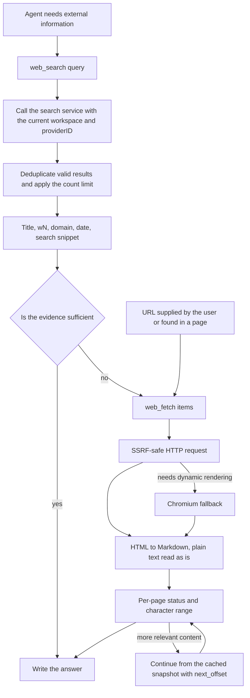

# Web search and page fetching

Web search supplements a knowledge base with information from the public web. An agent finds sources with `web_search` and reads the chosen pages with `web_fetch`. You can connect a hosted search service or run SearXNG yourself.

Under Settings → Web Search, pick a provider, enter its credentials and test the connection, then select that search configuration in the agent. The number of results per search is bounded by the agent's "Max Search Results" setting.

## Supported search engines

This section lists the engines you can choose from and what each one needs. Engines are registered in `registerWebSearchProviders` in `internal/container/container.go`:

```go
registry.Register("duckduckgo", infra_web_search.NewDuckDuckGoProvider)
registry.Register("google", infra_web_search.NewGoogleProvider)
registry.Register("bing", infra_web_search.NewBingProvider)
registry.Register("tavily", infra_web_search.NewTavilyProvider)
registry.Register("ollama", infra_web_search.NewOllamaProvider)
registry.Register("baidu", infra_web_search.NewBaiduProvider)
registry.Register("searxng", infra_web_search.NewSearxngProvider)
registry.Register("keenable", infra_web_search.NewKeenableProvider)
registry.Register("zhipu", infra_web_search.NewZhipuProvider)
registry.Register("exa", infra_web_search.NewExaProvider)
registry.Register("metaso", infra_web_search.NewMetasoProvider)
registry.Register("bocha", infra_web_search.NewBochaProvider)
registry.Register("brave", infra_web_search.NewBraveProvider)
registry.Register("serply", infra_web_search.NewSerplyProvider)
```

| Engine | Source file | API key | Endpoint | Notes |
| ------ | --------- | ----------------- | ------ | ------ |
| DuckDuckGo | `duckduckgo.go` | No | HTML endpoint first, API fallback | Free; `proxy_url` supported |
| Google | `google.go` | Yes (plus `engine_id`) | Google Custom Search API (official `customsearch/v1` SDK) | |
| Bing | `bing.go` | Yes | `https://api.bing.microsoft.com/v7.0/search` (hard-coded) | |
| Tavily | `tavily.go` | Yes | `https://api.tavily.com/search` (hard-coded) | |
| Ollama Web Search | `ollama.go` | Yes | `https://ollama.com/api/web_search` (hard-coded) | At most 10 results |
| Baidu Qianfan AI Search | `baidu.go` | Yes | `https://qianfan.baidubce.com/v2/ai_search/web_search` (hard-coded) | |
| SearXNG | `searxng.go` | No | `base_url` supplied by the workspace (self-hosted instance) | The only engine with a custom address; it must pass the SSRF check |
| Keenable | `keenable.go` | Optional | `https://api.keenable.ai` (hard-coded) | Without a key it uses the public rate-limited endpoint; a key lifts the cap |
| Zhipu AI Search | `zhipu.go` | Yes | `https://open.bigmodel.cn/api/paas/v4/web_search` (hard-coded), default engine `search_std` | `extra_config.search_engine` and `content_size` |
| Metaso | `metaso.go` | Yes | `https://metaso.cn/api/v1/search` | `extra_config.scope` selects the content source, default `webpage` |
| Exa | `exa.go` | Yes | `https://api.exa.ai/search` | Highlights by default; `extra_config.include_text` returns page text |
| Bocha | `bocha.go` | Yes | `https://api.bochaai.com/v1/web-search` | `extra_config.freshness` and `summary` |
| Brave Search | `brave.go` | Yes | `https://api.search.brave.com/res/v1/web/search` | Per-call `country` and `freshness` |
| Serply | `serply.go` | Yes | `https://api.serply.io/v1/search` | Google results; per-call `country` and `freshness` (`pd`/`pw`/`pm`/`py` only) |

14 engines are registered.

| Provider-specific setting | Values |
| --- | --- |
| Zhipu search_engine | `search_std` (default), `search_pro`, `search_pro_sogou`, `search_pro_quark` |
| Zhipu content_size | `medium` (default) or `high` |
| Metaso scope | `webpage` (default), `document`, `scholar`, `podcast`, `video`, `image` |
| Exa include_text | A string boolean such as `"true"`; page text is not fetched by default |
| Bocha freshness | `noLimit` (default), `oneDay`, `oneWeek`, `oneMonth`, `oneYear` |
| Bocha summary | Summaries are requested by default; `"false"` turns them off |
| Brave per-call filters | `country` and `freshness` are `web_search` tool arguments (see below); their values differ from Bocha's fixed configuration |
| Serply per-call filters | As Brave; `country` maps to Google's `gl`, `freshness` accepts only `pd`/`pw`/`pm`/`py`, no date ranges |

Every endpoint except SearXNG is hard-coded and cannot be changed by a workspace. That is the first line of SSRF defence (the source comment reads `Not configurable by tenants`, prevents SSRF).

## Search engine configuration (the provider entity)

This section describes what a saved search configuration contains and how it is managed over the API. Each workspace can create several search engine configurations (for example "Production Bing" and "Test Google"). They are stored as `WebSearchProviderEntity` rows in the `web_search_providers` table (`internal/types/web_search_provider.go`) and agents reference them by ID. The parameter structure is `WebSearchProviderParameters`:

| Name | Type | Default | Description |
| ------ | ------ | -------- | ------ |
| `api_key` | string | empty | The search service key, AES-GCM encrypted at rest; changed only through the `/credentials` subresource and never returned in responses |
| `engine_id` | string | empty | Google Custom Search only |
| `base_url` | string | empty | SearXNG only: the address of the self-hosted instance; checked with `utils.ValidateURLForSSRF`, private addresses must be added to `SSRF_WHITELIST` |
| `proxy_url` | string | empty | Optional outbound HTTP/HTTPS proxy (it tunnels traffic, it does not replace the API endpoint); also SSRF-checked |
| `extra_config` | map[string]string | nil | Provider-specific settings such as Metaso scope, Exa include_text, Bocha freshness/summary |

CRUD routes (`RegisterWebSearchProviderRoutes`, `internal/router/routes_infra.go`): create, read, update and delete under `/web-search-providers`, `POST /test` (try unsaved parameters), `POST /:id/test` (test a saved configuration), `PUT /:id/credentials` and `DELETE /:id/credentials/:field`. Tests and writes require Admin. `GET /web-search-providers/types` returns the metadata the settings form renders, and `GET /web-search/providers` returns the catalog of available engine types. The full interface is in the [Infrastructure API](../04-api/02-api-infra.md).

## Agent search and page reading

This section explains how an agent moves from a question to verified web evidence. `web_search` discovers sources and `web_fetch` reads the selected pages. When the user names a web page, the agent can read it directly; when the user asks for external or current information, it can search directly. Whether the knowledge base is searched depends on the task and the tools available; `search_knowledge` is no longer a mandatory first call.



### web_search

Example calls:

```json
{"query":"Python release notes","count":5}
{"query":"Rust release notes","country":"DE","freshness":"pw","content":true}
```

- `count` sets the number of results, from 1 to the agent's configured maximum (at most 20); omitted, it uses the agent's default. A value above the maximum is clamped to it and the model-visible output carries a correction note, so the call does not fail; a value below 1 returns an argument error.
- `country` and `freshness` take effect through the Brave and Serply providers. The region accepts a two-letter code or `ALL`; freshness accepts `pd` / `pw` / `pm` / `py` or `YYYY-MM-DDtoYYYY-MM-DD`. When `country` is omitted, Brave is not sent the parameter (Brave's own default is US); an explicit `ALL` asks for worldwide results. Serply maps `country` to Google's `gl` (omitted or `ALL` sends no `gl`, so Google picks the region) and its `freshness` accepts only `pd` / `pw` / `pm` / `py`. Other providers do not support these filters; passing them explicitly returns an error instead of being ignored silently. Values are documented in the [Brave API reference](https://api-dashboard.search.brave.com/api-reference/web/search/get).
- `content` is off by default. Set to `true`, it fetches the body of the first 3 results in parallel (a 15 second budget for the batch, up to 5,000 characters per page); the remaining results keep their search snippet and can be read with `web_fetch`. A failed fetch keeps the snippet; the address of the complete page comes back as `full_output_path`. Search and a standalone `web_fetch` share this run's snapshots, and the short timeout does not cancel a shared fetch that is still in progress.
- Brave's relative `age` is kept as is, so "2 days ago" is never turned into a fake exact publication date.
- Empty queries, invalid URLs and duplicate results are dropped; the maximum number of results comes from the agent configuration and is capped at 20.
- Agent search no longer calls `CompressWithRAG`: it creates no temporary knowledge base and needs no embedding or rerank model and no temporary Redis state. The RAG compression setting still applies to the Quick Answer chat pipeline.
- The model output contains the title, domain, date when available and the wN page ID. Snippets and provider content are labelled as search evidence that has not been verified against the page; each snippet is at most 1,500 characters, and the whole tool output is subject to the agent's tool output budget (24,000 characters by default).

### web_fetch

Example call:

```json
{"items":[{"url":"w1"},{"url":"https://example.com/guide","limit":4000}]}
```

- Accepts known wN page IDs and HTTP(S) URLs supplied by the user or found in a page. Short IDs are resolved at the model context boundary; the UI and persisted results keep the real URL.
- The `prompt` parameter was removed; the tool schema exposes only `url`, `offset` and `limit`. No second model is called to summarize: the main agent reads the page body itself.
- HTML goes through Readability first; when that succeeds the full extraction is converted, and only on failure does it fall back to `main`/`article`/`body`, which avoids losing neighbouring paragraphs by re-selecting an inner `.content` node. The Markdown keeps headings, paragraphs, links, tables and code. Relative links resolve against the final HTTP URL; embedded resources are not downloaded.
- Plain text, Markdown, JSON and XML are read as is, so `<...>` is not discarded as HTML. Binary formats report `unsupported_content`.
- HTTP comes first; the existing Chromium fallback for dynamic pages remains. Requests go through the shared SSRF validation, the safe client and DNS pinning.
- At most 8 items per batch; items with the same canonical URL, offset and limit are deduplicated. Each item returns `success`, `failed` or `skipped` on its own, and a partial failure keeps the successful bodies.
- `offset` is a zero-based Unicode character offset; `limit` defaults to and is capped at 8,000. The batch shares the output budget across items (16,000 characters at most) and returns `offset`, `returned_chars`, `content_length` and `truncated`; `next_offset` is present when content remains.
- Continue with the same URL and `offset=next_offset`. The in-memory cache holds at most 8 page snapshots and serves character continuation within this run only; after a snapshot is evicted, the returned `full_output_path` gives the same complete body without refetching the page. A character continuation whose cache entry is gone returns the retryable `snapshot_expired` (refetch from offset 0 or switch to `read_file`), so two versions of a page are never stitched together. A continuation in the same batch waits for the first fetch to finish.
- After a fetch, the complete Markdown is saved to the file storage of the session's workspace and returned as a `web://...` `full_output_path`. `read_file` can read these files in later turns without a sandbox. The body is bound to the assistant message that produced it; a read checks the workspace, the session owner, the session, the message and the web-page binding, and an ordinary attachment cannot be read as a web page. Once the message or session is deleted the page is no longer accessible, with the same retention as soft-deleted message attachments.
- A failed save does not discard the fetched body: the result carries `storage_error`, and continuation is then limited to this run's in-memory cache. One saved Markdown file is capped at 8 MiB.
- For `read_file`, `offset` is a one-based line number, `limit` is at most 2,000 lines, a web page read is at most 50 KiB, and the agent output budget still applies. On an overlong line it returns `next_offset` and `next_line_offset`; continue the line with `offset` plus `line_offset`. An agent without a sandbox therefore needs no shell.
- The agent download limit per page is 2 MiB; a larger page reports `body_too_large` instead of passing silently truncated HTML off as the full page. The request timeout stays at 60 seconds, and agent fetches accept any HTTP 2xx response.
- Failures keep returning stable error codes and a retryable flag. A temporary failure can be retried; a permanent one calls for another source, or for naming the gap when the evidence is insufficient. A whole batch failing does not end the research, and it is never treated as a verification.
- With web search turned off, neither tool is registered at runtime, whether or not a legacy `allowed_tools` list names them. A failed page is no longer shown as a successful web citation.

The Quick Answer path of the shared fetcher keeps using `NewPipelineFetcher`: a 15 second timeout, a 100 KiB download limit, HTTP only and the original plain-text extraction.

## The role of docker/searxng

This section is for running the bundled SearXNG instead of a hosted search API. SearXNG is a self-hosted metasearch engine that aggregates several upstream engines. AI KB packages it as the **optional search backend that needs no API key**, under the `searxng` / `full` profiles in `docker-compose.yml`:

- `docker/searxng/settings.yml`: the important customizations are `search.formats` with `json` enabled (the backend calls `/search?format=json`), `server.limiter: false` (IP rate limiting off, otherwise the backend gets throttled; re-enable it with an allowlist if the instance is public) and `secret_key`, which the entrypoint script replaces with the `SEARXNG_SECRET` environment variable. `SEARXNG_SECRET` falls back to a placeholder in `docker-compose.yml`; set your own before exposing the instance.
- The `searxng-init` helper container copies the template into a separate volume first, so the SearXNG entrypoint's in-place sed does not write the resolved secret back into the repository working tree.
- The host port is controlled by `SEARXNG_PORT` (default 8888) and `SEARXNG_BIND` (default `127.0.0.1`). Do not set `SEARXNG_PORT` to the same value as `APP_PORT` (default 8080): on Linux, when both publish the same port, a request to `localhost:8080` can reach SearXNG first and the login endpoint returns SearXNG's HTML 404.
- The app container adds the `searxng` host name to the SSRF whitelist by default (`SSRF_WHITELIST_EXTRA=searxng,qdrant,...`), so a workspace configuration of `base_url: http://searxng:8080` works out of the box.
- The client timeout is 12 s (`defaultSearxngTimeout`), slightly above SearXNG's `outgoing.max_request_timeout: 10.0`, so a slow upstream engine surfaces as a SearXNG-side error rather than a client cancellation. `ValidateSearxngBaseURL` is shared between "save" and "use", so both apply the same validation.

## Implementation and extension reference

This section is for developers who maintain the search code or add an engine.

### SSRF protection for outbound requests

`NewSearchHTTPClient` in `internal/infrastructure/web_search/proxy.go` builds one safe HTTP client for every engine:

- `DialContext` is `utils.SSRFSafeDialContext` (the target IP is checked at dial time, against DNS rebinding);
- every redirect hop is re-checked by the shared SSRF redirect policy (`ValidateURLForSSRF` on the target), and the request fails once the maximum hop count is exceeded;
- an explicit `proxy_url` must pass the SSRF check; without one the client falls back to `ProxyFromEnvironment`.

With `SSRF_DNS_WHITELIST_ONLY` on, the search service domains, the SearXNG host name and every web page domain `web_fetch` reads must be listed in `SSRF_WHITELIST`, otherwise they are refused before the DNS query. See the [configuration reference](../01-getting-started/04-configuration.md).

### Interfaces

Search is defined by two interfaces (`internal/types/interfaces/web_search.go`):

```go
// WebSearchProvider defines the interface for web search providers
type WebSearchProvider interface {
    Name() string
    Search(ctx context.Context, query string, maxResults int, includeDate bool) ([]*types.WebSearchResult, error)
}

// WebSearchService defines the interface for web search services
type WebSearchService interface {
    Search(ctx context.Context, providerID string, config *types.WebSearchConfig, query string) ([]*types.WebSearchResult, error)
    CompressWithRAG(ctx context.Context, sessionID string, tempKBID string, questions []string, ...) (...)
}
```

A provider that supports per-call `country` and `freshness` also implements `FilteredWebSearchProvider` (`SearchWithFilters`); the service returns an error when filters are requested from a provider without it.

`internal/infrastructure/web_search/registry.go` keeps the **provider type -> factory function** registry; instances are created at call time from the workspace's parameters:

```go
type ProviderFactory func(params types.WebSearchProviderParameters) (interfaces.WebSearchProvider, error)

func (r *Registry) Register(id string, factory ProviderFactory)
func (r *Registry) CreateProvider(providerType string, params types.WebSearchProviderParameters) (interfaces.WebSearchProvider, error)
```

### Adding a search engine

1. Create `<engine>.go` in `internal/infrastructure/web_search/`, implement `interfaces.WebSearchProvider` (`Name()` and `Search()`) and provide the factory `func New<Engine>Provider(params types.WebSearchProviderParameters) (interfaces.WebSearchProvider, error)`. Hard-code the official endpoint as a constant and build the HTTP client with `NewSearchHTTPClient(timeout, params.ProxyURL)`.
2. Add a `WebSearchProviderType` constant in `internal/types/web_search_provider.go` and an entry in `GetWebSearchProviderTypes()` so the settings form knows the engine.
3. Append `registry.Register("<engine>", infra_web_search.New<Engine>Provider)` to the registration in `internal/container/container.go`.
4. If the key or extra parameters need validation, extend the parameter validation branch of the web search provider service (follow the shared-validation pattern of `ValidateSearxngBaseURL`).
5. Write unit tests with `httptest` to simulate the upstream, following `searxng_test.go` and `zhipu_test.go`.
