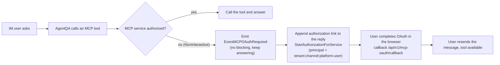
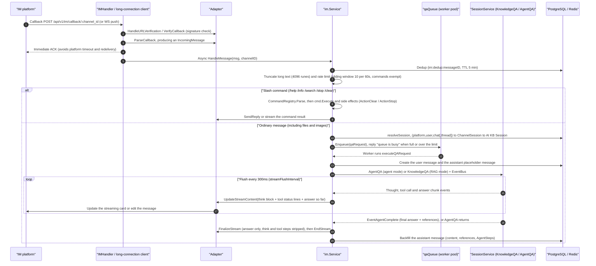

# IM integration

IM integration connects an agent to chat platforms such as WeCom, Feishu, DingTalk, Slack and Telegram. Users ask the bot a question in the platform, and AI KB answers with the retrieval and model configuration of the bound agent.

Create a channel under Settings → IM integration: pick the platform, enter the application credentials, bind an agent and enable it. Webhook mode needs the callback URL registered in the platform console; long-connection mode needs no public callback URL to receive messages. Each channel can carry its own reply language, which fixes the language the agent answers in on that channel. It is set through the API (`locale`), since the admin UI has no language picker; when left empty the deployment default applies. The section description names the platforms this deployment allows (`AIKB_IM_PLATFORMS`), and a new channel starts on the first allowed platform in the picker with that platform's connection mode and credential defaults already applied. With an empty allow-list the capability is unsupported, so the section is hidden; if it is reached anyway, Add Channel is disabled.

<Screenshot
  src="/screenshots/im-channels.png"
  caption="IM channel configuration: platform, credentials and the bound agent"
  hint="The channel list and the configuration form of one channel (platform type, credentials, bound agent, callback URL)." />

Platforms that support it can also import received files into a knowledge base, and every channel offers built-in commands such as `/help`. The exact behavior depends on platform capabilities and channel configuration.

## Supported platforms and capabilities

Use this table to pick the connection mode and gather the credentials a platform needs before you create its channel. `validIMPlatforms` in `internal/handler/im.go` defines the 10 accepted platforms. A deployment can narrow that list with `AIKB_IM_PLATFORMS` (comma-separated, unset or empty means all ten): excluded platforms get no adapter at startup, disappear from the channel picker (the list travels as `im_platforms` in `GET /system/capabilities`), and creating a channel for one returns 400 naming the enabled platforms. A channel already stored for an excluded platform stays listed, keeps its platform in the edit form, and logs "no adapter factory for platform" instead of starting. Capabilities below follow each adapter's `factory.go` and its compile-time interface assertions.

| Platform | Connection mode (default in bold) | Streaming replies (StreamSender) | File download (FileDownloader) | Threads or topics (ThreadID) | Main credential fields (credentials JSON) |
| --- | --- | --- | --- | --- | --- |
| WeCom `wecom` | **websocket** (smart bot long connection) / webhook (self-built app callback) | websocket mode only | both modes | no | websocket: `bot_id`, `bot_secret`, `ws_endpoint`, `bot_name`; webhook: `corp_id`, `agent_secret`, `token`, `encoding_aes_key`, `corp_agent_id`, `api_base_url` |
| Feishu `feishu` | **websocket** (long-connection event stream) / webhook | yes (streaming card) | yes | yes (`root_id`, a top-level message uses its own `message_id`) | `app_id`, `app_secret`, `verification_token`, `encrypt_key` |
| Lark `lark` | same as Feishu (same adapter, `RegionLark` points at open.larksuite.com) | yes | yes | yes | same as Feishu |
| Slack `slack` | **websocket** (Socket Mode) / webhook (Events API) | yes | yes | yes (`thread_ts`) | websocket: `app_token` + `bot_token`; webhook: `bot_token` + `signing_secret` |
| Telegram `telegram` | **websocket** (long polling via getUpdates) / webhook | yes (message edits) | yes | yes (`message_thread_id` of Forum Topics) | `bot_token`; webhook also takes `secret_token` |
| DingTalk `dingtalk` | **websocket** (Stream mode, the only mode supported; migration 000096 converts existing webhook channels to websocket, so enable Stream in the DingTalk developer console) | yes (AI card) | yes | no | `client_id`, `client_secret`, `card_template_id` |
| Mattermost `mattermost` | **webhook** (Outgoing Webhook + REST API only) | yes | yes | yes (`root_id`) | `site_url`, `bot_token`, `outgoing_token` (required), `bot_user_id`, `post_to_main` |
| WeChat `wechat` (iLink bot) | **longpoll** (forced; the backend sets `mode=longpoll` and `output_mode=full` on creation) | no (whole answer at once) | yes | no | `bot_token`, `ilink_bot_id` (both required) |
| QQ bot `qqbot` | **websocket** (only mode) | no | no | no | `app_id`, `client_secret`, `api_base_url`, `gateway_url` |
| Yunzhijia `yunzhijia` | **webhook** / websocket (the WS address is derived from `send_msg_url`) | no | yes | yes (top-level `msgId`, replies `replyRootMsgId`) | `send_msg_url` (required), `secret`, `app_id`, `app_secret`, `allowed_webhook_host_suffix`, `timeout_seconds` |

## Built-in commands

The commands let a user inspect the bound agent, search the knowledge bases directly, stop a running answer or clear the conversation memory from inside the chat. The framework lives in `command.go` and `command_registry.go`: a command only declares its intent (`CommandResult.Action`) and the Service performs the side effect. `LooksLikeCommand` separates a command attempt (`/help`) from path-like text that should go to QA (`/api/v2/users`); an unregistered command attempt gets an "unknown command" reply, while path-like text enters QA normally.

All commands registered in `NewService`:

| Command | File | Function | Side effect |
| --- | --- | --- | --- |
| `/help [command]` | `cmd_help.go` | Lists every available command, or shows the detailed usage of one | none |
| `/info` | `cmd_info.go` | Shows the bound agent's information and capabilities: Agent or RAG mode, the enabled knowledge bases (`KBSelectionMode` all/selected/none), skills, MCP services, web search switch and output mode | none |
| `/search <keywords>` | `cmd_search.go` | Runs hybrid retrieval (vector + keyword) over the knowledge bases the agent can reach and returns the raw passages (**no AI summary**); at most 5 results of 200 runes each, with a match percentage. The knowledge base scope matches the QA pipeline's `resolveKnowledgeBasesFromAgent` (including the agent-mode capability filter) | none |
| `/stop` | `cmd_stop.go` | Aborts the answer in progress (it can interrupt a long ReAct reasoning chain) | `ActionStop`: first dequeue or cancel the local in-flight request, then write a stop event to the StreamManager (the same mechanism as the web StopSession, so it works **across instances** through the `im:inflight:` mapping to sessionID and messageID), and finally set the Redis `im:stop:` marker to catch a request that is queued but not yet running |
| `/clear` | `cmd_clear.go` | Clears the conversation memory | `ActionClear`: soft-deletes the current `ChannelSession`, so the next message creates a fresh AI KB session |

## Group and direct chat behavior

This section explains how each platform decides what counts as a message to the bot and where the reply lands.

- `ChatType` is decided by the adapter: `direct` (private chat, `ChatID` empty) or `group`.
- **Feishu/Lark**: in a group the bot usually has to be @mentioned (group message text received over the long connection carries an `@_user_N` prefix, which the adapter strips in a loop before processing). Group replies prefer reply-in-thread; when the group rejects threads (error code 230071 and similar) the adapter falls back to a plain message (the fallback logic in `adapter.go`).
- **Slack**: group messages arrive as `AppMentionEvent` (the bot was @mentioned) and as channel or group `MessageEvent` (bot messages with a non-empty `BotID` and subtypes other than `file_share` are filtered out). Replies always go into a thread (`thread_ts`; a top-level message uses its own timestamp).
- **Telegram**: `group` and `supergroup` count as group chats; the `@botname` mention prefix is stripped; replies carry `reply_to_message_id`.
- **Mattermost**: the Outgoing Webhook trigger word must be the **first word** of the message, otherwise the callback parses as an empty message (`handler/im.go` logs a targeted hint). The `post_to_main` credential decides whether the reply is posted to the main channel or the thread.
- Session isolation: in `user` mode the same user has separate `ChannelSession` rows for the private chat, group A and group B (the key includes `chat_id`); in `thread` mode every user in one thread shares the session.

## File messages

Send a file or an image to have the bot answer from its content, and optionally keep it in a knowledge base. Files and images are handled as QA attachments: document content is given to the model, and images are recognized directly when the model supports it. The bot therefore answers from the attachment even when the channel has no file knowledge base configured.

`knowledge_base_id` only decides whether the attachment is also saved to a knowledge base. It must be a knowledge base of the channel's workspace (a restricted API key also needs it in its knowledge base allowlist), otherwise creating or updating the channel returns 400. When configured, the save runs as a background task, does not delay the current QA reply, and sends no extra "imported" or "parsing finished" messages. The parsed text keeps at most the first 500 lines and 32 KiB; when either limit is hit the model receives a generic truncation note. When the attachment cannot be read, the platform does not support download, or the file exceeds 32 MiB, the bot asks the user to describe it in text or resend.

## Image links in replies (resource:// rewriting)

When an answer cites knowledge base images, the body contains internal references such as `resource://`, `local://` or `minio://`, which an IM client cannot fetch. To make them load, `rewriteStorageURLs` (`internal/im/service.go`) replaces them with reachable http(s) URLs before sending:

- When the resolved result is **not** http(s) (for example still an internal `storage://` path), the original reference is kept and an actionable WARN is logged, rather than sending a link that is certain to fail in the IM client.
- A successful rewrite is logged at INFO with the signed URL (useful for troubleshooting, at the cost that anyone with log access can use the link while it is valid).

To make images display, choose one of two setups:

1. **A publicly reachable storage backend**: object storage with a public endpoint (or `MINIO_ENDPOINT` set to the public host); `resource://` then falls back to the backend's presigned URL.
2. **Set `APP_EXTERNAL_URL`**: `resource://` is rewritten to `<APP_EXTERNAL_URL>/r/<token>`, and the request is proxied back to the app through nginx's `location ^~ /r/`. The official frontend image ships that location; a self-built reverse proxy must add it, otherwise the request falls into the SPA fallback and returns a blank page.

The default internal MinIO deployment (`minio:9000`) and the `local` backend only work with the second setup. When IM channels are enabled but `APP_EXTERNAL_URL` is empty, `LoadAndStartChannels` prints one startup warning (`imImageConfigWarning`).

If images still do not show, go through the troubleshooting table in [External access to images and files](21-file-access.md), which lists the four URL forms and how each channel fetches them.

## MCP OAuth authorization notices (identity binding)

When an agent's MCP service needs OAuth, the IM user has to authorize it from a browser, because the IM conversation has no interactive frontend to complete an in-session OAuth flow. The service handles this as follows:

- `withIMIdentity` marks the context `MCPOAuthNonInteractive`: when the agent meets an unauthorized OAuth MCP service it **does not block and wait**; it emits a one-shot `EventMCPOAuthRequired` event.
- `handleMessageStream` collects these events (deduplicated by ServiceID). After the answer ends, `buildIMMCPAuthNotice` appends an authorization notice to the reply. When `APP_EXTERNAL_URL` is set and the OAuthManager is available, it generates a dedicated authorization link per service (callback `<APP_EXTERNAL_URL>/api/v1/mcp-oauth/callback`, principal `PrincipalIMUser`, so the authorization is bound to workspace + channel + platform + IM user); otherwise it asks the user to authorize in the AI KB admin UI.
- After authorizing through the link, the user **resends the original message** to use the MCP service.



## Configuration and runtime reference

### Channel model and configuration (internal/im/types.go)

An `IMChannel` (table `im_channels`) binds one platform bot to one agent:

| Field | Description |
| --- | --- |
| `AgentID` | The bound custom agent; answers use that agent's configuration (model, knowledge bases, skills, MCP, web search) |
| `Platform` / `Mode` | Platform and connection mode. Defaults: mattermost and yunzhijia → `webhook`, wechat → `longpoll` (with `output_mode=full` forced), everything else → `websocket` |
| `OutputMode` | `stream` (default, streaming) or `full` (one reply once the complete answer is ready; on platforms with a replaceable message the bot shows a placeholder first and replaces it once, with no intermediate updates) |
| `Locale` | Reply language: `en-US` / `zh-CN` / `zh-TW` / `ja-JP` / `ko-KR` / `ru-RU` (`internal/types/locale.go`); any other value returns 400. Empty (the default) uses `AIKB_LANGUAGE`, and `en-US` when that is unset. The admin UI has no picker for it and sends the stored value back unchanged on edit, so set or clear it through the API. The `Accept-Language` header of an IM callback comes from the platform, not the person asking, so it does not influence the reply language |
| `KnowledgeBaseID` | Optional "file knowledge base". Files and images are always downloaded for QA; when set, they are also imported in the background (see above) |
| `SessionMode` | `user` (default, sessions keyed by platform + user + chat) or `thread` (keyed by platform + thread + chat, every top-level message starts a new session) |
| `BotIdentity` | A unique bot identifier derived from platform, mode and credentials (`computeBotIdentity`, for example `feishu:<app_id>`, `telegram:<botID>`, `wecom:ws:<bot_id>`). A database unique index stops the same bot being configured on two channels (`checkDuplicateBot` returns HTTP 409; the message names the existing channel only when it is in the caller's workspace) |
| `Credentials` | JSONB credentials. The list endpoint (`IMChannelSummary`) **never returns credential contents**, only the `credentials_configured` boolean |

A `ChannelSession` (table `im_channel_sessions`) maps `(platform, user_id, chat_id, thread_id, tenant_id)` to an AI KB `session_id`, which gives the IM side conversation continuity. When the underlying session is deleted from the web UI, `HandleMessage` detects `ErrSessionNotFound`, soft-deletes the stale mapping and recreates it, so the bot does not go silent for good.

#### Channel management API (internal/handler/im.go + routes_agent.go)

| Method and path | Description |
| --- | --- |
| `POST /api/v1/agents/:id/im-channels` | Create a channel for the agent (validates the platform, fills default mode and output_mode) |
| `GET /api/v1/agents/:id/im-channels` | List the agent's channels (without credentials) |
| `GET /api/v1/im-channels` | Overview of the workspace's channels across agents |
| `PUT /api/v1/im-channels/:id` | Partial update (name/mode/output_mode/locale/session_mode/knowledge_base_id/credentials/enabled/agent_id); an empty string for `knowledge_base_id` unbinds the file knowledge base |
| `DELETE /api/v1/im-channels/:id` | Delete |
| `POST /api/v1/im-channels/:id/toggle` | Enable or disable |
| `POST /api/v1/wechat/qrcode`, `POST /api/v1/wechat/qrcode/status` | WeChat (iLink) QR code binding: generate the code and poll its status |
| `GET / POST /api/v1/im/callback/:channel_id` | **Platform callback URL** (registered in the platform console in webhook mode; protected by the platform's own signature check, no AI KB API key) |

Webhook mode means registering `https://<your-domain>/api/v1/im/callback/<channel_id>` as the platform's event subscription or callback URL. AI KB first answers the platform's URL verification challenge (`HandleURLVerification`, such as the Feishu challenge echo or the WeCom echostr decryption), after which every callback passes the `VerifyCallback` signature check. WebSocket and long-connection modes need no public callback URL: AI KB connects to the platform gateway itself.

#### Feishu/Lark reverse proxy

`credentials.api_base_url` overrides the API origin and is also used as the bootstrap domain of the long-connection SDK. Leave it empty to use the default Feishu or Lark cloud address; on a private network set something like `https://feishu-proxy.example.com`, without an API path at the end. The proxy must forward the platform API and the long-connection bootstrap request, and the WebSocket address returned by the bootstrap response must be reachable from the AI KB server. Proxying only the web console does not solve a server-to-Feishu network problem.

```json
{"platform":"feishu","mode":"websocket","credentials":{"app_id":"<app-id>","app_secret":"<app-secret>","api_base_url":"https://feishu-proxy.example.com"}}
```

With `session_mode=thread`, Yunzhijia reuses one session per topic: a top-level message starts a new thread and replies continue in the root message's thread. DingTalk rich-text messages have their readable content extracted, and images inside Feishu post messages go through image processing.

#### Long-connection reliability: leader election and the Supervisor

- **Multi-instance leader election** (`service.go`): in a multi-instance deployment (with Redis), websocket and longpoll channels use `SETNX im:ws:leader:<channelID>` (TTL 15s, renewed every 5s) so that **only one instance** keeps the long connection. Non-leader instances retry the lock every 10s and take over when the leader dies. A stopped longpoll channel keeps its lock until the TTL expires, so old and new instances never write at the same time. When renewal fails (leadership lost), `handleWSLeadershipLoss` first stops this instance's adapter, then puts the channel back into the lock retry loop. The channel row is re-read from the database before each retry, so a channel deleted, disabled or reconfigured in the meantime is not revived by the old runtime.
- **Connection keepalive** (`RunSupervised` in `supervisor.go`): some SDKs (DingTalk, Feishu) reconnect internally and can end up with a connection object that exists but no longer receives messages. The Supervisor rebuilds the connection every 6 hours (`defaultRecycleInterval`) and retries a failed connect after a 5s backoff, which bounds the worst-case outage to the recycle interval. Today the DingTalk adapter runs under the Supervisor; the Feishu adapter relies on the SDK's auto-reconnect.
- **Yunzhijia long connection** (`yunzhijia/websocket.go`): a heartbeat every 15s; the connection is considered dead and reconnected when nothing arrives for 45s; one connection lives at most 6 hours before it is rebuilt. Reconnects back off at 1s, 2s, 5s, 10s, 30s and 60s.

### Multi-instance deployment

All distributed state is defined by the Redis key prefix constants in `service.go`:

| Redis key | Purpose |
| --- | --- |
| `im:ws:leader:<channelID>` | Leader election for WebSocket and long-polling channels (TTL 15s, 5s renewal, 10s lock retry) |
| `im:dedup:<messageID>` | Cross-instance message deduplication (TTL 5 min) |
| `im:stop:<userKey>` | Cross-instance /stop pre-execution marker (TTL 30s) |
| `im:inflight:<userKey>` | userKey → `sessionID:messageID` mapping, used by a cross-instance /stop to write the StreamManager stop event |
| `im:queue:user:<userKey>` | Global per-user queue counter |
| `im:ratelimit:<key>` | Sliding-window rate limiting (ZSET) |
| `im:global:active` | Global concurrent QA worker counter (atomic Lua INCR + check, TTL 5 min for self-healing) |

Without Redis (Lite or single-instance mode) everything falls back to in-memory implementations: the behavior is the same, only the cross-instance semantics are lost.

### Message processing flow

`IMCallback` (webhook) and long-connection callbacks both end in `Service.HandleMessage`, and from there go through the queue into QA execution:



Key details (all in `service.go`):

- **Deduplication**: `MessageID` is written to Redis `im:dedup:` (TTL 5 minutes) or a local `sync.Map` (single-instance mode); callbacks redelivered by the platform are skipped.
- **Rate limiting**: a sliding window per `channelID:userID:chatID[:threadID]` (default 10 messages per 60s, overridable through `config.IM`). **Slash commands bypass the limit**, so a user can still `/stop` during a storm.
- **QA queue** (`qaqueue.go`): a bounded queue with a fixed worker pool (defaults: workers 5, queue size 50, 3 queued requests per user, 60s queue timeout). Across instances, Redis counters enforce a **global per-user limit** (`im:queue:user:`) and an optional **global concurrency gate** (`im:global:active` with a Lua script, configured by `GlobalMaxWorkers`), which applies back pressure to the downstream LLM. A request with queue position > 0 first gets a "queued" notice.
- **Session resolution**: `user` mode shares one session per user, titled like "Alice · group 1a2b3c4d" or "Alice · dm"; `thread` mode gives every top-level message or topic its own session (Slack thread, Feishu topic group, Telegram Forum Topic, Mattermost root_id). The first message triggers asynchronous title generation (`GenerateTitleAsync`).
- **Identity injection** (`withIMIdentity`): IM callbacks are authenticated by platform signature rather than an AI KB login, so the service injects a synthetic identity: `system-<tenantID>` + `PrincipalIMUser` (`tenantID:channelID:platform:userID`) + the Viewer role, which keeps UserID-dependent logic such as organization-shared knowledge bases working. It also sets `MCPOAuthNonInteractive` (see [MCP OAuth authorization notices](#mcp-oauth-authorization-notices-identity-binding)).
- **Streaming rendering** (`handleMessageStream` + `think.go` + `tool_display.go`): subscribes to the EventBus events `EventAgentThought` (thinking), `EventAgentToolCall` / `EventAgentToolResult` (tool status lines; internal tools are filtered by `isToolVisibleToUser`, and Quick Answer only shows the two RAG pipeline tools `query_understand` and `knowledge_search`), `EventAgentFinalAnswer` (answer chunks), `EventAgentReferences` (citations) and `EventAgentComplete`. In agent mode an optimistic answer that is followed by another tool call is **retracted** into the think block (`retractAgentLiveAnswer`, matching the web's superseded preamble). Every 300ms the buffered content is pushed as a whole (`UpdateStreamContent` has replace semantics); `holdbackCutoff` holds back incomplete `provider://` URLs, Markdown images and XML tags that straddle a chunk boundary so half-rendered content does not flicker. The final `FinalizeStream` keeps only the answer text (`StripThinkBlocks`), strips `<kb/>` and `<web/>` citation tags and `<image>` XML, and rewrites `provider://` storage URLs to reachable links (`cleanIMContent` / `rewriteStorageURLs`).
- **Stream completion**: in agent mode, either `EventAgentComplete` or the return of the AgentQA call (whichever comes first) ends the streaming reply, so the card never stays on "generating"; errors raised after the completion event are still collected and attached to the final reply. The Quick Answer (KnowledgeQA) answer stream is asynchronous and ends when the stream ends. Feishu streaming cards stay active during a long answer and are not reclaimed early by expiry cleanup.
- **Non-streaming path**: when the channel has `output_mode=full`, the adapter does not implement `StreamSender`, or `StartStream` fails, `runQA` collects the complete answer and `SendReply` sends it once.
- **Quoted messages** (`Quote`, currently populated by the WeCom long-connection adapter among others): a quoted text is wrapped in `<quoted_message>` and injected into the LLM context (at most 500 runes, with a distinct label when the user quoted the bot's own reply). When the quote is an image, file, video or other non-text message, the injected text tells the model explicitly that it cannot see that content, so it does not guess.

### Architecture overview

#### Adapter interface (internal/im/adapter.go)

Every platform adapter implements the single `Adapter` interface, which reduces platform differences to four methods:

```go
type Adapter interface {
    Platform() Platform
    // VerifyCallback verifies the signature/token of an incoming callback request
    VerifyCallback(c *gin.Context) error
    // ParseCallback parses the raw platform callback into a unified IncomingMessage (nil for non-message events)
    ParseCallback(c *gin.Context) (*IncomingMessage, error)
    // SendReply sends the reply back to the IM platform
    SendReply(ctx context.Context, incoming *IncomingMessage, reply *ReplyMessage) error
    // HandleURLVerification handles the platform's URL verification challenge
    HandleURLVerification(c *gin.Context) bool
}
```

Two **optional** extension interfaces account for the capability differences between platforms:

- `StreamSender`: streaming replies (`StartStream` → `UpdateStreamContent` (whole-content replace semantics) → `FinalizeStream` (answer only, thinking and tool steps stripped) → `EndStream`). Implemented by Feishu/Lark (streaming card), DingTalk (AI card, needs `card_template_id`), Slack, Telegram (message edits), Mattermost and WeCom in WebSocket mode.
- `FileDownloader`: downloads files and images the user sent (`DownloadFile`). Implemented by every platform except the QQ bot (WeCom in both modes).

The unified `IncomingMessage` model carries `Platform`, `MessageType` (`text`/`file`/`image`), `UserID`, `ChatID`, `ChatType` (`direct`/`group`), `Content`, `MessageID` (for deduplication), `FileKey`/`FileName`/`FileSize`, `ThreadID` (topic or thread ID), `Quote` (the quoted message) and other fields.

#### Service orchestration (internal/im/service.go)

`im.Service` is the message processing hub. Its responsibilities (from the source comments):

1. Receive the unified `IncomingMessage` from the Adapter.
2. Resolve or create the AI KB session for the IM channel.
3. Dispatch slash commands first (they never enter the QA pipeline).
4. Send ordinary messages through the AI KB QA pipeline (`KnowledgeQA` / `AgentQA`).
5. Collect the streamed answer and send it back through the Adapter.

Platform adapters are registered through `AdapterFactory` (`registerIMAdapterFactories` in `internal/container/container.go`):

```go
imService.RegisterAdapterFactory("wecom", wecom.NewFactory())
imService.RegisterAdapterFactory("feishu", feishu.NewFactory(feishu.RegionFeishu))
imService.RegisterAdapterFactory("lark", feishu.NewFactory(feishu.RegionLark)) // Lark shares the Feishu adapter, only the API domain differs
imService.RegisterAdapterFactory("slack", slack.NewFactory())
imService.RegisterAdapterFactory("telegram", telegram.NewFactory())
imService.RegisterAdapterFactory("dingtalk", dingtalk.NewFactory())
imService.RegisterAdapterFactory("mattermost", mattermost.NewFactory())
imService.RegisterAdapterFactory("wechat", wechat.NewFactory())
imService.RegisterAdapterFactory("qqbot", qqbot.NewFactory())
imService.RegisterAdapterFactory("yunzhijia", yunzhijia.NewFactory())
```

## Implementation reference

- Core framework and orchestration: `internal/im/` (`adapter.go`, `service.go`, `supervisor.go`, `command*.go`, `qaqueue.go`, `session/stream/think/tool_display` and so on)
- Platform adapters: `internal/im/{wecom,feishu,dingtalk,slack,telegram,mattermost,wechat,qqbot,yunzhijia}/`
- HTTP layer: `internal/handler/im.go`
- Routes: `RegisterIMRoutes` / `RegisterIMChannelRoutes` in `internal/router/routes_agent.go`
