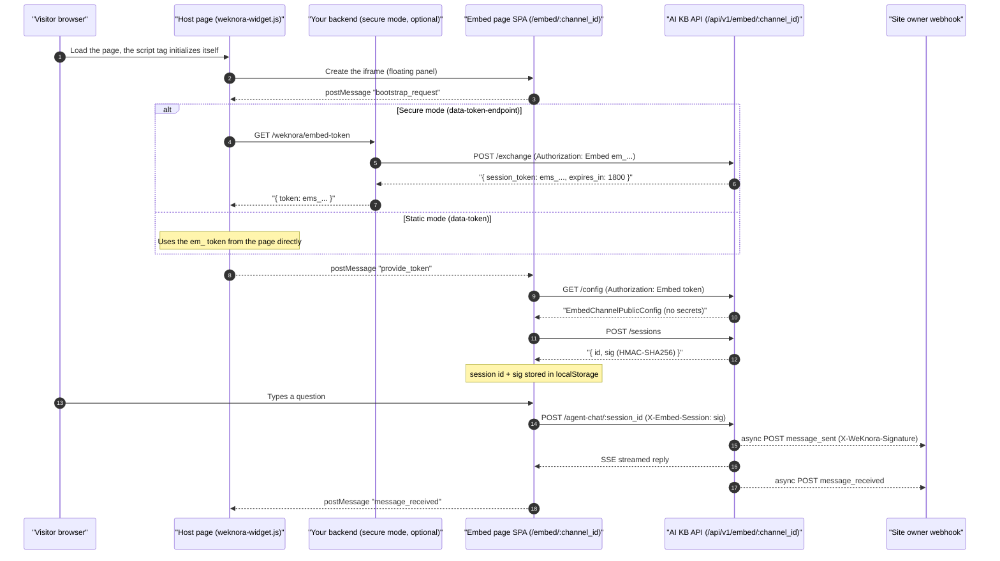

# Web embed (embed channel)

An embed channel puts a knowledge base chat widget on a website or help center. You create a channel, bind it to an agent and add the generated script to the page; visitors chat without a AI KB account. The visitor's retrieval scope and model are decided entirely by the agent bound to the channel: the server discards any knowledge base, document, tag, @mention, skill or model override in the request.

Create the channel under Settings → Publish & Integrations → Web Embed, bind an agent, set the host domains allowed to embed it, then copy the snippet. Before public use, configure the origin allowlist and the rate limits so that both the source and the volume of requests are bounded.

<Screenshot
  src="/screenshots/embed-channel.png"
  caption="Web embed channel: configuration, code snippet and the rendered widget"
  hint="The channel configuration (bound agent, allowed origins, appearance settings) and the generated script snippet; if possible a second shot of the widget opened on a web page." />

A channel accepts a static token or secure-mode integration, and can deliver conversation events to a webhook.

Images on the visitor side go through a channel-scoped authenticated proxy, which differs from the main site; when images do not render, see [External access to images and files](21-file-access.md).

## Add the widget to a page

To put the chat widget on a page you load the SDK and give it a channel and a token source. The SDK is a dependency-free loader script, `frontend/public/weknora-widget.js`, served from the AI KB server root after deployment. It renders a floating button plus an iframe panel; the iframe points at the embed page SPA at `/embed/{channel_id}` (entry `frontend/src/embed-main.ts`, served from `frontend/embed.html`).

### Option 1: static token mode (the token is visible to visitors)

```html
<script
  src="https://your-weknora.example.com/weknora-widget.js"
  data-channel="your-channel-uuid"
  data-token="em_your_publish_token"
  data-position="bottom-right"
  data-primary-color="#07C05F"
  data-title="AI Assistant"
></script>
```

The publish token is written into the page HTML and visible to every visitor; rotating the token means updating every deployed page. Suitable for internal sites and low-sensitivity use.

### Option 2: secure mode (recommended)

The publish token stays on your own backend, and the page points `data-token-endpoint` at an exchange endpoint there:

```html
<script
  src="https://your-weknora.example.com/weknora-widget.js"
  data-channel="your-channel-uuid"
  data-token-endpoint="https://your-backend.example.com/weknora/embed-token"
  data-position="bottom-right"
></script>
```

Your backend implements that endpoint: it holds the `em_` token, calls `POST /api/v1/embed/{channel_id}/exchange` to obtain a short-lived `ems_` token and returns `{ "token": "ems_...", "expiresIn": 1800 }` (the widget also accepts `session_token` and `expires_in`, optionally wrapped in a `data` object). The widget refreshes the token at about 80% of its TTL, never sooner than 30 seconds (`scheduleRefresh` in `weknora-widget.js`). **The publish token never reaches the browser.**

The exchange endpoint must first verify your own session or JWT and the visitor's access rights; checking that a cookie or `Authorization` header merely exists is not authentication. When your server calls the exchange, send an `Origin` header that matches the channel allowlist, for example `Origin: https://shop.example.com`. Never expose a AI KB management token to visitors.

Other optional attributes: `data-base-url` (derived from the script `src` by default), `data-width` / `data-height` (panel size, default 400×600), `data-sandbox` (the iframe `sandbox` policy; `true` applies `allow-scripts allow-forms allow-popups allow-modals allow-same-origin`, which is also added automatically when the host and the embed page are on different origins, and `false` turns it off).

### Option 3: programmatic API

```html
<script src="https://your-weknora.example.com/weknora-widget.js"></script>
<script>
  AIKB.init({
    channel: 'your-channel-uuid',
    tokenEndpoint: 'https://your-backend.example.com/weknora/embed-token', // or token: 'em_...'
    position: 'bottom-right',
    primaryColor: '#07C05F',
    title: 'AI Assistant',
    baseUrl: 'https://your-weknora.example.com',
  });
  AIKB.setContext({ userId: 'u_123', page: location.pathname }); // context is attached to every question
  AIKB.setLocale('en-US');
  AIKB.openWithQuery('How do I reset my password?');   // opens the panel and sends the question
  AIKB.on('ready', () => console.log('widget ready'));
  // Also: AIKB.open() / close() / toggle() / destroy() / off(event, fn)
</script>
```

### Direct iframe

The loader is optional; you can embed the iframe yourself. The token then has to be supplied through the URL or `postMessage`, so the loader is the usual choice:

```html
<iframe src="https://your-weknora.example.com/embed/your-channel-uuid"
        width="400" height="600" style="border:none"></iframe>
```

### postMessage bridge protocol

The host page (loader) and the embed page inside the iframe talk over `postMessage`, and both sides check origins. The loader only posts to the derived `embedOrigin` and never to `*`. The embed page pins the parent origin from the first trusted message (or the referrer) and drops conversation content when that origin is unknown; only the `bootstrap_request` and `ready` handshake messages may fall back to `*` (`frontend/src/api/embed/index.ts`):

- host → iframe (`source: "weknora-host"`): `provide_token` (hands over the token), `set_context`, `set_locale`, `open_with_query`;
- iframe → host (`source: "weknora-embed"`): `ready`, `bootstrap_request` (asks for a token), `message_sent`, `message_received`.

## Authentication and anonymous sessions

A visitor never logs in, so this section explains which tokens the channel issues, how requests are checked, and how a chat session is bound to the visitor who created it.

### Two kinds of token

| Token | Prefix | Lifetime | Purpose |
| --- | --- | --- | --- |
| Publish token | `em_` | Long-lived (until rotated) | The channel's publish token, embedded in the page (static mode) or kept on your backend (secure mode) |
| Session token | `ems_` | **30 minutes** (Redis TTL) | A short-lived token obtained from the publish token through `/exchange`, used by the browser |

Every public endpoint carries the token in the `Authorization: Embed <token>` request header (**a query string is not accepted**). The `EmbedAuth` middleware (`internal/middleware/embed_auth.go`) runs these checks in order:

1. Look up the channel by `channel_id` and check that the token matches `publish_token`, or that a session token found in Redis (key `embed:session:{token}`) belongs to that channel;
2. Check that the channel is `enabled`;
3. Allow same-origin API requests from inside the iframe; the `Origin` (or, failing that, the `Referer`) of cross-origin API requests and of the server-side exchange in secure mode must match `allowed_origins`. An empty allowlist still rejects everything; the host restriction itself is enforced by the CSP on the embed HTML;
4. Rate limits (a Redis Lua script with a sliding window, falling back to an in-memory limiter when Redis is unavailable):
   - per IP: at most `RateLimitPerMinute` per minute;
   - per channel: at most `max(RateLimitPerMinute × 20, 120)` per minute, so an attacker cannot defeat the per-IP limit by rotating IPs;
   - per channel: at most `RateLimitPerDay` per day.

### Host origins and deployment

When site A embeds AI KB served at B, the allowlist contains A. The standard Nginx fetches the channel policy from `/api/v1/embed-frame-policy` (no token needed; it returns only the CSP, never the channel configuration) and sets `frame-ancestors` on the HTML response for `/embed/:channelId`; Lite applies the same policy in its own middleware. The page is not cached, and when the policy cannot be fetched the embed HTML is not returned.

When upgrading, channels that listed only B must be changed to the real host A, and the frontend and backend are updated together. A custom reverse proxy must preserve the CSP, the original `Host` (including the port), the protocol and `Sec-Fetch-Site`. The allowlist restricts browser embedding; it does not authenticate visitors or stop a non-browser client that holds a token. That kind of access control is what secure mode and the rate limits are for.

#### Separate subdomain (optional) {#embed-subdomain}

By default the embed page and the console share one domain. When you need a separate entry point or cookie isolation, serve the embed page at `https://embed.example.com`, keep the console at `https://app.example.com`, with the business host at `https://shop.example.com`.

The console takes the embed origin from `window.__RUNTIME_CONFIG__.EMBED_BASE_URL` in `frontend/public/config.js`, or from the build-time `VITE_EMBED_BASE_URL`; when both are empty it follows the current page origin. After changing it, confirm that the generated widget and iframe snippets point at the new address.

The separate Nginx server serves only `/embed/*`, `/weknora-widget.js`, `/assets/*` and the backend proxy it needs; it does not serve the console `index.html`. Keep the `auth_request` on `/embed/`, the internal `/_embed-frame-policy` location and the CSP response header from the standard `frontend/nginx.conf`: when the policy fetch fails the page must be refused, and no gateway or CDN may cache or strip that policy.

The allowlist still contains the real business host `https://shop.example.com`, and the secure-mode exchange declares the same `Origin`; the embed origin itself does not need to be added for ordinary same-origin chat requests. The widget adds the iframe sandbox automatically when the host and the embed page differ in origin. Verify from the real host page, checking the iframe, the API calls, the CSP and the generated snippet; a console preview alone is not enough.

### Token exchange (the core of secure mode)

`POST /api/v1/embed/:channel_id/exchange` with the header `Authorization: Embed em_xxx` (**only a publish token is accepted**; a session token is refused with 403). Response:

```json
{ "success": true, "data": { "session_token": "ems_...", "expires_in": 1800 } }
```

The implementation is `IssueSessionToken` in `internal/application/service/embed_session.go`: 32 random bytes, base64url-encoded, with the `ems_` prefix, written to Redis with a 30-minute TTL.

### Creating an anonymous session

`POST /api/v1/embed/:channel_id/sessions` creates a chat session and returns (HTTP 201):

```json
{ "success": true, "data": { "id": "<session_uuid>", "sig": "<HMAC-SHA256 base64url>" } }
```

- The session is written to the `sessions` table with `Description` set to `embed_channel:{channel_id}` and `UserID` set to the opaque visitor identity from `EmbedSessionPrincipal(tenantID, channelID, sessionID).StorageID()`;
- `sig` is the **session signature**: `HMAC-SHA256(key, "embed-session:v2|{publish_token}|{channel_id}|{session_id}")`, where the key is the system signing key (`SYSTEM_SIGNING_KEY`, falling back to `SYSTEM_AES_KEY`; keys shorter than 16 characters and the example values are rejected). When no signing key is configured, session creation fails with 503 and the log says `embed session signing key is not configured`. Every later call that names the session (`/sessions/:session_id/*`, `/knowledge-chat/:session_id`, `/agent-chat/:session_id`, `/messages/:session_id/load`) must carry the header `X-Embed-Session: <sig>`, which the server compares in constant time (`VerifyEmbedSessionHandle`). This stops anyone from taking over a session with its id alone, and rotating the publish token invalidates every signature at once. The HMAC key changed from the publish token to the signing key in v0.8.2, so sessions signed before that release are invalid after upgrading.

The frontend can also send `X-Embed-Visitor: <uuid>` for per-visitor statistics. The session id and `sig` are cached per channel in `localStorage`, so a page reload resumes the session (`frontend/src/composables/useEmbedBridge.ts`).

## Webhook callbacks

To get notified of conversations, set a `webhook_url` on the channel; the server then POSTs JSON to your backend on these events (`internal/application/service/embed_webhook.go`):

| Event | When | Payload fields |
| --- | --- | --- |
| `message_sent` | The visitor sends a question | `type`, `channel_id`, `session_id`, `timestamp`, `query` |
| `message_received` | The assistant's reply is complete | `type`, `channel_id`, `session_id`, `timestamp`, `content` |

Security and delivery semantics:

- When `webhook_secret` is set, the request carries the signature header `X-WeKnora-Signature: sha256=<hex(HMAC-SHA256(secret, raw_body))>`;
- The URL must be `http(s)` and pass the SSRF check. Outbound requests use the SSRF-safe client (every redirect is re-checked, at most 5 hops) with a 5-second timeout and the `User-Agent` `AIKB-Embed-Webhook/1.0`;
- Delivery is asynchronous and best-effort: a failure is logged and **not retried**;
- The frontend can also forward events explicitly through `POST /api/v1/embed/:channel_id/sessions/:session_id/events`.

## Configuration and API reference

This section is the reference for the channel record, its settings, the management API and the public API.

### Data model

`EmbedChannel` in `internal/types/embed_channel.go` is the full channel definition (table `embed_channels`, soft-deleted, with a partial unique index on `publish_token`):

```go
type EmbedChannel struct {
    ID                     string         // UUID primary key
    TenantID               uint64         // owning workspace
    AgentID                string         // bound agent (default builtin-quick-answer)
    Name                   string         // channel name
    Enabled                bool           // on/off switch
    PublishToken           string         // long-lived publish token, "em_" prefix
    AllowedOrigins         JSON           // allowed origins (JSONB)
    WelcomeMessage         string         // welcome message
    RateLimitPerMinute     int            // per-IP per-minute limit (default 30)
    RateLimitPerDay        int            // per-channel daily limit (default 10000)
    PrimaryColor           string         // theme color
    PageTitle              string         // page title
    HeaderTitleMode        string         // "channel" | "session"
    ShowSuggestedQuestions bool           // suggested questions switch
    WidgetPosition         string         // widget corner
    AllowWebSearch         bool           // allow web search
    AllowFileUpload        bool           // allow file and image upload
    DefaultLocale          string         // default language
    WebhookURL             string         // outbound webhook
    WebhookSecret          string         // HMAC-SHA256 signing secret
    ...
}
```

#### Channel settings

When creating or updating a channel (`embedChannelRequest` in `internal/handler/embed_channel.go`) you can set:

| Setting | Type | Default | Description |
| --- | --- | --- | --- |
| `name` | string | - | Display name of the channel |
| `enabled` | bool | `true` | Channel switch; when off, every public endpoint refuses access |
| `agent_id` | string | `builtin-quick-answer` | The bound agent, which decides the knowledge base scope and chat capabilities |
| `allowed_origins` | string[] | - | **At least one entry is required; list the embedding host A, not the AI KB address B.** Three forms: a full `http(s)://` origin (no path or query), a subdomain wildcard `*.example.com` (matches subdomains only, not `example.com` itself; matches any port unless one is given), or the wildcard `*` (refused when `GIN_MODE=release`; development only) |
| `welcome_message` | string | empty | Welcome message shown when the widget opens |
| `rate_limit_per_minute` | int | `30` | Per-IP requests per minute |
| `rate_limit_per_day` | int | `10000` | Per-channel requests per day |
| `primary_color` | string | - | Widget theme color (a CSS color such as `#0052d9`) |
| `page_title` | string | empty | Browser title of the embed page |
| `header_title_mode` | string | `channel` | Title mode: `channel` (fixed channel name) or `session` (generated from the conversation) |
| `show_suggested_questions` | bool | `true` | Whether suggested questions are shown |
| `widget_position` | string | `bottom-right` | `bottom-right` \| `bottom-left` \| `top-right` \| `top-left` |
| `allow_web_search` | bool | `false` | Whether visitors get a web search toggle |
| `allow_file_upload` | bool | `false` | Whether visitors can upload images and files |
| `default_locale` | string | empty (follows the browser) | A supported locale tag; the UI ships in English (`en-US`) |
| `webhook_url` | string | empty | Event callback URL; **must be `http(s)` and pass the SSRF check** (private and link-local addresses are refused) |
| `webhook_secret` | string | empty | Webhook signing secret (never returned by the API) |

When both the channel and the bound agent allow image upload, a visitor can paste a screenshot into the chat input, confirm the preview and send it, or remove the image from the preview. Pasting and file selection share the same limits: JPEG, PNG, GIF and WebP, at most 10 MB each and at most 5 per message. Plain-text pasting is unchanged; when the clipboard holds both an image and text, only the image is added, as in the main chat.

### Management API (login required)

Registered by `RegisterEmbedChannelRoutes` (`internal/router/routes_agent.go`); API keys need the `manage_channels` capability:

| Method | Path | Role | Description |
| --- | --- | --- | --- |
| POST | `/api/v1/agents/:id/embed-channels` | Admin | Create a channel for an agent |
| GET | `/api/v1/agents/:id/embed-channels` | Viewer | List an agent's channels |
| GET | `/api/v1/embed-channels` | Viewer | List every channel in the workspace |
| GET | `/api/v1/embed-channels/:channel_id` | Viewer | Channel details (including `publish_token`) |
| PUT | `/api/v1/embed-channels/:channel_id` | Admin | Update the channel configuration |
| DELETE | `/api/v1/embed-channels/:channel_id` | Admin | Delete the channel (soft delete) |
| POST | `/api/v1/embed-channels/:channel_id/rotate-token` | Admin | Rotate `publish_token` (the old token and every issued session signature stop working immediately) |
| POST | `/api/v1/embed-channels/:channel_id/preview-session` | Viewer | Issue a short-lived session token for the console widget preview |
| GET | `/api/v1/embed-channels/:channel_id/stats` | Viewer | Channel session statistics |

### Public API (anonymous, Embed authentication)

Registered by `RegisterEmbedPublicRoutes` under the `/api/v1/embed/:channel_id` prefix; every route passes through the `middleware.EmbedAuth` middleware (token check, origin check, rate limits):

```go
embed := r.Group("/api/v1/embed/:channel_id", middleware.EmbedAuth(embedService, tenantService, redisClient))
{
    embed.POST("/exchange", embedHandler.ExchangeEmbedSession)
    embed.GET("/config", embedHandler.GetEmbedConfig)
    embed.GET("/suggested-questions", embedHandler.GetEmbedSuggestedQuestions)
    embed.GET("/chunks/:chunk_id", embedHandler.GetEmbedChunk)
    embed.POST("/sessions", embedHandler.CreateEmbedSession)
    embed.POST("/knowledge-chat/:session_id", embedHandler.EmbedKnowledgeChat)
    embed.POST("/agent-chat/:session_id", embedHandler.EmbedAgentChat)
    embed.GET("/messages/:session_id/load", embedHandler.EmbedLoadMessages)
    embed.POST("/sessions/:session_id/stop", embedHandler.EmbedStopSession)
    embed.POST("/sessions/:session_id/events", embedHandler.EmbedRelayWebhookEvent)
    // message suggestions, MCP OAuth, tool approvals and file serving routes omitted
    embed.GET("/files", newFileServeHandler(...))
}
```

#### Public configuration

`GET /api/v1/embed/:channel_id/config` returns `EmbedChannelPublicConfig` (`internal/types/embed_channel.go`), which holds only what the widget needs to render:

- Returned: `channel_id`, `name`, `display_title` (resolved on the server in the order `PageTitle → Name → AgentName → "AI Assistant"`), `agent_id` / `agent_name` / `agent_avatar`, `knowledge_base_ids`, `welcome_message`, `primary_color`, `page_title`, `header_title_mode`, `show_suggested_questions`, `allowed_origins`, `widget_position`, `allow_web_search`, `allow_file_upload`, `agent_web_search_enabled`, `agent_image_upload_enabled`, `default_locale`;
- **Never returned**: `publish_token`, `webhook_url`, `webhook_secret`.

### End-to-end sequence



### Security summary

- **Host allowlist**: the embed HTML carries a per-channel `CSP frame-ancestors` that restricts every ancestor page; same-origin API calls from inside the iframe pass. An empty `allowed_origins` refuses every request; `*` is available in development mode only; `*.example.com` subdomain wildcards are supported. Same-origin console previews are allowed.
- **Two tokens**: in secure mode the publish token never leaves your server, and the browser holds only the 30-minute `ems_` token.
- **Session signature**: the `X-Embed-Session` HMAC binds a session to the channel, the session id and the current publish token under the server signing key; rotating the token revokes every session.
- **Three rate limits**: per IP per minute, per channel per minute (20 × the per-IP limit, floor 120), per channel per day, enforced atomically in Redis Lua.
- **Webhook SSRF protection**: SSRF check on the URL, private addresses refused, every redirect re-checked, 5-second timeout.

## Implementation reference

All paths are relative to the repository root:

| Layer | File |
| --- | --- |
| Data structures | `internal/types/embed_channel.go` |
| HTTP handler | `internal/handler/embed_channel.go` |
| Channel service | `internal/application/service/embed_channel.go` |
| Anonymous sessions and tokens | `internal/application/service/embed_session.go` |
| Webhook dispatch | `internal/application/service/embed_webhook.go` |
| Authentication middleware | `internal/middleware/embed_auth.go` |
| Rate limiter | `internal/ratelimit/limiter.go` |
| Route registration | `internal/router/routes_agent.go` (`RegisterEmbedPublicRoutes` / `RegisterEmbedChannelRoutes` / embed page CSP policy) |
| Host origin rules | `internal/embedpolicy/origin.go` |
| Widget loader (SDK) | `frontend/public/weknora-widget.js` |
| Embed page SPA | `frontend/src/embed-main.ts`, `frontend/src/api/embed/index.ts` (bridge and API client), `frontend/src/composables/useEmbedBridge.ts`, `useEmbedChatSession.ts` |
| Database migration | `migrations/versioned/000060_embed_channels.up.sql` |
