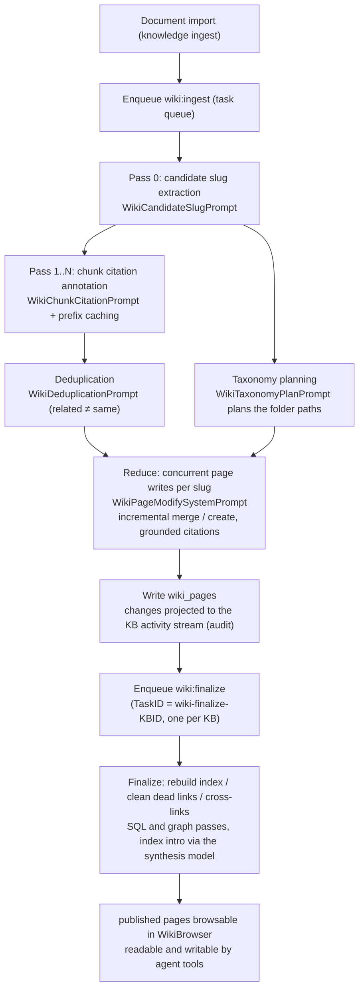

# Wiki

The Wiki turns the material in a knowledge base into interlinked Markdown pages. After documents are imported, the model extracts entries such as people, products and concepts and writes a page for each, with citations back to the source documents, so the content can be browsed by topic.

Users can edit the generated pages, view their history and roll back. Agents can read and maintain pages through the Wiki tools; access is still decided by the knowledge base permissions.

<Screenshot
  src="/screenshots/wiki-browser.png"
  caption="Wiki browser: the directory tree on the left, a generated entry page with its sources on the right"
  hint="The directory tree grouped by type on the left, the body of one entity page, in-page wiki links and the source document citations." />

## Enable and browse the Wiki

To get a Wiki you switch it on for a knowledge base, upload documents and wait for generation to finish.

1. Edit the knowledge base and enable **Wiki** under "Indexing Strategy".
2. Upload documents. Documents already in the knowledge base are included; there is no need to upload them again.
3. Wait for generation. Wiki generation is asynchronous and takes a while for a large knowledge base. The knowledge base header shows how many tasks are still pending in the Wiki queue.
4. When it is done, open the **Wiki** tab of the knowledge base to browse, and the **Graph** tab to see how the entries link to each other.

Wiki generation adds model calls; the amount depends on the number of documents and the extraction density. The Wiki settings of the knowledge base offer `focused`, `standard` and `exhaustive`; see [Extraction granularity](#extraction-granularity).

<Screenshot
  src="/screenshots/wiki-graph.png"
  caption="Wiki graph view: the links between entries"
  hint="The graph overview mode, nodes colored by page type, each node clickable to open its page." />

## Edit and roll back pages

When a generated page needs a correction you edit it in place, compare versions and roll back if needed.

After editing the body of a Wiki page you can open the version history and compare changes. The history labels each version by its origin: auto-generated, AI edited, manually edited or reverted. A rollback creates a new version from the selected historical content; the version number keeps increasing.

Old auto-generated versions are cleaned up first: once a page has 50 historical versions the prunable snapshots are trimmed, and at 200 the hard cap trims every origin. Content that must be kept long-term should be archived elsewhere. Versions written before the upgrade that introduced history, and versions that were already pruned, have no snapshot: selecting one shows a notice in the history panel instead of a diff, and when the comparison baseline is missing the panel shows the full text of the selected version. Comparison and rollback of other versions are unaffected.

## Review changes and generation status

To see what changed in a Wiki and whether generation is still running, use the activity stream and the indexing status.

Page creation, updates, deletion and batch generation are recorded in "Knowledge base → Settings → Activity". While documents are being processed the indexing status is visible; after a service restart the system recovers the persisted pending Wiki tasks. Deleting a knowledge base also removes its Wiki pages, folders, issues and version history. API compatibility and the recovery mechanism are described in the reference sections below.

## Version and runtime reference

This section is the reference for version history, the activity stream and failure recovery.

### Manual editing and version history

Wiki pages support manual editing and rollback, so users can correct generated content and see the origin, author and time of every version. Version records were introduced by migration `000075`.

#### Version origin and author

`wiki_pages` carries two provenance columns. `last_edit_source` marks the author kind of the **current version**:

| `edit_source` | Meaning |
| --- | --- |
| `pipeline` | Written by the Wiki generation pipeline (legacy rows hold an empty string, which is treated as `pipeline`) |
| `agent` | Written by an agent through tools such as `wiki_write_page` / `wiki_replace_text` |
| `user` | Edited by a person in the editor |
| `revert` | Produced by a rollback |

The companion `last_editor_id` records the actor (empty for background pipeline writes). The UI uses these to show the origin of each version.

#### Snapshots and rollback

- Before a page is overwritten, the **old version** is snapshotted in full into `wiki_page_revisions` (title, body, summary, page type, status, aliases, plus the author and time of that version); the current version exists only in `wiki_pages`. A unique index on `(page_id, version)` together with `ON CONFLICT DO NOTHING` keeps the "snapshot, then update" write path idempotent under retries.
- `GET /revisions/*slug` lists the historical versions (newest first, without body, plus the current version number); with `?version=N` it returns the full text of that version, for diffing.
- `POST /revert` with `{slug, version}` rolls back. The rollback creates a new version with the content of the target version, the version number keeps increasing and `edit_source` is `revert`, so a rollback can itself be rolled back. Reverting to the current version returns 400 (usually the frontend holds a stale history list).

#### Retention policy

Version history is pruned at two levels (`internal/types/wiki_page.go`):

- **Soft cap, 50 versions**: only "prunable" snapshots are removed, that is those written by `pipeline` and legacy rows with an empty origin.
- **Hard cap, 200 versions**: snapshots are trimmed regardless of author, so a purely hand-maintained page also has bounded storage.

Until the hard cap is reached the system removes auto-generated history first and keeps manual edits.

<Screenshot
  src="/screenshots/wiki-revision-history.png"
  caption="Wiki page version history: the list of versions by origin, with the rollback entry point"
  hint="The history drawer of one wiki page: version number, edit origin (pipeline/manual/agent/revert), editor and time, and the compare and revert buttons." />

### Operation history (knowledge base activity stream)

The Wiki once kept a separate operation log (the `wiki_log_entries` table, the `GET /wiki/log` endpoint and a log tab in WikiBrowser). That feed overlapped with the knowledge base activity stream and was removed as a whole in migration `000077_remove_wiki_log`: the table is dropped, legacy pages with `page_type = 'log'` are deleted, and `log` is no longer a valid page type.

**The knowledge base activity stream is now the only operation history**:

- When an ingest batch ends, `wiki_ingest_batch.go` sums the actions of the batch by kind and calls `service.RecordWikiContentActivity()` to write one `wiki.content_changed` activity.
- When a person creates, edits, reverts or deletes a page in WikiBrowser, `internal/handler/wiki_page.go` projects `manual_create` / `manual_edit` / `revert` / `manual_delete` into the activity stream the same way.
- Activity records live in the audit log system (`kb_activity.go` → `AuditLogService`), are shown under "Knowledge base → Settings → Activity", and follow the same retention as other audit logs (see [Observability and audit](16-observability.md)).
- Writes are best-effort: a failed activity record does not fail the Wiki edit itself.

Upgrade note: an external integration that still calls `GET /api/v1/knowledgebase/:kb_id/wiki/log` must switch to the knowledge base activity endpoint `GET /api/v1/knowledge-bases/:id/activity`.

### Failure recovery

`internal/container/recover_pending_wiki_tasks.go` runs at service start and closes the gap left by Lite mode (the in-process `SyncTaskExecutor`) or an interrupted Redis enqueue:

1. It scans the persisted `task_pending_ops` table for pending combinations with `scope = knowledge_base` and `task_type` in `{wiki:ingest, wiki:finalize}`.
2. It removes leftover rows whose knowledge base, or whose workspace, has been deleted (fail-closed).
3. For every active knowledge base it re-enqueues the trigger task: `wiki:ingest` without a TaskID (several batches may run concurrently), `wiki:finalize` deduplicated with `"wiki-finalize-" + KB_ID` (one finalize per knowledge base). Duplicate enqueues are harmless. Ingest claims disjoint rows and finalize coalesces within its lane.

Other protections at run time:

- **Workspace deleted**: ingest and finalize tasks check that the workspace is still alive before calling a model; if it was deleted they drop the queue of that knowledge base and no further model requests are made.
- **Wiki cannot run**: when a trigger finds the Wiki switched off, no synthesis model configured, or the model deleted, the unclaimed ingest operations are cleared and the affected documents released, so they do not stay in the indexing state forever.
- **Lost trigger**: a knowledge base that has persisted operations but no trigger task is re-triggered by the background housekeeping task, at most once per housekeeping threshold window per knowledge base.
- **Transient error retries**: model calls that hit 408, 429 or 5xx, a timeout, a connection reset, or a 403 whose body carries rate-limit wording (such as `rate limit` or `qpm`) are retried with exponential backoff; an authorization 403 is not retried.
- **Failure-count priority**: when pending documents are claimed, those with fewer failures go first, so a document that keeps failing does not block new ones.

## Page and API reference

This section is the reference for the page model, the HTTP routes, the agent tools and the generation pipeline.

### Page model and hierarchy

#### Page types (PageType)

`internal/types/wiki_page.go` defines 6 page types:

| Type | Description |
| --- | --- |
| `summary` | Summary page of one source document (slug of the form `summary/<knowledge-uuid>`) |
| `entity` | Entity page (person, organization, product, technology, ...) |
| `concept` | Concept or topic page |
| `index` | Wiki-level index page (metadata) |
| `synthesis` | Synthesis page, **created only by an agent through the `wiki_write_page` tool** |
| `comparison` | Comparison page, **created only by an agent through the `wiki_write_page` tool** |

Page status (`WikiPageStatus`): `draft` / `published` (default) / `archived`.

#### Folder hierarchy

Migration `000061_wiki_page_hierarchy.up.sql` introduced the separate `wiki_folders` table (adjacency list):

- `WikiFolder` forms the tree from `ParentID` (empty string for the root) plus a materialized `Path` (the names joined with `/`); empty folders can exist on their own, so a user can lay out the skeleton first.
- `WikiPage.FolderID` is the **single source of truth** for where a page sits (FK → `wiki_folders.id`, empty string for the wiki root).
- `CategoryPath` / `WikiPath` / `Depth` / `SortOrder` on the page are **cached projections** derived from the folder chain.
- A model-generated category path is at most 3 levels deep (constant `WikiCategoryMaxDepth = 3`). `CleanWikiCategoryPath()` normalizes full-width separators (full-width slash and vertical bar, and `|`) to `/` and drops type labels such as "entity" and "concept".
- When a page is placed in a user-created folder, the folder path is used as the category path verbatim; a folder named "Concepts" or similar is not stripped as a type label.

#### Key fields

- `Slug`: the unique identifier of a page within its knowledge base (see the Slug section below).
- `SourceRefs`: source citations in the form `"<knowledge_id>|<doc_title>"`; `ChunkRefs`: chunk-level evidence citations.
- `InLinks` / `OutLinks`: inbound and outbound wiki links that maintain the graph; `GET /graph` returns the global overview or an ego view.
- `Aliases`: alternative names (used for search, and so that the old name still resolves after a dedup merge); `Version`: the version number.

### Publishing and access

All Wiki routes hang under `/api/v1/knowledgebase/:kb_id/wiki` (`internal/router/routes_knowledge.go`). **There is no public, login-free access mode**; reads and writes are both subject to RBAC and knowledge base access control.

#### Read endpoints (Viewer + KBAccessRead)

| Method | Path | Description |
| --- | --- | --- |
| GET | `/pages` | Page list |
| GET | `/pages/*slug` | One page by slug |
| GET | `/folders` | Folder tree |
| GET | `/index` | Index page |
| GET | `/graph` | Link graph (`mode=overview`, the default, or `mode=ego` with `center=<slug>`) |
| GET | `/stats` | Statistics |
| GET | `/search?q=...` | Search |
| GET | `/lint` / `/issues` | Quality check results / issue list |
| GET | `/revisions/*slug` | Version history list; with `?version=N` the full text of that version |

`KBAccessRead` covers the knowledge base owner, organization shares and access obtained through a shared agent.

#### Write endpoints (OwnedWikiKBOrAdmin + KBAccessWrite)

| Method | Path | Description |
| --- | --- | --- |
| POST / PUT / DELETE | `/pages`, `/pages/*slug` | Create / update / delete a page |
| POST / PUT / DELETE | `/folders`, `/folders/:folder_id` | Folder management |
| PUT | `/move-page` | Move a page into a folder |
| POST | `/rebuild-links` | Rebuild the link graph |
| POST | `/auto-fix` | Trigger automatic fixes |
| PUT | `/issues/:issue_id/status` | Update an issue's status |
| POST | `/revert` | Roll back to a given version (body: `{slug, version}`) |

Write permission follows knowledge base ownership: a Contributor who owns the knowledge base can manage its wiki, otherwise 403. For API keys the routes map to the `ingest` (write) and `retrieve` (read) capabilities.

The browsing UI is `WikiBrowser.vue`. While documents are parsing, `wikiStatusRefresh.ts` polls `parse_status` (`pending` / `processing` / `finalizing`) and keeps polling when parsing has completed but the summary is still being generated. The expanded state of the folder tree is kept separately in `wikiDirectoryState.ts`: after a folder is created or the data is refreshed, `expandWikiDirectoryPath()` marks every folder on the current path as expanded by the user, so a refresh does not collapse the whole tree back to its default state.

### Relationship with agents

Agents read and modify pages and handle issues through the following 9 Wiki tools (reading a source document back reuses the general `read_document` tool). The tool definitions are in `internal/agent/tools/definitions.go`:

| Tool | Purpose | Key parameters |
| --- | --- | --- |
| `wiki_read_page` | Read the full text of pages by slug, in bulk | `slugs: string[]` |
| `wiki_search` | Search pages (title / slug / aliases / summary / content; `query` is a case-insensitive POSIX regular expression, text that is not a valid regular expression such as `C++` is matched literally; `regex=false` forces a literal match) | `query`, `regex?`, `knowledge_base_ids?`, `limit?` (the legacy `queries` and `knowledge_base_id` are still accepted) |
| `wiki_write_page` | Create a page or overwrite one in full (`synthesis` and `comparison` pages can only be created this way) | `slug`, `title`, `summary`, `content`, `page_type`, `aliases?`, `source_refs?` |
| `wiki_replace_text` | Exact text replacement within a page | `slug`, `old_text`, `new_text` |
| `wiki_rename_page` | Rename a slug and update the backlinks automatically | `slug`, `new_slug` |
| `wiki_delete_page` | Delete a page and clean up dead links | `slug` |
| `read_document` | Read a source document back: the metadata header plus chunks, paged or located inside the document with `query` (replaces the former `wiki_read_source_doc`; also available on Wiki-only knowledge bases, because chunks are always stored) | `id` (`dN` / `cN`), `offset?`, `limit?`, `query?`, `regex?`, `context?` |
| `wiki_flag_issue` | Flag a page issue | `slug`, `issue_type` in `{mixed_entities, contradictory_facts, out_of_date, other}`, `description` |
| `wiki_read_issue` | View issue details | issue ID |
| `wiki_update_issue` | Update an issue's status | issue ID, `status` in `{pending, ignored, resolved}` |

The recommended reading order is `wiki_search` → `wiki_read_page` → `read_document`: find the page, read it in full, and go back to the `cN` chunks of the original source when an exact citation is needed. Tool output is an XML-like structure (`<wiki_page><metadata>...<summary>...<content>...`), which the frontend parses with `parseWikiToolReferences()` in `frontend/src/utils/wikiToolReferences.ts` into the citation cards rendered in the conversation.

Supporting mechanisms:

- **Wiki scope**: an agent session keeps an allowlist of wiki knowledge bases; an `@mention` narrows the scope to specific documents or tags, and tool execution filters `source_refs` accordingly (`internal/agent/tools/wiki_tools.go`).
- **Write permission**: the retrieval scope only needs read access, while the mutating tools (`wiki_write_page`, `wiki_replace_text`, `wiki_rename_page`, `wiki_delete_page`, `wiki_flag_issue`, `wiki_update_issue`) act only on knowledge bases the caller may edit: those of its own workspace, or those shared through an organization with editor permission or above. The caller must also hold write permission itself: a workspace role of Contributor or above, or for a scoped API key the `ingest` capability. IM, web embed and MCP endpoints run as Viewer and are therefore read-only. When the scope contains no editable wiki knowledge base these tools are not registered. Shared agents are always read-only.
- **Wiki Fixer**: a built-in agent (`types.BuiltinWikiFixerID`) that fixes wiki issues automatically (dead links, mixed entities and so on). Access to a shared knowledge base across workspaces requires an organization role of Editor or above and is elevated to the source workspace context (`internal/handler/session/wiki_fixer_scope.go`). The elevated run uses the built-in default configuration pinned to that one knowledge base, with MCP, skills, sandbox and web search disabled, and models fall back to the knowledge base's own; the caller's customizations of the fixer are not carried into the source workspace.
- **Issue loop**: the `wiki_page_issues` table, the lint endpoint and `auto-fix`; both people and agents can report and handle issues.

### Generation pipeline

Wiki generation is **triggered by document ingest** and runs asynchronously through the task queue (Redis-backed Asynq in standard mode, the in-process executor in Lite mode). The task types are defined in `internal/types/task.go`:

```go
TypeWikiIngest   = "wiki:ingest"
TypeWikiFinalize = "wiki:finalize"
```

The pipeline has four stages (a Map-Reduce structure):

| Stage | Task | What it does | LLM prompt (`internal/agent/prompts_wiki.go`) |
| --- | --- | --- | --- |
| Pass 0: candidate extraction | `wiki:ingest` | Extracts a skeleton of candidate slugs from the document (JSON of entities and concepts) | `WikiCandidateSlugPrompt` |
| Pass 1..N: chunk citations | `wiki:ingest` | Annotates the candidate slugs with citations chunk by chunk, producing `{ citations: {"slug": ["c001", ...]}, new_slugs: [...] }`; the long shared prefix benefits from prefix caching | `WikiChunkCitationPrompt` |
| Reduce: page merge | `wiki:ingest` | Updates or merges pages incrementally per slug, producing `SUMMARY: ...` plus the Markdown body; strict grounding, no hallucination, deduplication, no self-links | `WikiPageModifySystemPrompt` + `WikiPageModifyUserPrompt` |
| Finalize: wrap-up | `wiki:finalize` | Rebuilds the index page, cleans dead links, adds cross-links and prunes folders. The link and folder passes are pure SQL and graph work; the index page intro is rewritten with the synthesis model when the batch changed something (skipped when no model is configured) | `WikiIndexIntroPrompt` / `WikiIndexIntroUpdatePrompt` |

Auxiliary prompts:

- `WikiTaxonomyPlanPrompt`: plans the folder paths for all entities and concepts of a batch at once (at most 2 levels, reusing existing folders first), so the folder tree stays coherent.
- `WikiDeduplicationPrompt`: decides whether a newly extracted item is the same thing as an existing page. The core principle is **"related ≠ same"**; it returns `{ merges: { "entity/new": "entity/existing" } }`. Names and aliases are compared in both directions (name against alias, alias against alias), but a shared alias or abbreviation alone is not enough to call two items the same.

Other deduplication and write rules:

- **Same name across types**: on a reparse the model may classify the same thing first as `concept/X` and later as `entity/X`. When no page of the same type exists, a page of the other type with the same normalized title is updated directly instead of creating a twin page.
- **Cited images carry their descriptions**: when the Reduce stage reads a cited chunk it inlines the caption and OCR text of its images into the chunk content, so the model can judge whether an image belongs on the page.
- **Truncated full-page rewrites**: when a full-page rewrite is cut off by the output length limit, up to 3 continuation rounds are requested and stitched together seamlessly; if the page is still incomplete the write is abandoned with a warning, and half a page is never written back.
- **No automatic links for single-character titles**: a page whose title is a single Han character can exist, but that character is not auto-linked in the body of other pages, to avoid linking it inside unrelated words.

#### Extraction granularity

`WikiExtractionGranularity` in `WikiConfig` (stored in the `knowledge_bases.wiki_config` JSONB column) controls the extraction density:

| Granularity | Behavior |
| --- | --- |
| `focused` | Only the 3-7 main subjects |
| `standard` (default) | The subjects plus entities and concepts that are substantively discussed (a paragraph, several entries, or 2-3 sentences or more) |
| `exhaustive` | Every named thing and recognized concept |

#### Concurrency and batching

Related `WikiConfig` parameters (`internal/types/wiki_page.go`):

| Parameter | Default | Description |
| --- | --- | --- |
| `IngestBatchSize` | 5 | Pending documents claimed per batch |
| `IngestMapParallel` | 10 | errgroup concurrency of the Map stage (extraction plus citations per document) |
| `IngestReduceParallel` | 10 | Concurrency of the Reduce stage (page write per slug) |
| `IngestMaxInflight` | 4 | Maximum concurrent batches for one knowledge base (fairness across knowledge bases) |

Wiki tasks run on their own worker pool (`AIKB_WIKI_ASYNQ_CONCURRENCY`, default 8), so they cannot starve document parsing; see [Async tasks](../02-architecture/05-async-tasks.md). When the folder planning stage computes embeddings for folders and items, the requests are split by `BATCH_EMBED_SIZE` like every other embedding call, so an oversized input is not rejected by the model service.

#### Generation flow



### Slugs

- **Format**: `<type>/<name>`, for example `entity/acme-corp`, `concept/rag`, `summary/<knowledge-uuid>`; lowercase, hyphen-separated, non-Latin names romanized (pinyin for Chinese).
- **Uniqueness**: a database unique index (`000037_wiki_and_indexing.up.sql`):

  ```sql
  CREATE UNIQUE INDEX IF NOT EXISTS idx_wiki_pages_kb_slug ON wiki_pages (knowledge_base_id, slug) WHERE deleted_at IS NULL
  ```

  A slug is therefore **unique within one knowledge base** and may repeat across knowledge bases.
- **Stability**: when a document is updated and re-extracted, the prompt forces the model to reuse the old slugs.

  > If an entity or concept from the previous extraction still exists in the current document, **reuse its exact slug** from the previous list. Do NOT generate a new slug for the same thing.

  Only newly appearing things get a new slug; items that disappeared are no longer output.
- **Slug handles**: in the LLM calls of ingest, high-entropy real slugs (especially `summary/...` slugs containing a UUID) are replaced by short handles (`ref-1`, `ref-2`); the model writes `[[ref-1|title]]` and the backend restores the real slug, so the model never has to copy a UUID (`internal/application/service/wiki_slug_handles.go`).
- **Citations**: wiki citations in agent answers appear as `[[slug|title]]`; `InLinks` / `OutLinks` maintain the page graph by slug, and renaming a slug (the `wiki_rename_page` tool) updates every backlink automatically.

## Implementation reference

This section lists where each part of the Wiki lives in the repository; paths are relative to the repository root.

| Layer | Files |
| --- | --- |
| Data structures | `internal/types/wiki_page.go` |
| HTTP handler | `internal/handler/wiki_page.go` |
| Generation pipeline | `internal/application/service/wiki_ingest.go`, `wiki_ingest_batch.go`, `wiki_ingest_cite.go`, `wiki_ingest_dedup.go`, `wiki_ingest_taxonomy.go` |
| Page service | `internal/application/service/wiki_page.go`, `wiki_linkify.go`, `wiki_lint.go`, `wiki_slug_handles.go` |
| LLM prompts | `internal/agent/prompts_wiki.go` |
| Agent tools | `internal/agent/tools/wiki_*.go` (registered in `internal/agent/tools/definitions.go`) |
| Failure recovery | `internal/container/recover_pending_wiki_tasks.go` |
| Routes | `RegisterWikiPageRoutes` in `internal/router/routes_knowledge.go` (behavior tests in `internal/router/router_wiki_test.go`) |
| Database migrations | `migrations/versioned/000037_wiki_and_indexing.up.sql`, `000061_wiki_page_hierarchy.up.sql`, `000075_wiki_page_revisions.up.sql`, `000077_remove_wiki_log.up.sql` |
| Frontend | `frontend/src/views/knowledge/wiki/WikiBrowser.vue`, `frontend/src/views/knowledge/wikiStatusRefresh.ts`, `frontend/src/views/knowledge/wiki/wikiDirectoryState.ts`, `frontend/src/api/wiki/`, `frontend/src/utils/wikiToolReferences.ts` |
