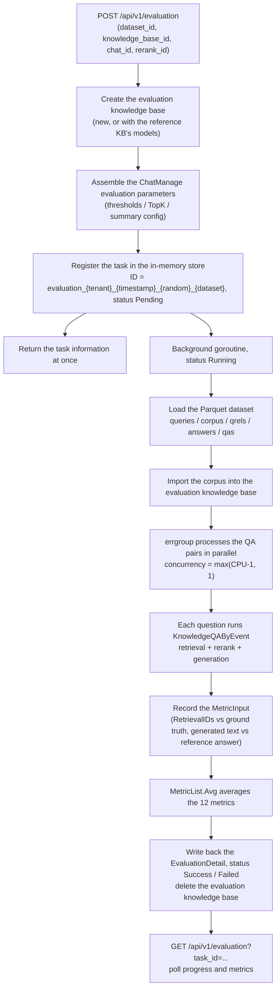

# Evaluation

Evaluation compares chunking, model and retrieval configurations against a question-and-answer dataset with known answers. The system creates an evaluation knowledge base, imports the corpus, runs retrieval and generation for every question, and reports Precision, Recall, NDCG, MRR, MAP, BLEU and ROUGE.

::: tip Used through the API
Evaluation has no screen in the UI yet. Start a run with `POST /api/v1/evaluation` and poll `GET /api/v1/evaluation?task_id=...` for the result. Creating a run needs the Admin role, reading a result needs Viewer. The dataset is a set of Parquet files; the format is below.
:::

To compare configurations, keep the dataset fixed, change one variable per run and read the same set of metrics each time.

## Run an evaluation

To get a first set of numbers you run the built-in sample dataset through the API, then swap in your own data once the loop works.

1. Use the built-in sample dataset, or produce Parquet files in the format below and replace the files of the same names in `dataset/samples/` under the service working directory (`/app/dataset/samples/` in the container).
2. Choose a reference knowledge base, a chat model and a rerank model, and create the task with `POST /api/v1/evaluation`. The reference knowledge base is only a source of model settings; the evaluation itself runs in a separate knowledge base.
3. Note the task ID in the response and poll `GET /api/v1/evaluation?task_id=...` for status and progress.
4. When the task succeeds, compare the retrieval and generation metrics. When it fails, read the task error first, then adjust the configuration and run again.

Creating a task needs the Admin role and reading a result needs Viewer. An API key also needs the `run_evaluations` capability or full access.

## Dataset format

To bring your own questions you produce five Parquet files with the schemas below. The dataset service (`internal/application/service/dataset.go`) loads them from `./dataset/samples/`:

| File | Schema | Meaning |
| --- | --- | --- |
| `queries.parquet` | `id: int64, text: string` | The questions |
| `corpus.parquet` | `id: int64, text: string` | The passages, imported into the knowledge base during the run |
| `answers.parquet` | `id: int64, text: string` | The reference answers |
| `qrels.parquet` | `qid: int64, pid: int64` | Question to relevant passage ground truth, the basis of the retrieval metrics |
| `qas.parquet` | `qid: int64, aid: int64` | Question to answer mapping, the basis of the generation metrics |

The matching Go structs:

```go
type TextInfo struct {
    ID   int64  `parquet:"id"`
    Text string `parquet:"text"`
}
type RelsInfo struct {
    QID int64 `parquet:"qid"`
    PID int64 `parquet:"pid"`
}
type QaInfo struct {
    QID int64 `parquet:"qid"`
    AID int64 `parquet:"aid"`
}
```

After loading, the rows are joined into one `QAPair` per question (`internal/types/dataset.go`):

```go
type QAPair struct {
    QID      int      // question ID
    Question string   // question text
    PIDs     []int    // relevant passage IDs (ground truth)
    Passages []string // passage texts
    AID      int      // answer ID
    Answer   string   // reference answer text
}
```

The service always reads these five files from `./dataset/samples/`. `dataset_id` is only used to build the task ID; it does not select another directory. To use a custom dataset, generate Parquet files with the schemas above under the same names and replace the contents of that directory (in a Docker deployment, mount it at `/app/dataset/samples/`). On load the service logs statistics: question count, corpus size, average relevant passages per question and answer coverage.

The `dataset/` directory in the repository also holds `qa_dataset.py`, the script that produced the sample files: it samples queries, passages and relevance judgments from an MS MARCO style dataset and generates answers with an OpenAI-compatible model.

## Read the result

To follow a run and collect its numbers you poll the result endpoint with the task ID from the create response. `GET /api/v1/evaluation?task_id=<task ID>` returns an `EvaluationDetail`:

```json
{
  "success": true,
  "data": {
    "task": {
      "id": "evaluation_1_1758600000000_1a2b3c4d_default",
      "dataset_id": "default",
      "status": 2,
      "total": 100,
      "finished": 100
    },
    "params": { "...": "snapshot of the ChatManage evaluation parameters" },
    "metric": {
      "retrieval_metrics": {
        "precision": 0.85, "recall": 0.92,
        "ndcg3": 0.88, "ndcg10": 0.86,
        "mrr": 0.95, "map": 0.87
      },
      "generation_metrics": {
        "bleu1": 0.72, "bleu2": 0.65, "bleu4": 0.58,
        "rouge1": 0.78, "rouge2": 0.71, "rougel": 0.75
      }
    }
  }
}
```

While the task runs, poll this endpoint for the `finished / total` progress; `metric` holds the running average so far. When `status = 3`, `err_msg` carries the failure reason. A result can only be read from the workspace that created it.

> **Note**: results are stored **in memory** (`evaluationMemoryStorage`: a `map[string]*EvaluationDetail` behind a `sync.RWMutex`, see `internal/application/service/evaluation.go`). A service restart loses every task and result, and the evaluation has to be started again.

## Metric list

To interpret the numbers you need to know what each metric measures and how the text is tokenized. The registry is in `internal/application/service/metric_hook.go`: 12 metrics in two groups. Text is first tokenized by `metric/common.go`: sentences are split on `。` or `.`, Chinese runs are segmented with Jieba, and Latin runs are split on whitespace.

### Retrieval metrics

| Metric | Field | Implementation | Meaning |
| --- | --- | --- | --- |
| Precision | `precision` | `metric/precision.go` | Relevant documents among the retrieved ones divided by the number retrieved, averaged over the ground truth sets |
| Recall | `recall` | `metric/recall.go` | Relevant documents retrieved divided by the number of relevant documents |
| NDCG@3 | `ndcg3` | `metric/ndcg.go` | Normalized discounted cumulative gain over the top 3, which rewards ranking relevant documents first |
| NDCG@10 | `ndcg10` | `metric/ndcg.go` | The same over the top 10 |
| MRR | `mrr` | `metric/mrr.go` | Mean reciprocal rank of the first relevant document: `sum(1/rank) / N` |
| MAP | `map` | `metric/map.go` | Mean average precision: `Precision@k` summed at every hit position, then normalized |

The NDCG core (`metric/ndcg.go`):

```go
// DCG = sum((2^rel_i - 1) / log2(i+2)), rel is 0 or 1
dcg += (math.Pow(2, float64(relevance)) - 1) / math.Log2(float64(i+2))
// NDCG = DCG / IDCG (the DCG of the ideal ordering)
```

The MRR core (`metric/mrr.go`):

```go
for i, predID := range ids {
    if _, ok := gtSet[predID]; ok {
        sumRR += 1.0 / float64(i+1) // reciprocal of the first hit position
        break
    }
}
```

### Generation metrics

| Metric | Field | Implementation | Meaning |
| --- | --- | --- | --- |
| BLEU-1 | `bleu1` | `metric/bleu.go` | 1-gram precision (weights `[1.0, 0, 0, 0]`) |
| BLEU-2 | `bleu2` | `metric/bleu.go` | 1-gram and 2-gram at 50% each (weights `[0.5, 0.5, 0, 0]`) |
| BLEU-4 | `bleu4` | `metric/bleu.go` | 1-gram to 4-gram with equal weights (`[0.25, 0.25, 0.25, 0.25]`), with the brevity penalty |
| ROUGE-1 | `rouge1` | `metric/rouge.go` | Unigram overlap F1 |
| ROUGE-2 | `rouge2` | `metric/rouge.go` | Bigram overlap F1 |
| ROUGE-L | `rougel` | `metric/rouge.go` | Longest common subsequence (LCS) F1 |

BLEU (`metric/bleu.go`) is the weighted geometric mean of the modified n-gram precisions times the brevity penalty: `bp * exp(sum(w_i * log(p_i)))`. ROUGE reports F1: `F1 = 2PR / (P + R + 1e-8)` (`metric/rouge_score.go`).

## API and execution reference

### API

`internal/router/routes_infra.go`:

```go
evaluationRoutes := g.apiKeyGroup(r.Group("/evaluation"), apiKeyRunEvaluations(apiKeyFullAccess()))
{
    evaluationRoutes.POST("", g.Admin(), handler.Evaluation)
    evaluationRoutes.GET("", g.Viewer(), handler.GetEvaluationResult)
}
```

| Method | Path | Permission | Description |
| --- | --- | --- | --- |
| POST | `/api/v1/evaluation` | Admin (an API key needs the `run_evaluations` capability or full access) | Create an evaluation task and return the task information at once |
| GET | `/api/v1/evaluation?task_id=...` | Viewer | Read task status, progress and metrics |

#### Create an evaluation task

Request parameters (`internal/handler/evaluation.go`):

```go
type EvaluationRequest struct {
    DatasetID       string `json:"dataset_id"`        // dataset ID, default "default"
    KnowledgeBaseID string `json:"knowledge_base_id"` // reference knowledge base (its model settings are reused)
    ChatModelID     string `json:"chat_id"`           // chat model
    RerankModelID   string `json:"rerank_id"`         // rerank model
}
```

| Parameter | Required | Default behavior |
| --- | --- | --- |
| `dataset_id` | No | Defaults to `default`; only used in the task ID, the data is always read from `dataset/samples/` |
| `knowledge_base_id` | No | Omitted: a new evaluation knowledge base is created with an embedding model and a chat model from the workspace model list. Provided: the evaluation knowledge base copies that knowledge base's embedding and summary model IDs |
| `chat_id` | No | Omitted: the first chat model in the workspace model list; with none, the request fails |
| `rerank_id` | No | Omitted: the first rerank model in the workspace model list; with none, reranking is skipped |

The task ID comes from `utils.GenerateTaskID` in the form `evaluation_{tenantID}_{millisecond timestamp}_{8 random characters}_{datasetID}`. It differs on every create, so query with the ID from the create response. The task object (`internal/types/evaluation.go`):

```go
type EvaluationTask struct {
    ID        string           `json:"id"`
    TenantID  uint64           `json:"tenant_id"`
    DatasetID string           `json:"dataset_id"`
    StartTime time.Time        `json:"start_time"`
    Status    EvaluationStatue `json:"status"`
    ErrMsg    string           `json:"err_msg,omitempty"`
    Total     int              `json:"total,omitempty"`    // number of samples
    Finished  int              `json:"finished,omitempty"` // samples completed
}
```

The status enum (the source spells it `EvaluationStatue`):

```go
const (
    EvaluationStatuePending EvaluationStatue = iota // 0 waiting to start
    EvaluationStatueRunning                          // 1 running
    EvaluationStatueSuccess                          // 2 succeeded
    EvaluationStatueFailed                           // 3 failed
)
```

### Evaluation flow

In `internal/application/service/evaluation.go`, the POST handler **prepares synchronously and evaluates asynchronously**:

1. **Knowledge base preparation**: create the evaluation knowledge base, either with models picked from the workspace list or with the embedding and summary models of the reference knowledge base.
2. **Parameter assembly**: build the `ChatManage` evaluation parameters from the system configuration: `VectorThreshold`, `KeywordThreshold`, `EmbeddingTopK`, `RerankTopK`, `RerankThreshold`, `MaxRounds`, `SummaryConfig` (MaxTokens, TopK, TopP, RepeatPenalty, Prompt, ContextTemplate and the rest), `FallbackResponse` and the rewrite prompts.
3. **Task registration**: register the task in the in-memory store with status `Pending` and return the response at once.
4. **Background execution** (goroutine): import the dataset corpus into the evaluation knowledge base, evaluate every QA pair in parallel, aggregate the metrics, then clean up.

The concurrency is `max(GOMAXPROCS - 1, 1)` (an errgroup limit):

```go
var g errgroup.Group
metricHook := NewHookMetric(len(dataset))
g.SetLimit(max(runtime.GOMAXPROCS(0)-1, 1))
for i, qaPair := range dataset {
    g.Go(func() error {
        // 1. clone the ChatManage configuration
        // 2. run the full KnowledgeQAByEvent pipeline (retrieval + rerank + generation)
        // 3. record the MetricInput (retrieved passage IDs, generated text, ground truth)
        // 4. update the finished counter under a lock
    })
}
g.Wait()
```

Each sample produces one `MetricInput` (`internal/types/evaluation.go`):

```go
type MetricInput struct {
    RetrievalGT    [][]int // retrieval ground truth (relevant passage IDs)
    RetrievalIDs   []int   // passage IDs actually retrieved
    GeneratedTexts string  // text generated by the model
    GeneratedGT    string  // reference answer
}
```

`metric_hook.go` runs every registered metric over each sample, and `Avg()` takes the per-metric mean over all samples into the `MetricResult`.

::: warning What RetrievalIDs must contain
`RetrievalIDs` must be **passage IDs from the dataset**, not the `ChunkIndex` of a retrieval result. `ChunkIndex` is only the chunk's position in the knowledge base and has no relation to the passage ID; using it makes every retrieval metric 0. `recordFinish` therefore matches the text of each retrieved result against the sample's ground truth passages (either contains the other) to recover the passage ID, and deduplicates the hits. When the rerank result is empty it falls back to the raw retrieval result, so a sample is not recorded as retrieving nothing.

The corpus import must also **wait for indexing to finish** (`CreateKnowledgeFromPassageSync`): with an asynchronous import the evaluation queries run before the index exists, which also shows up as metrics stuck at 0. The passage list is sized `maxPID + 1`; passage IDs are 0-based and the last one is included.
:::

#### Evaluation flow diagram



## Implementation reference

Paths are relative to the repository root:

| Layer | File |
| --- | --- |
| HTTP handler | `internal/handler/evaluation.go` |
| Evaluation service | `internal/application/service/evaluation.go` |
| Metric registry and aggregation | `internal/application/service/metric_hook.go` |
| Metric implementations | `internal/application/service/metric/` (`precision.go`, `recall.go`, `ndcg.go`, `mrr.go`, `map.go`, `bleu.go`, `rouge.go`, `rouge_score.go`, `common.go`) |
| Dataset loading | `internal/application/service/dataset.go` |
| Type definitions | `internal/types/evaluation.go`, `internal/types/dataset.go` |
| Built-in sample dataset | `dataset/samples/` (Parquet files), generated by `dataset/qa_dataset.py` |
| Route registration | `RegisterEvaluationRoutes` in `internal/router/routes_infra.go` |
