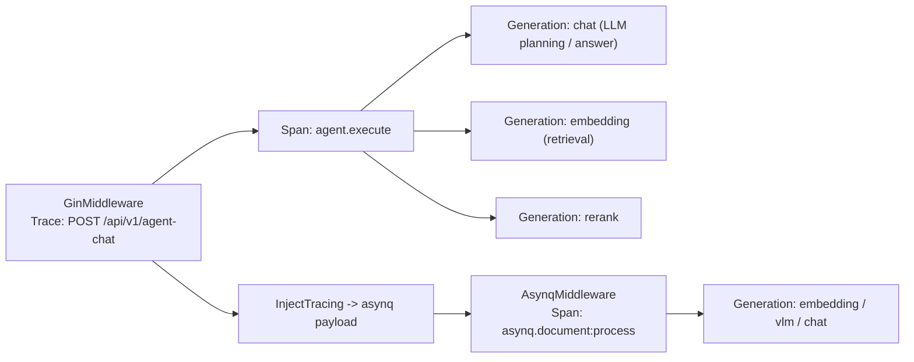
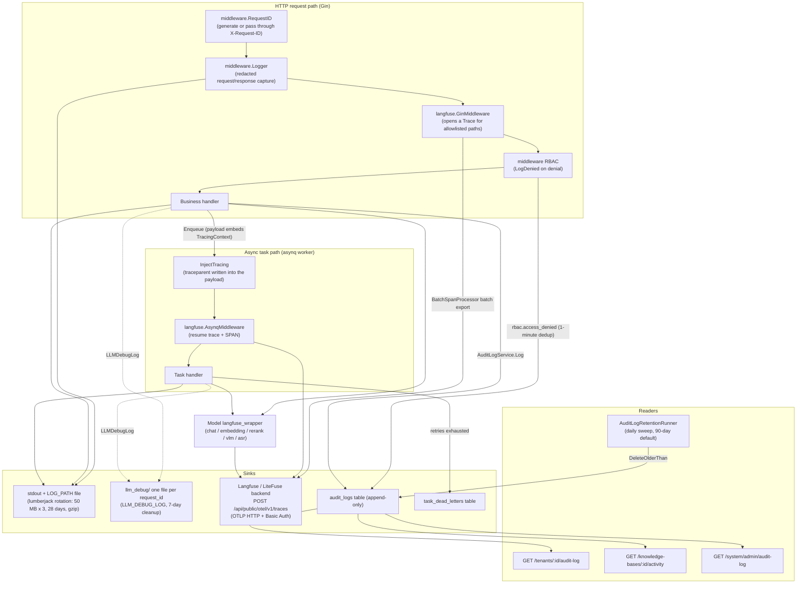

# Observability and audit

Logs and traces explain request errors, latency and model usage. The audit log records resource changes. The task queue dashboard shows background backlog, failures and retries.

| What you want to check | Where to look |
| --- | --- |
| What one answer retrieved, how many model calls it made, how many tokens it used | The full call tree in Langfuse, once Langfuse is connected |
| Changes to a knowledge base, to members or to system settings | "Activity" in the knowledge base settings, and Settings → Audit log |
| Whether background parsing, summary or Wiki tasks are piling up or failing | Settings → Task Queues |
| Whether the service is alive | `GET /health` |
| Service log lines that belong to one request | Search the logs for the `X-Request-ID` response header value |

<Screenshot
  src="/screenshots/queue-dashboard.png"
  caption="Runtime task queues: backlog, failures and retries per queue"
  hint="The queue dashboard with queue names, pending/active/failed counts and the dead-letter task actions." />

<Screenshot
  src="/screenshots/observability-langfuse.png"
  caption="Langfuse trace: the complete call tree of one answer"
  hint="One expanded trace in Langfuse with the retrieval, rerank and generation spans and their token usage." />

When you troubleshoot a request, take the `X-Request-ID` from the response headers first, then correlate the logs and the trace with it.

## Operations quick reference

Use this table to find the right source for a question before reading the reference sections below.

| You want to know... | Go to |
| --- | --- |
| Everything that happened during one request | grep the application log for the `X-Request-ID` response header; with `LLM_DEBUG_LOG` on, read `llm_debug/<request_id>.log` |
| The LLM call tree and token cost of one chat or one parse | The Langfuse UI (trace name `POST /api/v1/agent-chat` or `asynq.document:process`) |
| Who changed what, and when | Workspace audit `/tenants/:id/audit-log`; knowledge base activity `/knowledge-bases/:id/activity`; platform audit `/system/admin/audit-log` |
| Why one document keeps failing | The `task_dead_letters` table (scope `knowledge` or `knowledge_base`) plus the `last_error` of the archived task in the [runtime dashboard](../02-architecture/05-async-tasks.md#runtime-dashboard-systemadmin-runtime-dashboard) |
| Whether the service is alive | `GET /health` (200 `{"status":"ok"}`) |
| Whether the configuration loaded as expected | The `[startup-env]` banner in the startup log (`internal/runtime/startup.go`; sensitive values show only their length) |

## Health check

Point your container or load balancer probe at `/health`; it needs no credentials.

`internal/router/router.go` registers the probe without authentication (the public path allowlist in `internal/middleware/auth.go` includes `/health`):

```go
// internal/router/router.go
r.GET("/health", func(c *gin.Context) {
    c.JSON(200, gin.H{"status": "ok"})
})
```

It is a pure liveness probe: it does not check the database or Redis. `langfuse.shouldTrace` traces an allowlist of routes only, so the probe never opens a trace. The request log middleware is registered before the route, so every probe hit does produce one request log line. Process uptime comes from `MarkServerStarted` and `ServerUptime` in `internal/runtime/server.go` and feeds the runtime dashboard.

## Logging, tracing and audit reference

This section is the reference for the four data sources behind the tables above: the application logger, Langfuse tracing, the audit log, and rate limiting, plus the model reference query that guards model deletion.

### Logging (`internal/logger`)

#### Format and levels

- The core is a **private** logrus instance (`appLogger`, so that a dependency rewriting the global logrus cannot lose log lines) with a custom `CustomFormatter`.
- The default single-line format is `LEVEL[timestamp] [request_id fields...] caller | message`, where caller is `file:line[function]` (`addCaller`).
- `LOG_FORMAT` supplies a template. Placeholders: `%d` time, `%level` level, `%thread` goroutine ID (resolved only when the template references it, so no `runtime.Stack` per line otherwise), `%logger` caller, `%traceId` request_id, `%msg` message plus structured fields. One `strings.NewReplacer` pass avoids cascading replacement.
- `LOG_LEVEL` sets the level (`debug`, `info`, `warn`, `error`, `fatal`); unset or invalid values **default to debug**.
- Colors: ANSI colors when stdout is a terminal; off otherwise (Docker log collection); when writing to a file, `ansiStripWriter` removes the ANSI sequences so the file stays plain text.
- Structured field API: `logger.WithField(ctx, k, v)` and `WithFields` store an entry with fields in the context (`types.LoggerContextKey`), and later `logger.Infof(ctx, ...)` calls carry them. `WarnWithFields` is reserved for audit-relevant events (cross-workspace probes, broken invariants) so a log aggregator can index them by tenant or resource.
- `CloneContext` copies the key context values (tenant, user, request_id, role, language and so on) into a derived background goroutine, and also keeps the Langfuse `*Trace` handle and the **active OTel span**, so child spans do not become orphan traces.

#### Output and rotation

`ConfigureFromEnv()` runs at init and can be called again after `main` loads `.env`. It always writes to stdout. When `LOG_PATH` is set (or when a macOS `.app` bundle runs, in which case the file lands in `~/Library/Logs/<App>/<App>.log`), it also writes to disk through lumberjack:

```go
// internal/logger/logger.go openLogFile()
return &lumberjack.Logger{
    Filename:   logPath,
    MaxSize:    50, // megabytes
    MaxBackups: 3,
    MaxAge:     28, // days
    Compress:   true,
}, nil
```

#### LLM debug log (`internal/logger/llm_logger.go`)

With `LLM_DEBUG_LOG=true|1|<directory>`, every model call (Chat, Chat Stream, Embedding, Rerank, VLM) writes its **complete** input messages, tool calls, output and errors into the `llm_debug/` directory. **All calls that share a request_id append to the same file** (`<request_id>.log`), which reconstructs every model interaction of one conversation. Files older than 7 days are removed in the background at startup (`cleanupOldDebugFiles`).

#### Request log middleware (`internal/middleware/logger.go`)

- `RequestID()` reads or generates `X-Request-ID`, writes it back to the response header, and stores the request_id and a logger with fields in both the gin context and the `http.Request` context. Every log line on the request path, including the session labels passed through to the asynq worker, can be correlated by request_id.
- `Logger()` records method, path (the query goes through `sanitizeQuery`, which blanks `token`, `code`, `state` and other OAuth parameters), status_code, latency, client_ip, size, and up to 10 KB of request and response body. Bodies pass through `sensitiveFieldRegex`, which replaces the values of password, token, api_key, secret, private_key and similar fields with `"***"` (snake_case and camelCase). An SSE response body is replaced by a placeholder marker. `/assets/` and the wiki stats polling path are skipped entirely.
- Trusted proxies: `r.SetTrustedProxies(...)` (`AIKB_TRUSTED_PROXIES`) stops a forged `X-Forwarded-For` from bypassing `ClientIP`-based rate limiting.

### Langfuse tracing (`internal/tracing/langfuse`)

Distributed tracing uses the OpenTelemetry Go SDK. Span attributes follow the Langfuse semantic conventions (`langfuse.observation.*`) and are exported over OTLP/HTTP to `POST <host>/api/public/otel/v1/traces`, which works with Langfuse v3+ and LiteFuse. Tracing is off by default; when disabled, every entry point is a no-op and nothing is exported.

#### Configuration (environment variables, `config.go`)

| Variable | Default | Description |
| --- | --- | --- |
| `LANGFUSE_ENABLED` | Auto-enabled when both keys are set | Master switch (same convention as the Python SDK) |
| `LANGFUSE_HOST` | `https://cloud.langfuse.com` | Langfuse or LiteFuse base URL (self-hosted works) |
| `LANGFUSE_PUBLIC_KEY` / `LANGFUSE_SECRET_KEY` | - | Project credentials for Basic Auth |
| `LANGFUSE_RELEASE` / `LANGFUSE_ENVIRONMENT` | - | Attached to every trace for filtering in the UI |
| `LANGFUSE_FLUSH_AT` | 15 | Export batch size (BatchSpanProcessor `MaxExportBatchSize`) |
| `LANGFUSE_FLUSH_INTERVAL` | 3s | Maximum interval between exports (`BatchTimeout`) |
| `LANGFUSE_QUEUE_SIZE` | 2048 | In-memory buffer cap (prevents unbounded growth when the endpoint is unreachable) |
| `LANGFUSE_REQUEST_TIMEOUT` | 10s | HTTP timeout of one ingestion batch |
| `LANGFUSE_SAMPLE_RATE` | 1.0 | `ParentBased(TraceIDRatioBased)` sampling rate, 0..1 |
| `LANGFUSE_DEBUG` | false | Verbose logging of batch send errors |

#### Exporter (`exporter.go`)

The OTLP/HTTP exporter sends `Authorization: Basic base64(public:secret)`. It uses its own HTTP client, so it bypasses the SSRF guard and is not restricted by `SSRF_DNS_WHITELIST_ONLY`. `x-langfuse-ingestion-version: 4` is the gate header that the Langfuse v3 and LiteFuse OTel direct-write path requires (without it the server returns 400); `x-langfuse-sdk-name/version` are compatibility markers. `Manager` (`manager.go`) owns a private `TracerProvider` (resource `service.name=weknora`) and never calls `otel.SetTextMapPropagator` or other global OTel setters, so other OTel instrumentation in the process is untouched. The W3C `TraceContext` propagator is a package-private value.

#### Observation model and instrumentation points

Three handles (`tracer.go`): `Trace` (the root, one request), `Span` (a non-LLM unit of work) and `Generation` (one model call, with `TokenUsage` token counts and the streaming time-to-first-token mark `MarkCompletionStart`). Parent-child relationships come from the OTel span context. When no trace is active, an auto-trace opens so no span is orphaned.

Main instrumentation points:

| Point | Source | Output |
| --- | --- | --- |
| HTTP entry | `middleware.go` `GinMiddleware` | Opens a root Trace for the `shouldTrace` allowlist (knowledge-chat, agent-chat, knowledge-search, the ingestion POST/PUT routes, FAQ import, wiki auto-fix, evaluation, the initialization checks and more). Name `METHOD /path`, metadata http.method/path/query/request_id, output status and response.size. An upstream W3C `traceparent` header is honored so the trace shares the caller's trace id |
| asynq worker | `asynq.go` `AsynqMiddleware` | Resumes the HTTP trace from the traceparent in the payload, otherwise opens an `asynq.<task_type>` trace. Wraps the handler in a SPAN with task_id/queue/retry/max_retry/payload_bytes metadata; the payload preview is the first 1 KB |
| Enqueue side | `asynq.go` `InjectTracing` plus `internal/types/tracing.go` `TracingContext` | Embeds the traceparent and the user and session labels into the task payload as `lf_*` JSON fields, so they cross the process boundary |
| Model calls | `internal/models/{chat,embedding,rerank,vlm,asr}/langfuse_wrapper.go` | One Generation per call (model name, input, parameters, output, token usage, error) |
| Retrieval and rerank summaries | `retrieval_obs.go` | `SummarizeRetrieveOutput`, `SummarizeSearchResults` and friends compress hits into a top-25 preview (rank, chunk_id, score, 160-character preview) so full text never enters the trace |
| Agent execution | `internal/agent/engine.go`, `act.go` | `agent.execute` and related SPANs, kept on the HTTP root trace through `logger.CloneContext` |

Reported span attributes (`events.go`): `langfuse.observation.type/input/output/metadata/model.name/model.parameters/usage_details/completion_start_time`, `langfuse.trace.name/input/output/metadata/tags`, `user.id` (the explicit user, or `tenant:<id>`), `session.id`, `langfuse.environment/release`.



#### Retrieval calls and diagnostic records

`embedding.embed`, `retrieve` and `rerank` record the time spent computing the query vector, running the retrieval stage and calling the rerank model. Nodes whose name starts with `diagnostics.` only record statistics and filter decisions over results that already exist. They issue no extra retrieval or model request and must not be counted as calls.

| Diagnostic node | Meaning |
| --- | --- |
| `diagnostics.retrieval.vector.result_pool.initial` | The result pool returned by the first vector retrieval |
| `diagnostics.retrieval.keywords.result_pool.initial` | The result pool returned by the first keyword retrieval |
| `diagnostics.retrieval.<vector/keywords>.result_pool.refill` | The result pool returned by a refill retrieval; present only when a refill actually ran |
| `diagnostics.retrieval.<vector/keywords>.filter_decision` | The pool before application filters, with the keep or drop decision per hit |
| `diagnostics.retrieval.fusion.candidate_selection` | The truncation decision against the candidate cap after fusion |
| `diagnostics.rerank.selection` | The keep or drop decision after reranking |

These pools contain every record in the query scope: text, summaries, image descriptions, OCR and raw image vectors. They are not image-only retrievals. Counts cover all candidates; `image_samples` lists a sample of raw image vector hits only. The metadata marks the purpose with `observation_kind=diagnostic` and `sample_scope=image_vectors`. Without a refill, the samples in `result_pool.initial` and `filter_decision` can be identical, which means the same batch was observed at both stages.

The renamed nodes affect new traces only; older records keep the previous `retrieval.image_*` and `rerank.selection` names. Dashboards or queries that filter by node name need to be updated.

#### Per-turn usage, call purpose and caching

Every model call still produces its own Generation. The message `usage` stores the aggregated token usage of the turn, and the agent completion event returns it as `turn_usage`, so it stays readable when the history is reopened. `prompt_tokens`, `completion_tokens` and `total_tokens` are totals. `cached_tokens` is a compatibility alias of `cache_read_tokens`; `cache_read`, `cache_write` and `cache_miss` break down the input tokens and must not be added to `prompt_tokens` again.

`cache_reported` and `cache_status` distinguish hit, miss, unreported and unsupported. An unreported cache is not a cache miss. The Generation metadata records `call_purpose` and a prompt prefix fingerprint, which separates answering, rewriting, summarizing and other purposes and explains cache changes.

Prompt assembly puts the stable instructions first and the dynamic conversation content last; providers that support it receive cache markers. A hit still depends on the provider protocol, the model and the request prefix, so not every request is cached. When troubleshooting, compare the call purpose, the prefix fingerprint and the model first, then the reported status.

Sandbox calls get Langfuse spans too, which puts instance operations and tool execution time on the current trace and separates waiting for the sandbox from waiting for the model. Sandbox background maintenance (session reaping, for example) records child spans only under an existing parent trace and never creates a trace of its own; skill install, removal and maintenance tasks open their own trace. Nothing is exported while tracing is disabled.

### Audit log

#### Data model (`internal/types/audit_log.go`)

The `audit_logs` table is **append-only** (no UpdatedAt, no soft delete). The monotonic id is both the primary key and the pagination cursor:

| Column | Type | Description |
| --- | --- | --- |
| `id` | uint64 auto-increment | Primary key and cursor (`WHERE id < after_id ORDER BY id DESC`) |
| `tenant_id` | uint64 | Workspace; `0` marks a system-scope event |
| `actor_user_id` / `actor_role` | varchar | The actor and the role they held at the time (empty for system-triggered rows) |
| `action` | varchar(64) | Dotted name `<area>.<event>` (see [Audit actions](#audit-actions)) |
| `scope_type` / `scope_id` | varchar | Resource scope (for example `knowledge_base` plus the KB id, which drives the KB activity page) |
| `target_type` / `target_id` / `target_user_id` | varchar | The target resource or user |
| `request_path` / `request_method` | varchar | The route template, not the raw URL, so the cursor index stays small; the raw URL goes to Details.raw_path |
| `outcome` | varchar(16) | `success` / `accepted` (asynchronous work accepted, not final) / `denied` / `failed` / `partial` / `canceled` |
| `details` | jsonb | Action-specific payload; secret values **never** land here (vector_store rows list only the changed field names). Knowledge base activity triggered by an API key also records `api_key_id` / `api_key_name` (a name snapshot, never the key) |
| `created_at` | timestamp | The basis for the retention sweep |

#### Audit actions

| Group | Actions |
| --- | --- |
| RBAC / members | `rbac.member_added`, `rbac.member_removed`, `rbac.member_role_changed`, `rbac.member_left`, `rbac.access_denied`, `rbac.invitation_sent`, `rbac.invitation_accepted`, `rbac.invitation_declined`, `rbac.invitation_revoked`, `rbac.invitation_expired` |
| Vector stores | `vector_store.created`, `vector_store.updated`, `vector_store.deleted` |
| OpenSearch derived resources | `opensearch.index_created`, `opensearch.index_deleted`, `opensearch.reindex_executed` |
| System administration (tenant_id=0) | `system.setting_changed`, `system.admin_promoted`, `system.admin_revoked`, `system.user_created`, `system.user_password_reset`, `system.api_key_created`, `system.api_key_revoked` |
| Runtime queue operations (tenant_id=0) | `system.queue_task_retried`, `system.queue_task_deleted`, `system.queue_task_run_now`, `system.queue_task_cancelled`, `system.queue_archived_purged` |
| Knowledge bases | `kb.created`, `kb.updated`, `kb.deleted`, `kb.duplicated`, `kb.clone_started`, `kb.clone_completed`, `kb.clone_failed`, `kb.share_added`, `kb.share_permission_changed`, `kb.share_removed` |
| Knowledge | `knowledge.created`, `knowledge.updated`, `knowledge.deleted`, `knowledge.batch_deleted`, `knowledge.reparse_started`, `knowledge.parse_canceled`, `knowledge.move_started`, `knowledge.move_completed`, `knowledge.move_failed` |
| Tags / data sources | `tag.created`, `tag.updated`, `tag.deleted`, `datasource.created`, `datasource.updated`, `datasource.deleted`, `datasource.sync_started`, `datasource.sync_completed`, `datasource.sync_failed`, `datasource.paused`, `datasource.resumed` |
| Wiki / FAQ | `wiki.content_changed`, `faq.import_started`, `faq.import_completed`, `faq.import_failed` |

#### Write path (service and middleware)

- `auditLogService.Log` (`internal/application/service/audit_log.go`) is the canonical writer. It defaults `outcome=success` and fills `CreatedAt`. **A failed write is logged at ERROR and never propagated**: an audit failure must not interrupt the business operation.
- `LogDenied` records RBAC middleware denials. It deduplicates on `(tenant_id, actor, action=rbac.access_denied, route template)` in a **1-minute sliding window** (`denyDedupWindow`, `repo.CountSinceForDedup`), so a probing client cannot flood the table (100 RPS against one endpoint produces 1 row per minute). The route template rather than the raw URL is the dedup key, so iterating UUIDs cannot escape the window. The `[rbac] role insufficient` line on stderr is not deduplicated; every denial logs it.
- `AuditServiceProvider` in `middleware/audit_provider.go` injects the service into the gin context (key `weknora.audit_service`); the RBAC middleware reads it with `AuditServiceFromContext`, which is nil-safe (Lite mode can run without the audit service).

#### Query API (`internal/handler/audit_log.go`)

| Route | Permission | Description |
| --- | --- | --- |
| `GET /api/v1/tenants/:id/audit-log` | PathTenantMatch + Admin | The workspace audit stream; returns only workspace-level rows with `scope_type=''` (`UnscopedOnly`) |
| `GET /api/v1/knowledge-bases/:id/activity` | The KB creator or a workspace Admin, and only in the owner workspace (organization-shared consumers cannot read it) | The KB activity projection: `scope_type=knowledge_base` plus `scope_id=kbID` |
| `GET /api/v1/system/admin/audit-log` | SystemAdmin (or a platform API key with `system_audit_read`) | Platform-level events with `tenant_id=0` (settings, promotions, queue operations and so on) |

Shared query parameters: `after_id` (cursor; returns rows with a smaller id), `limit` (1 to 100, default 50, hard cap `auditLogListLimitMax=100`), and exact filters `action` / `outcome` / `actor`. The response carries `next_cursor` (the smallest id on the page; 0 means the end).

#### Retention (`internal/application/service/audit_log_retention.go`)

- Configuration: `audit.retention_days` (YAML) or `AIKB_AUDIT_RETENTION_DAYS` (env override). When the `audit:` section is omitted, the default is **90 days**. An explicit 0 disables the sweep (for compliance setups that archive outside the database); a negative value fails config validation.
- `AuditLogRetentionRunner` is a plain `time.Ticker` background goroutine (no cron or asynq dependency). It starts 10 minutes after boot (clear of migrations and startup traffic), then runs `runOnce` **every 24 hours**: `DeleteOlderThan(now - retention_days)`, one indexed DELETE with a 30-second timeout. The deleted count is logged at INFO, a failure at WARN (retried on the next tick). `internal/container/container.go` wires it and registers it with the `ResourceCleaner` for graceful shutdown (`Stop` is idempotent and returns at once when `Start` never ran).

### Rate limiting (`internal/ratelimit` and middleware)

#### Shared sliding-window limiter (`internal/ratelimit/limiter.go`)

- Redis first: a Lua script atomically "evicts expired ZSET members, counts with `ZCARD`, and if under the limit runs `ZADD` plus `PEXPIRE`", so several instances share one budget. The member is `<instanceID>:<ms>`, which keeps it unique.
- When Redis is unavailable (an error, or Lite without Redis) it **falls back automatically** to the in-process `localLimiter` (`sync.Map` plus a timestamp slice per key); `StartCleanup` evicts empty keys periodically.
- `max` is passed per `Allow` call, so one limiter serves different budgets per key (for example a quota per embed channel).
- Users: the public web embed endpoints (a per-minute and a per-24-hour limiter keyed by channel plus ClientIP, `internal/middleware/embed_auth.go`) and the IM service (`internal/im/service.go`).

#### IP rate limit on public auth endpoints (`internal/middleware/auth_public_ratelimit.go`)

`PublicAuthRateLimit()` protects the unauthenticated invitation endpoints (`/auth/invitations/lookup`, `/auth/register-by-invite`): an in-process sliding window of **30 requests per minute per IP** (one bucket shared by both endpoints), returning 429 (`ErrTooManyRequests`) when exceeded. It is local only, which suits these low-traffic endpoints; the source comment says to switch to the Redis-backed `internal/ratelimit` limiter when the auth surface scales horizontally.

### Model reference query (`internal/application/repository/model_usage.go`)

This file answers "which resources use this model" (usage by reference) to protect a model from deletion while it is bound. It is not token accounting:

- `scopeKnowledgeBasesByModelID` matches any model binding column in `knowledge_bases`: `embedding_model_id`, `summary_model_id`, `image_processing_config.model_id`, `vlm_config.model_id`, `asr_config.model_id`, `wiki_config.synthesis_model_id`, `auto_tag_config.model_id` (Postgres uses the `->>` JSON operator, SQLite `json_extract`; both dialects are equivalent).
- `scopeCustomAgentsByModelID` matches `model_id`, `rerank_model_id`, `vlm_model_id`, `asr_model_id`, `query_understand_model_id` and `question_suggestions.follow_ups.model_id` inside `custom_agents.config`.
- The workspace long-term memory configuration counts too: `extract_model_id` and `embedding_model_id` in `memory_config` appear under `long_term_memory.bindings`.
- Consumers: `ListModelUsages` in the `knowledgebase.go` and `custom_agent.go` repositories reuse those scopes and return a minimal projection of the workspace's active objects (`id`, `name`, merged `bindings`), capped at `ModelUsageListLimit` (50). The delete guard in `internal/application/service/model.go` blocks on `knowledge_base_total`, `agent_total` or any long-term memory binding, and returns the truncated lists, the totals and `long_term_memory` in the `error.details` of the HTTP 400 response.

Token-level model usage is reported by the Langfuse Generation `usage_details` (`TokenUsage`: input/output/total/cache_*) and aggregated in the Langfuse UI by model, by user (`tenant:<id>`) or by session.

### Observability data flow



## Implementation reference

Use this table to jump from a capability to the source file that implements it. Paths are relative to the repository root.

| Capability | Source |
| --- | --- |
| Application log | `internal/logger/logger.go` |
| LLM call debug log | `internal/logger/llm_logger.go` |
| Request log / RequestID middleware | `internal/middleware/logger.go` |
| Langfuse tracing (OTel SDK) | `internal/tracing/langfuse/` (`config.go`, `manager.go`, `exporter.go`, `tracer.go`, `middleware.go`, `asynq.go`, `events.go`, `retrieval_obs.go`, `context.go`) |
| Cross-process trace carrier | `internal/types/tracing.go` |
| Audit log handler / service / repository | `internal/handler/audit_log.go`, `internal/application/service/audit_log.go`, `internal/application/repository/audit_log.go` |
| Audit retention | `internal/application/service/audit_log_retention.go`, `internal/config/config.go` (`applyAuditDefaults`) |
| Audit actions / model | `internal/types/audit_log.go` |
| Rate limiting | `internal/ratelimit/limiter.go`, `internal/middleware/auth_public_ratelimit.go` |
| Health check | `internal/router/router.go` (`GET /health`) |
| Model reference query | `internal/application/repository/model_usage.go` |
