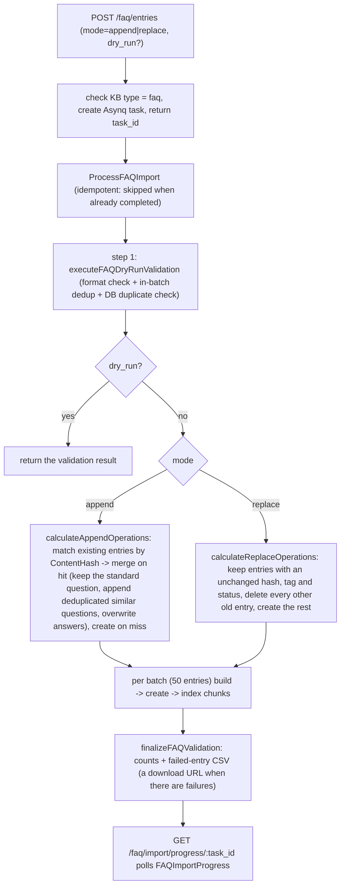
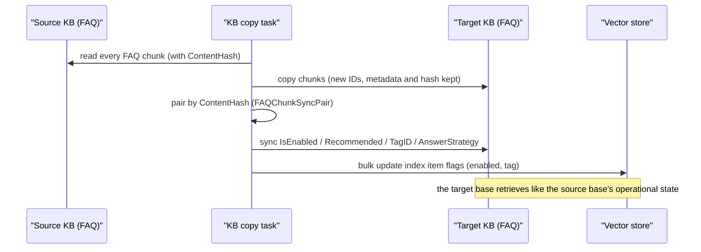

# FAQ

An FAQ knowledge base holds standard question-and-answer pairs such as a return policy, an expense claim procedure or the fix for a common fault. Each entry has a standard question, similar questions, negative questions and the answer. Retrieval matches the question and returns the answer according to the hit policy.

After creating a knowledge base of type FAQ you can import question-and-answer pairs in bulk from Excel, CSV or JSON, then add similar and negative questions. An FAQ base can be searched by an agent alongside document bases; with FAQ priority on and the direct-answer threshold met, the standard answer is returned as is.

<Screenshot
  src="/screenshots/faq-management.png"
  caption="FAQ management: entry list, filters and batch import"
  hint="The FAQ entry list (standard question, number of similar questions, tag, status) with the import button and the import result banner." />

Entry management, import and the retrieval configuration follow. Deduplication and the sync mechanism are in the reference sections.

## Create and maintain entries

To build the FAQ base you create an entry per question, then widen or narrow what it matches. Each entry has a standard question and an answer. Similar questions cover other phrasings; negative questions exclude questions that are easy to mismatch. An entry can have several answers, returned either all at once or one at random.

Entries can be grouped by category, disabled individually while they are not in use, or kept out of recommendations. An FAQ category is a single tag per entry, managed separately from the multi-tag mechanism of document knowledge bases.

## Import and export

To load many entries at once, prepare them with the template and import the file. The template has columns for the standard question, similar questions, negative questions and answers; multi-value fields are separated with `##`. On import you choose append or replace: append matches existing entries by content hash and merges duplicates; replace deletes the old entries and keeps only this batch. To check a file first, call the API with `dry_run` to run validation only.

The import result distinguishes success, failure, partial failure and skipped, with the reason for each failure. CSV and JSON export serve backup, editing and reimport.

## Check hit results

To tune an FAQ base you test questions against it and read why each entry was hit. FAQ retrieval combines vectors, keywords and tag priority, and an entry whose negative question matches the query exactly is excluded. Each result carries the matched question, the score and the hit type, which is what you adjust similar questions, negative questions and thresholds against.

## Import and retrieval reference

This section has the exact payloads, flow and limits behind the import and the hit policy above.

### Batch import

`internal/application/service/knowledge_faq_import.go`. Entry point `POST /knowledge-bases/:id/faq/entries`:

```go
type FAQBatchUpsertPayload struct {
    Entries     []FAQEntryPayload `json:"entries" binding:"required"` // can also be pulled from object storage through EntriesURL
    Mode        string            `json:"mode" binding:"oneof=append replace"`
    KnowledgeID string            `json:"knowledge_id"`
    TaskID      string            `json:"task_id"` // optional, generated when omitted; a custom value allows only [A-Za-z0-9_-], at most 128 characters
    DryRun      bool              `json:"dry_run"` // validate only, write nothing
}
```

The API payload `FAQEntryPayload` carries `standard_question` (required), `similar_questions`, `negative_questions`, `answers` (at least one), `answer_strategy`, `tag_id` or `tag_name` (an entry with neither goes to the default tag "Untagged"), `is_enabled` and `is_recommended`. The UI import (`frontend/src/utils/faqImport.ts`, used by `FAQEntryManager.vue`) reads CSV, Excel and JSON files. CSV and Excel headers are matched with the parenthesized notes stripped: `tag_name`, `standard_question` (or `question`), `similar_questions`, `negative_questions`, `answers`, `answer_all` (`TRUE` sets `answer_strategy` to `all`, `FALSE` to `random`), `is_disabled` and `not_recommended`, plus the legacy Chinese export headers; multi-value cells are split on `##`. JSON keeps `answer_strategy`, `is_enabled` and `is_recommended`. A flag column that is missing or empty is left to the server default.



The counters on the progress object `FAQImportProgress`: `success_count` / `failed_count` / `partial_failed_count` (a similar or negative question was dropped but the entry was imported) / `skipped_count` (duplicates skipped) / `merged_count` / `added_count`, `failed_entries[]` (failure reason and original content) and `failed_entries_url`, `import_mode`, `processing_time`; task status `pending → processing → completed / failed`.

Export comes in two formats: CSV (header row `tag_name(required)`, `standard_question(required)`, `similar_questions(optional - separate multiple with ##)`, `negative_questions(optional - separate multiple with ##)`, `answers(required - separate multiple with ##)`, `answer_all(optional - default FALSE)`, `is_disabled(optional - default FALSE)`, `not_recommended(optional - default FALSE means recommendable)`, booleans as `TRUE` / `FALSE`, the same header as the UI template; a BOM is prepended so Excel reads it as UTF-8) and JSON (`FAQExportEntry`, compatible with the import payload, so export → edit → reimport is a closed loop).

### Hit policy

`SearchFAQ` in `internal/handler/faq.go` plus `internal/application/service/knowledgebase_search_faq.go`:

```go
type FAQSearchRequest struct {
    QueryText            string  `binding:"required"`
    VectorThreshold      float64 // vector similarity threshold (default 0.7)
    MatchCount           int     // number of results (default 10, capped at 50)
    FirstPriorityTagIDs  []int64 // first-priority tags (ranked first)
    SecondPriorityTagIDs []int64 // second-priority tags
    OnlyRecommended      bool    // return only recommendable entries
}
```

The hit flow:

1. **Hybrid recall**: the query text is normalized, then vector retrieval and BM25 keyword retrieval run and the results are fused and deduplicated.
2. **Two-level tag priority**: entries matching `FirstPriorityTagIDs` rank first, then `SecondPriorityTagIDs`.
3. **Negative question filter** (`filterByNegativeQuestions`): when the query text equals any negative question of an entry (compared lowercased), that entry is dropped. Typical case: the user asks "Is X unsupported?", and the entry that answers "X is supported" must not come back.
4. **Iterative retrieval** (`applyFAQPostProcessing`): when the number of unique entries after filtering is below `match_count` and some vector result list came back full, `iterativeRetrieveWithDeduplication` runs: at most 5 rounds, TopK starting at `max(3 × match_count, 2 × first-round depth)` and doubling each round, capped at 500 (it stops once the cap is reached), each round fused and scored like the first, with a negative-filter cache, and it ends early when no list is full at the current depth.
5. Results carry `score`, `match_type` and `matched_question` (whether the standard question or which similar question was hit); answers are returned according to `answer_strategy` (all / random).

When the retrieval scope has no FAQ base the post-processing is skipped and ordinary hybrid retrieval is unaffected. As long as the scope contains an FAQ base (even when the primary knowledge base is a document base, or the FAQ base is shared by an organization), the negative question filter applies; iterative retrieval only runs when the primary knowledge base is an FAQ base. The agent retrieval chain goes through the same post-processing on FAQ bases.

## Entries and API reference

This section is the data model, the endpoints and the deduplication rules for anyone integrating with the FAQ API.

### Data model

#### Storage: one FAQ entry is one chunk

Each FAQ entry is one `Chunk` row (`chunk_type = "faq"`) under the `Knowledge` of type `faq` in the knowledge base (created automatically with the first entry). The structured content of the entry is in `Chunk.Metadata` (JSON):

```go
// internal/types/faq.go
type FAQChunkMetadata struct {
    StandardQuestion  string         `json:"standard_question"`
    SimilarQuestions  []string       `json:"similar_questions,omitempty"`
    NegativeQuestions []string       `json:"negative_questions,omitempty"` // negative questions: an exact hit filters the entry out
    Answers           []string       `json:"answers,omitempty"`
    AnswerStrategy    AnswerStrategy `json:"answer_strategy,omitempty"`    // all | random
    Version           int            `json:"version,omitempty"`            // incremented on every update
    Source            string         `json:"source,omitempty"`
}

const (
    AnswerStrategyAll    AnswerStrategy = "all"    // return every answer
    AnswerStrategyRandom AnswerStrategy = "random" // return one at random
)
```

Generic chunk fields reused by FAQ: `SeqID` (auto-increment integer, the entry ID in the public API), `TagID` (the category tag; the default tag name is the constant `UntaggedTagName`, "Untagged"), `IsEnabled` (the disable switch), `Flags` (bit 0 `ChunkFlagRecommended`, whether the entry may be recommended), `ContentHash` (the deduplication hash, see [Normalization and content hash (the deduplication core)](#normalization-and-content-hash-the-deduplication-core)).

#### API projection: FAQEntry

```go
type FAQEntry struct {
    ID                int64          `json:"id"`        // chunk.SeqID
    ChunkID           string         `json:"chunk_id"`
    KnowledgeID       string         `json:"knowledge_id"`
    KnowledgeBaseID   string         `json:"knowledge_base_id"`
    TagID             int64          `json:"tag_id"`
    TagName           string         `json:"tag_name"`
    IsEnabled         bool           `json:"is_enabled"`
    IsRecommended     bool           `json:"is_recommended"`
    StandardQuestion  string         `json:"standard_question"`
    SimilarQuestions  []string       `json:"similar_questions"`
    NegativeQuestions []string       `json:"negative_questions"`
    Answers           []string       `json:"answers"`
    AnswerStrategy    AnswerStrategy `json:"answer_strategy"`
    IndexMode         FAQIndexMode   `json:"index_mode"`
    UpdatedAt         time.Time      `json:"updated_at"`
    CreatedAt         time.Time      `json:"created_at"`
    Score             float64        `json:"score,omitempty"`            // retrieval score
    MatchType         MatchType      `json:"match_type,omitempty"`
    ChunkType         ChunkType      `json:"chunk_type"`
    MatchedQuestion   string         `json:"matched_question,omitempty"` // the question text that was actually hit
}
```

#### Knowledge base FAQ configuration (FAQConfig)

| Setting | Values | Default | Meaning |
| --- | --- | --- | --- |
| `index_mode` | `question_only` / `question_answer` | `question_answer` | Whether the indexed content includes the answers |
| `question_index_mode` | `combined` / `separate` | `combined` | Standard question plus similar questions as one index item, or one index item per question |

In `separate` mode every similar question gets its own index item, so similar questions can be added and removed at that granularity. Every path addresses these items by a hash of the normalized question, `SourceID = chunk.ID + "-" + md5(NormalizeQuestion(similarQ))[:8]` (`faqSimilarQuestionSourceID`), so an edit after an import or creation removes exactly the items of the questions it dropped. The item's content is the question's original text on every path, so keyword (BM25) matching sees the same text whether a full index or an edit wrote the item last.

### API endpoints

`internal/handler/faq.go` (routes registered in `internal/router/routes_knowledge.go`; the knowledge base gates match the knowledge routes: reads go through KBAccessRead, writes through KBAccessWrite; an API key needs the `ingest` capability for writes and `retrieve` for reads, and the progress route accepts either):

| Method | Path | Function |
| --- | --- | --- |
| GET | `/knowledge-bases/:id/faq/entries` | List entries (pagination / tag / keyword / enabled state) |
| GET | `/knowledge-bases/:id/faq/entries/:entry_id` | One entry |
| POST | `/knowledge-bases/:id/faq/entry` | Create one entry synchronously |
| PUT | `/knowledge-bases/:id/faq/entries/:entry_id` | Update one entry (incremental index) |
| POST | `/knowledge-bases/:id/faq/entries` | Batch import / update (asynchronous, append/replace) |
| POST | `/knowledge-bases/:id/faq/entries/:entry_id/similar-questions` | Append similar questions |
| PUT | `/knowledge-bases/:id/faq/entries/fields` | Batch update fields (enabled / recommended / strategy) |
| PUT | `/knowledge-bases/:id/faq/entries/tags` | Batch update tags |
| DELETE | `/knowledge-bases/:id/faq/entries` | Batch delete |
| POST | `/knowledge-bases/:id/faq/search` | FAQ retrieval (hybrid search) |
| GET | `/knowledge-bases/:id/faq/entries/export` | Export (CSV / JSON) |
| GET | `/faq/import/progress/:task_id` | Import task progress |
| PUT | `/knowledge-bases/:id/faq/import/last-result/display` | Display state of the import result panel (open/close) |

List query parameters: `page` / `page_size`, `tag_id` (tag seq_id, the legacy single tag) or `tag_ids` (tag UUIDs, comma separated, OR semantics), `keyword` plus `search_field` (`standard_question` / `similar_questions` / `answers`; all fields when omitted), `sort_order` (`asc`; the default is newest updated first), `is_enabled` (`true` / `false` filters by enabled state; omitted returns all).

**Write validation** (`sanitizeFAQEntryPayload` plus `checkFAQQuestionDuplicate`): the standard question is required; at least one answer; `answer_strategy` is `all` or `random` (default `all`); similar questions, negative questions and answers are trimmed and deduplicated; and four duplicate checks run: similar question against the standard question, similar questions against each other, negative questions against the standard and similar questions, and conflicts with other entries in the database (reported with the conflicting question).

### Normalization and content hash (the deduplication core)

FAQ stores the **original text and compares by normalized text**, in two layers:

```go
// Write: the DB keeps the original data, ContentHash is computed from a normalized copy
func (c *Chunk) SetFAQMetadata(meta *FAQChunkMetadata) error {
    meta.Sanitize()                          // basic cleanup only
    c.Metadata, _ = json.Marshal(meta)
    normalized := meta.Normalize()           // normalized copy
    c.ContentHash = CalculateFAQContentHash(normalized)
    return nil
}
```

The `NormalizeQuestion` chain (order matters): trim whitespace → remove URLs → lowercase → strip leading and trailing punctuation (ASCII and full-width question marks, periods, commas, semicolons, colons, exclamation marks and quotes) → **Traditional to Simplified Chinese** → **full-width to half-width** → smart spacing (spaces between CJK characters removed, spaces between Latin letters and digits kept).

`CalculateFAQContentHash` = SHA256(normalized standard question + sorted similar questions + sorted negative questions + sorted answers). `internal/types/faq_test.go` pins the invariants of the hash: insensitive to case and punctuation, to Traditional versus Simplified, to full-width versus half-width and to array order, and identical on the write and read paths. The hash drives import deduplication and the entry pairing of clone sync.

### Differences from document knowledge

| Dimension | FAQ | Document |
| --- | --- | --- |
| KB type | `faq` | `document` |
| Knowledge.Type | `faq` (usually one aggregate Knowledge per base) | file / `manual` / URL |
| Chunk origin | Structured entries entered by the user | Chunks produced by the parser |
| Chunk.ChunkType | `faq` | `text` / `image_ocr` / `summary` and others |
| Metadata | `FAQChunkMetadata` (questions / answers / negatives / strategy) | Document metadata (AI-generated questions and so on) |
| Chunk.Content | Built by `buildFAQChunkContent`: `"Q: <standard question>\nSimilar Questions:\n- ..."`; `question_answer` mode appends `Answers`; **negative questions are never written to Content (they are not indexed)** | The original passage |
| ContentHash | Normalized deduplication hash (the core mechanism) | Generally unused |
| Index granularity | One or several index items per `question_index_mode` | One index item per chunk (parent-child chunking aside) |
| Processing pipeline | Synchronous create / asynchronous batch import, indexed immediately | Asynchronous DocReader parsing pipeline |
| Retrieval post-processing | Negative filter + iterative retrieval (see [Hit policy](#hit-policy)) | Regular fusion and rerank |
| State switches | `is_enabled` + `is_recommended` (Flags) + `answer_strategy` | `enable_status` |

Entry updates use **incremental indexing** (`incrementalIndexFAQEntry`): only the changed parts are re-embedded. A changed standard question is reindexed; similar questions are diffed one by one and added or removed; a changed answer triggers reindexing only in `question_answer` mode; `SourceID` is used to delete the stale index items precisely.

### Clone and share sync

`internal/application/service/faq_clone_sync.go`. Triggered by **knowledge base copy**: the FAQ chunks in the copied base are new rows, and their operational state (enabled / recommended / tag / answer strategy) has to be aligned with the source base:

- **Pairing**: source and target entries are matched by `ContentHash`, giving `FAQChunkSyncPair{SrcChunkID, DstChunkID}` (the normalized hash keeps Traditional/Simplified, width and order differences from breaking a pair; `internal/types/faq_sync_test.go` covers it).
- **Synced content**: the `IsEnabled` switch, the `ChunkFlagRecommended` bit of `Flags`, the `TagID` category and the `AnswerStrategy`.
- **Index side**: after the DB update, the `enabled` and `tag` flags of the matching index items in the vector store are refreshed in bulk so retrieval filtering applies immediately (the difference computation is covered by `internal/application/repository/chunk_faq_diff_test.go`). The `recommended` flag is updated in the database only; the vector-store update for it is skipped with a warning.



## Implementation reference

This table is where to look when you need the code behind a section above. Paths are relative to the repository root:

| Layer | File |
| --- | --- |
| FAQ types, normalization and hash | `internal/types/faq.go` (plus `faq_test.go` and `faq_sync_test.go`) |
| FAQ handler | `internal/handler/faq.go` |
| Entry CRUD and export service | `internal/application/service/knowledge_faq.go` |
| Asynchronous import service | `internal/application/service/knowledge_faq_import.go` |
| Clone and sync | `internal/application/service/faq_clone_sync.go` |
| FAQ retrieval post-processing | `internal/application/service/knowledgebase_search_faq.go` |
| Knowledge base FAQ configuration | `internal/types/knowledgebase.go` (`FAQConfig`) |
