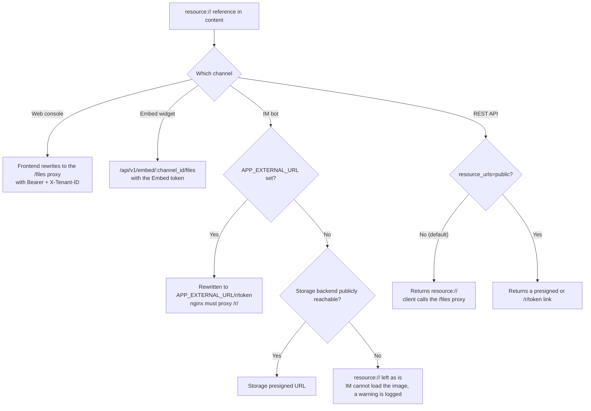

# External access to images and files

Images and files are fetched differently on each channel. The web console and the embed widget call an authenticated proxy with their credentials. IM platforms need a time-limited link that loads without credentials. API clients choose between internal references and external links per request.

When you integrate, confirm three things together: the reference form, the caller's permissions and whether the address is reachable from where it is used. When an image does not render, work through the troubleshooting table at the end.

## File reference forms

You are deciding which form of file address your client will receive and what each one requires. Knowledge base images and attachments live in file storage. Content carries a stable internal reference; the response or the renderer converts it to an address for the channel in use:

| Form | Example | Who can fetch it | Lifetime |
| --- | --- | --- | --- |
| **Internal reference** | `resource://<handle>` | Resolved on the server; not fetchable as a URL | None |
| **Authenticated proxy** | `/files`, `/api/v1/knowledge-bases/:id/files`, `/api/v1/embed/:channel_id/files`, message-level `/api/v1/sessions/:id/messages/:message_id/files` | A client carrying the matching credential (login session, KB access or Embed token) | As long as the credential |
| **Capability short link** | `/r/<token>` | Anyone holding the link (**anonymous read**) | A grant issued by AI KB, 2 hours |
| **Storage presigned URL** | An http(s) link issued by the storage backend | Anyone holding the link (**anonymous read**) | Set by the storage; MinIO default 24 hours |

A capability short link and a storage presigned URL let any holder read the file anonymously until they expire. Treat these links with the same care as the file itself when you share or log them. Revoking an organization share or leaving an organization does not expire links that were already issued; they stay valid until they expire (short link 2 hours, storage presigned URL up to 24 hours).

::: tip Default access path
By default the system returns internal references and a credentialed client reads them through the authenticated proxy. External links need either a storage endpoint reachable from the public internet or `APP_EXTERNAL_URL`, after which AI KB issues access links itself. The default MinIO address `minio:9000` is only reachable inside the container network.
:::

## Access by channel

You are tracing how a `resource://` reference in an answer becomes something the channel can load.

### Web console

The web frontend converts `resource://` and `provider://` references into authenticated proxy addresses. Ordinary resources use `/files` with a Bearer token and `X-Tenant-ID`. A knowledge base shared across workspaces uses `/api/v1/knowledge-bases/:id/files`, which reads the owning workspace's files under the knowledge base access check with no extra configuration.

Images in answers from a shared agent or an organization-shared knowledge base go through `/api/v1/sessions/:id/messages/:message_id/files?file_path=...` first. The server checks that the caller can read the message, that the requested resource is actually referenced by that message, and re-checks the authorization of the resource's knowledge base or shared agent. Once a share is revoked, old messages no longer grant access to their resources. Ordinary knowledge base browsing keeps using the KB-level proxy; each proxy has its own context.

### IM bots

IM platforms cannot attach AI KB credentials, so they need a publicly reachable HTTP(S) URL. Before a message is sent, the system builds an external link from the storage and deployment configuration, in this order:

1. **`APP_EXTERNAL_URL` is set.** A `resource://` reference is rewritten to `<APP_EXTERNAL_URL>/r/<token>`, and the request is proxied back to the app by nginx's `location ^~ /r/`. The official frontend image ships that location; a self-managed reverse proxy must add it, otherwise the request falls into the SPA fallback and returns a blank page.
2. **The storage backend itself is publicly reachable.** Object storage with a public endpoint, or `MINIO_ENDPOINT` set to a public host. With `APP_EXTERNAL_URL` unset, the link falls back to the storage presigned URL and needs no further configuration.

The default in-network MinIO deployment and `local` storage need `APP_EXTERNAL_URL`. When neither condition holds, the system keeps the original reference and logs a warning, and the IM platform cannot show the image. With IM channels enabled and `APP_EXTERNAL_URL` empty, a warning is also logged at startup.

### Embed widget

The embed widget uses the channel file proxy `/api/v1/embed/:channel_id/files`. The Embed token identifies the channel's workspace and the server checks that the resource path belongs to it. Embed channels always return internal references; neither `RESOURCE_URL_MODE=public` nor `?resource_urls=public` changes this, so every read goes through channel authentication.

### REST API and SDKs

You are choosing whether your integration fetches files through the proxy or receives links it can render directly. The API returns `resource://` by default and clients fetch the file through the authenticated proxy. To receive direct external links instead, set one of:

- Per request: `?resource_urls=public`
- Deployment-wide: `RESOURCE_URL_MODE=public`

The request parameter wins over the environment variable, so after setting the deployment default to `public` a single call can still fall back with `?resource_urls=handle`. The endpoints that accept the parameter, what it covers and its security boundary are in [API overview](../04-api/01-api-overview.md) under "File reference forms".

An API key restricted to specific knowledge bases gets 403 for `public`, and such a key cannot use the general `/files` proxy either. When the deployment cannot issue external links, the response keeps `resource://` and a client with the right permissions can use the authenticated proxy instead.

## Troubleshooting

You have an image that does not render and need to find which link in the chain is broken.

| Symptom | Likely cause | Fix |
| --- | --- | --- |
| Images do not show in IM | `APP_EXTERNAL_URL` is unset and the storage is not publicly reachable | Set `APP_EXTERNAL_URL` and confirm nginx proxies `/r/`; look for the `storage URL rewrite no-op` WARN in the app log |
| An IM image link opens but returns a blank page | nginx lacks `location ^~ /r/`, so the request falls into the SPA fallback | Add that location (the official frontend image ships it); see [Web frontend](../05-clients/01-frontend.md) |
| `APP_EXTERNAL_URL` points at an internal address or `localhost` | The IM platform sits on the public internet and cannot reach it | Use an address the IM platform can reach; for local development use ngrok, cloudflared or frp |
| Image addresses in API responses are `resource://` | That is the default, an internal reference | Add `?resource_urls=public`, or call the `/files` proxy |
| `resource_urls=public` is set but `resource://` still comes back | The deployment cannot issue external links (for example `local` storage without `APP_EXTERNAL_URL`) | Meet one of the external-link conditions, or use the `/files` proxy |
| `resource_urls=public` returns 403 | The caller is an API key restricted to specific knowledge bases | Use `handle` mode, or an authorized full-access key |
| Images do not show in the embed widget but do on the web | The widget uses the channel proxy, not the main site's credentials | Confirm the widget page carries a valid Embed token; `resource_urls=public` has no effect on embed channels |
| Images in a shared answer return 403 or 404 | Message context missing, resource not bound to the message, or the share was revoked | Use the message-level proxy and check the current share permissions; do not build an owner-workspace `/files` address by hand |
| Links already issued stop working after an upgrade or a key change | The signing key (`SYSTEM_SIGNING_KEY`, or `SYSTEM_AES_KEY` as the fallback) changed, so old signatures no longer verify | Fetch the link again; in a multi-replica deployment confirm every instance uses the same key |
| An external link stops working after a while | External links are time-limited (grant 2 hours, MinIO presigned URL 24 hours) | Do not cache the link itself; fetch it again when needed. With a signing key configured, the same file gets the same link while it is valid |
| Images return 404 on the web and the log reports a workspace mismatch | The image of a cross-workspace shared knowledge base lives under the owning workspace | That case must use `/api/v1/knowledge-bases/:id/files`; confirm the frontend received the KB-scoped proxy address |

## Configuration reference

You are checking which setting controls each part of the link chain.

| Setting | Effect |
| --- | --- |
| `APP_EXTERNAL_URL` | The externally reachable address for IM image links; required before `resource://` can be rewritten to `<APP_EXTERNAL_URL>/r/<token>` |
| `RESOURCE_URL_MODE` | The default file reference form in API responses (`handle` or `public`) |
| `MINIO_ENDPOINT` and the other storage endpoints | Set to a public address, the storage presigned URL can serve as the external link without `APP_EXTERNAL_URL` |
| `SYSTEM_SIGNING_KEY` (falls back to `SYSTEM_AES_KEY` when unset) | The signing key. `/api/v1/files/presigned` links depend on it; it also lets a `/r/<token>` grant be reused while valid, which keeps direct links stable and reduces write load on read endpoints. When it is unset, shorter than 16 characters or an example value (the shipped default `SYSTEM_AES_KEY` included), presigned links cannot be issued; changing it invalidates links already issued |

## Related pages

- [IM integration](12-im-integration.md): the rewrite logic and the startup warning
- [Embed channel](13-embed-channel.md): channel authentication and anonymous sessions
- [API overview](../04-api/01-api-overview.md): the full semantics of `resource_urls`
- [Configuration](../01-getting-started/04-configuration.md): the environment variables above
- [Web frontend](../05-clients/01-frontend.md): the nginx `/files` and `/r/` proxies

## Implementation reference

- `frontend/src/utils/protectedFileAccess.ts`: web file references and proxy paths.
- IM messages are converted to external links by `rewriteStorageURLs()` before sending.
