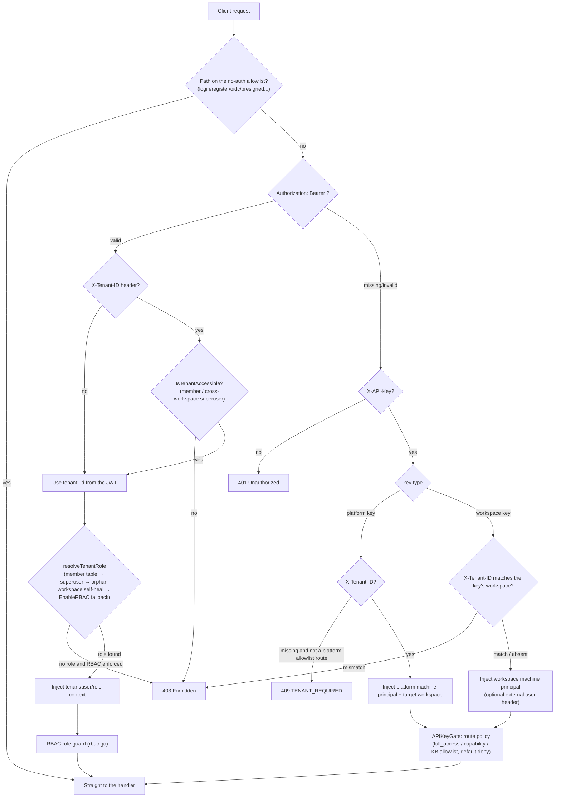

# API overview

The AI KB HTTP API is mounted under `/api/v1` and accepts JWT, API key and embed token credentials. The built-in MCP server endpoints use their own endpoint tokens. Pick the credential for your client type, then follow the shared conventions below for responses, errors, pagination and streaming events.

## Base URL and version prefix

- Every business API lives under the `/api/v1` prefix (`r.Group("/api/v1")` in `router.go`).
- Health check: `GET /health` (no authentication) returns `{"status":"ok"}`.
- Swagger UI: `/swagger/index.html` on the backend, registered only outside `release` mode (`GIN_MODE != release`). Docker Compose defaults to `release`. Enabling it, the backend port and troubleshooting a blank page: [Development guide](../06-development/01-dev-guide.md#gin-mode-and-swagger).
- Paths outside the normal authentication flow: `GET|HEAD /r/:token` (short-lived resource grant URL), `GET /files` (authenticated file proxy), `GET|HEAD /api/v1/files/presigned` (HMAC-signed URL, no authentication), `GET /api/v1/files/presigned-preview` (Admin diagnostics).

```
BASE=http://localhost:8080
```

## Authentication

The `Auth` middleware in `internal/middleware/auth.go` handles every credential and tries them in this order:

### JWT Bearer (web users)

```
Authorization: Bearer <access_token>
```

- `POST /api/v1/auth/login` (or register / OIDC; the native desktop app uses auto-setup) returns `token` and `refresh_token`. `POST /api/v1/auth/refresh` issues a new token.
- Optional header `X-Tenant-ID: <tenant_id>` switches to a workspace other than the one in the JWT. The user must be an active member of that workspace or carry the cross-workspace superuser attribute `CanAccessAllTenants`. A malformed or `0` value returns 400.
- When the JWT resolves to no workspace and the route is not on the tenantless allowlist (`/auth/me`, `/me/invitations` and the like), the response is 409 `{"code":"TENANT_REQUIRED"}`.

### API key (machine principals)

```
X-API-Key: <api_key>
```

- Workspace keys: created with `POST /api/v1/tenants/:id/api-keys` and bound to one workspace. Sending `X-Tenant-ID` for another workspace returns 403.
- Platform keys: created with `POST /api/v1/system/admin/api-keys`. They must send `X-Tenant-ID` to choose the target workspace (except on `/system/admin/*`, `GET /tenants/all|search` and `POST /tenants`), otherwise the response is 409 `TENANT_REQUIRED`.
- Authorization model (`internal/middleware/api_key_gate.go`, default deny): every `/api/v1` route declares an API key policy. A route without one returns 403 to any key.
  - `full_access` key: full authority inside the workspace (the machine form of Owner).
  - Scoped key: admitted per capability and bounded by the `knowledge_base_ids` allowlist. The capability constants live in `internal/types/tenant_api_key.go`: `retrieve`, `ingest`, `chat`, `read_agents`, `manage_kbs`, `manage_agents`, `message_history`, `manage_models`, `manage_mcp_services`, `manage_datasources`, `manage_channels`, `manage_vector_stores`, `manage_storage_backends`, `manage_web_search`, `run_evaluations`, `manage_members`, `manage_spaces`, `manage_tenant_settings`. Platform capabilities: `system_tenants_read/manage`, `system_settings_read/manage`, `system_runtime_read/manage`, `system_audit_read`.
- External user principals (optional, configured per workspace at `api-principal-config`):
  - `direct_header` mode: `X-External-User-ID: <external user ID>` (at most 128 characters).
  - `signed_token` mode: `X-External-User-Token: <HS256 JWT>` with `aud=aikb`, `exp` (lifetime at most 24h), a `tenant_id` claim equal to the target workspace, and `sub` set to the external user ID.

### Embed publish token (anonymous embed clients)

The public routes under `/api/v1/embed/:channel_id/*` use the separate `EmbedAuth` middleware (`internal/middleware/embed_auth.go`):

```
Authorization: Embed <publish_token or session_token>
```

- `POST /embed/:channel_id/exchange` trades the publish token for a short-lived session token. Session-level calls also send `X-Embed-Session: <sig>`, the signed handle returned when the session was created.
- IM callback routes (`/api/v1/im/callback/:channel_id`) are registered before the global authentication middleware and verify each IM platform's own signature.

### MCP endpoint token (built-in MCP server)

`/mcp/:endpoint_id` (no `/api/v1` prefix) is the MCP Streamable HTTP endpoint a workspace exposes. `internal/middleware/mcp_endpoint_auth.go` validates it:

```
Authorization: Bearer <endpoint_token>
```

The token is shown once when the endpoint is created under Settings → Publish & Integrations → MCP Server, and can be rotated. Requests run as the machine principal of the endpoint's workspace, limited to the tools and knowledge bases selected on the endpoint. The management API is `/api/v1/mcp-endpoints` (Viewer+ reads, Admin+ changes, API keys need `manage_channels`). Usage: [MCP integration](../03-features/08-mcp.md).

### Authentication flow



## Roles and permissions (RBAC)

`internal/middleware/rbac.go` and `internal/middleware/access.go`:

| Role | Description |
| --- | --- |
| `owner` | Workspace owner: workspace lifecycle, API keys, member management |
| `admin` | Workspace administrator: models, infrastructure, channels and other workspace-level configuration |
| `contributor` | Contributor: creates knowledge bases and agents, edits resources **they created** |
| `viewer` | Read-only member: reads and uses conversations |
| SystemAdmin | Platform administrator (`User.IsSystemAdmin`), independent of workspace roles, guards `/system/admin/*`, always enforced |

- "Viewer+ / Contributor+ / Admin+ / Owner" in these docs is the minimum role. "Creator OR Admin+" maps to `RequireOwnershipOrRole` (a Contributor may only change knowledge bases, agents and content they created).
- With `cfg.Tenant.EnableRBAC=false` the role guard logs and lets the request through (fail-open for rollout). The SystemAdmin guard ignores this switch.
- The knowledge base access guards `KBAccessRead/Write` (`internal/middleware/kb_access.go`) resolve three kinds of access, own, organization-shared and visible through a shared agent, and rewrite the request's tenant to the knowledge base's owning workspace.
- An API key principal short-circuits the JWT role guards. Its real authority is decided entirely by the APIKeyGate (capability plus knowledge base allowlist).
- Denied requests are written to the audit log (`middleware.AuditServiceProvider`, deduplicated over a 1-minute sliding window).

## Response format and error codes

Most handlers return:

```json
{ "success": true, "data": { ... } }
```

List endpoints usually add `total`, `page` and `page_size`. Exceptions: some read endpoints under `/system/admin/*` return the raw row or array without a wrapper, and `/system/info` and a few others use `{"code":0,"msg":"success","data":...}`.

Errors are rendered by `internal/middleware/error_handler.go` from an `AppError` (`internal/errors/errors.go`):

```json
{ "success": false, "error": { "code": 1003, "message": "...", "details": null } }
```

The middleware layer (authentication, RBAC) returns `{"error": "..."}` directly, sometimes with a string `"code"` such as `TENANT_REQUIRED`.

| Code | Meaning | HTTP |
| --- | --- | --- |
| 1000 | ErrBadRequest, malformed request | 400 |
| 1001 | ErrUnauthorized, not authenticated | 401 |
| 1002 | ErrForbidden, no permission | 403 |
| 1003 | ErrNotFound, resource does not exist | 404 |
| 1004 | ErrMethodNotAllowed | 405 |
| 1005 | ErrConflict | 409 |
| 1006 | ErrTooManyRequests, rate limit or quota | 429 |
| 1007 | ErrInternalServer | 500 |
| 1008 | ErrServiceUnavailable | 503 |
| 1009 | ErrTimeout | - |
| 1010 | ErrValidation, parameter validation failed | 400 |
| 2000-2005 | Workspace: not found / already exists / inactive / name required / invalid status / self-service creation disabled | 404 / 409 / 403 / - / - / 403 (2003 and 2004 are defined but no constructor raises them) |
| 2100-2103 | Agent: missing thinking model / missing allowed tools / invalid max iterations (1-20) / invalid temperature (0-2) | 400 |
| 2200-2201 | Vector store binding invalid / currently unavailable | 400 |
| 2300 | Model in use (ErrModelInUse); `details` carries the usage breakdown | 400 |

Two errors carry no numeric code: `types.StorageQuotaExceededError` (storage quota exceeded) and `types.DuplicateKnowledgeError` (duplicate file or URL; the upload endpoints return 409 with `"code":"duplicate_file"` or `"duplicate_url"` and `data` set to the existing knowledge item).

## Pagination

`internal/handler/list_pagination.go`:

| Parameter | Type | Required | Description |
| --- | --- | --- | --- |
| `page` | int | no | Page number, default 1, must be at least 1 |
| `page_size` | int | no | Items per page, default 20, range 1-100 |

Out-of-range or malformed values return a validation error (code 1010). List responses carry `total`, `page` and `page_size`. Some endpoints use cursor pagination: audit logs (`after_id` + `limit`, response carries `next_cursor`), system runtime tasks (`cursor` + `page_size`, response carries `next_cursor` and `has_more`), Wiki index and log (`cursor` + `limit`).

## Streaming protocol (SSE)

The chat endpoints (`POST /api/v1/knowledge-chat/:session_id`, `POST /api/v1/agent-chat/:session_id`, `GET /api/v1/sessions/continue-stream/:session_id`, and their embed counterparts) return Server-Sent Events:

```
Content-Type: text/event-stream
Cache-Control: no-cache
Connection: keep-alive
X-Accel-Buffering: no
```

Each event is `event: message` with `data:` holding a `types.StreamResponse` JSON object:

| Field | Type | Description |
| --- | --- | --- |
| `id` | string | Request ID |
| `response_type` | string | `answer` / `references` / `thinking` / `tool_call` / `tool_result` / `command_output` / `reflection` / `session_title` / `agent_query` / `artifacts_pending` / `memory_recalled` / `user_message_injected` / `context_compacted` / `tool_approval_required` / `tool_approval_resolved` / `mcp_oauth_required` / `mcp_oauth_resolved` / `error` / `complete`. The skill install stream adds `install_prompt` / `install_output` |
| `content` | string | Incremental text |
| `done` | bool | Whether this event type has finished |
| `knowledge_references` | []SearchResult | Citations carried by the `references` event |
| `tool_calls` | []LLMToolCall | Tool call events |
| `data` | object | Extra event metadata (for example `success` on a tool result, `truncated` on an answer) |
| `session_id` / `assistant_message_id` | string | Carried by the `agent_query` event |
| `usage` | TokenUsage | `prompt_tokens/completion_tokens/total_tokens/cache_*` |
| `finish_reason` | string | Why generation stopped |

`source_locators` on a `SearchResult` (in `knowledge_references` and in retrieval results) is the chunk's position in the original file, so a client can highlight the citation in the source. Documents imported before this feature shipped have none:

| Field | For `type` | Description |
| --- | --- | --- |
| `type` | - | `pdf` / `docx` / `slide` / `sheet` / `text` / `time` / `section` |
| `page`, `bbox` | `pdf` | Page number (from 1); `bbox` is `[x0,y0,x1,y1]` as fractions of the page width and height with the origin at the top-left corner, may be absent |
| `block` | `docx` | Index of the paragraph or table in the body (from 1) |
| `slide` | `slide` | Slide number (from 1) |
| `sheet`, `row_start`, `row_end` | `sheet` | Sheet name (empty for CSV) and row numbers (from 1, as shown in Excel) |
| `start`, `end` | `text` | Character range in the original text file (Unicode code points) |
| `start_ms`, `end_ms` | `time` | Audio time range in milliseconds |
| `section`, `title` | `section` | Index in the EPUB spine (from 1) and the chapter title |
| `quote` | all | The cited text, at most 300 characters |

Numeric fields with value 0 are omitted. A merged retrieval result carries the union of the merged chunks' locators.

The stream ends with `response_type:"complete"` (`done:true`), or with `response_type:"error"` (`done:true`) on failure. A failed tool execution arrives as `tool_result` with `data.success=false`; `error` only means the whole turn failed. When an answer is cut off by the output limit, the `answer` event carries `data.truncated=true`. `continue-stream` resumes by replaying stored events and then polling for new ones every 100ms (`?message_id=` is required).

## File references (resource_urls)

Images and attachments cited in answers and retrieval results are returned as internal handles, `resource://<handle>`, by default. The client then calls the authenticated `/files` proxy to fetch the content. A third-party app that wants a link it can render directly can switch to direct-link mode:

| Scope | Usage |
| --- | --- |
| One request | Add `?resource_urls=public` to the URL |
| Whole deployment | Environment variable `RESOURCE_URL_MODE=public` |

The only values are `handle` (default) and `public`; anything else returns 400. The request parameter wins over the environment variable, so after setting the deployment default to `public` a single request can still opt back with `?resource_urls=handle`.

Endpoints that accept the parameter: `POST /knowledge-chat/{session_id}`, `POST /agent-chat/{session_id}`, `GET /sessions/continue-stream/{session_id}`, `GET /messages/{session_id}/load`, `POST /knowledge-search`, `POST /knowledge-bases/{id}/hybrid-search` (GET also works). The rewrite covers answer text, retrieval result `content` and `image_info`, `knowledge_references`, agent execution steps and tool results, and image attachments on messages. In a streamed answer a reference split across chunks is buffered before rewriting, so the client always receives a complete link.

Before using it:

- **An external URL is required.** Direct links come from storage backend presigning, or from `APP_EXTERNAL_URL` + `/r/<token>`. With neither (for example local storage without `APP_EXTERNAL_URL`), the reference stays `resource://` and the client can still fall back to `/files`.
- **Direct links are anonymous and time-limited** (grants issued by AI KB last 2 hours, MinIO and S3-compatible presigned URLs 24 hours). Anyone with the link can read it until it expires, so do not log it or forward it to people who should not see it.
- **Embed channels do not support it.** Endpoints under `/api/v1/embed/...` force `handle`; visitor images keep going through the channel-scoped authenticated proxy.
- **A knowledge-base-restricted API key gets 403 with `public`.** Such a key is already denied the `/files` proxy, and an anonymous direct link would bypass the same restriction.
- **Direct links for the same file are reused while valid.** Repeated requests do not issue new credentials, so client and CDN caches can hit.

Which form each channel (web, IM, embed widget, API) receives, and how to troubleshoot images that do not load: [Image and file access](../03-features/21-file-access.md).

## Choosing a retrieval endpoint {#retrieval-api}

Two retrieval endpoints are public. Both require an API key with `retrieve` (or full access) and both return a list of `SearchResult`.

**Default to `POST /knowledge-search`.** It runs the same retrieval flow as in-product chat (recall → rerank → merge → truncate) and returns the same chunks a chat answer would use. `POST /knowledge-bases/{id}/hybrid-search` is the lower-level recall primitive: no rerank by default, scores are recall scores, suited to cases where you need to see or control the raw recall.

### By scenario

| I want to... | Endpoint | Request body |
| --- | --- | --- |
| Feed my own RAG or agent with results ranked like in-product chat | `knowledge-search` | `query` + `knowledge_base_ids`, nothing else |
| Search several knowledge bases that use different embedding models | `knowledge-search` | `knowledge_base_ids` |
| Search only a few documents or tags | `knowledge-search` | `knowledge_ids` / `tag_ids`; when targeting documents, do not also pass their `knowledge_base_ids`, the two are unioned |
| Change the result count or recall thresholds but keep rerank | `knowledge-search` | `match_count`, `vector_threshold`, `keyword_threshold` |
| Use a different rerank model or threshold | `knowledge-search` | `rerank.model_id`, `rerank.threshold` |
| Skip rerank and take raw recall | `knowledge-search` or `hybrid-search` | the former with `"rerank":{"enabled":false}`; the latter without `rerank` |
| Understand why a result is empty | `knowledge-search` | Read `meta.rerank.outcome` in the response |
| Pass a query vector I computed myself | `hybrid-search` | `query_embedding` + `disable_keywords_match: true` |
| Evaluate recall quality: one knowledge base, fixed parameters, raw recall scores | `hybrid-search` | no `rerank` |
| Compare that evaluation with rerank applied | `hybrid-search` | the same request plus `rerank` |
| Return parent and neighbor chunks as separate result rows instead of merging them into the content | `hybrid-search` | the default; `skip_context_enrichment: true` turns it off |

### Differences

| | `knowledge-search` | `hybrid-search` |
| --- | --- | --- |
| rerank | On by default (workspace configuration); the `rerank` object overrides or disables it | Off by default; on only when a `rerank` object is sent |
| Multiple knowledge bases | Yes, with different embedding models | `knowledge_base_ids` is accepted, but the embedding model must match and the path `{id}` must be among them |
| Precomputed vector | Not supported | `query_embedding` |
| Context chunks | Merged into the result `content` | Returned as extra result rows |
| `match_count` omitted | The workspace's `rerank_top_k` (default 10) | 50 |
| `meta.rerank` | Always returned | Returned only when `rerank` was sent |

The recall parameters (`vector_threshold`, `keyword_threshold`, `match_count`, `disable_keywords_match`, `disable_vector_match`) and the `rerank` object mean the same on both endpoints. Parameters omitted from `knowledge-search` fall back to the workspace retrieval configuration (`GET /tenants/kv/retrieval-config`).

### The rerank object

Both endpoints take the same `rerank` structure:

| Field | Type | Default | Description |
| --- | --- | --- | --- |
| `enabled` | bool | `true` | Set to `false` to skip rerank and keep recall order |
| `model_id` | string | see below | Rerank model ID (a model with `type` `Rerank` in `GET /models`). An unknown, inactive or non-rerank ID returns 400; it is never silently replaced |
| `top_k` | int | the endpoint's result count | Maximum results kept after rerank; a negative value or one above 200 returns 400 |
| `threshold` | float | `rerank_threshold` from the workspace retrieval configuration (0.2 when unset) | Minimum model score; `0` and negative values are valid |

Without `model_id` the order is: `rerank_model_id` from the workspace retrieval configuration → the workspace's first rerank model. With neither, no rerank runs, results keep recall order and `meta.rerank.outcome` is `no_model`.

Rerank shares one implementation (`internal/reranking`) with the chat pipeline and the `search_knowledge` tool of Smart Reasoning:

1. The text scored by the model is the document title + the chunk body with Markdown markup stripped + image descriptions and OCR text + generated questions. FAQ entries get no title. When the model is configured with a per-document or per-request length limit (`max_document_chars` / `max_request_chars`), oversized text is trimmed from the tail, dropping the appended image text and generated questions first, so one oversized passage never fails the whole batch.
2. Results with a score at or above `threshold` are kept. If none pass and `threshold` is above 0.3, the threshold is lowered to `max(threshold×0.7, 0.3)` and the filter runs again. If still nothing passes, the single best candidate is kept when its score is at least 0.15, otherwise the list is empty.
3. Ranking score = `0.6×model score + 0.3×recall score + 0.1×source weight`, capped at 1. An agent's `faq_score_boost`, when above 1, multiplies FAQ entries' scores. Each result's `metadata` carries `model_score` and `base_score`.
4. MMR (λ=0.7) picks `top_k` results from the survivors to reduce redundancy.

When `hybrid-search` runs rerank, the recall depth is at least `top_k`. The candidate pool is the top `max(top_k, 50)` fused chunks, so even a small `match_count` leaves the model enough candidates.

If the rerank model fails to load or the call errors, the request does not fail. Results come back in recall order and `meta.rerank` states the reason.

### meta.rerank diagnostics

A `knowledge-search` response always carries `meta.rerank`; `hybrid-search` carries it only when the request included a `rerank` object.

```json
{
  "success": true,
  "data": [],
  "meta": {
    "rerank": {
      "applied": true,
      "outcome": "all_below_threshold",
      "model_id": "rr-1",
      "model_source": "tenant",
      "threshold": 0.3,
      "effective_threshold": 0.3,
      "top_score": 0.08,
      "candidate_count": 24,
      "result_count": 0
    }
  }
}
```

| Field | Description |
| --- | --- |
| `applied` | Whether rerank scores decided the returned order |
| `outcome` | See the table below |
| `model_id` / `model_source` | The model used and where it came from: `request` (set in the request), `tenant` (workspace configuration), `auto` (chosen automatically) |
| `threshold` / `effective_threshold` | The requested threshold and the one applied after degradation |
| `top_score` | Best model score among the candidates |
| `candidate_count` / `result_count` | Candidates sent to rerank / results returned |
| `error` | Error message for `model_error` and `model_unavailable` |

| `outcome` | Meaning |
| --- | --- |
| `ok` | Results passed the threshold |
| `threshold_degraded` | Nothing passed the original threshold; results appeared after lowering it |
| `fallback_top1` | Nothing passed any threshold; only the best candidate was kept |
| `all_below_threshold` | The model rejected every candidate; the result is empty. Rephrase the question or lower `rerank.threshold` |
| `model_error` | The model call failed; recall order returned |
| `model_unavailable` | The model failed to load (credentials, endpoint or other configuration); recall order returned |
| `no_model` | The workspace has no rerank model; recall order returned |
| `disabled` | The request set `rerank.enabled` to `false` |
| `no_candidates` | Recall returned nothing |

## Rate limits

| Surface | Limit | Source |
| --- | --- | --- |
| Public share-link endpoints (`/auth/invitations/lookup`, `/auth/register-by-invite`) | 30 requests per minute per IP, shared by both endpoints; over the limit 429 (code 1006) | `internal/middleware/auth_public_ratelimit.go` |
| Public embed routes | Per (channel, IP) `rate_limit_per_minute` (default 30) per minute; per channel `rate_limit_per_minute*20` (floor 120) per minute; per channel `rate_limit_per_day` (default 10000) per day; over the limit 429 | `internal/middleware/embed_auth.go` |
| Reverse proxy trust | `X-Forwarded-For` is honored only from `AIKB_TRUSTED_PROXIES` (default: loopback and private ranges), so a spoofed IP cannot bypass the limiter | `router.go` `trustedProxies()` |

Other business endpoints have no global rate limit. Quota rejections such as self-service workspace creation also use 429 (code 1006).

## API groups

| Group | Page | Main prefixes |
| --- | --- | --- |
| Authentication and users | [02-api-auth.md](./02-api-auth.md) | `/auth`, `/me/invitations` |
| Workspaces (tenants) and members | [02-api-tenant.md](./02-api-tenant.md) | `/tenants` |
| Organizations and sharing | [02-api-org.md](./02-api-org.md) | `/organizations`, `/shared-*`, `/knowledge-bases/:id/shares`, `/agents/:id/shares` |
| Knowledge bases and knowledge | [02-api-knowledge.md](./02-api-knowledge.md) | `/knowledge-bases`, `/knowledge`, knowledge base folders |
| Chunks and tags | [02-api-chunks.md](./02-api-chunks.md) | `/chunks`, `/knowledge-bases/:id/tags`, `/chunker/preview` |
| FAQ and Wiki | [02-api-faq-wiki.md](./02-api-faq-wiki.md) | `/knowledge-bases/:id/faq`, `/faq`, `/knowledgebase/:kb_id/wiki`, `/wiki-search` |
| Sessions, messages and chat | [02-api-chat.md](./02-api-chat.md) | `/sessions`, `/messages`, `/knowledge-chat`, `/agent-chat`, `/knowledge-search` |
| Models and initialization | [02-api-model-system.md](./02-api-model-system.md) | `/models`, `/initialization`, `/evaluation`, `/weknoracloud` |
| System and platform administration | [02-api-system.md](./02-api-system.md) | `/system`, `/system/admin` |
| Infrastructure and data sources | [02-api-infra.md](./02-api-infra.md) | `/vector-stores`, `/storage-backends`, `/web-search-providers`, `/datasource` |
| Agents and MCP | [02-api-agent-mcp.md](./02-api-agent-mcp.md) | `/agents`, `/mcp-services`, `/agent`, `/user/favorites` |
| Built-in MCP server | [MCP integration](../03-features/08-mcp.md) | `/mcp-endpoints`, `/mcp/:endpoint_id` |
| Local Browser | [Local Browser](../05-clients/09-local-browser.md) | `/me/browser`, `/local-browser` |
| Sandbox, skills and personal variables | [02-api-sandbox-skills.md](./02-api-sandbox-skills.md) | `/sandbox-configs`, `/skills`, `/me/env-vars` |
| Long-term memory | [02-api-memory.md](./02-api-memory.md) | `/memory`, `/tenants/kv/memory-config` |
| IM, embed and file services | [02-api-channels.md](./02-api-channels.md) | `/im`, `/im-channels`, `/wechat`, `/embed-channels`, `/embed`, `/files`, `/r/:token` |

Configuration and personal endpoints: [Sandbox, skills and personal variables](02-api-sandbox-skills.md) and [Long-term memory](02-api-memory.md). Generated file listing and download: [Sessions and chat](02-api-chat.md).
