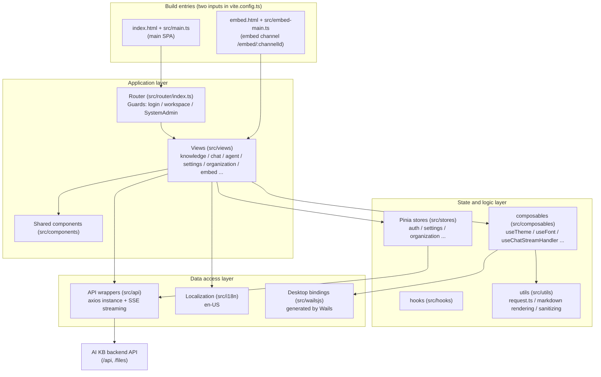

# Web frontend (frontend/)

The AI KB web frontend is a single-page application (SPA) built on **Vue 3 + TypeScript + Vite**. It carries every interactive screen: knowledge base management, agent conversations, organization collaboration and system settings. One codebase serves three forms:

1. **Standard web deployment**: an nginx container serves the Vite build output and reverse-proxies `/api` to the backend.
2. **Web embed**: a separate lightweight entry, `frontend/embed.html` + `frontend/src/embed-main.ts`, lets third-party sites embed an agent conversation as an iframe or floating window.
3. **Desktop (Wails)**: the auto-generated bindings in `frontend/src/wailsjs/` talk to the Go side of the desktop process. They support desktop features such as `--wails-draggable` drag regions and syncing the window's light or dark theme.

## Technology stack

Use this table to see which libraries the frontend is built on and which versions it pins.

From `frontend/package.json`:

| Category | Choice | Version | Notes |
| --- | --- | --- | --- |
| Framework | Vue | ^3.5.44 | Composition API, `<script setup>` style |
| Language | TypeScript | ~6.0.3 | `vue-tsc` type checking (`npm run type-check`) |
| Build tool | Vite | ^7.3.7 | Plugins: `@vitejs/plugin-vue`, `@vitejs/plugin-vue-jsx` |
| UI component library | TDesign (tdesign-vue-next) | ^1.20.10 | With `tdesign-icons-vue-next` 0.4.11 (version locked by overrides) |
| State management | Pinia | ^4.0.3 | Every store lives in `frontend/src/stores/` |
| Routing | Vue Router | 5.4.0 | `createWebHistory`, see `frontend/src/router/index.ts` |
| Localization | vue-i18n | ^11.4.14 | `en-US` |
| HTTP | axios | ^1.20.0 | One shared instance in `frontend/src/utils/request.ts` |
| SSE streaming | @microsoft/fetch-event-source | ^2.0.1 | Streamed chat replies, see `frontend/src/api/chat/streame.ts` |
| Markdown rendering | marked / marked-katex-extension / katex / highlight.js / mermaid | - | Rich text for chat answers (formulas, code highlighting, diagrams) |
| Security | dompurify | ^3.4.17 | Sanitizes all v-html content (`frontend/src/utils/markdownDomPurify.ts`) |
| Document preview | docx-preview / @vue-office/pptx / xlsx / papaparse | - | In-app preview of Word, PowerPoint, Excel and CSV |
| Long lists | vue-virtual-scroller | ^3.0.5 | Virtual scrolling for the message list |
| Styling | Less + CSS variables | less ^4.9.1 | Theme variables in `frontend/src/assets/theme/theme.css` |

Dependency details worth knowing:

- `xlsx` installs `0.20.2` from a fixed SheetJS URL, and `package-lock.json` keeps its integrity hash. The repository does not ship the package, so an offline build needs a prepared npm cache.
- `frontend/pnpm-workspace.yaml` does not declare workspace packages. It only holds the `allowBuilds` allow-list (`@vue-office/pptx`, `esbuild` and `vue-demi` may run build scripts) for pnpm's build-script security policy.
- `overrides` / `resolutions` disable `lightningcss` and pin one version each of `esbuild` and `serialize-javascript`.

## Module structure

Use this section to find which layer of the frontend owns a piece of behavior.

### Directory overview

| Directory | Responsibility |
| --- | --- |
| `frontend/src/main.ts` | Main SPA entry: installs TDesign, Pinia, the router and i18n, initializes theme and font, installs the TDesign icon offline guard (`installTDesignIconOfflineGuard`, so nothing requests `tdesign.gtimg.com` at runtime), and waits for `router.isReady()` before mounting so the first screen does not flash |
| `frontend/src/embed-main.ts` | Embed entry: a separate Vue app with its own router (only `/embed/:channelId`), mounted on `#embed-app`, with its own i18n (`src/i18n/embed.ts`) |
| `frontend/src/views/` | Page-level components, one directory per business area (see the route tables below) |
| `frontend/src/components/` | Components shared across pages (message bubbles, the upload overlay, the command palette and so on) |
| `frontend/src/stores/` | Pinia state (see the store table below) |
| `frontend/src/api/` | Backend API wrappers (see the API module table below) |
| `frontend/src/composables/` | Composables: theme, font, chat stream handling, citation popovers, the embed bridge and so on |
| `frontend/src/hooks/` | Business hooks (such as `useKnowledgeBase`) |
| `frontend/src/utils/` | Utilities: the axios instance, the markdown rendering pipeline, DOMPurify sanitizing, agent tool display and so on |
| `frontend/src/i18n/` | vue-i18n configuration and the locale bundle |
| `frontend/src/assets/theme/` | Theme CSS variables (light / dark) |
| `frontend/src/wailsjs/` | Wails desktop bindings, generated (do not edit by hand) |
| `frontend/src/directives/`, `frontend/src/types/`, `frontend/src/config/` | Custom directives, type definitions, configuration |
| `frontend/public/` | Static assets: `ai-kb-widget.js` (embed loader for third-party sites), `config.js` (runtime configuration placeholder, overwritten when the container starts), offline TDesign icons |

## Page routes

Use these tables to find which component renders a URL and what it requires.

Routes are defined in `frontend/src/router/index.ts` with `createWebHistory`. Every page component is a dynamic import, so each route is a lazily loaded chunk.

### Top-level routes

| Path | Name | Component | Purpose |
| --- | --- | --- | --- |
| `/` | - | Redirect | Redirects to `/platform/knowledge-bases` |
| `/login` | `login` | `src/views/auth/Login.vue` | Login page (with OIDC and an animated background) |
| `/register` | `registerByInvite` | `src/views/auth/Login.vue` | Invite registration landing page. It reuses the Login component, which detects `?token=xxx` on mount and switches to invite registration |
| `/onboarding/workspace` | `workspaceOnboarding` | `src/views/auth/WorkspaceOnboarding.vue` | Workspace onboarding for a user with no workspace (create one or wait for an invitation). Requires login but not an existing workspace |
| `/join` | `joinOrganization` | Redirect | Organization invitation link. Turns `?code=` into the `invite_code` parameter and goes to `/platform/organizations` |
| `/knowledgeBase` | `home` | `src/views/knowledge/KnowledgeBase.vue` | Knowledge base detail (legacy top-level path) |
| `/platform` | `Platform` | `src/views/platform/index.vue` | Main platform layout (left menu, router outlet, the global settings modal and the drag-and-drop upload overlay). Redirects to the knowledge base list by default |
| `/platform/dev/markdown` | `markdownTest` | `src/views/dev/MarkdownTestPage.vue` | Markdown rendering visual regression page, registered only in dev mode (`import.meta.env.DEV`) |

### `/platform` child routes

| Path | Name | Component | Purpose |
| --- | --- | --- | --- |
| `/platform/knowledge-bases` | `knowledgeBaseList` | `src/views/knowledge/KnowledgeBaseList.vue` | Knowledge base list: a space sidebar (all, mine, per organization, favorites, recent), the card list and the create entry. Sorts by updated time, created time or name (`components/ResourceSortControl.vue`, which the agent list also uses) |
| `/platform/knowledge-bases/:kbId` | `knowledgeBaseDetail` | `src/views/knowledge/KnowledgeBase.vue` | Knowledge base detail: the document list (sortable by updated time, created time or file name, sorted on the server, newest created first by default), upload, parsing status, the conversation entry, Wiki and more |
| `/platform/agents` | `agentList` | `src/views/agent/AgentList.vue` | Agent list and management. Editing goes through `AgentEditorModal.vue`. Requires the deployment capability `agents` |
| `/platform/toolbox/:section?` | `toolbox` | `src/views/toolbox/Toolbox.vue` | Toolbox: three tabs, `skills`, `mcp` (MCP services) and `browserconnection` (browser connection). See [Toolbox](#toolbox) below |
| `/platform/artifacts` | `artifactLibrary` | `src/views/artifacts/ArtifactLibrary.vue` | Artifact library: files that agents produced across conversations. Requires the deployment capability `settings.sandbox` |
| `/platform/creatChat` | `globalCreatChat` | `src/views/creatChat/creatChat.vue` | New conversation page: suggested questions, then pick knowledge bases, an agent and a model to start a session |
| `/platform/knowledge-bases/:kbId/creatChat` | `kbCreatChat` | `src/views/creatChat/creatChat.vue` | Starts a new conversation in the context of one knowledge base (same component) |
| `/platform/chat/:chatid` | `chat` | `src/views/chat/index.vue` | Conversation page: the message stream (SSE streaming render, skeleton screens, virtual scrolling), the citation panel, attachment preview |
| `/platform/organizations` | `organizationList` | `src/views/organization/OrganizationList.vue` | Organization list: create or join organizations, manage members and shared resources (with `OrganizationSettingsModal.vue`). Requires the deployment capability `organizations` and is always hidden in Lite. Adding a member looks up the exact workspace ID instead of fuzzy-searching workspace names |
| `/platform/settings` | `settings` | `SettingsRouteOutlet` (renders nothing) | Owns the settings URL only. `views/platform/index.vue` always mounts the full-screen settings modal (`src/views/settings/Settings.vue`) and opens it on this path. Sections are listed in [Settings sections and visibility](#settings-sections-and-visibility) |
| `/platform/tenant` | - | Redirect | Old path, redirects to `/platform/settings` |
| `/platform/knowledge-search` | - | Redirect | Old global search path, goes to the knowledge base list and opens the global command palette (⌘K) through `?cmdk=` |
| `/platform/integrations` | - | Redirect | Goes to `/platform/settings?section=integration-im` (an old `?tab=` is normalized to `integration-<tab>`; the views are in `src/views/integrations/`) |
| `/platform/system`, `/platform/system/settings`, `/platform/system/admins` | `systemSettings` / `systemAdmins` | Redirect | Old system administration paths, go to `/platform/settings?section=system-global` and require `requiresSystemAdmin` (the views are in `src/views/system/`: `SystemSettings.vue`, `SystemAuditLog.vue`, `PlatformAPIKeys.vue` and others) |
| `/platform/system/queues` | `systemQueues` | Redirect | Goes to `/platform/settings?section=runtime-queues` (runtime task queues, `src/views/system/RuntimeQueues.vue`) |

### Separate entry: the embed page

`/embed/:channelId` is not a main SPA route. It is a separate entry made of `frontend/embed.html` + `frontend/src/embed-main.ts` (nginx and the Vite dev server both fall back from `/embed/*` to `embed.html`). The component is `src/views/embed/EmbedPage.vue` (with `EmbedChatView.vue`, `EmbedChatCore.vue`, `EmbedBotMessage.vue` and others). It authenticates with an embed token and is meant for third-party sites to load in an iframe.

### Settings sections and visibility

`Settings.vue` presents every section in seven groups and selects one with `?section=`:

| Group | Sections (`section` value) |
| --- | --- |
| Account | `general` (personal preferences), `userprofile`, `mymemory` (personal memory), `envvars` (personal variables) |
| Workspace | `tenant` (workspace information), `members`, `chathistory`, `memory` (workspace memory) |
| Models and runtime | `models`, `ollama`, `weknoracloud` |
| Integrations | `integration-im`, `integration-embed`, `integration-api`, `integration-mcpserver`, `integration-cli`, `integration-chrome`, `integration-claw` |
| Data and extensions | `vectorstore`, `parser`, `storage`, `sandbox`, `websearch` |
| System administration | `system-global`, `model-catalog`, `runtime-queues`, `platform-api-keys`, `system-audit-log` |
| Platform | `system` (version information) |

The integration tabs are registered by `INTEGRATION_TABS` / `INTEGRATION_PREVIEW_ITEMS` in `frontend/src/config/integrations.ts`, and every section value has the form `integration-<tab>`. An old `/platform/integrations?tab=<tab>` is normalized to the matching section.

Since v0.8.2, skills, MCP services and the browser connection are no longer settings sections. They moved to the [Toolbox](#toolbox). The route guard redirects an old bookmark `/platform/settings?section=skills|mcp|browserconnection` to `/platform/toolbox/<section>` (`skills` keeps its `sandboxId` parameter).

Three sets of rules decide visibility, and **the frontend only narrows what it shows; the backend route guards are authoritative**:

- **Workspace role threshold**: `SETTINGS_SECTION_MIN_ROLE` in `frontend/src/config/settingsAccess.ts` gives each section a minimum role. `general`, `models`, `system`, `userprofile`, `tenant`, `members`, `mymemory` and `envvars` start at `viewer` (visible read-only). `ollama`, `weknoracloud`, `websearch`, `chathistory`, `memory`, `vectorstore`, `parser`, `storage` and `sandbox` require `admin`. Among the integrations, `integration-api` requires `owner` (`INTEGRATION_TAB_MIN_ROLE`). `SETTINGS_MANAGEMENT_SHORTCUT_MIN_ROLE` sets a higher bar for the avatar-menu shortcuts labeled as management (member management needs `owner`, model management needs `admin`), so a read-only page is never presented as a management entry.
- **Deployment capabilities**: `SETTINGS_SECTION_CAPABILITY` / `INTEGRATION_TAB_CAPABILITY` in `frontend/src/config/deploymentCapabilities.ts` map sections to the capability keys returned by `GET /api/v1/system/capabilities` (such as `settings.sandbox.remote` or `integrations.mcpserver`). An entry is hidden when its capability is explicitly `supported: false`. See [Settings navigation and deployment capabilities](#settings-navigation-and-deployment-capabilities) below.
- **System administrator allow-list**: `SYSTEM_ADMIN_SETTINGS_SECTIONS` (`system-global`, `model-catalog`, `runtime-queues`, `platform-api-keys`, `system-audit-log`) is shown only to system administrators, independent of the workspace role. See [Manage workspace and platform permissions](../03-features/01-tenant-auth.md#manage-workspace-and-platform-permissions).

### Toolbox

The "Toolbox" entry in the left menu (`/platform/toolbox/:section?`, `src/views/toolbox/Toolbox.vue`) gathers the tools agents can use. Its tabs are defined by `TOOLBOX_ITEMS` in `frontend/src/config/toolbox.ts`:

| Tab (`section`) | Content | Visible when |
| --- | --- | --- |
| `skills` | Skill management (reuses `SkillSettings.vue`). `?sandboxId=` can select a sandbox configuration | `admin` and up, and the deployment supports `settings.sandbox` |
| `mcp` | MCP services (reuses `McpSettings.vue`) | `admin` and up, and the deployment supports `settings.mcp` |
| `browserconnection` | Browser connection (reuses `BrowserConnectionSettings.vue`). The tab shows the connection status | `viewer` and up |

The tabs keep the role and deployment-capability thresholds of the settings sections they replaced (`canAccessToolboxSection`). When the current workspace has no visible tab, the page shows an empty state. Hovering the menu item previews the available tools, and the browser connection status also appears in the sidebar. For using the browser connection, see [Local Browser](09-local-browser.md).

<Screenshot
  src="/screenshots/toolbox.png"
  caption="Toolbox: manage skills, MCP services and the browser connection on one page"
  hint="The 'Toolbox' entry in the left menu (with the hover preview of tool icons), and the three tabs at the top of the Toolbox page (Skills / MCP services / Browser connection, with counts and connection status), with the Skills tab selected." />

### Knowledge base edit dialog sections

Many settings are **not in the settings center but in the knowledge base edit dialog** (`KnowledgeBaseEditorModal.vue`), because they apply per knowledge base. The sidebar has five groups; a group with no visible section is hidden.

| Group | Sections (`key`) | Notes |
| --- | --- | --- |
| Basic | `basic`, `models`, `vectorStore`, `faq` | Name, type, chat/embedding/summary models. `vectorStore` cannot change once bound. `faq` appears only for FAQ knowledge bases |
| Processing | `parser`, `chunking`, `multimodal`, `asr`, `graph`, `advanced` | Parsing engine and first-row table headers, chunking parameters, image understanding, speech-to-text, knowledge graph, advanced options. Not shown for FAQ knowledge bases |
| Data | `storage`, `datasource` | `datasource` appears **only in edit mode** and not for FAQ knowledge bases. Sync from Feishu / Lark (wiki and drive), Notion, Confluence, Yuque, DingTalk Docs, Tencent IMA, RSS / Atom, GitLab and Seafile is configured here, not in the global settings (connector definitions in `views/knowledge/settings/DataSourceEditorDialog.vue`) |
| Integration | `share` | Share to an organization. Edit mode only, hidden in Lite |
| Management | `activity` | Activity stream. Edit mode only, for the knowledge base owner or a workspace `admin`, and only in the knowledge base's own workspace |

### Global command palette (⌘K / Ctrl+K)

`components/GlobalCommandPalette.vue` is the second main navigation path besides the sidebar:

- It searches knowledge bases, documents and sessions, and can narrow the scope to one knowledge base (scope chip) before searching.
- With an empty query it shows recent searches and quick actions (create a knowledge base, upload, new session and so on).
- The entry at the top right opens the **retrieval settings drawer** (`views/settings/RetrievalSettings.vue`). This is where TopK, the vector and keyword thresholds and the rerank parameters are tuned. It is **not in the settings center**; if you cannot find these settings, they are here.

### Navigation guards

`router.beforeEach` implements a complete authentication chain (`frontend/src/router/index.ts`):

1. **OIDC callback pass-through**: when the URL hash contains `oidc_result=` / `oidc_error=`, the guard lets the navigation through and `App.vue` consumes the result.
2. **Old toolbox bookmarks**: `/platform/settings?section=skills|mcp|browserconnection` redirects to `/platform/toolbox/<section>`.
3. **Lite / desktop deep-link restore**: when a hard refresh in Lite mode lands on the default home page, the guard restores the last visited `/platform` sub-path from `sessionStorage` (never to the organizations page).
4. **Session restore**: when not logged in, the guard first uses `aikb_token` from `localStorage` to call `getCurrentUser()` and restore the session (also refreshing memberships, so role changes are not stale).
5. **Desktop auto-login**: if restore fails, the guard tries `autoSetup()` once per page load. Since v0.8.2 it only works in the native desktop app: it gets the process's random credential through the Wails binding `GetAutoSetupToken()`, then calls `POST /api/v1/auth/auto-setup` with the `X-AIKB-Desktop-Token` header. Lite opened in a browser has no such binding and goes straight to the normal registration / login.
6. **Workspace gate**: logged in but without a valid workspace, the user goes to `/onboarding/workspace`.
7. **Deployment capability gate**: when the route's `meta.requiredCapability` (such as `agents`, `organizations` or `settings.sandbox`) is not supported by the current deployment, the guard shows a warning and returns to the knowledge base list. If the capability probe fails, the navigation proceeds and the backend endpoints have the final say.
8. **SystemAdmin gate**: `requiresSystemAdmin` routes send non-system-administrators back to the knowledge base list (a UI-only check; the server enforces its own).

## State management (Pinia)

Use this table to find which store owns a piece of client state.

Stores and helper modules under `frontend/src/stores/`:

| File | Store ID / type | Responsibility |
| --- | --- | --- |
| `stores/auth.ts` | `useAuthStore` | Authentication core: user, token, refreshToken, tenant, memberships, role checks (`hasRole`, `isSystemAdmin`) and the Lite mode flag. On logout it clears the workspace-level caches of the other stores and reloads the per-user preferences (theme, font) |
| `stores/chatResources.ts` | `useChatResourcesStore` | Shared workspace-level snapshot of knowledge bases, agents, models, web search providers and sandbox backends for the chat and new-conversation pickers. No TTL: every `ensureX()` sends a request (concurrent callers share the one in flight), and writes refresh it explicitly |
| `stores/editorResources.ts` | `useEditorResourcesStore` | Shared snapshot of editor and settings resources: storage engine configuration and status, prompt templates, parsing engines, system information, MCP services, skills, agent type presets, retrieval configuration. Same no-TTL convention as `chatResources` |
| `stores/commandPalette.ts` | `useCommandPaletteStore` | Global command palette (⌘K / Ctrl+K) open state and query. Recent searches are stored per (user, workspace) so they do not leak between accounts |
| `stores/organization.ts` | `useOrganizationStore` | Organization collaboration: the organization list, members, shared knowledge bases and agents, join requests and review, role upgrades and the other actions |
| `stores/organizationState.ts` | Pure function module | Pure logic such as organization list upsert / merge and how join reviews change member counts (unit tests in `organizationState.test.ts`) |
| `stores/settings.ts` | Settings store | Session and agent configuration: the selected knowledge bases, files, tags, MCP, skills and tools, model configuration, Ollama configuration, the web search switch and so on |
| `stores/settingsStorage.ts` | Pure function module | Reading, cloning and built-in agent mode repair for the persisted settings (`AIKB_settings` key) (tests in `settingsStorage.test.mjs`) |
| `stores/menu.ts` | `useMenuStore` | Left navigation menu structure (new conversation, knowledge bases, agents and other entries) with i18n titles |
| `stores/knowledge.ts` | `knowledgeStore` | Knowledge card list and total (lightweight) |
| `stores/ui.ts` | `useUIStore` | Global UI state: switches and parameters for the settings modal, the knowledge base edit modal, the manual document editor, sidebar collapse and so on |
| `stores/uploadConfirm.ts` | Upload confirm store | State of the dialog that confirms processing parameters before an upload, URL import, manual entry or reparse |
| `stores/versionedRequest.ts` | Pure function module | `createVersionedRequestCoordinator`: a versioned cache request coordinator that stops stale responses from overwriting newer writes (tests in `versionedRequest.test.ts`) |
| `stores/deploymentCapabilities.ts` | `useDeploymentCapabilitiesStore` | Deployment capability snapshot (`GET /api/v1/system/capabilities`) that the route guard, sidebar, settings and toolbox use to decide which entries to show |
| `stores/modelProviders.ts` | `useModelProvidersStore` | Model vendor catalog cache (`GET /api/v1/models/providers`, loaded per model type). The model editor and model cards read vendor information from here |
| `stores/uploadTasks.ts` (+ `uploadQueue.ts` / `uploadTasksCore.ts` / `uploadTasksState.ts`) | `useUploadTasksStore` | Knowledge file upload queue: bounded concurrent transfers, cancel / retry, polling of parse progress, driving the floating upload progress panel. Uploads continue after you leave the knowledge base page |
| `stores/browserConnection.ts` | `useBrowserConnectionStore` | Local browser connection status for the toolbox tab and the sidebar status |
| `stores/sessionActivity.ts` | `useSessionActivityStore` | In-progress state of sessions in the sidebar |

## API wrappers (frontend/src/api/)

Use this section to see how requests reach the backend and which module wraps each API area.

### Request foundation

- **axios instance**: `frontend/src/utils/request.ts` creates one shared instance. `baseURL` comes from `getApiBaseUrl()` in `frontend/src/utils/api-base.ts`, which respects Vite's `BASE_URL` so the app works behind a sub-path reverse proxy. Ordinary requests time out after 30s. File uploads (`postUpload`) compute their timeout from the payload size (`uploadTimeoutMs` in `utils/requestTimeouts.ts`: at least 5 minutes, scaled at about 10MB per minute), so raising `MAX_FILE_SIZE_MB` does not leave large files cut off by the 30s default. A `timeout` passed explicitly by the caller wins.
- **Request interceptor**: adds `Authorization: Bearer <aikb_token>` (an embed channel's `Authorization: Embed <token>` header is not overwritten), `Accept-Language` (the current i18n locale), `X-Request-ID` (a random string) and `X-Tenant-ID` (for cross-workspace access; the active workspace id is always sent, so the header is not lost after switching workspaces).
- **Response interceptor**: a 2xx response is unwrapped to `data`. A 401 triggers a single-flight refresh-token refresh and replays the queued requests. A 401 from a public endpoint (`/auth/login`, `/auth/register`, `/auth/oidc/`, `/auth/auto-setup`, `/auth/invitations/lookup`, `/api/v1/embed/`, that is `PUBLIC_AUTH_PATHS`) is thrown to the page without redirecting to login. The embed page never redirects to `/login`.
- **HTTP status (`$httpStatus`)**: `get` / `post` / `put` / `patch` / `del` / `postUpload` return `WithStatus<T>`. A JSON object or array response carries a non-enumerable `$httpStatus` property, which separates results that share a success shape (for example, a system administrator creating a user: 201 means created, 200 means an idempotent retry). It does not appear in object spread, `JSON.stringify` or `Object.keys`. Blob, string and SSE responses do not carry it.
- **SSE streaming**: `frontend/src/api/chat/streame.ts` wraps `@microsoft/fetch-event-source` as `useStream()`, with streamed output, loading state, error state and request debug metadata. `frontend/src/composables/useChatStreamHandler.ts` turns it into the chat message stream. When the chat stream handshake returns 401, it shares the single-flight refresh in `utils/authRefresh.ts` with axios and replays the request once with the new token, so an expired access token does not break a conversation that is being started.

### Module list

| Module | Responsibility |
| --- | --- |
| `api/auth/` | Login, registration, OIDC, `autoSetup` (native desktop only, sends the `X-AIKB-Desktop-Token` supplied by Wails), `getCurrentUser` session restore |
| `api/tenant/` (`index` / `members` / `invitations` / `audit-log`) | Workspace (tenant) information, member management, invitations, audit log |
| `api/organization/` | Organization CRUD, members, shared knowledge bases and agents, join requests |
| `api/knowledge-base/` | Knowledge base CRUD and file / knowledge item management |
| `api/chat/` (`index` / `streame` / `steer` / `temporary-attachments`) | Session CRUD, title generation, SSE streaming Q&A, appending messages to a running agent turn (`steer`), temporary attachments |
| `api/artifacts.ts` | Artifact library list and delete (`/api/v1/artifacts`) |
| `api/memory.ts` / `api/env-vars.ts` | Workspace and personal memory, personal variables |
| `api/mcp-endpoint.ts` | Built-in MCP Server endpoint management (Integrations → MCP Server) |
| `api/chat-history.ts` | Chat history |
| `api/agent/` | Custom agent CRUD, type presets, placeholders (including the built-in Quick Answer / Smart Reasoning ids) |
| `api/model/` | Model configuration management |
| `api/retrieval.ts` | Workspace retrieval configuration |
| `api/vector-store.ts` / `api/storage-backend.ts` / `api/chunker/` | Vector store, storage backend and chunker configuration |
| `api/datasource/` | Data source connections |
| `api/embed/` | Web embed channel management (creating channels, rate limits and so on) |
| `api/image-gallery/` | Knowledge base image gallery listing and configuration |
| `api/initialization/` | System initialization flow |
| `api/system/` | System-level endpoints: system information, storage engine status, prompt templates, parsing engines and so on |
| `api/mcp-service.ts` / `api/skill/` | MCP service and skill management |
| `api/web-search.ts` / `api/web-search-provider.ts` | Web search and provider configuration |
| `api/wiki/` | Knowledge base Wiki generation endpoints |
| `api/message-suggestion.ts` | Suggested questions |
| `api/user-favorites.ts` | User favorites (favorite knowledge bases and agents) |

## Waiting states in the conversation timeline

This section explains what the chat shows between the last pipeline step and the first answer token.

The visual RAG pipeline progress (`views/chat/components/RagPipelineProgress.vue`) has a quiet gap between "every visible step has finished" and "the model emits its first token". `utils/rag-pipeline-state.ts` describes that gap:

- `getRagPipelineWaitKind()` decides the wait type. Only a turn whose retrieval step actually completed gets `model` (generating the answer). A turn with no retrieval step, such as a question about attachments only, gets a neutral `preparing` instead of no feedback at all.
- `createRagWaitController()` handles presentation. It waits `RAG_WAIT_REVEAL_DELAY_MS` (250ms) before showing anything, so a fast answer does not flash. After `RAG_WAIT_STALL_DELAY_MS` (60s) it switches to a "stalled" state: when SSE disconnects the backend never sends `is_completed`, and without this limit the progress bar would claim "almost done" forever.
- State changes are announced through a persistent `aria-live` region, so screen reader users do not miss them when the node is replaced as a whole.

## Localization (i18n)

This section covers how UI strings are loaded and how the locale reaches the backend.

Implemented in `frontend/src/i18n/index.ts` on top of `vue-i18n` (Composition mode with `legacy: false`, `globalInjection: true`):

- **Locale** (`frontend/src/i18n/locales/`): the UI ships in `en-US` only.
- The locale is persisted under the `locale` key in `localStorage`. The axios interceptor writes it into the `Accept-Language` request header so the backend returns content for that locale.
- Some translations embed `<strong>` markup (rendered with v-html after DOMPurify sanitizing), so `warnHtmlMessage: false` turns off vue-i18n's HTML warning.
- **Separate embed i18n**: the visitor-facing embed page uses its own `frontend/src/i18n/embed.ts` (loaded by `embed-main.ts`). The admin-side "Web embed" strings stay in the main locale bundle. `frontend/src/i18n/locales/embed/index.ts` re-exports the locale helpers from one path.
- **Locale audit**: `npm run check-i18n` runs `src/i18n/localeKeyAudit.test.ts`. It checks that the bundle's messages compile under vue-i18n rules and that the keys the app builds at runtime exist: the critical keys, the audit action labels from `i18n/auditActionRegistry.ts`, the runtime queue and pool labels, the parser engine names and the data source connector texts. `npm test` runs it too. A new audit action needs one entry in the registry and its label in `en-US.ts`.

## Theme and appearance

This section covers how the light and dark themes are applied and remembered.

- **Theme mode**: `frontend/src/composables/useTheme.ts` provides three states, `light | dark | system`. It applies a theme by setting the `theme-mode` attribute on `document.documentElement`. `system` mode follows the `prefers-color-scheme` media query.
- **CSS variables**: `frontend/src/assets/theme/theme.css` uses the TDesign token system (`--td-brand-color-*`, `--td-bg-color-*`, `--td-text-color-*`, font, radius, shadow and so on) to define two variable sets, `:root[theme-mode="light"]` and `:root[theme-mode="dark"]`. The brand color is green. Component styles reference only the variables, so one switch re-skins everything.
- **Preference persistence**: `frontend/src/composables/preferenceStorage.ts` stores theme and font preferences in `localStorage`, namespaced by user id. Login, logout and account switches reload them with `reloadThemeFromStorage()` / `reloadFontFromStorage()` (triggered from `stores/auth.ts`).
- **Font**: `frontend/src/composables/useFont.ts` manages the UI font choice. `main.ts` calls `initTheme()` + `initFont()` at startup.
- **Desktop sync**: `syncWailsNativeChrome()` in `useTheme.ts` calls the Wails runtime's `WindowSetDarkTheme / WindowSetLightTheme / WindowSetBackgroundColour` so the native window background matches the page theme, which reduces the white flash on refresh.

## Build and deployment

Use this section to run the frontend locally, build the production image and configure its nginx reverse proxy.

### Development and build (vite.config.ts)

Key points of `frontend/vite.config.ts`:

- **Two build inputs**: `rollupOptions.input` builds both `index.html` (main SPA) and `embed.html` (embed page). In development the custom plugin `embedHtmlDevFallback()` rewrites `/embed/:channelId` requests to `/embed.html`, matching nginx.
- **Code splitting**: `manualChunks` splits mermaid/dagre/cytoscape, marked/katex and highlight.js into `vendor-mermaid`, `vendor-markdown` and `vendor-highlight`. The embed entry filters the heavy chat chunks out through `modulePreload.resolveDependencies`, so the embed page's first screen loads only the code needed for the token exchange.
- **Version injection**: `__FRONTEND_VERSION__` (the package.json version) and `__FRONTEND_COMMIT__` (`VITE_FRONTEND_COMMIT` / `GITHUB_SHA` / `git rev-parse`) are injected at build time.
- **Dev proxy**: the dev server (port 5173) and preview (port 4173) both proxy `/api`, `/files` and `/mcp/` to `VITE_DEV_PROXY_TARGET` (or `FRONTEND_BACKEND_URL`, default `http://localhost:8080`). `/api` forwards WebSockets (sandbox terminals and the like) with the timeout raised to 180s. `/mcp/` carries the built-in MCP Server's long-lived Streamable HTTP connections with a 1-hour timeout.
- **Aliases**: `@` → `frontend/src`, plus entry-file detection for `@vue-office/pptx`.
- Common scripts: `npm run dev` / `npm run build` / `npm run preview` (serves the production build locally, the closest match to the release image) / `npm run type-check` / `npm run test` (tsx --test).

### Production image (Dockerfile + nginx)

`frontend/Dockerfile`:

- Since v0.8.2 it is a two-stage build. A digest-pinned `node:24-bookworm-slim` runs `npm ci` + `npm run build` on `$BUILDPLATFORM`, then `dist/` is copied into the runtime stage. The host no longer needs Node / npm, and `dist/` does not have to be built beforehand (`scripts/build_frontend_dist.sh` is still used for Lite and desktop packaging).
- The runtime base image is a digest-pinned `nginx:1.30.3-alpine`. A comment forbids switching back to a floating tag: newer Alpine 3.24+ bases fail to start on old CentOS 7 kernels, which broke v0.7.0.
- `nginx.conf` goes in as the template `/etc/nginx/templates/default.conf.template`. The proxy settings shared by `/api/`, `/mcp/` and skill uploads are in `nginx-api-proxy.conf` (copied verbatim to `/etc/nginx/api-proxy.conf`). The http-level snippet `nginx-http.conf` (the `api_no_query` log format, which drops query strings) is copied to `/etc/nginx/conf.d/00-ai-kb-http.conf`. The image exposes port 80 and its entrypoint is `docker-entrypoint.sh`.

Image build arguments:

| Name | Type | Default | Description |
| --- | --- | --- | --- |
| `NPM_REGISTRY` | build-arg | empty | Registry used by `npm ci`; empty uses npm's default registry |
| `NODE_MAX_OLD_SPACE_SIZE` | build-arg | `4096` | Node heap limit (MB) in the build stage, so the Vite build does not run out of memory |
| `VITE_FRONTEND_COMMIT` | build-arg | `unknown` | Frontend commit injected into the page. Declared after `npm ci`, so changing it does not invalidate the dependency layer cache |

`frontend/docker-entrypoint.sh` (runtime configuration injection):

1. Generates `/usr/share/nginx/html/config.js`, writing `MAX_FILE_SIZE_MB`, `MAX_SKILL_BUNDLE_SIZE_MB` and `DEFAULT_LOCALE` into `window.__RUNTIME_CONFIG__` for the frontend to read at runtime.
2. Renders the nginx template with `envsubst`.
3. Starts nginx in the foreground.

| Name | Type | Default | Description |
| --- | --- | --- | --- |
| `MAX_FILE_SIZE_MB` | integer (MB) | `50` | Site-wide request body limit and the frontend upload size limit |
| `MAX_SKILL_BUNDLE_SIZE_MB` | integer (MB) | `256` | Applies only to the skill ZIP upload routes. Raised to `MAX_FILE_SIZE_MB` when smaller, capped at 512 |
| `DEFAULT_LOCALE` | string | empty | Default UI locale. Only `en-US` is accepted; other values are dropped |
| `APP_HOST` | string | `app` | Backend host name |
| `APP_PORT` | integer | `8080` | Backend port |
| `APP_SCHEME` | string | `http` | Backend scheme; set `https` for a remote HTTPS backend |

Key behavior of `frontend/nginx.conf`:

- **SPA fallback**: `/` uses `try_files ... /index.html`, and `index.html` is served `no-cache` (so users do not keep an old version after an upgrade). Hashed `/assets/*` files get a one-year immutable cache.
- **API proxy**: `/api/` and `/files` reverse-proxy to `${APP_SCHEME}://${APP_HOST}:${APP_PORT}`. For SSE, `/api/` turns off `proxy_buffering`, caching and chunked encoding, raises the read and write timeouts to 3600s, and retries upstream 3 times.
- **Built-in MCP Server `/mcp/`**: proxied to the backend with the original path and the same proxy settings as `/api/`. External MCP clients can connect to `/mcp/<endpoint_id>` on the site's own domain.
- **WebSocket channels**: `/api/v1/sessions/<id>/sandbox/(terminal|desktop)` (the sandbox terminal and graphical desktop) and `/api/v1/local-browser/extension` (the BrowserSkill browser extension) get their own Upgrade handling, and their access logs drop the query string so handshake tickets are not recorded. The in-cluster path `/api/v1/local-browser/internal` returns 404.
- **Skill bundle uploads**: the two collection routes `/api/v1/skills/catalog` and `/api/v1/sandbox-configs/<id>/skills` use `MAX_SKILL_BUNDLE_SIZE`. Every other upload endpoint stays under `MAX_FILE_SIZE`.
- **Resource short links `/r/`**: `location ^~ /r/` also proxies to the backend. IM channels rewrite `resource://` images to `<APP_EXTERNAL_URL>/r/<token>`. Without this block the request falls into the SPA fallback and the image shows blank on the IM side (see [IM integration](../03-features/12-im-integration.md)).
- **Embed page**: `/embed/*` returns `embed.html` from its own location, which does not inherit the main site's `X-Frame-Options: SAMEORIGIN`. nginx first makes the internal subrequest `/_embed-frame-policy` to the backend's `GET /api/v1/embed-frame-policy` to fetch the host origins the channel allows, and adds the returned `Content-Security-Policy` to the response. If the channel does not exist, is disabled, has no allowed host origin, or the backend is unreachable, loading is refused. A custom reverse proxy must keep this step, or the host origin allow-list has no effect. `/ai-kb-widget.js` is the static loader for third-party sites. The top of the file also has an optional example server block for a dedicated embed subdomain.
- gzip is on (a comment records the measured gain: on low bandwidth the first screen went from 25s to 3-5s), along with a set of security response headers (`X-Frame-Options`, `X-Content-Type-Options`, `Referrer-Policy` and others), repeated in each location because nginx `add_header` is not inherited.

## Desktop (Wails) integration

This section covers the generated bindings the frontend uses when it runs inside the desktop app.

`frontend/src/wailsjs/` is binding code generated by the Wails framework (the file header says "automatically generated. DO NOT EDIT"):

- `wailsjs/go/main/App.d.ts` / `App.js`: JS bindings for the methods of the Go `App` struct. They include `CheckForUpdates` / `AutoCheckForUpdates` (desktop update checks), `GetAPIBaseURL` / `GetAPILanBaseURL`, the port and public-listen settings of the desktop's built-in HTTP service (`GetDesktopHTTPPortSetting`, `SetDesktopHTTPBindPublicSetting` and others), and `GetAutoSetupToken` (returns the random credential the desktop process generated at startup, which the frontend uses to call `auto-setup` without a login; see the navigation guards above).
- `wailsjs/runtime/`: the Wails runtime API (window control and so on). Calls from a plain browser are caught by try/catch and degrade quietly (as in `useTheme.ts`).

The desktop app's window content is this same frontend. Desktop auto-login, deep-link restore and the draggable title area marked `--wails-draggable` are adaptations for the desktop form.

## Settings navigation and deployment capabilities

Use this section when you add a settings entry or need to know why one is hidden.

Settings entries are grouped by task. The integrations include pages for IM, web embed, API, MCP Server, CLI and the Claw skill. Sandbox configuration, personal variables and workspace / personal memory each have a management page in the settings center. Skills, MCP services and the browser connection are in the toolbox. A new entry should reuse the existing registrations in `frontend/src/config/integrations.ts`, `frontend/src/config/toolbox.ts`, `frontend/src/config/settingsAccess.ts` and the like, and check the sidebar grouping at the same time.

`GET /api/v1/system/capabilities` returns the edition and each capability's supported / reason. The frontend hides or disables entries according to what the deployment actually supports (the route guard, left menu, settings sections and toolbox tabs all read the same snapshot). When the capability probe fails, or an older backend lacks a key, the entry stays visible by default. `organizations` is always hidden in Lite. `settings.sandbox.docker`, `settings.sandbox.host` and `settings.sandbox.remote` are shown only when the backend explicitly returns `supported: true`. Frontend visibility only improves the user experience; the backend routes still check roles and capabilities. For the endpoint, see [System API](../04-api/02-api-system.md).
