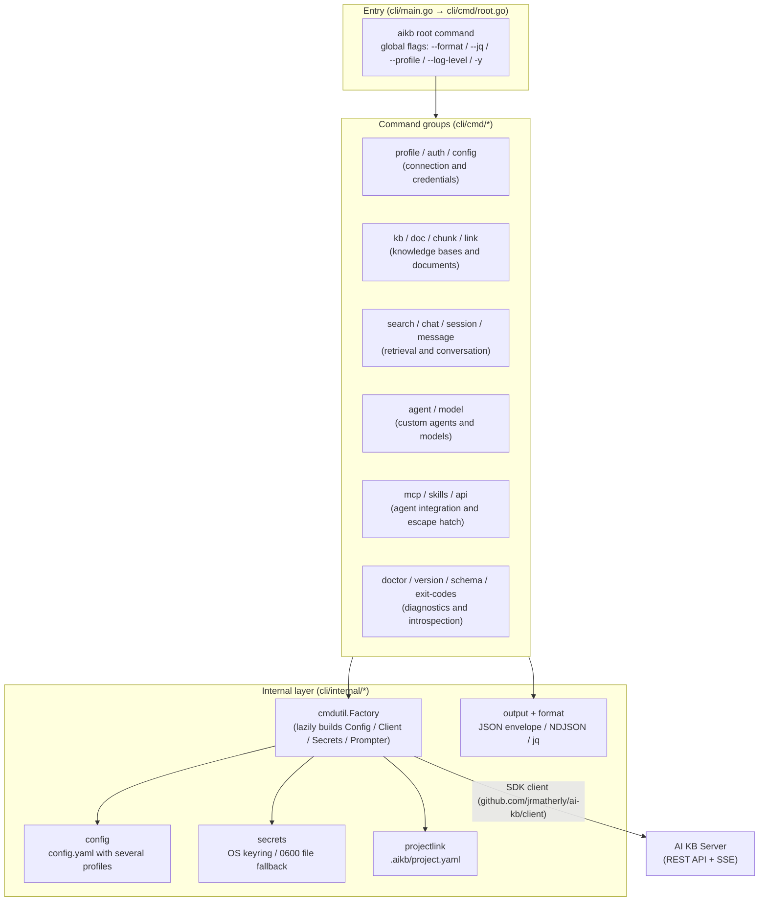

# AI KB CLI (the aikb command-line tool)

The AI KB CLI (command name `aikb`) manages knowledge bases and documents, runs retrieval and streams answers. People can ask for readable text output. Scripts and AI agents get JSON responses, typed errors, `--dry-run` previews and contract lookup with `aikb schema`. `aikb mcp serve` runs an MCP server.

The source is in `cli/`, a separate Go module (`github.com/jrmatherly/ai-kb/cli`). Building it needs Go 1.26 or later. The command entry point is `cli/cmd/root.go`.

The console page Settings → Publish & Integrations → CLI walks through setup and generates commands for the current deployment that you can copy:

1. **Install**: build from source (needs Git and Go 1.26+; the example is for macOS and Linux).
2. **Connect**: `aikb profile add aikb --host '<current server address>' --use && aikb auth login` creates and activates a profile named `aikb`, then signs in with your email and password. The server address keeps any reverse proxy path prefix and does not end in `/api/v1`. If a profile with that name already exists, pick another name.
3. **Verify**: run `aikb doctor` and `aikb kb list` to confirm that the server and the credential work.

The right side of the page lists common commands (upload, search, ask, list agents) and an MCP client configuration example (`"args": ["--profile", "aikb", "mcp", "serve"]`).

<Screenshot
  src="/screenshots/integration-cli.png"
  caption="Settings → Publish & Integrations → CLI: install, connect and verify commands"
  hint="The settings sidebar with CLI selected under 'Publish & Integrations'. On the right, the three quick start steps (Install the CLI / Connect to this server / Verify the connection, with the current server address filled into the connect command), the common commands and the MCP client configuration example." />

## Architecture

This section shows how the command tree, the internal packages and the server fit together, so you know where to look when a command misbehaves.



---

## Installation

To get a `aikb` binary on your `PATH`, build it from source. There are no prebuilt CLI binaries and no supported `go install` path; the Homebrew formula in `Formula/` installs the Lite server, not the CLI.

### Build from source (the supported installation method)

```bash
git clone https://github.com/jrmatherly/ai-kb.git
cd ai-kb/cli
go build -o aikb .
sudo mv aikb /usr/local/bin/   # or any directory on $PATH
```

### Use cli/Makefile

`cli/Makefile` has build targets that inject version metadata (`internal/build.Version/Commit/Date` through `-ldflags`):

| target | Effect |
| --- | --- |
| `make build` | Compiles to `./bin/aikb` with the `git describe` version, the short commit hash and the build time |
| `make test` | `go test ./...` |
| `make test-coverage` | Runs the tests and prints a coverage report |
| `make lint` | `go vet ./...` |
| `make tidy` | `go mod tidy` |
| `make clean` | Removes `./bin` and coverage.out |

The Makefile has **no** `install` target. Move the built binary onto your `$PATH` yourself.

---

## Configuration and profile management

To point the CLI at a server and keep credentials for it, you create profiles. This section covers where they are stored, how the active profile and knowledge base are chosen, and the environment variables that skip the config file entirely.

### Config file and paths

`cli/internal/config/config.go` manages the user configuration at `$XDG_CONFIG_HOME/aikb/config.yaml` (`~/.config/aikb/config.yaml` when `XDG_CONFIG_HOME` is unset). Path resolution is in `cli/internal/xdg/xdg.go` and follows the XDG variables on every operating system, macOS included. Writes are atomic (temporary file plus rename) with mode 0600.

On-disk schema (`config.Config` / `config.Profile`):

```yaml
current_profile: prod          # name of the active profile
profiles:
  prod:
    host: https://kb.example.com   # required: server address
    tenant_id: 42                  # optional: workspace id (display only, not sent as a request header)
    user: user@example.com         # optional: account email (shown by profile list only)
    api_key_ref: keychain://...    # storage reference for the API key (keychain:// or file://)
    token_ref: keychain://...      # reference to the JWT access token
    refresh_token_ref: keychain://...
    default_kb_id: "..."           # declared in the schema; not read by knowledge base resolution
defaults:
  format: json                 # optional: CLI-wide default output format
  no_version_check: true       # declared in the schema; no command reads it
```

`defaults.format` sets the default output format for every command. The format resolves from `--format`, then `AIKB_FORMAT`, then `defaults.format`, then `json`; `aikb config view` reports the result as `format_default`. `aikb auth token` keeps its own raw-token default and reads only `--format` and `AIKB_FORMAT`.

### Credential storage (secrets)

Credentials are **not written to config.yaml**; the file holds references only. `cli/internal/secrets/` has two backends:

- **KeyringStore**: the OS keychain (macOS Keychain, Linux keyring). Entries use the service `aikb:<profile>` and the account `access`, `refresh` or `api_key`.
- **FileStore**: when no keychain is available (headless CI, WSL without DBus, containers), plaintext 0600 files at `$XDG_CONFIG_HOME/aikb/secrets/<profile>/<key>`. `auth login` prints a one-time warning to stderr when it falls back to this store.

### Switching profiles and resolution order

The profile resolution chain is in `cli/internal/cmdutil/factory.go` (`Factory.ActiveProfile`), from highest to lowest priority:

1. The global `--profile <name>` flag (applies to this invocation only, nothing written to disk).
2. The environment variable `AIKB_PROFILE`.
3. `current_profile` in `config.yaml` (persisted by `aikb profile use`).

### Stateless environment credentials (headless, CI and agent use)

`buildClientFromEnv` in `factory.go` can bypass config.yaml and the keychain completely:

| Environment variable | Effect |
| --- | --- |
| `AIKB_TOKEN` | Bearer JWT (takes precedence over `AIKB_API_KEY`) |
| `AIKB_API_KEY` | API key |
| `AIKB_HOST` | Server address, used only when `AIKB_TOKEN` or `AIKB_API_KEY` is set. When unset, the host of the `current_profile` in config.yaml is used |
| `AIKB_PROFILE` | Overrides the active profile |
| `AIKB_KB_ID` | Sets the knowledge base id explicitly |
| `AIKB_FORMAT` | Default output format (text / json / ndjson) |
| `AIKB_LOG_LEVEL` | SDK log level (error / warn / info / debug) |
| `AIKB_AGENT_HELP=1` | Makes `--help` print machine-readable AgentHelp JSON (`cli/internal/cmdutil/agenthelp.go`) |

### Knowledge base (--kb) resolution chain

Commands that need a knowledge base scope (chat, doc, chunk, search chunks/docs and others) resolve it through `Factory.ResolveKB` with four fallbacks (`cli/internal/cmdutil/factory.go`):

1. The `--kb` flag. A UUID is passed through as is; a name is looked up through `ListKnowledgeBases` to get its id (see `cli/internal/cmdutil/kb.go`).
2. The `AIKB_KB_ID` environment variable.
3. The project link file `.aikb/project.yaml`, written by `aikb link`. It is searched for from the current directory upward, at most 64 levels (see `cli/internal/projectlink/projectlink.go`).
4. If none of these match, the command fails with `local.kb_id_required`.

A JWT profile (one that holds both an access token and a refresh token) gets a transport that refreshes transparently on 401 (`AuthRetryTransport`): the first 401 calls `/api/v1/auth/refresh` and replays the original request. API key profiles and environment credentials are not refreshed.

---

## Global flags, output formats and scripting

To script the CLI or drive it from an agent, you rely on its output contract: a JSON envelope, typed errors, fixed exit codes and a confirmation gate on risky writes. This section defines each of them.

### Global flags (`addGlobalFlags` in `cli/cmd/root.go`)

| Flag | Short | Description |
| --- | --- | --- |
| `--format` | | Output format: `text` \| `json` \| `ndjson`. **The default is `json`** whether or not stdout is a TTY (an agent-first design; people pass `--format text` explicitly). `AIKB_FORMAT` and `defaults.format` in config.yaml set a default. Precedence: `--format` > `AIKB_FORMAT` > `defaults.format` > the json default |
| `--jq` | `-q` | Filters JSON output with a jq expression. With `--format` unset it selects JSON output, even when `AIKB_FORMAT` or `defaults.format` is `text`; combining it with an explicit `--format text` is an error (exit 2) |
| `--profile` | | Overrides the active profile for this invocation (nothing written to disk) |
| `--log-level` | | SDK debug log level: error \| warn \| info \| debug |
| `--yes` | `-y` | Skips the confirmation prompt on destructive operations |
| `--version` | `-v` | Prints the version (same line as `aikb version --format text`) |

Many write commands also register `--dry-run` (`cli/internal/cmdutil/dryrun.go`). It covers nearly every mutation command in kb, doc, chunk, agent, model, profile, auth, session, message, link, api and skills. It performs no write and prints `meta.dry_run=true` plus `meta.plan` (a description of the action it would take). With `--format text` it prints the same plan as key/value rows.

### JSON envelope output contract (`cli/internal/output/envelope.go`)

The success path writes to stdout:

```json
{"ok": true, "data": ..., "meta": {"count": 2, "total_count": 2}, "profile": "prod"}
```

- `data`: the command payload (an object or an array). A `--jq` projection is rooted at the envelope, so use `.data`, as in `--jq '.data[].id'`.
- `meta`: list commands carry `count` / `total_count`, plus `has_more` when the list was truncated. Batch operations carry `successes` / `failures`. A dry run carries `dry_run` + `plan`. An optional `hint` adds an actionable note to a success.
- `status`: set by batch commands only, with three values (success / partial / error).
- `profile`: the profile name resolved for this invocation.

The error path writes to stderr, which keeps stdout clean for `| jq` pipelines:

```json
{"ok": false, "error": {"type": "auth.unauthenticated", "message": "...", "exit_code": 3,
  "hint": "...", "retry_argv": ["aikb","auth","login"], "retryable": false}}
```

Error types are hierarchical strings (`cli/internal/cmdutil/errors.go`): `auth.*`, `resource.*`, `input.*`, `server.*`, `network.error`, `operation.*`, `local.*`, `internal.error`. `retry_argv` is an argument array for the fixing command that can be executed directly.

`--format ndjson` is for the streaming commands (`chat` / `session ask` / `session resume`). The first line is a CLI `init` event (with session_id, kb_id or agent_id, and profile); after that each SDK SSE event is passed through as one line (`cli/internal/sse/`).

### Exit code matrix (`cli/cmd/exitcodes.go`; run `aikb exit-codes` for a machine-readable version)

| Exit code | Meaning | Error types | Suggested agent action |
| --- | --- | --- | --- |
| 0 | Success | - | Continue |
| 1 | Typed local error / operation failed / unclassified | `local.*`, `operation.failed`, `operation.cancelled`, `server.session_create_failed`, `internal.error` | Read stderr, then decide to retry or give up |
| 2 | Flag or argument parse error (unknown flag, argument count, missing required flag) | `input.invalid_argument` (same type as exit code 5; the exit code tells them apart) | Check `aikb <cmd> --help` |
| 3 | Authentication or authorization failure | `auth.*` | Run `aikb auth login` again, then retry |
| 4 | Resource not found | `resource.not_found` | Check the resource id |
| 5 | Invalid input value (typed validation, not a parse error) | `input.*` (except confirmation_required) | Adjust the arguments and retry |
| 6 | Rate limited | `server.rate_limited` | Back off, then retry |
| 7 | Server or network error | `server.*`, `network.*` | Transient; retry with backoff |
| 10 | Confirmation required (high-risk write) | `input.confirmation_required` | Ask the human; retry with `-y` only after explicit approval |
| 124 | Operation timed out | `operation.timeout` | Raise `--timeout` or check the underlying job |
| 130 | Cancelled by a signal (SIGINT/SIGTERM) | - | Stop; do not retry |

**High-risk write protection (the exit-10 protocol)**: deletes, `kb config set`, the `update` commands of kb, doc, agent and model, `api -X DELETE/PUT/PATCH`, `message delete`, `session tool-approval resolve`, `auth logout` and removing the current profile all need confirmation. Without `-y` they prompt only on a TTY with `--format text`. Otherwise (no TTY, or JSON output, which is the default) they return `input.confirmation_required` with exit code 10 and change nothing, so an agent cannot silently modify server state.

### Machine introspection

- `aikb schema` (`cli/cmd/schema.go`) with no arguments lists every leaf command with its purpose. `aikb schema kb create` prints the full contract of one command (used_for, flags, required_flags, examples, output, and risk and warnings for risky commands).
- `AIKB_AGENT_HELP=1 aikb <cmd> --help` prints the same AgentHelp JSON.
- An unknown subcommand returns a typed `input.unknown_subcommand` envelope (exit code 5) with the available subcommands and, when one is close, `suggestions` (did-you-mean).

---

## Command groups

Use this section as the reference for each command: its arguments, its flags and what it changes. Each group corresponds to a directory under `cli/cmd/`.

### profile - manage connection targets (`cli/cmd/profile/`)

| Subcommand | Use | Description |
| --- | --- | --- |
| list | `list` | Lists the configured profiles |
| add | `add <name>` | Registers a new profile (host only, no credentials) |
| use | `use <name>` | Switches the default profile persistently |
| remove | `remove <name>` | Deletes a profile (removes the config entry and the keychain references) |

Key flags of `add`: `--host` (required, server URL), `--user` (optional email, display only), `--use` (switch to the profile after adding it).

```bash
aikb profile add prod --host=https://kb.example.com --use
aikb profile list --format json
```

### auth - manage credentials (`cli/cmd/auth/`)

| Subcommand | Use | Description |
| --- | --- | --- |
| login | `login` | Authenticates the **active profile**: interactive email and password, or `--with-token` to read an API key from stdin (checked against `/auth/me` before it is stored) |
| logout | `logout` | Clears the stored credentials of a profile; `--all` clears every profile |
| list | `list` | Lists authentication profiles |
| status | `status` | Shows the active profile, the principal and the token state |
| refresh | `refresh` | Exchanges the stored refresh token for a new JWT access token |
| token | `token` | Prints the active profile's raw credential to stdout (for shell scripts) |

```bash
aikb auth login                                    # interactive (TTY)
echo "$AIKB_API_KEY" | aikb auth login --with-token   # non-interactive / agent
aikb auth status --format json
```

`auth login` does not accept `--host`. Create and activate a profile with `profile add ... --use` first.

### config - inspect the resolved configuration (`cli/cmd/config/`)

| Subcommand | Use | Description |
| --- | --- | --- |
| view | `view` | Read-only view of the resolved configuration and **the source of each value** (active_profile / profile_source / auth_source / host / kb_id / kb_source / log_level / log_level_source / format_default / config_file / cache_dir / secrets / project_link). Makes no network request |

```bash
aikb config view --format json --jq '.data.kb_source'
```

### link / unlink - bind a directory to a knowledge base (`cli/cmd/link/`)

`link` and `unlink` both hang directly off the root command (see `root.go`).

| Command | Use | Description |
| --- | --- | --- |
| link | `link [kb]` | Writes `.aikb/project.yaml` in the current directory to bind a knowledge base (positional argument or `--kb`, which are equivalent; with neither on a TTY it prompts for a choice; an existing link is overwritten). Supports `--dry-run` |
| unlink | `unlink` | Removes the knowledge base binding of the current directory |

```bash
aikb link engineering            # the name is resolved to an id
aikb link --kb a32a63ff-fb36-4874-bcaa-30f48570a694
```

### kb - manage knowledge bases (`cli/cmd/kb/`)

| Subcommand | Use | Description |
| --- | --- | --- |
| list | `list` | Lists visible knowledge bases; `--pinned` shows only pinned ones, `--limit/-L` (default 30) |
| view | `view <kb-id>` | Shows one by ID |
| create | `create <name>` | Creates one; `--description`, `--embedding-model`, `--chat-model` (ready to use on creation), `--storage-provider` |
| update | `update <kb-id>` | Renames or changes the description: `--name`, `--description` (in `kb/edit.go`); exit-10 protection |
| delete | `delete <kb-id>` | Deletes (exit-10 confirmation protection, skip with `-y`) |
| pin / unpin | `pin <kb-id>` / `unpin <kb-id>` | Pins or unpins (idempotent: a no-op when already in the target state) |
| status | `status <kb-id>` | Shallow health check (one HTTP request) |
| check | `check <kb-id>` | End-to-end check (status plus aggregated failed documents) |
| config | `config <kb-id>` | Read-only view of the model configuration (embedding / llm / rerank / multimodal and the `retrieval_ready` flag; API keys are never shown) |
| config set | `set <kb-id>` | Binds models: `--chat-model` and `--embedding-model` are both required (id or name); high-risk write with exit-10 protection |

```bash
aikb kb create docs --embedding-model text-embedding-3 --chat-model gpt-4o
aikb kb config set <kb-id> --chat-model <id> --embedding-model <id> -y
```

### doc - manage documents (`cli/cmd/doc/`)

| Subcommand | Use | Description |
| --- | --- | --- |
| upload | `upload <file>` | Uploads a local file; `--name`, `--recursive` + `--glob` (a whole directory, such as `'*.pdf'`), `--metadata key=value` (repeatable), `--enable-multimodel`, `--channel` |
| fetch | `fetch <url>` | Fetches a remote document; `--name`, `--title`, `--file-type` (type hint when the URL has no extension), `--enable-multimodel`, `--tag-id`, `--channel` |
| create | `create` | Creates an entry from inline Markdown text: `--text` (required), `--title`, `--tag-id`, `--channel` |
| list | `list` | Lists documents; `--status pending\|processing\|completed\|failed`, `--keyword`, `--file-type`, `--source`, `--tag-id`, `--start-time/--end-time` (RFC3339), `--limit/-L`, `--page-size`, `--all-pages` |
| view | `view <doc-id>` | Shows a document |
| update | `update <doc-id>` | `--title`, `--description`; exit-10 protection |
| delete | `delete <doc-id> [<doc-id>...] \| --all --kb=<kb-id>` | Deletes several documents or empties a knowledge base (exit-10 protection) |
| download | `download <doc-id>` | Downloads the original file; `-O/--output` (`-` for stdout), `--clobber` |
| reparse | `reparse <doc-id>` | Parses the document again |
| wait | `wait <doc-id> [<doc-id>...]` | Polls until parsing finishes; `--timeout` (default 10m, exit code 124 on timeout), `--interval` (default 2s, exponential backoff capped at 15s) |

```bash
aikb doc upload ./design.pdf --kb docs
aikb doc wait <doc-id> --timeout 5m && aikb search chunks "RRF" --kb docs
```

### chunk - debug chunks (`cli/cmd/chunk/`)

| Subcommand | Use | Description |
| --- | --- | --- |
| list | `list` | Enumerates a document's chunks (for administration and debugging, not retrieval): `--doc` (required), `--limit/-L` (default 50), `--page-size`, `--all-pages` |
| view | `view <chunk-id>` | Shows the content of one chunk |
| delete | `delete <chunk-id> [<chunk-id>...] --doc <doc-id>` | Deletes chunks (`--doc` required; exit-10 protection) |

### search - retrieval (`cli/cmd/search/`)

| Subcommand | Use | Description |
| --- | --- | --- |
| chunks | `chunks "<query>"` | **Hybrid retrieval** (vector + keyword): `--kb`, `--limit/-L` (default 8, tuned for a RAG context window), `--vector-threshold`, `--keyword-threshold`, `--no-vector`, `--no-keyword` |
| docs | `docs "<query>"` | Finds documents by keyword (filtered on the server): `--kb`, `--limit/-L`, `--page-size`, `--all-pages` |
| kb | `kb "<query>"` | Finds knowledge bases by name or description (substring match on the client): `--limit/-L` |
| sessions | `sessions "<query>"` | Finds sessions by title or description (substring match on the client): `--limit/-L`, `--page-size`, `--all-pages` |

```bash
aikb search chunks "rate limiting design" --kb docs --limit 5 --format json --jq '.data[].content'
```

### chat - streaming RAG answers (`cli/cmd/chat/chat.go`)

A single command: `chat "<text>"`. The three output modes share one SDK streaming call:

- `--format json` (default): buffers a projection of the stream into one envelope (events, session_id, assistant_message_id and more).
- `--format text`: streams a readable answer as it arrives.
- `--format ndjson`: passes the raw SSE events through (the first line is the init event with session_id / kb_id).

Flags: `--kb`, `--session` (continue an existing session), `--reference` (include reference indexes), `--verbose` (include reasoning, tool and lifecycle events).

```bash
aikb chat "What is RRF?" --kb a32a63ff-fb36-4874-bcaa-30f48570a694
aikb chat "Continue" --session sess_abc --format ndjson
```

### session - manage sessions (`cli/cmd/session/`)

| Subcommand | Use | Description |
| --- | --- | --- |
| list | `list` | Lists sessions: `--limit/-L`, `--page-size`, `--all-pages`, `--since` (such as 7d / 24h / 30m) |
| view | `view <session-id>` | Shows a session; `--full` also loads the chat history, `--limit/-L` |
| ask | `ask "<text>"` | Asks a **server-side custom agent**: `-a/--agent` (required), `--session`, `--reference`, `--verbose` |
| resume | `resume <session-id>` | Resumes the SSE event stream of an in-progress or completed message: `-m/--message` (required) |
| stop | `stop <session-id>` | Stops generation of an assistant message: `-m/--message` (required) |
| delete | `delete <session-id> [<session-id>...]` | Deletes several sessions (exit-10 protection) |
| tool-approval resolve | `resolve <pending-id>` | Approves or rejects a tool call an agent run is waiting on: `--reject`, `--reason`, `--modified-args` (JSON, on approval only); high-risk write |

```bash
aikb session ask "Summarize this KB" --agent agt_123 --format ndjson
aikb session tool-approval resolve <pending-id> --reject --reason "Write operations are not allowed" -y
```

### message - messages in a session (`cli/cmd/message/`)

| Subcommand | Use | Description |
| --- | --- | --- |
| list | `list --session <session-id>` | Lists messages (newest first, time-cursor pagination): `--session` (required), `--limit/-L`, `--before` (RFC3339) |
| search | `search "<query>"` | Searches chat history (question and answer pairs) across sessions: `--limit/-L` (default 20), `--mode keyword\|vector\|hybrid`, `--session` (repeatable, limits the scope) |
| delete | `delete <message-id> --session <session-id>` | Deletes one message (`--session` required; high-risk write with exit-10 protection) |

### agent - custom agent CRUD (`cli/cmd/agent/`)

| Subcommand | Use | Description |
| --- | --- | --- |
| list | `list` | Lists agents: `--limit/-L` |
| view | `view <agent-id>` | Shows the configuration |
| create | `create <name>` | Creates an agent: `--model` (required unless `--generate-skeleton`), `--description`, `--system-prompt` / `--system-prompt-file` (mutually exclusive, `-` reads stdin), `--agent-mode`, `--attach-kb` (repeatable), `--kb-selection-mode`, `--rerank-model`, `--temperature`, `--from` (copy an existing agent), `--config-file` (a full AgentConfig in YAML or JSON), `--generate-skeleton` (print a blank configuration skeleton) |
| update | `update <agent-id>` | Updates an agent (`agent/edit.go`): `--name`, `--description`, `--model`, `--system-prompt(-file)`, `--agent-mode`, `--rerank-model`, `--temperature`, `--add-kb` / `--remove-kb` (repeatable, idempotent), `--kb-selection-mode`, `--config-file` (replaces the baseline, then the individual flags apply on top); exit-10 protection |
| delete | `delete <agent-id>` | Deletes (exit-10 protection) |
| status | `status <agent-id>` | Health status |
| check | `check <agent-id>` | End-to-end check (status plus kb_scope reachability) |

```bash
aikb agent create researcher --model gpt-4o --attach-kb <kb-id> --system-prompt-file ./prompt.md
aikb agent update agt_123 --add-kb <kb-id2> --temperature 0.3
```

### model - manage models (`cli/cmd/model/`)

| Subcommand | Use | Description |
| --- | --- | --- |
| list | `list` | Lists models: `--type` (Embedding / Rerank / KnowledgeQA / VLLM / ASR), `--source` (local / remote / openai / aliyun …), `--limit/-L` |
| view | `view <model-id>` | Shows a model |
| create | `create <name>` | Registers a model: `--type` (required; `chat` means KnowledgeQA), `--source` (required; local=Ollama, remote=provider API), `--provider` (required when source=remote), `--base-url`, `--api-key-stdin` (reads the key from stdin, keeping it out of argv and shell history), `--dimension` (Embedding only), `--default`, `--param key=value` (repeatable, value parsed as JSON), `--display-name`, `--description` |
| update | `update <model-id>` | `--display-name`, `--description`, `--base-url`, `--api-key-stdin` (rotates the key), `--param`, `--default`; exit-10 protection |
| delete | `delete <model-id>` | Deletes (exit-10 protection) |

```bash
aikb model create bge-m3 --type Embedding --source local --base-url http://localhost:11434 --dimension 1024
echo "$OPENAI_KEY" | aikb model create gpt-4o --type chat --source remote --provider openai --api-key-stdin
```

### api - raw HTTP escape hatch (`cli/cmd/api/api.go`)

A single command: `api <path>`. It sends the active profile's authentication header and a request-id header automatically. The workspace comes from the credential; the CLI does not send the profile's `tenant_id` as a header.

| Flag | Short | Description |
| --- | --- | --- |
| `--method` | `-X` | HTTP method (default GET; promoted to POST automatically when a body is supplied) |
| `--data` | `-d` | Inline JSON body (mutually exclusive with `--input` / `-F`) |
| `--input` | | Reads the body from a file (`-` for stdin) |
| `--field` | `-F` | Builds a JSON object body from `key=value` (repeatable; true/false/null and numbers are typed automatically) |
| `--paginate` | | Follows offset pagination (`?page=N&page_size=M`) and merges the pages into one `{data, total}` response |

`-X DELETE` is behind the exit-10 destructive confirmation and `PUT/PATCH` behind the write confirmation. `POST` has no gate, like the typed create commands. `--dry-run` is supported for non-GET methods only.

```bash
aikb api /api/v1/knowledge-bases                              # GET
aikb api /api/v1/knowledge-bases -d '{"name":"foo"}'          # POST (automatic)
aikb api /api/v1/knowledge-bases/<id> -X DELETE -y
```

### mcp - Model Context Protocol server (`cli/cmd/mcp/`)

| Subcommand | Use | Description |
| --- | --- | --- |
| serve | `serve` | Runs a JSON-RPC 2.0 MCP server on stdin/stdout (stdio is the only transport for now); logs go to stderr. It builds the SDK client eagerly at startup and fails immediately with `auth.unauthenticated` when no profile is configured |

It offers 10 tools (implemented in `cli/internal/mcp/tools.go`). `kb_list` / `kb_view` / `doc_list` / `doc_view` / `doc_download` / `search_chunks` / `chunk_list` / `agent_list` are read-only; `chat` and `session_ask` create session and message records. There are no tools to create or delete resources or to upload files.

MCP client registration example (goes in the client's `mcpServers` configuration):

```json
{
  "mcpServers": {
    "aikb": { "command": "aikb", "args": ["mcp", "serve"] }
  }
}
```

### skills - bundled Agent Skills (`cli/cmd/skills/skills.go`)

| Subcommand | Use | Description |
| --- | --- | --- |
| list | `list` | Lists the Agent Skills embedded in the binary (`cli/skills/embed.go`) with name / description / files |
| install | `install` | Writes the embedded skills to an agent's skills directory: `--dir` (default `~/.claude/skills`, a leading `~` is expanded), `--force` (overwrite existing files; otherwise they are skipped); supports `--dry-run` |

```bash
aikb skills install --dry-run --format json
aikb skills install --dir ~/.claude/skills --force
```

### doctor - self-check (`cli/cmd/doctor/doctor.go`)

A single command: `doctor`. It runs 4 checks: base URL reachability, authentication, server version compatibility and credential storage. Each check reports `ok / warn / fail / skip`. Any `fail` gives exit code 1 (the JSON data is still printed). Warnings alone give exit code 0 with `summary.all_passed=false`.

Flags: `--no-cache` (bypasses the `$XDG_CACHE_HOME/aikb/server-info.yaml` cache and probes again), `--offline` (skips the network checks and only verifies the local keychain or file storage).

```bash
aikb doctor --format json --jq '.data.summary.all_passed'
```

### Root-level helper commands (`cli/cmd/root.go`, `schema.go`, `exitcodes.go`)

| Command | Use | Description |
| --- | --- | --- |
| version | `version` | Build metadata (version / commit / date) |
| schema | `schema [command...]` | Machine-readable command contract (see "Machine introspection" above) |
| exit-codes | `exit-codes` | The exit code matrix (JSON or a table) |
| completion | `completion <shell>` | Shell completion script (built into cobra) |

---

## What the acceptance tests cover (`cli/acceptance/`)

When you change the CLI's output or error codes, these tests tell you whether you broke the contract that scripts and agents rely on. `cli/acceptance/` is the cross-cutting contract and integration test layer of the CLI (`doc.go` calls it "the contract surface - change with care") and has two subpackages.

### contract/ - wire contract tests

- **`wire_test.go`** drives the full cobra command tree in process, captures stdout and stderr for each scenario and compares stdout byte for byte with the JSON golden files in `testdata/wire/`. The scenarios are `version`, `auth_status` (success and an `auth.unauthenticated` failure), `doctor` (offline success and a network error), `kb_list` (success / empty list / `auth.forbidden`), `kb_view` (success / `resource.not_found`), `profile_use` and `search` (success / invalid input / not found). The golden files pin the full envelope shape (such as `{"ok":true,"data":[...],"meta":{"count":0,"total_count":0}}`), so any drift in the wire contract shows up at once. Failure cases assert that stderr contains the expected typed error code.
- **`errorcodes_test.go`** scans every literal `cmdutil.NewError(CodeXxx, ...)` / `Wrapf(CodeXxx, ...)` reference in `cli/cmd/` with go/ast and checks that each error code is registered in `cmdutil.AllCodes()`, so the documented list of error codes cannot drift from the code.

### e2e/ - end-to-end tests against a real server

`e2e_test.go` carries the `//go:build acceptance_e2e` build tag, so a plain `go test ./...` skips it. Run it explicitly:

```bash
cd cli
AIKB_E2E_HOST=https://kb.example.com AIKB_E2E_TOKEN=eyJ... \
  go test -tags=acceptance_e2e -v ./acceptance/e2e/...
```

`TestRAGFullLoop` builds the real CLI binary and runs a full RAG loop through the `AIKB_HOST`/`AIKB_TOKEN` environment credential path (which exercises headless authentication without a keychain): **kb create (with model binding) → doc upload → doc wait (for indexing) → search → chat**. Each step reads ids from the previous step's JSON envelope, so the test checks both behavior and the stability of the wire contract. The temporary knowledge base is removed through `t.Cleanup`, even when the test fails.

`cli/cmd/` also holds tree-wide tests (outside the acceptance directory, but they constrain the whole tree): `required_positional_coverage_test.go`, `dryrun_coverage_test.go`, `agenthelp_coverage_test.go`, `root_unknown_subcommand_test.go` and others. They make sure every leaf command validates its positional arguments, supports `--dry-run` where it should, has AgentHelp metadata and handles unknown subcommands.

---

## Quick start

These steps take you from an empty machine to a first answer from your own documents.

```bash
# 1. Register the server as a profile and activate it
aikb profile add prod --host https://kb.example.com --use

# 2. Authenticate (interactive; agents use --with-token)
aikb auth login

# 3. Self-check
aikb doctor

# 4. Create a knowledge base, bind models, upload a document, wait for indexing
aikb kb create docs --embedding-model <emb> --chat-model <llm>
aikb doc upload ./design.pdf --kb docs
aikb doc wait <doc-id>

# 5. Search and ask
aikb search chunks "rate limiting" --kb docs
aikb chat "Summarize this design document" --kb docs
```
