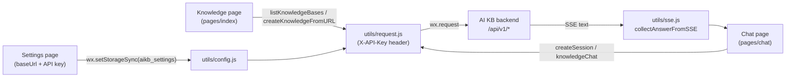

# WeChat Mini Program client

The WeChat Mini Program is a mobile entry point to an existing AI KB server for knowledge base questions and web page import. The source is in `miniprogram/`. Configure the API address and an API key first, then pick a knowledge base:

- Import a web page URL into the selected knowledge base.
- Ask questions against the selected knowledge base.

## Backend address and authentication

Before the mini program can call the server, you give it the server address and an API key. **No backend address is hardcoded.** All connection details are entered on the Settings page and stored with `wx.setStorageSync` under the local storage key `aikb_settings`. The stored object has three fields:

```js
{
  baseUrl: "http://localhost:8080",   // default written by app.js onLaunch
  apiKey: "",
  selectedKnowledgeBaseId: ""
}
```

- **Defaults**: when `miniprogram/app.js` finds no settings in `onLaunch`, it writes the default `baseUrl: "http://localhost:8080"`, an empty `apiKey` and an empty `selectedKnowledgeBaseId`. The default only helps local development; set the real address on the Settings page before use.
- **Reading, writing and normalization**: `miniprogram/utils/config.js` provides `getSettings()` and `saveSettings()`. `normalizeBaseUrl()` trims surrounding whitespace and trailing `/` characters.
- **Authentication uses an API key**: every request from `miniprogram/utils/request.js` carries these headers:
  - `X-API-Key: <the API key you entered>`. Create it in AI KB under Settings → Publish & Integrations → API Integration and copy it when it is shown (only once, at creation); it looks like `sk-...`.
  - `X-Request-ID: mp-<timestamp>-<random string>`, so the server can trace the request.
  - `Content-Type: application/json`.
- **Pre-flight check**: if `baseUrl` or `apiKey` is missing, the request is rejected right away with an error asking you to configure the AI KB API base URL or API key first. `onShow` in `pages/index/index.js` uses the same check to show a prompt that leads to the Settings page.
- **AppID**: copy `miniprogram/project.private.config.json.example` to `project.private.config.json` and fill in your own AppID (the example file contains `{"appid": "your-wechat-mini-program-appid"}`). The shared `project.config.json` currently carries an `appid` field; for your own mini program, the private config overrides it.

Backend routes it calls (all defined in `miniprogram/utils/request.js`):

| Function | Method and path |
| --- | --- |
| `listKnowledgeBases()` | `GET /api/v1/knowledge-bases` |
| `createKnowledgeFromURL(kbId, url, enableMultimodel)` | `POST /api/v1/knowledge-bases/{kbId}/knowledge/url` |
| `createSession(kbId)` | `POST /api/v1/sessions` |
| `knowledgeChat(sessionId, query, kbId)` | `POST /api/v1/knowledge-chat/{sessionId}` |

The API key needs access to these routes. A full-access key works. A scoped key needs the `retrieve` capability to list knowledge bases, `ingest` to import URLs and `chat` for sessions and questions (`internal/router/routes_knowledge.go`, `internal/router/routes_chat.go`).

## UI strings and chat rendering

This section covers where UI text comes from and how answers are shown. The UI ships in English only, with no language setting. Page text comes from the `MESSAGES` table in `utils/i18n.js` (`getMessages()`, and `t()` for `{name}` substitution); new pages should reuse that module. The navigation bar titles are static `navigationBarTitleText` values in `app.json` and each page's `.json`, and the bottom tab labels and icons (`assets/tab/*.png`) are static in the `tabBar` of `app.json`.

The chat page parses the whole SSE text after the request completes and concatenates the `answer` fragments. It does not render chunk by chunk. A production release needs the API domain added to the request domain allowlist.

## Build and release

This section takes you from the source directory to a published mini program. There is no compile step (native development, no build toolchain); open the project directly in WeChat DevTools:

1. **Import the project**: in WeChat DevTools choose "Import Project" and point it at the repository's `miniprogram/` directory. DevTools reads `project.config.json` (project name "AI KB Mini Program").
2. **Configure the AppID**: copy `miniprogram/project.private.config.json.example` to `project.private.config.json` and replace `appid` with your mini program's AppID. `project.private.config.json` is personal configuration, is ignored by `.gitignore` and should not be committed.
3. **Configure the backend connection**: run the mini program, open the Settings tab, enter the API Base URL (for example `https://ai-kb.example.com`) and the AI KB API key (the one you copied when you created it under Settings → Publish & Integrations → API Integration), then save.
4. **Local debugging**: `project.config.json` sets `urlCheck: true`, so DevTools blocks requests to domains that are not on the allowlist, such as `localhost`. For local testing, tick "Do not verify valid domain names" in DevTools, or expose the AI KB server on an HTTPS development domain.
5. **Release**: before release, add the AI KB API domain (it must be HTTPS) to the request domain allowlist in the mini program admin console on the WeChat Official Accounts Platform. Then click "Upload" in DevTools to submit the code, and submit it for review and release in the admin console.

### Tests

`miniprogram/package.json` defines a single script:

```bash
cd miniprogram
npm test    # runs node --test ../tests/miniprogram/*.test.js
```

It runs the unit tests in the repository's `tests/miniprogram/miniprogram.test.js` with the built-in Node.js test runner. They cover SSE parsing, base URL normalization, UI string lookup, request headers and bodies, and the knowledge base page's loading logic. No dependencies need to be installed.

### Base library compatibility

Page and `utils/` code avoids optional chaining `?.` and nullish coalescing `??`. Some base library versions do not support either syntax, and a page that uses them renders blank (this once left the knowledge base page empty). Text bindings in WXML also stay flat fields so they render on every base library version. Keep this constraint when you change the code.

## Implementation reference

This section maps the source files, pages and data flow for anyone changing the client.

### Tech stack

The client is a **native WeChat Mini Program**. It uses no cross-platform framework such as Taro, uni-app or mpvue, and has no npm runtime dependencies:

- `miniprogram/app.js`: the standard `App({...})` entry point; `onLaunch` writes default settings to local storage.
- `miniprogram/app.json`: the standard global mini program configuration (`pages`, `window`, `tabBar`).
- `miniprogram/app.wxss`: global styles. Each page is a set of four files: `js`, `wxml`, `wxss` and `json`.
- `miniprogram/package.json`: package name `ai-kb-miniprogram` (version `2026.10.21.1`), `description` "WeChat Mini Program plugin for AI KB", **no `dependencies`**, and a single test script (see "Tests" above).
- `miniprogram/project.config.json`: `compileType: "miniprogram"`, `libVersion: "latest"` (the latest base library). Compile options enable `es6`, `enhance`, `postcss`, `minified`, `minifyWXSS` and `minifyWXML`, and `urlCheck: true` (domain allowlist check) is on. The file currently carries an `appid` field; your own AppID comes from the private config file (see "Build and release").

Global window style: navigation bar title `AI KB`, background `#0d3b2a` (dark green), white text.

### Pages

`miniprogram/app.json` registers 3 pages, and all three make up the bottom `tabBar` (selected color `#07c05f`, each item with a normal and a selected icon):

| Page path | Tab label | Purpose |
| --- | --- | --- |
| `pages/index/index` | Knowledge | Home page. Checks whether baseUrl and API key are configured; if not, it shows a prompt with a button to the Settings page. Calls `GET /api/v1/knowledge-bases` to load the knowledge base list. You pick a knowledge base with the `picker` or by tapping the list, and the choice is saved to local storage. After you enter a web page URL it calls `POST /api/v1/knowledge-bases/{id}/knowledge/url` to import that URL into the selected knowledge base (`enable_multimodel` is always `false`) |
| `pages/chat/chat` | Chat | Knowledge Q&A page. The first question lazily creates a session with `POST /api/v1/sessions`, then asks through `POST /api/v1/knowledge-chat/{sessionId}` with the selected knowledge base in `knowledge_base_ids`. The client also sends `knowledge_base_id` when creating the session, but the server's session request has no such field and ignores it. The response body is SSE text; the client parses it with `utils/sse.js`, joins the fragments where `response_type === "answer"` and shows the result in one piece (if parsing yields nothing it shows the raw response) |
| `pages/settings/settings` | Settings | Connection settings. Enter the API Base URL and API key (a password field) and save to the local storage key `aikb_settings` |

### utils/ modules

| File | Responsibility |
| --- | --- |
| `miniprogram/utils/config.js` | Settings persistence. Defines the storage key `STORAGE_KEY = "aikb_settings"` and provides `getSettings()`, `saveSettings()` (a merging update) and `normalizeBaseUrl()` (trims and removes trailing slashes) |
| `miniprogram/utils/i18n.js` | The English UI string table. Exports `MESSAGES`, `getMessages()` (returns the table) and `t(key, vars)` (looks up a key, substitutes `{name}` placeholders and falls back to the key itself) |
| `miniprogram/utils/request.js` | A Promise wrapper around `wx.request`: joins `baseUrl + path`, injects the `X-API-Key` and `X-Request-ID` headers, treats any 2xx as success and extracts error messages (`error.message` first, then `message`, falling back to `HTTP <status>`). It exports the 4 API functions in the table above |
| `miniprogram/utils/sse.js` | Server-Sent Events text parser. `parseSSE(raw)` splits events on blank lines and parses the `event:` and `data:` lines. `collectAnswerFromSSE(raw)` parses each event's `data` as JSON and concatenates the `content` of events where `response_type === "answer"` into the final answer. The mini program **does not stream**: it waits for `wx.request` to return the full SSE text, then parses and shows it at once |

### Data flow


