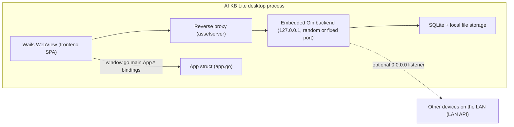

# Desktop client (AI KB Lite Desktop)

::: warning Not released yet
The desktop application ships no installer with a release. Build it yourself as described in [Installation](../01-getting-started/02-installation.md#desktop-application-cmd-desktop-wails-v2). This repository has no release workflow yet, so no release carries desktop artifacts.
:::

The AI KB Lite desktop application is built on [Wails v2](https://wails.io). It runs the Go backend inside the desktop process with SQLite and local file storage. After it starts you can manage knowledge bases and ask questions, with no Docker and no external database. The source is in `cmd/desktop/`. Its features match the [single Lite binary](../01-getting-started/02-installation.md). The desktop build adds startup without a login and, on macOS, a [host sandbox](../03-features/22-skills-sandbox.md#lite-host) that runs agent commands on the local machine.

## Architecture

This section shows how the window, the backend and the native bindings fit together in one process, so you know which part serves what.

The desktop application has three parts, all in the same process:

1. **Embedded backend**: `cmd/desktop/main.go` builds the same dependency injection container as the server with `container.BuildContainer()` and starts an `http.Server` (Gin router) in its own goroutine.
2. **Wails window (WebView)**: `wails.Run()` creates the native window. Page requests go through a **reverse proxy** mounted as `assetserver.Options.Handler` (`httputil.ReverseProxy`) to the embedded backend, so the WebView loads the SPA that the backend serves from its `./web` directory.
3. **Go binding layer**: the `App` struct in `cmd/desktop/app.go` is exposed to frontend JavaScript through `Bind` (`window.go.main.App.*`).



### Port and listener

`desktopBackendListenAddr()` in `main.go` decides where the backend listens:

- By default it binds `127.0.0.1` on the `http_port` saved in `desktop-prefs.json`. When that is unset (0) it uses `:0`, a random free port. Listening retries with exponential backoff (`listenWithRetry`, at most 10 attempts, delay capped at 3 seconds).
- When the preference `http_bind_public` is `true` it listens on `0.0.0.0` instead. `desktopPreferredLANIPv4()` then picks a non-loopback IPv4 address (a private address first) and builds `http://<LAN-IP>:<port>/api/v1` for other devices on the LAN.
- The reverse proxy and the WebView's API calls always use the loopback address `http://127.0.0.1:<port>`. They never dial `0.0.0.0`.

### Where data is stored

Data lives in the user's directories, not inside the application bundle. When `main.go` detects that it runs from `.app/Contents/MacOS`, `configureDesktopStorage()` does the following:

- The data directory is `~/Library/Application Support/AI KB Lite/`, named after the `.app` bundle.
- The SQLite database is `.../data/aikb.db`, passed in through the `DB_PATH` environment variable. An absolute `DB_PATH` is kept as it is.
- `migrateLegacyDesktopData()` moves data that older builds kept in `.app/Contents/Resources/data` to Application Support once, if the target does not exist yet.
- The working directory changes to `.app/Contents/Resources` when it contains `config/config.yaml`, so the packaged `config/config.yaml`, `.env`, `migrations/sqlite` and `web/` frontend are found.

Uploaded files are stored separately. For every desktop process, packaged or not, `configureDesktopFileStorage()` sets `LOCAL_STORAGE_BASE_DIR` to `~/.aikb/data/files` unless it already names an absolute directory other than the Docker default `/data/files`. Files that an earlier build kept under Application Support move there once.

Logs go to `~/Library/Logs/AI KB Lite/AI KB Lite.log` (also named after the bundle) unless `LOG_PATH` is set.

## Main source files

This table maps each file in `cmd/desktop/` to its job, so you know where to start reading.

| File | Purpose |
| --- | --- |
| `cmd/desktop/main.go` | Main entry point (`//go:build !bindings`): starts the embedded Gin backend, builds the macOS menu, configures the Wails window and reverse proxy, injects JavaScript on DomReady |
| `cmd/desktop/main_bindings.go` | Binding generation entry point (`//go:build bindings`): the binding generation step of `wails build` compiles it alone with `-tags bindings`; it only calls `Bind` and starts neither Gin nor the database |
| `cmd/desktop/app.go` | The `App` struct and every Wails binding method |
| `cmd/desktop/prefs.go` | Reads and writes the desktop preferences (`desktop-prefs.json`), including the host sandbox's approved project directories |
| `cmd/desktop/signing_key.go` | Generates and persists the signing key (and, when needed, a JWT secret) on first launch |
| `cmd/desktop/update.go` | Update check, download, install and restart based on GitHub Releases |
| `cmd/desktop/wails.json` | Wails build configuration |
| `cmd/desktop/build/` | Packaging resources: `appicon.png` (application icon), `darwin/Info.plist` (macOS bundle template), `windows/installer/project.nsi` (Windows NSIS installer template) |

## Window configuration and injected scripts

This section lists what the window looks like and which scripts the shell injects into the page, for when you debug desktop-only behavior in the frontend.

Key settings of `wails.Run(&options.App{...})` in `cmd/desktop/main.go`:

- Title `AI KB Lite`, initial size **1280 × 800**, resizable, shown at startup.
- `AssetServer.Handler` is the reverse proxy to the embedded backend. **The frontend assets are not embedded with Go embed. They are the SPA that the backend serves from `./web` (packaged in `.app/Contents/Resources/web`).**
- macOS only: `mac.TitleBarHiddenInset()` hides the title bar, and the WebView is opaque.
- Application menu: `About AI KB` (Cmd+I, with an "Open GitHub" button that opens `https://github.com/jrmatherly/ai-kb`), `Check for Updates...`, `Quit` (Cmd+Q), the standard Edit menu, and `View > Reload` (Cmd+R, which sends the `app:reload` event to the frontend).

On `OnDomReady` the shell injects three scripts into the WebView:

1. `wailsThemeSyncJS`: syncs the light or dark theme and the window background color from the `AIKB_theme` key in `localStorage`.
2. `dragHandlerJS`: custom window dragging. It bypasses Wails' CSS-variable drag detection and uses `el.closest()` DOM traversal plus a 40px title bar region at the top, and sends `drag` through the WKWebView message bridge. It also intercepts external `http(s)` links and `window.open` and opens them in the system browser (`BrowserOpenURL`).
3. `window.__AIKB_API_BASE__` (the real API root, `http://127.0.0.1:<port>/api/v1`) and, when set, `window.__AIKB_API_LAN_BASE__` (the LAN address).

## Wails binding methods (callable from the frontend)

This table lists the native methods the frontend can call, so you can tell which desktop features go through the bridge rather than the REST API.

The `App` struct (`cmd/desktop/app.go`) is exposed through `Bind`. The frontend calls `window.go.main.App.<method>`. The generated TypeScript bindings are in `frontend/src/wailsjs/go/main/App.d.ts`.

| Method | Signature (JavaScript) | Description |
| --- | --- | --- |
| `GetAPIBaseURL` | `(): Promise<string>` | Returns the local REST API root, such as `http://127.0.0.1:PORT/api/v1`. The WebView's `window.location.origin` is not the API host, so use this value |
| `GetAPILanBaseURL` | `(): Promise<string>` | Returns the API address suggested for other devices on the LAN (`…/api/v1`). Empty when not in bind-public mode or when IP detection failed |
| `GetDesktopHTTPPortSetting` | `(): Promise<number>` | Reads the saved local API port preference (0 = a random port on each launch) |
| `SetDesktopHTTPPortSetting` | `(port: number): Promise<void>` | Saves the port preference. Takes effect after a restart |
| `GetDesktopHTTPBindPublicSetting` | `(): Promise<boolean>` | Reads the preference to listen on all interfaces (`0.0.0.0`) |
| `SetDesktopHTTPBindPublicSetting` | `(v: boolean): Promise<void>` | Saves the LAN/public listener preference. Takes effect after a restart |
| `GetDesktopListenPublicActive` | `(): Promise<boolean>` | Whether this session **actually** listens on all interfaces (runtime state, not the saved preference) |
| `CheckForUpdates` | `(): Promise<void>` | Runs an update check by hand, with dialog feedback such as "Up to Date" |
| `AutoCheckForUpdates` | `(): Promise<void>` | Checks for updates silently and downloads in the background |
| `GetAutoSetupToken` | `(): Promise<string>` | Returns this process's login-free credential. The frontend uses it to call `POST /api/v1/auth/auto-setup` |
| `PickProjectDir` | `(): Promise<string>` | Opens the system folder picker, adds the chosen folder to the host sandbox's approved list and returns it. Empty when cancelled |
| `GetProjectDirs` | `(): Promise<string[]>` | Reads the approved project directories |
| `RemoveProjectDir` | `(dir: string): Promise<void>` | Removes one directory from the approved list |
| `GetApprovalMode` / `SetApprovalMode` | `(): Promise<string>` / `(mode: string): Promise<void>` | Reads or writes the host sandbox approval mode. Only `auto` is accepted today |

## Preference storage (cmd/desktop/prefs.go)

This section describes the preferences file, for when you need to inspect or reset desktop settings by hand.

Preferences are stored as the JSON file `desktop-prefs.json` at `os.UserConfigDir()/AI KB Lite/desktop-prefs.json`. When `XDG_CONFIG_HOME` is set it replaces `os.UserConfigDir()` on every platform.

- macOS: `~/Library/Application Support/AI KB Lite/desktop-prefs.json`
- Windows: `%AppData%\AI KB Lite\desktop-prefs.json`
- Linux: `~/.config/AI KB Lite/desktop-prefs.json`

The file has mode `0600`. Fields:

| Field | Type | Default | Description |
| --- | --- | --- | --- |
| `http_port` | int | 0 | Listen port of the embedded API server. 0 or an invalid value (outside 1-65535) means a random free port on each launch |
| `http_bind_public` | bool | false | Whether to listen on `0.0.0.0` (allows LAN or public access to the embedded API) |
| `project_dirs` | string[] | empty | Local project directories (absolute paths) approved through the system folder picker. Only directories in this list can be bound to a session |
| `approval_mode` | string | `auto` | Host sandbox approval mode. Unknown values count as `auto`. `ask` and `full` are not available yet: saving them is rejected, and a hand-written `ask` or `full` makes the host sandbox refuse to run |
| `session_root` | string | empty | Declared but not read. Temporary session workspaces always go under `~/Documents/AIKBLite/` |

Read and write entry points: `LoadDesktopPrefsHTTPPort()` / `LoadDesktopHTTPBindPublic()` / `SaveDesktopHTTPPortPreference()` / `SaveDesktopHTTPBindPublicPreference()`, plus `LoadProjectDirs()` / `LoadApprovalMode()` for the host sandbox. A missing or unparsable file silently falls back to zero values. `project_dirs` can only grow through the folder picker (`PickProjectDir` or `POST /api/v1/system/host-project-dir`). A path typed by hand is never treated as approved.

## Login-free startup and the signing key

This section explains how the desktop app signs you in without a password and which keys it creates, so you know what is safe to expose on a LAN.

The desktop build needs no registration or login at startup:

- Each launch generates a random credential and hands it only to the built-in frontend, through the Wails binding `GetAutoSetupToken`. The frontend sends it in the `X-AIKB-Desktop-Token` request header to `POST /api/v1/auth/auto-setup`. The first call creates the default user `admin@ai-kb.local` and its workspace. Later calls issue login tokens directly. Requests without the credential (including other devices on the LAN and ordinary browsers) are rejected.
- When no valid `SYSTEM_SIGNING_KEY` (or non-default `SYSTEM_AES_KEY`) is configured, the first launch generates `signing.key` (mode `0600`) in the preferences directory and uses it as `SYSTEM_SIGNING_KEY`. It signs presigned file links, web embed sessions and the like, and stays valid across restarts. It is only a signing key and never replaces the AES key that encrypts stored credentials.
- When `JWT_SECRET` is unset, a placeholder or the shipped default, the desktop build also fills it: with the generated signing key, or, when the signing key came from the environment, with a separate `jwt.key` (mode `0600`) in the same directory.
- When `SYSTEM_AES_KEY` is unset or still the shipped default (`aikb-default-aes-key-change-me!!`, which the bundled `.env` carries), the desktop build generates `aes.key` (mode `0600`, 32 characters) in the same directory and uses it, so stored credentials are encrypted with a key of its own from the first launch. Credentials stored in plaintext by an earlier version stay readable.

## Automatic updates (cmd/desktop/update.go)

This section describes how the update check finds, downloads and installs a new version. This repository has no release workflow yet, so no release carries desktop artifacts and the check has nothing to install.

`checkUpdate(ctx, currentVersion, showUpToDate, autoDownload)` runs in a goroutine:

1. **Version source**: `desktopAboutVersion()` uses `handler.Version` injected through ldflags at build time, and otherwise looks for a `VERSION` file up to the repository root. When the version cannot be determined the check gives up.
2. **Check**: GET `https://api.github.com/repos/jrmatherly/ai-kb/releases/latest` (10s timeout, a fixed desktop `User-Agent`, plus an `Authorization` header when the `GITHUB_TOKEN` environment variable is set, to raise the rate limit). `golang.org/x/mod/semver` compares `tag_name` with the current version.
3. **Asset selection**: `findBestAsset()` considers only desktop assets, named `<prefix>-Lite-App_<version>_<os>_<arch>...` (`.sha256` files and the `ai-kb-lite_*` server tarballs are skipped). It matches `runtime.GOOS/GOARCH` as an OS token (`macOS`/`windows`/`linux`) plus the architecture (`amd64`/`arm64`, then `aarch64` on arm64, then `universal` on macOS). With no match, a manual check opens the release page.
4. **Download**: `downloadAndInstall()` downloads to the system temp directory. In `autoDownload` mode the download is silent. A manual check first shows an "Update Available" dialog. After the download it asks "Restart Now" or "Later".
5. **Install and restart** (`applyUpdateAndRestart()`, per platform):
   - **Windows**: writes a temporary `aikb_update.bat` (wait 2 seconds, run the installer silently with `/S`, restart the program, delete itself), runs it with `cmd.exe /C start /b` and quits the app.
   - **macOS (.dmg)**: mounts the image with `hdiutil attach` at a temporary mount point, finds the `.app` inside and writes a temporary `aikb_update.sh`. The script runs `rm -rf` on the old bundle and `cp -a` for the new one (retrying with `osascript … with administrator privileges` on failure), then `hdiutil detach`, `open` on the new app, and deletes itself. For a non-`.dmg` download or any error it falls back to `open` on the downloaded file.
   - **Linux**: opens the downloaded file with `xdg-open` and quits.

Triggers: the macOS menu item `Check for Updates...` (manual, shows the result), the binding `CheckForUpdates()` (manual) and `AutoCheckForUpdates()` (silent, with automatic download). `frontend/src/App.vue` calls `AutoCheckForUpdates` 2 seconds after startup and every 4 hours when the binding exists and the auto-update setting is on (the default). Turning that setting on in `frontend/src/views/settings/GeneralSettings.vue` also runs a check.

## Wails build configuration (cmd/desktop/wails.json)

This section explains the Wails configuration, for when you change the build or move the frontend.

```json
{
  "name": "AI KB Lite",
  "outputfilename": "AI KB Lite",
  "frontend:dir": "../../frontend",
  "wailsjsdir": "../../frontend/src",
  "build:tags": "desktop",
  "info": { "companyName": "Tencent", "productName": "AI KB Lite", "productVersion": "1.0.0" },
  "mac": { "category": "public.app-category.productivity", "titlebar": "hiddenInset" }
}
```

Notes:

- `build:tags` is `desktop`. Only a program built with this tag contains the Lite host sandbox. Tags passed with `wails build -tags ...` are merged with it.
- `frontend:dir` points to the repository's `frontend/`. `wailsjsdir` points to `frontend/src`, so the bindings Wails generates land in `frontend/src/wailsjs/` (`go/main/App.js`, `App.d.ts` and `runtime/`).
- **Frontend build**: the packaging script builds the frontend separately, and the Wails configuration sets no `frontend:build`. The WebView reaches the embedded backend through the reverse proxy.
- `cmd/desktop/build/` contains `appicon.png` (application icon), `darwin/Info.plist` (a Go template for the macOS bundle that declares `CFBundleIdentifier` <span v-pre>`com.wails.{{.Name}}`</span>, minimum system version 10.13, Retina support and more) and the Windows installer template `windows/installer/project.nsi` (which also installs the third-party license files). `wails build` writes its output to `cmd/desktop/build/bin/`.

## How the frontend detects the desktop environment

This section shows how frontend code tells the desktop shell apart from a browser, so desktop-only UI appears only where it works.

- `dragHandlerJS` adds the `wails-desktop` class to `document.documentElement`, so frontend CSS can adapt styles for the desktop.
- `window.go.main.App.*` (generated bindings in `frontend/src/wailsjs/go/main/`) and `window.runtime` (`frontend/src/wailsjs/runtime/`, such as `BrowserOpenURL` and `EventsEmit`) exist only in the desktop environment, and the frontend uses feature detection. For example, `frontend/src/composables/useApiBaseUrlDisplay.ts` polls `window.__AIKB_API_BASE__` or calls `window.go.main.App.GetAPIBaseURL()` for the real API address (a browser falls back to the configured value or `window.location.origin`). `frontend/src/App.vue` starts the silent update check when `window.go.main.App.AutoCheckForUpdates` exists.
- `frontend/src/views/integrations/ApiIntegrationSettings.vue` uses these bindings to show and change desktop-only options such as the port and the LAN listener. `frontend/src/views/settings/GeneralSettings.vue` uses `AutoCheckForUpdates` for the auto-update setting.

## Build

This section walks through building the macOS app from source, which is the only way to get it today.

The macOS packaging script is `scripts/package-mac-app.sh`. The root `Makefile` wraps it as `make package-mac-app`.

```bash
# Full build (frontend + Wails packaging + .app assembly)
./scripts/package-mac-app.sh

# Skip the frontend build (reuse the existing web/ directory)
SKIP_FRONTEND=1 ./scripts/package-mac-app.sh
```

What the script does:

1. **Frontend build**: `cd frontend && npm ci --prefer-offline && npm run build`, then replaces the repository root's `web/` with `frontend/dist` (the Lite backend serves the SPA from `./web`).
2. **Wails build**: the Wails CLI must be installed first (`go install github.com/wailsapp/wails/v2/cmd/wails@v2.12.0`). The script sets environment variables such as `EDITION=lite`, `GONOSUMDB=git.sr.ht/*` and `GOLANG_PROTOBUF_REGISTRATION_CONFLICT=warn` (which avoids the `common.proto` descriptor registration conflict between the Milvus and Qdrant gRPC generated code), takes the version from `scripts/get_version.sh` into ldflags, then runs:

   ```bash
   cd cmd/desktop && wails build -clean -tags "sqlite_fts5" -ldflags="$LDFLAGS" -o "AI KB Lite"
   ```

   The effective build tags are `desktop` from `wails.json` plus `sqlite_fts5` from the command line. The command's binding generation step compiles `main_bindings.go` alone with `-tags bindings` (no database connection) and refreshes the binding files under `frontend/src/wailsjs/`.
3. **Assembly**: copies `cmd/desktop/build/bin/AI KB Lite.app` to `dist/` and places the third-party licenses (`scripts/copy-licenses.sh`), `.env` (from `.env.lite.example`), `config/`, `migrations/sqlite/` and the `web/` frontend in `.app/Contents/Resources/`.

The result is `dist/AI KB Lite.app`; double-click it to run. Windows and Linux builds are possible with `wails build` in `cmd/desktop` (the update logic already handles `.exe` and `xdg-open`), but the repository ships only the macOS packaging script and `build/darwin` resources. The host sandbox exists only on macOS: the Windows backend is not implemented and reports itself unavailable, and Linux has none.
