# Database and migrations

AI KB keeps its database schema in versioned migrations, with one migration directory for PostgreSQL and one for SQLite. The application can run migrations automatically at startup, or you can run them by hand with a script. A new column or table has to be added to both paths.

## Supported databases

The main application connects to its database through GORM, and the environment variable `DB_DRIVER` picks the driver. The switch in `initDatabase()` in `internal/container/container.go` **accepts only two values**:

| `DB_DRIVER` | Description |
| --- | --- |
| `postgres` | Standard mode. Works with plain PostgreSQL (+pgvector) and with **ParadeDB** (a PostgreSQL distribution with built-in `pg_search`/BM25; the Compose files default to `paradedb/paradedb:v0.26.1-pg18`). The GORM DSN is built from `DB_HOST/DB_PORT/DB_USER/DB_PASSWORD/DB_NAME` and forces `sslmode=disable` and `TimeZone=UTC` |
| `sqlite` | Lite mode. The path comes from `DB_PATH` (default `./data/aikb.db`), the DSN appends `_journal_mode=WAL&_busy_timeout=5000&_foreign_keys=on`, and the `sqlite-vec` extension is loaded (`sqlite_vec.Auto()`) for vector retrieval |
| Any other value | Fails immediately with `unsupported database driver` |

**MySQL is not a main database option.** The `go-sql-driver/mysql` dependency in `go.mod` only registers the MySQL protocol driver for the Doris retrieval engine (MySQL protocol, `database/sql`); see the import comment in `container.go`. `migrations/mysql/00-init-db.sql` is a one-off MySQL table script that covers only 10 core tables (tenants/models/knowledge_bases/knowledges/sessions/messages/message_suggestion_sets/message_suggestion_events/chunks/chunk_revisions). **No Go code or script references it.** It is not part of application startup; treat it as legacy or for external initialization.

The retrieval engine (where vector and keyword indexes are stored) is decoupled from the main database and is set by `RETRIEVE_DRIVER` (postgres / elasticsearch / qdrant / milvus / sqlite and others; see [Extension points](./03-extension-points.md)). When `RETRIEVE_DRIVER` does not include `postgres`, the migration DSN carries `options=-c app.skip_embedding=true`, and migrations that touch the `embeddings` table skip themselves based on that GUC.

## Migration directory layout

```text
migrations/
├── versioned/     # PostgreSQL/ParadeDB versioned migrations: 000000-000117, 118 versions (236 .up/.down.sql files)
├── sqlite/        # SQLite migrations: 000000_init (flattened full schema) + incremental versions 000001-000036
├── paradedb/      # ParadeDB extra scripts: 00-init-db.sql, 01-migrate-to-paradedb.sql (switching an existing database)
└── mysql/         # 00-init-db.sql, a legacy one-off MySQL table script (not wired into the code)
```

- PostgreSQL's `versioned/` runs from `000000_init` to `000117_tenant_api_key_hint`.
- `sqlite/` uses `000000_init` as a flattened full initialization (dialect differences such as JSONB→TEXT and SERIAL→AUTOINCREMENT already adapted), followed by incremental versions (currently up to `000036_tenant_api_key_hint`), also applied in order by golang-migrate.
- Extensions are created by the `versioned/` migrations themselves: `uuid-ossp` in 000000, and `vector`, `pg_trgm` and `pg_search` in 000002. The BM25 index is built on `embeddings.content` with the Lindera tokenizer `chinese_lindera`.
- `paradedb/00-init-db.sql` contains, besides the extensions, an old set of table definitions. **Neither Compose nor the code references it.** Do not mount it as a database initdb script: the old tables it creates make `000000_init` fail.

### versioned/ migration history by topic

| Version range | Topic | Key tables and columns introduced |
| --- | --- | --- |
| 000000 | Core initialization | `tenants`, `models`, `knowledge_bases`, `knowledges`, `chunks`, `sessions`, `messages` |
| 000001 | User authentication + agents + MCP | `users`, `auth_tokens`, `custom_agents`, `mcp_services`, `knowledge_tags` |
| 000002-000011 | Vectors and retrieval | `embeddings` (HNSW + BM25, gated by `app.skip_embedding`), `chunks.flags`, `seq_id`, ParadeDB BM25 index |
| 000012-000018 | Cross-workspace collaboration | `organizations`, `organization_members`, `kb_shares`, `agent_shares`, `organization_join_requests` |
| 000019-000028 | Message and IM enhancements | New `messages` columns (images, rendered_content, agent_duration_ms), `im_channels`, `im_channel_sessions` |
| 000029-000036 | Data sources and vector store abstraction | `data_sources`, `sync_logs`, `web_search_providers`, `vector_stores`, knowledge base asr_config/vector_store_id |
| 000037-000041 | Wiki and task queue | `wiki_pages` (unique index `idx_wiki_pages_kb_slug`), `wiki_folders`, `wiki_page_issues`, `wiki_log_entries` (removed in 000077), `task_pending_ops`, `task_dead_letters` |
| 000042-000054 | RBAC / audit / invitations / system settings | `mcp_tool_approvals`, `tenant_members`, `audit_logs`, `organization_tenant_members` (the old `organization_members` renamed and archived), `user_resource_favorites`, `tenant_invitations`, `user_kb_pins`, `system_settings` and `users.is_system_admin` (000053), invitation link columns `tenant_invitations.token`/`accepted_count` (000054) |
| 000055-000060 | Processing pipeline and embed channels | `knowledge_processing_spans`, `knowledges.pending_subtasks_count` (000056, the subtask count for the `finalizing` status), `embed_channels`, 1024-dimension HNSW index (000059) |
| 000061-000067 | Wiki hierarchy / OAuth / multiple tags per document / principal identity / suggested questions | `wiki_pages` hierarchy columns, `mcp_oauth_clients`, `mcp_oauth_tokens`, `knowledge_tag_relations`, principal identity columns (000064: `tenants.api_principal_config`, `mcp_oauth_tokens.principal_type`/`principal_id`), `tenant_api_keys` (000065, which also drops `tenants.api_key`), `message_suggestion_sets`, `message_suggestion_events` |
| 000068-000074 | Storage / resources / temporary documents | `storage_backends`, `resources`, `resource_bindings`, `resource_access_grants`, `temporary_documents`, platform-level API keys, `auth_tokens` timestamps as TIMESTAMPTZ, audit log activity scope (`audit_logs.scope_type`/`scope_id`), OAuth refresh lease |
| 000075-000076 | Wiki revision history and indexes | `wiki_page_revisions`, `wiki_pages.last_edit_source`/`last_editor_id`, a prefix index on `knowledges.metadata->>'external_id'` |
| 000077 | Remove the Wiki operation log | DROP `wiki_log_entries` and delete the leftover `page_type = 'log'` pages; Wiki changes are recorded in the knowledge base activity stream |
| 000078 | Chunk editing and custom metadata | `chunks` gains `source_content`/`content_revision`/`index_status`/`last_editor_id`/`context_header`, a new `chunk_revisions` table, `knowledges` gains `custom_metadata` |
| 000079 | Knowledge base folder tree | `knowledges` gains a `folder_path` column, backfilled for earlier folder uploads (the path used to be packed into `file_name`), plus a new `(tenant_id, knowledge_base_id, folder_path)` index |

### Migrations from 000080 on

| Version | Change |
| --- | --- |
| 000080 | knowledge_bases.auto_tag_config |
| 000081 | messages.artifacts, persists generated files (moved to the `message_artifacts` table from 000103) |
| 000082 | tenant_sandbox_configs, multiple named backends and a lease for configuration changes |
| 000083 | sessions.sandbox_config_id |
| 000084 | Six long-term memory tables, tenants.memory_config, messages.used_memories |
| 000085 | messages.usage |
| 000086 | tenant_skills, tenant_skill_snapshots, the install and snapshot ledger |
| 000087 | Skill install_session_id / install_message_id, the install conversation log |
| 000088 | Snapshot planned_name, records the planned name before creation |
| 000089 | Skill envs, tenant_user_env_vars |
| 000090 | tenant_skill_catalog; tenant_skills.catalog_id, backfilled for existing installs |
| 000091 | mcp_tool_approvals.enabled, default true |
| 000092 | mcp_services.usage_instructions; the `mcp_metadata` table, a persisted snapshot of each MCP service's tool catalog |
| 000093 | `browser_devices`, `browser_pairings`, `browser_task_interruptions`, device authorization and pairing for browser connections |
| 000094 | memory_subjects.extraction_state, memory_items.replaces_id, the `memory_extraction_sessions` table (extraction progress per session); repairs data where older versions let a pending inference replace an active memory too early |
| 000095 | memory_item_embeddings.embedding (halfvec, added only when the `vector` extension is installed) and its retrieval index |
| 000096 | Data migration: DingTalk channel `mode` changes from webhook to websocket (Stream). Stream mode must be enabled in the DingTalk developer console; down is a no-op |
| 000097 | Session forking: sessions.parent_session_id / forked_from_message_id / fork_bootstrap, messages.sandbox_checkpoint |
| 000098 | The `fork_snapshot_leases` table, which records sandbox snapshots taken before a forked session is saved so they can be reclaimed |
| 000099 | Upgrades an installed pg_search 0.22.2–0.22.5 to 0.22.6; skipped when the image does not ship 0.22.6, for other versions, or with `app.skip_embedding=true` |
| 000100 | Drops three indexes on chunks that only slowed writes: `idx_chunks_chunk_type`, `idx_chunks_content_hash`, `idx_chunks_tenant_kg` |
| 000101 | knowledges.profile (document profile), knowledge_bases.profile_config / generated_profile (AI-generated knowledge base description) |
| 000102 | The `mcp_endpoints` table, MCP endpoints a workspace publishes |
| 000103 | The `message_artifacts` table, backfilled from `messages.artifacts`; from then on only the new table is read and written. After the backfill, old-column values are set to NULL (the column stays for old instances during a rolling upgrade); an unparseable `file_size`/`created_at` falls back to 0 and the message creation time instead of failing the migration. The down migration writes the new table back into the old column |
| 000104 | tenant_skills.served, records the version still served from the image while a new version is installing or has failed |
| 000105 | messages.context_checkpoint, the agent's context compression summary |
| 000106 | The messages index `idx_messages_session_created_id` on `(session_id, created_at DESC, id DESC)`, built with `CREATE INDEX CONCURRENTLY` so it does not block writes; an interrupted build leaves an INVALID index, which you must `DROP INDEX` before rerunning the migration |
| 000107 | message_artifacts.deleted_at, files a user deletes stay as tombstone rows |
| 000108 | sessions.sandbox_config_tenant_id (BIGINT, default 0), records which workspace owns the sandbox configuration a session uses; backfilled from the sandbox configuration for sessions that use a shared agent |
| 000109 | sessions.host_workspace_dir (VARCHAR(1024)), the project directory of the Lite desktop host sandbox, fixed after creation |
| 000110 | im_channels.locale (VARCHAR(16), default empty string), a fixed reply language for an IM channel; an empty string uses the deployment default |
| 000111 | The `model_catalog_configs` table, a single row (`CHECK (id = 1)`) holding the model catalog overlay and its history |
| 000112 | btree indexes `idx_embeddings_knowledge_id` and `idx_embeddings_chunk_id` on embeddings; skipped when the `embeddings` table does not exist |
| 000113 | The `chunk_images` table, the image gallery's projection of `chunks.image_info` (one row per image), kept in sync by triggers on `chunks` and backfilled; trigram indexes on caption and OCR text when `pg_trgm` is available |
| 000114 | chunks.source_locators (JSONB), the chunk's positions in the original file |
| 000115 | Upgrades an installed pg_search 0.22.x–0.25.x to 0.25.11 and pgvector 0.8.0–0.8.3 to 0.8.4 when the server ships those versions; skipped with `app.skip_embedding=true` |
| 000116 | The `system_secrets` table (`name`, `value`), server-generated secrets such as the per-install JWT secret; no API reads it |
| 000117 | tenant_api_keys.key_hint (VARCHAR(16)). A startup backfill then writes the real hash for keys 000065 copied with a `migrated-tenant-*` placeholder, fills the hint and empties `api_key`, so no token stays stored |

SQLite version numbers evolve independently and do not map one-to-one to the PostgreSQL numbers:

| SQLite version | Change |
| --- | --- |
| 000001–000002 | Remove the Wiki log, folder path |
| 000003–000004 | Auto tagging, long-term memory |
| 000005 | Message attachments and invitation fields |
| 000006–000008 | Tasks and dead letters, system administration and settings, processing spans and the pending subtask count |
| 000009 | A legacy embed memory flag column; the current channel API does not expose it |
| 000010–000011 | Multi-tag relations, the principal model |
| 000012–000013 | Message usage, MCP tool enabled (matching 000085, 000091) |
| 000014–000016 | Browser authorization, memory consistency, memory vector retrieval index (matching 000093–000095; SQLite has no vector column and still ranks in the application) |
| 000017 | DingTalk channel switched to websocket (matching 000096) |
| 000018–000019 | Session forking, fork snapshot leases (matching 000097–000098) |
| 000020–000022 | Redundant chunk indexes dropped, knowledge profiles, MCP endpoints (matching 000100–000102) |
| 000023 | The `message_artifacts` table, backfilled and the old column cleared (matching 000103) |
| 000024–000026 | messages.context_checkpoint, the messages session time index, message_artifacts.deleted_at (matching 000105–000107) |
| 000027 | sessions.sandbox_config_tenant_id (matching 000108; Lite has no shared workspaces, so nothing is backfilled) |
| 000028 | Creates the missing `tenant_skills`, `tenant_skill_snapshots`, `tenant_skill_catalog`, `tenant_user_env_vars` (matching 000086–000090 and 000104). Lite lacked these four tables before, and reading skill credentials failed with `no such table` |
| 000029–000030 | sessions.host_workspace_dir, im_channels.locale (matching 000109–000110) |
| 000031 | The `model_catalog_configs` table (matching 000111) |
| 000032–000033 | The `chunk_images` table with its triggers, chunks.source_locators (matching 000113–000114) |
| 000034 | mcp_services.usage_instructions and the `mcp_metadata` table (matching 000092) |
| 000035 | The `system_secrets` table (matching 000116) |
| 000036 | tenant_api_keys.key_hint (matching 000117) |

000099, 000112 and 000115 (pg_search and pgvector upgrades, embeddings indexes) have no SQLite counterpart. 000078 has no separate SQLite version: its columns and the `chunk_revisions` table are part of the SQLite baseline `000000_init`.

The baseline schema and the incremental versions together decide the final result for new and existing databases. You cannot tell whether Lite has a table from the new migration file names alone.

## Final table structure

The tables below show the **effective structure after all up migrations** (later ALTERs to early tables are merged in). Most business tables have `created_at` / `updated_at`, and many have `deleted_at` (GORM soft delete); these are not listed each time. An arrow (→) marks a logical reference. Database-level foreign keys exist only where the table says FK.

### Tenants and users

| Table | Purpose | Key columns |
| --- | --- | --- |
| `tenants` | Tenant (workspace), the root of multi-tenancy | `id` (SERIAL, starting at 10000), `name`, `retriever_engines` (JSONB), `status`, `storage_quota`/`storage_used`, `agent_config`/`context_config`/`conversation_config`/`web_search_config`/`credentials`/`api_principal_config`/`memory_config` (JSONB), `default_storage_backend_id`. The old `api_key` column was dropped in 000065; keys live in `tenant_api_keys` |
| `users` | Login users | `id` (UUID), `username` (unique), `email` (unique), `password_hash`, `tenant_id` (FK→tenants, ON DELETE SET NULL), `is_active`, `can_access_all_tenants` (cross-workspace access), `is_system_admin` (system administrator, 000053), `preferences` (JSON) |
| `auth_tokens` | Login tokens | `id`, `user_id` (FK→users, CASCADE), `token`, `token_type` (access/refresh), `expires_at` (TIMESTAMPTZ since 000072), `is_revoked` |
| `tenant_members` | Workspace-level RBAC membership | `user_id`+`tenant_id` (unique among non-deleted rows), `role` (owner/admin/contributor/viewer), `status`, `invited_by`, `joined_at` |
| `tenant_invitations` | In-app invitations and invitation links | `tenant_id`, `invitee_user_id`, `role`, `status` (pending/accepted/rejected), `expires_at`; unique constraint on pending; `token` (invitation link, unique)/`accepted_count` (000054) |
| `tenant_api_keys` | Workspace and platform API keys | `tenant_id` (NULL for platform scope), `scope_type` (tenant/platform, CHECK constraint), `key_hash` (unique SHA-256 of the token), `key_hint` (masked display value, 000117; the token itself is not stored, and the legacy `api_key` column is emptied by the startup backfill), `full_access`, `knowledge_base_ids`, `capabilities`, `expires_at`/`revoked_at` |
| `user_kb_pins` | Per-user knowledge base pins | PK (`tenant_id`,`user_id`,`kb_id`) + `pinned_at` |
| `user_resource_favorites` | User favorites | PK (`user_id`,`tenant_id`,`resource_type`,`resource_id`) |
| `system_settings` | System-level settings (000053) | `key`, `value`/`value_type`, `category`, `is_secret`, `requires_restart`, `last_modified_by` |
| `system_secrets` | Server-generated secrets no API reads, such as the per-install JWT secret (000116) | `name`, `value` |
| `audit_logs` | Audit log (000044) | `tenant_id`, `actor_user_id`/`actor_role`, `action`, `target_type`/`target_id`/`target_user_id`, `request_path`/`request_method`, `outcome` (success/denied), `scope_type`/`scope_id`, `details` (JSONB) |

### Models and knowledge bases

| Table | Purpose | Key columns |
| --- | --- | --- |
| `models` | AI model configuration (LLM, embedding, rerank and so on) | `id`, `tenant_id` (→tenants), `name`/`display_name`, `type` (`KnowledgeQA` / `Embedding` / `Rerank` / `VLLM` / `ASR`), `source`, `parameters` (JSONB; may carry an optional `spec` that overrides protocol and capabilities, no migration needed), `is_default`, `is_builtin`, `managed_by`, `status` |
| `model_catalog_configs` | Model catalog overlay (000111) | Single row with `id` = 1, `version`, `overlay`/`history` (JSONB), `updated_by`, `updated_at` |
| `knowledge_bases` | Knowledge bases | `id` (UUID), `tenant_id`, `name`, `type` (document/faq/wiki), `chunking_config`/`image_processing_config`/`vlm_config`/`faq_config`/`asr_config`/`wiki_config`/`indexing_strategy`/`auto_tag_config`/`profile_config`/`generated_profile` (JSONB), `embedding_model_id`/`summary_model_id` (→models), `vector_store_id` (→vector_stores), `storage_backend_id` (→storage_backends), `creator_id` (→users), `is_temporary` |
| `knowledges` | Knowledge items (documents, web pages, FAQ and so on) | `id`, `tenant_id`, `knowledge_base_id` (→knowledge_bases), `type`, `title`, `source` (VARCHAR(2048)), `parse_status` (pending/processing/finalizing/completed/failed/cancelled/deleting), `pending_subtasks_count` (000056, enrichment subtasks still open in the `finalizing` stage), `enable_status`, `file_name`/`file_type`/`file_size`/`file_path`/`file_hash`, `metadata` (internal import state), `custom_metadata` (JSONB, user-entered metadata, 000078), `folder_path` (folder tree path, 000079), `summary_status`, `profile` (JSONB, document profile: gist, topics, type, typical questions, 000101), `channel`, `processed_at`/`error_message`. **There is no `tag_id` column.** Since 000063 tags go through the `knowledge_tag_relations` join table |
| `chunks` | Chunks (the smallest retrieval unit) | `id`, `tenant_id`, `knowledge_base_id`, `knowledge_id` (→knowledges), `content`, `source_content` (raw parser output, immutable), `content_revision`, `index_status` (ready/processing/failed), `last_editor_id`, `context_header` (heading breadcrumb used for indexing), `chunk_index`, `start_at`/`end_at`, `pre_chunk_id`/`next_chunk_id` (linked list), `parent_chunk_id` (self-reference for parent-child chunks), `chunk_type` (text/image/…), `image_info`/`video_info`, `relation_chunks`/`indirect_relation_chunks` (JSONB), `source_locators` (JSONB, the chunk's positions in the original file, 000114), `is_enabled`, `flags`, `status`, `content_hash`, `seq_id`, `tag_id` |
| `chunk_images` | Image gallery projection of `chunks.image_info` (000113) | PK (`chunk_id`,`image_index`), `tenant_id`, `knowledge_base_id`, `knowledge_id`, `chunk_type`, `image_key` (de-duplication key), `url`/`original_url`, `caption`, `ocr_text`, `attrs` (JSONB), `is_enabled`, `status`; maintained by triggers on `chunks` |
| `chunk_revisions` | Chunk revision history (000078) | `id`, `tenant_id`, `knowledge_base_id`, `knowledge_id`, `chunk_id`+`revision` (unique index), `content`, `is_enabled`, `editor_id`, `edit_source`, `edited_at` |
| `embeddings` | Vectors + BM25 index (only for the Postgres/ParadeDB retrieval engine, gated by `app.skip_embedding`) | `id`, `source_id`+`source_type` (unique; sources such as a chunk or a wiki page), `chunk_id`/`knowledge_id`/`knowledge_base_id`, `content` (BM25 full text), `dimension`, `embedding` (halfvec; HNSW partial indexes per dimension for 768, 1024 and 3584), `is_enabled`, `tag_id` |
| `knowledge_tags` | Knowledge tags (FAQ categories and so on) | `id`, `tenant_id`, `knowledge_base_id`, `name`, `seq_id` |
| `knowledge_tag_relations` | Document ↔ tag many-to-many (000063) | Composite primary key (`knowledge_id`,`tag_id`) + `created_at`; an index on each side. **The same migration dropped `knowledges.tag_id`** (existing single-tag data moved into this table). FAQ entry tags are not here; they remain the single tag in `chunks.tag_id` |
| `vector_stores` | External vector store connection settings (000032) | `id`, `tenant_id`, `name` (unique within a workspace), `engine_type`, `connection_config`/`index_config` (JSONB) |

000002 builds the 3584 and 768 indexes, and 000059 adds 1024. Embeddings of any other dimension have no HNSW index and fall back to a sequential scan.

### Sessions and messages

| Table | Purpose | Key columns |
| --- | --- | --- |
| `sessions` | Sessions (conversation context and a snapshot of retrieval parameters) | `id`, `tenant_id`, `title`, `knowledge_base_id`, `agent_id` (→custom_agents), `user_id`, `max_rounds`, `enable_rewrite`, `fallback_strategy`/`fallback_response`, `keyword_threshold`/`vector_threshold`, `embedding_top_k`/`rerank_top_k`/`rerank_threshold`, `rerank_model_id`/`summary_model_id`, `agent_config`/`context_config` (JSONB), `sandbox_config_id`/`sandbox_config_tenant_id` (the sandbox configuration and the workspace that owns it, 0 means the session's own workspace, 000108), `parent_session_id`/`forked_from_message_id`/`fork_bootstrap` (session forking, 000097), `host_workspace_dir` (Lite desktop project directory, 000109) |
| `messages` | Messages | `id`, `request_id`, `session_id` (→sessions), `role`, `content`/`rendered_content`, `knowledge_references` (JSONB citations), `agent_steps` (JSONB, the agent's reasoning trace), `mentioned_items`/`images` (JSONB), `is_completed`/`is_fallback`, `channel` (web or IM channel), `agent_id`+`agent_tenant_id`, `model_id`, `knowledge_id`, `agent_duration_ms`, `execution_context`, `attachments`, `used_memories`/`usage` (JSONB), `sandbox_checkpoint` (sandbox checkpoint at the fork point, 000097), `context_checkpoint` (the agent's context compression summary, 000105). Since 000103 the `artifacts` column is no longer read or written and has been cleared (kept only for rollback and rolling upgrades); generated files live in `message_artifacts` |
| `message_artifacts` | Files generated by skills, one row each (000103) | `session_id`, `message_id`, `position` (order within the message, the index used by the download API; unique with `message_id`), `url` (storage or resource:// reference, never returned to clients), `file_name`/`file_type`/`file_size`, `content_hash`, `source_path` (the same path in the same session is treated as versions of one file), `mod_time` (RFC 3339 text that keeps nanosecond precision for the collector's comparison), `created_at`, `deleted_at` (000107; a file the user deletes stays as a tombstone row so `position` stays stable and the file is not collected again). Files are hidden along with a soft-deleted message |
| `message_suggestion_sets` | Suggested question sets (000067) | `tenant_id` (FK→tenants, CASCADE), `session_id`, `assistant_message_id`, `placement` (`after_answer`), `config_hash`, `locale`, unique on (`tenant_id`,`assistant_message_id`,`placement`,`config_hash`,`locale`) as the cache key, `status`, `questions` (JSONB), token and latency statistics, `lease_until` |
| `message_suggestion_events` | Suggested question impression and click events | `suggestion_set_id` (FK, CASCADE), `question_id`, `event_type`, `actor_id` |
| `temporary_documents` | Temporary documents within a session (000070) | `tenant_id`, `session_id`, `resource_ref`, `file_name`/`file_type`/`file_size`, `status` (uploaded/processing/ready/failed), `content`, `chunks` (JSONB), `expires_at` |

### Agents and MCP

| Table | Purpose | Key columns |
| --- | --- | --- |
| `custom_agents` | Custom agents | **Composite primary key (`id`,`tenant_id`)**, `name`, `is_builtin`, `created_by` (→users), `runnable_by_viewer`, `config` (JSONB: mode, models, tools, knowledge scope) |
| `mcp_services` | MCP service configuration | `id`, `tenant_id`, `name`, `enabled`, `transport_type` (sse/http-streamable/stdio), `url`/`headers`/`auth_config`/`advanced_config`/`stdio_config`/`env_vars` (JSONB), `is_builtin`, `usage_instructions` (locally maintained usage notes, 000092) |
| `mcp_metadata` | MCP tool catalog snapshot (000092) | PK (`tenant_id`,`service_id`,`principal`); `principal` is an empty string for static authentication, and OAuth services get one row per user principal; `config_fingerprint`, `tools` (JSONB), `instructions`, `server_name`/`server_version`/`server_description`, `synced_at`; deleted with the service (FK, CASCADE) |
| `mcp_endpoints` | MCP endpoints a workspace publishes (000102) | `tenant_id`, `name`/`description`, `enabled`, `token_hash` (SHA-256 of the bearer token, unique among non-deleted rows; the plaintext is shown once)/`token_hint`, `knowledge_base_ids` (JSONB, an empty array means all knowledge bases), `tools` (JSONB allowlist), `default_agent_id`, `rate_limit_per_minute` (default 60), `last_used_at` |
| `mcp_tool_approvals` | MCP tool approval policy (000042) | (`tenant_id`,`service_id`,`tool_name`) unique, `service_id` (FK, CASCADE), `require_approval`, `enabled` (default true) |
| `mcp_oauth_clients` | MCP OAuth clients (000062) | (`tenant_id`,`service_id`) unique, `client_id`/`client_secret`/`redirect_uri` |
| `mcp_oauth_tokens` | MCP OAuth tokens | (`tenant_id`,`principal_type`,`principal_id`,`service_id`) unique (per principal since 000064, previously per `user_id`), `access_token`/`refresh_token`, `expires_at`, `refresh_lease_id`/`refresh_lease_until` (000074, prevents concurrent refreshes) |

### Browser connections

| Table | Purpose and key columns |
| --- | --- |
| `browser_devices` | Authorized browser extension devices (000093), one per user per workspace; label, token_hash/previous_hash (SHA-256 only; token rotation has a grace period), expires_at/renew_after, last_seen_at, revoked_at, online lease owner/lease_until |
| `browser_pairings` | One-time pairing token hashes and expiry times |
| `browser_task_interruptions` | Interrupted tasks the user must resume explicitly (scope_key + session) |

### Sandbox and skills

| Table | Purpose and key columns |
| --- | --- |
| `tenant_sandbox_configs` | id, tenant_id, name, sandbox_type, config (JSONB), cordoned_at; names of non-deleted configurations are unique within a workspace |
| `tenant_skill_catalog` | Workspace skill definitions; name/version/description/instructions, bundle_ref/bundle_sha256, names unique within a workspace |
| `tenant_skills` | catalog_id plus sandbox_config_id identify one install; enabled/status/error, installed_snapshot_id, installing_since, install_session_id/install_message_id, envs, served (the version still served while a new version is installing or has failed, 000104) |
| `tenant_skill_snapshots` | sandbox_config_id, skill_id, snapshot_id/parent_snapshot_id, generation, trigger/state, planned_name, superseded_at |
| `tenant_user_env_vars` | tenant_id, principal_type/principal_id, sandbox_config_id, skill_id, name, encrypted value; an empty skill_id marks a configuration-level variable |
| `fork_snapshot_leases` | snapshot_id (PK), tenant_id, sandbox_config_id, created_at; a session fork records the sandbox snapshot first, and a background job reclaims it after a failed fork or an interrupted process (000098) |

Definitions and installs are separate; disabling a skill changes only its visibility. Personal variables use the full principal identity and are never merged by the synthetic user_id that IM channels share. Workspace variables and personal values are stored encrypted, and responses never return personal values in plaintext.

### Long-term memory

| Table | Purpose and key columns |
| --- | --- |
| `memory_subjects` | (tenant_id,subject_id) unique; personal enabled flag, resident block_text, item_count, extract_cursor/pending_sessions/extract_scheduled_at, extraction_state (000094), consolidation times |
| `memory_extraction_sessions` | PK (tenant_id,subject_id,session_id); per-session extraction cursor, pending flag and failed ranges (000094) |
| `memory_items` | kind/content/topic/normalized_key, importance/origin/status, source session and message, valid_from/invalid_at/expires_at, superseded_by, replaces_id (the old item a pending item will replace, 000094) |
| `memory_tombstones` | Topic and content fingerprints of deleted or rejected memories, used to suppress repeated extraction; the original text is not kept |
| `memory_topic_stats` | topic/aliases, hits, last_seen_at/promoted_at |
| `memory_doc_affinity` | knowledge_id/knowledge_base_id/title, hits/last_used_at |
| `memory_item_embeddings` | item_id, model_id, dims, vector; when PostgreSQL has the `vector` extension there is also embedding (halfvec, 000095) for in-database retrieval, while SQLite ranks in the application; stored in a separate table from the items |

subject_id uses Principal.StorageID() and, together with tenant_id, isolates identities. Vector records are kept out of the item list and do not change access rights on the original knowledge base.

### Cross-workspace collaboration (organizations)

| Table | Purpose | Key columns |
| --- | --- | --- |
| `organizations` | Organizations (the cross-workspace collaboration unit, 000012) | `id`, `name`, `owner_id` (→users), `owner_tenant_id`, `invite_code` (unique) + expiry control, `require_approval`, `searchable`, `member_limit` |
| `organization_members_pre_plan3` | The old per-user organization member table (renamed from `organization_members` and archived in 000045, kept only for rollback) | `organization_id`, `user_id`, `tenant_id`, `role`; membership is now kept in `organization_tenant_members` |
| `organization_tenant_members` | An organization's member workspaces (000045) | (`organization_id`,`tenant_id`) unique, `organization_id` (FK, CASCADE), `role` (admin/editor/viewer), `representative_user_id` |
| `organization_join_requests` | Join and upgrade requests | `organization_id` (FK, CASCADE), `user_id`, `status` (unique while pending), `requested_role`, `request_type` (join/upgrade), review fields |
| `kb_shares` | Knowledge bases shared to an organization | (`knowledge_base_id`,`organization_id`) unique among non-deleted rows, both FK with CASCADE, `source_tenant_id`, `permission` |
| `agent_shares` | Agents shared to an organization | FK (`agent_id`,`source_tenant_id`)→the custom_agents composite primary key (CASCADE), `organization_id`, `permission` |
| `tenant_disabled_shared_agents` | A workspace disables a shared agent | PK (`tenant_id`,`agent_id`,`source_tenant_id`) |

### Wiki

| Table | Purpose | Key columns |
| --- | --- | --- |
| `wiki_pages` | AI-generated Wiki pages (000037) | `id`, `tenant_id`, `knowledge_base_id`, `slug` (unique within a knowledge base, `idx_wiki_pages_kb_slug`), `title`, `page_type` (summary/index/…), `status`, `content`/`summary`, hierarchy columns (000061: `parent_slug`, `folder_id`, `category_path`, `wiki_path`, `depth`, `sort_order`), `source_refs`/`chunk_refs`/`in_links`/`out_links` (JSONB), `version`; full-text GIN/tsvector + trigram indexes |
| `wiki_folders` | Wiki folder tree | `knowledge_base_id`, `parent_id` (adjacency list), `name` (unique under one parent), `path` (materialized path), `depth`, `sort_order` |
| `wiki_page_issues` | Reported page issues | `knowledge_base_id`, `slug`, `issue_type`, `description`, `suspected_knowledge_ids`, `status`, `reported_by` |
| `wiki_page_revisions` | Wiki page revision history (000075) | `page_id`+`version` (unique index), snapshots of title, body, summary, type, status and aliases, `edit_source` (pipeline/agent/user/revert), `editor_id`, `edited_at`; two retention limits: a soft 50 revisions (trims only pipeline and empty sources) and a hard 200 |

### Data sources, channels and search

| Table | Purpose | Key columns |
| --- | --- | --- |
| `data_sources` | External data source connections (Feishu/Lark wiki and drive, Notion, Confluence, Yuque, DingTalk, IMA, RSS, GitLab, Seafile; 000029) | `id`, `tenant_id`, `knowledge_base_id`, `type`, `config` (JSONB credentials), `sync_schedule` (cron), `sync_mode` (incremental/full), `conflict_strategy`, `sync_deletions`, `last_sync_at`/`last_sync_cursor`/`last_sync_result` |
| `sync_logs` | One record per sync run | `data_source_id` (FK, CASCADE), `status`, `started_at`/`finished_at`, `items_total/created/updated/deleted/skipped/failed`, `error_message` |
| `im_channels` | IM channel settings (WeCom, Feishu, Slack and others) | `tenant_id`, `platform`, `agent_id`, `knowledge_base_id`, `mode` (websocket/webhook; DingTalk uses only websocket since 000096), `output_mode`, `session_mode`, `bot_identity`, `credentials`, `locale` (fixed reply language, an empty string uses the deployment default, 000110) |
| `im_channel_sessions` | IM user or thread ↔ session mapping | `im_channel_id`, `session_id` (FK, CASCADE), `agent_id`, platform user and conversation identifiers |
| `embed_channels` | Embed channels for the web chat widget (000060) | `tenant_id`, `agent_id`, public token and domain settings |
| `web_search_providers` | Web search engine settings (000030) | `id`, `tenant_id`, `name`, `provider` (bing/google/tavily/searxng and others), `parameters` (JSONB API key), `is_default` |

### Storage, resources, tasks and observability

| Table | Purpose | Key columns |
| --- | --- | --- |
| `storage_backends` | Object storage backend settings (000068) | `id`, `tenant_id`, `name` (unique within a workspace), `provider` (local/minio/cos/oss/s3/obs/tos/ks3), `config` (JSONB), `source` (user/system), `legacy_alias` |
| `resources` | Unified resource registry (000069) | `id`, `handle` (22-character short handle, unique), `tenant_id`, `storage_backend_id`, `provider`, `physical_path`, `location_hash` (unique within a workspace), `mime_type`/`original_name`/`size`/`content_hash`, `lifecycle` (persistent/temporary)+`expires_at`, `state` |
| `resource_bindings` | Polymorphic resource ↔ owner bindings (message, knowledge item, session) | (`resource_id`,`owner_type`,`owner_id`,`relation`) unique, `resource_id` (FK, CASCADE) |
| `resource_access_grants` | Temporary resource access tokens | `token_hash` (unique), `resource_id` (FK, CASCADE), `access_scope`, `expires_at`/`revoked_at` |
| `task_pending_ops` | Generic pending task queue (000041) | `tenant_id`, `task_type`, `scope`+`scope_id`, `op`, `dedup_key`, `payload` (JSONB), `fail_count`, `enqueued_at`/`claimed_at` (concurrent claiming) |
| `task_dead_letters` | Dead-letter archive for failed tasks | `task_type`, `scope`/`scope_id`/`related_id`, `payload`, `last_error`, `fail_count`, `failed_at` |
| `knowledge_processing_spans` | Document processing pipeline trace (000055) | (`knowledge_id`,`attempt`,`span_id`) unique, `parent_span_id`, `name` (DocReader/Chunking/Embedding…), `kind`, `status`, `input`/`output`/`metadata` (JSONB), `error_code`/`error_message`, `duration_ms` |
| `schema_migrations` | golang-migrate state table (maintained automatically) | `version`, `dirty` |

## ER diagram (core tables)

```mermaid
erDiagram
    tenants ||--o{ users : "tenant_id (SET NULL)"
    tenants ||--o{ tenant_members : "workspace members"
    users ||--o{ tenant_members : "user_id"
    users ||--o{ auth_tokens : "login tokens"
    tenants ||--o{ models : "model settings"
    tenants ||--o{ knowledge_bases : "knowledge bases"
    tenants ||--o{ tenant_api_keys : "API keys"
    tenants ||--o{ audit_logs : "audit"
    users ||--o{ audit_logs : "actor_user_id"

    knowledge_bases ||--o{ knowledges : "documents"
    knowledge_bases }o--|| models : "embedding_model_id"
    knowledge_bases }o--o| vector_stores : "vector_store_id"
    knowledge_bases }o--o| storage_backends : "storage_backend_id"
    knowledge_bases }o--o| users : "creator_id"
    knowledges ||--o{ chunks : "chunks"
    chunks ||--o| chunks : "parent_chunk_id (parent-child)"
    chunks ||--o| embeddings : "source_id (vector/BM25)"
    chunks ||--o{ chunk_images : "image gallery projection"
    knowledge_bases ||--o{ knowledge_tags : "tags"
    knowledge_tags ||--o{ knowledge_tag_relations : "multi-tag relations"
    knowledges ||--o{ knowledge_tag_relations : "knowledge_id"

    tenants ||--o{ sessions : "sessions"
    sessions ||--o{ messages : "messages"
    sessions ||--o{ sessions : "parent_session_id (fork)"
    messages ||--o{ message_artifacts : "generated files"
    sessions }o--o| custom_agents : "agent_id"
    sessions }o--o| knowledge_bases : "knowledge_base_id"
    messages }o--o| knowledges : "knowledge_id"
    messages ||--o{ message_suggestion_sets : "suggested questions"
    message_suggestion_sets ||--o{ message_suggestion_events : "events"
    sessions ||--o{ temporary_documents : "temporary documents"

    tenants ||--o{ custom_agents : "custom agents"
    tenants ||--o{ mcp_services : "MCP services"
    mcp_services ||--o{ mcp_tool_approvals : "tool approvals"
    mcp_services ||--o{ mcp_oauth_clients : "OAuth clients"
    mcp_services ||--o{ mcp_oauth_tokens : "OAuth tokens"
    mcp_services ||--o{ mcp_metadata : "tool catalog snapshot"
    tenants ||--o{ mcp_endpoints : "published MCP endpoints"

    users ||--o{ organizations : "owner_id"
    organizations ||--o{ organization_tenant_members : "member workspaces"
    organizations ||--o{ kb_shares : "knowledge base shares"
    organizations ||--o{ agent_shares : "agent shares"
    organizations ||--o{ organization_join_requests : "join requests"
    knowledge_bases ||--o{ kb_shares : "shared"
    custom_agents ||--o{ agent_shares : "shared (id, tenant_id)"

    knowledge_bases ||--o{ wiki_pages : "Wiki pages"
    wiki_pages }o--o| wiki_folders : "folder_id"
    wiki_folders ||--o{ wiki_folders : "parent_id (tree)"
    knowledge_bases ||--o{ wiki_page_issues : "issue reports"

    knowledge_bases ||--o{ data_sources : "data sources"
    data_sources ||--o{ sync_logs : "sync logs"
    tenants ||--o{ web_search_providers : "web search settings"
    tenants ||--o{ im_channels : "IM channels"
    im_channels ||--o{ im_channel_sessions : "channel session mapping"
    im_channel_sessions }o--|| sessions : "session_id"
    tenants ||--o{ embed_channels : "embed channels"

    tenants ||--o{ storage_backends : "storage backends"
    tenants ||--o{ resources : "resources"
    resources }o--o| storage_backends : "storage_backend_id"
    resources ||--o{ resource_bindings : "polymorphic binding (message/knowledge/session)"
    resources ||--o{ resource_access_grants : "access grants"

    tenants ||--o{ task_pending_ops : "task queue"
    tenants ||--o{ task_dead_letters : "dead letters"
    knowledges ||--o{ knowledge_processing_spans : "processing trace"
```



## Migration mechanism (golang-migrate)

The migration tool is **golang-migrate/migrate v4** (`go.mod`: `github.com/golang-migrate/migrate/v4 v4.20.1`), and its state lives in the `schema_migrations` table (`version` + `dirty`). There are two ways to run migrations:

### Automatic migration at startup (default)

`initDatabase()` in `internal/container/container.go`:

- When `AUTO_MIGRATE != "false"` (**on by default**), it calls `database.RunMigrationsWithOptions(migrateDSN, opts)`.
- When `AUTO_RECOVER_DIRTY != "false"` (**on by default**), it sets `MigrationOptions.AutoRecoverDirty = true` and tries to recover from a dirty state automatically.
- A failed migration **only logs a Warn and does not stop startup** (on the assumption that migrations may be managed externally). Always check the startup log when troubleshooting.
- The postgres migrate DSN appends `options=-c app.skip_embedding=<true|false>` (depending on whether `RETRIEVE_DRIVER` includes `postgres`), which decides whether the `embeddings` migrations actually create the table and indexes.

The path selection in `internal/database/migration.go`:

```go
// internal/database/migration.go
migrationsPath := "file://migrations/versioned"
if strings.HasPrefix(dsn, "sqlite3://") {
    migrationsPath = "file://migrations/sqlite"
}
```

So postgres and ParadeDB use `migrations/versioned/`, and SQLite uses `migrations/sqlite/`.

### Running by hand: scripts/migrate.sh

`scripts/migrate.sh` wraps the `migrate` CLI (the Makefile `migrate-*` targets call it):

- It loads the root `.env` automatically. Variables already exported in the shell win over `.env`, so `DB_HOST=127.0.0.1 make migrate-up` reaches the dev container even though `.env` names the compose host `postgres`.
- The DSN comes from `DB_URL` first (adding `sslmode=disable` when no sslmode is set and replacing `sslmode=require/prefer` with `disable`). Otherwise it is built from `DB_HOST/DB_PORT/DB_USER/DB_PASSWORD/DB_NAME` (defaults `localhost`, `5432`, user and password `postgres`, database `ai_kb`). The user and password are URL-encoded with Python `urllib.parse.quote` to handle special characters, and `up` prints the URL with the password masked.
- The migration directory defaults to `MIGRATIONS_DIR=<repo>/migrations/versioned`, so the script runs from any directory.
- If `migrate` is not installed, it prints the install command for the version `go.mod` pins, to run from the repository root: <span v-pre>`go install -tags postgres "github.com/golang-migrate/migrate/v4/cmd/migrate@$(go list -m -f '{{.Version}}' github.com/golang-migrate/migrate/v4)"`</span>.

```bash
make migrate-up                    # apply all pending migrations
make migrate-down                  # roll back
make migrate-version               # show the current version and dirty flag
make migrate-create name=add_xxx   # create add_xxx.up.sql / .down.sql at the next free version
make migrate-force version=74      # force the version marker (dirty recovery)
make migrate-goto version=60       # migrate or roll back to a given version
```

## Adding a migration

1. **Create the files**: `make migrate-create name=add_my_feature` creates the next version number under `migrations/versioned/` (check the directory first and use the up/down files at the next free version).
2. **Write the up SQL**: mind the PostgreSQL dialect (JSONB, partial indexes, `TIMESTAMP WITH TIME ZONE`). If it touches the `embeddings` table, follow the existing migrations and gate it on the `app.skip_embedding` GUC (`SELECT current_setting('app.skip_embedding', true)`) so deployments with a non-postgres retrieval engine still pass the migration.
3. **Write the down SQL**: it must be reversible (drop column/table/index), or the rollback chain breaks.
4. **Mirror it in SQLite**: add an incremental migration at the next free version in `migrations/sqlite/` with the same change (mind the dialect conversions: JSONB→TEXT, SERIAL→INTEGER AUTOINCREMENT, TIMESTAMPTZ→DATETIME and so on). Existing Lite databases do not replay `000000_init`, so changing only the baseline leaves old databases missing columns or tables. Also update the table and column list and the expected version in `internal/database/migration_sqlite_versioned_schema_test.go`.
5. **Mirror it in the GORM model**: add the field to the matching struct in `internal/types/` (GORM only does the ORM mapping; production databases **do not use AutoMigrate** to create tables, and the schema is driven entirely by the SQL migrations).
6. **Verify**: run `make migrate-up` → `make migrate-down` → `make migrate-up` to confirm it is reversible; for SQLite, start Lite once with `DB_DRIVER=sqlite` to verify the initialization scripts.

## Troubleshooting migrations

For the deployment-side diagnosis order, extension checks and recovery limits, see [Database migration failures](../01-getting-started/05-troubleshooting.md#database-migrations). `force` changes only the version marker and does not undo any SQL. Back up and check the actual schema first; never assume a failed migration was rolled back completely.

### dirty state (most common)

When a migration fails partway or the process is killed, `schema_migrations.dirty = true` and later migrations refuse to run.

```bash
# 1. Confirm the state
make migrate-version            # prints something like "74 (dirty)"
# or query the table directly
# SELECT version, dirty FROM schema_migrations;

# 2. Stop writes, back up, and check the actual schema and where the failed SQL stopped

# 3. Run this only after confirming the schema matches version 73 and the failed migration can safely rerun
# 73 is only an example; do not just subtract one from the failed version
make migrate-force version=73
make migrate-up
```

The application has `AUTO_RECOVER_DIRTY` on by default (`container.go`) and tries to recover at startup. If you turn it off (set it to `false`), the log tells you to use force by hand.

### Migration "succeeded" but the table is missing

Check the startup log: a failed automatic migration is only a Warn (`Database migration failed ... Continuing with application startup`) and does not stop the process. Also, the `embeddings` objects are gated by `app.skip_embedding`. If `RETRIEVE_DRIVER` does not include `postgres`, the `embeddings` indexes are not built, and that is expected.

### Connection fails because of special characters in the password

The `migrate` CLI needs a DSN in URL form, so a password with characters such as `@ # !` must be URL-encoded. `scripts/migrate.sh` and `container.go` both handle this (with Python `quote` and Go `url.QueryEscape` respectively). If you build `DB_URL` yourself, encode it yourself.

### ParadeDB vs. plain Postgres

The BM25 index (`USING bm25`, Lindera tokenizer) is available only on ParadeDB. A plain Postgres deployment needs the conditional branches of the relevant migrations to apply, or an external retrieval engine such as Elasticsearch. To move an existing plain Postgres database to ParadeDB, see `migrations/paradedb/01-migrate-to-paradedb.sql`.

The default image is `paradedb/paradedb:v0.26.1-pg18`. A new database gets the image's extension versions from `CREATE EXTENSION`, and the migrations below leave them alone. When the server ships the matching extension packages, migration 000115 upgrades an installed pg_search 0.22.x–0.25.x to 0.25.11 and pgvector 0.8.0–0.8.3 to 0.8.4. The older migration 000099 applies only to the `v0.22.6-pg17` image. Other release lines are never upgraded or downgraded automatically. The extension catalog must match the image version, or calling some extension functions can crash the database.

### Version file conflicts

Two branches that each add the same version number (both generating the same numeric prefix) conflict. golang-migrate sorts by number and requires unique versions, and a directory with a duplicate version cannot be loaded at all, so every deployment fails to migrate. When merging, whoever merges second must renumber their migration to the next free version (rename both the up and the down file). `internal/database/migration_versions_test.go` loads both the `versioned/` and `sqlite/` directories, so CI catches these conflicts (000104 once collided this way).
