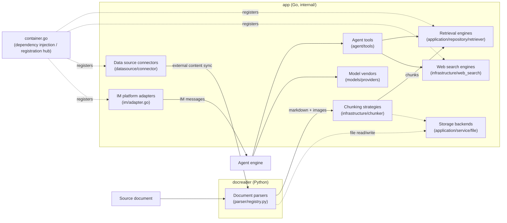

# Extension points

Parsers, chunking strategies, retrieval engines, model vendors, web search engines, data sources, IM adapters, agent tools and storage backends all plug in through interfaces. To add an implementation, implement the interface, wire it in at the registration point, then check the existing call chain. The sections below list the interface, the existing implementations and the steps for each extension type.

## Extension point overview



On the Go side the **registration hub** for most extension points is `internal/container/container.go` (the dependency injection container): retrieval engines in `initRetrieveEngineRegistry()`, web search in `registerWebSearchProviders()`, IM adapters in `registerIMService()`, data source connectors in `initConnectorRegistry()`.

---

## Add a document parser (docreader, Python)

### Interface

The base class is in `docreader/parser/base_parser.py`. Since the lightweight refactor, BaseParser only turns a document into markdown text plus raw image references. Chunking, image storage, OCR and VLM captions all happen on the Go side.

```python
# docreader/parser/base_parser.py
class BaseParser(ABC):
    """Base parser interface."""

    def __init__(self, file_name: str = "", file_type: Optional[str] = None, **kwargs):
        self.file_name = file_name
        self.file_type = file_type or os.path.splitext(file_name)[1].lstrip(".")

    @abstractmethod
    def parse_into_text(self, content: bytes) -> Document:
        """Parse document content into markdown text.

        Returns:
            Document with ``content`` (markdown string) and optional
            ``images`` dict mapping storage-relative paths to base64 data.
        """
```

The return value `Document` (`docreader/models/document.py`, a pydantic model) has two core fields: `content: str` (markdown) and `images: Dict[str, str]` (path → base64).

### Registration

`ParserEngineRegistry` in `docreader/parser/registry.py` manages parsers as a two-level map, engine name → {file extension → parser class}. When the requested engine does not support a file type, the registry falls back first to a per-type default engine (`ppt`, `pptx` and `csv` go to `markitdown`), then to the `builtin` engine. `_build_default_registry()` builds the default registry, held in the module-level singleton `registry = _build_default_registry()`.

```python
# docreader/parser/registry.py (excerpt)
class ParserEngineRegistry:
    def register(self, name: str, file_types: Dict[str, Type[BaseParser]],
                 description: str = "", check_available: Callable | None = None,
                 unavailable_hint: str = ""): ...
    def get_parser_class(self, engine: str, file_type: str) -> Type[BaseParser]: ...
```

### Existing implementations

| Engine | Parser | File |
| --- | --- | --- |
| `builtin` | `Docx2Parser` / `DocParser` / `PDFParser` / `MarkdownParser` / `ExcelParser` / `EPUBParser` / `HTMLParser` / `MHTMLParser` / `XMindParser` / `ImageParser` (jpg, jpeg, png, gif, bmp, tiff, webp); `pptx` and `ppt` map to `MarkitdownParser` | `docreader/parser/docx2_parser.py`, `doc_parser.py`, `pdf_parser.py`, `markdown_parser.py`, `excel_parser.py`, `epub_parser.py`, `html_parser.py`, `mhtml_parser.py`, `xmind_parser.py`, `image_parser.py` |
| `markitdown` | `MarkitdownParser` (Microsoft MarkItDown, many formats including csv) | `docreader/parser/markitdown_parser.py` |
| `opendataloader` | `OpenDataLoaderParser` (PDF layout analysis, needs Java 11+, probed by `check_available`) | `docreader/parser/opendataloader_parser.py` |

### Steps

1. Create `my_parser.py` in `docreader/parser/`, subclass `BaseParser` and implement `parse_into_text(content: bytes) -> Document`.
2. **Registration point: `docreader/parser/registry.py`**. Add to `_build_default_registry()`:

   ```python
   reg.register(
       "my_engine",
       {"myext": MyParser},
       description="My parsing engine",
       check_available=lambda overrides: (True, ""),   # optional: dependency availability probe
       unavailable_hint="Hint shown when a dependency is missing",  # optional
   )
   ```

3. To swap the implementation for an existing extension, you can instead add one line `"ext": MyParser` to the `builtin` map.
4. Add a unittest under `docreader/tests/` (see `test_parser_routing.py`) and run `uv run --project docreader python -m unittest discover -s docreader/tests -p "test_*.py"`.

---

## Add a chunking strategy (internal/infrastructure/chunker)

### Interface

Chunking has no interface. It uses **strategy tiers plus package-level function variables that are overridden**. The public entry points are in `internal/infrastructure/chunker/strategy.go`:

```go
// internal/infrastructure/chunker/strategy.go
// Strategy values for SplitterConfig.Strategy.
const (
    StrategyAuto      = "auto"
    StrategyHeading   = "heading"
    StrategyHeuristic = "heuristic"
    StrategyRecursive = "recursive"
    StrategyLegacy    = "legacy"
)

func Split(text string, cfg SplitterConfig) []Chunk
func SplitWithDiagnostics(text string, cfg SplitterConfig) ([]Chunk, *Diagnostics)
func SplitParentChild(text string, parentCfg, childCfg SplitterConfig) ParentChildResult
```

The config and result types are in `internal/infrastructure/chunker/splitter.go`:

```go
// internal/infrastructure/chunker/splitter.go
type Chunk struct {
    Content       string
    ContextHeader string
    Seq           int
    Start         int
    End           int
}

type SplitterConfig struct {
    ChunkSize    int
    ChunkOverlap int
    Separators   []string
    Strategy     string   // empty = legacy (backward compatible)
    TokenLimit   int      // cap chunk size in approximate tokens, 0 = use ChunkSize characters
    Languages    []string // multilingual heuristic hints, empty = auto-detect
}
```

`runTier()` dispatches by tier. The heading and heuristic implementations override package-level function variables from the `init()` of their own files:

```go
// internal/infrastructure/chunker/strategy.go
func runTier(tier StrategyTier, text string, cfg SplitterConfig, profile *DocProfile) []Chunk {
    switch tier {
    case TierHeading:
        return splitByHeadings(text, cfg, profile)
    case TierHeuristic:
        return splitByHeuristics(text, cfg, profile)
    case TierLegacy:
        return SplitText(text, cfg)
    }
    return SplitText(text, cfg)
}

var splitByHeadings = func(text string, cfg SplitterConfig, _ *DocProfile) []Chunk {
    return SplitText(text, cfg) // overridden by init() in heading_splitter.go
}
var splitByHeuristics = func(text string, cfg SplitterConfig, _ *DocProfile) []Chunk {
    return SplitText(text, cfg) // overridden by init() in heuristic_splitter.go
}
```

### Existing implementations

| Tier | Description | File |
| --- | --- | --- |
| `TierHeading` | Splits by Markdown heading hierarchy | `internal/infrastructure/chunker/heading_splitter.go` (heading stack in `heading_hierarchy.go`) |
| `TierHeuristic` | Multilingual heuristic splitting | `internal/infrastructure/chunker/heuristic_splitter.go` |
| `TierLegacy` (strategy `legacy` or `recursive`) | Recursive separator splitting (the original implementation) | `SplitText()` in `internal/infrastructure/chunker/splitter.go` |
| Validator | `ValidateChunks` checks each tier's output; on failure the chain falls back to the next tier | `internal/infrastructure/chunker/validator.go` |

### Steps

1. Create `my_splitter.go` in `internal/infrastructure/chunker/` and implement `func(text string, cfg SplitterConfig, profile *DocProfile) []Chunk`.
2. **Registration points: `internal/infrastructure/chunker/strategy.go` and `profiler.go`**.
   - Add a strategy constant (for example `StrategyMine = "mine"`) in `strategy.go` and a new `StrategyTier` value next to `TierHeading` in `profiler.go`.
   - In the switch of `resolveChainWithProfile`, return a tier chain for the new strategy (ending in `TierLegacy` as the fallback is recommended).
   - Add a case to `runTier()`.
3. Callers need no changes: the knowledge base's `chunking_config.strategy` (JSONB) reaches the chunker through `buildSplitterConfigFromChunking` in `internal/application/service/knowledge_process.go`.
4. Write unit tests with `SplitWithDiagnostics` that check tier selection and `ValidateChunks` acceptance.

---

## Add a retrieval engine

### Interface

The interfaces are in `internal/types/interfaces/retriever.go`, in three layers (engine → repository → service, plus a registry):

```go
// internal/types/interfaces/retriever.go (excerpt)
type RetrieveEngine interface {
    EngineType() types.RetrieverEngineType
    Retrieve(ctx context.Context, params types.RetrieveParams) ([]*types.RetrieveResult, error)
    Support() []types.RetrieverType // supported retrieval types (vector / keyword)
}

type RetrieveEngineRepository interface {
    Save(ctx context.Context, indexInfo *types.IndexInfo, params map[string]any) error
    BatchSave(ctx context.Context, indexInfoList []*types.IndexInfo, params map[string]any) error
    EstimateStorageSize(ctx context.Context, indexInfoList []*types.IndexInfo, params map[string]any) int64
    DeleteByChunkIDList(ctx context.Context, indexIDList []string, dimension int, knowledgeType string) error
    DeleteBySourceIDList(ctx context.Context, sourceIDList []string, dimension int, knowledgeType string) error
    CopyIndices(ctx context.Context, sourceKnowledgeBaseID string,
        sourceToTargetKBIDMap map[string]string,
        sourceToTargetChunkIDMap map[string]string,
        targetKnowledgeBaseID string, dimension int, knowledgeType string) error
    DeleteByKnowledgeIDList(ctx context.Context, knowledgeIDList []string, dimension int, knowledgeType string) error
    BatchUpdateChunkEnabledStatus(ctx context.Context, chunkStatusMap map[string]bool) error
    BatchUpdateChunkTagID(ctx context.Context, chunkTagMap map[string]string) error
    RetrieveEngine
}

type RetrieveEngineRegistry interface {
    Register(indexService RetrieveEngineService) error
    GetRetrieveEngineService(engineType types.RetrieverEngineType) (RetrieveEngineService, error)
    GetAllRetrieveEngineServices() []RetrieveEngineService
    GetByStoreID(storeID string) (RetrieveEngineService, error)
}
```

The engine type enum is in `internal/types/retriever.go`. `infinity` and `elasticfaiss` are legacy values with no implementation:

```go
// internal/types/retriever.go
const (
    PostgresRetrieverEngineType        RetrieverEngineType = "postgres"
    ElasticsearchRetrieverEngineType   RetrieverEngineType = "elasticsearch"
    InfinityRetrieverEngineType        RetrieverEngineType = "infinity"
    ElasticFaissRetrieverEngineType    RetrieverEngineType = "elasticfaiss"
    QdrantRetrieverEngineType          RetrieverEngineType = "qdrant"
    MilvusRetrieverEngineType          RetrieverEngineType = "milvus"
    WeaviateRetrieverEngineType        RetrieverEngineType = "weaviate"
    DorisRetrieverEngineType           RetrieverEngineType = "doris"
    SQLiteRetrieverEngineType          RetrieverEngineType = "sqlite"
    TencentVectorDBRetrieverEngineType RetrieverEngineType = "tencent_vectordb"
    OpenSearchRetrieverEngineType      RetrieverEngineType = "opensearch"
)
```

### Existing implementations

All under `internal/application/repository/retriever/`: `postgres/` (pgvector + BM25/ParadeDB), `elasticsearch/v7/`, `elasticsearch/v8/`, `qdrant/`, `milvus/`, `weaviate/`, `doris/`, `sqlite/` (sqlite-vec + FTS5), `tencentvectordb/`, `opensearch/`. The `neo4j/` package next to them backs the knowledge graph, not chunk retrieval.

### Steps

1. Add a `RetrieverEngineType` constant in `internal/types/retriever.go`.
2. Create a package `internal/application/repository/retriever/myengine/` that implements `RetrieveEngineRepository` (see `qdrant/` or `sqlite/`).
3. **Registration point: `initRetrieveEngineRegistry()` in `internal/container/container.go`**. Engines register conditionally on the `RETRIEVE_DRIVER` environment variable (comma-separated):

```go
// internal/container/container.go (excerpt)
retrieveDriver := strings.Split(os.Getenv("RETRIEVE_DRIVER"), ",")
if slices.Contains(retrieveDriver, "postgres") {
    postgresRepo := postgresRepo.NewPostgresRetrieveEngineRepository(db)
    if err := registry.Register(
        retriever.NewKVHybridRetrieveEngine(postgresRepo, types.PostgresRetrieverEngineType),
    ); err != nil { ... }
}
```

   Add a branch for the new engine modeled on this one, wrapping the repository with `retriever.NewKVHybridRetrieveEngine(repo, engineType)` before registering it.
4. **Registration point for vector stores configured at runtime: `createEngineServiceFromStore()` in `internal/container/engine_factory.go`**. Add a case for the new engine type so a store saved in the UI can be built on demand.
5. Optional: to reuse existing vectors when a document moves between knowledge bases, also implement `KnowledgeIndexMover` (`MoveKnowledgeIndices`: keeps chunk IDs and vectors, changes only the owning knowledge base, and must be safe to retry). Without it, a move that reuses vectors is rejected and only the re-parse mode is available.
6. If the engine runs as its own service, add a service with a profile to `docker-compose.dev.yml` (see `qdrant` and `opensearch`) and add its connection variables to `.env.example`.

---

## Add a model provider (internal/models/providers)

Model integration has four layers: protocol, vendor, catalog and runtime (overview in [Model management](../03-features/06-models.md#layered-structure)). Most new vendors only need a vendor definition plus catalog entries and reuse an existing protocol.

### Interface

A vendor definition is a struct, not an interface implementation. It lives in `internal/models/providers/definition.go`:

```go
// internal/models/providers/definition.go (excerpt)
type Definition struct {
    ID           string            // stable identifier stored in models.parameters.provider
    Name         string
    Names        map[string]string // localized names keyed by locale
    Website      string
    Icon         []byte            // SVG
    API          api.API           // default chat protocol
    RerankAPI    api.RerankAPI     // defaults to cohere-rerank when not declared
    EmbeddingAPI api.EmbeddingAPI  // defaults to openai-embeddings when not declared
    TranscriptionAPI api.TranscriptionAPI // defaults to openai-transcriptions when not declared
    DefaultBaseURLs  map[types.ModelType]string
    ModelTypes       []types.ModelType
    RequiresAuth     bool
    Auth             AuthStyle          // bearer / api-key / x-api-key / x-goog-api-key / none / signed
    AuthByAPI        map[api.API]AuthStyle // per-protocol auth override
    URLPatterns      []string           // identify the vendor by URL for legacy rows with no provider
    ExtraFields      []ExtraField       // extra fields rendered dynamically by the editor
    CredentialLabels []CredentialLabel  // rename the credential inputs (signed APIs)
    Compat           VendorCompat       // vendor-level compat defaults per protocol
    ThinkingLevels   api.ThinkingLevelMap
    Order            int                // sort order in the vendor list
    // optional hooks
    Endpoint  func(req EndpointRequest) (url string, query map[string]string)
    PreferAPI func(baseURL string, spec models.ModelSpec) api.API
    Signer    func(creds api.Credentials) api.AuthFunc
    Validate  func(cfg *Config) error
}
```

The protocol layer has one minimal interface per capability. A new protocol implements it to plug in:

```go
// internal/models/api/rerank.go
type Reranker interface {
    Rerank(ctx context.Context, query string, documents []string) ([]RerankResult, error)
}

// internal/models/api/embeddings.go
type Embedder interface {
    Embed(ctx context.Context, texts []string, kind EmbedInputType) ([][]float32, error)
}

// internal/models/api/transcriptions.go
type Transcriber interface {
    Transcribe(ctx context.Context, req TranscriptionRequest) (*Transcription, error)
}
```

Chat protocol clients implement the `Chat` interface in `internal/models/chat` (`Chat` / `ChatStream` / `GetModelName` / `GetModelID`).

### Existing implementations

- **Vendors**: 30 files under `internal/models/providers/`, one per vendor (`aliyun.go`, `deepseek.go`, `generic.go`, `weknoracloud.go` and others), listed explicitly by `Builtins()` in `builtin.go`. Icons are in `providers/assets/<id>.svg`.
- **Protocols**: `internal/models/api/<protocol>`. Chat: `openaicompletions`, `openairesponses`, `anthropicmessages`, `googlegenai`. Embedding: `openaiembeddings`, `dashscopeembeddings`, `arkembeddings`, `googleembeddings`. Rerank: `cohererank`, `dashscoperank`, `nimrerank`, `pineconerank`, `teirank`, `tencentlkeap`, `volcengineknowledge`. Speech: `openaitranscriptions`, `openaichataudio`.
- **Model catalog**: `internal/models/catalog/data/seed.json` (model metadata) plus `overrides.json` (protocol, thinking map and compat corrections). A script generates `models.generated.json` from them, which is embedded at build time. The generated file is committed; regenerate it, never edit it by hand.
- **Runtime**: `internal/models/runtime` combines vendor definitions with the catalog (`New()`), applies the deployment overlay `config/models.json`, and resolves the protocol, endpoint and compat settings for each model row.

### Steps

1. **Create the vendor definition**: `internal/models/providers/<id>.go`. Declare the name, supported model types, default base URL per type, auth style, protocol defaults and any special endpoint hooks, and cite the vendor's official documentation in the package comment.
2. **Registration point 1: `internal/models/providers/builtin.go`**. Add `new<Id>Provider()` to `Builtins()` and put the icon in `providers/assets/<id>.svg`.
3. **Registration point 2: the model catalog**. Add an entry for the vendor in `internal/models/catalog/data/seed.json` (an empty list is still required when there are no models yet, because the runtime reads the catalog by vendor ID) and maintain the model metadata there. Protocol, thinking map and compat corrections go in `overrides.json`. A model key includes the type and the id or match, so a chat model and an embedding model with the same name can coexist.
4. **Generate the catalog**: run `make model-catalog-generate`. Do not edit the generated file by hand.
5. **New protocol (optional)**: reuse an existing protocol when it covers the vendor. If a new one is needed, add a package `internal/models/api/<protocol>` and wire it into the protocol branch of the matching factory: chat in `NewRemoteChat` in `internal/models/chat/chat.go`, embedding in `internal/models/embedding/protocol.go`, rerank in `internal/models/rerank/reranker.go`, speech in `internal/models/asr/protocol.go`.
6. **Check**: run `make model-catalog-check`.

`make model-catalog-check` first checks that the generated data is current, then runs every test under `internal/models/...`: the registration and icon checks in `providers`; resolution and overlay in `runtime`; and in the `parity` package, the **invariants** (field validity of every model entry, decodable compat key names, consistent context and max output) and the **per-model outbound request checks** (with thinking on and off, each chat model sends only one output limit field; a model that does not support sampling parameters must not carry temperature; an always-thinking model must not receive an off switch; and so on). A new vendor or model that breaks these rules fails the tests directly, with no extra test cases to write.

The frontend needs no changes: the vendor dropdown, icons, extra fields and model catalog are all rendered from `GET /api/v1/models/providers`. The ready-to-use built-in model rows are declared by the operator in `config/builtin_models.yaml` (template `config/builtin_models.yaml.example`) and are independent of vendor definitions.

### Maintain an existing vendor

**Add or adjust model metadata** (new model ids, context windows, prices): generate the diff report first, update `seed.json` against the vendor's documentation, then regenerate the catalog.

```bash
make model-catalog-diff                 # all vendors
make model-catalog-diff VENDOR=deepseek # one vendor
```

The report compares against the public metadata at [models.dev](https://models.dev/api.json): `+` is a model upstream has and the catalog lacks, `~` is a numeric difference, `?` is an entry upstream does not list (common for regional vendors and aliases, and not an error). The script only reads and never writes, and it is never called at runtime. Behavioral facts such as field names and thinking formats are not synced automatically; maintain them by hand against the vendor's documentation.

**The vendor changed API behavior** (a different output limit field, new effort values, a changed thinking switch format): change `Compat` in `providers/<id>.go`, or the model's `compat` in `overrides.json`, regenerate the catalog, and update the documentation links in the comments. Snapshot tests such as `internal/models/api/openaicompletions/golden_test.go` pin the outbound JSON, so update the test expectations first.

**Emergency fix**: no need to wait for a release. Change it on the deployment side first with the [deployment overlay `config/models.json`](../03-features/06-models.md#deployment-overlay-config-models-json), verify, then port the change back into the code.

---

## Add a web search engine (internal/infrastructure/web_search)

### Interface

```go
// internal/types/interfaces/web_search.go
type WebSearchProvider interface {
    // Name returns the name of the provider
    Name() string
    // Search performs a web search
    Search(ctx context.Context, query string, maxResults int, includeDate bool) ([]*types.WebSearchResult, error)
}
```

The registry is a factory map that instantiates providers on demand with workspace parameters:

```go
// internal/infrastructure/web_search/registry.go
type ProviderFactory func(params types.WebSearchProviderParameters) (interfaces.WebSearchProvider, error)

type Registry struct {
    factories map[string]ProviderFactory
    mu        sync.RWMutex
}

func (r *Registry) Register(id string, factory ProviderFactory)
func (r *Registry) CreateProvider(providerType string, params types.WebSearchProviderParameters) (interfaces.WebSearchProvider, error)
```

An engine that supports region and freshness filters can also implement the optional interface `FilteredWebSearchProvider` (`SearchWithFilters`). An engine without filter support must not silently drop filters the caller asked for.

### Existing implementations

In `internal/infrastructure/web_search/`: `duckduckgo.go`, `google.go`, `bing.go`, `brave.go`, `tavily.go`, `ollama.go`, `baidu.go`, `searxng.go`, `keenable.go`, `zhipu.go`, `exa.go`, `metaso.go`, `bocha.go`, `serply.go` (plus `proxy.go` for outbound proxy support). The type constants are in `internal/types/web_search_provider.go` (`WebSearchProviderTypeXxx`, one per registered ID).

### Steps

1. Add a `WebSearchProviderType` constant in `internal/types/web_search_provider.go`.
2. Create `mysearch.go` in `internal/infrastructure/web_search/`, implement `WebSearchProvider` and expose the factory `func NewMySearchProvider(params types.WebSearchProviderParameters) (interfaces.WebSearchProvider, error)`.
3. **Registration point: `registerWebSearchProviders()` in `internal/container/container.go`**:

   ```go
   func registerWebSearchProviders(registry *infra_web_search.Registry) {
       registry.Register("duckduckgo", infra_web_search.NewDuckDuckGoProvider)
       registry.Register("google", infra_web_search.NewGoogleProvider)
       // ... add yours here:
       registry.Register("mysearch", infra_web_search.NewMySearchProvider)
   }
   ```

4. If the frontend provider dropdown and parameter form should show the new engine, update the matching settings page component in `frontend/`. Workspace configuration is persisted in the `web_search_providers` table.

---

## Add a data source connector (internal/datasource/connector)

> The directory includes an implementation guide, `internal/datasource/CONNECTOR_IMPLEMENTATION_GUIDE.md`, to read alongside this section.

### Interface

```go
// internal/datasource/connector.go
type Connector interface {
    // Type returns the connector type identifier (e.g., "feishu", "notion")
    Type() string

    // Validate verifies that the provided configuration is valid by testing
    // connectivity and checking credentials.
    Validate(ctx context.Context, config *types.DataSourceConfig) error

    // ListResources lists available resources that can be synced.
    // parentID lazy-loads hierarchical resources: "" returns the top level, a non-empty value returns that resource's direct children.
    ListResources(ctx context.Context, config *types.DataSourceConfig, parentID string) ([]types.Resource, error)

    // ResolveResourceAncestors resolves the ancestor chain of existing selections in a lazy-loaded tree (O(depth)).
    ResolveResourceAncestors(
        ctx context.Context, config *types.DataSourceConfig, resourceIDs []string,
    ) ([]string, error)

    // FetchAll performs a full sync of the specified resources.
    FetchAll(ctx context.Context, config *types.DataSourceConfig, resourceIDs []string) ([]types.FetchedItem, error)

    // FetchIncremental performs an incremental sync based on the provided cursor.
    FetchIncremental(ctx context.Context, config *types.DataSourceConfig, cursor *types.SyncCursor) ([]types.FetchedItem, *types.SyncCursor, error)
}
```

The optional streaming interface (page-level checkpoints for large data sets, only one item held in memory at a time):

```go
// internal/datasource/connector.go
type StreamHandler interface {
    Emit(ctx context.Context, item types.FetchedItem) error
    Checkpoint(ctx context.Context, cursor *types.SyncCursor) error
}

type StreamingConnector interface {
    Connector
    FetchStream(ctx context.Context, config *types.DataSourceConfig,
        cursor *types.SyncCursor, h StreamHandler) (*types.SyncCursor, error)
}
```

Two more optional interfaces keep deletion reconciliation working during a full sync: `FullStreamingConnector` (`FetchFullStream`) and `FullSyncWithCursor` (`FetchAllFromCursor`). On a forced full sync or `sync_mode=full` they re-fetch every item while keeping the previous cursor to detect deleted documents. Without them, a full sync cannot produce delete events.

The registry is in the same file: `ConnectorRegistry` (`NewConnectorRegistry()` / `Register(connector)` / `Get(type)` / `List()`). The connector UI metadata (name, AuthType, capabilities) is in the `ConnectorMetadataRegistry` map in the same file.

### Existing implementations

| Type | Directory | Description |
| --- | --- | --- |
| `feishu` / `lark` | `internal/datasource/connector/feishu/wiki/` | Feishu / Lark wiki, one implementation split by region |
| `feishu_drive` / `lark_drive` | `internal/datasource/connector/feishu/drive/` | Feishu / Lark drive |
| `notion` | `internal/datasource/connector/notion/` | Pages and databases |
| `confluence` | `internal/datasource/connector/confluence/` | Confluence |
| `yuque` | `internal/datasource/connector/yuque/` | Yuque |
| `dingtalk` | `internal/datasource/connector/dingtalk/` | DingTalk Docs |
| `ima` | `internal/datasource/connector/ima/` | Tencent IMA knowledge bases |
| `rss` | `internal/datasource/connector/rss/` | RSS feeds |
| `gitlab` | `internal/datasource/connector/gitlab/` | GitLab repositories |
| `github` | `internal/datasource/connector/github/` | GitHub repositories |
| `seafile` | `internal/datasource/connector/seafile/` | Library directories and files |

`internal/types/datasource.go` also has type constants with no registered implementation yet, such as `google_drive`, `onedrive`, `web_crawler`, `slack` and `imap`.

### Steps

1. Create a package `internal/datasource/connector/mysource/` that implements `Connector` (for large data sets also implement `StreamingConnector`) and provides `NewConnector()`.
2. **Registration point 1: `initConnectorRegistry()` in `internal/container/container.go`**:

   ```go
   if err := registry.Register(mysourceConnector.NewConnector()); err != nil {
       errs = errors.Join(errs, fmt.Errorf("register mysource connector: %w", err))
   }
   ```

3. **Registration point 2: `ConnectorMetadataRegistry` in `internal/datasource/connector.go`**. Add a type constant (`ConnectorTypeXxx` in `internal/types`) and a metadata entry (Name/Description/AuthType/Capabilities).
4. Update the configuration structure: if `types.DataSourceConfig` needs new credential fields, follow the encrypted-storage convention. The frontend data source page renders from the metadata.
5. Reuse the shared helpers in `internal/datasource`: run user-supplied API addresses through `ValidateConnectorBaseURL` for SSRF checks first, send HTTP requests with `NewConnectorHTTPClient` (SSRF protection on redirects and at dial time), and build file names with `SanitizeFileName`.

---

## Add an IM platform adapter (internal/im)

### Interface

```go
// internal/im/adapter.go
type Platform string // "wecom" / "feishu" / "lark" / "slack" / "telegram" / "dingtalk" /
                     // "mattermost" / "wechat" / "qqbot" / "yunzhijia"

// Adapter is the interface every IM platform must implement.
type Adapter interface {
    // Platform returns the platform identifier.
    Platform() Platform

    // VerifyCallback verifies the signature/token of an incoming callback request.
    VerifyCallback(c *gin.Context) error

    // ParseCallback parses the raw IM callback request into a unified IncomingMessage.
    // Returns nil message for non-message events (e.g., URL verification).
    ParseCallback(c *gin.Context) (*IncomingMessage, error)

    // SendReply sends a reply back to the IM platform.
    SendReply(ctx context.Context, incoming *IncomingMessage, reply *ReplyMessage) error

    // HandleURLVerification handles the initial URL verification challenge.
    HandleURLVerification(c *gin.Context) bool
}
```

Three optional capability interfaces:

```go
// internal/im/adapter.go
// StreamSender: when implemented, the IM service pushes streaming answers in real time (for example Feishu streaming cards, Telegram message edits)
type StreamSender interface {
    StartStream(ctx context.Context, incoming *IncomingMessage) (string, error)
    UpdateStreamContent(ctx context.Context, incoming *IncomingMessage, streamID string, fullContent string) error
    FinalizeStream(ctx context.Context, incoming *IncomingMessage, streamID string, finalContent string) error
    EndStream(ctx context.Context, incoming *IncomingMessage, streamID string) error
}

// FullOutputProgressSender: in full output mode, show a placeholder and replace it once with the completed answer
type FullOutputProgressSender interface {
    StreamSender
    SupportsFullOutputProgress() bool
}

// FileDownloader: when implemented, file and image messages are passed to QA as attachments,
// and a channel with a knowledge_base_id also saves them to the knowledge base
type FileDownloader interface {
    DownloadFile(ctx context.Context, msg *IncomingMessage) (io.ReadCloser, string, error)
}
```

A factory instantiates the adapter per channel (`internal/im/service.go`):

```go
// internal/im/service.go
type AdapterFactory func(ctx context.Context, channel *IMChannel,
    msgHandler func(ctx context.Context, msg *IncomingMessage) error,
) (Adapter, context.CancelFunc, error)

func (s *Service) RegisterAdapterFactory(platform string, factory AdapterFactory)
```

### Existing implementations

One subpackage per platform under `internal/im/`: `wecom/`, `feishu/` (Lark reuses it via `feishu.NewFactory(feishu.RegionLark)`), `slack/`, `telegram/`, `dingtalk/`, `mattermost/`, `wechat/`, `qqbot/`, `yunzhijia/`.

### Steps

1. Add a `Platform` constant in `internal/im/adapter.go`.
2. Create `internal/im/myplatform/` and implement `Adapter` (plus `StreamSender` / `FileDownloader` as needed) and `NewFactory() im.AdapterFactory`.
3. **Registration point: `registerIMService()` in `internal/container/container.go`**:

   ```go
   func registerIMService(imService *imPkg.Service, cleaner interfaces.ResourceCleaner) {
       imService.RegisterAdapterFactory("wecom", wecom.NewFactory())
       // ... add yours here:
       imService.RegisterAdapterFactory("myplatform", myplatform.NewFactory())
       if err := imService.LoadAndStartChannels(); err != nil { ... }
       ...
   }
   ```

4. Channel configuration is persisted in the `im_channels` table and session mappings in `im_channel_sessions`. The frontend channel management page needs a configuration form for the new platform.

---

## Add an agent tool (internal/agent/tools)

### Interface

The tool interface is defined in `internal/types/agent.go`:

```go
// internal/types/agent.go
type Tool interface {
    // Name returns the unique identifier for this tool
    Name() string

    // Description returns a human-readable description of what the tool does
    Description() string

    // Parameters returns the JSON Schema for the tool's parameters
    Parameters() json.RawMessage

    // Execute runs the tool with the given arguments
    Execute(ctx context.Context, args json.RawMessage) (*ToolResult, error)
}
```

The runtime registry is in `internal/agent/tools/registry.go`:

```go
// internal/agent/tools/registry.go (excerpt)
type ToolRegistry struct {
    tools             map[string]types.Tool
    deferred          map[string]bool
    maxToolOutputSize int
    ...
}

// RegisterTool adds a tool to the registry.
// Duplicate names are first-wins, which prevents hijacking by name collision (GHSA-67q9-58vj-32qx).
func (r *ToolRegistry) RegisterTool(tool types.Tool)
func (r *ToolRegistry) RegisterDeferredTool(tool types.Tool)
func (r *ToolRegistry) GetTool(name string) (types.Tool, error)
func (r *ToolRegistry) ListTools() []string
```

### Existing implementations

The tool name constants are collected in `internal/agent/tools/definitions.go`: `thinking`, `todo_write`, the knowledge retrieval tools (`search_knowledge`, `read_document`, `list_documents`, `query_knowledge_graph`), `database_query`, `data_analysis`, `data_schema`, `web_search`, `web_fetch`, the on-demand MCP tools (`discover_mcp_tools`, `call_mcp_tool`), the sandbox and skill tools (`shell_exec`, `read_file`, `list_sandbox_files`, `write_sandbox_file`, `edit_sandbox_file`, `write_skill_file`, `edit_skill_file`), the memory tools (`search_memory`, `search_conversations`) and the wiki tools (`wiki_read_page`, `wiki_write_page`, `wiki_replace_text`, `wiki_rename_page`, `wiki_delete_page`, `wiki_search`, `wiki_flag_issue`, `wiki_read_issue`, `wiki_update_issue`). The Local Browser tool `local_browser` is implemented in `browserskill*.go`. Implementation files mostly share the tool's name (for example `search_knowledge.go`, `read_document.go`, `list_documents.go`, `data_analysis.go`); `mcp_tool.go` and `mcp_catalog.go` discover and call the remote tools of MCP services on demand.

Retired sandbox tool names (`execute_skill_script`, `read_skill`, `read_sandbox_file`) are kept only to decode history and are no longer registered. Retired retrieval tool names (`knowledge_search`, `grep_chunks`, `list_knowledge_chunks`, `get_document_info`, `wiki_read_source_doc`) remain as `LegacyTool*` constants: `legacyToolSuccessors` maps them to `search_knowledge` or `read_document`, `NormalizeAllowedTools` rewrites old names in saved agent configurations when tools are registered, and `SuccessorToolName` / `IsLegacyRetrievalTool` let other services check them. Use this mechanism when you rename or merge tools instead of migrating data.

### Steps

1. Create `my_tool.go` in `internal/agent/tools/` and implement the four `types.Tool` methods (`Parameters()` returns a JSON Schema; mind the OpenAI limit of 64 characters for tool names, `maxFunctionNameLength` in `definitions.go`).
2. **Registration point 1: `internal/agent/tools/definitions.go`**. Add a constant `ToolMyTool = "my_tool"` and add the tool to `AvailableToolDefinitions()` (the selectable tool list in the UI; its comment requires keeping it in sync with the registered tools).
3. **Registration point 2: `registerTools()` in `internal/application/service/agent_service.go`**. This is where the agent session builds its `ToolRegistry`, instantiating the tools in the agent's allowed tool list and calling `RegisterTool`. Add the new tool's constructor there. A tool that holds resources implements `Cleanup` (`types.Cleanable`).
4. If the tool needs a knowledge base with a given capability, add its requirement to `ToolCapabilityRequirements` in `internal/agent/tools/capabilities.go` and keep `frontend/src/utils/tool-capabilities.ts` aligned. Tools absent from that map have no requirement.
5. For tools with large output, mind how `ToolRegistry` truncates at `maxToolOutputSize`. Write a `_test.go` for the tool (the same directory has many references, such as `search_knowledge_test.go` and `scope_authorization_test.go`).

---

## Add a storage backend (object storage)

### Interface

The file service interface is in `internal/types/interfaces/file.go`:

```go
// internal/types/interfaces/file.go
type FileService interface {
    CheckConnectivity(ctx context.Context) error
    SaveFile(ctx context.Context, file *multipart.FileHeader, tenantID uint64, knowledgeID string) (string, error)
    SaveBytes(ctx context.Context, data []byte, tenantID uint64, fileName string, temp bool) (string, error)
    GetFile(ctx context.Context, filePath string) (io.ReadCloser, error)
    GetFileURL(ctx context.Context, filePath string) (string, error)
    DeleteFile(ctx context.Context, filePath string) error
    CopyFile(ctx context.Context, srcPath string, tenantID uint64, knowledgeID string) (string, error)
}
```

Multi-backend resolution (workspace-level `storage_backends` table rows → FileService instances) goes through `internal/types/interfaces/storagebackend.go`:

```go
// internal/types/interfaces/storagebackend.go
type StorageBackendService interface {
    Create(ctx context.Context, backend *types.StorageBackend) error
    Update(ctx context.Context, backend *types.StorageBackend) error
    Delete(ctx context.Context, tenantID uint64, id string) error
    SetDefault(ctx context.Context, tenantID uint64, id string) error
    Test(ctx context.Context, backend *types.StorageBackend) error
}

type StorageBackendResolver interface {
    ResolveFileService(ctx context.Context, tenant *types.Tenant, backendID, provider, localBaseDir string) (FileService, string, error)
    ResolveBackend(ctx context.Context, tenant *types.Tenant, backendID, provider string) (*types.StorageBackend, error)
}
```

### Existing implementations

All in `internal/application/service/file/`:

| provider | File | Description |
| --- | --- | --- |
| `local` | `local.go` | Local file system |
| `minio` | `minio.go` | MinIO / S3-compatible |
| `cos` | `cos.go` | Tencent Cloud COS |
| `tos` | `tos.go` | Volcengine TOS |
| `s3` | `s3.go` | AWS S3 and compatible services |
| `obs` | `obs.go` | Huawei Cloud OBS |
| `oss` | `oss.go` | Alibaba Cloud OSS |
| `ks3` | `ks3.go` | Kingsoft Cloud KS3 |

### Steps

1. Create `mystore.go` in `internal/application/service/file/` and implement every `FileService` method (`CheckConnectivity` backs the frontend "Test connection" button, that is `StorageBackendService.Test`).
2. **Registration point: `NewFileServiceFromStorageConfig()` in `internal/application/service/file/factory.go`**. Add a case to the provider switch:

   ```go
   switch p {
   case "local":  // NewLocalFileService(...)
   case "minio":  // NewMinioFileService(...)
   // ... add yours here:
   case "mystore":
       return NewMyStoreFileService(cfg), p, nil
   default:
       return nil, p, fmt.Errorf("unsupported provider %q", p)
   }
   ```

3. If the backend should also be selectable as the process-wide default through the `STORAGE_TYPE` environment variable, add a case to `initRawFileService()` in `internal/container/container.go`, which reads its settings from environment variables.
4. If the new provider needs new configuration fields (endpoint, bucket, region and so on), extend `StorageEngineConfig` (`internal/types/tenant.go`) and `StorageBackendConfig` (`internal/types/storagebackend.go`, stored in the JSON column `storage_backends.config`).
5. Add form fields for the provider to the frontend storage backend page. Workspace configuration lives in the `storage_backends` table (its `provider` column is the switch key).

---

## Appendix: extension point quick reference

| Extension point | Core interface | Interface file | Registration point |
| --- | --- | --- | --- |
| Document parser | `BaseParser.parse_into_text` | `docreader/parser/base_parser.py` | `_build_default_registry()` in `docreader/parser/registry.py` |
| Chunking strategy | tier function `func(text, cfg, profile) []Chunk` | `internal/infrastructure/chunker/strategy.go` | `runTier()` and `resolveChainWithProfile()` in the same file, plus strategy and tier constants |
| Retrieval engine | `RetrieveEngineRepository` | `internal/types/interfaces/retriever.go` | `initRetrieveEngineRegistry()` in `container.go` (gated by `RETRIEVE_DRIVER`) + `createEngineServiceFromStore()` in `engine_factory.go` |
| Model vendor | `providers.Definition` (+ protocol layer `Reranker` / `Embedder` / `Transcriber`, `chat.Chat`) | `internal/models/providers/definition.go` | `Builtins()` in `internal/models/providers/builtin.go` + `internal/models/catalog/data/seed.json` |
| Web search | `WebSearchProvider` | `internal/types/interfaces/web_search.go` | `registerWebSearchProviders()` in `container.go` |
| Data source connector | `Connector` / `StreamingConnector` | `internal/datasource/connector.go` | `initConnectorRegistry()` in `container.go` + `ConnectorMetadataRegistry` |
| IM adapter | `Adapter` (+ `StreamSender` / `FullOutputProgressSender` / `FileDownloader`) | `internal/im/adapter.go` | `registerIMService()` in `container.go` |
| Agent tool | `types.Tool` | `internal/types/agent.go` | `internal/agent/tools/definitions.go` + `registerTools()` in `agent_service.go` (`ToolRegistry.RegisterTool`) |
| Storage backend | `FileService` | `internal/types/interfaces/file.go` | switch in `internal/application/service/file/factory.go` |
